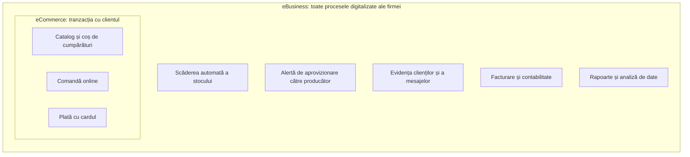
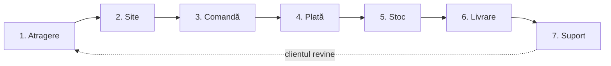

# Capitolul 1. eBusiness și economia digitală: concepte de bază

## Ce vei putea face după acest capitol

- Să explici, în cuvintele tale, ce înseamnă transformare digitală, economie digitală și eBusiness, cu câte un exemplu pentru fiecare.
- Să clasifici corect un proces al unei firme: este eCommerce, este eBusiness fără să fie eCommerce sau nu este digital deloc.
- Să descrii traseul unei comenzi online, de la prima vizită până la suportul de după livrare, și să spui ce date lasă în urmă fiecare etapă.
- Să recunoști sistemele din spatele unui magazin online (platforma de magazin, procesatorul de plăți, CRM, ERP, SCM) și să spui cum arată ele într-o firmă mică față de una mare.
- Să evaluezi nivelul de maturitate digitală al unei firme mici cu ajutorul unei liste de autoevaluare și să alegi următorul pas realist.
- Să identifici principalele obligații legale ale celui care vinde online în România (protecția datelor, dreptul de retragere, e-Factura) și să știi unde verifici forma lor actuală.

## 1.1 De ce începem cu o cămară

Suportul acesta de curs are un fir roșu: un magazin online fictiv din Galați, numit „Cămara de la Dunăre”. Magazinul vinde dulcețuri, zacuscă, miere și siropuri de la producători locali. Nu există în realitate. L-am construit pentru exercițiu, iar toate cifrele despre el sunt date fictive, construite pentru exercițiu. Îl vei întâlni în fiecare capitol, pentru că aceeași firmă, privită din unghiuri diferite, te ajută să legi conceptele între ele.

Iată povestea pe scurt. Avem 12 săptămâni de date: câte patru în septembrie, octombrie și noiembrie. Clienții ajung pe site pe patru canale: Căutare (Google, neplătit), Reclame (plătite, pe rețele sociale), Email și Direct (cei care tastează adresa sau o au salvată). Fiecare comandă este atribuită canalului de pe care a venit ultimul clic.

| Indicator (date fictive, construite pentru exercițiu) | Septembrie | Noiembrie | Variație |
|---|---|---|---|
| Vizite pe site | 18.860 | 32.140 | +70% |
| Comenzi | 553 | 796 | +44% |
| Venit (lei) | 85.400 | 109.125 | +28% |
| Rezultat simplificat (lei) | 18.088 | 6.758 | -63% |

Citește tabelul de sus în jos. Vizitele cresc, comenzile cresc, venitul crește. Dacă te-ai opri aici, ai spune că toamna a fost excelentă. Ultimul rând spune altceva: banii rămași după ce scazi costurile s-au redus cu aproape două treimi.

Cauza este o decizie de marketing. Bugetul lunar de Reclame a crescut de la 2.400 lei la 16.800 lei, iar reclamele au promovat un cod de reducere de 20%. Pe canalul Reclame, valoarea medie a comenzii a scăzut de la 150 lei la 105 lei, marja brută a coborât de la 45% la 31%, iar contribuția pe comandă a trecut de la +16 lei la -40 lei. Altfel spus, fiecare comandă adusă de reclame în noiembrie a costat firma, în medie, 40 de lei. Mai multe comenzi au însemnat mai puțini bani.

Nu trebuie să înțelegi acum toți termenii. Marja, contribuția și economia unei comenzi se explică pe larg în capitolul 5. Reține doar ideea care justifică întregul curs: o firmă care vinde online produce date la fiecare pas, iar datele acestea pot arăta lucruri pe care intuiția nu le vede. Proprietarul „simțea” că afacerea merge bine, pentru că telefonul suna, coletele plecau și contul se umplea. Datele, citite corect, arătau o problemă.

Capitolul 1 pune fundația. Înainte să măsori și să desenezi grafice, trebuie să știi ce măsori: ce este un eBusiness, din ce procese este făcut, ce sisteme îl țin în funcțiune și ce reguli trebuie să respecte.

> **De reținut.** Toate cifrele despre „Cămara de la Dunăre” sunt fictive. Rolul lor este să îți dea un teren de antrenament pe care poți greși fără costuri. Cifrele despre lumea reală din acest capitol au sursa indicată imediat după ele.

## 1.2 Transformarea digitală și economia digitală, pe înțeles

### 1.2.1 Trei cuvinte care se confundă

În limbajul de zi cu zi, „digitalizare” acoperă aproape orice. Ca să gândești limpede, desparte trei lucruri.

**Digitizarea** înseamnă să muți o informație de pe hârtie într-un fișier. Scanezi o factură. Treci lista de prețuri din caiet într-un tabel. Informația este aceeași, doar suportul s-a schimbat.

**Digitalizarea** înseamnă să faci un proces cu ajutorul tehnologiei. Nu mai scrii factura de mână și apoi o scanezi, ci o emiți direct dintr-un program de facturare, care o numerotează, calculează taxa pe valoarea adăugată (TVA) și o trimite clientului pe email. Procesul exista și înainte, dar acum rulează altfel: mai repede, cu mai puține greșeli, cu date care rămân.

**Transformarea digitală** înseamnă să schimbi felul în care firma funcționează și câștigă bani, pentru că tehnologia face posibile lucruri care înainte nu erau. Un producător de dulcețuri care vindea doar la târguri își deschide un magazin online, ajunge la clienți din toată țara, află ce produse se cumpără împreună și își planifică producția după comenzile din anul trecut. Aici nu s-a schimbat un singur proces. S-a schimbat modelul de lucru.

Westerman, Bonnet și McAfee, în cartea „Leading Digital” (2014), descriu transformarea digitală ca pe o schimbare a modului în care organizațiile operează, creează valoare și se raportează la clienți și parteneri. Ideea lor centrală, parafrazată: tehnologia singură nu transformă nimic. Contează ce schimbă firma în procese și în decizii odată ce are tehnologia.

> **Exemplu.** La „Cămara de la Dunăre” (firmă fictivă), cele trei trepte ar arăta așa. Digitizare: fișele producătorilor, ținute într-un dosar, sunt trecute într-un tabel. Digitalizare: comenzile nu se mai preiau la telefon, ci prin site, care trimite singur confirmarea. Transformare digitală: firma descoperă din date că mierea de salcâm se cumpără des împreună cu siropul de soc, creează un pachet, îl promovează prin email clienților care au cumpărat doar unul dintre produse și negociază cu producătorii cantități pe baza cererii estimate.

> **Greșeală frecventă.** „Avem pagină de Facebook, deci suntem digitalizați.” O pagină pe o rețea socială este un canal de comunicare. Dacă mesajele primite acolo sunt copiate de mână într-un caiet, iar stocul se numără o dată pe lună, firma are o vitrină digitală și un interior analogic.

### 1.2.2 Ce este economia digitală

Economia digitală este partea din economie în care valoarea se creează, se vinde sau se livrează cu ajutorul tehnologiilor digitale și al internetului. Definiția este largă cu intenție, pentru că fenomenul este larg. Ca să o faci concretă, gândește-te la trei cercuri.

1. **Miezul:** firmele care produc tehnologia. Telecomunicații, software, centre de date, echipamente.
2. **Firmele născute digital:** afaceri care nu ar putea exista fără internet. Un magazin exclusiv online, o platformă de anunțuri, un serviciu de streaming.
3. **Firmele tradiționale care folosesc digitalul:** brutăria care primește comenzi pe site, service-ul auto cu programări online, cabinetul de contabilitate care lucrează în cloud.

Al treilea cerc este cel mai mare și cel mai interesant pentru tine. Cele mai multe firme din România nu sunt firme de tehnologie. Sunt firme obișnuite, pentru care digitalul este un mijloc.

Ce are economia digitală diferit față de comerțul clasic? Patru trăsături, fiecare cu o consecință practică.

| Trăsătură | Ce înseamnă | Consecința pentru o firmă mică |
|---|---|---|
| Distanța contează mai puțin | Un magazin din Galați poate vinde în Cluj sau în altă țară din Uniunea Europeană (UE) | Piața este mai mare, dar și concurența vine de peste tot |
| Fiecare pas lasă date | Vizite, clicuri, comenzi, plăți și retururi sunt înregistrate automat | Poți măsura ce funcționează, dacă știi unde să te uiți |
| Costul unei copii este aproape zero | O pagină de produs poate fi văzută de 10 sau de 10.000 de oameni fără cost suplimentar semnificativ | Merită să investești în conținut bun, făcut o singură dată |
| Intermediarii se schimbă | Dispar unii (agentul, angrosistul), apar alții (platforme de anunțuri, marketplace-uri, curieri, procesatori de plăți) | Depinzi de parteneri digitali, cu comisioane și reguli proprii |

Ultimul rând merită atenție. Internetul nu a eliminat intermediarii, i-a înlocuit. Un mic producător care vinde printr-un marketplace (o platformă care găzduiește ofertele mai multor vânzători) nu mai plătește chirie pentru un spațiu, dar plătește comision și respectă regulile platformei. Modelele de afaceri și sursele de venit se discută în capitolul 2.

## 1.3 De ce contează pentru o firmă mică din România

Cifrele de mai jos vin din statisticile oficiale europene. Le folosim ca să răspundem la două întrebări: câți clienți cumpără online și câte firme vând online.

### 1.3.1 Clienții sunt deja online

În 2025, 73,6% dintre persoanele de 16-74 de ani din UE au cumpărat ceva online în ultimele 12 luni. În România, proporția a fost de 60,3%, în creștere de la 56,1% în 2024 (Eurostat, setul de date „Internet purchases by individuals”, cod isoc_ec_ib20, date 2025, https://ec.europa.eu/eurostat/databrowser/view/isoc_ec_ib20/default/table?lang=en).

Dacă îi numărăm doar pe cei care folosesc internetul, 78% dintre utilizatorii de internet din UE au cumpărat online în 2025, față de 62% în 2015. România este printre țările cu cea mai mare creștere din deceniu, cu 46 de puncte procentuale în plus față de 2015, dar rămâne cu una dintre cele mai mari diferențe între câți oameni folosesc internetul și câți cumpără online: 31 de puncte procentuale (Eurostat, „E-commerce statistics for individuals”, date extrase în februarie 2026, https://ec.europa.eu/eurostat/statistics-explained/index.php?title=E-commerce_statistics_for_individuals).

Ce înseamnă asta pentru cineva care vrea să vândă? Că aproximativ șase din zece adulți din România au făcut deja cel puțin o comandă online într-un an. Clientul pentru zacuscă artizanală nu trebuie convins că se poate cumpăra de pe internet. Trebuie convins să cumpere de la tine.

### 1.3.2 Firmele vin din urmă

Partea de ofertă arată diferit. În 2024, 23,6% dintre firmele din UE au avut vânzări electronice (e-sales), față de 18,9% în 2014. România a avut 14,6%, cea mai mică valoare din UE, alături de Luxemburg (14,7%). Mărimea firmei contează mult: au vândut electronic 48,5% dintre firmele mari (de la 250 de angajați în sus), 31,7% dintre cele mijlocii (50-249) și 21,4% dintre cele mici (10-49). Vânzările electronice au adus 19,5% din cifra de afaceri totală a firmelor din UE, dar numai 8,7% din cea a firmelor mici (Eurostat, „E-commerce statistics”, anul de referință 2024, date extrase în februarie 2026, https://ec.europa.eu/eurostat/statistics-explained/index.php?title=E-commerce_statistics).

Două precizări te ajută să citești corect aceste cifre.

Prima: „vânzări electronice” înseamnă aici două lucruri diferite. Unul sunt vânzările prin web (site, aplicație, marketplace). Celălalt sunt vânzările prin schimb electronic de date (EDI, Electronic Data Interchange), adică mesaje standardizate trimise direct între sistemele informatice ale firmelor, folosite mai ales între companii mari. Firmele mici vând aproape numai prin web: 91,2% dintre firmele mici cu vânzări electronice au avut vânzări web. Dintre firmele din UE cu vânzări web, 85,7% au vândut prin site-ul sau aplicația proprie și 45% au folosit un marketplace (aceeași sursă Eurostat).

A doua: clasele de mărime din aceste statistici pornesc de la 10 angajați. Microîntreprinderile (sub 10 angajați), adică exact tipul de firmă din care face parte „Cămara de la Dunăre”, nu se regăsesc în procentele de mai sus. Imaginea pentru cei mai mici vânzători este deci incompletă.

### 1.3.3 Cât de digitalizate sunt firmele mici

UE urmărește un indicator numit intensitate digitală (Digital Intensity Index). Eurostat îl calculează pornind de la tehnologiile digitale pe care le folosește o firmă. Ținta europeană pentru 2030 este ca peste 90% dintre întreprinderile mici și mijlocii (IMM; în engleză SME, small and medium-sized enterprises) să atingă cel puțin nivelul de bază.

În 2025, 71% dintre IMM-urile din UE aveau cel puțin un nivel de bază de intensitate digitală. În România, proporția era de 44%, a doua cea mai mică din UE după Bulgaria (38%). La folosirea inteligenței artificiale (AI, artificial intelligence), 20% dintre firmele din UE declarau că o folosesc în 2025, iar România avea cea mai mică valoare, 5% (Eurostat, „Digitalisation in Europe, 2026 edition”, https://ec.europa.eu/eurostat/web/interactive-publications/digitalisation-2026).

| Indicator | UE | România | An | Sursă |
|---|---|---|---|---|
| Persoane (16-74 ani) care au cumpărat online în ultimele 12 luni | 73,6% | 60,3% | 2025 | Eurostat, isoc_ec_ib20 |
| Firme (10+ angajați) cu vânzări electronice | 23,6% | 14,6% | 2024 | Eurostat, E-commerce statistics |
| IMM-uri cu cel puțin nivel de bază de intensitate digitală | 71% | 44% | 2025 | Eurostat, Digitalisation in Europe 2026 |
| Firme care folosesc AI | 20% | 5% | 2025 | Eurostat, Digitalisation in Europe 2026 |

### 1.3.4 Cum citești aceste cifre ca antreprenor

Pune rândurile unul lângă altul. Cumpărătorii români sunt cu vreo 13 puncte procentuale sub media europeană. Firmele românești care vând online sunt cu 9 puncte sub medie, pornind de la o bază mult mai mică. Raportat la medie, decalajul firmelor este mai mare decât al cumpărătorilor.

De aici ies două concluzii opuse, ambele adevărate.

- **Oportunitate.** Într-o piață în care puține firme vând online, un magazin corect făcut iese în evidență mai ușor decât într-o piață matură. Mai ales pe nișe locale, cum sunt produsele de la producători mici.
- **Presiune.** Clientul român care cumpără online nu compară magazinul tău doar cu alte firme mici din România. Îl compară cu cei mai buni vânzători pe care i-a folosit, inclusiv marketplace-uri mari și magazine din alte țări. Așteptările lui la livrare, retur și răspuns la mesaje sunt setate de aceștia.

> **Pentru afacerea ta.** Statisticile îți spun cum arată piața în medie, nu cum arată clienții tăi. Notează trei întrebări la care poți răspunde din datele proprii în 30 de minute: câte comenzi ai primit luna trecută, pe ce canal au venit și câte au fost de la clienți care au mai cumpărat. Dacă nu poți răspunde la niciuna, acesta este primul tău proiect de digitalizare.

## 1.4 Ce este eBusiness

### 1.4.1 Definiția, în două variante

Varianta de manual: eBusiness (electronic business, afaceri electronice) înseamnă integrarea tehnologiilor informației și comunicațiilor (TIC; în engleză ICT, information and communication technologies) în procesele unei organizații, cu scopul de a crea, livra și capta valoare. Aceasta este definiția din prezentarea de curs, atribuită acolo lui Turban și colegilor săi („Electronic Commerce 2018”). Tot prezentarea reține de la Laudon și Traver („E-commerce: Business, Technology, Society”) un accent apropiat: folosirea tehnologiilor digitale și a internetului pentru a executa principalele procese de afaceri ale unei firme.

Varianta pe înțeles: o firmă face eBusiness atunci când treburile ei importante, nu doar vânzarea, se fac cu ajutorul unor sisteme digitale legate între ele. Comanda, plata, stocul, livrarea, facturarea, relația cu clientul și cu furnizorul circulă ca date, nu ca hârtii și telefoane.

Trei cuvinte din definiție merită despachetate.

- **A crea valoare:** a face ceva pentru care clientul este dispus să plătească. Un borcan de dulceață bună, găsit ușor și comandat în două minute.
- **A livra valoare:** a face ca produsul sau serviciul să ajungă efectiv la client, la timp și în starea promisă.
- **A capta valoare:** a păstra o parte din bani după ce plătești toate costurile. Aici a avut probleme „Cămara de la Dunăre” în noiembrie: a creat și a livrat valoare pentru mai mulți clienți, dar a captat mai puțină.

### 1.4.2 Cele trei dimensiuni

Prezentarea de curs descrie eBusiness prin trei dimensiuni. Gândește-te la ele ca la trei întrebări pe care le pui despre orice firmă.

**Dimensiunea tehnologică: cu ce lucrăm?** Infrastructura digitală, platformele și aplicațiile. Site-ul, găzduirea, programul de facturare, sistemul de plăți, conturile de reclame, instrumentul de analiză a traficului, tabelele partajate.

**Dimensiunea proceselor: cum lucrăm?** Felul în care tehnologia schimbă pașii prin care se face treaba. Aceeași tehnologie poate fi folosită prost. Un magazin online în care fiecare comandă este recopiată de mână în programul de facturare are tehnologie, dar procesul este rupt la mijloc.

**Dimensiunea valorii: ce iese din asta și pentru cine?** Beneficiile pentru cei implicați (în engleză stakeholders, părți interesate): clienți, proprietar, angajați, furnizori. Unele se văd în bani: costuri mai mici, vânzări mai mari. Altele se văd mai greu: încrederea clientului, timp eliberat, decizii mai bune.

| Dimensiune | Întrebarea | Exemplu la „Cămara de la Dunăre” (fictiv) | Ce se întâmplă dacă lipsește |
|---|---|---|---|
| Tehnologie | Cu ce lucrăm? | Platformă de magazin online, procesator de plăți, program de facturare, serviciu de email | Totul se face manual; firma nu poate crește fără să angajeze proporțional |
| Procese | Cum lucrăm? | Comanda plătită scade stocul, generează factura și creează automat documentul de transport pentru curier | Instrumente scumpe, folosite ca niște mașini de scris; erori la fiecare recopiere |
| Valoare | Ce iese și pentru cine? | Clientul primește coletul în două zile și știe mereu unde este; producătorul află din timp ce cantități se cer | Firma „se digitalizează” fără să câștige ceva: cheltuială fără rezultat |

> **Exemplu.** Un producător de miere își face cont la un serviciu de email marketing (tehnologie). Trimite același mesaj tuturor, o dată pe an, înainte de Crăciun (proces neschimbat). Nu vede nicio diferență în vânzări (valoare zero). Aceeași unealtă, folosită cu un proces gândit (mesaj la trei săptămâni după livrare, când borcanul este probabil pe terminate), ar putea aduce comenzi repetate. Diferența nu a fost în tehnologie.

> **Greșeală frecventă.** A începe cu tehnologia. Întrebarea „ce platformă să cumpăr?” vine a treia. Prima este „ce valoare vreau să obțin?”, a doua este „ce proces trebuie să schimb?”. Abia apoi alegi unealta.

## 1.5 eCommerce față de eBusiness

### 1.5.1 Unde este diferența

Cei doi termeni sunt folosiți des ca sinonime. Nu sunt.

**eCommerce** (electronic commerce, comerț electronic) este cumpărarea și vânzarea de produse sau servicii prin internet, împreună cu plata și schimbul de date care însoțesc tranzacția. Este partea în care firma și clientul fac schimbul: ofertă, comandă, plată.

**eBusiness** cuprinde toate procesele digitalizate ale firmei. Include tranzacția comercială, dar și tot ce se întâmplă înainte, după și în jurul ei: gestiunea stocurilor, relația cu furnizorii, relația cu clienții, contabilitatea, analiza datelor.

Relația dintre ele este de incluziune: eCommerce ⊂ eBusiness. Orice activitate de eCommerce este și eBusiness. Invers nu.

### 1.5.2 Exemplul-cheie: plata și stocul

Un client al „Cămării de la Dunăre” pune în coș două borcane de dulceață de caise și plătește cu cardul.

- **Plata cu cardul este eCommerce.** Este un schimb comercial între firmă și client, făcut prin internet. Fiind eCommerce, este automat și eBusiness.
- **Scăderea automată a stocului după plată este eBusiness, dar nu este eCommerce.** Nimeni nu cumpără și nimeni nu vinde nimic în acel moment. Este un proces intern al firmei, declanșat de tranzacție: sistemul modifică stocul de la 40 la 38 de borcane, ca următorul client să nu poată comanda ceva ce nu mai există.

Testul pe care îl poți aplica oricărui proces are două întrebări:

1. Procesul se desfășoară cu ajutorul unui sistem digital? Dacă nu, nu este nici eBusiness, nici eCommerce.
2. Procesul este el însuși o cumpărare sau o vânzare (ofertă, comandă, plată) între firmă și un client ori un partener? Dacă da, este eCommerce (și, implicit, eBusiness). Dacă nu, este eBusiness fără a fi eCommerce.

### 1.5.3 Tabel comparativ

| Criteriu | eCommerce | eBusiness |
|---|---|---|
| Ce acoperă | Cumpărarea și vânzarea prin internet, cu plata și datele aferente | Toate procesele firmei făcute cu sisteme digitale |
| Orientare | Spre tranzacție și venit | Spre funcționarea întregii firme |
| Cine este implicat | Firma și clientul (sau firma și un partener comercial) | Și oameni din interior: gestiune, contabilitate, aprovizionare, suport |
| Întrebarea tipică | „Câte comenzi am și cât încasez?” | „Cum lucrăm mai bine de la un capăt la altul?” |
| Exemple | Magazin online, ofertă pe un marketplace, plată online | Gestiune automată a stocului, evidența clienților, alerte de aprovizionare, rapoarte |
| Sisteme tipice | Platformă de magazin, procesator de plăți | CRM, ERP, SCM, instrumente de analiză (vezi secțiunea 1.7) |
| Relația | Parte a eBusiness | Întregul |

### 1.5.4 Exercițiu lucrat: clasificarea proceselor

Mai jos sunt douăsprezece situații. Acoperă ultimele două coloane și încearcă întâi singur.

| Nr. | Situația | Clasificare | De ce |
|---|---|---|---|
| 1 | Clientul plătește comanda cu cardul pe site | eCommerce (deci și eBusiness) | Este tranzacția însăși |
| 2 | După plată, stocul produsului scade automat | eBusiness, nu eCommerce | Proces intern, fără cumpărare sau vânzare |
| 3 | Firma listează zacusca pe un marketplace și primește comenzi acolo | eCommerce | Vânzare prin internet, pe platforma altcuiva |
| 4 | Când stocul scade sub 10 borcane, sistemul trimite un email producătorului | eBusiness, nu eCommerce | Alertă de aprovizionare; nu este încă o comandă |
| 5 | Firma comandă borcane goale de pe site-ul unui furnizor de ambalaje | eCommerce | Firma este acum cumpărător; este comerț electronic între firme |
| 6 | Contabilul descarcă lunar un fișier cu toate facturile din programul de facturare | eBusiness, nu eCommerce | Proces administrativ digital |
| 7 | Clientul primește automat un email cu numărul de urmărire al coletului | eBusiness, nu eCommerce | Comunicare după tranzacție; nu se vinde nimic |
| 8 | Proprietarul notează comenzile primite la telefon într-un caiet | Niciuna | Nu există sistem digital |
| 9 | Proprietarul se uită săptămânal la un raport cu vizitele și comenzile pe canale | eBusiness, nu eCommerce | Analiză de date pentru decizie |
| 10 | Un client rezervă și plătește online un loc la un atelier de gătit organizat de firmă | eCommerce | Vânzare de serviciu prin internet |
| 11 | Firma transmite factura în sistemul național RO e-Factura | eBusiness, nu eCommerce | Obligație fiscală îndeplinită digital |
| 12 | Clientul comandă pe site și alege plata la livrare, în numerar | eCommerce | Comanda s-a făcut online; plata în numerar nu schimbă natura comenzii |

Situațiile 5 și 12 sunt, de obicei, cele mai înșelătoare. La 5, firma noastră cumpără, nu vinde, dar tot comerț electronic este. La 12, ai putea crede că fără plată online nu avem eCommerce. Comanda plasată prin internet este suficientă.

> **Greșeală frecventă.** „Am magazin online, deci am un eBusiness.” Ai eCommerce, care este o parte din eBusiness. Dacă restul firmei merge pe hârtie, dimensiunea proceselor lipsește aproape complet. Testul practic: după ce clientul apasă „Trimite comanda”, câte lucruri se întâmplă singure și câte așteaptă să le facă un om?

## 1.6 Procesele digitale ale unei firme: traseul unei comenzi

Cel mai simplu mod de a vedea un eBusiness întreg este să urmărești o singură comandă de la un capăt la altul. Traseul are șapte etape.

Pentru fiecare etapă punem trei întrebări: ce se întâmplă, ce date apar și ce indicator ne ajută. Indicatorii sunt doar numiți aici. Definițiile exacte, formulele și capcanele lor sunt în capitolul 5.

### 1.6.1 Atragere

**Ce se întâmplă.** Un om află că magazinul există și ajunge pe site. La „Cămara de la Dunăre” poate veni din Căutare, din Reclame, din Email sau Direct. Canalele și felul în care lucrează împreună sunt subiectul capitolului 3.

**Ce date apar.** Numărul de vizite, sursa fiecărei vizite, costul reclamelor, cuvintele căutate, dispozitivul folosit.

**Ce indicator ajută.** Vizitele pe canal și costul pe vizită la canalele plătite. Întrebarea de fond: de unde vin oamenii și cât ne costă să îi aducem?

### 1.6.2 Site

**Ce se întâmplă.** Vizitatorul se uită la produse, citește descrieri, compară, poate adaugă ceva în coș. Site-ul face aici munca unui vânzător: prezintă, răspunde la obiecții, inspiră încredere.

**Ce date apar.** Paginile văzute, timpul petrecut, produsele căutate în motorul intern de căutare, produsele adăugate în coș, punctul în care vizitatorul pleacă.

**Ce indicator ajută.** Proporția vizitelor care ajung la o pagină de produs și proporția celor care adaugă în coș. Întrebarea de fond: găsesc oamenii ce caută?

### 1.6.3 Comandă

**Ce se întâmplă.** Vizitatorul devine client: completează datele de livrare, alege metoda de plată și de transport, confirmă. Este momentul în care se încheie contractul la distanță, cu consecințe juridice (vezi secțiunea 1.10).

**Ce date apar.** Produsele și cantitățile, valoarea comenzii, adresa, codul de reducere folosit, canalul atribuit comenzii, data și ora. Apar și datele personale ale clientului, pe care firma devine responsabilă să le protejeze.

**Ce indicator ajută.** Rata de conversie (câte vizite din o sută se termină cu o comandă) și valoarea medie a comenzii. În septembrie, la „Cămara de la Dunăre”, 553 de comenzi din 18.860 de vizite înseamnă cam 2,9 comenzi la 100 de vizite, iar venitul de 85.400 lei împărțit la 553 de comenzi dă o valoare medie de aproximativ 154 lei (date fictive, construite pentru exercițiu).

### 1.6.4 Plată

**Ce se întâmplă.** Banii trec de la client la firmă: cu cardul, prin transfer sau în numerar la livrare. La plata cu cardul, în configurația obișnuită pentru un magazin mic, clientul introduce datele cardului într-o pagină a procesatorului de plăți, nu în baza de date a magazinului. Procesatorul verifică tranzacția cu banca și îi spune magazinului doar „acceptat” sau „respins”.

**Ce date apar.** Starea plății, metoda, suma, comisionul procesatorului, plățile respinse, rambursările.

**Ce indicator ajută.** Proporția plăților reușite și ponderea fiecărei metode de plată. Întrebarea de fond: pierdem comenzi în ultimul pas?

### 1.6.5 Stoc

**Ce se întâmplă.** Comanda rezervă produsele și stocul scade. Dacă un produs se apropie de zero, cineva (sau ceva) trebuie să anunțe producătorul. La produse alimentare apare și termenul de valabilitate: se vinde întâi lotul care expiră primul.

**Ce date apar.** Stocul pe produs, intrările de la producători, ieșirile prin comenzi, loturile și termenele de valabilitate, zilele în care un produs a fost indisponibil.

**Ce indicator ajută.** Numărul de produse cu stoc epuizat și zilele de stoc rămase la ritmul actual de vânzare. Întrebarea de fond: putem onora ce promite site-ul?

### 1.6.6 Livrare

**Ce se întâmplă.** Comanda este ambalată, se generează documentul de transport, curierul preia coletul și îl duce la client. Clientul primește mesaje cu starea livrării. La „Cămara de la Dunăre”, ambalarea și livrarea costă 14 lei pe comandă (ipoteză fictivă, folosită în tot suportul).

**Ce date apar.** Data predării către curier, data livrării, costul transportului, coletele refuzate sau întoarse, borcanele sparte.

**Ce indicator ajută.** Durata de la comandă la livrare și proporția comenzilor livrate fără incident. Întrebarea de fond: ne ținem promisiunea?

### 1.6.7 Suport

**Ce se întâmplă.** Clientul întreabă ceva, reclamă ceva sau vrea să returneze. Felul în care este tratat aici cântărește mult în decizia lui de a mai cumpăra. Asistența digitală pentru clienți are un capitol întreg, capitolul 4.

**Ce date apar.** Mesajele primite, motivul fiecăruia, timpul până la primul răspuns, retururile și motivele lor, recenziile.

**Ce indicator ajută.** Timpul de răspuns și numărul de solicitări la 100 de comenzi. Întrebarea de fond: ce nu merge, văzut prin ochii clientului?

### 1.6.8 Traseul într-un singur tabel

| Etapă | Ce se întâmplă | Ce date apar | Indicator de pornire |
|---|---|---|---|
| Atragere | Omul află de magazin și vine pe site | Vizite, sursă, cost reclame | Vizite pe canal |
| Site | Caută, compară, adaugă în coș | Pagini văzute, coșuri create | Proporția vizitelor cu adăugare în coș |
| Comandă | Completează datele și confirmă | Produse, valoare, canal, date de contact | Rata de conversie, valoarea medie a comenzii |
| Plată | Banii ajung la firmă | Metodă, stare, comisioane | Proporția plăților reușite |
| Stoc | Produsele sunt rezervate și scăzute | Stoc, loturi, lipsuri | Produse epuizate |
| Livrare | Ambalare, curier, predare | Date, costuri, incidente | Durata de livrare |
| Suport | Întrebări, reclamații, retururi | Mesaje, motive, timp de răspuns | Timp până la primul răspuns |

> **Exemplu.** O comandă urmărită pas cu pas (situație fictivă). Marți seara, o clientă din Brăila caută pe Google „zacuscă de casă cu vinete” și intră pe site din rezultatele neplătite (atragere, canal Căutare). Citește două pagini de produs și pune în coș trei borcane (site). Completează adresa și confirmă o comandă de 152 lei (comandă). Plătește cu cardul; procesatorul confirmă în câteva secunde (plată). Stocul de zacuscă scade de la 31 la 28 de borcane, iar factura se generează singură (stoc). Miercuri dimineață coletul este ambalat, joi ajunge la destinație, iar clienta primește două mesaje cu starea livrării (livrare). Vineri scrie că un capac este ușor îndoit; primește răspuns în aceeași zi și un cod pentru transport gratuit la următoarea comandă (suport). În urma acestei singure comenzi au rămas zeci de înregistrări în mai multe sisteme diferite.

> **De reținut.** Etapele 1-4 sunt, în mare, eCommerce. Etapele 5-7 sunt eBusiness care nu este eCommerce. Clientul vede mai ales primele patru. Costurile, promisiunea ținută și dorința clientului de a reveni depind mult de ultimele trei.

## 1.7 Sistemele din spate, explicate simplu

Fiecare etapă de mai sus se sprijină pe un sistem. Numele lor sună intimidant, dar fiecare răspunde la o întrebare simplă.

### 1.7.1 Platforma de magazin

Este programul care afișează catalogul, ține coșul de cumpărături și înregistrează comenzile. Răspunde la întrebarea „ce vindem și cine ce a comandat?”. Există două familii: platforme închiriate lunar, în care furnizorul se ocupă de găzduire și actualizări (de exemplu Shopify), și platforme instalate pe găzduirea ta, pe care le administrezi singur sau cu un specialist (de exemplu WooCommerce, o extensie pentru WordPress). Prima variantă îți cere mai puține cunoștințe tehnice. A doua îți dă mai mult control și mai multă răspundere.

### 1.7.2 Procesatorul de plăți

Este firma care face legătura dintre magazinul tău, banca clientului și banca ta. Răspunde la întrebarea „a plătit sau nu?”. În varianta cu pagină de plată găzduită, clientul introduce datele cardului pe pagina procesatorului, nu pe a ta. Procesatorul verifică plata, reține un comision și îți virează banii. Pentru o firmă mică, avantajul major este că nu ajunge să stocheze date de card, deci nu își asumă riscurile care vin cu ele.

### 1.7.3 CRM

CRM vine de la Customer Relationship Management, managementul relațiilor cu clienții. Este sistemul în care ții minte cine sunt clienții tăi, ce au cumpărat, ce au întrebat și ce le-ai promis. Răspunde la întrebarea „ce știm despre omul acesta?”. Fără CRM, fiecare mesaj al unui client vechi este tratat ca venind de la un necunoscut.

### 1.7.4 ERP

ERP vine de la Enterprise Resource Planning, planificarea resurselor întreprinderii. Este sistemul care ține la un loc banii, stocurile, achizițiile și facturile, astfel încât o singură operațiune să actualizeze toate evidențele. Răspunde la întrebarea „ce avem, ce datorăm și ce ni se datorează?”. Într-un ERP, o vânzare scade stocul, creează factura și apare în contabilitate fără ca cineva să o introducă de trei ori.

### 1.7.5 SCM

SCM vine de la Supply Chain Management, managementul lanțului de aprovizionare. Acoperă tot drumul produsului: de la furnizor, prin depozit, până la client. Răspunde la întrebarea „de unde vine marfa, când vine și cum pleacă?”. La un magazin cu produse de la producători locali, SCM înseamnă să știi ce cantitate poate livra fiecare producător, în cât timp și ce faci când recolta de caise a fost slabă.

### 1.7.6 Firma mică față de firma mare

Când auzi „ERP”, e ușor să îți imaginezi un sistem uriaș și scump, potrivit doar pentru corporații. La o firmă mică, aceeași funcție există, doar că arată modest. Tabelul de mai jos este cel mai util din această secțiune.

| Sistem | Întrebarea la care răspunde | Într-o firmă mică | Într-o firmă mare |
|---|---|---|---|
| Platformă de magazin | Ce vindem și cine ce a comandat? | Un abonament la o platformă gata făcută, cu o temă standard | Platformă adaptată sau construită la comandă, cu echipă proprie de dezvoltare |
| Procesator de plăți | A plătit sau nu? | Un singur procesator, integrat printr-un modul gata făcut | Mai mulți procesatori, rate, portofele electronice, reguli antifraudă proprii |
| CRM | Ce știm despre client? | Lista de clienți din platforma de magazin, plus serviciul de email și un tabel | Sistem dedicat, cu istoric complet pe toate canalele și echipe de vânzări și suport |
| ERP | Ce avem, ce datorăm, ce ni se datorează? | Program de facturare și gestiune, legat de contabil | Sistem integrat: financiar, achiziții, producție, resurse umane |
| SCM | De unde vine marfa și cum pleacă? | Un tabel cu producătorii, telefonul și contul de la firma de curierat | Sisteme de planificare a cererii, depozite automatizate, schimb electronic de date cu furnizorii |

Două observații practice.

Prima: la o firmă mică, sistemele sunt de obicei bucăți separate, iar valoarea vine din felul în care le legi. Legătura se numește integrare. Poate fi un modul gata făcut care trimite comenzile din platforma de magazin în programul de facturare, sau un export săptămânal într-un tabel. Fiecare loc în care un om recopiază date dintr-un sistem în altul este un loc în care apar erori și se pierde timp.

A doua: un tabel bine ținut este un sistem legitim. O firmă mică poate funcționa bine cu un tabel partajat pe post de CRM și de SCM. Problema nu este tabelul. Problema apare când sunt cinci tabele care se contrazic și nimeni nu știe care este cel corect.

> **Exemplu.** La „Cămara de la Dunăre” (situație fictivă), harta sistemelor ar putea arăta astfel: platforma de magazin ține catalogul și comenzile; procesatorul de plăți confirmă plățile cu cardul; un program de facturare și gestiune emite facturile și ține stocul (un ERP în miniatură); serviciul de email ține lista de abonați; un tabel partajat conține producătorii, prețurile de achiziție și termenele lor de livrare (un SCM în miniatură). Setul de date pe care îl vei analiza în capitolele următoare, cu vizite, comenzi, venit și costuri pe săptămâni și canale, este exact genul de fișier care rezultă atunci când aduni la un loc exporturi din aceste sisteme.

> **Pentru afacerea ta.** Desenează pe o foaie sistemele pe care le folosești și trage o săgeată de fiecare dată când o informație trece dintr-unul în altul. Scrie pe săgeată „automat” sau „manual”. Săgețile manuale pe care trec multe date sunt candidații pentru următoarea ta investiție.

## 1.8 Scurt istoric al internetului comercial și al comerțului electronic

Nu ai nevoie de o istorie completă. Ai nevoie de câteva repere care explică de ce lucrurile arată azi așa. Am inclus doar momente verificate în sursele indicate.

| An | Ce s-a întâmplat | De ce contează | Sursă |
|---|---|---|---|
| 1986 | Fundația Națională pentru Știință din SUA (NSF, National Science Foundation) lansează rețeaua NSFNET, care leagă cercetătorii de centrele de supercalculatoare | Rețeaua devine coloana vertebrală a internetului american; scopul ei este academic, nu comercial | NSF, „Birth of the Commercial Internet” |
| 1989 | Tim Berners-Lee, cercetător britanic la CERN (Organizația Europeană pentru Cercetare Nucleară), inventează World Wide Web, gândit pentru schimbul automat de informații între oameni de știință | Apare „web-ul”: pagini legate între ele, accesibile printr-un browser | CERN, „The birth of the Web” |
| 1993 | La 30 aprilie, CERN pune software-ul World Wide Web în domeniul public | Oricine poate folosi și dezvolta software-ul web fără licență | CERN, „The birth of the Web” |
| 1995 | NSF închide NSFNET, după extinderea rapidă a serviciilor comerciale de internet | Infrastructura internetului trece la operatori comerciali | NSF, „Birth of the Commercial Internet” |
| 1995 | În iulie, Amazon se deschide ca librărie online, din casa fondatorului Jeff Bezos din Bellevue, statul Washington | Un magazin care a pornit direct pe internet, fără magazin fizic | Amazon, „About Amazon” |
| 2014 | 18,9% dintre firmele din UE au vânzări electronice | Punct de referință pentru deceniul următor | Eurostat, E-commerce statistics |
| 2018 | De la 25 mai se aplică Regulamentul general privind protecția datelor (GDPR) | Datele clienților devin o responsabilitate reglementată unitar în UE | Regulamentul (UE) 2016/679, art. 99 |
| 2024 | 23,6% dintre firmele din UE au vânzări electronice; în România, facturarea electronică devine obligatorie între firme de la 1 ianuarie | Vânzarea electronică a crescut, dar rămâne minoritară între firme; statul digitalizează fiscalitatea | Eurostat; Comisia Europeană, „eInvoicing in Romania” |
| 2025 | 78% dintre utilizatorii de internet din UE cumpără online, față de 62% în 2015 | Cumpărăturile online au devenit comportament majoritar | Eurostat, E-commerce statistics for individuals |

Din tabel se văd trei etape.

**Internetul ca unealtă academică.** NSFNET a fost construită pentru cercetători, iar web-ul însuși a apărut ca soluție la o problemă a oamenilor de știință: cum împarți informații între universități și institute din țări diferite.

**Deschiderea comercială.** Două momente din tabel au pregătit terenul pentru comerțul electronic: software-ul web a fost pus la dispoziția tuturor (1993), iar infrastructura a trecut la operatori comerciali (1995). În același an 1995 se deschidea și librăria online Amazon. Cărțile sunt un produs ușor de descris pe o pagină și ușor de expediat.

**Maturizarea.** În ultimii zece ani, cumpărăturile online au devenit obișnuință pentru majoritatea europenilor. În paralel s-au adunat reguli: protecția datelor, drepturile consumatorului la distanță, facturarea electronică. Cine vinde online azi trebuie să cunoască și piața, și regulile.

> **De reținut.** Comerțul electronic are cam treizeci de ani, iar cumpărăturile online au devenit comportament majoritar în UE abia în ultimul deceniu. În România, mai puțin de una din șase firme cu cel puțin 10 angajați vinde electronic. Cine intră azi pe piață nu a pierdut trenul.

## 1.9 Niveluri de maturitate digitală ale unei firme mici

### 1.9.1 Cinci trepte

Maturitatea digitală arată cât de mult se sprijină o firmă pe sisteme și date în munca de zi cu zi. Modelul de mai jos este o simplificare didactică, făcută pentru acest suport, nu un standard oficial. Indicele de intensitate digitală al Eurostat, amintit în secțiunea 1.3, măsoară ceva înrudit la scara întregii economii.

| Nivel | Nume | Cum arată | Semn distinctiv | Riscul principal |
|---|---|---|---|---|
| 0 | Pe hârtie | Comenzi la telefon, caiet, facturi scrise sau făcute într-un editor de text | Proprietarul ține totul în cap | Firma se oprește când proprietarul lipsește |
| 1 | Prezență online | Pagină pe o rețea socială sau site de prezentare; comenzile vin prin mesaje | Clienții te găsesc, dar tot manual lucrezi | Mesaje pierdute, comenzi încurcate |
| 2 | Vânzare online | Magazin online sau cont pe un marketplace, plată online, program de facturare | Clientul poate comanda singur, la orice oră | Sisteme nelegate, date recopiate de mână |
| 3 | Procese integrate | Comanda actualizează singură stocul, factura, documentul de transport și lista de clienți | După „Trimite comanda”, aproape totul curge automat | Dependență de furnizori și de integrări pe care nu le înțelege nimeni din firmă |
| 4 | Decizii pe bază de date | Indicatori urmăriți săptămânal, teste, bugete alocate după rezultate măsurate | Deciziile se iau cu cifrele în față | Măsori multe și decizi puțin; indicatori aleși greșit |

Câteva lămuriri.

Nivelurile nu se sar ușor. O firmă de nivel 1 care vrea direct „inteligență artificială” nu are datele pe care aceasta să lucreze.

Nivelul mai înalt nu este automat mai bun pentru orice firmă. Un producător care vinde tot ce face la două târguri pe an nu are nevoie de nivelul 3. Întrebarea corectă este ce nivel cere strategia ta.

Diferența dintre nivelurile 3 și 4 este cea mai subtilă și cea mai importantă pentru acest curs. La nivelul 3, firma are datele. La nivelul 4, le folosește. „Cămara de la Dunăre” din povestea noastră seamănă cu o firmă de nivel 3 care a luat o decizie de buget fără să se uite la contribuția pe comandă. Datele săptămânale pe canale, pe care le vei analiza și tu, conțineau tot ce trebuia ca problema să fie văzută. Capitolele 5-9 te duc de la nivelul 3 la nivelul 4.

### 1.9.2 Listă de autoevaluare

Răspunde cu „da” sau „nu” la fiecare afirmație, pentru firma ta sau pentru o firmă pe care o cunoști bine. Fii sever: „da” înseamnă că se întâmplă de regulă, nu că s-a întâmplat o dată.

**A. Prezență și vânzare**

1. Firma poate fi găsită online cu informații corecte: ce vinde, program, contact.
2. Un client poate plasa o comandă fără să vorbească cu cineva.
3. Clientul poate plăti online.
4. Site-ul se folosește comod de pe telefon.

**B. Procese**

5. Fiecare comandă ajunge într-un singur loc, indiferent de canalul pe care a venit.
6. Stocul se actualizează fără intervenție manuală.
7. Factura se generează din comandă, fără recopierea datelor.
8. Clientul primește automat confirmarea comenzii și starea livrării.
9. Există o procedură scrisă pentru retururi, pe care o știe toată echipa.

**C. Clienți și date**

10. Poți afla în cinci minute de câte ori a cumpărat un anumit client.
11. Știi pe ce canal a venit fiecare comandă.
12. Lista de email conține doar persoane care și-au dat acordul.
13. Există o copie de siguranță a datelor, făcută automat.

**D. Decizii**

14. Te uiți la aceiași trei până la cinci indicatori în fiecare săptămână.
15. Știi cât câștigi, în medie, la o comandă după toate costurile variabile.
16. Ultima decizie importantă de buget a fost luată pe baza unor cifre, nu a unei impresii.

**E. Conformitate**

17. Site-ul are informare despre prelucrarea datelor personale și despre dreptul de retragere.
18. Facturile se transmit în RO e-Factura în termenul legal.

**Cum interpretezi rezultatul** (orientativ):

| Răspunsuri „da” | Nivel probabil | Următorul pas rezonabil |
|---|---|---|
| 0-3 | 0 sau 1 | Un singur loc în care se adună toate comenzile, chiar și un tabel |
| 4-8 | 2 | Leagă platforma de magazin de facturare și de stoc |
| 9-13 | 3 | Alege trei indicatori și uită-te la ei în fiecare săptămână |
| 14-18 | 4 | Testează sistematic: o schimbare pe rând, măsurată (vezi capitolul 9) |

Atenție la blocul E. Întrebările 17 și 18 nu țin de maturitate, ci de obligații legale. Un „nu” acolo se rezolvă înaintea oricărei alte îmbunătățiri.

> **Pentru afacerea ta.** Nu încerca să urci toate treptele deodată. Alege o singură afirmație la care ai răspuns „nu” și care te costă cel mai mult timp sau cei mai mulți bani. Stabilește un termen de 30 de zile și o măsură clară a reușitei, de exemplu „nicio factură recopiată de mână”.

> **Greșeală frecventă.** A confunda numărul de instrumente cu maturitatea. O firmă cu zece abonamente la aplicații care nu comunică între ele este mai puțin matură decât una cu trei sisteme bine legate și un tabel săptămânal de indicatori.

## 1.10 Cadrul legal de bază pentru cine vinde online

> **De reținut.** Secțiunea aceasta este o orientare, nu consultanță juridică sau fiscală. Regulile se modifică des; cele privind facturarea electronică s-au schimbat de mai multe ori în ultimii ani. Înainte de a lua o decizie, verifică forma actuală a actelor normative și cere părerea unui avocat sau a unui contabil. Informațiile de mai jos reflectă sursele consultate în noiembrie 2026.

Cine vinde online către consumatori din România are de-a face, din prima zi, cu cel puțin trei familii de reguli.

### 1.10.1 Protecția datelor personale (GDPR)

GDPR vine de la General Data Protection Regulation, Regulamentul general privind protecția datelor. Este Regulamentul (UE) 2016/679 și se aplică din 25 mai 2018 (art. 99 din regulament). Fiind regulament european, se aplică direct în toate statele membre.

De ce te privește: orice comandă online conține date personale. Nume, adresă, telefon, email, istoric de cumpărături. Firma care le colectează și decide ce face cu ele se numește operator și răspunde pentru ele.

Regulamentul cere respectarea a șapte principii. Le redăm pe scurt, după prezentarea Comisiei Europene („Principles of the GDPR”):

1. **Legalitate, echitate și transparență.** Ai un temei legal și îi spui omului ce faci cu datele lui.
2. **Limitarea scopului.** Folosești datele pentru scopul anunțat, nu pentru altceva.
3. **Reducerea la minimum a datelor.** Ceri doar ce îți trebuie. Pentru a livra un borcan de miere nu ai nevoie de data nașterii.
4. **Limitarea stocării.** Nu păstrezi datele mai mult decât este necesar.
5. **Exactitate.** Ții datele corecte și la zi.
6. **Integritate și confidențialitate.** Le protejezi: parole, acces limitat, copii de siguranță.
7. **Responsabilitate.** Poți demonstra că respecți toate cele de mai sus.

Orice prelucrare are nevoie de un temei legal. Articolul 6 din regulament prevede șase: consimțământul persoanei, executarea unui contract, o obligație legală, protejarea intereselor vitale ale unei persoane, o sarcină de interes public și interesul legitim al operatorului.

Pentru un magazin online, trei dintre ele apar zilnic:

| Ce faci cu datele | Temei probabil | Observație |
|---|---|---|
| Folosești adresa ca să livrezi comanda | Executarea contractului | Prelucrarea este necesară pentru a onora comanda |
| Păstrezi facturile | Obligație legală | Legislația fiscală și contabilă îți cere să le păstrezi |
| Trimiți newsletter cu oferte | Consimțământ, de regulă | Cere acordul explicit și oferă o dezabonare simplă; verifică detaliile cu un specialist |

Dacă se produce o încălcare a securității datelor (de exemplu, lista de clienți ajunge la cine nu trebuie), operatorul trebuie să anunțe autoritatea de supraveghere, dacă este posibil, în cel mult 72 de ore de când a aflat, cu excepția cazului în care este improbabil ca incidentul să genereze un risc pentru persoane (art. 33). Amenzile maxime prevăzute de regulament ajung, pentru încălcările cele mai grave, la 20 de milioane de euro sau, pentru o întreprindere, la 4% din cifra de afaceri mondială anuală, oricare valoare este mai mare (art. 83). În România, autoritatea de supraveghere este Autoritatea Națională de Supraveghere a Prelucrării Datelor cu Caracter Personal.

Listă de pornire pentru un magazin mic (bune practici, nu o listă completă de obligații): o politică de confidențialitate scrisă clar; formulare care cer doar datele necesare; căsuță de abonare la newsletter nebifată din oficiu; un mod simplu de dezabonare; acces la datele clienților doar pentru cine are nevoie; un răspuns pregătit pentru clientul care întreabă ce date ai despre el.

### 1.10.2 Drepturile consumatorului la vânzarea la distanță

Când vinzi online către o persoană fizică, încheiați un contract la distanță. În România, regulile sunt în Ordonanța de urgență a Guvernului (OUG) nr. 34/2014 privind drepturile consumatorilor, iar pe portalul „Your Europe” al UE găsești prezentarea lor pe scurt, valabilă în toată Uniunea. Ideea de bază: clientul nu a putut vedea și atinge produsul, deci are dreptul să se răzgândească.

Punctele principale, pe scurt:

- **Dreptul de retragere în 14 zile.** Consumatorul poate renunța la contract în 14 zile, fără să dea un motiv. La produse, termenul curge din ziua în care intră în posesia lor (portalul „Your Europe”, pagina despre returnări; OUG nr. 34/2014, art. 9).
- **Dacă nu l-ai informat.** Dacă vânzătorul nu l-a informat pe consumator despre dreptul de retragere, perioada de retragere expiră la 12 luni de la sfârșitul celor 14 zile inițiale (OUG nr. 34/2014, art. 10).
- **Rambursarea.** Vânzătorul restituie banii fără întârziere nejustificată și cel mai târziu în 14 zile de la data la care a fost informat despre retragere, inclusiv costul livrării standard. Poate amâna rambursarea până primește produsele înapoi sau o dovadă că au fost expediate (OUG nr. 34/2014, art. 13).
- **Costul returului.** De regulă, consumatorul suportă costul direct al returnării, în afară de cazul în care vânzătorul a acceptat să îl suporte sau nu l-a informat că îi revine consumatorului (OUG nr. 34/2014, art. 14; „Your Europe”).
- **Excepții.** Dreptul de retragere nu se aplică, printre altele, la produsele făcute după specificațiile clientului sau personalizate clar, la produsele care se pot deteriora sau care expiră rapid și la produsele sigilate care nu pot fi returnate din motive de sănătate sau igienă și care au fost desigilate (OUG nr. 34/2014, art. 16).
- **Garanția legală de conformitate.** Separat de dreptul de retragere, consumatorul are o garanție legală de cel puțin 2 ani pentru produsele cumpărate de la un comerciant din UE („Your Europe”, pagina despre garanții).

Am consultat textul OUG nr. 34/2014 într-o reproducere neoficială. Verifică forma consolidată la zi pe Portalul legislativ înainte de a-ți scrie politica de retur.

> **Exemplu.** Ce înseamnă asta pentru un magazin de produse alimentare ca „Cămara de la Dunăre” (firmă fictivă)? Un borcan de dulceață cu termen de valabilitate de un an nu este, la prima vedere, un produs care „expiră rapid”, deci clientul l-ar putea returna sigilat în 14 zile. Un borcan desfăcut intră probabil sub excepția produselor sigilate, desigilate, care nu pot fi returnate din motive de igienă. Un coș cadou cu numele destinatarului gravat este un produs personalizat. Formulările sunt prudente cu intenție: încadrarea exactă a fiecărui produs se stabilește cu un jurist, iar politica de retur se scrie pe site înainte de prima comandă.

> **Greșeală frecventă.** „Nu acceptăm retururi” scris pe site. Pentru vânzările la distanță către consumatori, dreptul de retragere este prevăzut de lege, cu excepțiile enumerate de ea. O frază în termeni și condiții nu îl face să dispară. În plus, dacă nu informezi clientul despre acest drept, termenul lui de retragere se prelungește.

### 1.10.3 Facturarea electronică (RO e-Factura)

RO e-Factura este sistemul național de facturare electronică, operat prin Agenția Națională de Administrare Fiscală (ANAF), în care facturile se transmit în format electronic structurat. Cadrul legal de bază este OUG nr. 120/2021, modificată de mai multe ori.

Calendarul, pe scurt, după fișa de țară a Comisiei Europene („eInvoicing in Romania”, actualizată în octombrie 2026) și după materialul ANAF privind OUG nr. 89/2025:

| Relația | Ce înseamnă | De când este obligatorie transmiterea în RO e-Factura |
|---|---|---|
| B2G (business to government) | Firmă către instituții publice | De la 1 iulie 2022, pentru furnizorii instituțiilor publice |
| B2B (business to business) | Firmă către firmă | De la 1 ianuarie 2024 |
| B2C (business to consumer) | Firmă către persoane fizice | De la 1 ianuarie 2025 (opțional între 1 iulie și 31 decembrie 2024) |

Câteva detalii utile pentru un magazin online:

- **Termenul de transmitere.** De la 1 ianuarie 2026, termenul-limită este de 5 zile lucrătoare de la data emiterii facturii. Până la acea dată, termenul era de 5 zile calendaristice (OUG nr. 120/2021, art. 10 alin. (7) și art. 10^1 alin. (2^1), așa cum au fost modificate prin OUG nr. 89/2025; material informativ ANAF, ianuarie 2026).
- **Bonurile fiscale.** Bonurile fiscale emise cu casa de marcat, care îndeplinesc condițiile unei facturi simplificate, sunt exceptate de la transmiterea în relația B2C (OUG nr. 120/2021, art. 10^1 alin. (2)).
- **Clientul persoană fizică primește în continuare factura** de la vânzător, potrivit regulilor din Codul fiscal (OUG nr. 120/2021, art. 10^1 alin. (4)). În practică, magazinele o trimit de obicei pe email. Transmiterea în sistemul național nu înlocuiește comunicarea cu clientul.
- **Formatul.** Factura se transmite ca fișier XML, conform specificațiilor naționale RO_CIUS, bazate pe standardul european EN 16931 (Comisia Europeană, „eInvoicing in Romania”). De obicei, programul de facturare generează și transmite fișierul în locul tău.

Legătura cu restul capitolului: e-Factura este un exemplu curat de eBusiness care nu este eCommerce. Este un proces intern, obligatoriu, făcut integral digital. Este și un argument practic pentru integrare. Un magazin cu 796 de comenzi pe lună (cât are „Cămara de la Dunăre” în noiembrie, date fictive) ar pierde ore întregi dacă ar încărca facturile manual, una câte una. Are nevoie ca platforma de magazin, programul de facturare și sistemul național să fie legate.

### 1.10.4 Ce nu am acoperit

Lista de mai sus este un minim. În funcție de ce vinzi, mai pot apărea: reguli privind informarea despre prețuri și reduceri, reguli privind cookie-urile și comunicările comerciale, cerințe sanitare și de etichetare pentru alimente, obligații privind ambalajele, reguli de TVA pentru vânzările către alte țări din UE. Nu le tratăm aici. Reține doar că există și că merită o discuție cu un specialist înainte de lansare.

## Aplicații

**Aplicația 1. Clasifică procesele Cămării.** Pentru fiecare dintre situațiile de mai jos, spune dacă este eCommerce, eBusiness fără a fi eCommerce sau niciuna, și justifică într-o propoziție: (a) un client folosește codul de reducere de 20% la finalizarea comenzii; (b) sistemul trimite un email automat clienților care au lăsat produse în coș; (c) proprietarul sună producătorul de miere ca să mai ceară 50 de borcane; (d) firma plătește online factura la reclamele de pe o rețea socială; (e) un tabel partajat calculează săptămânal contribuția pe canal; (f) curierul încasează numerar la livrare pentru o comandă plasată pe site.

**Aplicația 2. Harta datelor unei comenzi la Cămară.** Ia exemplul comenzii din secțiunea 1.6.8 (clienta din Brăila). Desenează un tabel cu șapte rânduri, câte unul pentru fiecare etapă, și trei coloane: ce date s-au înregistrat, în ce sistem ajung (platformă de magazin, procesator de plăți, program de facturare și gestiune, serviciu de email, tabel) și cine din firmă are nevoie de ele. Marchează datele personale. Apoi răspunde: care dintre aceste date apar, agregate, în coloanele fișierului `camara_saptamanal.csv` (saptamana, luna, canal, vizite, comenzi, venit, marja_bruta, cost_marketing, cost_ambalare_livrare, contributie) și care nu apar deloc?

**Aplicația 3. Citește tabelul Cămării ca un proprietar.** Folosind doar tabelul din secțiunea 1.1 (date fictive, construite pentru exercițiu), calculează pentru septembrie și pentru noiembrie: numărul de comenzi la 100 de vizite și venitul mediu pe comandă. Scrie trei propoziții pe care proprietarul le-ar putea spune dacă s-ar uita doar la vizite, comenzi și venit, apoi trei propoziții pe care le-ar spune dacă s-ar uita și la rezultat. Ce date suplimentare ai cere ca să confirmi că problema vine de la canalul Reclame?

**Aplicația 4. Trei dimensiuni, o firmă reală.** Alege o firmă locală pe care o cunoști ca client (o florărie, o cafenea cu comenzi online, un magazin de bricolaj). Descrie-o pe cele trei dimensiuni ale eBusiness: ce tehnologie se vede din exterior, ce procese par automate și care par manuale, ce valoare primește clientul din asta. Folosește doar ce poți observa direct; nu presupune ce nu vezi. Propune o singură îmbunătățire și spune pe ce dimensiune acționează.

**Aplicația 5. Pentru afacerea ta: autoevaluarea.** Completează lista din secțiunea 1.9.2 pentru afacerea ta. Dacă nu ai una, completează lista pentru afacerea unui prieten sau a unui membru al familiei, discutând cu el. Stabilește nivelul probabil, alege un singur „nu” pe care vrei să îl transformi în „da” în 30 de zile și scrie: ce schimbi, ce unealtă folosești, cât costă și cum vei ști că ai reușit.

**Aplicația 6. Pentru afacerea ta: harta sistemelor.** Desenează sistemele pe care le folosește afacerea ta (sau cea aleasă la aplicația 5), cu săgeți între ele pentru fiecare flux de date. Notează pe fiecare săgeată „automat” sau „manual” și estimează câte minute pe săptămână consumă săgețile manuale. Care este cea mai scumpă?

**Aplicația 7. Verificare de conformitate, la nivel de observator.** Deschide site-urile a două magazine online mici din România. Fără să tragi concluzii juridice, verifică dacă găsești ușor: datele de identificare ale vânzătorului, informații despre dreptul de retragere și despre cum se face returul, o politică de confidențialitate, o căsuță de abonare la newsletter care nu este bifată din oficiu. Notează cât timp ți-a luat să găsești fiecare informație. Ce ai face altfel pe site-ul tău?

**Aplicația 8. Actualizează cifrele.** Deschide setul de date Eurostat isoc_ec_ib20 și caută valoarea cea mai recentă pentru România și pentru UE la indicatorul „ultima cumpărătură online în ultimele 12 luni”. S-a schimbat față de valorile din secțiunea 1.3? Scrie două propoziții despre tendință, cu sursa și data accesării.

## Întrebări de verificare

1. Care este diferența dintre digitizare, digitalizare și transformare digitală?
2. Numește cele trei dimensiuni ale eBusiness și dă câte un exemplu pentru fiecare.
3. De ce spunem că eCommerce este inclus în eBusiness și nu invers?
4. Plata cu cardul și scăderea automată a stocului: cum se clasifică fiecare și de ce?
5. O comandă plasată pe site, cu plata în numerar la livrare, este eCommerce? Argumentează.
6. Care sunt cele șapte etape ale traseului unei comenzi?
7. La ce întrebare răspunde fiecare dintre sistemele CRM, ERP și SCM?
8. Cum arată un „ERP” într-o firmă cu trei oameni?
9. Ce diferență este între nivelul 3 și nivelul 4 de maturitate digitală din modelul capitolului?
10. În cât timp poate un consumator să se retragă dintr-un contract la distanță și ce se întâmplă dacă vânzătorul nu l-a informat despre acest drept?
11. De când este obligatorie transmiterea facturilor în RO e-Factura în relația cu persoanele fizice și care este termenul de transmitere aplicabil din 2026?
12. În povestea „Cămării de la Dunăre”, de ce au crescut comenzile, dar a scăzut rezultatul?

### Răspunsuri

1. Digitizarea mută o informație de pe hârtie în format digital. Digitalizarea face un proces cu ajutorul tehnologiei. Transformarea digitală schimbă felul în care firma funcționează și câștigă bani.
2. Tehnologie (platforma de magazin), procese (comanda scade stocul și generează factura), valoare (clientul primește coletul repede, firma are costuri mai mici).
3. eCommerce acoperă doar cumpărarea și vânzarea prin internet. eBusiness acoperă toate procesele digitalizate, inclusiv cele interne, deci îl cuprinde pe primul.
4. Plata cu cardul este eCommerce (și, implicit, eBusiness), pentru că este tranzacția. Scăderea stocului este eBusiness, dar nu eCommerce, pentru că este un proces intern în care nu se cumpără și nu se vinde nimic.
5. Da. Comanda s-a făcut prin internet; metoda de plată nu schimbă natura ei.
6. Atragere, site, comandă, plată, stoc, livrare, suport.
7. CRM: ce știm despre client. ERP: ce avem, ce datorăm și ce ni se datorează. SCM: de unde vine marfa, când vine și cum pleacă.
8. De regulă, un program de facturare și gestiune legat de contabil, eventual completat de un tabel.
9. La nivelul 3, firma are procese integrate și date. La nivelul 4, folosește datele în mod regulat ca să ia decizii.
10. În 14 zile, fără motiv; la produse, din ziua în care le primește. Dacă nu a fost informat, perioada de retragere expiră la 12 luni de la sfârșitul celor 14 zile.
11. De la 1 ianuarie 2025. Din 1 ianuarie 2026, termenul este de 5 zile lucrătoare de la emiterea facturii.
12. Bugetul de Reclame a crescut de la 2.400 la 16.800 lei pe lună, cu un cod de reducere de 20%. Comenzile aduse astfel au avut valoare și marjă mai mici, iar contribuția pe comandă pe acest canal a ajuns la -40 lei (date fictive, construite pentru exercițiu).

## De reținut

- Transformarea digitală nu înseamnă să cumperi tehnologie, ci să schimbi procese și decizii cu ajutorul ei.
- eBusiness are trei dimensiuni: tehnologie (cu ce lucrăm), procese (cum lucrăm) și valoare (ce iese și pentru cine). Ordinea sănătoasă de gândire este inversă: valoare, proces, apoi tehnologie.
- eCommerce ⊂ eBusiness. Plata cu cardul este eCommerce. Scăderea automată a stocului după plată este eBusiness, dar nu eCommerce.
- O comandă parcurge șapte etape: atragere, site, comandă, plată, stoc, livrare, suport. Fiecare lasă date, iar fiecare are cel puțin un indicator care merită urmărit.
- CRM, ERP și SCM sunt funcții, nu neapărat produse scumpe. Într-o firmă mică pot fi un program de facturare, un serviciu de email și un tabel bine ținut, cu condiția să fie legate între ele.
- În România, aproximativ șase din zece adulți cumpără online, dar puține firme vând online. Este o oportunitate și o presiune în același timp.
- Maturitatea digitală se construiește treaptă cu treaptă. Pentru acest curs, pasul care contează este cel de la „avem datele” la „le folosim în decizii”.
- Cine vinde online are obligații din prima zi: protecția datelor (GDPR), dreptul de retragere de 14 zile al consumatorului și transmiterea facturilor în RO e-Factura. Regulile se schimbă, deci se verifică la sursă.

## Surse și lecturi recomandate

**Statistici și documente oficiale**

- Eurostat, „E-commerce statistics for individuals” (Statistics Explained), date extrase în februarie 2026. https://ec.europa.eu/eurostat/statistics-explained/index.php?title=E-commerce_statistics_for_individuals (accesat în noiembrie 2026).
- Eurostat, setul de date „Internet purchases by individuals (2020 onwards)”, cod isoc_ec_ib20, valori 2024 și 2025 pentru UE și România, obținute prin interfața de date Eurostat. https://ec.europa.eu/eurostat/databrowser/view/isoc_ec_ib20/default/table?lang=en (accesat în noiembrie 2026).
- Eurostat, „E-commerce statistics” (Statistics Explained), anul de referință 2024, date extrase în februarie 2026. https://ec.europa.eu/eurostat/statistics-explained/index.php?title=E-commerce_statistics (accesat în noiembrie 2026).
- Eurostat, „Digitalisation in Europe, 2026 edition”. https://ec.europa.eu/eurostat/web/interactive-publications/digitalisation-2026 (accesat în noiembrie 2026).

**Reglementări**

- Regulamentul (UE) 2016/679 (Regulamentul general privind protecția datelor), art. 6, 33, 83 și 99, consultat în reproducerea de pe https://gdpr-info.eu/ (accesat în noiembrie 2026). Textul oficial se găsește pe EUR-Lex: https://eur-lex.europa.eu/eli/reg/2016/679/oj
- Comisia Europeană, „Principles of the GDPR”. https://commission.europa.eu/law/law-topic/data-protection/rules-business-and-organisations/principles-gdpr_en (accesat în noiembrie 2026).
- Uniunea Europeană, portalul „Your Europe”, „Returnări” și „Garanții și returnări”. https://europa.eu/youreurope/citizens/consumers/shopping/returns/index_ro.htm și https://europa.eu/youreurope/citizens/consumers/shopping/guarantees-returns/index_ro.htm (accesate în noiembrie 2026).
- Ordonanța de urgență a Guvernului nr. 34/2014 privind drepturile consumatorilor în cadrul contractelor încheiate cu profesioniștii, art. 9, 10, 13, 14 și 16, text consultat în reproducerea neoficială de pe https://legeaz.net/monitorul-oficial-427-2014/oug-34-2014-drepturile (accesat în noiembrie 2026). Pentru forma consolidată la zi, vezi Portalul legislativ: https://legislatie.just.ro
- Ordonanța de urgență a Guvernului nr. 120/2021 privind sistemul național RO e-Factura, forma de bază, pe Portalul legislativ. https://legislatie.just.ro/Public/DetaliiDocument/255162 (accesat în noiembrie 2026).
- ANAF, Direcția Generală Regională a Finanțelor Publice Brașov, „Modificări aduse OUG nr. 120/2021 [...] de OUG 89/2025”, material informativ din 8 ianuarie 2026. https://static.anaf.ro/static/10/Brasov/Brasov/facturare_electronica_89.pdf (accesat în noiembrie 2026).
- Comisia Europeană, „eInvoicing in Romania”, pagină actualizată în octombrie 2026. https://ec.europa.eu/digital-building-blocks/sites/display/DIGITAL/eInvoicing+in+Romania (accesat în noiembrie 2026).

**Istoric**

- CERN, „The birth of the Web”. https://home.cern/science/computing/the-birth-of-the-web/ (accesat în noiembrie 2026).
- U.S. National Science Foundation, „Birth of the Commercial Internet”. https://www.nsf.gov/impacts/internet (accesat în noiembrie 2026).
- Amazon, „About Amazon”, articol despre primul sediu al companiei. https://www.aboutamazon.com/news/workplace/first-amazon-office-jeff-bezos-garage (accesat în noiembrie 2026).

**Cărți (lecturi recomandate; citate în prezentările de curs, parafrazate aici)**

- Westerman, G., Bonnet, D., McAfee, A. (2014). *Leading Digital: Turning Technology into Business Transformation*. Harvard Business Review Press.
- Laudon, K. C., Traver, C. G. *E-commerce: Business, Technology, Society*. Pearson (mai multe ediții).
- Turban, E., Outland, J., King, D., Lee, J. K., Liang, T.-P., Turban, D. C. (2018). *Electronic Commerce 2018: A Managerial and Social Networks Perspective*. Springer.
- Chaffey, D., Ellis-Chadwick, F. (2019). *Digital Marketing: Strategy, Implementation and Practice* (ediția a 7-a). Pearson.
- Jelassi, T., Martínez-López, F. J. (2020). *Strategies for e-Business: Concepts and Cases on Value Creation and Digital Business Transformation* (ediția a 4-a). Springer.
