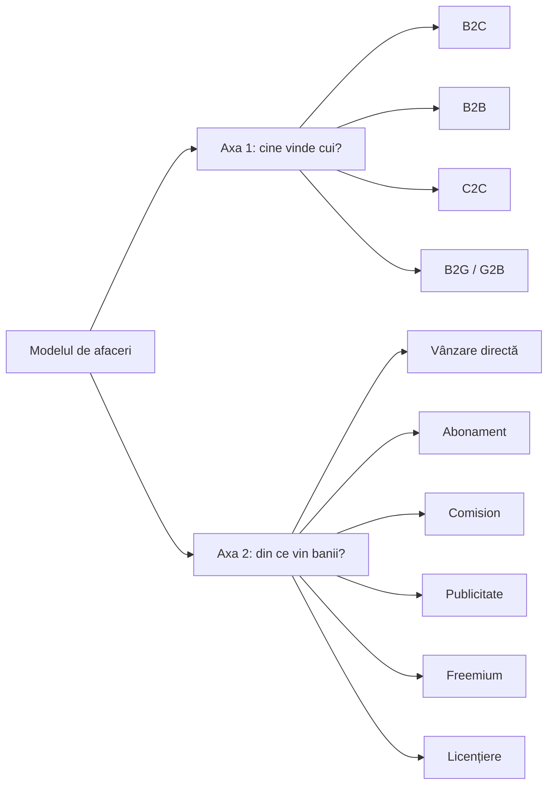
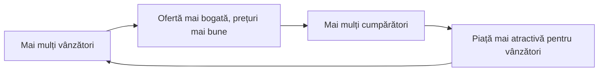

# Capitolul 2. Modele de afaceri online: cine vinde cui și din ce vin banii

## Ce vei putea face după acest capitol

- Să descrii modelul unei afaceri online în cinci întrebări simple și să îl așezi pe Business Model Canvas.
- Să deosebești relația dintre participanți (B2C, B2B, C2C, B2G, G2B) de mecanismul de venit (vânzare directă, abonament, comision, publicitate, freemium, licențiere).
- Să alegi, pentru o idee de afacere, combinațiile relație × mecanism care au sens și să explici de ce altele nu au.
- Să compari vânzarea pe un marketplace cu vânzarea în magazinul propriu, cu avantaje, costuri și riscul de dependență.
- Să explici de ce venitul nu este profit, folosind costuri fixe, costuri variabile și marjă.
- Să analizezi modelul unei afaceri digitale existente cu o grilă de opt întrebări și să spui ce date ți-ar mai trebui.

## 2.1 Ce este un model de afaceri

### 2.1.1 Definiția, pe înțeles

În manuale, modelul de afaceri este descris ca logica prin care o organizație creează, livrează și captează valoare. Formularea este corectă, dar greu de folosit luni dimineața. O rescriem în cinci întrebări la care orice antreprenor trebuie să poată răspunde în câte o propoziție:

1. **Ce problemă rezolvi și de ce te-ar alege cineva pe tine?** Aceasta este propunerea de valoare.
2. **Pentru cine?** Aceștia sunt clienții, grupați în segmente.
3. **Cum ajungi la ei și cum ajunge produsul la ei?** Acestea sunt canalele.
4. **Din ce încasezi bani?** Acestea sunt veniturile, mai precis mecanismul de venit.
5. **Pe ce cheltuiești ca să faci toate acestea?** Acestea sunt costurile.

Dacă una dintre cele cinci propoziții lipsește sau sună vag („pentru toată lumea”, „din vânzări”), modelul nu este încă gândit până la capăt.

> **Exemplu.** Cămara de la Dunăre, magazinul online fictiv din Galați pe care îl urmărim în tot suportul de curs, răspunde așa: (1) aduce într-un singur loc dulcețuri, zacuscă, miere și siropuri de la producători locali, cu livrare acasă; (2) pentru familii din orașe care vor produse făcute ca la țară și nu au de unde să le cumpere; (3) printr-un site propriu, la care oamenii ajung din căutări pe Google, din reclame, din email și direct; (4) din vânzarea produselor, cu un adaos peste prețul plătit producătorilor; (5) cheltuiește pe marfă, pe ambalare și livrare, pe reclame și pe costurile fixe ale firmei.

Două lucruri merită observate de la început. Primul: modelul de afaceri nu este același lucru cu produsul. Două firme pot vinde aceeași zacuscă având modele complet diferite: una o vinde bucată cu bucată în magazinul propriu, alta o trimite lunar într-o cutie cu abonament, a treia o livrează en-gros restaurantelor. Al doilea: modelul de afaceri nu este același lucru cu planul de afaceri. Planul este un document cu termene și bugete. Modelul este schema de funcționare, care trebuie să încapă pe o pagină.

Clasificările pe care le folosim în acest capitol au o istorie. Paul Timmers a propus în 1998 una dintre primele tipologii ale modelelor de afaceri pentru piețele electronice, iar manualele de comerț electronic (de exemplu Laudon și Traver) folosesc de atunci două criterii: cine participă la tranzacție și cum se obține venitul. Prezentarea de la curs pornește de la primul criteriu. Noi le vom ține pe amândouă, separat, pentru că amestecarea lor este cea mai frecventă sursă de confuzie.

### 2.1.2 Business Model Canvas, pe scurt

Business Model Canvas este o schemă pe o singură pagină, propusă de Alexander Osterwalder și Yves Pigneur în cartea „Business Model Generation” (2010). Împarte modelul în nouă căsuțe. Cele cinci întrebări de mai sus se regăsesc toate; canvasul adaugă detalii despre partea „din spate” a afacerii: ce resurse, ce activități și ce parteneri îți trebuie.

Tabelul 2.1 arată cele nouă căsuțe completate pentru Cămara. Datele despre Cămara sunt fictive, construite pentru exercițiu.

**Tabelul 2.1.** Business Model Canvas pentru Cămara de la Dunăre

| Căsuța | Întrebarea la care răspunde | Cămara de la Dunăre (exemplu fictiv) |
|---|---|---|
| Segmente de clienți | Pentru cine creăm valoare? | Familii din orașe, 30-55 de ani, care cumpără produse tradiționale; oameni care caută cadouri; pe viitor, cafenele și pensiuni |
| Propunerea de valoare | Ce problemă rezolvăm? De ce noi? | Produse de la producători locali verificați, într-un singur coș, livrate acasă; povestea fiecărui producător |
| Canale | Cum află clienții de noi și cum primesc produsul? | Site propriu; trafic din Căutare, Reclame, Email și Direct; livrare prin curier |
| Relații cu clienții | Ce fel de legătură păstrăm? | Newsletter, răspuns rapid la întrebări, recomandări de rețete (vezi capitolul 4 pentru asistența clienților) |
| Fluxuri de venit | Din ce încasăm? | Vânzare directă, cu marjă brută de 45% la preț întreg |
| Resurse cheie | Ce trebuie să avem? | Relațiile cu producătorii, un spațiu de depozitare, site-ul, lista de email |
| Activități cheie | Ce trebuie să facem bine? | Selecția produselor, ambalarea fără borcane sparte, livrarea la timp, marketingul |
| Parteneri cheie | Pe cine ne bazăm? | Producătorii locali, firma de curierat, procesatorul de plăți |
| Structura costurilor | Pe ce cheltuim? | Marfa, ambalare și livrare (14 lei pe comandă), reclame, costuri fixe (10.000 lei pe lună) |

Cum folosești canvasul în practică:

- Completează-l în 20-30 de minute, cu propoziții scurte. Dacă îți ia o zi, scrii un plan de afaceri, nu un canvas.
- Începe din dreapta (clienți, propunere de valoare), nu din stânga. Resursele și partenerii decurg din ce promiți clientului.
- Tratează fiecare căsuță ca pe o ipoteză. „Familiile din orașe vor plăti 25 de lei pe un borcan de dulceață” este o presupunere până când ai comenzi care o confirmă.
- Refă-l când schimbi ceva important. Un canvas vechi de doi ani descrie o altă firmă.

> **De reținut.** Canvasul nu îți spune dacă modelul este bun. Îți arată doar dacă este complet și coerent: dacă promiți livrare în 24 de ore, trebuie să apară undeva partenerul și costul care fac promisiunea posibilă.

## 2.2 Două axe pe care nu trebuie să le amesteci

Când cineva spune „am un business B2B”, îți spune **cui vinde**. Când spune „am un business pe abonament”, îți spune **cum încasează**. Sunt răspunsuri la două întrebări diferite:

- **Axa 1, relația dintre participanți:** cine vinde și cine cumpără. Aici intră B2C, B2B, C2C, B2G și G2B.
- **Axa 2, mecanismul de venit:** pentru ce anume plătește clientul și cum se face încasarea. Aici intră vânzarea directă, abonamentul, comisionul, publicitatea, freemium, licențierea.



Axele sunt independente. Abonamentul există și în B2C (o cutie lunară cu dulcețuri pentru o familie), și în B2B (un program de facturare plătit lunar de o firmă). Comisionul există și în C2C (o platformă de anunțuri între persoane), și în B2B (o platformă de comenzi pentru restaurante). De aceea „abonamentul” nu este nici B2C, nici B2B: este un mecanism care se poate așeza peste oricare relație.

> **Greșeală frecventă.** „Modelul nostru este B2C” ca răspuns la întrebarea „din ce faceți bani?”. B2C spune doar că vinzi către persoane fizice. Nu spune dacă încasezi pe bucată, lunar, din comisioane sau din reclame. O descriere completă are mereu două părți: „vindem către consumatori (B2C), prin vânzare directă și, pentru o parte din clienți, prin abonament”.

De ce contează separarea? Pentru că fiecare axă schimbă alte lucruri în afacere. Relația îți schimbă ciclul de vânzare, felul în care comunici și valoarea unei comenzi. Mecanismul de venit îți schimbă fluxul de numerar și indicatorii la care te uiți. Dacă le amesteci, vei copia practici care nu ți se potrivesc: vei încerca, de exemplu, să vinzi unei cafenele cu un cod de reducere pe Instagram, deși proprietarul cafenelei vrea o listă de prețuri, o factură cu termen de plată și o persoană de contact.

## 2.3 Axa 1: relația dintre participanți

### 2.3.1 B2C: firma vinde consumatorului

B2C înseamnă Business-to-Consumer, adică de la firmă la consumator. Firma vinde persoanelor fizice, care cumpără pentru ele sau pentru familie.

**Caracteristici.** Multe tranzacții, fiecare de valoare mică. Clientul decide singur și repede, uneori din impuls. Nu negociază prețul: îl acceptă sau pleacă. Nu semnează un contract negociat: acceptă termenii afișați pe site.

**Cum arată ciclul de vânzare.** Scurt. Omul vede o reclamă sau caută „zacuscă de casă”, intră pe site, compară două sau trei produse, pune în coș și plătește. De la prima vizită la comandă pot trece zece minute sau câteva zile, rar mai mult.

**Ce contează pentru client.** Încrederea (cine sunteți, ce spun alții), simplitatea comenzii, costul și durata livrării, posibilitatea de retur, felul în care arată produsul în poze. În B2C, experiența de cumpărare este o parte din produs.

**Cât de mare este fenomenul.** În Uniunea Europeană, 78% dintre utilizatorii de internet au cumpărat online în 2025, față de 62% în 2015. România are cea mai mare creștere dintre țările menționate în analiza Eurostat: 46 de puncte procentuale între 2015 și 2025 (Eurostat, „E-commerce statistics for individuals”, date extrase în februarie 2026, https://ec.europa.eu/eurostat/statistics-explained/index.php?title=E-commerce_statistics_for_individuals).

> **Exemplu.** Cămara este în primul rând un magazin B2C. În septembrie a avut 553 de comenzi și un venit de 85.400 lei, adică o comandă medie de aproximativ 154 de lei (date fictive, construite pentru exercițiu). Multe comenzi mici, de la oameni care nu se cunosc între ei și care decid singuri: profilul tipic al relației B2C.

**D2C, un caz particular.** D2C înseamnă Direct-to-Consumer, adică direct către consumator: producătorul vinde el însuși clientului final, fără distribuitor și fără magazin intermediar. Un apicultor care își vinde mierea pe propriul site lucrează D2C. Cămara nu este D2C, pentru că nu produce: este un comerciant care revinde. Diferența contează la marjă. Producătorul D2C păstrează și adaosul pe care altfel l-ar lua comerciantul, dar preia și toată munca acestuia: site, marketing, ambalare, relația cu clienții.

### 2.3.2 B2B: firma vinde altei firme

B2B înseamnă Business-to-Business, adică de la firmă la firmă. Cumpărătorul este o organizație, care folosește produsul în activitatea ei sau îl revinde.

**Caracteristici.** Mai puține tranzacții, de valoare mai mare. Relații pe termen lung. Prețuri negociate, adesea diferite de la un client la altul, cu reduceri de volum. Plata se face de regulă pe factură, la termen (de exemplu la 30 de zile), nu cu cardul în momentul comenzii.

**Cum arată ciclul de vânzare.** Lung și în mai mulți pași: primul contact, mostre, ofertă de preț, negociere, uneori contract, prima comandă de probă, apoi comenzi repetate. Decizia aparține rareori unui singur om. Cine folosește produsul (barista), cine decide (proprietarul) și cine plătește (contabilitatea) pot fi trei persoane diferite, fiecare cu alte întrebări.

**Ce contează pentru client.** Siguranța aprovizionării (ai marfă și luna viitoare?), calitatea constantă, prețul la volum, termenele de plată, documentele corecte (factură, aviz, declarații de conformitate), un om de contact care răspunde. Aspectul site-ului contează mai puțin; fiabilitatea contează mai mult.

**Cât de mare este fenomenul.** Publicul vede mai ales comerțul B2C, dar vânzările dintre firme sunt cel puțin la fel de mari. În 2024, vânzările pe web ale firmelor din UE către alte firme și către instituții publice au reprezentat 4,34% din cifra de afaceri totală, față de 4,04% pentru vânzările pe web către consumatori (Eurostat, „E-commerce statistics”, date extrase în februarie 2026, https://ec.europa.eu/eurostat/statistics-explained/index.php?title=E-commerce_statistics).

> **Exemplu.** Trei cafenele din Galați și Brăila vor siropurile și dulcețurile Cămării pentru meniul lor. Nu vor cumpăra din site, cu coș și card. Vor cere o listă de prețuri en-gros, borcane mai mari, livrare în aceeași zi a săptămânii și factură cu plata la 30 de zile. Cămara vinde aceleași produse, dar într-o relație cu totul diferită.

### 2.3.3 C2C: consumatorul vinde altui consumator

C2C înseamnă Consumer-to-Consumer, adică de la consumator la consumator. Două persoane fizice fac o tranzacție între ele, iar o platformă le ajută să se găsească. Platformele de anunțuri și cele de haine la mâna a doua sunt exemplele obișnuite.

**Caracteristici.** Vânzătorul nu este un profesionist. Produsele sunt adesea unicat sau folosite. Platforma nu deține marfa: ea pune la dispoziție locul de întâlnire, căutarea, uneori plata și livrarea.

**Cum arată ciclul de vânzare.** Cumpărătorul caută, scrie vânzătorului, negociază direct, apoi plătește și primește coletul sau se întâlnește cu vânzătorul. Ciclul este scurt, dar nesigur: nimeni nu garantează că produsul arată ca în poze.

**Ce contează pentru client.** Încrederea într-un necunoscut. De aceea platformele C2C investesc în mecanisme de reputație: calificative, recenzii, profil verificat, plată ținută de platformă până la confirmarea primirii. Fără aceste mecanisme, piața se blochează, pentru că nimeni nu vrea să plătească primul.

**De unde vin banii.** Aici se vede bine separarea celor două axe. Relația este C2C, dar platforma este o firmă, iar veniturile ei vin din mecanisme de pe axa a doua: comision din tranzacție, taxă de listare, taxă pentru promovarea anunțului, publicitate.

> **De reținut.** În C2C există de fapt trei participanți: vânzătorul, cumpărătorul și platforma. Când analizezi un model C2C, întreabă mereu „cine plătește platforma și pentru ce?”.

**C2B, pe scurt.** C2B înseamnă Consumer-to-Business, adică de la consumator la firmă: o persoană fizică oferă ceva unei firme. Exemple: un fotograf amator care își vinde pozele printr-o bancă de imagini, un creator de conținut plătit de o marcă pentru o recomandare. Pentru Cămara, un client care trimite o rețetă filmată și primește în schimb un voucher este un mic aranjament C2B.

### 2.3.4 B2G și G2B: firma și statul

B2G înseamnă Business-to-Government, adică de la firmă la administrația publică: firma vinde statului (unei primării, unei școli, unui spital). G2B înseamnă Government-to-Business, adică de la administrație la firmă: statul oferă firmelor servicii digitale, de la înregistrarea societății la depunerea declarațiilor.

**Caracteristici.** Proceduri standardizate și reglementate strict. Accent pe transparență și pe conformitate: contează să respecți forma, termenele și documentele cerute. Prețul și calitatea nu se negociază la o cafea; se evaluează după criterii anunțate dinainte.

**B2G în România: achizițiile publice electronice.** Legea nr. 98/2016 privind achizițiile publice definește SEAP, Sistemul Electronic de Achiziții Publice, ca sistemul informatic de utilitate publică, accesibil prin internet, folosit pentru aplicarea prin mijloace electronice a procedurilor de atribuire și pentru publicarea anunțurilor la nivel național (Legea nr. 98/2016, art. 3, Portalul Legislativ, https://legislatie.just.ro/Public/DetaliiDocument/178667). Platforma se află la adresa e-licitatie.ro și este operată de Autoritatea pentru Digitalizarea României (ADR), care o descrie ca platforma electronică prin care autoritățile publice cumpără bunuri și servicii și atribuie lucrări (ADR, „Platforme operate”, https://www.adr.gov.ro/en/platforme-operate). În practică vei auzi și numele SICAP, folosit pentru versiunea modernizată a aceleiași platforme; legea și site-ul oficial folosesc denumirea SEAP.

Pentru o firmă mică, două lucruri sunt utile de știut:

- **Achiziția directă.** Sub un anumit prag valoric, o autoritate poate cumpăra direct, fără licitație. În forma legii afișată pe Portalul Legislativ la data consultării, pragul este de 270.120 lei fără TVA pentru produse și servicii (art. 7 alin. (5)). Pragurile se modifică periodic, deci verifică textul la zi.
- **Catalogul electronic.** Firmele înscrise în SEAP își pot publica produsele într-un catalog electronic, din care autoritățile pot cumpăra. În aceeași formă a legii, pentru achizițiile directe de peste 200.000 lei fără TVA la produse și servicii, autoritatea trebuie să folosească fie catalogul electronic, fie un anunț public (art. 7 alin. (7)).

**Ciclul de vânzare în B2G.** Te înregistrezi în sistem ca operator economic, îți publici oferta în catalog sau urmărești anunțurile, depui oferta în formatul cerut, aștepți evaluarea, semnezi contractul, livrezi, facturezi electronic, încasezi la termenul din contract. Totul lasă urme documentate. Ciclul este mai lung decât în B2C și mai formal decât în B2B.

**G2B în România: serviciile digitale ale statului pentru firme.** Chiar dacă nu vinzi niciodată statului, vei folosi serviciile lui digitale. Câteva exemple verificabile în surse oficiale:

| Serviciu | Ce face pentru o firmă | Sursa oficială |
|---|---|---|
| Spațiul Privat Virtual (SPV) al Agenției Naționale de Administrare Fiscală (ANAF) | Canalul electronic de comunicare cu fiscul; prin el se accesează și sistemul RO e-Factura | Ghidul ANAF privind RO e-Factura, https://static.anaf.ro/static/10/Anaf/AsistentaContribuabili_r/Ghid_RO_eFactura.pdf |
| RO e-Factura | Sistemul național de facturare electronică: factura este un fișier XML transmis prin sistem | Același ghid ANAF |
| Portalul Oficiului Național al Registrului Comerțului (ONRC) | Portalul de servicii online al registrului comerțului, instituția la care se înregistrează firmele | https://www.onrc.ro/index.php/ro/servicii-online |
| Ghișeul.ro | Plata online, cu cardul, a taxelor, impozitelor locale și amenzilor | ADR, „Platforme operate” |
| Punctul de Contact Unic electronic (PCUe) și platforma care îl înlocuiește, ROePAS | Proceduri la distanță: declarații, notificări, cereri de autorizare | ADR, „Platforme operate” |

Despre RO e-Factura merită reținut calendarul descris în ghidul ANAF (ediția 2023): în relația B2G, utilizarea sistemului este obligatorie de la 1 iulie 2022; în relația B2B, firmele stabilite în România au avut obligația de a raporta facturile în sistem de la 1 ianuarie 2024 și de a le transmite destinatarilor prin sistem de la 1 iulie 2024. Regulile pentru facturile emise către persoane fizice au fost modificate după apariția acestui ghid, așa că verifică situația la zi pe anaf.ro. Observă și un detaliu interesant: ghidul fiscal folosește chiar etichetele din acest capitol (B2G, B2B, B2C) ca să spună ce reguli se aplică fiecărei facturi. Clasificarea după relație nu este doar teorie de manual; determină obligații concrete.

> **Pentru afacerea ta.** Dacă vinzi produse pe care le cumpără și instituțiile (papetărie, alimente, servicii de curățenie, cursuri), înscrierea în SEAP și publicarea ofertei în catalogul electronic îți deschid un canal pe care concurenții mici îl ignoră adesea. Costul principal este timpul de învățare a procedurilor. Acest paragraf și toată secțiunea sunt informare generală, nu consultanță juridică sau fiscală: înainte să acționezi, citește textele oficiale la zi sau întreabă un specialist.

> **Exemplu.** O primărie vrea 300 de pachete cu produse locale pentru un eveniment. Cămara, înscrisă în SEAP, are în catalog „pachet cadou cu trei produse”. Primăria cumpără direct din catalog, Cămara livrează și emite factura prin RO e-Factura. Aceleași borcane, a treia relație: B2G.

### 2.3.5 Comparație între relații

| Criteriu | B2C | B2B | C2C | B2G |
|---|---|---|---|---|
| Cine cumpără | Persoane fizice | Firme | Persoane fizice, de la alte persoane | Instituții publice |
| Valoarea unei tranzacții | Mică | Mare | Mică, variabilă | Medie spre mare |
| Numărul de clienți | Mare | Mic | Foarte mare | Mic |
| Cine decide | Un om, repede | Mai mulți oameni, în pași | Un om | O comisie, după reguli |
| Ciclul de vânzare | Minute sau zile | Săptămâni sau luni | Ore sau zile | Săptămâni sau luni |
| Prețul | Afișat, același pentru toți | Negociat, cu reduceri de volum | Negociat între persoane | Ofertat, evaluat după criterii publice |
| Plata | Imediat (card, ramburs) | Factură la termen | Imediat | Factură la termen, după recepție |
| Ce cântărește cel mai mult | Experiența, încrederea, livrarea | Fiabilitatea, prețul la volum, relația | Reputația celuilalt | Conformitatea, transparența |

Tabelul descrie tipare, nu legi. Un abonament la un program de 50 de lei pe lună vândut unei microîntreprinderi este B2B, dar se cumpără ca în B2C: cu cardul, în zece minute, fără negociere. Folosește tabelul ca punct de plecare, apoi uită-te la clienții tăi reali.

## 2.4 Axa 2: mecanismul de venit

Trecem la a doua întrebare: pentru ce plătește clientul și cum ajung banii la tine. Fiecare mecanism are propria logică, propriii indicatori și propriile riscuri. Indicatorii sunt doar numiți aici; definițiile și calculele lor sunt în capitolul 5.

### 2.4.1 Vânzarea directă

**Cum funcționează.** Clientul plătește o dată, pentru un produs sau un serviciu. Cumperi sau produci cu un cost, vinzi cu un preț mai mare, diferența este marja ta.

**Când se potrivește.** La produse fizice, la servicii cu început și sfârșit clar, la orice lucru pe care clientul îl vrea „acum, o dată”.

**Ce indicatori urmărești.** Numărul de comenzi, valoarea medie a comenzii, marja brută, rata de conversie, cât de des revine un client.

**Riscuri.** Fiecare lună pornește de la zero: dacă nu aduci din nou clienți, nu ai venit. Banii stau blocați în stoc. Reducerile cresc vânzările, dar mănâncă marja.

> **Exemplu.** Exact asta s-a întâmplat la Cămara în noiembrie. Cu un buget de reclame crescut de la 2.400 la 16.800 lei pe lună și un cod de reducere de 20%, comenzile au crescut cu 44%, iar venitul cu 28%. Rezultatul simplificat a scăzut însă cu 63%, de la 18.088 la 6.758 lei (date fictive, construite pentru exercițiu). La vânzarea directă, volumul fără marjă nu ajută. Analiza completă este în capitolul 5.

### 2.4.2 Abonamentul

**Cum funcționează.** Clientul plătește periodic (lunar, anual) și primește acces continuu sau livrări repetate. Venitul devine recurent: știi la începutul lunii, cu aproximație, cât vei încasa.

**Când se potrivește.** Când nevoia clientului se repetă (cafea, lame de ras, hrană pentru animale), când produsul este un serviciu folosit continuu (programe informatice, conținut video sau muzică) sau când clientul apreciază surpriza și comoditatea (cutii lunare).

**Ce indicatori urmărești.** Venitul lunar recurent (MRR, Monthly Recurring Revenue), numărul de abonați activi și, mai ales, rata de renunțare (churn rate): ce procent dintre abonați anulează într-o lună. La vânzarea directă te întrebi „câți au cumpărat?”. La abonament te întrebi „câți au rămas?”.

**Riscuri.** Renunțarea. Dacă pierzi 8% din abonați în fiecare lună, un abonat rămâne în medie cam un an și trebuie înlocuit. Costul de a atrage un abonat se plătește la început, iar banii vin în rate: poți crește repede și rămâne fără numerar. Un alt risc este oboseala: după câteva luni, clientului i se umple cămara de borcane și anulează.

> **Exemplu.** Cămara se gândește la „Cutia lunii”: trei produse alese de echipă, 129 lei pe lună, livrare inclusă. Calcul ipotetic, pentru exercițiu: marja brută de 45% înseamnă 58,05 lei; după 14 lei ambalare și livrare rămân 44,05 lei contribuție pe abonat, pe lună. Cu 200 de abonați, venitul recurent ar fi 25.800 lei pe lună, iar contribuția 8.810 lei, aproape cât costurile fixe ale firmei. Dacă atragerea unui abonat costă 90 de lei, banii se recuperează abia în a treia lună. Un abonat care anulează după prima cutie aduce pierdere.

### 2.4.3 Comisionul

**Cum funcționează.** Nu vinzi tu produsul. Pui în legătură un vânzător cu un cumpărător și reții un procent sau o sumă fixă din fiecare tranzacție. Este mecanismul tipic al marketplace-urilor, al platformelor de rezervări și al procesatorilor de plăți.

**Când se potrivește.** Când poți aduna multă cerere și multă ofertă în același loc și când tranzacția trece prin tine, astfel încât o poți măsura și taxa.

**Ce indicatori urmărești.** Valoarea totală a tranzacțiilor care trec prin platformă (GMV, Gross Merchandise Value, adică valoarea brută a mărfurilor vândute), rata comisionului, numărul de vânzători activi și de cumpărători activi.

**Riscuri.** Venitul tău este doar comisionul, nu toată valoarea tranzacțiilor: o platformă prin care trec 100.000 de lei, la un comision de 15%, are venituri de 15.000 de lei. Ai nevoie de volum mare. Părțile pot încerca să te ocolească: se cunosc pe platformă și fac următoarea tranzacție direct. Și răspunzi în ochii clientului pentru calitatea unor produse pe care nu le controlezi.

> **Exemplu.** Cămara ar putea lista pe site produsele altor producători (brânzeturi maturate, vin), care le livrează singuri, și ar reține un comision de 15%. La o comandă de 150 de lei, Cămara încasează 22,50 lei, fără stoc și fără ambalare. Pare puțin față de marja de 67,50 lei de la vânzarea directă, dar nu blochează bani în marfă și nu riscă borcane expirate. Cifrele sunt ipotetice.

Două exemple reale, ca să vezi cum arată un comision publicat. eMAG Marketplace anunță pe pagina pentru vânzători comisioane între 7% și 25%, în funcție de categoria produsului, reținute doar pentru ce se vinde (eMAG Marketplace, „Taxes and commissions”, https://marketplace.emag.ro/infocenter/start-selling/taxes-and-commissions/?lang=en). Etsy, o platformă de produse lucrate manual, percepe o taxă de listare de 0,20 dolari pe anunț, indiferent dacă produsul se vinde, plus o taxă de tranzacție de 6,5% din valoarea comenzii, incluzând transportul facturat clientului (Etsy Help, „Etsy Fees Basics”, https://help.etsy.com/hc/en-us/articles/360035902374-Etsy-Fees-Basics). Observă că aceeași platformă poate combina două mecanisme: o taxă fixă de listare și un comision din vânzare. Tarifele se schimbă; verifică paginile oficiale înainte de orice calcul.

### 2.4.4 Publicitatea

**Cum funcționează.** Utilizatorii primesc gratuit conținutul sau serviciul. Cei care plătesc sunt firmele care vor să ajungă la acești utilizatori. Motoarele de căutare, rețelele sociale și site-urile de știri funcționează în mare parte așa.

**Când se potrivește.** Când poți aduna o audiență foarte mare sau una mică, dar foarte precisă și valoroasă pentru cineva (de exemplu un site citit de medici stomatologi).

**Ce indicatori urmărești.** Numărul de utilizatori activi, timpul petrecut, numărul de afișări ale reclamelor, venitul la o mie de afișări.

**Riscuri.** Ai doi „clienți” cu interese diferite: utilizatorul vrea conținut fără reclame, firma vrea atenția utilizatorului. Depinzi de volum și de platformele care intermediază reclamele. Pentru un site mic, sumele sunt neglijabile.

> **Exemplu.** Cămara are un blog cu rețete. Ar putea vinde spațiu publicitar? În noiembrie a avut 32.140 de vizite (date fictive). Chiar la un tarif ipotetic de 20 de lei la o mie de afișări și cu o singură reclamă văzută la fiecare vizită, ar încasa în jur de 640 de lei pe lună, sub 1% din venitul lunii. În plus, reclamele ar trimite vizitatorii pe alte site-uri tocmai când erau aproape de coș. Pentru un magazin, publicitatea este un mecanism de venit slab; blogul își face treaba aducând cumpărători.

### 2.4.5 Freemium

**Cum funcționează.** Numele vine din „free” (gratuit) și „premium”. Versiunea de bază este gratuită pentru totdeauna, iar o parte dintre utilizatori plătesc pentru funcții suplimentare: mai mult spațiu, fără reclame, funcții pentru echipe. Chris Anderson a popularizat ideea în cartea „Free” (2009).

**Când se potrivește.** La produse digitale, unde servirea unui utilizator în plus costă aproape nimic. Utilizatorii gratuiți sunt, de fapt, canalul tău de marketing: încearcă produsul, îl recomandă, iar o parte fac pasul spre versiunea plătită.

**Ce indicatori urmărești.** Rata de conversie de la gratuit la plătit, costul servirii unui utilizator gratuit, apoi indicatorii de abonament pentru cei care plătesc.

**Riscuri.** Versiunea gratuită este atât de bună încât nimeni nu plătește, sau atât de slabă încât nimeni nu rămâne. Costurile cu utilizatorii gratuiți cresc mai repede decât veniturile de la cei plătitori.

> **Greșeală frecventă.** A confunda freemium cu perioada de probă și cu mostra gratuită. Perioada de probă (free trial) este limitată în timp: 14 zile, apoi plătești sau pierzi accesul. Freemium este gratuit pe termen nelimitat, cu funcții limitate. Mostra gratuită a unui produs fizic este o cheltuială de marketing, nu un model freemium: fiecare borcan dăruit te costă marfă și transport.

### 2.4.6 Licențierea

**Cum funcționează.** Deții ceva ce se poate folosi fără să se consume: un program, o marcă, o rețetă, o fotografie, un curs. Acorzi altcuiva dreptul de a-l folosi, în schimbul unei taxe fixe sau al unei redevențe (un procent din vânzările lui).

**Când se potrivește.** Când ai proprietate intelectuală valoroasă și nu vrei sau nu poți să o exploatezi singur pe toate piețele.

**Ce indicatori urmărești.** Numărul de licențe active, venitul pe licență, rata de reînnoire.

**Riscuri.** Pierzi controlul asupra felului în care îți este folosită marca. Protecția juridică și urmărirea respectării contractului costă.

> **Exemplu.** Dacă marca „Cămara de la Dunăre” devine cunoscută, un lanț de magazine din alt oraș ar putea plăti pentru dreptul de a vinde o gamă sub acest nume, respectând rețetele și standardele Cămării. Cămara ar încasa o redevență fără să producă sau să livreze nimic. Este un scenariu ipotetic și îndepărtat, dar arată că aceeași firmă poate ajunge, în timp, la un mecanism de venit complet diferit.

### 2.4.7 Alte mecanisme, pe scurt

- **Plata la utilizare (pay-per-use):** plătești cât consumi. Exemple: servicii de găzduire în cloud, trotinete electrice închiriate la minut.
- **Afilierea:** recomanzi produsele altcuiva și primești un comision pentru fiecare vânzare venită prin linkul tău. Este un comision fără platformă proprie.
- **Vânzarea de date sau de rapoarte:** aduni date și vinzi analize pe baza lor. Mecanismul ridică probleme serioase de protecție a datelor și nu este un punct de pornire pentru o firmă mică.
- **Donații și finanțare participativă (crowdfunding):** susținătorii plătesc voluntar sau în avans, pentru un produs care urmează să existe.

### 2.4.8 Comparație între mecanisme

| Mecanism | Pentru ce plătește clientul | Când intră banii | Indicatorul la care te uiți întâi | Riscul principal |
|---|---|---|---|---|
| Vânzare directă | Un produs, o dată | La fiecare comandă | Comenzi, valoare medie, marjă | Fiecare lună pornește de la zero |
| Abonament | Acces sau livrări repetate | Periodic, previzibil | Rata de renunțare, venit recurent | Clienții anulează mai repede decât îi recuperezi |
| Comision | Intermedierea unei tranzacții | La fiecare tranzacție a altora | Valoarea tranzacțiilor, rata comisionului | Volum insuficient, ocolirea platformei |
| Publicitate | Atenția audienței tale (plătește altcineva) | La afișare sau la clic | Utilizatori activi, afișări | Audiență prea mică |
| Freemium | Funcții suplimentare | Periodic, de la o minoritate | Conversia de la gratuit la plătit | Costul utilizatorilor gratuiți |
| Licențiere | Dreptul de folosire | Taxă fixă sau redevență | Licențe active, reînnoiri | Pierderea controlului asupra mărcii |

## 2.5 Matricea relație × mecanism

Punem acum cele două axe una peste alta. Fiecare celulă a tabelului este un model posibil. Am completat matricea cu idei pentru Cămara; toate sunt ipotetice.

| Mecanism \ Relație | B2C (familii) | B2B (cafenele, pensiuni, firme) | C2C (între persoane) | B2G (instituții) |
|---|---|---|---|---|
| **Vânzare directă** | Magazinul online actual | Livrare en-gros către cafenele; cadouri de firmă | Nu se aplică: Cămara ar fi doar gazda | Pachete pentru evenimente, prin catalogul SEAP |
| **Abonament** | „Cutia lunii”, 129 lei pe lună | Aprovizionare săptămânală fixă pentru cafenele | Nu are sens | Rar: contract-cadru cu livrări periodice |
| **Comision** | Produse ale altor producători listate pe site (plătește producătorul) | Platformă de comenzi între producători și restaurante | Târg online de conserve făcute în casă | Nu are sens |
| **Publicitate** | Blog de rețete cu reclame: venit neglijabil | Producători care plătesc pentru loc pe prima pagină | Anunțuri promovate | Nu are sens |
| **Freemium** | Nu are sens la borcane; posibil la un club de rețete | Posibil la un instrument digital pentru producători | Nu are sens | Nu are sens |
| **Licențiere** | Nu are sens | Marca și rețetele, licențiate unui lanț de magazine | Nu are sens | Nu are sens |

Câteva lecturi ale matricei:

**Nu orice combinație are sens.** Freemium cu produse fizice nu funcționează, pentru că fiecare „utilizator gratuit” costă marfă și transport. Publicitatea nu merge fără audiență mare. Licențierea către consumatori individuali nu are obiect în cazul unui magazin de dulcețuri. Celulele goale nu sunt o slăbiciune a matricei; sunt informație.

**Unele combinații sunt legale doar cu condiții.** „Târgul online de conserve făcute în casă” (C2C cu comision) sună simpatic, dar vânzarea de alimente este reglementată sanitar-veterinar, iar platforma ar purta o parte din răspundere și din riscul de imagine. Un model poate fi coerent economic și totuși greu de pus în practică.

**Aceeași firmă poate ocupa mai multe celule.** Cămara poate avea magazinul B2C cu vânzare directă, „Cutia lunii” pe abonament și livrări en-gros către cafenele. Fiecare celulă ocupată înseamnă însă alți clienți, alte procese și alți indicatori. Trei modele la o firmă cu doi angajați înseamnă trei lucruri făcute pe jumătate.

**Mută-te în celula vecină, nu în colțul opus.** De la magazin B2C la abonament B2C păstrezi clienții și schimbi doar mecanismul. De la magazin B2C la livrări B2B păstrezi mecanismul și schimbi relația. De la magazin B2C la platformă cu comision pentru restaurante schimbi totul deodată.

### 2.5.1 Mini studiu de caz: Cămara vinde cafenelelor

Să vedem ce se schimbă, concret, când aceleași produse trec din B2C în B2B. Calculul este ipotetic, pentru exercițiu.

Un borcan de dulceață se vinde pe site cu 25 de lei. La marja brută de 45%, costul mărfii este 13,75 lei, iar marja 11,25 lei. O cafenea nu va plăti prețul de raft; cere preț en-gros. Cămara oferă 19 lei pe borcan pentru comenzi de minimum 40 de borcane.

| | Comandă B2C tipică | Comandă B2B (cafenea) |
|---|---|---|
| Valoarea comenzii | 150 lei | 40 × 19 = 760 lei |
| Marja brută, în lei | 67,50 lei | 40 × 5,25 = 210 lei |
| Marja brută, în procente | 45% | circa 28% |
| Ambalare și livrare | 14 lei | 30 lei (o cursă locală) |
| Contribuție înainte de marketing | 53,50 lei | 180 lei |
| Când încasezi | La comandă | La 30 de zile de la livrare |
| Probabilitatea de a recomanda luna viitoare | Mică | Mare, dacă ești punctual |

Ce vedem? Marja procentuală scade mult, de la 45% la aproximativ 28%. Dar contribuția în lei pe comandă este de peste trei ori mai mare, iar clientul revine lunar fără reclame. Prețul plătit este altul: aștepți banii 30 de zile, depinzi de câțiva clienți mari și trebuie să ai marfă constant. Dacă o cafenea care face un sfert din vânzările tale B2B închide, simți imediat.

> **Pentru afacerea ta.** Înainte să adaugi o relație nouă (de exemplu B2B lângă B2C), scrie pe o foaie trei lucruri: ce preț vei avea acolo, când încasezi și ce se întâmplă dacă cel mai mare client pleacă. Dacă al treilea răspuns este „închidem”, ai o dependență, nu un model.

## 2.6 Platforme și marketplace-uri

### 2.6.1 Ce este o platformă și ce sunt efectele de rețea

Un magazin obișnuit cumpără marfă și o revinde. O platformă nu vinde ea însăși: creează locul în care două grupuri se întâlnesc și fac schimb între ele. Un marketplace este o platformă de comerț: vânzători de o parte, cumpărători de cealaltă. Economiștii numesc aceste afaceri piețe cu două fețe (Rochet și Tirole, 2003), iar cartea „Platform Revolution” (Parker, Van Alstyne și Choudary, 2016) le explică pe larg pentru publicul de afaceri.

Ce le face speciale sunt **efectele de rețea**: valoarea serviciului pentru un utilizator depinde de câți alți utilizatori există.

- **Efecte directe:** cu cât sunt mai mulți utilizatori de același fel, cu atât serviciul valorează mai mult pentru fiecare. O aplicație de mesagerie pe care o folosesc toți prietenii tăi este utilă; una pe care ești singur nu este.
- **Efecte indirecte (între cele două fețe):** mai mulți vânzători atrag mai mulți cumpărători, pentru că oferta este mai bogată. Mai mulți cumpărători atrag mai mulți vânzători, pentru că au cui vinde.



Cercul din diagramă explică de ce platformele mari tind să devină și mai mari și de ce este greu să concurezi una deja instalată. Efectele de rețea pot lucra și în sens invers: prea mulți vânzători cu același produs înseamnă concurență pe preț și nemulțumire, iar prea multe anunțuri slabe îi alungă pe cumpărători.

### 2.6.2 Problema „oul sau găina”

Cercul de mai sus are un punct slab: începutul. Cumpărătorii nu vin pe o platformă fără vânzători. Vânzătorii nu vin pe o platformă fără cumpărători. Literatura economică numește asta chiar problema „oul și găina” (Caillaud și Jullien, 2003). Strategiile obișnuite de ieșire sunt descrise, între alții, de Eisenmann, Parker și Van Alstyne (2006):

- **Subvenționezi o parte.** O parte intră gratuit sau chiar primește stimulente, iar cealaltă plătește. De regulă este subvenționată partea mai greu de atras sau mai sensibilă la preț.
- **Începi tu ca vânzător.** Pornești ca magazin obișnuit, cu marfa ta, aduni cumpărători, apoi deschizi platforma și altor vânzători.
- **Începi foarte îngust.** Un singur oraș, o singură categorie, o singură comunitate. Este mai ușor să ai destulă ofertă și destulă cerere pentru „produse locale în Galați” decât pentru „orice, oriunde”.
- **Aduci o parte la pachet.** Convingi o asociație de producători sau un târg existent să vină împreună pe platformă.

> **Exemplu.** Dacă ar vrea să devină un marketplace pentru producători locali, Cămara are deja jumătate din răspuns: cumpărătorii. Clienții din spatele celor 796 de comenzi din noiembrie (date fictive) sunt „găina”. Poate invita cinci producători noi să își listeze produsele și le poate arăta trafic real din prima zi. Un marketplace pornit de la zero nu ar avea ce să le arate.

### 2.6.3 Marketplace sau magazin propriu?

Pentru un vânzător mic, întrebarea practică este alta: unde vând? Pe un marketplace mare, în magazinul meu, sau în amândouă?

Datele Eurostat arată că firmele europene le folosesc pe amândouă, dar nu în aceeași măsură. Dintre firmele din UE care au vândut pe web în 2024, 85,65% au vândut prin site-ul sau aplicația proprie, iar 45% au folosit un marketplace. Ca valoare, vânzările prin site-uri și aplicații proprii au reprezentat 7,08% din cifra de afaceri totală a firmelor din UE, iar cele prin marketplace-uri 1,30%. România are cea mai mică pondere din UE a firmelor care fac vânzări electronice: 14,57%, față de 23,59% media UE (Eurostat, „E-commerce statistics”, date extrase în februarie 2026, https://ec.europa.eu/eurostat/statistics-explained/index.php?title=E-commerce_statistics). Altfel spus, în România mai este loc: cele mai multe firme încă nu vând deloc online.

| Criteriu | Pe un marketplace | În magazinul propriu |
|---|---|---|
| Trafic | Vine cu platforma: cumpărătorii sunt deja acolo | Îl aduci tu, cu timp sau cu bani |
| Cost de pornire | Mic: cont, listări | Mai mare: site, plăți, fotografii, texte |
| Cost pe vânzare | Comision la fiecare comandă, plus eventuale taxe de servicii | Fără comision de platformă, dar cu cost de marketing pe comandă |
| Încrederea cumpărătorului | Împrumutată de la platformă | O construiești singur, în timp |
| Datele despre clienți | Rămân în mare parte la platformă | Sunt ale tale: adrese de email, istoric de comenzi |
| Marca | Ești un vânzător într-o listă, lângă concurenți | Tot spațiul vorbește despre tine |
| Regulile | Le stabilește platforma și le poate schimba | Le stabilești tu, în limitele legii |
| Riscul de dependență | Ridicat dacă vinzi doar acolo | Scăzut față de platformă, dar depinzi de sursele de trafic |

**Să punem cifre pe comparație.** Ipoteză de lucru: un marketplace reține un comision de 15% (o valoare din interiorul intervalului de 7-25% publicat de eMAG Marketplace; comisionul real depinde de categorie și de contract).

| Pe o comandă de 150 lei la preț întreg | Marketplace (comision ipotetic 15%) | Magazin propriu |
|---|---|---|
| Marja brută (45%) | 67,50 lei | 67,50 lei |
| Comision platformă | 22,50 lei | 0 lei |
| Ambalare și livrare | 14 lei | 14 lei |
| Rămâne înainte de marketing | 31 lei | 53,50 lei |
| Cost de marketing pe comandă | De regulă mic, dacă nu plătești promovare în platformă | Depinde de canal |

Concluzia calculului: magazinul propriu este mai rentabil decât marketplace-ul cât timp aduci o comandă cu mai puțin de 22,50 lei cheltuiți pe marketing. Pe canalele Căutare, Email și Direct, Cămara este mult sub acest prag. Pe canalul Reclame, în noiembrie, contribuția pe comandă a ajuns la -40 de lei (date fictive): acolo, o comandă venită printr-un marketplace ar fi fost mai bună decât una cumpărată cu reclame și cod de reducere.

**Dependența.** Riscul cel mare al marketplace-ului nu este comisionul de azi, ci faptul că nu controlezi regulile de mâine. Platforma poate schimba comisioanele, criteriile de afișare în rezultate sau condițiile de retur, iar tu afli dintr-o notificare. Uniunea Europeană a recunoscut acest dezechilibru: Regulamentul (UE) 2019/1150, cunoscut ca regulamentul „platformă către întreprinderi” (P2B, Platform-to-Business), se aplică din 12 iulie 2020 și cere platformelor, între altele, să comunice vânzătorilor principalii factori care determină ordinea în rezultatele căutării. De notat că, în noiembrie 2025, Comisia Europeană a propus abrogarea lui, cu argumentul că reguli mai noi acoperă aceeași zonă (Comisia Europeană, „Platform-to-business trading practices”, https://digital-strategy.ec.europa.eu/en/policies/platform-business-trading-practices). Verifică stadiul la zi; textul de față nu este consultanță juridică.

**O strategie rezonabilă pentru început.** Mulți vânzători mici folosesc marketplace-ul pentru a fi găsiți și magazinul propriu pentru a păstra relația: clientul te descoperă pe platformă, iar tu faci produsul și ambalajul suficient de memorabile încât a doua oară să te caute direct. Verifică și programele dedicate producătorilor mici. eMAG Marketplace, de exemplu, descrie programul „Open Romania”, care din septembrie 2025 este deschis producătorilor români din orice domeniu, inclusiv alimentar, cu cifră de afaceri anuală de până la 2 milioane de lei, cu comisioane între 5% și 10% în funcție de categorie (eMAG Marketplace, „The Open Romania program”, https://marketplace.emag.ro/infocenter/the-open-romania-program-new-opportunities-for-local-entrepreneurs/?lang=en). Condițiile se schimbă; citește pagina oficială și contractul înainte de a te baza pe ele.

> **Greșeală frecventă.** „Vând pe marketplace, deci nu am costuri de marketing.” Comisionul este costul tău de marketing, plătit sub altă formă. Tratează-l ca atare și compară-l cu ce te-ar costa să aduci singur aceeași comandă.

## 2.7 Economia unui model: de ce venitul nu este profit

Un model de afaceri poate fi elegant pe hârtie și totuși să piardă bani la fiecare comandă. Ca să vezi asta, îți trebuie patru noțiuni. Le introducem aici; calculele pas cu pas, pe datele săptămânale ale Cămării, sunt în capitolul 5.

**Venitul** este tot ce încasezi din vânzări. Este cifra cea mai vizibilă și cea mai înșelătoare.

**Costurile variabile** cresc odată cu fiecare comandă: marfa, ambalajul, curierul, comisionul procesatorului de plăți, comisionul de marketplace. Dacă nu vinzi nimic, sunt zero.

**Costurile fixe** se plătesc oricum, fie că ai o comandă, fie că ai o mie: chiria depozitului, salariile, abonamentele la programe, contabilul.

**Marja** este ce rămâne dintr-un leu încasat după ce scazi anumite costuri. Marja brută scade doar costul mărfii. Contribuția scade și marketingul, ambalarea și livrarea. Rezultatul scade și costurile fixe.

Pentru Cămara, ipotezele de lucru din tot suportul de curs sunt: marjă brută de 45% la preț întreg, 14 lei ambalare și livrare pe comandă, costuri fixe de 10.000 de lei pe lună. Formulele simplificate sunt:

```text
contribuție        = marjă brută - marketing - ambalare și livrare
rezultat simplificat = contribuție - costuri fixe
```

Să urmărim o singură comandă de 150 de lei, la preț întreg:

| Pas | Calcul | Rămâne |
|---|---|---|
| Venit | 150 lei | 150,00 lei |
| Minus costul mărfii (55%) | 150 × 0,55 = 82,50 lei | 67,50 lei (marja brută) |
| Minus ambalare și livrare | 14 lei | 53,50 lei |
| Minus marketing pe comandă | Depinde de canal | ? |
| Minus partea din costurile fixe | Depinde de numărul de comenzi | ? |

Din 150 de lei încasați, înainte de marketing și de costurile fixe au rămas 53,50 lei. De aici se vede și un prag util: ca să acopere costurile fixe de 10.000 de lei pe lună, Cămara are nevoie de circa 187 de asemenea comenzi (10.000 împărțit la 53,50), fără să cheltuiască nimic pe marketing. Acesta este pragul de rentabilitate: punctul în care nu pierzi și nu câștigi. Orice leu cheltuit pe reclame ridică pragul.

Acum privește lunile reale ale Cămării (date fictive, construite pentru exercițiu):

| | Septembrie | Noiembrie | Schimbare |
|---|---|---|---|
| Comenzi | 553 | 796 | +44% |
| Venit | 85.400 lei | 109.125 lei | +28% |
| Rezultat simplificat | 18.088 lei | 6.758 lei | -63% |
| Rezultat ca parte din venit | circa 21% | circa 6% | |

Dacă te uiți doar la primele două rânduri, noiembrie este o lună excelentă. Al treilea rând spune altceva. Bugetul de reclame a crescut de la 2.400 la 16.800 de lei, iar codul de reducere de 20% a coborât, pe canalul Reclame, valoarea medie a comenzii de la 150 la 105 lei și marja brută de la 45% la 31%. Fiecare comandă adusă de reclame a ajuns să coste mai mult decât aducea.

> **De reținut.** Venitul îți spune cât de mare este afacerea. Marja îți spune dacă merită să fie mai mare. Un model sănătos este unul în care fiecare comandă în plus lasă ceva după ce își plătește costurile variabile; abia apoi are sens să vorbești despre creștere.

Mecanismul de venit schimbă și forma costurilor. La comision aproape că nu ai cost al mărfii, dar ai costuri fixe de platformă. La abonament plătești atragerea clientului la început și recuperezi în luni. La un produs digital, costul variabil pe client este aproape zero, iar aproape tot ce cheltuiești este fix. De aceea aceeași cifră de venit poate însemna afaceri foarte diferite.

## 2.8 Cum analizezi modelul unei afaceri digitale existente

Tema de la curs îți cere să alegi trei afaceri digitale de succes și să le analizezi. Grila profesorului are opt întrebări. Le luăm pe rând, cu indicații despre unde găsești răspunsul când nu ai acces la datele interne ale firmei.

| Nr. | Întrebarea | Ce cauți | Unde găsești răspunsul din afară |
|---|---|---|---|
| 1 | Ce model de business folosește? | Relația (axa 1) și propunerea de valoare | Site-ul, pagina „Despre noi”, termenii și condițiile |
| 2 | Care sunt factorii critici de succes? | Cele 3-5 lucruri fără de care modelul cade | Recenzii, ce laudă și ce reclamă clienții |
| 3 | Cum generează venit? | Mecanismul sau mecanismele (axa 2) | Pagina de prețuri, pagina pentru parteneri sau vânzători, rapoartele anuale |
| 4 | La ce indicatori se uită managementul? | Indicatorii care decurg din mecanism | Deducție din model; rapoarte pentru investitori, interviuri |
| 5 | Cum îi măsoară? | Instrumente și surse de date | Deducție: analiza traficului, sistemul de comenzi, platforma de email |
| 6 | Care este concurența? | Concurenți direcți și înlocuitori | Căutări pe Google după produsele lor, marketplace-uri |
| 7 | Ce face pe rețelele sociale? | Canale, frecvență, tip de conținut, reacții | Paginile publice ale firmei |
| 8 | La ce alte date te-ai uita? | Ce nu poți vedea din afară și ai cere | Lista ta de întrebări pentru o întâlnire cu firma |

Trei reguli pentru o analiză bună:

1. **Separă ce ai observat de ce ai dedus.** „Site-ul afișează livrare gratuită peste 200 de lei” este observație. „Probabil vor să crească valoarea medie a comenzii” este deducție. Scrie-le diferit.
2. **Leagă indicatorii de mecanism.** Nu înșira toți indicatorii pe care îi știi. Dacă firma trăiește din abonamente, primul indicator este rata de renunțare. Dacă trăiește din comisioane, este valoarea tranzacțiilor.
3. **Nu inventa cifre.** Dacă nu ai găsit cifra de afaceri într-o sursă publică, scrie „nu am găsit” și treci întrebarea la punctul 8.

### 2.8.1 Exemplu lucrat complet: Cămara de la Dunăre

Aplicăm grila pe Cămara, ca și cum am fi consultanți care au primit și datele interne. Toate cifrele sunt fictive, construite pentru exercițiu.

**1. Ce model de business folosește?**
Comerț online B2C: un comerciant care selectează produse alimentare tradiționale de la producători locali și le vinde consumatorilor, printr-un site propriu. Nu este producător, deci nu este D2C. Nu este marketplace, pentru că deține marfa și facturează el clientul. Propunerea de valoare: produse locale verificate, adunate într-un singur coș, livrate acasă.

**2. Care sunt factorii critici de succes?**
- Selecția: produse pe care clientul nu le găsește în supermarket.
- Încrederea: povestea și numele fiecărui producător, recenzii reale.
- Livrarea fără incidente: borcanele sunt grele și fragile; un colet spart înseamnă client pierdut și cost dublu.
- Recumpărarea: produsele se consumă, deci un client mulțumit ar trebui să revină. Fără recumpărare, fiecare comandă trebuie „cumpărată” din nou cu marketing.
- Disciplina la reduceri: marja de 45% suportă 14 lei de livrare, dar nu suportă și o reducere de 20%, și reclame scumpe, cum a arătat luna noiembrie.

**3. Cum generează venit?**
Printr-un singur mecanism: vânzare directă, cu marjă brută de 45% la preț întreg. Nu are abonamente, comisioane sau venituri din publicitate. Un singur mecanism înseamnă simplitate, dar și faptul că fiecare lună pornește de la zero.

**4. La ce indicatori se uită managementul?**
Din model decurg direct: numărul de comenzi, venitul, valoarea medie a comenzii, marja brută, costul de marketing, contribuția pe comandă și pe canal, rezultatul lunar. Întrebarea mai interesantă este la ce s-a uitat managementul în toamnă. Judecând după decizii, s-a uitat la comenzi și la venit, care au crescut cu 44% și cu 28%. Dacă s-ar fi uitat săptămânal la contribuția pe canal, ar fi văzut că pe Reclame ea a trecut de la +16 lei la -40 de lei pe comandă.

**5. Cum îi măsoară?**
- Vizitele și canalul din care vin: cu un instrument de analiză a traficului, canalul fiind atribuit după ultimul clic.
- Comenzile și venitul: din platforma magazinului online.
- Costul mărfii: din facturile producătorilor.
- Costul reclamelor: din conturile de publicitate.
- Totul reunit într-un tabel săptămânal, cu un rând pentru fiecare canal (fișierul `camara_saptamanal.csv`, folosit în capitolele 5, 7 și 8).

Limita măsurării: regula „ultimul clic” atribuie comanda canalului din care clientul a venit ultima dată. Un client adus prima oară de o reclamă, care revine peste o lună din newsletter, apare la Email. Canalul Reclame arată astfel puțin mai rău decât este, iar Email puțin mai bine (vezi capitolele 3 și 9).

**6. Care este concurența?**
- Directă: alte magazine online cu produse tradiționale și producătorii care vând singuri pe site-ul lor (D2C).
- Marketplace-urile generaliste, unde aceiași producători își pot lista produsele.
- Înlocuitori: raftul „produse tradiționale” din supermarket, piața agroalimentară, târgurile de sezon, borcanele primite de la bunici.
Pentru un produs alimentar, concurentul cel mai puternic este adesea obiceiul clientului, nu alt site.

**7. Ce face pe rețelele sociale?**
Rulează reclame plătite, care în noiembrie au fost purtate de un cod de reducere de 20%. Ce am verifica în plus: dacă există și conținut neplătit (rețete, filmări de la producători), cât de des se postează, ce întrebări pun oamenii în comentarii și cât de repede primesc răspuns. Tipurile de conținut și rolul fiecărei rețele sunt tratate în capitolul 3.

**8. La ce alte date ne-am uita?**
- Câți dintre clienții din noiembrie sunt noi și câți au mai cumpărat. Datele săptămânale pe canale nu spun asta.
- Câți dintre clienții aduși cu cod de reducere comandă a doua oară la preț întreg. De acest răspuns depinde dacă noiembrie a fost o pierdere sau o investiție.
- Marja pe produs: care produse aduc bani și care doar ocupă loc.
- Rata coletelor deteriorate și a retururilor.
- Sezonalitatea: cât din creșterea din noiembrie se datorează apropierii sărbătorilor și cât reclamelor.
- Costul real al timpului: cine ambalează și cât durează.

**Concluzia analizei, în trei propoziții.** Cămara are un model simplu și coerent: B2C, vânzare directă, marjă decentă. Slăbiciunea lui este că nu are nimic recurent, așa că presiunea de a cumpăra comenzi cu reclame și reduceri este mare. Direcțiile naturale de testat sunt celulele vecine din matrice: abonamentul B2C („Cutia lunii”) și livrările B2B către cafenele.

> **Pentru afacerea ta.** Fă aceeași analiză pe cel mai bun concurent al tău, apoi pe tine, cu aceeași sinceritate. Diferențele de la întrebările 2 și 4 (ce face el bine și la ce se uită) sunt de obicei cele mai utile.

## 2.9 Greșeli frecvente la alegerea modelului

Antreprenorii la început repetă câteva greșeli. Le-am adunat într-o listă, fiecare cu un antidot.

**1. Copiezi mecanismul unei firme mari fără condițiile ei.** „Facem gratuit și trăim din reclame” funcționează la audiențe de milioane. La câteva mii de vizitatori pe lună nu acoperă nici găzduirea. Antidot: fă calculul cu audiența ta de azi, nu cu cea visată.

**2. Confunzi venitul cu profitul.** Te bucuri de comenzile în creștere și afli la sfârșit de trimestru că ai plătit ca să vinzi. Antidot: calculează contribuția pe comandă înainte de a mări bugetul de reclame (capitolul 5).

**3. Alegi abonamentul pentru că „e la modă”.** Abonamentul are sens doar dacă nevoia clientului se repetă în ritmul în care îl taxezi. O cutie lunară cu șase borcane, pentru o familie care mănâncă două, se anulează în luna a treia. Antidot: întreabă zece clienți cât de des ar vrea de fapt produsul.

**4. Pornești un marketplace fără niciuna dintre părți.** Problema „oul sau găina” nu se rezolvă cu un site frumos. Antidot: începe ca vânzător, adună cumpărători, apoi deschide platforma.

**5. Depinzi de un singur canal sau de o singură platformă.** Tot traficul dintr-o rețea socială, toate vânzările pe un singur marketplace, jumătate din venit de la un singur client B2B. Antidot: urmărește ponderea celui mai mare canal și a celui mai mare client; dacă trece de jumătate, ai o prioritate.

**6. Tratezi clienții B2B ca pe consumatori.** Le trimiți coduri de reducere și newslettere cu emoticoane, când ei vor listă de prețuri, termen de plată și un număr de telefon. Antidot: pentru fiecare relație, scrie separat ciclul de vânzare.

**7. Faci prea multe modele deodată.** Magazin, abonament, en-gros și marketplace în primul an. Antidot: un model principal, cel mult un test în paralel, cu dată de evaluare stabilită dinainte.

**8. Stabilești prețul fără să numeri toate costurile variabile.** Uiți comisionul procesatorului de plăți, ambalajul de protecție, retururile, coletele sparte. Antidot: fă lista costurilor pe o comandă reală, cu facturile în față.

**9. Ignori obligațiile care vin odată cu relația.** Vânzarea către consumatori, către firme și către stat vine cu reguli diferite de facturare, de retur și de informare. Antidot: verifică în surse oficiale ce se aplică relației tale, înainte de lansare, sau întreabă un specialist.

**10. Nu îți scrii ipotezele.** Crezi că „oamenii vor plăti 129 de lei pe lună”, dar nu ai notat nicăieri ce ar trebui să vezi ca să afli că te-ai înșelat. Antidot: lângă fiecare căsuță din canvas, scrie cum vei verifica și până când.

**Listă de verificare înainte de a alege un model:**

- [ ] Pot spune într-o propoziție cui vând (axa 1) și într-o altă propoziție din ce încasez (axa 2).
- [ ] Știu cât îmi rămâne dintr-o comandă tipică după costurile variabile.
- [ ] Știu câte comenzi (sau câți abonați) îmi acoperă costurile fixe.
- [ ] Știu care este indicatorul principal al mecanismului ales și de unde îl voi citi.
- [ ] Știu ce se întâmplă dacă cel mai mare canal sau cel mai mare client dispare.
- [ ] Am vorbit cu cel puțin zece clienți posibili despre preț și frecvență.
- [ ] Am verificat regulile care se aplică relației mele (consumatori, firme, instituții).

## Aplicații

**1. Canvasul Cămării, varianta 2 (pe Cămara).** Pornește de la tabelul 2.1 și refă canvasul pentru scenariul în care Cămara adaugă „Cutia lunii” pe abonament. Marchează căsuțele care se schimbă și scrie, pentru fiecare, ipoteza pe care ar trebui să o verifici mai întâi.

**2. Abonamentul, în cifre (pe Cămara).** Folosește ipotezele din secțiunea 2.4.2: 129 lei pe lună, marjă brută 45%, 14 lei ambalare și livrare. (a) Câți abonați îi trebuie Cămării pentru ca abonamentul singur să acopere costurile fixe de 10.000 de lei pe lună? (b) Dacă 8% dintre abonați renunță lunar, câți abonați noi trebuie aduși în fiecare lună ca să rămână la 250? (c) Cât poate cheltui cel mult pe atragerea unui abonat, dacă vrea să recupereze banii în trei luni?

**3. Marketplace sau reclame? (pe Cămara).** Refă tabelul din secțiunea 2.6.3 pentru o comandă de 105 lei cu marjă brută de 31% (situația de pe canalul Reclame din noiembrie), la un comision de marketplace de 10%, apoi de 20%. În care situație marketplace-ul lasă o contribuție pozitivă? Ce ai recomanda proprietarului?

**4. Clasifică zece afaceri.** Alege zece site-uri sau aplicații pe care le folosești. Pentru fiecare, completează două coloane: relația (B2C, B2B, C2C, B2G) și mecanismul sau mecanismele de venit. Notează sursa din care ai aflat mecanismul (pagina de prețuri, termeni, raport). Unde ai găsit două mecanisme la aceeași firmă?

**5. Analiză cu grila în opt întrebări.** Alege o afacere digitală reală și aplică grila din secțiunea 2.8. Folosește doar informații publice, cu sursă. La fiecare răspuns marchează „observat” sau „dedus”. Încheie cu cinci întrebări pe care i le-ai pune managerului.

**6. Furnizor pentru stat.** Intră pe e-licitatie.ro și caută, în secțiunea publică, anunțuri sau achiziții pentru un produs simplu (de exemplu „miere” sau „papetărie”). Notează ce fel de autorități cumpără, ce documente se cer și la ce valori. Scrie o jumătate de pagină: ar merita pentru o firmă mică să vândă pe acest canal?

**7. Pentru afacerea ta.** Completează matricea relație × mecanism din secțiunea 2.5 pentru afacerea ta sau pentru o idee pe care o ai. Marchează celula în care ești acum, două celule vecine în care te-ai putea muta și cel puțin trei celule care nu au sens, cu motivul. Pentru una dintre celulele vecine, calculează contribuția pe o comandă tipică.

**8. Oul sau găina.** Imaginează-ți o platformă care leagă studenții care dau meditații de elevii din orașul tău. Care parte este mai greu de atras? Propune trei acțiuni concrete pentru primele 60 de zile și spune ce mecanism de venit ai folosi și din ce moment.

## Întrebări de verificare

1. Care sunt cele cinci întrebări la care răspunde un model de afaceri?
2. Câte căsuțe are Business Model Canvas și cine l-a propus?
3. Care sunt cele două axe după care descriem un model de afaceri online?
4. De ce „abonamentul” nu este nici B2C, nici B2B?
5. Numește trei diferențe între ciclul de vânzare B2C și cel B2B.
6. Cine sunt cei trei participanți într-un model C2C și cine plătește de obicei platforma?
7. Ce este SEAP și cine îl operează?
8. Care este indicatorul specific abonamentului pe care vânzarea directă nu îl are?
9. O platformă intermediază tranzacții de 200.000 de lei pe lună, cu un comision de 12%. Care este venitul ei?
10. Ce sunt efectele de rețea indirecte?
11. La un comision de marketplace de 15% pe o comandă de 150 de lei, sub ce cost de marketing pe comandă este mai rentabil magazinul propriu?
12. De ce a scăzut rezultatul Cămării în noiembrie, deși venitul a crescut?

### Răspunsuri

1. Ce problemă rezolvi (propunerea de valoare), pentru cine (clienți), cum ajungi la ei (canale), din ce încasezi (venituri), pe ce cheltuiești (costuri).
2. Nouă căsuțe; Alexander Osterwalder și Yves Pigneur, în „Business Model Generation” (2010).
3. Relația dintre participanți (cine vinde cui) și mecanismul de venit (din ce vin banii).
4. Pentru că este un mecanism de venit, pe a doua axă. Se poate aplica oricărei relații: o cutie lunară pentru familii este abonament B2C, un program plătit lunar de o firmă este abonament B2B.
5. În B2C decide un singur om, repede, la preț afișat, cu plata pe loc. În B2B decid mai mulți oameni, în pași, la preț negociat, cu plata pe factură la termen.
6. Vânzătorul, cumpărătorul și platforma. Platforma este plătită de regulă de vânzător (comision, taxă de listare, promovare) sau din publicitate.
7. Sistemul Electronic de Achiziții Publice, platforma prin care autoritățile publice din România cumpără electronic și publică anunțuri; este operat de Autoritatea pentru Digitalizarea României, la e-licitatie.ro.
8. Rata de renunțare (churn rate): procentul de abonați care anulează într-o perioadă.
9. 24.000 de lei pe lună (12% din 200.000). Venitul platformei este comisionul, nu valoarea tranzacțiilor.
10. Situația în care mai mulți utilizatori de pe o parte a platformei (vânzători) cresc valoarea ei pentru cealaltă parte (cumpărători) și invers.
11. Sub 22,50 lei pe comandă, adică valoarea comisionului.
12. Creșterea a fost cumpărată cu un buget de reclame de șapte ori mai mare și cu un cod de reducere de 20%, care a scăzut valoarea medie a comenzii și marja pe canalul Reclame; contribuția pe comandă a devenit acolo negativă.

## De reținut

- Un model de afaceri răspunde la cinci întrebări: ce valoare, pentru cine, prin ce canale, din ce venituri, cu ce costuri. Business Model Canvas le așază pe o pagină, în nouă căsuțe.
- Relația (B2C, B2B, C2C, B2G, G2B) și mecanismul de venit (vânzare directă, abonament, comision, publicitate, freemium, licențiere) sunt două axe independente. Descrie-le mereu pe amândouă.
- Relația schimbă ciclul de vânzare și ce contează pentru client. Mecanismul schimbă fluxul de numerar și indicatorii la care te uiți.
- Nu orice combinație are sens. Celulele goale din matrice sunt informație, iar mutarea sănătoasă este spre o celulă vecină.
- Platformele trăiesc din efecte de rețea și se lovesc la început de problema „oul sau găina”. Pentru vânzător, comisionul de marketplace este un cost de marketing, iar riscul principal este dependența.
- Venitul nu este profit. Întâi afli ce rămâne dintr-o comandă după costurile variabile, apoi câte comenzi acoperă costurile fixe.
- O analiză bună a unei afaceri existente separă observațiile de deducții, leagă indicatorii de mecanismul de venit și se încheie cu lista datelor care lipsesc.

## Surse și lecturi recomandate

**Surse oficiale și statistice (accesate în noiembrie 2026)**

- Eurostat, „E-commerce statistics for individuals”, Statistics Explained, date extrase în februarie 2026. https://ec.europa.eu/eurostat/statistics-explained/index.php?title=E-commerce_statistics_for_individuals
- Eurostat, „E-commerce statistics” (firme), Statistics Explained, date extrase în februarie 2026. https://ec.europa.eu/eurostat/statistics-explained/index.php?title=E-commerce_statistics
- Legea nr. 98/2016 privind achizițiile publice, Portalul Legislativ al Ministerului Justiției. https://legislatie.just.ro/Public/DetaliiDocument/178667
- Autoritatea pentru Digitalizarea României, „Platforme operate” (SEAP, Ghișeul.ro, PCUe, ROePAS). https://www.adr.gov.ro/en/platforme-operate
- Sistemul Electronic de Achiziții Publice. https://www.e-licitatie.ro
- Ministerul Finanțelor și ANAF, „Ghid privind utilizarea sistemului național de facturare electronică RO e-Factura”, 2023. https://static.anaf.ro/static/10/Anaf/AsistentaContribuabili_r/Ghid_RO_eFactura.pdf
- Oficiul Național al Registrului Comerțului, „Servicii online”. https://www.onrc.ro/index.php/ro/servicii-online
- Comisia Europeană, „Platform-to-business trading practices” (despre Regulamentul (UE) 2019/1150). https://digital-strategy.ec.europa.eu/en/policies/platform-business-trading-practices

**Pagini ale unor platforme (accesate în noiembrie 2026; tarifele se pot schimba)**

- eMAG Marketplace, „Taxes and commissions”. https://marketplace.emag.ro/infocenter/start-selling/taxes-and-commissions/?lang=en
- eMAG Marketplace, „The Open Romania program”. https://marketplace.emag.ro/infocenter/the-open-romania-program-new-opportunities-for-local-entrepreneurs/?lang=en
- Etsy Help, „Etsy Fees Basics”. https://help.etsy.com/hc/en-us/articles/360035902374-Etsy-Fees-Basics
- Strategyzer, „The Business Model Canvas”. https://www.strategyzer.com/library/the-business-model-canvas

**Cărți și articole**

- Osterwalder, A., Pigneur, Y. (2010). *Business Model Generation*. Wiley.
- Timmers, P. (1998). „Business Models for Electronic Markets”. *Electronic Markets*, 8(2).
- Laudon, K. C., Traver, C. G. *E-commerce: Business, Technology, Society*. Pearson (ediții succesive).
- Parker, G. G., Van Alstyne, M. W., Choudary, S. P. (2016). *Platform Revolution*. W. W. Norton.
- Rochet, J.-C., Tirole, J. (2003). „Platform Competition in Two-Sided Markets”. *Journal of the European Economic Association*, 1(4).
- Caillaud, B., Jullien, B. (2003). „Chicken & Egg: Competition among Intermediation Service Providers”. *RAND Journal of Economics*, 34(2).
- Eisenmann, T., Parker, G., Van Alstyne, M. W. (2006). „Strategies for Two-Sided Markets”. *Harvard Business Review*, octombrie 2006.
- Anderson, C. (2009). *Free: The Future of a Radical Price*. Hyperion.

**Materialul de curs**

- Geru, M., „Introducere în eBusiness și economia digitală”, prezentare de curs (secțiunea „Modele de afaceri online” și tema „Identifică și analizează trei modele de succes în eBusiness”).
