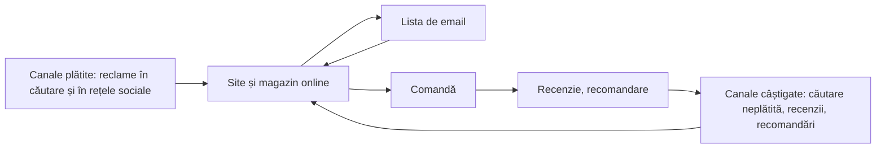
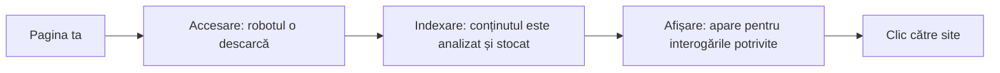
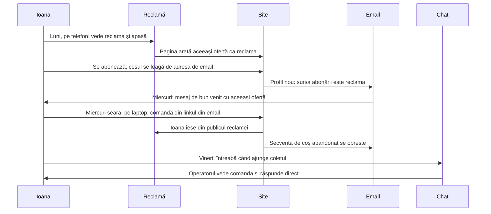

# Capitolul 3. Ecosistemul digital: site, căutare, rețele sociale, email și integrarea canalelor

## Ce vei putea face după acest capitol

- Să descrii ecosistemul digital al unei firme și să încadrezi fiecare canal ca deținut, plătit sau câștigat.
- Să evaluezi un site după cele patru funcții ale lui și după cinci principii de construcție: mobil întâi, viteză, accesibilitate, securitate, conformitate.
- Să explici cum ajunge o pagină în rezultatele Google și să alegi între optimizarea pentru căutare și reclamele în căutare.
- Să proiectezi un program minim de email (consimțământ, segmente, secvențe automate) și să citești corect indicatorii lui.
- Să explici de ce costul unei comenzi aduse din reclame crește când extinzi publicul și să recunoști momentul în care reclama produce pierdere.
- Să compari modelele de atribuire și să construiești un plan de canale pe 90 de zile pentru o firmă mică.

## 3.1 Ce este ecosistemul digital al unei firme

### 3.1.1 O definiție pe înțeles

În prezentarea cursului, ecosistemul digital este descris ca o rețea interconectată de tehnologii, platforme și canale care facilitează interacțiunile digitale și crearea de valoare. Pe înțeles: ecosistemul digital al unei firme este totalitatea locurilor din mediul online în care un om poate da peste firmă, poate afla ceva despre ea, poate cumpăra și poate cere ajutor, împreună cu legăturile dintre aceste locuri.

Partea a doua a definiției contează cel mai mult. Un site, o pagină de Instagram și o listă de email care nu știu unul de altul sunt trei proiecte separate. Devin ecosistem abia când omul care a văzut un clip ajunge ușor pe pagina produsului, când cel care a cumpărat primește emailul potrivit și când firma poate vedea traseul întreg.

> **Exemplu.** Cămara de la Dunăre, magazinul online fictiv din Galați pe care îl folosim în tot suportul, are un site cu magazin, o listă de abonați la newsletter, conturi pe rețele sociale pe care rulează reclame și o prezență în rezultatele Google. În datele ei (date fictive, construite pentru exercițiu) aceste locuri apar ca patru canale: Căutare, Reclame, Email și Direct.

### 3.1.2 Canale deținute, plătite și câștigate

Cea mai utilă împărțire a canalelor pornește de la o întrebare simplă: cine controlează canalul și cu ce îl plătești?

| Tip de canal | Ce înseamnă | Exemple | Cu ce plătești | Ce riști |
|---|---|---|---|---|
| Deținut (owned) | Îl controlezi tu: tu decizi ce apare și când | Site, magazin online, lista de email, blog, aplicație | Timp, găzduire, abonamente la instrumente | Crește încet; dacă îl neglijezi, îmbătrânește |
| Plătit (paid) | Cumperi atenție pe platforma altcuiva | Reclame în căutare, reclame în rețele sociale, colaborări plătite cu creatori | Bani, pe clic sau pe afișare | Se oprește în ziua în care oprești bugetul |
| Câștigat (earned) | Vorbesc alții despre tine, fără plată | Recenzii, recomandări, distribuiri, articole în presă, poziții bune în căutare | Calitatea produsului și a serviciului, răbdare | Nu îl controlezi: poate fi și negativ |

Câteva observații care te feresc de confuzii:

- **Contul tău de pe o rețea socială este „deținut” doar pe jumătate.** Tu decizi ce publici, dar platforma decide cui arată și își poate schimba regulile oricând. Lista de email și site-ul sunt singurele locuri în care legătura cu clientul îți aparține cu adevărat.
- **Poziția în rezultatele neplătite din Google este câștigată, nu cumpărată.** Google spune explicit că nu acceptă plată ca să acceseze mai des un site sau ca să îl claseze mai sus (Google Search Central, „How Search works”, https://developers.google.com/search/docs/fundamentals/how-search-works).
- **Cele trei tipuri lucrează împreună.** Reclama (plătit) aduce omul pe site (deținut), unde se abonează la newsletter (deținut), cumpără, apoi scrie o recenzie (câștigat) pe care o văd următorii vizitatori.

Diagrama arată de ce site-ul stă în centru: aproape orice drum trece prin el. De aceea începem cu site-ul.

### 3.1.3 Rolul fiecărui tip de canal

- **Canalele deținute păstrează valoarea.** Aici se întâmplă vânzarea și tot aici rămân datele despre clienți. Ce construiești pe ele (pagini bune, o listă de abonați) îți rămâne.
- **Canalele plătite cumpără viteză.** Sunt singurele pe care le poți porni mâine și regla din buget. Sunt și singurele cu factură lunară directă, deci cele mai ușor de transformat în pierdere.
- **Canalele câștigate aduc încredere.** O recenzie de la un necunoscut convinge de multe ori mai bine decât textul tău de prezentare, tocmai pentru că nu ai scris-o tu.

> **De reținut.** O firmă mică sănătoasă își construiește întâi canalele deținute, apoi folosește canalele plătite ca accelerator, nu ca motor unic. Dacă toate comenzile tale depind de reclame, ai chirie, nu ai afacere.

## 3.2 Site-ul: centrul ecosistemului

### 3.2.1 Cele patru funcții ale site-ului

Prezentarea cursului numește patru funcții strategice ale site-ului. Le luăm pe rând, cu întrebarea de control potrivită fiecăreia.

| Funcția | Ce face | Întrebare de control | La Cămara de la Dunăre |
|---|---|---|---|
| Informare (hub informațional) | Prezintă oferta și valorile firmei | Găsește vizitatorul în 10 secunde ce vinzi, cui și la ce preț? | Categorii clare: dulcețuri, zacuscă, miere, siropuri; pagină „Producătorii noștri” |
| Conversie | Transformă vizita în comandă sau în contact | Există pe fiecare pagină un pas următor evident? | Butonul „Adaugă în coș”, formular de abonare la newsletter |
| Servicii | Livrează valoare după sau în afara vânzării | Poate clientul să se descurce singur? | Starea comenzii, retur, întrebări frecvente, rețete cu produsele cumpărate |
| Brand | Construiește identitatea și încrederea | Ar recunoaște clientul site-ul fără logo? | Fotografii reale din gospodării, tonul cald, povestea fiecărui producător |

Funcția de servicii se leagă direct de asistența pentru clienți, pe care o tratăm în capitolul 4. Indicatorii site-ului pomeniți în prezentare (rata de conversie, rata de respingere, timpul petrecut pe site, valoarea medie a comenzii) sunt definiți și calculați în capitolul 5.

> **Greșeală frecventă.** Site-ul gândit ca broșură: arată bine, spune povestea firmei, dar nu are niciun pas următor. O pagină fără acțiune clară (cumpără, abonează-te, scrie-ne) îndeplinește doar funcția de informare și lasă celelalte trei pe dinafară.

De ce merită efortul? Cumpăratul online a devenit comportament obișnuit: 78% dintre utilizatorii de internet din Uniunea Europeană au cumpărat sau au comandat online bunuri sau servicii în 2025 (Eurostat, „E-commerce statistics for individuals”, date extrase în februarie 2026, https://ec.europa.eu/eurostat/statistics-explained/index.php?title=E-commerce_statistics_for_individuals).

### 3.2.2 Principiul 1: mobil întâi

„Mobil întâi” (mobile-first) înseamnă că proiectezi pagina pentru ecranul telefonului și abia apoi o extinzi pentru ecrane mari, nu invers. Motivul practic: pe un ecran mic nu încape tot, așa că ești obligat să decizi ce contează.

Există și un motiv tehnic. Google folosește indexarea „mobile-first”: pentru indexare și clasare ia în calcul versiunea de mobil a conținutului, accesată cu robotul său pentru smartphone (Google Search Central, „Mobile-first indexing best practices”, https://developers.google.com/search/docs/crawling-indexing/mobile/mobile-sites-mobile-first-indexing). Consecința: ce lipsește din versiunea de mobil lipsește, practic, și pentru Google. Aceeași documentație recomandă designul adaptabil (responsive web design), adică aceeași adresă și același cod HTML, cu aranjarea ajustată după lățimea ecranului.

Test rapid, de făcut pe telefonul tău: poți citi textul fără să mărești? Poți apăsa butoanele cu degetul mare fără să nimerești alt buton? Poți termina o comandă cu o singură mână, în autobuz?

### 3.2.3 Principiul 2: viteza și Core Web Vitals

Prezentarea cere „timp de încărcare sub 3 secunde”. Este o regulă empirică rezonabilă, dar azi există o măsură mai precisă: Core Web Vitals (în română, „indicatorii web esențiali”), un set de trei indicatori definiți de Google pentru experiența reală a utilizatorilor pe o pagină.

| Indicator | Ce măsoară, pe înțeles | Prag pentru „bun” |
|---|---|---|
| LCP (Largest Contentful Paint, afișarea celui mai mare element de conținut) | Cât durează până apare elementul principal al paginii, de obicei fotografia mare sau titlul | Cel mult 2,5 secunde de la începutul încărcării |
| INP (Interaction to Next Paint, de la interacțiune la următoarea afișare) | Cât de repede răspunde pagina când apeși, atingi sau tastezi | Cel mult 200 de milisecunde |
| CLS (Cumulative Layout Shift, deplasarea cumulată a aranjării) | Cât de mult „sar” elementele în timp ce pagina se încarcă | Cel mult 0,1 |

Pragurile sunt cele din documentația Google (web.dev, „Web Vitals”, pagină actualizată la 31 octombrie 2024, https://web.dev/articles/vitals). Două detalii din aceeași sursă merită reținute. Primul: pragul se judecă la percentila 75 a încărcărilor de pagină, separat pe mobil și pe desktop. Adică pagina este „bună” dacă măcar trei sferturi dintre vizitele reale se încadrează, nu dacă merge bine pe laptopul tău. Al doilea: INP este indicatorul de interactivitate din set; dacă întâlnești prin tutoriale mai vechi alt indicator la acest capitol, sunt depășite.

Contează viteza și pentru căutare? Google spune că indicatorii Core Web Vitals sunt folosiți de sistemele sale de clasare, dar și că nu există un singur semnal pentru experiența paginii, iar conținutul relevant rămâne esențial (Google Search Central, „Understanding page experience in Google Search results”, https://developers.google.com/search/docs/appearance/page-experience). Tradus: o pagină rapidă cu conținut slab nu urcă, dar între două pagini la fel de utile, cea plăcută de folosit are un avantaj.

> **Exemplu.** Pagina „Zacuscă de vinete” de la Cămara are o fotografie de 4 MB, făcută cu telefonul și urcată direct. Pe o conexiune mobilă slabă, fotografia apare târziu, deci LCP iese prost. Remediul nu cere programator: redimensionezi fotografia la lățimea la care se afișează, o salvezi într-un format comprimat și îi declari dimensiunile în pagină, ca textul să nu sară când apare (ceea ce ajută și CLS).

Măsori gratuit cu PageSpeed Insights (https://pagespeed.web.dev/) sau cu raportul „Core Web Vitals” din Google Search Console, care arată date de la vizitatori reali.

### 3.2.4 Principiul 3: accesibilitatea

Accesibilitatea înseamnă că site-ul poate fi folosit și de oameni cu deficiențe de vedere, de auz, motorii sau cognitive. În practică ajută pe toată lumea: omul cu telefonul în soare, omul cu mâna în ghips, omul în vârstă cu ochelarii uitați acasă.

Standardul de referință este WCAG (Web Content Accessibility Guidelines, „Ghidul pentru accesibilitatea conținutului web”), publicat de W3C (World Wide Web Consortium, consorțiul care stabilește standardele webului). Prezentarea pomenește WCAG 2.1. Versiunea pe care W3C o recomandă acum este WCAG 2.2, publicată la 5 octombrie 2023 și actualizată la 12 decembrie 2024; W3C încurajează folosirea celei mai noi versiuni și precizează că un conținut conform cu 2.2 este conform și cu 2.1 și 2.0. WCAG 3 există doar ca proiect timpuriu (W3C, „WCAG 2 Overview”, pagină actualizată la 17 septembrie 2026, https://www.w3.org/WAI/standards-guidelines/wcag/).

WCAG are patru principii și trei niveluri de conformitate (A, AA, AAA). Nivelul AA este ținta obișnuită.

| Principiu | Întrebare de control | Verificare în 2 minute |
|---|---|---|
| Perceptibil | Poate fi perceput conținutul și fără vedere sau fără auz? | Fotografiile au text alternativ? Textul are contrast suficient față de fundal? |
| Operabil | Poți folosi site-ul fără mouse? | Parcurge pagina doar cu tasta Tab: vezi mereu unde ești? Ajungi la buton? |
| Inteligibil | Înțelegi ce ți se cere și ce s-a întâmplat? | Mesajele de eroare din formular spun ce e greșit și cum repari? |
| Robust | Funcționează cu tehnologii asistive? | Titlurile sunt titluri reale (H1, H2), nu text îngroșat? Câmpurile au etichete? |

Accesibilitatea este și obligație legală în anumite situații. Actul european privind accesibilitatea (Directiva (UE) 2019/882) acoperă, printre altele, serviciile de comerț electronic, iar statele membre au avut termen până în iunie 2022 să îl transpună în legislația națională (Comisia Europeană, „European Accessibility Act”, https://commission.europa.eu/strategy-and-policy/policies/justice-and-fundamental-rights/disability/union-equality-strategy-rights-persons-disabilities-2021-2030/european-accessibility-act_en). Data de la care se aplică cerințele și excepțiile pentru firmele foarte mici trebuie verificate în textul directivei și în legea națională de transpunere. Textul de față nu este consultanță juridică.

### 3.2.5 Principiul 4: securitatea (HTTPS)

HTTPS (HyperText Transfer Protocol Secure, protocolul securizat de transfer al paginilor web) criptează comunicarea dintre browserul vizitatorului și site. Fără el, datele dintr-un formular (nume, adresă, parolă) pot fi citite pe drum, iar browserele afișează avertismentul „Nesecurizat”, care alungă cumpărătorii exact pe pagina de plată.

Ce ai de făcut concret:

- Certificat valid pe tot site-ul, nu doar pe pagina de plată. Majoritatea firmelor de găzduire îl oferă inclus.
- Redirecționare automată de la adresa cu http la cea cu https.
- Plata cu cardul printr-un procesator de plăți autorizat. Un magazin mic nu trebuie să stocheze date de card pe serverul lui.
- Platforma și modulele ținute la zi, parole puternice și autentificare în doi pași pentru conturile de administrare.

Google întreabă explicit, în lista de autoevaluare pentru experiența paginii, dacă paginile sunt servite securizat, iar Search Console are un raport dedicat pentru HTTPS (Google Search Central, „Understanding page experience”, link mai sus).

### 3.2.6 Principiul 5: conformitatea (GDPR și cookie-uri)

GDPR (General Data Protection Regulation, Regulamentul general privind protecția datelor, adică Regulamentul (UE) 2016/679) stabilește cum poți colecta și folosi date personale. Pentru un site mic, punctele care apar zilnic sunt acestea:

- **Temei pentru fiecare prelucrare.** Pentru livrarea comenzii ai nevoie de nume și adresă, iar temeiul este contractul. Pentru newsletter ai nevoie, de regulă, de consimțământ.
- **Consimțământ adevărat.** GDPR îl definește, în esență, ca o manifestare de voință liberă, specifică, informată și lipsită de ambiguitate, exprimată printr-o declarație sau o acțiune pozitivă clară (art. 4 pct. 11). O căsuță bifată dinainte nu este acțiunea omului.
- **Retragere la fel de ușoară.** Retragerea consimțământului trebuie să fie la fel de simplă ca acordarea lui (art. 7 alin. 3).
- **Informare.** O politică de confidențialitate scrisă pe înțeles: ce date aduni, de ce, cât le păstrezi, cui le dai.
- **Minimizare.** Nu cere data nașterii dacă nu faci nimic cu ea.

Pentru cookie-uri (fișiere mici pe care site-ul le salvează în browserul vizitatorului) regula vine din legislația privind viața privată în comunicațiile electronice, transpusă în România prin Legea nr. 506/2004. Stocarea de informații în echipamentul utilizatorului este permisă cu acordul lui, dat după o informare clară și completă; acordul nu este necesar pentru ce este strict necesar furnizării unui serviciu cerut expres de utilizator (art. 4 alin. 5 și 6, Portalul legislativ, https://legislatie.just.ro/Public/DetaliiDocument/56973). Pe înțeles: cookie-ul care ține minte coșul de cumpărături merge fără acord; cele de statistică și de publicitate așteaptă un „da”.

> **Greșeală frecventă.** Bannerul de cookie-uri cu un buton mare „Accept” și refuzul ascuns la trei clicuri distanță, în timp ce scripturile de publicitate pornesc oricum înainte de orice alegere. Un asemenea banner decorează, nu cere acord. Verifică în browser, la instrumentele pentru dezvoltatori, ce cookie-uri apar înainte să apeși ceva.

Descrierea de mai sus este orientativă și nu ține loc de consultanță juridică. Pentru cazul tău, citește textul regulamentului și ghidurile autorității naționale (ANSPDCP, Autoritatea Națională de Supraveghere a Prelucrării Datelor cu Caracter Personal) sau consultă un specialist.

### 3.2.7 Listă de verificare pentru pagina de produs

Pagina de produs este locul în care se ia decizia. Parcurge lista cu telefonul în mână.

1. **Numele produsului** spune ce este, nu doar cum l-ai botezat: „Dulceață de caise fără zahăr adăugat, 250 g”, nu „Soare de vară”.
2. **Prețul** este vizibil fără derulare, cu TVA inclus și cu prețul pe unitate (lei/kg) acolo unde legea îl cere.
3. **Fotografii** reale: produsul întreg, eticheta lizibilă, produsul în folosire, o fotografie de scară (borcanul în mână).
4. **Disponibilitate** clară: în stoc, ultimele bucăți sau data la care revine.
5. **Costul și durata livrării** spuse înainte de coș. Costurile apărute abia la final sunt motivul clasic de abandon.
6. **Descriere pe două niveluri**: trei rânduri pentru cel grăbit, apoi detalii (ingrediente, alergeni, producător, valabilitate, păstrare).
7. **Buton de comandă** unic, contrastant, ușor de atins cu degetul mare.
8. **Recenzii** autentice, cu dată, inclusiv cele mai puțin entuziaste. Răspunde la cele negative.
9. **Politica de retur** și datele de contact la un clic distanță.
10. **Titlu de pagină și descriere** unice (vezi 3.3) și text alternativ la imagini.
11. **Date structurate de tip produs**, dacă platforma le oferă. Cu ele, Google poate afișa direct în rezultate prețul, disponibilitatea și evaluările, fără să garanteze că o va face (Google Search Central, „Product structured data”, https://developers.google.com/search/docs/appearance/structured-data/product).
12. **Produse care merg împreună** („Se potrivește cu...”), ca să crești valoarea comenzii fără reducere.

### 3.2.8 Listă de verificare pentru pagina de finalizare a comenzii

Aici omul a decis deja. Treaba ta este să nu îl încurci.

1. **Comandă fără cont obligatoriu.** Contul se poate oferi după plată, cu un singur clic.
2. **Cât mai puține câmpuri.** Fiecare câmp în plus este un motiv de plecare. Ce nu folosești nu ceri.
3. **Tastatura potrivită pe mobil**: numerică la telefon și la cod poștal, cu „@” la email. Completarea automată din browser lăsată activă.
4. **Erori explicate lângă câmp**, pe loc, cu datele deja introduse păstrate.
5. **Total complet vizibil permanent**: produse, livrare, reducere, total de plată.
6. **Metodele de plată pe care le așteaptă publicul tău**: card, ramburs, eventual transfer.
7. **Semnale de încredere** discrete: HTTPS, numele procesatorului de plăți, telefonul firmei.
8. **Căsuțe de consimțământ nebifate** dinainte, separate: una pentru termeni, alta (opțională) pentru newsletter.
9. **Câmpul „cod de reducere”** discret. Un câmp mare și gol îl trimite pe client să caute coduri pe internet și uneori nu se mai întoarce.
10. **Pagina de confirmare și emailul de confirmare** spun exact ce urmează: când pleacă pachetul, cum îl urmărești, cui scrii.

> **Pentru afacerea ta.** Roagă trei oameni care nu ți-au văzut site-ul să cumpere ceva de pe telefon, în fața ta, vorbind cu voce tare. Nu îi ajuta. Notează unde ezită. O jumătate de oră de asemenea observație îți dă mai multe idei decât o lună de dezbateri despre culoarea butonului.

## 3.3 Căutarea: cum te găsesc oamenii care te caută deja

### 3.3.1 Cum funcționează un motor de căutare, pe scurt

Documentația Google descrie trei etape (Google Search Central, „How Search works”, link mai sus):

1. **Accesarea (crawling).** Programe automate, numite roboți sau crawlere, descarcă textul, imaginile și clipurile din paginile pe care le găsesc. Cele mai multe pagini noi sunt descoperite urmând linkuri din pagini deja cunoscute.
2. **Indexarea.** Google analizează conținutul paginii și îl stochează în index, o bază de date uriașă. Indexarea nu este garantată: nu orice pagină procesată ajunge în index.
3. **Afișarea rezultatelor.** Când cineva caută, Google alege din index paginile pe care le consideră cele mai relevante și de cea mai bună calitate pentru acea interogare. Clasarea se face automat, prin program.

De aici rezultă ordinea corectă a întrebărilor când „nu apar pe Google”: Poate robotul să ajungă la pagină? Este pagina în index? Abia apoi: de ce nu este clasată mai sus?

### 3.3.2 SEO: conținut, tehnic, autoritate

SEO (Search Engine Optimization, optimizarea pentru motoarele de căutare) înseamnă munca prin care îți faci paginile ușor de găsit, de înțeles și de ales, în rezultatele neplătite. Se sprijină pe trei picioare.

| Componentă | Întrebarea la care răspunde | Ce faci concret |
|---|---|---|
| Conținut | Răspunde pagina la ce caută omul? | Pagini utile, scrise pentru oameni; cuvintele pe care le folosesc clienții puse în titluri și subtitluri; conținut ținut la zi |
| Tehnic | Poate Google să găsească și să înțeleagă pagina? | Linkuri care pot fi urmate, versiune de mobil completă, titluri unice, viteză, HTTPS, date structurate |
| Autoritate | Au și alții încredere în tine? | Linkuri și mențiuni de la site-uri relevante, recenzii, prezență în comunitățile de profil |

Câteva lucruri pe care Google le spune negru pe alb în ghidul său pentru începători (Google Search Central, „SEO Starter Guide”, https://developers.google.com/search/docs/fundamentals/seo-starter-guide):

- Un titlu bun este unic pentru pagină, clar, concis și descrie corect conținutul.
- O descriere meta bună este scurtă, unică pentru pagină și cuprinde punctele ei cele mai relevante. Google o poate folosi pentru fragmentul afișat în rezultate.
- Textul unui link ar trebui să spună ceva despre pagina spre care duce. „Vezi rețeta de zacuscă” este mai bun decât „click aici”.
- Textul alternativ al unei imagini trebuie să explice legătura dintre imagine și conținut.
- Google Search nu folosește eticheta meta „keywords”. Timpul petrecut cu ea este pierdut.
- Repetarea excesivă a acelorași cuvinte obosește cititorul și intră sub incidența politicilor antispam.
- Unele schimbări se văd în câteva ore, altele în câteva luni. Ghidul recomandă să aștepți câteva săptămâni înainte să judeci efectul.

Tot Google recomandă conținutul „în primul rând pentru oameni”: creat ca să ajute cititorul, nu ca să manipuleze clasarea. Pentru evaluarea calității folosește ideea de E-E-A-T (Experience, Expertise, Authoritativeness, Trustworthiness, adică experiență, expertiză, autoritate, încredere), cu precizarea că E-E-A-T nu este în sine un factor de clasare specific (Google Search Central, „Creating helpful, reliable, people-first content”, https://developers.google.com/search/docs/fundamentals/creating-helpful-content). Pentru un magazin cu produse alimentare, experiența se arată simplu: cine face dulceața, unde, din ce, cu fotografii proprii.

> **Greșeală frecventă.** Descrierea de produs copiată de la furnizor sau de la concurență. Pagina ta devine una dintre zecile de pagini identice, iar Google nu are niciun motiv să o aleagă tocmai pe a ta. Trei propoziții scrise de tine, despre lucruri pe care doar tu le știi despre produs, valorează mai mult decât un paragraf lung preluat.

### 3.3.3 SEO față de reclamele în căutare

În pagina de rezultate apar două feluri de poziții: rezultate neplătite (numite și organice) și reclame, marcate ca atare. Reclamele în căutare se cumpără prin licitație, de obicei cu plată pe clic. O abreviere pe care o vei întâlni: PPC (pay per click, plată pe clic).

| Criteriu | SEO (rezultate neplătite) | Reclame în căutare |
|---|---|---|
| Cost | Timp și muncă; clicul în sine nu costă | Plătești fiecare clic |
| Viteză | Săptămâni sau luni | Ore sau zile |
| Durată | Efectul rămâne o vreme și după ce te oprești | Se oprește odată cu bugetul |
| Control | Redus: nu alegi tu poziția | Mare: alegi cuvintele, mesajul, bugetul, orele |
| Potrivit pentru | Cerere stabilă, întrebări, categorii de produse | Lansări, sezon, verificarea rapidă a unei idei |
| Risc | Depinzi de schimbările de algoritm | Plătești clicuri care nu cumpără |

Cele două se completează. Reclamele îți arată repede ce interogări aduc comenzi. Apoi scrii conținut pentru acele interogări, ca peste câteva luni să primești o parte din clicuri fără plată.

### 3.3.4 Intenția de căutare

În spatele fiecărei căutări este o intenție. Dacă pagina ta nu răspunde intenției, nu contează cât de bine este scrisă. Împărțirea folosită curent în practica de marketing are patru tipuri.

| Intenție | Ce vrea omul | Exemplu de căutare | Pagina potrivită |
|---|---|---|---|
| Informațională | Să afle ceva | „cum se păstrează mierea cristalizată” | Articol sau ghid |
| De navigare | Să ajungă la un site anume | „cămara de la dunăre” | Pagina principală |
| Comercială (de comparare) | Să aleagă între variante | „cea mai bună zacuscă de casă” | Pagină de categorie, comparație, recenzii |
| Tranzacțională | Să cumpere acum | „dulceață de caise fără zahăr livrare galați” | Pagina de produs |

> **Exemplu.** Cine caută „cum se face zacusca” vrea o rețetă, nu un borcan. Dacă îi arăți pagina de produs, pleacă. Dacă îi dai rețeta bunicii, cu fotografii, și la final spui cinstit „dacă nu ai o zi liberă pentru asta, o facem noi după aceeași rețetă”, ai câștigat un cititor și uneori un client.

Metoda cea mai simplă de a afla intenția: caută tu expresia și uită-te la primele rezultate. Dacă apar doar rețete, Google a învățat că oamenii vor rețete.

### 3.3.5 Ce poate face o firmă mică în prima lună

| Săptămâna | Ce faci | Rezultat |
|---|---|---|
| 1 | Îți verifici site-ul în Google Search Console, serviciu gratuit prin care urmărești prezența site-ului în căutare (https://support.google.com/webmasters/answer/9128668). Cauți pe Google `site:domeniultau.ro` ca să vezi ce pagini sunt indexate. Îți completezi profilul firmei pe Google, dacă ai adresă fizică sau zonă de livrare. | Știi ce vede Google din site-ul tău |
| 2 | Rescrii titlurile și descrierile pentru cele mai importante 10 pagini. Verifici versiunea de mobil și viteza cu PageSpeed Insights. Repari linkurile rupte. | Paginile principale sunt clare pentru om și pentru robot |
| 3 | Notezi 10 întrebări pe care ți le pun clienții pe telefon, pe chat sau la târg. Scrii două pagini care răspund la primele două, cu fotografii proprii. | Primele pagini pentru intenția informațională |
| 4 | Ceri recenzii de la clienții mulțumiți. Rogi producătorii parteneri și asociațiile locale să pună link către tine. Te uiți în Search Console la interogările pentru care apari deja. | Primele semnale de autoritate și prima listă de teme |

Ce nu faci: nu cumperi pachete de linkuri, nu umpli paginile cu același cuvânt, nu promiți nimănui „locul 1 în 30 de zile”. Google precizează că nici respectarea tuturor recomandărilor nu garantează accesarea, indexarea sau afișarea unei pagini (Google Search Central, „Google Search Essentials”, https://developers.google.com/search/docs/essentials).

> **Exemplu.** La Cămara, canalul Căutare a adus în septembrie 9.640 de vizite și 241 de comenzi, cu zero cost de marketing direct, iar în noiembrie 9.920 de vizite și 249 de comenzi (date fictive, construite pentru exercițiu). Este canalul cu cea mai mare contribuție din toate cele patru și aproape nu s-a mișcat în trei luni. Asta spune două lucruri: căutarea este temelia magazinului și nimeni nu a mai lucrat la ea.

## 3.4 Rețelele sociale

### 3.4.1 Ce sunt și la ce folosesc

Kaplan și Haenlein (2010) definesc rețelele sociale ca aplicații pe internet care permit crearea și schimbul de conținut produs de utilizatori. Pe înțeles: locuri în care publicul scrie, filmează și comentează alături de tine, nu doar te citește. De aici vin și puterea, și riscul.

Pentru o firmă, rețelele sociale au patru roluri:

- **Descoperire.** Omul nu te caută, dar dă peste tine pentru că algoritmul platformei i-a recomandat un clip sau un prieten a distribuit o postare. Rețelele creează cerere, în timp ce căutarea prinde cererea care există deja.
- **Comunitate.** Clienții care te urmăresc, comentează și își arată unii altora ce au gătit cu produsele tale. O comunitate vie produce conținut și recomandări, adică un canal câștigat.
- **Suport.** Oamenii întreabă și reclamă în comentarii și în mesaje private, fie că îți convine sau nu. Regulile unui suport bun sunt în capitolul 4.
- **Reclame.** Spațiu plătit, cu public ales după interese, comportament și locație (vezi 3.6).

### 3.4.2 Cele cinci strategii din prezentare

**1. Conținut.** Publici lucruri utile sau plăcute pentru publicul tău, nu doar oferte. O regulă simplă de pornire: din cinci postări, cel mult una vinde direct. Pentru Cămara, teme firești sunt producătorii, sezonul (ce se culege acum), rețetele și culisele (cum se umple un borcan).

**2. Influenceri și creatori de conținut.** Colaborezi cu oameni care au deja atenția publicului tău. Pentru o firmă mică, creatorii mici, de nișă, sunt de multe ori alegerea mai potrivită: publicul lor este mai restrâns, dar mai apropiat de subiect. Trei reguli: verifici potrivirea cu publicul tău (nu doar numărul de urmăritori), stabilești în scris ce se livrează și marchezi clar conținutul plătit ca publicitate, pentru că practicile comerciale înșelătoare sunt interzise de regulile de protecție a consumatorului.

**3. Comunitate.** Răspunzi la comentarii, pui întrebări, moderezi. O comunitate nu se construiește prin postări, ci prin răspunsuri. Stabilește cine răspunde, în cât timp și pe ce ton.

**4. Ascultare socială (social listening).** Urmărești sistematic ce se spune despre tine, despre concurenți și despre categoria ta. Pentru o firmă mică, „sistematic” poate însemna o oră pe săptămână: citești comentariile și mesajele, cauți numele firmei și al produselor pe platforme, notezi într-un tabel întrebările și nemulțumirile care se repetă. Din tabelul acela ies idei de produse, de pagini de ajutor și de articole pentru căutare.

**5. Reclame plătite.** Afișezi mesaje unui public ales și plătești pentru afișări sau clicuri. Mecanismul este în secțiunea 3.6.

> **Greșeală frecventă.** Să judeci munca de pe rețele sociale după numărul de urmăritori și de aprecieri. Sunt indicatori de vanitate: arată bine, dar nu plătesc facturi. Întreabă mai bine: câți oameni au ajuns pe site din rețele, câți s-au abonat la newsletter, câți au cumpărat?

### 3.4.3 Cum alegi platforma după public

Prezentarea cursului caracterizează platformele mari astfel: Facebook, cu public larg și opțiuni avansate de țintire a reclamelor; Instagram, cu accent pe vizual și public mai tânăr; LinkedIn, pentru relații profesionale și vânzări între firme; TikTok, pentru video scurt, cu un algoritm de recomandare puternic; X (fost Twitter), pentru comunicare în timp real.

Cifrele despre numărul de utilizatori se schimbă de la an la an și diferă mult de la o țară la alta, așa că nu le reproducem aici. Când ai nevoie de ele, ia-le din rapoartele oficiale ale companiilor sau din estimările de public pe care fiecare platformă ți le arată în instrumentul ei de reclame, pentru țara și vârsta care te interesează.

Mai important decât mărimea platformei este răspunsul la patru întrebări:

1. **Unde își petrece timpul publicul tău?** Nu ghici: întreabă zece clienți reali ce aplicații deschid zilnic.
2. **Ce format poți produce constant?** Dacă nu poți filma două clipuri pe săptămână, o platformă de video scurt te va epuiza.
3. **Se potrivește produsul cu formatul?** Mâncarea, hainele și obiectele frumoase cer imagine. Serviciile pentru firme cer explicații și dovezi.
4. **Cât timp ai, cinstit?** Un cont lucrat bine bate patru conturi abandonate.

| Tip de afacere | Punct de plecare rezonabil | De ce |
|---|---|---|
| Produse alimentare artizanale, pentru persoane fizice | O platformă vizuală plus una cu grupuri locale | Produsul se vinde prin imagine și prin recomandări din comunitate |
| Servicii pentru firme (contabilitate, software) | O rețea profesională | Decidenții caută competență și referințe |
| Produse pentru public foarte tânăr | O platformă de video scurt | Acolo se face descoperirea |
| Serviciu local (salon, service) | Profilul firmei pe Google plus o platformă cu grupuri locale | Oamenii caută aproape de casă și cer recomandări |

> **Pentru afacerea ta.** Alege o singură platformă principală pentru următoarele trei luni și una secundară, pe care doar republici. Scrie pe o foaie: cui vorbesc, ce public de două ori pe săptămână, cine răspunde la mesaje și în cât timp, ce număr urmăresc (vizite pe site sau abonări, nu aprecieri).

## 3.5 Email marketing

### 3.5.1 De ce emailul rămâne important

Emailul este canalul deținut prin excelență. Lista este a ta, mesajul ajunge fără ca un algoritm să decidă cui îl arată, iar costul unui mesaj în plus este aproape zero. Prețul acestui avantaj: ai nevoie de permisiunea omului și trebuie să o meriți la fiecare trimitere. Ideea a fost formulată de Seth Godin sub numele de „marketing bazat pe permisiune”: vorbești cu oameni care au cerut să audă de la tine, în loc să întrerupi oameni care nu au cerut nimic.

În circulație sunt multe cifre spectaculoase despre randamentul emailului. Nu le reluăm aici, pentru că nu le-am putut verifica într-o sursă primară. Ai la îndemână ceva mai bun: propriile date.

> **Exemplu.** La Cămara, în septembrie, emailul a adus 2.400 de vizite și 121 de comenzi, cu un cost de 200 de lei pe lună pentru platforma de trimitere. Asta înseamnă o rată de conversie de aproximativ 5%, față de 2,5% la Căutare și 2% la Reclame, și o contribuție de 7.090 de lei (date fictive, construite pentru exercițiu). Atenție la interpretare: abonații sunt oameni care te cunosc deja. Emailul nu este „mai bun” decât reclama, ci lucrează în alt punct al relației.

### 3.5.2 Cele patru tipuri de mesaje

| Tip | Când pleacă | Scop | Exemplu la Cămara |
|---|---|---|---|
| Newsletter | Periodic, la o dată anunțată | Să rămâi în minte, să oferi ceva util | „Ce s-a copt luna asta”: un producător, o rețetă, două produse de sezon |
| Tranzacțional | Declanșat de o acțiune a clientului | Să informeze despre o tranzacție | Confirmarea comenzii, expedierea, factura, resetarea parolei |
| Secvență automată (drip) | Automat, în pași, după un eveniment | Să conducă omul spre pasul următor | Seria de bun venit după abonare: povestea, cele mai iubite produse, o primă ofertă |
| Reactivare | Când un abonat nu a mai deschis sau cumpărat de mult | Să recâștigi sau să cureți lista | „Mai vrei să primești vești de la noi?” după 6 luni de tăcere |

Două precizări. Mesajele tranzacționale se trimit pentru că fac parte din serviciu, nu pentru că omul a acceptat marketing; nu le transforma în reclame deghizate. Iar secvențele automate sunt cel mai bun raport între muncă și rezultat pentru o firmă mică: le scrii o dată și lucrează luni întregi. Trei secvențe de pornit: bun venit, coș abandonat, mesaj după livrare (cu cerere de recenzie).

### 3.5.3 Consimțământ și dezabonare

Regulile, pe scurt și cu prudența cuvenită:

- **Acord prealabil.** Legea nr. 506/2004 interzice comunicările comerciale prin email fără acordul prealabil expres al destinatarului (art. 12 alin. 1, https://legislatie.just.ro/Public/DetaliiDocument/56973).
- **Excepția pentru clienții existenți.** Dacă ai obținut adresa cu ocazia unei vânzări, o poți folosi pentru produse sau servicii similare ale tale, cu condiția să îi oferi clientului, clar și gratuit, posibilitatea de a refuza, atât la colectare, cât și în fiecare mesaj (art. 12 alin. 2).
- **Identitate reală.** Nu ascunzi cine trimite și incluzi o adresă validă la care omul poate cere oprirea mesajelor (art. 12 alin. 3).
- **Dreptul de opoziție.** GDPR dă persoanei dreptul de a se opune oricând prelucrării datelor în scop de marketing direct; după opoziție, datele nu mai pot fi folosite în acest scop (art. 21 alin. 2 și 3).
- **Dovada.** Tu trebuie să poți demonstra că omul și-a dat acordul (art. 7 alin. 1 din GDPR). Păstrează data, sursa și textul formularului.

La cerințele legale se adaugă cele ale furnizorilor de email. Google cere tuturor celor care trimit către conturi Gmail să își autentifice mesajele și să țină rata de raportare ca spam sub 0,30%. Celor care trimit peste 5.000 de mesaje pe zi le cere în plus autentificare completă (SPF, DKIM și DMARC, trei mecanisme prin care domeniul dovedește că mesajul vine de la el) și dezabonare cu un singur clic la mesajele de marketing (Google, „Email sender guidelines”, https://support.google.com/a/answer/81126). Chiar dacă trimiți mult mai puțin, regulile acestea sunt un standard bun.

> **Greșeală frecventă.** Lista cumpărată sau „împrumutată” de la un partener. Oamenii aceia nu ți-au dat ție acordul, vor marca mesajele ca spam, iar reputația domeniului tău scade până când nici clienții adevărați nu îți mai primesc emailurile. La fel de greșit: bifa de newsletter pusă dinainte în formularul de comandă.

Acest text nu este consultanță juridică. Verifică situația ta cu textele oficiale și, la nevoie, cu un specialist.

### 3.5.4 Segmentarea

Segmentarea înseamnă să împarți lista în grupuri și să trimiți fiecărui grup ce îl privește. Pornește simplu, cu date pe care le ai deja:

| Segment | Cum îl definești | Ce îi trimiți |
|---|---|---|
| Abonați care nu au cumpărat încă | Abonare fără nicio comandă | Seria de bun venit, cele mai apreciate produse, garanții |
| Clienți cu o singură comandă | O comandă în ultimele 90 de zile | Idei de folosire, produse complementare, invitație la recenzie |
| Clienți fideli | Trei comenzi sau mai multe | Acces în avans la loturi mici, mulțumiri, întrebări pentru feedback |
| Iubitori ai unei categorii | Au cumpărat de două ori miere, de exemplu | Noutăți din categoria respectivă |
| Inactivi | Niciun clic în 6 luni | O singură încercare de reactivare, apoi scoatere din listă |

Segmentarea are și un efect financiar direct: clienților fideli nu trebuie să le dai reducere ca să cumpere. Un cod de 20% trimis întregii liste scade marja exact la oamenii care ar fi cumpărat oricum.

### 3.5.5 Testarea A/B a subiectului

Subiectul decide dacă mesajul este deschis. Într-un test A/B trimiți două variante de subiect către două părți mici, alese la întâmplare, din listă, apoi trimiți restului varianta câștigătoare. Majoritatea platformelor de email fac asta automat.

Trei reguli practice:

- Schimbi un singur lucru între variante, altfel nu știi ce a contat. De exemplu: „Zacusca de anul acesta a sosit” față de „Am scos primele 200 de borcane de zacuscă”.
- Alegi dinainte indicatorul după care judeci. Clicurile sunt mai de încredere decât deschiderile (vezi mai jos).
- Pe o listă mică, diferențele mici sunt zgomot. Dacă varianta A are 41 de clicuri și B are 44, nu ai aflat nimic.

Cum se proiectează și se interpretează corect un experiment (mărimea eșantionului, semnificația diferenței) este subiectul capitolului 9.

### 3.5.6 Indicatorii și limitele lor

| Indicator | Formulă | Ce îți spune | Limite |
|---|---|---|---|
| Rata de livrare | mesaje livrate / mesaje trimise | Cât de curată este lista | Livrat nu înseamnă ajuns în căsuța principală |
| Rata de deschidere | deschideri unice / mesaje livrate | Cât de bine au lucrat subiectul și numele expeditorului | Măsurare nesigură (vezi explicația) |
| Rata de clic | clicuri unice / mesaje livrate | Cât de interesant a fost conținutul | Nu spune dacă omul a și cumpărat |
| Rata de dezabonare | dezabonări / mesaje livrate | Dacă trimiți prea des sau nepotrivit | O dezabonare e mai bună decât o raportare ca spam |
| Rata de raportare ca spam | raportări / mesaje livrate | Dacă oamenii consideră că nu ți-au dat acordul | Pragul Google, amintit mai sus: sub 0,30% |
| Venit pe mesaj trimis | venit atribuit emailului / mesaje trimise | Cât valorează o trimitere | Depinde de modelul de atribuire (vezi 3.8) |

De ce este nesigură rata de deschidere? Deschiderea se măsoară cu o imagine invizibilă din mesaj: când programul de email o descarcă, platforma notează „deschis”. Două lucruri strică măsurătoarea. Unele programe blochează imaginile, deci omul citește fără să fie numărat. Altele fac invers: funcția Mail Privacy Protection de la Apple îi împiedică pe expeditori să vadă dacă destinatarul a deschis mesajul (Apple, „Use Mail Privacy Protection on iPhone”, https://support.apple.com/guide/iphone/use-mail-privacy-protection-iphf084865c7/ios), iar pentru platforma de trimitere asemenea mesaje pot apărea ca deschise fără ca omul să le fi văzut. Aceeași pagină Apple precizează că protecția nu se extinde la linkuri, motiv pentru care clicurile rămân măsurabile.

> **De reținut.** Folosește rata de deschidere doar ca să compari între ele mesajele tale, pe aceeași listă, în timp. Nu o compara cu „media industriei” și nu lua decizii mari pe baza ei. Pentru decizii, uită-te la clicuri, la comenzi și la dezabonări.

## 3.6 Reclame plătite, pe scurt

### 3.6.1 Licitația

Spațiul de reclamă se vinde prin licitație automată, ținută de fiecare dată când există o ocazie de afișare: o căutare pe Google sau un loc liber în fluxul cuiva dintr-o rețea socială.

Nu câștigă neapărat cine oferă cel mai mult. La Google Ads, documentația enumeră mai mulți factori care decid ce reclame apar și în ce ordine: suma licitată, calitatea reclamei și a paginii de destinație, pragurile minime de calitate, contextul căutării, efectul așteptat al elementelor reclamei și nivelul concurenței din licitație. Suma licitată este maximul pe care accepți să îl plătești pe clic, iar suma plătită efectiv este adesea mai mică (Google Ads Help, „How the Google Ads auction works”, https://support.google.com/google-ads/answer/6366577). Meta descrie o logică asemănătoare pentru Facebook și Instagram: licitația caută să potrivească reclama cu oamenii cei mai susceptibili să fie interesați, iar relevanța se judecă după ratele de acțiune estimate și după calitatea reclamei, nu doar după ofertă (Meta, „Licitația pentru reclame”, https://www.facebook.com/business/ads/ad-auction).

Concluzia practică: o reclamă relevantă, care duce la o pagină bună, cumpără atenție mai ieftin decât una slabă cu buget mare. Munca la pagina de produs din secțiunea 3.2 scade și costul reclamelor.

### 3.6.2 Vocabularul minim

- **Cost pe clic** (CPC, cost per click): cât plătești, în medie, pentru o vizită adusă de reclamă. Se calculează ca buget cheltuit împărțit la numărul de clicuri.
- **Public țintă**: grupul de oameni cărora platforma le arată reclama. Îl definești prin locație, vârstă, interese, comportament sau prin liste proprii.
- **Redirecționare** (retargeting sau remarketing): reclame arătate oamenilor care au interacționat deja cu tine, de exemplu au vizitat site-ul sau au pus ceva în coș. Google o descrie ca folosirea datelor proprii pentru a reveni la oamenii care au mai interacționat cu marca (Google Ads Help, „About your data segments”, https://support.google.com/google-ads/answer/2453998). Atenție: redirecționarea se bazează pe cookie-uri și identificatori de publicitate, deci are nevoie de acordul vizitatorului (vezi 3.2.6).
- **Public asemănător**: platforma caută oameni care seamănă cu clienții tăi actuali.
- **Cost pe comandă**: bugetul cheltuit împărțit la numărul de comenzi aduse. Acesta este numărul care se compară cu marja, nu costul pe clic. Indicatorii financiari ai reclamelor sunt tratați pe larg în capitolul 5.

### 3.6.3 De ce crește costul când extinzi publicul

Gândește-te la publicul posibil ca la cercuri concentrice.

1. În centru sunt oamenii care te cunosc: foști clienți, abonați, vizitatori recenți. Sunt puțini, dar cumpără ușor.
2. În al doilea cerc sunt oamenii care seamănă cu clienții tăi și au deja interes pentru categorie.
3. În cercul mare sunt oamenii care nu te știu și nu căutau nimic.

Cu un buget mic, platforma îți cheltuie banii în primele două cercuri, pentru că acolo găsește cele mai probabile comenzi. Când mărești bugetul de câteva ori, cercurile din centru se epuizează repede și sistemul trebuie să iasă spre margine. Acolo se întâmplă trei lucruri deodată: oamenii fac clic mai rar, cei care fac clic cumpără mai rar, iar pentru a câștiga mai multe licitații ajungi să plătești mai mult pe fiecare. Economiștii numesc asta randament descrescător: fiecare leu în plus aduce mai puțin decât leul dinainte.

Datele Cămării arată exact acest tipar (date fictive, construite pentru exercițiu).

| Canalul Reclame | Septembrie | Noiembrie |
|---|---|---|
| Buget | 2.400 lei | 16.800 lei |
| Vizite | 3.220 | 15.900 |
| Comenzi | 64 | 286 |
| Cost pe vizită | 0,75 lei | 1,06 lei |
| Rata de conversie | 1,99% | 1,80% |
| Cost pe comandă | 37,50 lei | 58,74 lei |
| Valoarea medie a comenzii | 150 lei | 105 lei |
| Contribuția pe comandă | +16 lei | -40 lei |

Bugetul a crescut de 7 ori, comenzile doar de aproximativ 4,5 ori. Și mai grăitor este calculul la margine: cei 14.400 de lei în plus au adus 222 de comenzi în plus, adică aproape 65 de lei pe fiecare comandă suplimentară, față de 37,50 lei înainte.

A doua jumătate a problemei a fost codul de reducere de 20%. La preț întreg, o comandă de 150 de lei lasă o marjă brută de 45%, adică 67,50 lei; după 14 lei de ambalare și livrare rămân 53,50 lei din care se poate plăti reclama. Cu reducerea, comanda medie a coborât la 105 lei, cu o marjă de 31%: aproximativ 32,55 lei, din care rămân 18,55 lei după ambalare și livrare. Nicio reclamă către un public rece nu aduce o comandă cu mai puțin de 18,55 lei. Fiecare comandă din reclame a pierdut, în medie, 40 de lei, iar 286 de asemenea comenzi explică de ce rezultatul lunii a scăzut cu 63%, deși comenzile totale au crescut cu 44%. Calculul complet al economiei unei comenzi este în capitolul 5.

> **Greșeală frecventă.** „Reclama merge, hai să dublăm bugetul.” Rezultatul de la 2.400 de lei nu se înmulțește cu 7 la 16.800 de lei. Crește bugetul în pași mici (de exemplu cu 20-30% o dată), așteaptă o săptămână sau două și verifică de fiecare dată costul pe comandă al pasului adăugat, nu media pe toată luna.

> **Pentru afacerea ta.** Înainte de a porni o reclamă, calculează-ți plafonul: marja brută pe o comandă medie minus costurile de ambalare și livrare. Atât poți plăti, cel mult, ca să aduci o comandă fără să pierzi bani la prima vânzare. Scrie numărul pe un bilet și lipește-l pe monitor.

## 3.7 Integrarea canalelor: de la multe canale la o singură experiență

### 3.7.1 Multichannel față de omnichannel

O firmă este **multichannel** („cu mai multe canale”) când este prezentă pe mai multe canale, dar fiecare lucrează separat: echipă, obiective și date proprii. Este **omnichannel** („pe toate canalele, ca un întreg”) când canalele sunt gestionate împreună. Verhoef, Kannan și Inman (2015) descriu trecerea ca pe un management sinergic al canalelor și al punctelor de contact, astfel încât să fie optimizate și experiența clientului, și performanța de ansamblu a canalelor.

Pe înțeles: în multichannel, clientul se adaptează la organizarea firmei. În omnichannel, firma se organizează după drumul clientului.

| | Multichannel | Omnichannel |
|---|---|---|
| Punct de pornire | Canalul („ce facem pe Instagram?”) | Clientul („ce are nevoie Ioana acum?”) |
| Date | Câte o listă în fiecare instrument | Un singur profil al clientului |
| Mesaje | Fiecare canal are calendarul lui | Mesajele țin cont de ce s-a întâmplat pe celelalte canale |
| Obiective | Fiecare canal își apără cifrele | Rezultatul total și experiența clientului |
| Măsurare | Ultimul clic, pe canal | Traseul întreg |

### 3.7.2 Cele patru componente

Prezentarea numește patru componente ale integrării.

1. **Consistență între canale.** Același preț, aceeași ofertă, același ton, aceeași informație despre stoc și livrare, oriunde te întâlnește omul.
2. **Date unificate despre client** (single customer view, „o singură imagine a clientului”). Toate interacțiunile unei persoane sunt legate de același profil: comenzi, abonare, mesaje, conversații cu suportul. Pentru o firmă mică, asta începe cu un lucru modest: adresa de email ca identificator comun între magazin, platforma de email și instrumentul de suport.
3. **Orchestrare.** Mesajele se declanșează și se opresc în funcție de ce face clientul, cât mai aproape de timpul real. Exemplu: emailul „ai uitat ceva în coș” nu mai pleacă dacă omul a cumpărat între timp.
4. **Atribuire.** Înțelegi ce rol a jucat fiecare canal în drumul spre comandă (secțiunea 3.8).

### 3.7.3 Povestea Ioanei

Ioana are 34 de ani, locuiește în Brăila și caută un cadou pentru mama ei. Săptămâna ei arată așa:

- **Luni seara, pe telefon.** Vede pe o rețea socială reclama Cămării: zacuscă și dulceață, cu codul TOAMNA20, reducere de 20%. Apasă, se uită la două produse, se abonează la newsletter și închide. Era în autobuz.
- **Miercuri dimineața.** Primește newsletterul săptămânal. Îl deschide pe telefon și vede un set-cadou cu trei borcane.
- **Miercuri seara, pe laptop.** Apasă pe linkul din email, alege setul-cadou și comandă.
- **Vineri.** Scrie pe chat: „Când ajunge comanda? Aș vrea să o am până duminică.”

**Varianta cu canale separate.** Să vedem ce se strică, pas cu pas.

| Moment | Ce pățește Ioana | Cauza din spate |
|---|---|---|
| Luni | Pagina din reclamă arată alt preț decât reclama | Reclama a fost făcută de o agenție, prețul din site s-a schimbat între timp |
| Miercuri dimineața | Newsletterul anunță „10% reducere la tot”, deși reclama promitea 20% | Emailul și reclamele au calendare diferite; nimeni nu le-a pus alături |
| Miercuri seara | Coșul început luni pe telefon nu mai există pe laptop; codul TOAMNA20 „nu este valabil pentru seturi” | Coșul ține doar de dispozitiv; condițiile codului nu erau scrise în reclamă |
| Joi | Vede în continuare reclama cu produsul pe care tocmai l-a cumpărat | Lista de cumpărători nu ajunge la platforma de reclame |
| Joi | Primește emailul „Ai uitat ceva în coș?” pentru coșul de luni | Platforma de email nu știe de comanda de miercuri |
| Vineri | Operatorul de pe chat îi cere numele, emailul și numărul comenzii, apoi caută trei minute | Chatul nu este legat de magazin |
| La raportare | Comanda apare la canalul Email; reclama pare să nu fi adus nimic | Atribuire pe ultimul clic |

Niciuna dintre aceste probleme nu este o catastrofă. Împreună, îi spun Ioanei că are de-a face cu o firmă dezorganizată, iar firmei îi spun lucruri greșite despre ce funcționează.

**Varianta integrată.** Aceeași săptămână, cu legăturile făcute:

Ce a fost nevoie ca să arate așa:

- O singură sursă pentru prețuri și oferte, din care se alimentează site-ul, emailul și reclamele.
- Adresa de email ca identificator comun. Coșul și comenzile se leagă de ea.
- Un nou abonat intră în seria de bun venit, nu direct în newsletterul general. Seria respectă oferta prin care a venit.
- Lista de cumpărători este trimisă periodic către platforma de reclame, ca excludere, cu respectarea regulilor de consimțământ.
- Chatul afișează operatorului comenzile asociate adresei de email (detalii în capitolul 4).
- La raportare, firma se uită la traseu, nu doar la ultimul clic.

> **De reținut.** Integrarea nu începe cu un software scump. Începe cu trei decizii: un calendar comun al ofertelor, un identificator comun al clientului și o regulă simplă pentru fiecare eveniment important (abonare, comandă, reclamație): ce se pornește și ce se oprește pe celelalte canale.

## 3.8 Atribuirea: cui îi revine meritul pentru o comandă

### 3.8.1 Problema

Ioana a atins două canale înainte să cumpere. Alți clienți ating cinci. Comanda este una singură. Atribuirea este regula prin care împarți meritul unei comenzi între canalele care au contribuit la ea. Nu există o regulă „adevărată”; există reguli mai potrivite sau mai puțin potrivite pentru decizia pe care o ai de luat.

### 3.8.2 Modelele

Să luăm un traseu ceva mai lung, pentru o comandă de 120 de lei: reclamă pe rețele sociale (luni), căutare pe Google după numele magazinului (marți), email (miercuri), intrare directă pe site și comandă (joi).

| Model | Regula | Reclame | Căutare | Email | Direct |
|---|---|---|---|---|---|
| Primul contact | Tot meritul merge la primul canal | 120 lei | 0 | 0 | 0 |
| Ultimul clic | Tot meritul merge la ultimul canal | 0 | 0 | 0 | 120 lei |
| Ultimul clic, fără Direct | Ca mai sus, dar intrările directe sunt ignorate | 0 | 0 | 120 lei | 0 |
| Împărțită egal (liniară) | Fiecare contact primește la fel | 30 lei | 30 lei | 30 lei | 30 lei |
| Împărțită după poziție | De exemplu 40% primul, 40% ultimul, restul la mijloc | 48 lei | 12 lei | 12 lei | 48 lei |
| Bazată pe date | Un algoritm estimează contribuția fiecărui contact, comparând traseele care se termină cu o comandă cu cele care nu se termină | după estimare | după estimare | după estimare | după estimare |

Câteva lămuriri:

- **Primul contact** răsplătește canalele care fac cunoștință (reclame, rețele sociale) și ignoră tot ce a convins omul după aceea.
- **Ultimul clic** răsplătește canalele care încheie (email, direct, căutarea după numele firmei) și ignoră cine a adus omul prima dată.
- **Modelele împărțite** sunt un compromis: recunosc că au contat mai multe canale, dar ponderile sunt alese de tine, nu descoperite.
- **Modelul bazat pe date** are nevoie de volum mare de comenzi și rămâne o cutie neagră: primești rezultatul, nu și explicația.

Instrumentele se schimbă, așa că verifică ce îți oferă al tău. În Google Analytics 4, de exemplu, modelele disponibile sunt cel bazat pe date și două variante de ultim clic; modelele primul clic, liniar, cu depreciere în timp și bazat pe poziție nu mai sunt disponibile din noiembrie 2023 (Google Analytics Help, „Get started with attribution”, https://support.google.com/analytics/answer/10596866). Regulile simple rămân însă utile ca mod de a gândi și le poți aplica oricând pe propriile date.

### 3.8.3 Limitele oricărui model

- **Schimbarea dispozitivului.** Ioana a apăsat pe reclamă de pe telefon și a comandat de pe laptop. Dacă nu s-a autentificat pe ambele, pentru sistem sunt doi oameni diferiți.
- **Refuzul cookie-urilor.** Vizitatorii care nu acceptă cookie-urile de statistică lipsesc din trasee. Este dreptul lor, iar tu trebuie să accepți că imaginea este parțială.
- **Contactele fără clic.** Cine a văzut un clip fără să apese, a auzit de tine de la o prietenă sau a văzut borcanul la cineva acasă nu apare nicăieri.
- **„Direct” este o cutie cu de toate.** Aici ajung oamenii care au tastat adresa, dar și vizitele a căror sursă s-a pierdut pe drum (linkuri din aplicații de mesagerie, din documente, din unele aplicații de email).
- **Atribuirea nu este cauzalitate.** Faptul că un canal apare înaintea comenzii nu dovedește că a produs-o. Redirecționarea arată reclame unor oameni care oricum urmau să cumpere și apoi își trece comanda în cont. Ca să afli ce s-ar fi întâmplat fără reclamă, ai nevoie de un experiment (capitolul 9).

### 3.8.4 De ce contează când împarți bugetul

Bugetul urmează raportul. Dacă raportul folosește ultimul clic, canalele de început par slabe și li se taie banii. Peste două luni scad și canalele de încheiere, pentru că nu mai are cine să le aducă oameni noi. Dacă raportul folosește primul contact, se întâmplă invers: reclamele par eroii, iar emailul pare inutil.

În datele Cămării, canalul unei comenzi este **ultimul clic**. Asta are trei consecințe pe care trebuie să le ții minte când citești tabelele din acest suport:

1. **Email și Direct sunt probabil supraevaluate ca sursă de clienți noi.** O parte dintre comenzile lor aparțin unor oameni care au aflat de magazin dintr-o reclamă sau dintr-o căutare, ca Ioana.
2. **Reclamele sunt probabil subevaluate ca sursă de primă întâlnire.** Abonații noi câștigați în octombrie și noiembrie pot cumpăra în ianuarie, prin email, la preț întreg.
3. **Concluzia principală rămâne în picioare.** Reclamele din noiembrie au pierdut aproximativ 40 de lei pe fiecare comandă atribuită lor, iar vizitele și comenzile de pe Email și Direct au rămas aproape neschimbate din septembrie în noiembrie (Email: de la 121 la 129 de comenzi; Direct: de la 127 la 132; date fictive). Dacă reclamele ar fi împins masiv oameni spre celelalte canale, am fi văzut acolo o creștere. Nu o vedem, cel puțin nu încă.

> **Exemplu.** Un test simplu de bun-simț, înainte de orice model: pune pe același grafic bugetul de reclame și comenzile totale ale magazinului, pe săptămâni (tipurile de grafice sunt în capitolul 7). Dacă bugetul crește de 7 ori și comenzile din celelalte canale stau pe loc, niciun model de atribuire nu va scoate reclamele pe plus.

Ce poate face o firmă mică, fără instrumente scumpe:

- Marchează linkurile din emailuri și reclame cu parametri de campanie (parametri UTM, etichete adăugate la adresa linkului care spun instrumentului de analiză de unde vine vizita).
- Pune în formularul de comandă întrebarea opțională „De unde ai aflat de noi?”. Răspunsurile acoperă exact ce nu vede niciun instrument.
- Compară lunar două modele (primul contact și ultimul clic) pe aceleași comenzi. Canalele la care diferența este mare sunt cele despre care știi cel mai puțin.
- Urmărește separat clienții noi și cei care revin. Un canal care aduce doar clienți vechi nu crește afacerea.

## 3.9 Exemplu lucrat: plan de canale pe 90 de zile pentru Cămara de la Dunăre

### 3.9.1 Punctul de plecare

Suntem la sfârșitul lui noiembrie. Rezumatul situației (date fictive, construite pentru exercițiu):

| Canal (noiembrie) | Vizite | Comenzi | Venit | Cost de marketing | Contribuție |
|---|---|---|---|---|---|
| Căutare | 9.920 | 249 | 37.350 lei | 0 lei | 13.321,50 lei |
| Reclame | 15.900 | 286 | 30.030 lei | 16.800 lei | -11.494,70 lei |
| Email | 2.560 | 129 | 21.285 lei | 200 lei | 7.572,25 lei |
| Direct | 3.760 | 132 | 20.460 lei | 0 lei | 7.359,00 lei |
| Total | 32.140 | 796 | 109.125 lei | 17.000 lei | 16.758,05 lei |

După costurile fixe de 10.000 de lei, rezultatul simplificat al lunii este 6.758 de lei, față de 18.088 de lei în septembrie.

Diagnosticul, în trei propoziții. Canalele deținute și câștigate (Căutare, Email, Direct) produc toată contribuția și nu au mai fost dezvoltate. Canalul plătit a fost mărit de 7 ori și legat de o reducere care a coborât marja sub costul de achiziție. Canalele lucrează separat: reclamele nu alimentează planificat lista de email, iar raportarea se face doar pe ultimul clic.

### 3.9.2 Obiective și reguli

Obiectivul pe 90 de zile: rezultatul simplificat lunar revine peste nivelul din septembrie, fără ca numărul de comenzi să coboare sub cel din septembrie.

Reguli de lucru:

1. **Plafon de cost pe comandă pentru reclame: 35 de lei**, la preț întreg. Rațiunea: 53,50 lei rămân dintr-o comandă medie după marfă, ambalare și livrare, iar plafonul lasă o rezervă.
2. **Fără cod general de reducere în reclame.** Stimulentele se dau țintit (prima comandă a unui abonat, coș abandonat) și se verifică la marjă.
3. **Bugetul de reclame crește doar în pași de cel mult 25%**, și doar dacă pasul anterior a respectat plafonul.
4. **Fiecare vizită plătită are două ținte**: comanda sau abonarea la newsletter.
5. **O singură foaie de calcul comună** cu ofertele, mesajele și datele de pe toate canalele.

### 3.9.3 Planul, lună cu lună

| | Zilele 1-30: oprește pierderea, repară temelia | Zilele 31-60: construiește canalele deținute | Zilele 61-90: crește controlat și măsoară |
|---|---|---|---|
| Site | Verificare pe mobil; fotografiile comprimate; listele din 3.2.7 și 3.2.8 aplicate pe primele 10 produse și pe pagina de finalizare | Pagini de categorie rescrise; seturi-cadou ca produse separate; recenzii cerute după livrare | Întrebarea „De unde ai aflat de noi?” în formular; date structurate de produs |
| Căutare | Search Console configurat; titluri și descrieri pentru primele 10 pagini | Patru articole pe întrebări reale (păstrarea mierii, zacuscă fără conservanți, idei de cadou, rețete) | Analiza interogărilor din Search Console; încă patru articole; linkuri de la producători |
| Rețele sociale | O platformă principală; două postări pe săptămână despre producători | Serie de clipuri scurte „din cămară”; răspuns la comentarii în aceeași zi | O colaborare cu un creator local de conținut culinar, marcată ca publicitate |
| Email | Serie de bun venit (3 mesaje); mesaj de coș abandonat; formular de abonare vizibil | Segmente: fără comandă, o comandă, fideli; newsletter la două săptămâni | Reactivarea inactivilor; test A/B pe subiect la fiecare newsletter |
| Reclame | Buget redus la 3.000 lei; cod general oprit; redirecționare și public asemănător clienților | Buget până la 3.750 lei, doar dacă plafonul de 35 lei a fost respectat; reclame pentru seturi-cadou | Încă un pas de cel mult 25%, sub aceeași condiție; cumpărătorii excluși din public |
| Integrare și măsurare | Calendar comun de oferte; linkuri marcate cu parametri UTM | Adresa de email ca identificator comun între magazin, email și chat | Raport lunar cu două modele de atribuire; clienți noi și clienți care revin, separat |

### 3.9.4 Ce urmărim și când schimbăm direcția

| Indicator | Nivel de pornire (noiembrie) | Țintă la 90 de zile | Semnal de alarmă |
|---|---|---|---|
| Cost pe comandă la Reclame | 58,74 lei | Sub 35 lei | Peste 45 lei două săptămâni la rând |
| Contribuția pe comandă la Reclame | -40 lei | Pozitivă | Negativă după prima lună |
| Comenzi din Căutare | 249 pe lună | În creștere față de noiembrie | Scădere două luni la rând |
| Comenzi din Email | 129 pe lună | În creștere, pe măsură ce crește lista | Dezabonări în creștere după fiecare trimitere |
| Abonați noi pe lună | De măsurat (nu apare în date) | Urmărit săptămânal | Zero abonări din vizitele plătite |
| Rezultat simplificat lunar | 6.758 lei | Peste 18.088 lei | Sub nivelul din noiembrie |

Țintele sunt alegeri de lucru, nu previziuni. Un calcul de verificare arată însă că direcția este realistă: dacă în prima lună Reclamele revin doar la situația din septembrie (64 de comenzi, contribuție de 1.024 de lei), iar celelalte trei canale rămân la nivelul din noiembrie, contribuția totală ar fi 13.321,50 + 7.572,25 + 7.359,00 + 1.024 = 29.276,75 lei, iar rezultatul simplificat, după 10.000 de lei costuri fixe, aproximativ 19.277 de lei. Adică mai puține comenzi decât în noiembrie (574 față de 796) și un rezultat aproape de trei ori mai mare.

> **De reținut.** Planul nu spune „renunță la reclame”. Spune: reclama este un canal plătit, deci are un plafon; canalele deținute se construiesc mai încet, dar ce construiești rămâne; iar deciziile se iau pe contribuție, nu pe număr de comenzi.

## Aplicații

1. **Harta canalelor (Cămara).** Desenează ecosistemul digital al Cămării de la Dunăre: toate punctele de contact pe care le poți deduce din capitol, fiecare încadrat ca deținut, plătit sau câștigat. Marchează cu roșu legăturile care lipsesc în varianta „canale separate” din povestea Ioanei.

2. **Auditul unei pagini de produs.** Alege un magazin online românesc mic și o pagină de produs. Parcurge lista din 3.2.7 de pe telefon și notează, pentru fiecare dintre cele 12 puncte, „da”, „parțial” sau „nu”. Rulează pagina prin PageSpeed Insights și notează valorile LCP, INP și CLS, cu data măsurătorii. Propune primele trei îmbunătățiri, în ordinea efectului așteptat.

3. **Intenția de căutare (Cămara).** Scrie 12 căutări posibile legate de produsele Cămării, câte trei pentru fiecare tip de intenție. Pentru fiecare, spune ce pagină ar trebui să existe pe site și dacă ai urmări-o prin SEO, prin reclame în căutare sau prin ambele.

4. **Randamentul reclamelor (Cămara).** Din fișierul `camara_saptamanal.csv`, calculează pentru canalul Reclame, pe fiecare dintre cele 12 săptămâni: costul pe vizită, rata de conversie, costul pe comandă și contribuția pe comandă. Găsește săptămâna în care contribuția pe comandă devine negativă. Ce decizie ai fi luat în acea săptămână? (Calculul în Python este explicat în capitolul 8; poți lucra și într-o foaie de calcul.)

5. **Seria de bun venit.** Scrie cele trei mesaje ale unei serii de bun venit pentru Cămara: subiect (în două variante, pentru un test A/B), ideea principală, acțiunea cerută și ziua trimiterii. Precizează ce se întâmplă cu seria dacă abonatul comandă după primul mesaj.

6. **Atribuire pe hârtie.** Un client are traseul: clip văzut pe o rețea socială (fără clic), căutare pe Google după „miere de salcâm Galați” (clic pe rezultat neplătit), reclamă de redirecționare (clic), email (clic și comandă de 200 de lei). Împarte cei 200 de lei după modelele: primul contact, ultimul clic, liniar, pe poziție (40-20-40). Ce contact nu apare în niciun model și de ce?

7. **Pentru afacerea ta.** Pentru afacerea ta sau pentru una pe care o cunoști bine, scrie un plan de canale pe 90 de zile după modelul din 3.9: diagnostic în trei propoziții, plafonul de cost pe comandă (cu calculul), un tabel cu trei luni și cel mult cinci canale, plus trei indicatori cu semnal de alarmă.

8. **Verificarea consimțământului.** Abonează-te la newsletterele a trei magazine online. Notează pentru fiecare: cum ți s-a cerut acordul, dacă ai primit un email de confirmare, cât de ușor găsești linkul de dezabonare și din câte clicuri te dezabonezi. Compară cu regulile din 3.5.3.

## Întrebări de verificare

1. Care este diferența dintre un canal deținut, unul plătit și unul câștigat? Dă câte un exemplu.
2. Care sunt cele patru funcții ale unui site, potrivit prezentării cursului?
3. Ce măsoară LCP, INP și CLS și care sunt pragurile pentru „bun”?
4. Ce înseamnă indexarea „mobile-first” și ce consecință practică are?
5. Care este versiunea WCAG recomandată în prezent de W3C și care sunt cele patru principii?
6. Care sunt cele trei etape prin care o pagină ajunge în rezultatele Google?
7. Prin ce diferă SEO de reclamele în căutare ca viteză, cost și durată a efectului?
8. De ce este rata de deschidere a emailurilor un indicator nesigur?
9. De ce a crescut costul pe comandă la Cămara când bugetul de reclame a crescut de la 2.400 la 16.800 de lei?
10. Care sunt cele patru componente ale integrării omnichannel?
11. Ce canal primește meritul comenzii Ioanei în modelul „ultimul clic” și ce canal în modelul „primul contact”?
12. De ce atribuirea nu dovedește cauzalitatea?

### Răspunsuri

1. Deținut: îl controlezi tu (site, listă de email). Plătit: cumperi atenție pe platforma altcuiva (reclame). Câștigat: vorbesc alții despre tine fără plată (recenzii, poziții în căutarea neplătită).
2. Informare, conversie, servicii, brand.
3. LCP: cât de repede apare elementul principal, cel mult 2,5 secunde. INP: cât de repede răspunde pagina la interacțiune, cel mult 200 de milisecunde. CLS: cât de stabilă este aranjarea, cel mult 0,1. Toate se judecă la percentila 75 a vizitelor reale.
4. Google folosește versiunea de mobil a paginii pentru indexare și clasare. Conținutul care lipsește de pe mobil lipsește, practic, și pentru Google.
5. WCAG 2.2. Principiile: perceptibil, operabil, inteligibil, robust.
6. Accesare (crawling), indexare, afișarea rezultatelor.
7. SEO: lent, fără cost pe clic, cu efect care durează. Reclame: rapide, plătite pe clic, cu efect care se oprește odată cu bugetul.
8. Se măsoară printr-o imagine invizibilă. Unele programe blochează imaginile, iar funcții de protecție a vieții private, cum este Mail Privacy Protection de la Apple, îi împiedică pe expeditori să vadă dacă mesajul a fost deschis.
9. Publicul apropiat s-a epuizat și reclamele au ajuns la oameni mai puțin interesați: costul pe vizită a urcat de la 0,75 la 1,06 lei, iar conversia a scăzut de la 1,99% la 1,80%. Codul de 20% a redus în plus valoarea comenzii și marja (date fictive).
10. Consistență între canale, date unificate despre client, orchestrare, atribuire.
11. Ultimul clic: Email. Primul contact: Reclame.
12. Arată ce canale au apărut înaintea comenzii, nu ce s-ar fi întâmplat fără ele. O parte dintre clienți ar fi cumpărat oricum. Doar un experiment poate separa efectul.

## De reținut

- Ecosistemul digital înseamnă canalele firmei plus legăturile dintre ele. Site-ul stă în centru, pentru că aproape orice drum trece prin el.
- Canalele deținute păstrează valoarea, cele plătite cumpără viteză, cele câștigate aduc încredere. Construiește-le în această ordine.
- Un site bun este gândit întâi pentru mobil, rapid (LCP cel mult 2,5 s, INP cel mult 200 ms, CLS cel mult 0,1), accesibil (WCAG 2.2), securizat (HTTPS) și conform (GDPR, cookie-uri cu acord).
- În căutare câștigi cu pagini care răspund intenției omului. Google nu vinde poziții în rezultatele neplătite, iar efectele muncii se văd în săptămâni sau luni.
- Emailul se sprijină pe permisiune. Segmentează, automatizează trei secvențe de bază și judecă după clicuri și comenzi, nu după deschideri.
- Reclamele au randament descrescător: când extinzi publicul, costul pe comandă crește. Stabilește un plafon din marjă înainte să pornești.
- Integrarea canalelor începe cu un calendar comun, un identificator comun al clientului și reguli simple de pornit și oprit mesaje.
- Orice model de atribuire este o convenție. În datele Cămării canalul înseamnă ultimul clic, deci citește cifrele pe canale cu această rezervă.

## Surse și lecturi recomandate

Surse deschise și folosite la scrierea capitolului (toate accesate în noiembrie 2026):

- Google, web.dev, „Web Vitals” (pagină actualizată la 31 octombrie 2024): https://web.dev/articles/vitals
- Google Search Central, „In-depth guide to how Google Search works”: https://developers.google.com/search/docs/fundamentals/how-search-works
- Google Search Central, „SEO Starter Guide”: https://developers.google.com/search/docs/fundamentals/seo-starter-guide
- Google Search Central, „Google Search Essentials”: https://developers.google.com/search/docs/essentials
- Google Search Central, „Creating helpful, reliable, people-first content”: https://developers.google.com/search/docs/fundamentals/creating-helpful-content
- Google Search Central, „Understanding page experience in Google Search results”: https://developers.google.com/search/docs/appearance/page-experience
- Google Search Central, „Mobile-first indexing best practices”: https://developers.google.com/search/docs/crawling-indexing/mobile/mobile-sites-mobile-first-indexing
- Google Search Central, „Product structured data”: https://developers.google.com/search/docs/appearance/structured-data/product
- Google, Search Console Help, „About Search Console”: https://support.google.com/webmasters/answer/9128668
- Google Ads Help, „How the Google Ads auction works”: https://support.google.com/google-ads/answer/6366577
- Google Ads Help, „About your data segments”: https://support.google.com/google-ads/answer/2453998
- Google Analytics Help, „Get started with attribution”: https://support.google.com/analytics/answer/10596866
- Google Workspace Admin Help, „Email sender guidelines”: https://support.google.com/a/answer/81126
- Meta, „Licitația pentru reclame”: https://www.facebook.com/business/ads/ad-auction
- Apple, „Use Mail Privacy Protection on iPhone”: https://support.apple.com/guide/iphone/use-mail-privacy-protection-iphf084865c7/ios
- W3C, Web Accessibility Initiative, „WCAG 2 Overview” (pagină actualizată la 17 septembrie 2026): https://www.w3.org/WAI/standards-guidelines/wcag/
- Comisia Europeană, „European Accessibility Act”: https://commission.europa.eu/strategy-and-policy/policies/justice-and-fundamental-rights/disability/union-equality-strategy-rights-persons-disabilities-2021-2030/european-accessibility-act_en
- Eurostat, „E-commerce statistics for individuals” (date extrase în februarie 2026): https://ec.europa.eu/eurostat/statistics-explained/index.php?title=E-commerce_statistics_for_individuals
- Regulamentul (UE) 2016/679 (GDPR), art. 4, 7 și 21, consultate în ediția adnotată: https://gdpr-info.eu/ ; textul oficial: https://eur-lex.europa.eu/eli/reg/2016/679/oj
- Legea nr. 506/2004 privind prelucrarea datelor cu caracter personal și protecția vieții private în sectorul comunicațiilor electronice, Portalul legislativ: https://legislatie.just.ro/Public/DetaliiDocument/56973

Instrumente gratuite pomenite în capitol:

- PageSpeed Insights: https://pagespeed.web.dev/
- Google Search Console: https://search.google.com/search-console/about

Lecturi recomandate:

- Chaffey, D., Ellis-Chadwick, F. (2019). *Digital Marketing* (ediția a 7-a). Pearson.
- Verhoef, P. C., Kannan, P. K., Inman, J. J. (2015). „From Multi-Channel Retailing to Omni-Channel Retailing: Introduction to the Special Issue on Multi-Channel Retailing”. *Journal of Retailing*, 91(2).
- Kaplan, A. M., Haenlein, M. (2010). „Users of the world, unite! The challenges and opportunities of Social Media”. *Business Horizons*, 53(1).
- Godin, S. (1999). *Permission Marketing: Turning Strangers into Friends and Friends into Customers*. Simon & Schuster.
- Krug, S. (2014). *Don't Make Me Think, Revisited: A Common Sense Approach to Web Usability*. New Riders.
- Parker, G. G., Van Alstyne, M. W., Choudary, S. P. (2016). *Platform Revolution*. W. W. Norton.
