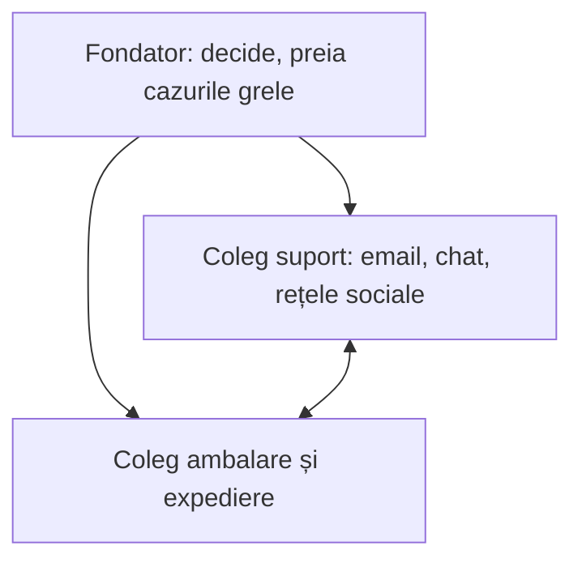
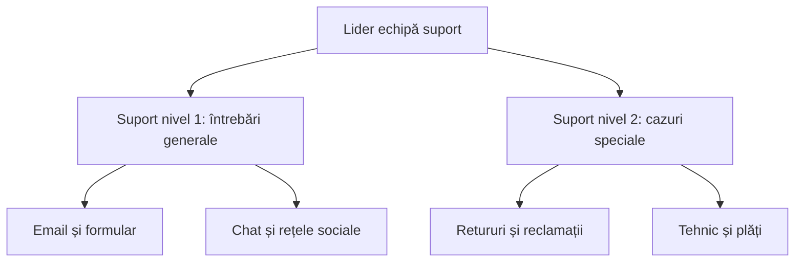
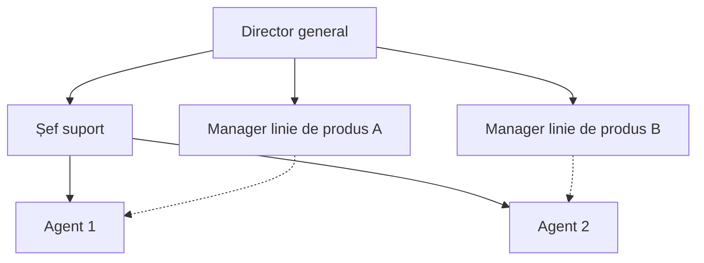
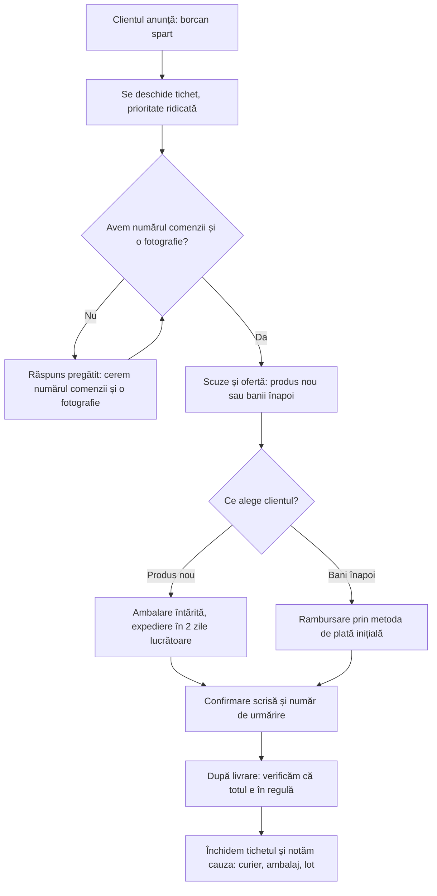

# Capitolul 4. Digital Customer Support: asistența digitală pentru clienți

## Ce vei putea face după acest capitol

- Să explici ce este customer service, ce este asistența digitală pentru clienți și prin ce canale se oferă.
- Să alegi canalele de suport potrivite pentru o afacere mică și să verifici dacă sunt folosite eficient.
- Să compari cele șapte tipuri de structură organizațională a unei echipe de suport și să o alegi pe cea potrivită mărimii firmei.
- Să proiectezi un flux digital de rezolvare a unei probleme, cu roluri, termene, tichete, răspunsuri pregătite și reguli de escaladare.
- Să scrii o politică de customer service scurtă și aplicabilă, care respectă drepturile de bază ale consumatorului.
- Să calculezi și să interpretezi principalii indicatori de suport: timp până la primul răspuns, timp de rezolvare, rezolvare la primul contact, CSAT, NPS, CES și tichete la 100 de comenzi.

## 4.1 Ce este customer service și ce este asistența digitală

### Customer service, pe înțeles

Customer service (în română: serviciul de asistență pentru clienți, pe scurt „suport”) este interacțiunea directă dintre un om care cumpără sau vrea să cumpere și un reprezentant al firmei care vinde. Definiția mai largă din prezentarea cursului spune că este vorba de asistența și sfaturile pe care o companie le oferă celor interesați să îi cumpere sau să îi folosească produsele.

Reține două lucruri din această definiție:

1. Suportul începe înainte de vânzare. Întrebarea „zacusca voastră conține țelină?” vine de la cineva care nu a cumpărat încă. Dacă nu primește răspuns, nu mai cumpără.
2. Suportul continuă după vânzare. „Unde e coletul meu?” și „mi-a venit un borcan spart” sunt momentele în care clientul decide dacă mai comandă a doua oară.

Majoritatea comercianților văd această interacțiune ca pe un factor care hotărăște două rezultate: dacă cumpărătorul rămâne mulțumit și dacă revine. Din acest motiv, un customer service bun se judecă de obicei după retenție, adică după câți clienți păstrezi.

### Asistența digitală

Digital customer support (asistență digitală pentru clienți) înseamnă același serviciu, oferit prin canale digitale: chat pe site, email, rețele sociale, aplicații de mesagerie, partajare de ecran, pagini de ajutor și alte aplicații de gestiune a relației cu clientul.

Canalele tradiționale sunt puține: telefonul, poșta, discuția față în față. Canalele digitale sunt mai multe și mai flexibile. Poți răspunde în scris când ai timp, poți trimite o fotografie sau un link, poți păstra istoricul conversației și poți lăsa clientul să se descurce singur la orice oră. Firmele care le folosesc ajung mai ușor la clienți, în locul și la ora care le convin acestora.

### Automatizare și om

O bună parte din suport este astăzi preluată de sisteme automate: mesaje de confirmare, pagini de urmărire a coletului, roboți de conversație. Totuși, cele mai multe afaceri păstrează posibilitatea de a vorbi cu un om. Motivul este practic: sistemele automate rezolvă bine întrebările repetitive, dar se blochează la situațiile neobișnuite, exact acolo unde clientul este deja supărat.

> **De reținut.** Customer service înseamnă interacțiunea dintre cumpărător și firma care vinde. Automatizarea preia întrebările simple și repetitive. Omul rămâne necesar pentru excepții, pentru situații cu emoție și pentru decizii care cer judecată.

## 4.2 Canalele digitale de suport

### Ce canale există

Tabelul de mai jos trece prin canalele din prezentare și adaugă, pentru fiecare, la ce este bun și unde te poate încurca.

| Canal | La ce se potrivește | Ce așteaptă clientul | Risc principal |
|---|---|---|---|
| Email | Probleme care cer detalii, fotografii, documente (factură, retur) | Răspuns în aceeași zi lucrătoare sau a doua zi | Mesaje pierdute într-o căsuță comună, fără responsabil |
| Chat pe site (live chat) | Întrebări scurte în timpul cumpărării | Răspuns în câteva minute, cât e pe site | Chat afișat ca „online” fără nimeni la tastatură |
| Rețele sociale (comentarii, mesaje private) | Întrebări publice, reclamații vizibile | Răspuns rapid și public | Reclamația fără răspuns e văzută de toți |
| Aplicații de mesagerie (WhatsApp, Messenger) | Conversații scurte, clienți care preferă telefonul mobil | Ton informal, răspuns rapid | Conversații amestecate cu cele personale, fără istoric comun |
| Telefon | Urgențe, clienți care nu scriu, situații delicate | Să răspundă cineva | Nu lasă urmă scrisă dacă nu notezi apelul |
| Partajare de ecran (screen sharing) | Software, servicii complexe, configurări | Să fie ghidat pas cu pas | Consumă mult timp; cere programare |
| Bază de cunoștințe (knowledge base) și pagină de întrebări frecvente | Întrebări care se repetă: livrare, plată, retur, ingrediente | Să găsească singur răspunsul în sub un minut | Informații vechi, care contrazic ce spune echipa |
| Self-service (cont client, urmărire comandă, formular de retur) | Acțiuni simple pe care clientul le poate face singur | Să funcționeze la orice oră | Proces blocat la jumătate, fără cale către un om |

Termenul self-service (autoservire) acoperă tot ce îi permite clientului să își rezolve singur problema: să vadă unde e coletul, să își schimbe adresa, să descarce factura, să citească ce alergeni are un produs. Baza de cunoștințe este o colecție organizată de articole scurte de ajutor. Pentru un magazin mic, ea poate fi o singură pagină „Întrebări frecvente” bine scrisă.

### Ce folosim deja

Aproape orice afacere mică folosește deja asistență digitală, de multe ori fără să o numească așa: o adresă de email pe site, un număr de WhatsApp, mesajele de pe pagina de Facebook sau Instagram, un formular de contact, mesajele automate ale firmei de curierat. La acestea se adaugă instrumente dedicate: aplicații de tichete (helpdesk), sisteme de gestiune a relațiilor cu clienții (CRM, din engleză Customer Relationship Management), widgeturi de chat și chatboți.

Problema obișnuită este alta: canalele există, dar nimeni nu le-a gândit împreună.

### Întrebarea care contează: le folosim eficient?

Prezentarea pune patru întrebări de control. Le poți folosi ca pe un audit rapid:

1. Oferă canalele o experiență pozitivă pentru client? Adică primește răspuns, în timp rezonabil, pe canalul pe care a scris?
2. Sunt canalele integrate între ele? Dacă un client scrie pe Instagram și apoi pe email, cel care răspunde vede ambele mesaje?
3. Contribuie canalele la loializare? Clientul care a avut o problemă mai comandă?
4. Ajută canalele echipa să fie eficientă sau o fac să răspundă de cinci ori la aceeași întrebare?

> **Exemplu.** Cămara de la Dunăre (magazin fictiv) are email, WhatsApp, mesaje pe Instagram și pe Facebook. Un client scrie duminică seara pe Instagram că i-a sosit un borcan de zacuscă spart. Luni dimineață, nevăzând răspuns, trimite și un email cu fotografii. Fondatoarea răspunde pe Instagram, colegul de la ambalare răspunde la email, fiecare cu altă soluție: una promite banii înapoi, celălalt un borcan nou. Clientul primește două răspunsuri diferite și trage concluzia că firma e dezorganizată. Cele patru canale funcționau. Lipsea legătura dintre ele.

> **Greșeală frecventă.** Deschizi un canal nou „ca să fim peste tot” fără să stabilești cine îl verifică și cât de des. Un canal pe care nu răspunde nimeni face mai mult rău decât lipsa lui. Mai bine două canale urmărite zilnic decât șase lăsate la voia întâmplării.

O notă despre cifre: prezentările pe această temă citează des procente spectaculoase despre comportamentul clienților (câți caută online înainte să cumpere, câte site-uri nu au formular de contact funcțional). Nu le reluăm aici, pentru că nu am putut identifica sursa lor primară. Ideea din spatele lor rămâne valabilă și o poți testa singur: clienții caută întâi singuri răspunsul, iar multe firme le îngreunează contactul. Verifică propriul formular de contact chiar azi, trimițându-ți un mesaj de test.

> **Pentru afacerea ta.** Fă un inventar de 15 minute. Scrie toate locurile în care un client îți poate scrie (email, formular, telefon, WhatsApp, Instagram, Facebook, recenzii Google, marketplace). Lângă fiecare notează: cine verifică, cât de des, unde se păstrează istoricul. Orice rând fără nume este o problemă care așteaptă să apară.

## 4.3 Cine are nevoie de asistență digitală și cât costă satisfacția clientului

### Cine are nevoie

Răspunsul scurt: oricine are clienți. Prezentarea distinge șase situații, care arată că suportul nu servește numai clientului.

| Cine | De ce are nevoie de suport digital |
|---|---|
| Firmele care vând online | Clientul nu poate întreba la tejghea; are nevoie de canale rapide |
| Firmele care vor relații mai bune cu clienții | Satisfacția și loialitatea se construiesc în momentele cu probleme |
| Departamentele de marketing | Conversațiile cu clienții arată ce nu se înțelege din site și din reclame |
| Firmele care își digitalizează procesele | Fluxurile clare scurtează timpul de reacție |
| Departamentele care vor transparență | Un sistem de tichete arată cine a promis ce, când și cui |
| Managerii care decid pe bază de date | Datele agregate din suport arată unde pierde firma bani și clienți |

Ultimele trei rânduri merită atenție. Un sistem de suport bine ținut este și o sursă de date. Dacă 12% dintre mesaje întreabă același lucru despre livrare, ai aflat ce trebuie rescris pe pagina de livrare. Despre cum transformi astfel de date în decizii, vezi capitolul 5.

### Costul satisfacției clientului

De zeci de ani, firmele încearcă să reducă costurile cu personalul prin automatizare. În suport, asta a dus la meniuri telefonice automate, formulare, roboți de conversație și pagini de ajutor care răspund fără intervenția unui om. Logica economică e simplă: un răspuns automat costă aproape zero, un răspuns scris de un om costă minute de salariu.

Calculul are însă două coloane. În prima stă costul suportului. În a doua stă costul clienților pierduți din cauza unui suport slab, iar acesta nu apare în nicio factură. Chiar și companiile mari de comerț online, care automatizează cât pot, păstrează căi de contact cu oameni reali. Există situații în care interacțiunea umană este de neînlocuit și devine un avantaj față de concurență: o discuție empatică și politicoasă cu un om pregătit poate face diferența dintre un client pierdut și unul păstrat.

De ce contează atât de mult păstrarea clientului? Pentru că un client nou costă. O sinteză publicată de Harvard Business Review arată că, în funcție de studiu și de industrie, atragerea unui client nou este de 5 până la 25 de ori mai scumpă decât păstrarea unuia existent (Amy Gallo, „The Value of Keeping the Right Customers”, Harvard Business Review, 2014, https://hbr.org/2014/10/the-value-of-keeping-the-right-customers). Intervalul este foarte larg tocmai pentru că depinde de domeniu. Ia-l ca ordin de mărime și calculează-ți propriile cifre.

> **Exemplu.** Date fictive, construite pentru exercițiu. În noiembrie, Cămara a cheltuit 16.800 lei pe reclame și a obținut 286 de comenzi pe canalul Reclame: aproximativ 59 de lei cheltuiți pentru fiecare comandă adusă de reclame. Un borcan spart înlocuit gratuit costă firma în jur de 42 de lei (un produs de 28 de lei plus 14 lei ambalare și livrare). Dacă înlocuirea rapidă păstrează clientul, ai „cumpărat” următoarea lui comandă mai ieftin decât prin reclame. Dacă refuzi sau întârzii, ai economisit 42 de lei și ai pierdut un client pentru care plătiseși deja 59.

Concluzia practică: automatizează ce se repetă și nu cere judecată, apoi folosește timpul economisit pentru cazurile în care un om schimbă rezultatul.

## 4.4 Componentele unui customer service bun

### Trei reguli de bază

Proprietarii de afaceri mici înțeleg de obicei instinctiv ce înseamnă suport bun, pentru că își cunosc clienții pe nume. Firmele mari au studiat subiectul în detaliu și au ajuns la câteva concluzii simple:

1. **Răspuns la timp.** Un client lăsat să aștepte începe conversația deja iritat. Timpul de așteptare strică interacțiunea înainte ca ea să înceapă.
2. **O singură etapă pentru client.** Pe cât se poate, clientul explică problema o singură dată, unei singure persoane, care o urmărește până la rezolvare. Complexitatea internă (curier, depozit, contabilitate) rămâne treaba firmei.
3. **Revenire după transfer.** Dacă trebuie să implici alt coleg sau alt departament, cel care a preluat inițial cazul revine la client și verifică dacă problema s-a rezolvat cu adevărat.

La acestea se adaugă, din practica zilnică, două componente pe care le vom dezvolta mai jos: consecvența (același răspuns indiferent cine răspunde, vezi secțiunea 4.10) și urma scrisă (orice caz lasă o înregistrare, vezi secțiunea 4.8).

> **Exemplu.** Un client al Cămării întreabă unde îi este coletul. Varianta slabă: „Vă rugăm să sunați la curier, noi l-am predat.” Varianta bună: „Am verificat: coletul a ajuns ieri în depozitul din Brașov și este programat la livrare mâine. Vă scriu eu mâine după-amiază să confirm că a ajuns.” În a doua variantă, clientul a făcut un singur pas, iar firma și-a asumat urmărirea.

### Legătura cu marketingul și cu managementul

Suportul nu este o insulă. Prezentarea îl leagă de trei concepte de marketing și de patru zone de management.

**Concepte de marketing:**

- **Valoarea percepută de client.** Este ce crede clientul că primește, raportat la ce plătește. Un borcan de dulceață la 28 de lei pare scump sau ieftin și în funcție de cât de ușor a fost să afli ce conține și cât de corect ai fost tratat când a apărut o problemă.
- **Satisfacția clientului.** Este diferența dintre ce aștepta și ce a primit. Suportul influențează ambele părți: stabilește așteptări realiste („livrăm în 2-3 zile lucrătoare”) și repară situațiile în care realitatea a ieșit mai prost.
- **Loialitatea clientului.** Este disponibilitatea de a cumpăra din nou și de a recomanda. Se măsoară prin retenție, prin recomandări și prin indicatori ca NPS (secțiunea 4.11).

**Zone de management:**

- **Managementul calității.** Reclamațiile sunt cea mai ieftină formă de control al calității: clientul îți spune gratuit ce nu merge.
- **Inovația centrată pe client.** Multe idei de produse și de îmbunătățiri vin din întrebările repetate ale clienților.
- **Managementul relațiilor cu clienții (CRM).** A devenit în timp un domeniu de sine stătător; suportul îi furnizează o mare parte din date.
- **Managementul riscurilor.** Un suport atent prinde devreme problemele care pot deveni grave: un lot cu capace defecte, o etichetă greșită la alergeni.

### Alte idei din definițiile prezentării

- Fiecare industrie cere un nivel diferit de customer service, dar scopul economic e același peste tot: un serviciu bine prestat susține veniturile (vezi Lucas, *Customer Service: Skills for Success*, în lista de lecturi).
- Felul în care o firmă face suport îi reflectă valorile și strategia. O firmă care se prezintă drept „de familie” și răspunde cu mesaje seci, copiate, se contrazice singură.
- Percepția clientului depinde mult de capacitatea angajatului de a se adapta la omul din fața lui: unul vrea detalii, altul vrea doar soluția.
- Pentru unele firme, suportul este un activ necorporal: nu apare în bilanț, dar le diferențiază pe piață.
- O singură experiență bună poate schimba părerea unui client despre întreaga organizație. La fel și una proastă.

### Valoarea pe viață a clientului

Valoarea pe viață a clientului (CLV, din engleză Customer Lifetime Value) este suma pe care te aștepți să o câștigi de la un client pe toată durata relației cu el, după ce scazi costurile de a-l servi. O formulă simplificată, suficientă pentru o primă estimare:

```
CLV simplificat = contribuția pe comandă × numărul de comenzi pe an × numărul de ani
```

> **Exemplu.** Date fictive, construite pentru exercițiu. Un client al Cămării care cumpără la preț întreg aduce, la o comandă de 150 de lei, o marjă brută de 45%, adică 67,50 lei. După ambalare și livrare (14 lei) rămân 53,50 lei pe comandă, înainte de costurile de marketing. Dacă acest client comandă de 4 ori pe an, timp de 2 ani, CLV simplificat este 53,50 × 4 × 2 = 428 lei. Acum întrebarea despre borcanul spart arată altfel: merită să cheltuiești 42 de lei ca să nu pierzi 428?

Calculul complet al economiei unei comenzi îl găsești în capitolul 5. Aici este suficient să reții că suportul trebuie judecat față de valoarea clientului în timp, nu față de valoarea unei singure comenzi.

## 4.5 Strategia de business și customer service

### Patru dimensiuni ale relației cu clientul

Prezentarea leagă suportul de patru dimensiuni ale managementului relațiilor cu clienții, descrise în literatura de CRM (prezentarea trimite la Ngai, 2005; clasificarea în aceste patru dimensiuni apare explicit în Ngai, Xiu și Chau, 2009, vezi lista de surse). Pentru fiecare, tabelul arată ce înseamnă și cu ce contribuie suportul.

| Dimensiune | Ce înseamnă | Ce aduce suportul | Exemplu la Cămara (fictiv) |
|---|---|---|---|
| Identificarea clienților | Afli cine sunt oamenii care merită abordați ca potențiali clienți | Întrebările de dinainte de cumpărare arată cine este interesat și de ce | Multe întrebări despre produse fără zahăr adăugat: există un segment nedeservit |
| Atragerea clienților | Pașii prin care le captezi interesul | Răspunsul rapid la o întrebare înainte de comandă transformă un vizitator în cumpărător | „Da, zacusca de vinete nu conține țelină” trimis în 10 minute |
| Retenția clienților | Tot ce faci ca un client să rămână | Rezolvarea corectă a problemelor este principalul motiv pentru care un client supărat revine | Borcan spart înlocuit în 48 de ore, fără discuții |
| Dezvoltarea clienților | Creșterea relației cu clienții existenți | Suportul vede ce cumpără clientul și ce i s-ar mai potrivi | Clientului care cumpără lunar miere i se propune abonament |

Dimensiunea „dezvoltarea clienților” folosește patru instrumente pe care le vei întâlni des:

- **Analiza valorii pe viață a clientului (CLV)**, explicată mai sus.
- **Upselling** (vânzare la un nivel superior): îi propui clientului o variantă mai valoroasă a produsului pe care îl vrea. Exemplu: borcanul de 720 g în locul celui de 314 g.
- **Cross-selling** (vânzare încrucișată): îi propui un produs complementar. Exemplu: la miere, un sirop de cătină.
- **Analiza coșului de cumpărături** (market basket analysis): cauți în datele de comenzi ce produse se cumpără împreună, ca să faci pachete și recomandări.

> **Greșeală frecventă.** Transformi suportul în canal de vânzare agresiv. Un client care reclamă un borcan spart nu vrea să audă de oferta săptămânii. Întâi rezolvi problema. Recomandările vin doar când sunt utile și cerute de context.

### Cinci tipuri de inovație care îmbunătățesc suportul

Al doilea pilon al strategiei, după relația cu clientul, este inovația. Prezentarea enumeră cinci tipuri. Niciunul nu cere bugete mari; cele mai multe pornesc din ce auzi de la clienți.

| Tip de inovație | Ce înseamnă | Exemplu pornit din suport (Cămara, fictiv) |
|---|---|---|
| De produs | Produse noi sau caracteristici noi la cele existente | Clienții cer des cadouri: apare „cutia de degustare” cu patru borcane mici |
| De proces | Schimbi felul în care produci sau livrezi | Prea multe borcane sparte: treci la separatoare de carton și test de cădere la ambalare |
| Administrativă | Optimizezi procesele interne | O singură căsuță comună pentru toate mesajele, cu un responsabil pe zi |
| De marketing | Comunici mai bine valoarea | Pagina de produs primește secțiunea „Alergeni și ingrediente”, pentru că asta se întreabă cel mai des |
| De servicii | Îmbunătățești asistența | Mesaj automat cu link de urmărire trimis în ziua expedierii |

## 4.6 Oamenii din suport: profilul specialistului și responsabilitățile angajatorului

### Ce face un specialist în asistență pentru clienți

Responsabilitățile de bază: răspunde la întrebări, recomandă soluții și ghidează clienții prin caracteristicile produsului. Ca să reușească, are nevoie de două lucruri mai presus de orice: să comunice clar și să câștige încrederea omului cu care vorbește.

Prezentarea descrie un profil ideal. Îl rescriem ca listă de abilități observabile:

| Abilitate | Cum se vede în practică |
|---|---|
| Recunoaște tipare în mesaje și în emoții | Observă că trei clienți din aceeași zi reclamă același lot; simte din ton când un client e pe punctul de a renunța |
| Înțelege repede nevoia reală | Din „nu mai vreau comanda” deduce că problema este de fapt întârzierea, și o rezolvă |
| Decide rapid | Aplică politica fără să ceară aprobare pentru fiecare caz mărunt |
| Atenție la detalii | Verifică numărul comenzii și adresa înainte să promită ceva |
| Ascultare și răbdare | Lasă clientul să termine; rămâne în conversație până la rezolvare |
| Comunicare clară | Propoziții scurte, fără jargon; la telefon vorbește rar și calm, chiar dacă celălalt ridică tonul |
| Stabilitate | Reacționează constructiv în situații tensionate și nu ia personal nemulțumirea clientului |
| Motivație intrinsecă | Îi place să rezolve probleme, dincolo de salariu |

Prezentarea menționează și „tendința spre perfecțiune, uneori cu orice preț”. Ia-o cu măsură: atenția la detalii ajută, dar perfecționismul fără limită întârzie răspunsurile și epuizează omul. Un răspuns corect azi valorează mai mult decât unul impecabil peste trei zile. Pregătirea în rezolvarea conflictelor este utilă pentru oricine lucrează direct cu clienții.

### Ce datorează angajatorul echipei

Calitatea suportului depinde de management cel puțin la fel de mult ca de omul care răspunde. Trei obligații reies din prezentare:

1. **Informare la zi.** Echipa de suport trebuie să afle prima, nu ultima, despre produse noi, schimbări de preț, promoții, întârzieri la curier și modificări de politică. Un agent care află de la client că există o promoție nu are cum să arate competent.
2. **Evaluare periodică.** Verifici regulat experiența pe care o oferi: citești conversații, îți trimiți singur o întrebare ca un client obișnuit, te uiți pe indicatori.
3. **Sondaje regulate.** Le dai clienților ocazia să spună cum a fost și ce ar îmbunătăți.

Aceste elemente stau de regulă într-un manual intern al echipei de suport (prezentarea îl numește „Cartea albastră de asistență pentru clienți”). Dacă ceva lipsește din el, angajatul are datoria să întrebe și să ceară clarificări. Obligația este reciprocă: firma trebuie să îi dea acces la oamenii care au răspunsurile.

De ce insistă prezentarea pe acest punct? Pentru că sursa cea mai mare de stres în suport nu este clientul nervos. Este neputința: agentul a promis un răspuns și nu poate da de curier, de depozit sau de șeful care aprobă returul. Stresul acesta se acumulează și se vede apoi în tonul răspunsurilor.

> **Pentru afacerea ta.** Dacă ești singur în firmă, ești și agent, și manager. Rezervă 20 de minute pe săptămână pentru rolul de manager: recitește cinci conversații alese la întâmplare și întreabă-te dacă ai fi mulțumit ca client. Notează o singură îmbunătățire și aplic-o săptămâna următoare.

## 4.7 Structuri organizaționale pentru echipa de suport

### Structura după mărimea firmei

Cum organizezi suportul depinde în primul rând de câți oameni și câți clienți ai. Prezentarea descrie trei trepte.

| Etapă | Cum arată structura | Cine face suportul | Ce contează |
|---|---|---|---|
| Start-up | Simplă, suplă (lean), versatilă | Fondatorul și 1-2 oameni care fac de toate | Oameni polivalenți: de la suport tehnic la relaționare și feedback pentru produs |
| Firmă medie, în creștere | Echipă dedicată, cu sub-echipe specializate | Agenți pe canale sau pe tipuri de probleme; apare rolul de Customer Success Manager | Alinierea echipei la obiectivele de creștere și de retenție |
| Firmă cu resurse | Echipă integrată, organizată după criterii complexe | Echipe pe regiuni, pe canale de vânzare (online, magazine, B2B) sau pe etape din călătoria cumpărătorului (pre-vânzare, post-vânzare, loializare) | Standarde stricte de calitate, procese standardizate, măsurarea performanței |

Două explicații de termeni. B2B (business-to-business) înseamnă vânzare către alte firme. Customer Success Manager (manager pentru succesul clienților) este persoana care se ocupă proactiv ca un client să obțină rezultatul pentru care a cumpărat, înainte să apară o reclamație. Rolul este frecvent la firmele care vând abonamente și software.

La un start-up, structura poate fi desenată în câteva căsuțe:



### Cele șapte tipuri de structură

Când firma crește, apare întrebarea „după ce criteriu împărțim echipa?”. Prezentarea trece prin șapte răspunsuri posibile.

#### 1. Structura funcțională

**Cum arată.** Ierarhie clasică, de sus în jos. În vârf stă liderul echipei, sub el urmează niveluri succesive: agenții de suport general, apoi serviciile specializate (tehnic, facturare, retururi).

**Când se potrivește.** Firme mici și medii cu o gamă de produse omogenă. Rolurile sunt clare, fiecare știe cui raportează.

**Riscuri.** Departamentele devin „silozuri”: suportul nu vorbește cu marketingul, iar clientul este plimbat între niveluri.



#### 2. Structura pe produs

**Cum arată.** Echipele se formează în jurul produselor. Fiecare linie de produs are propriii oameni de vânzări, marketing și asistență. Prezentarea dă exemplul ipotetic al unui producător de electronice care ar avea câte o echipă pentru tabletă, pentru telefon și pentru dispozitivul TV.

**Când se potrivește.** Produse foarte diferite între ele, care cer cunoștințe diferite.

**Riscuri.** Dublarea rolurilor și a costurilor; clientul care are două produse vorbește cu două echipe; experiența diferă de la un produs la altul.

#### 3. Structura pe piață

**Cum arată.** Seamănă cu structura pe produs, dar echipele se formează în jurul segmentelor de clienți: persoane fizice, firme mici, clienți mari; sau începători și avansați.

**Când se potrivește.** Când segmentele au nevoi cu adevărat diferite. O echipă care înțelege în profunzime un tip de client oferă servicii vizibil mai bune.

**Riscuri.** Segmentare făcută „din birou”, care nu corespunde clienților reali; clienți care nu se încadrează clar în niciun segment.

#### 4. Structura geografică

**Cum arată.** Echipe pe țări, regiuni sau orașe. Fiecare cunoaște limba, obiceiurile, curierii și regulile locale.

**Când se potrivește.** Firme care vând în mai multe țări sau regiuni cu diferențe mari de limbă, fus orar și legislație.

**Riscuri.** Standarde diferite de la o regiune la alta; costuri mari; cunoștințe care nu circulă între echipe.

#### 5. Structura pe proces

**Cum arată.** Echipele urmează procesele firmei: pre-vânzare, procesarea comenzilor, livrare, retururi, loializare. Pentru fiecare proces iei în calcul sarcinile, abilitățile necesare și legăturile cu celelalte procese.

**Când se potrivește.** Activități cu flux clar și repetitiv, cum este comerțul online, unde aproape orice problemă ține de o etapă precisă a comenzii.

**Riscuri.** Predările între procese: cazul „cade între scaune” când trece de la o echipă la alta. Cere fluxuri documentate (secțiunea 4.8).

#### 6. Structura matriceală

**Cum arată.** Fiecare om are doi șefi: liderul de departament (de exemplu, șeful suportului) și liderul de proiect sau de linie de produs. Echipele de marketing, vânzări și asistență colaborează transversal și împart responsabilități.

**Când se potrivește.** Organizații mari și complexe, cu multe produse și proiecte care au nevoie de aceiași specialiști.

**Riscuri.** Confuzie la decizii („cine are ultimul cuvânt?”), priorități contradictorii, ședințe multe. Funcționează doar cu o comunicare foarte bună.



Liniile continue arată raportarea ierarhică, cele punctate raportarea pe linia de produs.

#### 7. Structura circulară

**Cum arată.** Tot o ierarhie, dar desenată în cercuri concentrice. Managerii de nivel superior stau în centru și își transmit viziunea spre exterior. Angajații care pun viziunea în practică stau în inelele exterioare, cele mai aproape de clienți.

**Când se potrivește.** Organizații care vor să încurajeze circulația liberă a informației și să sublinieze că toți lucrează în aceeași direcție.

**Riscuri.** Nu e limpede cine cui raportează; oamenii noi se orientează greu; deciziile pot întârzia.

### Tabel comparativ

| Structură | Criteriul de împărțire | Avantaj principal | Risc principal | Potrivită pentru |
|---|---|---|---|---|
| Funcțională | Funcția și nivelul ierarhic | Roluri clare, ușor de condus | Silozuri, client plimbat între niveluri | Firme mici și medii, ofertă omogenă |
| Pe produs | Linia de produs | Expertiză profundă pe produs | Dublarea resurselor | Produse foarte diferite |
| Pe piață | Segmentul de clienți | Înțelegerea nevoilor segmentului | Segmente definite greșit | Clienți cu nevoi distincte (persoane fizice și firme) |
| Geografică | Regiunea | Limbă și cunoștințe locale | Standarde inegale | Vânzări în mai multe țări |
| Pe proces | Etapa din proces | Eficiență pe flux | Cazuri pierdute la predare | Comerț online, logistică |
| Matriceală | Departament și proiect, simultan | Flexibilitate, aliniere strategică | Doi șefi, decizii neclare | Organizații mari, complexe |
| Circulară | Apropierea de viziune și de client | Comunicare deschisă | Raportare neclară | Organizații cu cultură colaborativă |

> **Exemplu.** Cămara de la Dunăre are trei oameni. Nu are nevoie de niciun „tip” sofisticat de structură: are nevoie de structura suplă de start-up, cu o singură regulă clară despre cine răspunde în fiecare zi. Dacă într-un an ar ajunge la zece oameni și ar vinde și către restaurante, ar putea trece la o structură pe proces (pre-vânzare, comenzi și livrare, reclamații) sau pe piață (persoane fizice și clienți HoReCa, adică hoteluri, restaurante și cafenele).

> **Greșeală frecventă.** Copiezi organigrama unei corporații într-o firmă de cinci oameni. Structura trebuie să rezolve o problemă pe care o ai acum. Dacă nu poți spune ce problemă rezolvă o căsuță din organigramă, căsuța nu trebuie să existe.

## 4.8 Construirea unui flux digital de customer service

Un flux de lucru (workflow) este succesiunea de pași prin care o cerere a clientului ajunge de la primul mesaj la rezolvare: cine preia, ce verifică, ce decide, ce comunică și când. Prezentarea propune o construcție în mai mulți pași. Îi urmăm în ordine.

### Pasul 1. Înțelege procesul actual

Înainte să desenezi ceva, află ce se întâmplă de fapt:

- Ce face echipa zilnic? Ce sarcini se repetă?
- Ce procese există „în capul oamenilor”, dar nu sunt scrise nicăieri?
- Ce întrebări primiți cel mai des?

Cel mai simplu instrument este un tabel în care notezi, timp de două săptămâni, fiecare cerere: data, canalul, tipul, cât a durat rezolvarea.

> **Exemplu.** Date fictive, construite pentru exercițiu. În noiembrie, Cămara a primit 143 de solicitări la 796 de comenzi. Clasificate după subiect:
>
> | Tip de solicitare | Număr | Pondere |
> |---|---|---|
> | „Unde e coletul meu?” | 52 | 36% |
> | Produs deteriorat la livrare (de regulă borcan spart) | 19 | 13% |
> | Alergeni și ingrediente | 17 | 12% |
> | Modificare sau anulare de comandă | 14 | 10% |
> | Codul de reducere nu funcționează | 13 | 9% |
> | Termen de valabilitate | 12 | 8% |
> | Plată și factură | 11 | 8% |
> | Altele | 5 | 4% |
> | **Total** | **143** | **100%** |
>
> Trei tipuri (colet, alergeni, valabilitate) fac 57% din volum și sunt întrebări de informare. Pot fi reduse mult prin self-service: link de urmărire trimis automat, secțiune de alergeni pe pagina de produs, o frază despre termenul de valabilitate. Borcanul spart este altceva: cere un flux cu decizie și cu cost.

### Pasul 2. Identifică provocările

Întreabă-te ce vrei să îmbunătățești. Prezentarea sugerează trei locuri în care să cauți:

- **Indicatorii.** Poate indicatorii-cheie de performanță (KPI, din engleză Key Performance Indicators) arată prost: răspunsuri târzii, multe reveniri pe același caz.
- **Resursele.** Poate oamenii sunt alocați greșit: toată lumea răspunde dimineața, nimeni seara, când vin cele mai multe mesaje.
- **Tehnologia.** Poate setul de instrumente folosit nu mai face față: o căsuță de email comună a fost suficientă la 10 mesaje pe zi și nu mai este la 50.

Echipa trebuie să aibă o idee clară despre ce vrea să schimbe înainte să construiască sau să refacă fluxurile. Altfel desenezi diagrame frumoase pentru probleme pe care nu le ai.

### Pasul 3. Rezolvarea problemei clientului, pas cu pas

Rezolvarea unei plângeri trebuie făcută corect și empatic. Dacă nu, clientul devine frustrat, ajunge să considere agentul și firma incompetente și simte că nu este luat în seamă. Uneori, o reclamație tratată prost este picătura care umple paharul după alte mici neplăceri.

Fluxul general din prezentare are patru etape:

1. Clientul raportează problema.
2. Se generează un tichet și i se atribuie un nivel de gravitate sau de prioritate.
3. Clientul este direcționat către agentul cel mai potrivit.
4. Agentul și clientul discută până la soluționare.

Un **tichet** este fișa unui caz: un număr unic, cine a scris, despre ce, cine răspunde de caz, în ce stadiu se află și tot istoricul conversației. Poate fi un rând într-un tabel sau o înregistrare într-o aplicație de helpdesk.

În etapa a patra, conversația are la rândul ei șase pași:

1. **Salută** prietenos și invită clientul să explice problema.
2. **Ascultă** (sau citește) cu atenție, până la capăt.
3. **Reformulează** problema și cere confirmarea că ai înțeles corect.
4. **Prezintă soluția** și ține clientul la curent cât timp o pui în aplicare.
5. **Întreabă** dacă mai poți ajuta cu ceva; dacă nu, încheie politicos.
6. **Confirmă în scris**, prin email sau mesaj, că problema a fost soluționată.

Pasul 3 pare formal, dar previne cele mai multe neînțelegeri. Pasul 6 lasă o dovadă pentru ambele părți.

### Pasul 4. Identifică rolurile

Prezentarea propune patru acțiuni:

1. **Alege structura potrivită** (secțiunea 4.7) și stabilește ce roluri cere ea.
2. **Analizează canalele.** Uită-te unde pierzi cei mai mulți clienți, actuali sau potențiali: pe email, la telefon, pe rețelele sociale sau pe chat. Acolo ai nevoie de oameni mai întâi.
3. **Formează echipe specializate** pe competențe și nevoi: apeluri, emailuri, rețele sociale, suport tehnic și feedback. Fiecare echipă are o responsabilitate clară. Într-o firmă mică, „echipă” înseamnă „o persoană, într-un interval orar”.
4. **Stabilește ierarhia și triajul.** Când suportul lucrează împreună cu marketingul și cu partea tehnică, trebuie să fie clar cum se împart și cum se triază sarcinile: cine preia, cine decide, cui se escaladează.

**Escaladarea** înseamnă trecerea unui caz către cineva cu mai multă autoritate sau expertiză, atunci când primul nivel nu îl poate rezolva. O regulă de escaladare bună spune trei lucruri: când se escaladează, către cine și în cât timp trebuie să răspundă acea persoană.

### Pasul 5. Construiește fluxurile

Pentru desenarea fluxurilor poți folosi instrumente vizuale dedicate (prezentarea amintește InVision și Microsoft Visio) sau unele la îndemână: Excel, Google Sheets, o diagramă Mermaid ca cele din acest capitol ori chiar o foaie de hârtie. Instrumentul contează puțin. Contează ce pui în flux:

- cunoștințele tale despre proces;
- informațiile de la colegi (ei știu unde se blochează lucrurile);
- indicatorii pe care îi ai deja;
- feedbackul clienților.

Fiecare etapă se descrie clar, cu responsabil și termen. Așa vezi ce resurse cere și unde apar blocajele.

### Exemplu lucrat: fluxul „borcan spart la livrare”

Iată fluxul Cămării pentru cel mai costisitor tip de solicitare (magazin fictiv).



Același flux, ca tabel cu responsabili și termene:

| Pas | Ce se întâmplă | Cine | Termen |
|---|---|---|---|
| 1 | Mesajul intră pe orice canal și devine tichet cu eticheta „deteriorat” | Responsabilul de suport al zilei | La citire |
| 2 | Primul răspuns: scuze, cerere de fotografie și număr de comandă (dacă lipsesc) | Responsabilul de suport | 4 ore lucrătoare |
| 3 | Ofertă: înlocuire gratuită sau rambursare, la alegerea clientului | Responsabilul de suport, fără aprobare până la 150 de lei | La primirea fotografiei |
| 4 | Expedierea produsului nou sau rambursarea | Colegul de la ambalare, respectiv fondatoarea (plăți) | 2 zile lucrătoare, respectiv 5 zile lucrătoare |
| 5 | Confirmare scrisă către client, cu număr de urmărire | Responsabilul de suport | În ziua expedierii |
| 6 | Verificare după livrare: „a ajuns întreg?” | Responsabilul de suport | La 1-2 zile după livrare |
| 7 | Închiderea tichetului și notarea cauzei | Responsabilul de suport | La confirmarea clientului |
| 8 | Analiză lunară: câte cazuri, pe ce curier, ce ambalaj | Fondatoarea | Prima săptămână a lunii |

Trei observații despre acest flux:

- Clientul nu trimite borcanul spart înapoi. Costul și riscul returului depășesc valoarea produsului, iar fotografia este o dovadă suficientă.
- Agentul are o limită de decizie (150 de lei). Sub ea rezolvă singur, deci clientul nu așteaptă aprobări.
- Pasul 8 transformă reclamațiile în date. Fără el plătești borcane sparte la nesfârșit, fără să afli de ce se sparg.

### Pasul 6. Automatizează ce merită

Prezentarea pornește de la o întrebare simplă: dacă agentul creează manual un tichet după fiecare apel, este acesta cel mai eficient mod? De multe ori nu. Alternativele: chat, self-service și integrarea cu un CRM, astfel încât tichetul să se creeze singur și să fie legat de comanda clientului.

Patru niveluri de automatizare, de la simplu la complex:

**1. Sistem de tichete.** Toate mesajele, de pe toate canalele, ajung într-un singur loc. Fiecare primește număr, responsabil și stare (nou, în lucru, în așteptarea clientului, rezolvat). Rezolvă problema celor două răspunsuri diferite din exemplul de la secțiunea 4.2.

**2. Răspunsuri pregătite.** Șabloane pentru situațiile frecvente, pe care agentul le personalizează. Economisesc timp și asigură consecvența.

```
Subiect: Comanda {numar_comanda}: ne pare rău pentru borcanul spart

Bună ziua, {prenume},

Ne pare rău că {produs} a ajuns spart. Nu așa trebuia să primiți comanda.

Vă propunem, la alegere:
1. vă trimitem gratuit un produs nou, în cel mult 2 zile lucrătoare;
2. vă returnăm contravaloarea produsului, {suma} lei.

Nu este nevoie să ne trimiteți nimic înapoi. Vă rugăm doar să aruncați
cu grijă produsul, din cauza cioburilor.

Ne spuneți ce variantă preferați?

Cu drag,
{nume_agent}, Cămara de la Dunăre
```

**3. Mesaje automate declanșate de evenimente.** Confirmarea comenzii, emailul cu numărul de urmărire în ziua expedierii, mesajul „coletul a fost livrat, totul în regulă?”. Acestea previn întrebările înainte să apară.

**4. Chatbot.** Un chatbot este un program care poartă o conversație în scris cu clientul. Variantele simple urmează un arbore de opțiuni („1. Unde e coletul? 2. Retur 3. Altceva”). Variantele bazate pe modele de limbaj formulează răspunsuri libere, pornind de la o bază de cunoștințe.

Un chatbot este util când răspunde la întrebări frecvente cu răspuns stabil, când caută starea unei comenzi sau când adună datele cazului (număr de comandă, fotografie) înainte să îl predea unui om. Are însă limite pe care trebuie să le cunoști:

- **Poate greși cu siguranță de sine.** Un chatbot bazat pe model de limbaj poate formula un răspuns plauzibil, dar fals. La un magazin alimentar, un răspuns greșit despre alergeni poate face rău unui om. Întrebările despre alergeni trebuie să primească doar informația exactă de pe etichetă sau să ajungă la un om.
- **Nu simte situația.** Un client supărat care primește „Am înțeles! Cu ce te mai pot ajuta?” se supără mai tare.
- **Nu poate decide excepții.** Politica spune 14 zile, clientul scrie în ziua 16 pentru că a fost în spital. Aici e nevoie de judecată.
- **Are nevoie de întreținere.** Dacă schimbi costul livrării și uiți să actualizezi robotul, el va da informații greșite, politicos și la orice oră.
- **Trebuie să aibă ieșire.** Clientul trebuie să poată ajunge la un om în orice moment, fără să rămână blocat într-o buclă.

> **Greșeală frecventă.** Pui chatbotul ca zid între client și echipă, ca să scazi numărul de tichete. Tichetele scad, pentru că oamenii renunță să mai scrie, și tot atunci renunță să mai cumpere. Chatbotul trebuie să scurteze drumul clientului către răspuns.

### Pasul 7. Testează și îmbunătățește

Fluxurile bune nu ies din prima. Se obțin prin testarea mai multor variante, colectarea de date și ajustări treptate. Dacă o etapă durează prea mult, elimini ineficiența sau refaci fluxul. Ținta: un flux clar, rapid și previzibil, atât pentru echipă, cât și pentru client.

Listă de verificare pentru testarea unui flux:

- Parcurge fluxul ca un client: trimite o reclamație de test de pe o adresă personală.
- Încearcă pe fiecare canal: ajunge cazul în același loc?
- Testează cazurile-limită: client fără număr de comandă, client care nu răspunde, client care scrie în weekend.
- Cronometrează fiecare pas și compară cu termenul promis.
- Întreabă un coleg nou dacă poate aplica fluxul doar citind documentul.
- După o lună, compară indicatorii de dinainte cu cei de după (secțiunea 4.11).

## 4.9 Drepturile consumatorului pe care suportul trebuie să le cunoască

Echipa de suport este cea care aplică, în practică, drepturile legale ale clientului. Un agent care nu le cunoaște poate promite prea puțin (și expune firma la reclamații și sancțiuni) sau prea mult. Textul de mai jos este o prezentare generală, cu trimitere la surse oficiale. Nu este consultanță juridică; pentru situația firmei tale, verifică textele în vigoare și cere părerea unui jurist.

### Dreptul de retragere la cumpărăturile la distanță

În Uniunea Europeană, cine cumpără online, prin telefon sau în afara unui magazin are dreptul să se retragă din contract în 14 zile, fără să dea vreo explicație (portalul Your Europe al Uniunii Europene, pagina „Returnări”, https://europa.eu/youreurope/citizens/consumers/shopping/returns/index_ro.htm). În România, regula se găsește în Ordonanța de urgență a Guvernului nr. 34/2014 (OUG 34/2014), care transpune Directiva 2011/83/UE. Din textul consolidat al ordonanței reies câteva reguli pe care suportul le aplică zilnic:

| Regulă | Ce prevede, pe scurt | Unde |
|---|---|---|
| Termenul de retragere | 14 zile, fără justificare; pentru bunuri, se numără din ziua în care consumatorul intră în posesia lor | art. 9 |
| Rambursarea | Vânzătorul returnează toate sumele primite, inclusiv costul livrării inițiale, în cel mult 14 zile de la data la care a fost informat despre retragere, prin aceeași metodă de plată; nu datorează suplimentul pentru o livrare mai scumpă decât cea standard, aleasă de client | art. 13 alin. (1)-(3) |
| Amânarea rambursării | Vânzătorul poate aștepta până primește produsele sau dovada că au fost expediate | art. 13 alin. (4) |
| Returnarea produselor | Consumatorul le trimite înapoi în cel mult 14 zile de la anunțarea retragerii | art. 14 alin. (1) |
| Costul returului | Îl suportă consumatorul, dacă vânzătorul nu a acceptat să îl plătească și dacă l-a informat dinainte despre acest cost | art. 14 alin. (2) |
| Excepții | Printre altele: produse care se pot deteriora sau expiră rapid; produse sigilate care nu pot fi returnate din motive de sănătate sau igienă și care au fost desigilate; produse personalizate | art. 16 |

Pentru un magazin alimentar, excepțiile contează mult. Un borcan sigilat de dulceață, cu termen lung de valabilitate, nu este în mod evident un produs care „expiră rapid”, deci poate intra sub dreptul de retragere cât timp rămâne sigilat. Un borcan deschis intră, cel mai probabil, la excepția produselor desigilate care nu pot fi returnate din motive de igienă. Încadrarea exactă a fiecărui tip de produs este o chestiune juridică: confirm-o cu un specialist înainte să o scrii în politica de retur.

### Livrarea și coletul deteriorat

Dacă nu ai convenit altceva cu clientul, trebuie să livrezi în cel mult 30 de zile de la încheierea contractului (OUG 34/2014, art. 18). Riscul de pierdere sau de deteriorare trece la consumator abia când acesta intră în posesia fizică a produselor (art. 20). Portalul Your Europe formulează aceeași regulă pe înțeles: comerciantul răspunde de eventuala deteriorare a produselor de la expediere până când clientul le primește (pagina „Expediere și livrare”, https://europa.eu/youreurope/citizens/consumers/shopping/shipping-delivery/index_ro.htm). Excepția: clientul și-a ales singur un transportator pe care vânzătorul nu l-a oferit.

Consecința pentru suport este directă. „Curierul l-a spart, vorbiți cu curierul” nu este un răspuns acceptabil. Față de client răspunde vânzătorul, care își recuperează apoi paguba de la firma de curierat, dacă e cazul.

### Garanția legală de conformitate

Un produs trebuie să corespundă descrierii și să fie bun pentru utilizarea lui normală. În Uniunea Europeană, vânzătorul răspunde pentru neconformitățile care apar în minimum 2 ani de la livrare (Your Europe, pagina „Garanții și returnări”, https://europa.eu/youreurope/citizens/consumers/shopping/guarantees-returns/index_ro.htm). În România, regulile sunt în Ordonanța de urgență a Guvernului nr. 140/2021 (OUG 140/2021), aplicabilă contractelor încheiate după 1 ianuarie 2022:

- vânzătorul răspunde pentru neconformitatea care exista la livrare și este constatată în termen de 2 ani (art. 9);
- neconformitatea constatată în primul an de la livrare se prezumă că exista la livrare, până la proba contrarie (art. 10);
- consumatorul poate cere aducerea în conformitate (reparare sau înlocuire), reducerea proporțională a prețului sau încetarea contractului (art. 11);
- repararea sau înlocuirea se face gratuit, într-un termen rezonabil care nu poate depăși 15 zile calendaristice (art. 12).

La produse alimentare, garanția legală se întâlnește în practică rar ca „reparație”. Situațiile tipice sunt produsul livrat greșit, deteriorat, alterat înainte de termen sau diferit de descriere. Soluția firească este înlocuirea sau banii înapoi.

### Informații despre aliment la vânzarea online

Regulamentul (UE) nr. 1169/2011 privind informarea consumatorilor despre alimente stabilește ce informații sunt obligatorii, între care lista ingredientelor, alergenii, cantitatea netă și data de valabilitate. Pentru alimentele preambalate vândute la distanță, informațiile obligatorii trebuie să fie disponibile înainte de încheierea cumpărării, pe site sau prin alt mijloc clar indicat, fără costuri suplimentare. Excepție face data durabilității minimale sau data-limită de consum, care trebuie să fie disponibilă la livrare, împreună cu toate celelalte mențiuni (Comisia Europeană, pagina „Distance selling”, https://food.ec.europa.eu/food-safety/labelling-and-nutrition/food-information-consumers-legislation/distance-selling_en). Alergenii se evidențiază în lista de ingrediente, de exemplu prin alt font sau altă culoare de fundal (Your Europe, „Etichetarea produselor alimentare: reguli generale”, https://europa.eu/youreurope/business/product-requirements/food-labelling/general-rules/index_ro.htm).

Pentru suport, asta înseamnă două lucruri. Întrebările despre alergeni scad vizibil dacă pagina de produs afișează corect ingredientele. Iar când totuși apar, agentul răspunde citind eticheta lotului, nu din memorie.

> **De reținut.** Trei reguli pe care orice om din suportul unui magazin online trebuie să le știe: 14 zile pentru retragere la cumpărăturile la distanță (cu excepții), răspunderea vânzătorului pentru colet până ajunge la client și garanția legală de conformitate de 2 ani. Politica firmei poate oferi mai mult decât legea. Nu poate oferi mai puțin.

## 4.10 Politica de customer service

### Ce este și de ce contează

Politica de customer service este un document oficial al firmei care spune cum se face suportul: ce proceduri se urmează, în ce termene, pe ce ton și ce se întâmplă în situațiile frecvente. Este scrisă pentru echipă, ca toți să lucreze la fel. O parte din ea (termene, retururi) se publică de obicei și pentru clienți.

Rolurile ei, după prezentare:

- este punctul de referință pentru manageri și angajați;
- asigură consecvența: clientul primește același tratament indiferent cine răspunde și de unde;
- previne tratamentul subiectiv („lui i-ați dat banii înapoi, mie de ce nu?”);
- susține încrederea și loialitatea.

Importanța ei crește odată cu firma. Mai mulți clienți înseamnă mai multe interacțiuni, pe mai multe canale, purtate de mai mulți oameni. Fără reguli scrise, riscul de inconsecvență și de erori crește cu fiecare angajat nou. Într-o firmă de trei oameni, politica ține loc de memorie comună. Într-una de treizeci, fără ea fiecare agent își inventează propriile reguli.

### Ce conține

Prezentarea enumeră următoarele secțiuni ale unei politici interne:

1. **Prezentarea produselor și serviciilor.** O privire de ansamblu, cu linkuri către documentație internă, videoclipuri demonstrative, broșuri sau ghiduri de utilizare.
2. **Standardele de customer service.** Valorile firmei, așteptările privind interacțiunea cu clienții, comportamentele așteptate: empatie, claritate, promptitudine.
3. **Comunicare.** Cum înțelegi o problemă, cum îi găsești cauza și cum propui o soluție.
4. **Monitorizare.** Cum se urmărește calitatea și cum te asiguri că problema clientului a fost într-adevăr rezolvată.
5. **Reclamații.** Exemple de tratare a reclamațiilor, sfaturi pentru diferite tipuri de clienți și pentru păstrarea profesionalismului.
6. **Retenție.** De ce contează păstrarea clienților (vezi secțiunea 4.3) și ce poate face fiecare agent pentru ea.
7. **Colectarea feedbackului și a sugestiilor.** Cum notează angajații ce aud de la clienți, de exemplu printr-un formular intern (Google Forms, Typeform sau un simplu tabel).
8. **Monitorizarea performanței.** Ce indicatori se urmăresc și ce se așteaptă de la fiecare. Oamenii trebuie să știe după ce sunt evaluați.

La acestea se adaugă ghiduri pas cu pas pentru interacțiunile frecvente (de exemplu, procesarea unui retur) și criterii standard pentru situațiile care se repetă.

### Model de politică: Cămara de la Dunăre

Modelul de mai jos este scris pentru magazinul fictiv din acest suport. Îl poți adapta afacerii tale. Termenele și sumele sunt alegeri ale firmei, cu excepția celor care vin din lege (marcate ca atare). Înainte de a folosi un asemenea document într-o firmă reală, verifică-l cu un jurist.

---

**POLITICA DE CUSTOMER SERVICE**
**Cămara de la Dunăre (document intern, versiunea 1.0)**

**1. Scop și cui se aplică**

Documentul stabilește cum răspundem clienților, în ce termene și cum rezolvăm problemele. Se aplică tuturor celor care comunică cu clienții în numele Cămării, pe orice canal, inclusiv colaboratorilor ocazionali.

**2. Ce vindem**

Dulcețuri, zacuscă, miere și siropuri de la producători locali din zona Galați. Fișele de produs, cu ingrediente, alergeni, gramaj, producător și condiții de păstrare, se află în dosarul comun „Produse”. Fișa se actualizează la fiecare lot nou. Cine răspunde unei întrebări despre un produs verifică fișa, nu memoria.

**3. Principii**

1. Clientul explică problema o singură dată.
2. Cine preia un caz îl urmărește până la închidere.
3. Spunem adevărul, inclusiv când vestea e proastă („coletul întârzie două zile”).
4. Promitem doar ce putem face și facem ce am promis.
5. Rezolvăm întâi problema clientului și abia apoi căutăm vinovatul.

**4. Canale și program**

| Canal | Program de răspuns | Observații |
|---|---|---|
| Email și formularul de pe site | Luni-vineri, 9:00-17:00 | Canalul principal; aici se păstrează istoricul complet |
| WhatsApp (numărul firmei) | Luni-vineri, 9:00-17:00 | Pentru întrebări scurte; cazurile cu rambursare se confirmă și pe email |
| Instagram și Facebook (mesaje și comentarii) | Luni-vineri, verificare la 9:00, 13:00 și 16:30 | Reclamațiile publice primesc un răspuns public scurt, apoi continuăm în privat |
| Telefon | Luni-vineri, 10:00-14:00 | Fiecare apel se notează în registrul de tichete |

În afara programului, clientul primește un mesaj automat care spune când vom răspunde. Toate solicitările se trec în registrul unic de tichete, indiferent de canal.

**5. Termene de răspuns și de rezolvare**

| Situație | Primul răspuns | Rezolvare |
|---|---|---|
| Orice mesaj primit în program | Cel mult 4 ore lucrătoare | În funcție de tip, vezi mai jos |
| Mesaj primit în afara programului | Până la ora 11:00 a următoarei zile lucrătoare | În funcție de tip |
| „Unde e coletul?” | 4 ore lucrătoare | În aceeași zi lucrătoare, cu starea verificată la curier |
| Produs deteriorat sau greșit | 4 ore lucrătoare, cu prioritate | Reexpediere în 2 zile lucrătoare sau rambursare în 5 zile lucrătoare |
| Întrebare despre alergeni | 2 ore lucrătoare | La primul răspuns, cu textul exact de pe etichetă |
| Retragere din contract (retur) | 1 zi lucrătoare | Rambursare în cel mult 14 zile de la anunțul clientului (termen legal maxim) |

**6. Ton și limbaj**

- Ne adresăm cu „dumneavoastră”, cald și simplu. Trecem la „tu” doar dacă clientul o face primul.
- Începem cu numele clientului și semnăm cu prenumele nostru.
- La orice reclamație, prima propoziție recunoaște problema. Scuzele vin înaintea explicațiilor.
- Scriem propoziții scurte, fără jargon („AWB” devine „numărul de urmărire al coletului”).
- Nu dăm vina pe client, pe curier sau pe un coleg.
- Nu scriem cu majuscule, nu folosim ironie, nu răspundem la nervi cu nervi.
- Nu folosim: „conform politicii noastre, nu se poate”. Folosim: „iată ce putem face”.

**7. Situații frecvente**

*7.1 „Unde e coletul?”* Verificăm starea la curier înainte să răspundem. Trimitem clientului starea și data estimată. Dacă întârzierea depășește 3 zile lucrătoare față de termenul anunțat, contactăm noi curierul și revenim la client în 24 de ore. Dacă un colet nu a fost livrat la 10 zile lucrătoare de la expediere, oferim reexpediere sau rambursare, la alegerea clientului.

*7.2 Produs deteriorat la livrare (borcan spart, capac desfăcut).* Cerem o fotografie și numărul comenzii. Oferim, la alegerea clientului, produs nou trimis gratuit sau rambursarea produsului. Nu cerem returnarea produsului deteriorat. Dacă mai mult de jumătate din comandă este afectată, oferim înlocuirea sau rambursarea întregii comenzi, inclusiv a costului de livrare.

*7.3 Produs greșit sau lipsă.* Trimitem produsul corect pe cheltuiala noastră, în 2 zile lucrătoare. Clientul păstrează produsul primit din greșeală.

*7.4 Întrebări despre alergeni și ingrediente.* Răspundem numai cu informația de pe eticheta lotului aflat în stoc. Dacă nu avem informația, spunem „verific și revin în 2 ore” și întrebăm producătorul. Nu răspundem niciodată „cred că nu conține”. Nu dăm sfaturi medicale.

*7.5 Termen de valabilitate.* Comunicăm data de pe lotul din stoc. Nu expediem produse cu mai puțin de 3 luni până la data durabilității minimale fără acordul clientului. Dacă un produs ajunge cu termen mai scurt decât cel promis, îl tratăm ca produs neconform (7.2).

*7.6 Retragere din contract (retur fără motiv).* Clientul are 14 zile de la primirea coletului pentru a ne anunța că se retrage (drept legal). Acceptăm produsele sigilate, nedesfăcute. Produsele desigilate nu pot fi returnate, din motive de igienă. Costul transportului de retur este suportat de client, lucru anunțat pe site, în pagina „Livrare și retur”. Rambursăm prețul produselor și costul livrării standard inițiale, prin aceeași metodă de plată, în cel mult 14 zile de la anunț; putem aștepta primirea produselor sau dovada expedierii lor.

*7.7 Produs neconform descoperit ulterior (gust alterat, capac bombat, corp străin).* Prioritate maximă. Îi cerem clientului să nu consume produsul, apoi cerem fotografie și numărul lotului. Oferim rambursare sau înlocuire. Anunțăm fondatoarea în aceeași zi, pentru verificarea lotului și contactarea producătorului.

**8. Limite de decizie și escaladare**

| Nivel | Cine | Ce poate decide singur |
|---|---|---|
| 1 | Responsabilul de suport al zilei | Înlocuiri și rambursări până la 150 de lei pe caz; gest comercial (cod de reducere de 10%) |
| 2 | Fondatoarea | Orice sumă peste 150 de lei; excepții de la politică; cazuri de siguranță alimentară |

Se escaladează obligatoriu, în aceeași zi:

- orice suspiciune legată de siguranța alimentului sau orice reacție alergică semnalată;
- al doilea mesaj al aceluiași client despre aceeași problemă nerezolvată;
- clientul care anunță că face reclamație la autorități sau în presă;
- recenziile publice negative;
- trei reclamații asemănătoare despre același lot sau același curier, în 7 zile.

Fondatoarea răspunde la o escaladare în cel mult 4 ore lucrătoare. Până atunci, responsabilul de suport îi spune clientului ce urmează și când.

**9. Reclamații publice și recenzii negative**

Răspundem public, în cel mult o zi lucrătoare, scurt și fără a ne apăra: recunoaștem problema, ne cerem scuze, invităm la continuarea discuției în privat. Nu ștergem comentarii critice și nu cerem ștergerea recenziilor. După rezolvare, putem adăuga o notă publică despre soluție, fără date personale.

**10. Feedback și sugestii**

Orice sugestie sau observație repetată a clienților se notează în tabelul „Vocea clientului” (data, canalul, ideea, produsul). Tabelul se citește lunar, împreună cu indicatorii.

**11. Indicatori urmăriți lunar**

Timpul până la primul răspuns (țintă: mediana sub 4 ore lucrătoare), timpul de rezolvare, rezolvarea la primul contact (țintă: peste 75%), CSAT (țintă: peste 90%), tichete la 100 de comenzi (țintă: sub 12), numărul de produse deteriorate la 100 de comenzi (țintă: sub 1).

**12. Date personale**

Folosim datele clientului doar pentru rezolvarea solicitării. Nu cerem date de card prin mesaje. Fotografiile primite se păstrează doar în tichet.

**13. Revizuire**

Politica se revizuiește la 6 luni sau ori de câte ori se schimbă produsele, curierul ori legislația. Responsabil: fondatoarea.

---

> **Pentru afacerea ta.** Nu ai nevoie de 13 secțiuni din prima zi. Începe cu o pagină: canale și program, termenul primului răspuns, ce faci la produs deteriorat, ce faci la retur, cine decide excepțiile. Scrie-o, aplic-o o lună, apoi completeaz-o cu situațiile care au apărut între timp.

## 4.11 Monitorizarea performanței și revizuirea structurii

Un flux pe care nu îl măsori nu se îmbunătățește singur. Prezentarea recomandă managerilor să urmărească retenția clienților, timpul până la rezolvare, timpul până la primul răspuns, numărul de actualizări ale unui tichet și Net Promoter Score. Le completăm cu alți indicatori uzuali. Datele vin din sistemul de tichete, din platforma CRM, din rețelele sociale și din sondajele trimise clienților.

Toate cifrele despre Cămara din această secțiune sunt date fictive, construite pentru exercițiu.

### Timpul până la primul răspuns

Timpul până la primul răspuns (FRT, din engleză First Response Time) măsoară cât așteaptă clientul până primește primul răspuns de la un om. Mesajul automat „am primit solicitarea” nu se pune la socoteală.

```
FRT pentru un tichet = ora primului răspuns - ora primirii mesajului
```

La nivel de lună se raportează media sau, mai bine, mediana (valoarea din mijloc, după ordonare).

> **Exemplu.** Cinci tichete au avut timpii de așteptare: 12 minute, 35 de minute, 1 oră și 50 de minute, 4 ore și 19 ore (un mesaj trimis sâmbătă seara). În minute: 12, 35, 110, 240, 1.140. Media este 1.537 / 5 = 307 minute, adică peste 5 ore. Mediana este 110 minute, adică 1 oră și 50 de minute. Media este trasă în sus de un singur caz. Mediana spune ce trăiește clientul obișnuit. Raportează-le pe amândouă și uită-te separat la cazurile extreme.

Stabilește dinainte dacă măsori în ore calendaristice sau în ore lucrătoare. Ambele variante sunt corecte, cu condiția să nu le amesteci și să știi că pe client îl interesează ceasul real.

### Timpul de rezolvare

Timpul de rezolvare măsoară durata de la primul mesaj al clientului până la închiderea cazului.

```
Timp de rezolvare = momentul închiderii tichetului - momentul deschiderii
```

> **Exemplu.** La Cămara, în noiembrie, timpul median de rezolvare a fost de 9 ore, iar media de 26 de ore. Diferența vine din cazurile de produs deteriorat, care durează 2-4 zile din cauza reexpedierii.

Un indicator înrudit este numărul de actualizări ale tichetului („modificările agentului” din prezentare): câte mesaje și schimbări de stare a cerut un caz. Multe actualizări arată un caz complicat sau un flux neclar, în care clientul este întrebat același lucru de mai multe ori.

### Rezolvarea la primul contact

Rezolvarea la primul contact (FCR, din engleză First Contact Resolution) este procentul de cazuri închise după un singur răspuns al firmei, fără reveniri.

```
FCR = tichete rezolvate la primul contact / total tichete × 100
```

> **Exemplu.** Din 143 de tichete, 103 s-au închis după un singur răspuns. FCR = 103 / 143 × 100 = 72%. Cele 40 rămase sunt mai ales cazuri în care clientul a trebuit să revină cu numărul comenzii sau cu o fotografie. Un formular de contact care cere aceste date de la început ar ridica FCR fără niciun efort în plus din partea echipei.

### CSAT: satisfacția după o interacțiune

CSAT (Customer Satisfaction Score, scorul de satisfacție a clientului) se obține printr-o singură întrebare trimisă după închiderea cazului, de tipul „Cât de mulțumit sunteți de felul în care am rezolvat solicitarea?”, cu răspuns pe o scală de la 1 la 5. Convenția cea mai răspândită numără notele de 4 și 5:

```
CSAT = răspunsuri de 4 și 5 / total răspunsuri × 100
```

> **Exemplu.** Din 143 de clienți care au primit sondajul, au răspuns 60. Dintre aceștia, 51 au dat nota 4 sau 5. CSAT = 51 / 60 × 100 = 85%. Atenție la rata de răspuns: 60 din 143 înseamnă 42%. Nu știi nimic despre ceilalți 58%, iar cei foarte supărați și cei foarte încântați răspund de obicei mai des decât restul.

### NPS: disponibilitatea de a recomanda

Net Promoter Score (NPS, scorul net de promovare) a fost propus de Frederick F. Reichheld în articolul „The One Number You Need to Grow”, publicat în Harvard Business Review în decembrie 2003 (https://hbr.org/2003/12/the-one-number-you-need-to-grow). Ideea articolului: firmele cheltuiesc mult pe instrumente complicate de măsurare a satisfacției, deși o singură întrebare despre recomandare spune mai mult despre loialitate și creștere.

Întrebarea, în forma folosită de Bain & Company, firma la care lucra autorul: cât de probabil este să ne recomandați unui prieten sau coleg? Răspunsul se dă pe o scală de la 0 la 10, iar respondenții se împart în trei grupe (Bain & Company, „Measuring Your Net Promoter Score”, https://www.netpromotersystem.com/about/measuring-your-net-promoter-score/):

| Notă | Grupă | Ce înseamnă |
|---|---|---|
| 9-10 | Promotori | Clienți loiali, care recomandă și cumpără din nou |
| 7-8 | Pasivi | Mulțumiți deocamdată, dar ușor de atras de un concurent |
| 0-6 | Detractori | Nemulțumiți, pot vorbi de rău firma |

```
NPS = % promotori - % detractori
```

Rezultatul este un număr între -100 și +100. Pasivii intră în total, dar nu apar în diferență.

> **Exemplu.** Cămara trimite întrebarea, la 10 zile după livrare, tuturor clienților din noiembrie. Răspund 80: 44 dau 9 sau 10, 24 dau 7 sau 8, 12 dau între 0 și 6. Promotori: 44 / 80 = 55%. Detractori: 12 / 80 = 15%. NPS = 55 - 15 = 40. Se scrie „40”, fără semnul de procent.

Câteva precauții. NPS măsoară relația cu firma în ansamblu, nu calitatea unei conversații de suport; pentru aceasta folosești CSAT sau CES. Cu puține răspunsuri, scorul sare mult de la o lună la alta: la 80 de răspunsuri, patru oameni care trec de la promotori la detractori mută scorul cu 10 puncte. Iar comparațiile între industrii și între țări sunt înșelătoare. Compară-te în primul rând cu tine, de la o perioadă la alta, și citește comentariile libere, care valorează mai mult decât numărul.

### CES: efortul clientului

Customer Effort Score (CES, scorul de efort al clientului) vine din articolul „Stop Trying to Delight Your Customers”, semnat de Matthew Dixon, Karen Freeman și Nicholas Toman și publicat în Harvard Business Review în numărul iulie-august 2010 (https://hbr.org/2010/07/stop-trying-to-delight-your-customers). Autorii pun sub semnul întrebării ideea că firmele trebuie să își „încânte” clienții cu gesturi peste așteptări. Teza lor: loialitatea se câștigă mai ales scutindu-l pe client de efort, adică rezolvându-i problema repede și simplu. De aici întrebarea de măsurat: cât de mult s-a chinuit clientul ca să i se rezolve cererea?

În practică circulă mai multe forme ale întrebării și mai multe scale. O formă des folosită astăzi este o afirmație cu care clientul își exprimă acordul, de exemplu „Firma mi-a rezolvat ușor problema”, pe o scală de la 1 (dezacord total) la 7 (acord total). Se raportează media sau procentul celor care au răspuns cu 5, 6 sau 7.

```
CES (medie) = suma notelor / numărul de răspunsuri
CES (procent) = răspunsuri de 5, 6 și 7 / total răspunsuri × 100
```

> **Exemplu.** După închiderea tichetelor, 40 de clienți ai Cămării răspund la afirmația „Mi-a fost ușor să îmi rezolv problema”. Suma notelor este 228, deci CES mediu = 228 / 40 = 5,7 din 7. Dintre cei 40, 32 au dat 5, 6 sau 7: 80%. Cei 8 cu note mici sunt aproape toți clienți care au scris pe două canale până au primit un răspuns. Problema lor a fost până la urmă rezolvată. I-a nemulțumit drumul până acolo.

Întrucât scalele diferă de la o firmă la alta (în unele variante nota mare înseamnă efort mare, în altele efort mic), notează mereu întrebarea exactă și sensul scalei lângă rezultat.

### Tichete la 100 de comenzi

Acest indicator leagă volumul de suport de volumul de vânzări. Arată câtă „frecare” produce afacerea ta.

```
Tichete la 100 de comenzi = număr de tichete / număr de comenzi × 100
```

> **Exemplu.** Mini studiu de caz. În septembrie, Cămara a avut 72 de tichete la 553 de comenzi: 72 / 553 × 100 = 13,0 tichete la 100 de comenzi. În noiembrie: 143 / 796 × 100 = 18,0. Comenzile au crescut cu 44%, tichetele aproape s-au dublat. De ce?
>
> Împărțim tichetele din noiembrie după canalul comenzii:
>
> | Canalul comenzii (noiembrie) | Comenzi | Tichete | Tichete la 100 de comenzi |
> |---|---|---|---|
> | Reclame | 286 | 80 | 28,0 |
> | Căutare, Email și Direct, împreună | 510 | 63 | 12,4 |
> | **Total** | **796** | **143** | **18,0** |
>
> Clienții veniți din reclame, cu codul de reducere de 20%, scriu de peste două ori mai des: sunt clienți noi, nu cunosc magazinul, au probleme cu codul și întreabă mai mult despre livrare. Dacă un tichet consumă în medie 12 minute, cele 80 de tichete înseamnă 16 ore de muncă într-o lună. Din capitolul 5 știm că o comandă din Reclame avea deja o contribuție de -40 lei. Costul suportului nici măcar nu este inclus în acea cifră. Suportul confirmă astfel, din altă direcție, că promoția din noiembrie a costat mai mult decât părea.

### Retenția

Retenția arată ce parte dintre clienți cumpără din nou. O variantă simplă pentru un magazin online este rata de recumpărare:

```
Rata de recumpărare la 90 de zile = clienți cu a doua comandă în 90 de zile / clienți cu o primă comandă × 100
```

> **Exemplu.** Din 400 de clienți care au comandat prima dată în august, 96 au mai comandat o dată în următoarele 90 de zile: 96 / 400 = 24%. Mai interesant este să compari clienții care au avut o problemă rezolvată bine cu cei care nu au avut nicio problemă. Dacă primii revin la fel de des sau mai des, suportul își face treaba.

### Tablou rezumativ

| Indicator | Ce măsoară | Formulă | Cămara, noiembrie (fictiv) |
|---|---|---|---|
| Timp până la primul răspuns (FRT) | Cât așteaptă clientul primul răspuns | Ora răspunsului - ora mesajului | Mediană: 1 oră și 50 de minute (pe eșantionul din exemplu) |
| Timp de rezolvare | Cât durează până la închidere | Ora închiderii - ora deschiderii | Mediană: 9 ore; medie: 26 de ore |
| Rezolvare la primul contact (FCR) | Câte cazuri se închid dintr-un răspuns | Rezolvate la primul contact / total | 72% |
| CSAT | Mulțumirea după interacțiune | Note de 4-5 / total răspunsuri | 85% |
| NPS | Disponibilitatea de a recomanda | % promotori - % detractori | 40 |
| CES | Cât de ușor a fost pentru client | Media notelor (scală 1-7) | 5,7 |
| Tichete la 100 de comenzi | Câtă frecare produce afacerea | Tichete / comenzi × 100 | 18,0 |
| Rata de recumpărare | Câți clienți revin | Clienți cu a doua comandă / clienți noi | 24% la 90 de zile |

Cum prezinți acești indicatori într-un grafic sau într-un tablou de bord afli în capitolele 6 și 7.

> **Greșeală frecventă.** Urmărești un singur indicator și îl transformi în țintă pentru oameni. Dacă premiezi doar viteza primului răspuns, vei primi răspunsuri rapide și goale („am preluat solicitarea”). Dacă premiezi doar numărul de tichete închise, cazurile grele vor fi închise prematur. Urmărește mereu o pereche: un indicator de viteză și unul de calitate.

### Revizuirea structurii

Indicatorii servesc și la o întrebare mai mare: structura echipei mai este potrivită? Semne că trebuie regândită:

- timpul până la primul răspuns crește lună de lună, deși oamenii lucrează la fel de mult;
- un tip de solicitare crește mult mai repede decât comenzile;
- aceleași cazuri se escaladează repetat, pentru că primul nivel nu are autoritatea să le rezolve;
- un canal are rezultate mult mai slabe decât celelalte;
- oamenii din suport sunt epuizați sau pleacă.

Răspunsul obișnuit nu este mărirea echipei. Vine dintr-o ordine de verificări: întâi elimini cauza întrebărilor (o informație lipsă pe site), apoi automatizezi ce se repetă, apoi regândești rolurile și abia la urmă angajezi.

## 4.12 Întrebări de discuție și tema de proiect

### Întrebări pentru discuție

Prezentarea se încheie cu șase întrebări pentru seminar. Lângă fiecare am adăugat un punct de pornire, nu un răspuns definitiv.

1. **Care dintre structurile organizaționale este cea mai potrivită pentru un start-up și de ce?** Punct de pornire: gândește-te la numărul de oameni și la câte roluri are fiecare. O structură funcțională foarte simplă sau una pe proces cu oameni polivalenți sunt candidatele firești; matricea este aproape sigur prea mult.
2. **Ce roluri-cheie ar trebui să existe într-o echipă de customer service eficientă?** Punct de pornire: cine preia, cine decide excepțiile, cine ține la zi baza de cunoștințe, cine analizează datele. La o firmă mică pot fi aceeași persoană, dar rolurile trebuie numite.
3. **Cum ar trebui să reacționeze o firmă când un client lasă feedback negativ online?** Punct de pornire: răspunsul public are doi cititori, clientul supărat și toți viitorii clienți care vor citi schimbul de replici.
4. **Ce instrumente digitale ai folosi pentru a măsura performanța echipei?** Punct de pornire: ce date produce deja sistemul de tichete, ce trebuie cerut prin sondaj și ce poți calcula într-o foaie de calcul.
5. **Este mai important timpul până la primul răspuns sau timpul până la rezolvarea completă?** Punct de pornire: primul liniștește clientul, al doilea îi rezolvă problema. Depinde și de tipul cererii: la „unde e coletul?” cele două aproape coincid; la un borcan spart, nu.
6. **Ce tip de inovație este esențial pentru îmbunătățirea experienței clienților?** Punct de pornire: caută cauza celor mai dese reclamații. Dacă ține de produs, inovația de servicii nu o va repara.

### Tema: proiectarea unui flux de customer service adaptat unui tip de afacere

**Obiectiv.** Analizezi un model de afacere și construiești un flux de customer service care ține cont de structura organizațională, canalele de comunicare, tipologia clienților, instrumentele folosite și indicatorii de performanță.

**Sarcina de lucru:**

1. Alege un tip de firmă (de exemplu: start-up de comerț online, firmă SaaS, firmă de livrări, ONG). SaaS (Software as a Service) înseamnă software oferit ca serviciu, pe bază de abonament.
2. Definește structura organizațională recomandată (funcțională, pe produs, pe proces etc.) și justific-o.
3. Proiectează un flux de customer service în minimum 5 pași, ca diagramă sau ca tabel.
4. Alege minimum 3 indicatori relevanți pentru monitorizare.
5. Sugerează 1-2 instrumente digitale care pot eficientiza procesul (chatbot, CRM, helpdesk).
6. Opțional: propune o politică internă simplificată, cu 2-3 reguli esențiale.

### Exemplu lucrat: o firmă SaaS mică

Ca să nu repetăm exemplul Cămării, luăm o firmă fictivă de alt tip: „Agenda Salon”, o aplicație cu abonament lunar prin care saloanele de înfrumusețare primesc programări online. Firma are 6 angajați și 300 de saloane abonate.

**1. Tipul de firmă și clienții.** SaaS, vânzare către firme mici (B2B). Clienții sunt proprietari de salon, ocupați, cu pregătire tehnică redusă, care folosesc aplicația mai ales pe telefon. O problemă nerezolvată îi costă direct: dacă programările nu funcționează, își pierd clienții. Clientul final (cel care se programează) nu contactează firma, ci salonul.

**2. Structura.** Funcțională simplă, pe două niveluri: doi agenți de suport (nivelul 1) și un dezvoltator de serviciu prin rotație (nivelul 2), sub coordonarea unui responsabil de suport. Unul dintre agenți are și rol de Customer Success: sună saloanele noi în prima săptămână. Justificare: un singur produs, un singur tip de client, o singură țară. Structurile pe produs, pe piață sau geografică nu ar avea ce împărți.

**3. Fluxul pentru „nu pot primi programări”** (problemă critică):

| Pas | Ce se întâmplă | Cine | Termen |
|---|---|---|---|
| 1 | Salonul scrie pe chatul din aplicație; se creează automat un tichet legat de contul lui | Sistemul | Imediat |
| 2 | Chatbotul pune două întrebări de triaj: problema este la toți clienții salonului sau la unul? de când? | Chatbot | 1 minut |
| 3 | Tichetul primește prioritatea „critic” și ajunge la agentul disponibil | Sistemul | Imediat |
| 4 | Agentul salută, reformulează problema, verifică starea contului și setările de program | Agent nivel 1 | Primul răspuns în 15 minute |
| 5 | Dacă e o setare greșită, agentul o corectează împreună cu clientul, eventual prin partajare de ecran | Agent nivel 1 | 1 oră |
| 6 | Dacă e o eroare a aplicației, escaladează la dezvoltatorul de serviciu și îi spune clientului ce urmează | Agent, apoi nivel 2 | Escaladare în 30 de minute |
| 7 | După remediere, agentul confirmă cu salonul că programările funcționează și trimite un rezumat scris | Agent nivel 1 | În aceeași zi |
| 8 | Cauza se notează; dacă se repetă la trei saloane, devine articol în baza de cunoștințe sau cerere de modificare a produsului | Responsabil suport | Săptămânal |

**4. Indicatori.** Timpul până la primul răspuns la tichetele critice (țintă: 15 minute în program); rezolvarea la primul contact (țintă: 70%); CES după fiecare tichet închis; rata lunară de renunțare la abonament, ca indicator de retenție.

**5. Instrumente.** O aplicație de helpdesk cu chat integrat în produs, care creează tichete automat și vede datele contului; o bază de cunoștințe publică, cu articole scurte și capturi de ecran pentru cele mai frecvente 20 de întrebări.

**6. Politică simplificată, în trei reguli.**

1. Orice salon care nu poate primi programări primește un răspuns de la un om în 15 minute, în program.
2. Agentul care a preluat cazul îl urmărește până la confirmarea clientului, inclusiv după escaladare.
3. Nu închidem un tichet fără confirmarea scrisă că problema este rezolvată.

Compară acest flux cu cel al borcanului spart. Pașii de bază sunt aceiași (preluare, triaj, soluție, confirmare, învățare), dar termenele, canalele și indicatorii diferă, pentru că diferă clientul și paguba pe care o suferă cât timp așteaptă.

## Aplicații

1. **Cămara: clasificarea solicitărilor.** Pornind de la tabelul cu cele 143 de solicitări din noiembrie (secțiunea 4.8), propune pentru fiecare tip o măsură care să îi reducă volumul sau timpul de rezolvare. Estimează câte tichete ar dispărea dacă emailul cu link de urmărire ar elimina jumătate din întrebările „unde e coletul?” și recalculează tichetele la 100 de comenzi.

2. **Cămara: indicatori.** Într-o săptămână din decembrie (date fictive), Cămara are 210 comenzi și 31 de tichete. Dintre acestea, 24 s-au rezolvat la primul contact. La sondajul de satisfacție au răspuns 15 clienți, cu notele: 5, 5, 4, 5, 3, 5, 4, 2, 5, 5, 4, 5, 1, 5, 4. Calculează tichetele la 100 de comenzi, FCR și CSAT. Compară cu țintele din politica model și spune unde ai interveni mai întâi.

3. **Cămara: flux nou.** Desenează, ca diagramă Mermaid sau ca tabel cu minimum 6 pași, fluxul pentru solicitarea „codul de reducere nu funcționează”. Include un răspuns pregătit, o limită de decizie pentru agent și un pas de învățare (ce schimbi ca problema să nu mai apară).

4. **Cămara: NPS.** La un sondaj răspund 120 de clienți: 58 dau 9 sau 10, 41 dau 7 sau 8, 21 dau între 0 și 6. Calculează NPS. Apoi presupune că 10 dintre pasivi devin promotori și recalculează. Ce observi despre sensibilitatea indicatorului?

5. **Audit de canale.** Alege un magazin online real din România de la care ai cumpărat. Fără să trimiți solicitări false, notează: ce canale de contact afișează, dacă publică un termen de răspuns, dacă pagina de retur menționează cele 14 zile și cine plătește transportul, dacă are pagină de întrebări frecvente. Scrie trei recomandări.

6. **Pentru afacerea ta.** Scrie o politică de customer service de o pagină pentru afacerea ta (sau pentru una pe care ai vrea să o pornești): canale și program, termenul primului răspuns, două situații frecvente cu soluția standard, regula de escaladare, doi indicatori pe care îi vei urmări. Dă-o unui coleg și cere-i să răspundă, doar pe baza ei, la o reclamație inventată de tine.

7. **Structuri.** O firmă de 40 de angajați vinde echipamente de cafea către cafenele (B2B) și către persoane fizice, în România și Bulgaria. Propune două structuri posibile pentru echipa de suport, din cele șapte, și compară-le într-un tabel cu avantaje, riscuri și roluri necesare.

8. **Chatbot cu limite.** Pentru Cămara, scrie lista de întrebări la care un chatbot ar putea răspunde singur și lista celor pe care trebuie să le predea imediat unui om. Justifică fiecare încadrare într-o frază.

## Întrebări de verificare

1. Ce este customer service și în ce momente ale relației cu clientul apare?
2. Numește cinci canale digitale de suport și un risc pentru fiecare.
3. Care sunt cele patru întrebări prin care verifici dacă îți folosești eficient canalele?
4. De ce rămâne necesar elementul uman, chiar dacă automatizarea reduce costurile?
5. Care sunt cele trei componente de bază ale unui customer service bun, după prezentare?
6. Ce este valoarea pe viață a clientului (CLV) și de ce contează pentru deciziile de suport?
7. Care sunt cele patru dimensiuni ale relației cu clientul la care contribuie suportul?
8. Prin ce diferă structura pe produs de structura pe piață?
9. Care este riscul principal al structurii matriceale?
10. Ce este un tichet și ce informații conține?
11. Cum se calculează NPS și cine l-a propus?
12. Ce măsoară CES și prin ce diferă de CSAT?

### Răspunsuri

1. Interacțiunea directă dintre un cumpărător (sau potențial cumpărător) și un reprezentant al firmei; apare înainte de vânzare (întrebări), în timpul ei și după (livrare, probleme, retur).
2. De exemplu: email (mesaje pierdute fără responsabil), chat (afișat online fără operator), rețele sociale (reclamație publică fără răspuns), mesagerie (lipsa unui istoric comun), bază de cunoștințe (informații vechi).
3. Oferă o experiență pozitivă? Sunt integrate între ele? Contribuie la loializare? Ajută echipa să fie eficientă?
4. Pentru că sistemele automate se blochează la excepții, la situațiile cu emoție și la deciziile care cer judecată, adică exact acolo unde se pierde sau se păstrează clientul.
5. Răspunsul la timp; un proces cu o singură etapă pentru client, urmărit până la rezolvare; revenirea la client după un transfer.
6. Suma câștigată de la un client pe toată durata relației, după costurile de servire. Arată că merită să cheltuiești pentru rezolvarea unei probleme mai mult decât ar justifica o singură comandă.
7. Identificarea, atragerea, retenția și dezvoltarea clienților.
8. Prima împarte echipele după produsul gestionat, a doua după segmentul de clienți deservit.
9. Dubla subordonare: confuzie la decizii și priorități contradictorii, dacă nu există o comunicare foarte bună.
10. Fișa unui caz: număr unic, client, subiect, responsabil, prioritate, stare și istoricul conversației.
11. Procentul promotorilor (note de 9-10) minus procentul detractorilor (note de 0-6), la întrebarea despre probabilitatea de a recomanda firma, pe o scală de la 0 la 10. L-a propus Frederick Reichheld, în Harvard Business Review, în 2003.
12. CES măsoară cât de ușor i-a fost clientului să își rezolve problema; CSAT măsoară cât de mulțumit este de interacțiune. Un client poate fi mulțumit de rezultat și totuși obosit de drumul până la el.

## De reținut

- Customer service începe înainte de vânzare și continuă după ea. Calitatea lui se judecă în primul rând după câți clienți păstrezi.
- Un canal pe care nu răspunde nimeni face mai mult rău decât lipsa lui. Puține canale, urmărite și legate între ele, bat multe canale lăsate la întâmplare.
- Automatizează ce se repetă (urmărirea coletului, întrebările frecvente, crearea tichetelor) și păstrează oamenii pentru excepții. Un chatbot trebuie să aibă mereu o ieșire către un om.
- Structura echipei urmează mărimea și problemele firmei. Un start-up are nevoie de oameni polivalenți și de reguli clare, mai mult decât de o organigramă.
- Un flux bun spune, pentru fiecare pas, cine face, în cât timp și ce se întâmplă dacă nu merge. Se testează și se ajustează pe bază de date.
- Politica de customer service asigură același tratament pentru toți clienții, indiferent cine răspunde. Poate oferi mai mult decât legea (14 zile pentru retragere, răspunderea pentru colet până la client, garanția legală de 2 ani). Nu poate oferi mai puțin.
- Măsoară în perechi: un indicator de viteză (timp până la primul răspuns, timp de rezolvare) și unul de calitate (FCR, CSAT, CES). NPS arată relația de ansamblu, iar tichetele la 100 de comenzi arată câtă frecare produce afacerea.
- Reclamațiile sunt date. Notează cauza fiecărui caz și uită-te lunar la tipare; așa suportul ajunge să îmbunătățească produsul, ambalajul și site-ul.

## Surse și lecturi recomandate

**Sursa de bază**

- Geru, M., „Digital Customer Support”, prezentare de curs, disciplina eBusiness și Vizualizarea Datelor. Structura capitolului și conceptele principale urmează această prezentare. Statisticile din prezentare care nu au putut fi verificate într-o sursă primară au fost omise.

**Articole și cărți**

- Reichheld, F. F. (2003). „The One Number You Need to Grow”. *Harvard Business Review*, decembrie 2003. https://hbr.org/2003/12/the-one-number-you-need-to-grow (accesat în noiembrie 2026).
- Dixon, M., Freeman, K., Toman, N. (2010). „Stop Trying to Delight Your Customers”. *Harvard Business Review*, iulie-august 2010. https://hbr.org/2010/07/stop-trying-to-delight-your-customers (accesat în noiembrie 2026).
- Gallo, A. (2014). „The Value of Keeping the Right Customers”. *Harvard Business Review*, 29 octombrie 2014. https://hbr.org/2014/10/the-value-of-keeping-the-right-customers (accesat în noiembrie 2026).
- Bain & Company, „Measuring Your Net Promoter Score”. https://www.netpromotersystem.com/about/measuring-your-net-promoter-score/ (accesat în noiembrie 2026).
- Ngai, E. W. T. (2005). „Customer relationship management research (1992-2002): An academic literature review and classification”. *Marketing Intelligence & Planning*, 23(6). Lucrare citată în prezentare.
- Ngai, E. W. T., Xiu, L., Chau, D. C. K. (2009). „Application of data mining techniques in customer relationship management: A literature review and classification”. *Expert Systems with Applications*, 36(2). Aici apar cele patru dimensiuni: identificarea, atragerea, retenția și dezvoltarea clienților.
- Lucas, R. W. (2015). *Customer Service: Skills for Success* (ediția a 6-a). McGraw-Hill Education. Lucrare citată în prezentare.

**Surse oficiale privind drepturile consumatorului**

- Uniunea Europeană, portalul Your Europe, „Returnări”. https://europa.eu/youreurope/citizens/consumers/shopping/returns/index_ro.htm (accesat în noiembrie 2026).
- Uniunea Europeană, portalul Your Europe, „Garanții și returnări”. https://europa.eu/youreurope/citizens/consumers/shopping/guarantees-returns/index_ro.htm (accesat în noiembrie 2026).
- Uniunea Europeană, portalul Your Europe, „Expediere și livrare”. https://europa.eu/youreurope/citizens/consumers/shopping/shipping-delivery/index_ro.htm (accesat în noiembrie 2026).
- Uniunea Europeană, portalul Your Europe, „Etichetarea produselor alimentare: reguli generale”. https://europa.eu/youreurope/business/product-requirements/food-labelling/general-rules/index_ro.htm (accesat în noiembrie 2026).
- Comisia Europeană, „Distance selling” (informarea consumatorilor despre alimentele vândute la distanță, Regulamentul (UE) nr. 1169/2011). https://food.ec.europa.eu/food-safety/labelling-and-nutrition/food-information-consumers-legislation/distance-selling_en (accesat în noiembrie 2026).
- Ordonanța de urgență a Guvernului nr. 34/2014 privind drepturile consumatorilor în cadrul contractelor încheiate cu profesioniștii, cu modificările ulterioare (transpune Directiva 2011/83/UE). Text consolidat consultat în noiembrie 2026 într-o copie publică a actului (https://www.engie.ro/wp-content/uploads/2022/05/OUG-nr.-34-din-2014.pdf); pentru forma la zi, vezi Portalul Legislativ, https://legislatie.just.ro.
- Ordonanța de urgență a Guvernului nr. 140/2021 privind anumite aspecte referitoare la contractele de vânzare de bunuri (transpune Directiva (UE) 2019/771). Portalul Legislativ: https://legislatie.just.ro/Public/DetaliiDocumentAfis/303291 (accesat în noiembrie 2026).

Informațiile juridice din acest capitol sunt orientative și nu reprezintă consultanță juridică.
