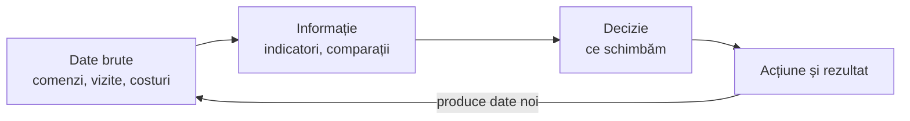
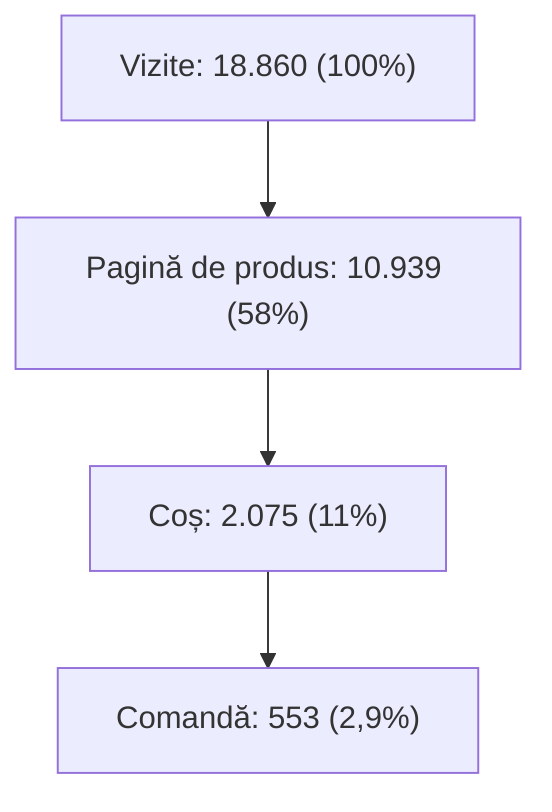

# Capitolul 5. Datele în decizie: indicatori, pâlnia de conversie și economia unei comenzi

## Ce vei putea face după acest capitol

- Să deosebești datele de informație și de decizie și să clasifici datele unei firme după structură și după sursă.
- Să alegi indicatorii potriviți pentru o decizie concretă și să recunoști un indicator de vanitate.
- Să calculezi și să interpretezi principalii indicatori dintr-un magazin online: rata de conversie, valoarea medie a comenzii, costul de achiziție, ROAS, valoarea pe viață a clientului și ceilalți din catalog.
- Să construiești o pâlnie de conversie și să găsești etapa în care se pierd cei mai mulți clienți.
- Să descompui o comandă în venit, costuri și contribuție, să calculezi pragul de rentabilitate și să faci o analiză de sensibilitate.
- Să conduci o investigație pe date, de la „ce s-a întâmplat” la „ce facem”, pe exemplul complet al magazinului „Cămara de la Dunăre”.

Acesta este capitolul cu cele mai multe calcule din suport. Nu ai nevoie de mai mult decât cele patru operații și de un tabel de calcul. Toate cifrele despre „Cămara de la Dunăre” sunt **date fictive, construite pentru exercițiu**, și vin din fișierul `camara_saptamanal.csv`. Le poți reface singur, rând cu rând.

## 5.1 Date, informație, decizie

### 5.1.1 Trei cuvinte care nu înseamnă același lucru

O **dată** este o înregistrare brută: „comanda 1.204, 3 borcane, 147 lei, venită din email, 14 octombrie”. Singură, nu spune nimic despre mersul afacerii.

**Informația** este data pusă în context și comparată cu ceva: „comenzile venite din email au o valoare medie de 165 lei, cu 10% peste cele din căutare”. Acum ai aflat ceva.

**Decizia** este ce faci cu informația: „trimitem newsletterul de două ori pe lună, nu o dată, și măsurăm ce se întâmplă”.



Expresia „decizii bazate pe date” (în engleză *data-driven decision making*) descrie tocmai acest circuit: nu hotărăști după impresie sau după cine vorbește mai tare în ședință, ci te uiți întâi la ce arată cifrele, apoi decizi și verifici dacă ai avut dreptate. Datele nu iau decizia în locul tău. Ele îți micșorează numărul de lucruri pe care trebuie să le ghicești.

Lanțul se rupe ușor în două locuri. Primul: ai date, dar nu le transformi în informație (exporturi pe care nu le deschide nimeni). Al doilea: ai informație, dar nu schimbă nimic (rapoarte citite cu interes și urmate de aceleași decizii ca înainte). Un raport care nu poate schimba nicio decizie este o cheltuială, nu o resursă.

### 5.1.2 Tipuri de date după structură

Prezentarea cursului împarte datele după cât de ordonate sunt. Împărțirea contează practic, pentru că îți spune cât de greu este să calculezi ceva din ele.

| Tip | Ce înseamnă | Exemple la Cămara | Cât de ușor se analizează |
|---|---|---|---|
| Structurate | Stau în tabele, cu rânduri și coloane fixe; fiecare coloană are un singur fel de valori | Tabelul de comenzi, lista de produse cu prețuri, stocul, fișierul `camara_saptamanal.csv` | Ușor: se sortează, se filtrează, se adună direct |
| Semistructurate | Au o organizare (etichete, câmpuri), dar nu formă de tabel; câmpurile pot lipsi sau varia | Răspunsul în format JSON primit de la procesatorul de plăți, fișierul XML al unei facturi electronice, un email (are expeditor, dată și subiect, dar corpul este text liber) | Mediu: trebuie întâi „desfăcute” în tabel |
| Nestructurate | Nu au câmpuri predefinite | Recenziile scrise de clienți, mesajele din chat, fotografiile produselor, înregistrările apelurilor | Greu: trebuie citite, etichetate sau prelucrate cu instrumente speciale |

O firmă mică își ia aproape toate deciziile din date structurate, pentru că acolo calculul este ieftin. Asta nu înseamnă că restul este inutil. Zece recenzii citite cu atenție pot explica de ce a scăzut un indicator pe care tabelul doar îl constată. O regulă bună de lucru: tabelul îți spune **cât**, textul clienților îți spune **de ce**.

> **Exemplu.** Tabelul de comenzi al Cămării arată că zacusca de vinete se vinde mai slab în noiembrie. Abia mesajele clienților („a ajuns cu capacul umflat”, „borcanul era spart”) arată că problema este la ambalare, nu la gust sau la preț. Prima informație vine din date structurate, a doua din date nestructurate.

### 5.1.3 Tipuri de date după sursă

A doua clasificare din prezentare ține de proveniență. În engleză se folosesc termenii *first-party*, *second-party* și *third-party data*.

| Sursă | Ce înseamnă | Exemple la Cămara | La ce să fii atent |
|---|---|---|---|
| Date proprii (*first-party*) | Le strângi tu, direct de la clienții și din operațiunile tale | Comenzi, vizite pe site, adrese de email ale abonaților, costuri, retururi | Sunt cele mai valoroase și cele mai ieftine; depind de cât de curat le înregistrezi |
| Date de la parteneri (*second-party*) | Datele proprii ale altei firme, primite printr-o înțelegere | Statusurile de livrare de la curier, vânzările raportate de un marketplace pe care listezi produse, stocurile anunțate de producători | Definițiile partenerului pot diferi de ale tale (ce numește el „livrat”?) |
| Date cumpărate sau publice (*third-party*) | Strânse de cineva care nu are legătură directă cu clienții tăi | Un studiu de piață plătit, statistici publice despre comerțul online, audiențe puse la dispoziție de platformele de reclame | Sunt generale, nu despre clienții tăi; verifică metodologia și data |

Pentru o afacere la început, ordinea priorităților este chiar ordinea din tabel. Întâi pune în ordine datele proprii. Abia apoi are sens să cauți altele.

Datele despre persoane (nume, adresă, email, istoricul comenzilor) sunt date cu caracter personal. Folosirea lor este reglementată în Uniunea Europeană de Regulamentul general privind protecția datelor (GDPR). Capitolul de față lucrează numai cu date agregate, pe săptămâni și canale, în care nu apare niciun client. Dacă lucrezi cu date la nivel de client, verifică obligațiile legale la sursa oficială sau cu un specialist; textul acesta nu este consultanță juridică.

> **Pentru afacerea ta.** Fă un inventar pe o singură pagină: ce date ai, unde stau (platforma magazinului, contabilitate, contul de reclame, un caiet), cine le poate exporta și cât de des. Majoritatea firmelor mici descoperă că au deja datele pentru toate calculele din acest capitol, doar că împrăștiate în trei sau patru locuri.

## 5.2 Indicatori: ce este un KPI și ce nu este

### 5.2.1 De la cifră la indicator

O firmă produce mii de cifre. Un **indicator** este o cifră calculată după o regulă fixă, urmărită în timp. Un **indicator-cheie de performanță**, pe scurt **KPI** (din engleză *Key Performance Indicator*), este un indicator ales special pentru că arată dacă te apropii de un obiectiv important.

Ce deosebește un KPI de o cifră oarecare:

1. **Este legat de un obiectiv.** „Vrem un rezultat lunar de cel puțin 15.000 lei” duce la indicatori precum contribuția pe comandă. Fără obiectiv, orice cifră pare interesantă.
2. **Are o definiție scrisă.** Ce intră la numărător, ce intră la numitor, din ce sursă, pe ce perioadă.
3. **Are un termen de comparație.** O țintă, luna trecută, aceeași lună a anului trecut. „Conversie 2,5%” nu spune nimic; „2,5%, față de 2,9% acum două luni” spune.
4. **Are un responsabil.** Cineva se uită la el și poate acționa.
5. **Poate schimba o decizie.** Dacă indiferent de valoare ai face același lucru, nu este cheie.

Câți KPI îți trebuie? Puțini. Dacă urmărești treizeci de „indicatori-cheie”, niciunul nu mai este cheie. O firmă mică se descurcă bine cu cinci până la opt, restul rămânând indicatori de sprijin, pe care îi deschizi când cauți o explicație.

### 5.2.2 Indicatori de vanitate și indicatori utili

Un **indicator de vanitate** este o cifră care arată bine și crește frumos, dar nu te ajută să decizi nimic. Termenul a fost popularizat în literatura pentru antreprenori (vezi Croll și Yoskovitz, *Lean Analytics*, 2013). Exemple tipice: numărul total de vizite, numărul de urmăritori, numărul total de conturi create de la înființare, aprecierile la o postare.

| Indicator de vanitate | De ce păcălește | Varianta utilă |
|---|---|---|
| Vizite totale pe site | Cresc și când cumperi trafic care nu cumpără nimic | Rata de conversie pe canal; contribuția pe canal |
| Urmăritori pe rețelele sociale | Nu spun câți ajung pe site și câți cumpără | Comenzi și venit din vizitele venite de pe rețelele sociale |
| Venitul total | Crește și când vinzi în pierdere | Marja brută și contribuția |
| Numărul total de clienți din toate timpurile | Nu poate scădea niciodată, deci nu avertizează | Clienți care au comandat în ultimele 90 de zile; rata de revenire |
| Numărul de comenzi | Crește și când dai reduceri care îți mănâncă marja | Contribuția pe comandă |

Testul practic este o singură întrebare: **„Dacă cifra asta crește cu 20%, ce fac altfel de mâine?”** Dacă răspunsul este „nimic, dar mă bucur”, ai în față un indicator de vanitate.

Studiul de caz al Cămării, de la finalul capitolului, este exact povestea a doi indicatori de vanitate. Comenzile au crescut cu 44%, venitul cu 28%, iar rezultatul a scăzut cu 63% (date fictive, construite pentru exercițiu).

### 5.2.3 Pornește de la decizie, nu de la cifră

Greșeala clasică este să deschizi platforma de analiză, să te uiți la ce grafice oferă și să te întrebi ce ai putea afla din ele. Drumul sănătos este invers:

1. **Decizia.** Ce am de hotărât? Exemplu: „Mărim bugetul de reclame în decembrie?”
2. **Întrebarea.** Ce ar trebui să știu ca să decid? „Comenzile aduse de reclame lasă bani după ce plătim marfa, reclama și livrarea?”
3. **Indicatorul.** Ce cifră răspunde la întrebare? „Contribuția pe comandă pe canalul Reclame.”
4. **Datele.** De ce am nevoie ca să o calculez? „Venit, marjă, cost de marketing și cost de livrare, pe canal.”
5. **Pragul.** La ce valoare aleg o variantă sau alta? „Dacă este sub zero, nu mărim bugetul.”

> **De reținut.** Stabilește pragul înainte să vezi cifra. Dacă îl alegi după, vei găsi mereu o explicație pentru care valoarea obținută este „de fapt în regulă”.

> **Greșeală frecventă.** Să alegi indicatorii pentru că îi afișează instrumentul, nu pentru că îți trebuie. Platformele de reclame, de exemplu, pun în față indicatorii care le avantajează pe ele (afișări, clicuri, venit atribuit), nu pe cei care îți arată ție profitul.

## 5.3 Catalogul indicatorilor

Prezentarea cursului grupează indicatorii din eBusiness în trei familii: **financiari** (CLV, CAC, ROAS, MRR), **de implicare** (NPS, CSAT, utilizatori activi, rata de renunțare) și **operaționali** (rata de conversie, abandonul coșului, valoarea medie a comenzii, performanța site-ului). Păstrăm gruparea. Pentru fiecare indicator găsești definiția, formula, un exemplu, decizia la care ajută și felul în care te poate păcăli.

O precizare despre exemple. Fișierul Cămării conține vizite, comenzi, venit și costuri pe săptămâni și canale. Nu conține date despre clienți individuali, abonamente sau sondaje. Acolo unde indicatorul are nevoie de astfel de date, exemplul folosește ipoteze suplimentare, marcate ca atare.

Nu vei găsi în acest catalog „valori medii pe industrie”. Ele depind puternic de domeniu, de preț, de țară, de dispozitiv și de felul în care fiecare firmă își definește indicatorul. Cel mai bun termen de comparație pentru o firmă mică este propria ei cifră din perioada anterioară.

### 5.3.1 Indicatori financiari

**Costul de achiziție a unui client, CAC** (*Customer Acquisition Cost*). Cât cheltuiești, în medie, ca să câștigi un client nou.

```
CAC = cheltuieli de marketing și vânzări dintr-o perioadă / număr de clienți noi din aceeași perioadă
```

Pe datele Cămării nu putem separa clienții noi de cei vechi, așa că vom calcula ruda apropiată a CAC-ului: **costul de marketing pe comandă**. Pe canalul Reclame, în septembrie: 2.400 lei / 64 comenzi = 37,50 lei pe comandă. În noiembrie: 16.800 lei / 286 comenzi = 58,74 lei pe comandă.

- *Decizia:* cât îți permiți să plătești pentru un client; ce canal merită buget.
- *Cum păcălește:* dacă împarți tot bugetul la toate comenzile magazinului, obții un cost mic și liniștitor (în noiembrie, 17.000 / 796 = 21,36 lei), deși canalul plătit costă aproape de trei ori mai mult. Clienții veniți singuri „subvenționează” media. A doua capcană: CAC lasă pe dinafară costuri reale, cum ar fi reducerea oferită sau timpul omului care face reclamele.

**Rentabilitatea cheltuielilor cu reclamele, ROAS** (*Return on Ad Spend*). Câți lei de venit aduce fiecare leu cheltuit pe reclame.

```
ROAS = venit atribuit reclamelor / cheltuiala cu reclamele
```

Documentația Google Ads descrie ROAS-ul țintă ca valoarea medie a conversiilor (de exemplu venitul) pe care vrei să o obții pentru fiecare unitate monetară cheltuită pe reclame și îl exprimă ca procent: 5 dolari vânzări la 1 dolar cheltuit înseamnă 500% (Google Ads Help, „About Target ROAS bidding”, https://support.google.com/google-ads/answer/6268637). La Cămara, pe canalul Reclame: septembrie 9.600 / 2.400 = 4,00; noiembrie 30.030 / 16.800 = 1,79.

- *Decizia:* oprești, păstrezi sau mărești o campanie.
- *Cum păcălește:* ROAS măsoară **venit**, nu profit. Un ROAS de 1,79 sună a „câștig 79 de bani la fiecare leu”. În realitate, din 1,79 lei venit, la o marjă brută de 31% rămân 0,55 lei, din care trebuie plătite reclama (1 leu) și livrarea. Mai jos, la secțiunea 5.5, calculăm ROAS-ul de la care canalul începe să lase bani.

> **Exemplu.** ROAS-ul de echilibru al canalului Reclame. La preț întreg, o comandă de 150 lei lasă 67,50 lei marjă brută; după 14 lei ambalare și livrare rămân 53,50 lei, adică maximul pe care îl poți plăti pe reclamă fără să pierzi. ROAS-ul de echilibru este 150 / 53,50 = 2,80. Cu reducerea de 20%, comanda medie este de 105 lei, cu marjă brută de 32,55 lei; după livrare rămân 18,55 lei. ROAS-ul de echilibru urcă la 105 / 18,55 = 5,66. Cămara a obținut 1,79. (Date fictive, construite pentru exercițiu.)

**Valoarea pe viață a clientului, CLV** (*Customer Lifetime Value*, uneori scris LTV). Câți bani îți lasă un client pe toată durata relației cu tine.

```
CLV (variantă simplă) = contribuția medie pe comandă × comenzi pe an × ani cât rămâne client
```

Exemplu cu ipoteze suplimentare: un client al Cămării comandă de trei ori pe an, la preț întreg (150 lei, marjă 45%, 14 lei livrare, deci 53,50 lei pe comandă înainte de marketing), și rămâne client doi ani. CLV = 53,50 × 3 × 2 = 321 lei. Un astfel de client merită un cost de achiziție de 58 lei. Un client care cumpără o singură dată, cu cod de reducere, lasă 18,55 lei și nu îl merită.

- *Decizia:* cât poți plăti pentru achiziție; în ce clienți investești (programe de fidelitate, email).
- *Cum păcălește:* este o **estimare** despre viitor, construită din ipoteze. Se calculează adesea din venit în loc de contribuție, ceea ce o umflă. Iar clienții aduși cu reduceri mari revin, de regulă, mai rar decât cei veniți la preț întreg, deci nu le poți atribui CLV-ul mediu al magazinului fără să verifici.

Raportul **CLV / CAC** leagă cei doi indicatori: arată de câte ori își scoate un client costul de achiziție. Sub 1 înseamnă că pierzi bani cu fiecare client câștigat. Cât de mult peste 1 trebuie să fie depinde de marjă, de cât de repede se recuperează banii și de cât de sigure sunt ipotezele din CLV.

**Venitul lunar recurent, MRR** (*Monthly Recurring Revenue*). Venitul care se repetă în fiecare lună din abonamente.

```
MRR = număr de abonați activi × prețul lunar mediu al abonamentului
```

Cămara nu vinde abonamente, deci nu are MRR. Să presupunem că ar lansa „Cutia lunii”, la 120 lei pe lună, și ar avea 80 de abonați: MRR = 9.600 lei. Avantajul acestui venit este că îl cunoști dinainte.

- *Decizia:* planificarea stocului, a angajărilor, a investițiilor; evaluarea unui model pe bază de abonament (vezi capitolul 2).
- *Cum păcălește:* dacă pui la MRR și vânzări care nu se repetă (taxe de instalare, comenzi unice), cifra arată o stabilitate care nu există. MRR-ul trebuie citit mereu împreună cu rata de renunțare.

### 5.3.2 Indicatori de implicare

**Rata de renunțare** (*churn rate*). Ce parte dintre clienți te părăsește într-o perioadă.

```
Rata de renunțare = clienți pierduți în perioadă / clienți la începutul perioadei
```

Pentru „Cutia lunii”: din 80 de abonați la 1 noiembrie, 6 renunță până la sfârșitul lunii. Rata de renunțare este 6 / 80 = 7,5% pe lună. Pare puțin. Dar cu 7,5% pe lună, din 100 de abonați de astăzi mai rămân aproximativ 39 după un an (0,925 la puterea 12).

- *Decizia:* investești în păstrarea clienților sau în aducerea altora noi.
- *Cum păcălește:* într-un magazin fără abonamente, clientul nu „își dă demisia”, pur și simplu nu mai comandă. Trebuie să alegi tu o regulă (de exemplu: nicio comandă în ultimele 180 de zile), iar cifra depinde de regula aleasă. În plus, o medie pe toți clienții ascunde diferențe mari între cei vechi și cei abia sosiți.

**Scorul net de recomandare, NPS** (*Net Promoter Score*). Măsoară cât de dispuși sunt clienții să te recomande. A fost propus de Frederick Reichheld în articolul „The One Number You Need to Grow” (Harvard Business Review, decembrie 2003). Clienții răspund la o singură întrebare, „Cât de probabil este să ne recomandați unui prieten sau coleg?”, pe o scară de la 0 la 10. Cei care dau 9 sau 10 sunt **promotori**, cei cu 7 sau 8 sunt **pasivi**, cei cu 0-6 sunt **detractori** (Bain & Company, „Measuring Your Net Promoter Score”, https://www.netpromotersystem.com/about/measuring-your-net-promoter-score/).

```
NPS = % promotori - % detractori
```

Exemplu cu date ipotetice de sondaj: din 200 de răspunsuri, 110 sunt promotori (55%), 60 pasivi și 30 detractori (15%). NPS = 55 - 15 = 40. Scorul poate lua valori între -100 și +100.

- *Decizia:* unde ai probleme de experiență; pe cine suni ca să afli ce a mers prost (detractorii).
- *Cum păcălește:* răspund mai ales clienții foarte mulțumiți și cei foarte supărați. Cu 30 de răspunsuri, scorul sare de la o lună la alta fără să se fi schimbat nimic. Două distribuții foarte diferite pot da același scor. Și măsoară o intenție declarată, nu un comportament.

**Scorul de satisfacție a clientului, CSAT** (*Customer Satisfaction Score*). Măsoară mulțumirea față de o interacțiune anume: o livrare, o discuție cu asistența.

```
CSAT = răspunsuri „mulțumit” și „foarte mulțumit” / total răspunsuri
```

Exemplu ipotetic: după livrare, 200 de clienți dau o notă de la 1 la 5; 180 dau 4 sau 5. CSAT = 90%.

- *Decizia:* ce pas al experienței repari primul. Se folosește mult în asistența pentru clienți (vezi capitolul 4).
- *Cum păcălește:* descrie un moment, nu relația. Un client poate fi mulțumit de curier și să nu mai comande niciodată. Depinde și de când întrebi: imediat după o problemă rezolvată, notele sunt mai mari.

**Utilizatori activi zilnic și lunar, DAU și MAU** (*Daily Active Users*, *Monthly Active Users*). Câte persoane distincte au folosit produsul într-o zi, respectiv într-o lună. Raportul DAU / MAU arată cât de des revin. Documentația Google Analytics îl descrie ca procentul utilizatorilor implicați într-o zi din cei implicați în ultimele 30 de zile (Google Analytics Help, „Analytics dimensions and metrics”, https://support.google.com/analytics/answer/9143382).

```
Raport DAU/MAU = utilizatori activi într-o zi / utilizatori activi în ultimele 30 de zile
```

Exemplu ipotetic: o aplicație de planificare a meselor are 1.200 de utilizatori activi azi și 6.000 în ultima lună. Raportul este 20%: utilizatorul tipic deschide aplicația cam o zi din cinci.

- *Decizia:* contează pentru produsele folosite des (aplicații, platforme, jocuri). Pentru un magazin de dulcețuri, de unde cumperi de câteva ori pe an, este aproape irelevant; mai util este numărul clienților care au comandat în ultimele 90 de zile.
- *Cum păcălește:* totul depinde de ce numești „activ”. Cine doar a deschis aplicația o secundă este activ?

**Rata de respingere** (*bounce rate*) și **rata de implicare** (*engagement rate*). Arată ce parte dintre vizite pleacă fără să facă nimic. În Google Analytics 4, o sesiune „implicată” este una care durează peste 10 secunde, are un eveniment-cheie sau are cel puțin două afișări de pagină. Rata de implicare este procentul sesiunilor implicate, iar rata de respingere este procentul sesiunilor care nu au fost implicate (Google Analytics Help, „[GA4] Engagement rate and bounce rate”, https://support.google.com/analytics/answer/12195621).

```
Rata de respingere = sesiuni neimplicate / total sesiuni = 100% - rata de implicare
```

Exemplu cu o ipoteză suplimentară: dacă din 15.900 de vizite venite din reclame în noiembrie, 9.858 nu ar fi fost implicate, rata de respingere ar fi 62%.

- *Decizia:* se potrivește reclama cu pagina pe care ajunge omul? Se încarcă pagina destul de repede?
- *Cum păcălește:* definiția diferă între instrumente și chiar între versiunile aceluiași instrument, deci nu compara cifre luate din surse diferite. O respingere nu este întotdeauna un eșec: cine a căutat programul de livrare și l-a găsit în cinci secunde a plecat mulțumit.

### 5.3.3 Indicatori operaționali

**Rata de conversie** (*conversion rate*). Ce parte dintre vizite se termină cu acțiunea dorită, de regulă o comandă.

```
Rata de conversie = comenzi / vizite
```

Cămara, septembrie: 553 / 18.860 = 2,93%. Noiembrie: 796 / 32.140 = 2,48%.

- *Decizia:* repari site-ul sau aduci alt trafic? Pe ce canal merită să insiști?
- *Cum păcălește:* în trei feluri. Întâi, depinde de numitor: vizite (sesiuni) sau vizitatori (persoane)? Google Analytics are indicatori separați pentru cele două variante, rata pe sesiuni și rata pe utilizatori (aceeași pagină de documentație citată mai sus). Apoi, media pe tot magazinul amestecă trafic foarte diferit; vom vedea că la Cămara conversia totală a scăzut deși aproape niciun canal nu a convertit mai prost. În fine, poți crește conversia dând reduceri, adică pe seama marjei.

**Valoarea medie a comenzii, AOV** (*Average Order Value*). Cât cheltuiește un client, în medie, la o comandă.

```
AOV = venit / număr de comenzi
```

Cămara, septembrie: 85.400 / 553 = 154,43 lei. Noiembrie: 109.125 / 796 = 137,09 lei. Pe canale, în noiembrie: Email 165 lei, Direct 155 lei, Căutare 150 lei, Reclame 105 lei.

- *Decizia:* praguri de transport gratuit, pachete de produse, recomandări în coș.
- *Cum păcălește:* este o medie, deci câteva comenzi foarte mari o trag în sus. Decide dinainte dacă o calculezi cu sau fără TVA, înainte sau după reduceri, cu sau fără taxa de transport, și păstrează aceeași regulă.

**Rata de abandon al coșului** (*cart abandonment rate*). Ce parte dintre coșurile începute nu ajung comenzi.

```
Rata de abandon = 1 - comenzi finalizate / coșuri create
```

Exemplu (cu ipoteza din secțiunea următoare, că 11% dintre vizite pun ceva în coș): în septembrie, 2.075 de coșuri și 553 de comenzi. Rata de abandon = 1 - 553 / 2.075 = 73,3%.

- *Decizia:* simplifici pașii de plată, afișezi mai devreme costul de transport, trimiți un email de reamintire.
- *Cum păcălește:* mulți oameni folosesc coșul ca listă de dorințe sau ca să afle costul transportului. Nu erau gata să cumpere, deci nu toți sunt „clienți pierduți”. Cifra arată întotdeauna dramatic; urmărește cum se schimbă, nu cât este.

**Indicatorii de performanță ai site-ului** (timp de încărcare, erori, disponibilitate) intră tot în familia operațională. Nu îi detaliem aici; rețin doar că un site lent strică toți ceilalți indicatori din pâlnie și că merită un loc în jurnalul lunar.

### 5.3.4 Doi indicatori care lipsesc din listă și fără care nu poți decide

Lista din prezentare este cea obișnuită în marketingul digital. Pentru un magazin, mai sunt necesari doi indicatori, pe care îi folosim în restul capitolului:

- **Marja brută:** venitul minus costul mărfii vândute. Ca procent: marjă brută / venit. La Cămara, 45% la preț întreg.
- **Contribuția pe comandă:** ce rămâne dintr-o comandă după costul mărfii, marketing, ambalare și livrare. Este indicatorul care spune dacă o comandă în plus te ajută sau te costă.

### 5.3.5 Tabel-sinteză

| Indicator | Formulă pe scurt | Decizia la care ajută | Cum poate păcăli |
|---|---|---|---|
| CAC | marketing / clienți noi | Cât plătești pentru un client | Media pe toate canalele ascunde canalul scump |
| ROAS | venit din reclame / cost reclame | Oprești sau mărești o campanie | Măsoară venit, nu profit |
| CLV | contribuție pe comandă × comenzi pe an × ani | Cât merită un client | Este o estimare; se umflă ușor |
| MRR | abonați × preț lunar | Planificarea veniturilor | Amestecat cu vânzări unice |
| Rata de renunțare | clienți pierduți / clienți la început | Păstrare sau achiziție | Depinde de definiția „pierdut” |
| NPS | % promotori - % detractori | Unde suferă experiența | Puține răspunsuri, cine răspunde |
| CSAT | răspunsuri mulțumite / total | Ce pas repari | Măsoară un moment, nu relația |
| DAU, MAU | persoane active pe zi, pe lună | Cât de des revin utilizatorii | Depinde de definiția „activ” |
| Rata de respingere | sesiuni neimplicate / sesiuni | Potrivirea reclamă-pagină | Definiții diferite între instrumente |
| Rata de conversie | comenzi / vizite | Site sau trafic | Media amestecă trafic diferit |
| AOV | venit / comenzi | Praguri, pachete | Sensibil la valori extreme |
| Abandonul coșului | 1 - comenzi / coșuri | Simplificarea plății | Coșul folosit ca listă de dorințe |
| Marja brută | (venit - cost marfă) / venit | Prețuri și reduceri | Ignoră costurile de după vânzare |
| Contribuția pe comandă | marjă - marketing - livrare, pe comandă | Merită comanda în plus? | Depinde de cum împarți marketingul |

## 5.4 Pâlnia de conversie

### 5.4.1 Ce este și cum se calculează

Drumul de la prima vizită la comandă are mai multe etape, iar la fiecare etapă o parte dintre oameni pleacă. Dacă desenezi câți rămân la fiecare pas, figura se îngustează ca o pâlnie. De aici numele: **pâlnia de conversie** (*conversion funnel*).

Pentru un magazin online, etapele obișnuite sunt:

1. vizită pe site;
2. vizualizarea unei pagini de produs;
3. adăugarea în coș;
4. începerea plății (uneori numărată separat);
5. comandă finalizată.

Pentru fiecare etapă calculezi două procente:

- **rata față de etapa anterioară** (câți trec de la pasul 2 la pasul 3), care arată unde este „gaura”;
- **rata față de total** (câți din toate vizitele ajung la pasul 3), care arată cât a mai rămas din pâlnie.

### 5.4.2 Pâlnia Cămării în septembrie

Din fișierul de date cunoaștem capetele pâlniei: 18.860 de vizite și 553 de comenzi, adică o rată de conversie de 2,9%. Pașii intermediari **nu sunt în fișier**. Pentru exercițiu, presupunem că 58% dintre vizite ajung pe o pagină de produs și că 11% dintre vizite pun ceva în coș. Acestea sunt ipoteze, nu date măsurate; într-un magazin real le-ai citi din instrumentul de analiză.

| Etapă | Număr | % din vizite | % din etapa anterioară | Pierduți la acest pas |
|---|---|---|---|---|
| Vizite | 18.860 | 100% | - | - |
| Văd o pagină de produs (ipoteză: 58%) | 10.939 | 58% | 58% | 7.921 |
| Pun în coș (ipoteză: 11%) | 2.075 | 11% | 19% | 8.864 |
| Finalizează comanda | 553 | 2,9% | 26,7% | 1.522 |

(Date fictive, construite pentru exercițiu.)



### 5.4.3 Cum citești o pâlnie

Trei observații pe tabelul de mai sus.

**Cea mai mare pierdere în număr de oameni** este între pagina de produs și coș: 8.864 de vizite văd un produs și nu îl adaugă. Întrebările care merită puse: sunt clare prețul și costul livrării? Sunt fotografiile și descrierile suficiente? Există recenzii?

**Cea mai mare pierdere procentuală** este la sfârșit: aproape trei coșuri din patru nu devin comenzi. Aici oamenii și-au arătat deja intenția, deci o îmbunătățire mică valorează mult.

**Efectul se calculează simplu.** Dacă rata de finalizare a coșului ar urca de la 26,7% la 30%, din aceleași 2.075 de coșuri ar ieși 622 de comenzi în loc de 553. Sunt 69 de comenzi în plus, fără niciun leu cheltuit pe trafic. La contribuția medie din septembrie de aproximativ 51 lei pe comandă, înseamnă circa 3.500 lei pe lună. (Calculul presupune că aceste comenzi suplimentare ar arăta ca media.)

Pâlnia se calculează și **pe segmente**: pe canal, pe dispozitiv (telefon sau calculator), pe clienți noi și clienți care revin. O pâlnie medie arată bine sau rău „în general”; pâlniile pe segmente arată unde anume. La Cămara, vizitele din email convertesc în proporție de 5,0%, iar cele din reclame în proporție de 1,8% până la 2,0%. Nu sunt același fel de vizitatori și nu are sens să le ceri același rezultat.

> **Greșeală frecventă.** Să repari etapa cu cel mai urât procent fără să te uiți la numărul de oameni. O etapă prin care trec 50 de persoane pe lună poate avea o rată groaznică și totuși să nu merite nicio oră de muncă. Înmulțește mereu: câți oameni ajung acolo × cât poți îmbunătăți realist × cât valorează o comandă.

> **De reținut.** Pâlnia îți spune **unde** pleacă oamenii, nu **de ce**. Pentru „de ce” ai nevoie de altceva: să parcurgi tu comanda pe telefon, să citești mesajele clienților, să întrebi cinci cumpărători.

## 5.5 Economia unei comenzi

### 5.5.1 De ce venitul nu este profit

**Economia unei comenzi** (în engleză *unit economics*, economia pe unitate) este răspunsul la o întrebare simplă: după ce plătesc tot ce este legat direct de o comandă, cu cât rămân?

Să urmărim o comandă obișnuită de 150 lei, la preț întreg, venită din căutare:

| Pas | Calcul | Lei |
|---|---|---|
| Venit | prețul plătit de client | 150,00 |
| Costul mărfii | cât plătești producătorilor (55%) | -82,50 |
| **Marjă brută** | 45% din venit | **67,50** |
| Marketing | căutarea neplătită nu costă pe comandă | 0,00 |
| Ambalare și livrare | cutie, protecție, curier | -14,00 |
| **Contribuție** | ce rămâne pentru costurile fixe și profit | **53,50** |

Din 150 lei încasați, 53,50 lei sunt cu adevărat „ai firmei”. Restul doar trec prin cont.

Acum aceeași privire asupra unei comenzi medii din noiembrie de pe canalul Reclame, cu cod de reducere de 20%:

| Pas | Lei |
|---|---|
| Venit | 105,00 |
| Costul mărfii | -72,45 |
| **Marjă brută** (31%) | **32,55** |
| Marketing (16.800 lei / 286 comenzi) | -58,74 |
| Ambalare și livrare | -14,00 |
| **Contribuție** | **-40,19** |

(Date fictive, construite pentru exercițiu.)

Clientul a plătit 105 lei, a fost numărat la „comenzi”, a intrat în „venit”, iar magazinul a rămas cu 40 de lei mai puțin decât dacă acea comandă nu ar fi existat. Asta înseamnă „venitul nu este profit”.

De ce scade marja de la 45% la 31% când dai o reducere de 20%? Pentru că reducerea se scade din preț, dar costul mărfii rămâne același. Un borcan cumpărat cu 55 lei și vândut cu 100 lei lasă 45 lei. Vândut cu 80 lei, lasă 25 lei, adică 31% din noul preț. O reducere de 20% din preț a tăiat 44% din marja în lei.

### 5.5.2 Costuri pe comandă și costuri fixe

Pentru calculele din acest capitol, costurile se împart în două categorii:

- **Costuri pe comandă (variabile):** apar cu fiecare comandă și dispar dacă nu vinzi. Costul mărfii, ambalarea, livrarea, comisionul procesatorului de plăți.
- **Costuri fixe:** le plătești oricâte comenzi ai. Chiria spațiului, salariile, abonamentul platformei, contabilitatea. La Cămara, 10.000 lei pe lună, adică 2.500 lei pe săptămână.

Marketingul stă la mijloc. Bugetul de reclame este hotărât de tine la începutul lunii (seamănă cu un cost fix), dar scopul lui este să aducă fiecare comandă în parte (seamănă cu un cost pe comandă). În analiza pe canale îl împărțim la comenzile canalului. În calculul pragului de rentabilitate îl tratăm ca pe un buget lunar dat. Ambele sunt corecte, cu condiția să spui ce ai ales.

De aici, două definiții pe care le folosim până la sfârșit:

```
Contribuție = marjă brută - marketing - ambalare și livrare
Rezultat simplificat = contribuție - costuri fixe
```

„Simplificat” înseamnă că lăsăm deoparte impozitele, amortizarea, dobânzile și alte elemente de contabilitate. Pentru decizii de marketing și de preț, simplificarea este suficientă. Pentru declarații fiscale, nu este.

### 5.5.3 Comanda medie, în septembrie și în noiembrie

Împărțind totalurile lunare din fișier la numărul de comenzi, obținem „comanda medie” a fiecărei luni:

| Pe o comandă medie (lei) | Septembrie | Noiembrie |
|---|---|---|
| Venit (AOV) | 154,43 | 137,09 |
| Costul mărfii | -84,94 | -80,68 |
| Marjă brută | 69,49 | 56,41 |
| Marketing | -4,70 | -21,36 |
| Ambalare și livrare | -14,00 | -14,00 |
| **Contribuție** | **50,79** | **21,05** |
| Costuri fixe repartizate | -18,08 | -12,56 |
| **Rezultat** | **32,71** | **8,49** |

(Date fictive, construite pentru exercițiu; calculate din `camara_saptamanal.csv`.)

Rândul costurilor fixe arată singurul efect bun al creșterii: aceiași 10.000 lei se împart la mai multe comenzi, deci apasă mai puțin pe fiecare (12,56 lei în loc de 18,08). Câștigul de 5,52 lei pe comandă este însă mult mai mic decât pierderea de 29,74 lei la contribuție.

### 5.5.4 Pragul de rentabilitate

**Pragul de rentabilitate** (*break-even point*) este numărul de comenzi la care rezultatul este exact zero. Sub prag pierzi, peste prag câștigi.

```
Prag (comenzi) = (costuri fixe + buget de marketing) / (marjă brută pe comandă - ambalare și livrare pe comandă)
```

Numitorul este ce lasă o comandă înainte de marketing. Numărătorul este suma pe care toate comenzile lunii trebuie să o acopere împreună.

**Calcul pe noiembrie.**

- O comandă medie aduce 137,09 lei, la o marjă brută de 41,15%: 56,41 lei.
- Scădem 14 lei pentru ambalare și livrare: rămân aproximativ 42,4 lei.
- De acoperit: 17.000 lei marketing + 10.000 lei costuri fixe = 27.000 lei.
- Prag = 27.000 / 42,41 ≈ 637 de comenzi.

Cămara a avut 796 de comenzi în noiembrie, cu 159 peste prag. Cele 159 de comenzi × 42,41 lei dau aproximativ 6.758 lei, adică exact rezultatul lunii. Verificarea aceasta merită făcută de fiecare dată: dacă nu iese, ai o greșeală în formulă.

**Același calcul pe septembrie.** O comandă lăsa 69,49 - 14 = 55,49 lei, iar de acoperit erau 2.600 + 10.000 = 12.600 lei. Pragul era de 227 de comenzi, iar magazinul a avut 553.

| | Septembrie | Noiembrie |
|---|---|---|
| Lasă o comandă, înainte de marketing (lei) | 55,49 | 42,41 |
| De acoperit: marketing + fixe (lei) | 12.600 | 27.000 |
| Prag de rentabilitate (comenzi) | 227 | 637 |
| Comenzi realizate | 553 | 796 |
| Comenzi peste prag | 326 | 159 |

(Date fictive, construite pentru exercițiu.)

În două luni, pragul aproape s-a triplat. Magazinul vinde mai mult și este mult mai aproape de pierdere. În septembrie putea pierde 59% din comenzi și tot rămânea pe zero; în noiembrie, o scădere de 20% îl duce acolo.

> **Greșeală frecventă.** Să calculezi pragul cu marja la preț întreg (45%) când o parte din vânzări se face cu reducere. Folosește marja reală a perioadei. La Cămara, diferența dintre 45% și 41,15% mută pragul din noiembrie de la aproximativ 566 la 637 de comenzi.

## 5.6 Analiza de sensibilitate: ce pârghie contează cel mai mult

### 5.6.1 Metoda

Rezultatul unui magazin se poate scrie ca o singură formulă:

```
Rezultat = vizite × rata de conversie × AOV × marja brută %
           - buget de marketing
           - comenzi × cost de ambalare și livrare
           - costuri fixe
```

**Analiza de sensibilitate** înseamnă să miști câte o pârghie, pe rând, lăsându-le pe celelalte pe loc, și să vezi cu cât se schimbă rezultatul. Scopul nu este o prognoză. Scopul este să afli pe ce merită să îți cheltuiești timpul.

### 5.6.2 Calcul pe noiembrie

Punctul de plecare: 32.140 vizite, conversie 2,48%, AOV 137,09 lei, marjă brută 41,15%, marketing 17.000 lei, 14 lei pe comandă, costuri fixe 10.000 lei. Rezultat: 6.758 lei.

| Scenariu | Ce se schimbă | Rezultat nou (lei) | Diferență (lei) | Diferență (%) |
|---|---|---|---|---|
| Trafic +10% | 80 de comenzi în plus, cu tot cu colete | 10.134 | +3.376 | +50% |
| Conversie +10% (de la 2,48% la 2,72%) | aceleași 80 de comenzi în plus | 10.134 | +3.376 | +50% |
| AOV +10% (de la 137 la 151 lei) | venit +10.913 lei, niciun colet în plus | 11.248 | +4.490 | +66% |
| Marjă +3 puncte procentuale (la 44,15%) | 3% din venit rămâne în firmă | 10.032 | +3.274 | +48% |
| Buget -10%, comenzi neschimbate | 1.700 lei economisiți | 8.458 | +1.700 | +25% |
| Buget -10%, cu 10% mai puține comenzi din reclame | 1.700 lei economisiți, minus marja a 29 de comenzi | 7.928 | +1.170 | +17% |

(Date fictive, construite pentru exercițiu; calculate din `camara_saptamanal.csv`.)

### 5.6.3 Ce învățăm din tabel

**Traficul și conversia dau exact același efect.** Nu este o coincidență: în formulă, vizitele și rata de conversie se înmulțesc, deci 10% în plus la oricare dintre ele dă aceleași 80 de comenzi în plus. Fiecare aduce 42,41 lei, în total 3.376 lei. Diferența dintre cele două pârghii este de cost, nu de efect: traficul în plus de obicei se cumpără, conversia în plus se obține muncind la site.

**AOV le bate pe amândouă.** Zece la sută în plus la valoarea comenzii aduce aceeași marjă brută suplimentară ca zece la sută în plus la trafic (4.490 lei), dar fără cele 80 de colete de ambalat și expediat (80 × 14 = 1.114 lei, cu rotunjire). Clientul care adaugă un borcan în plus în aceeași cutie este cea mai ieftină creștere.

**Trei puncte de marjă fac aproape cât zece la sută de trafic.** O renegociere cu producătorii sau o creștere de preț de câțiva lei pe borcan are un efect comparabil cu câteva mii de vizite în plus.

**Un rezultat mic amplifică orice.** Diferențele de 50% sau 66% par uriașe pentru că rezultatul de plecare este mic. O firmă care trăiește aproape de prag este foarte sensibilă în ambele direcții: tot cu 50% scade rezultatul dacă traficul scade cu 10%.

**Tăierea bugetului trebuie judecată cu tot cu comenzile pierdute.** Rândul al cincilea presupune că poți tăia 1.700 lei fără să pierzi nimic, ceea ce este optimist. Rândul al șaselea presupune că pierzi o zecime din comenzile din reclame. Fiecare dintre ele lăsa 18,55 lei înainte de marketing, deci pierzi 531 lei și câștigi net 1.170 lei. Tăierea rămâne avantajoasă tocmai pentru că aceste comenzi costă mai mult decât aduc.

> **Greșeală frecventă.** Să tratezi scenariile ca fiind la fel de ușor de obținut. Tabelul spune ce **efect** are fiecare pârghie, nu cât de **greu** se mișcă. Zece la sută la conversie poate însemna luni de lucru la site; trei puncte de marjă pot însemna o singură discuție cu un furnizor, sau pot fi imposibile. Analiza de sensibilitate îți ordonează opțiunile; nu le execută.

### 5.6.4 Costurile ascunse ale pârghiilor

Analiza de mai sus mișcă o singură pârghie și presupune că restul stau pe loc. În realitate, pârghiile sunt legate între ele. Trei legături apar în aproape orice magazin.

**Randamentul descrescător al reclamelor.** Primii lei cheltuiți pe reclame ajung la oamenii cei mai interesați. Pe măsură ce mărești bugetul, platforma îți arată reclama unor oameni tot mai puțin interesați, la un preț tot mai mare. La Cămara, costul unei vizite din reclame a urcat de la 0,75 lei în septembrie (2.400 / 3.220) la 1,06 lei în noiembrie (16.800 / 15.900), iar conversia a coborât de la 1,99% la 1,80%. Rezultatul: costul de marketing pe comandă a urcat de la 37,50 la 58,74 lei.

Mai grăitor este **costul marginal**, adică prețul comenzilor aduse de banii în plus. Între septembrie și noiembrie, bugetul a crescut cu 14.400 lei și a adus 222 de comenzi suplimentare pe canal. Fiecare comandă suplimentară a costat 14.400 / 222 = 64,86 lei în reclame, pentru o marjă brută de 32,55 lei. Media de 58,74 lei arată rău; costul marginal arată și mai rău, iar el este cel care contează când decizi dacă mai adaugi buget.

**Reducerea care crește comenzile și taie marja.** Reducerile funcționează: aduc comenzi. Întrebarea este de câte comenzi în plus ai nevoie ca să ieși la fel. La preț întreg, o comandă de 150 lei lasă 53,50 lei după marfă și livrare. Cu reducerea de 20% și coșul mai mic, o comandă lasă 18,55 lei. Ai nevoie de 53,50 / 18,55 = 2,9 comenzi cu reducere ca să câștigi cât dintr-una la preț întreg, și asta înainte de a plăti reclama. Mai există două costuri pe care tabelul nu le vede: clienții care ar fi cumpărat oricum la preț întreg și folosesc codul, și clienții care învață să aștepte următoarea reducere.

**Costuri pe comandă față de costuri fixe.** Volumul ajută doar acolo unde costurile sunt fixe. Dublarea comenzilor înjumătățește chiria pe comandă, dar nu schimbă nimic la cei 14 lei de ambalare și livrare, care se plătesc de fiecare dată. De aceea „recuperăm din volum” este adevărat numai dacă fiecare comandă în plus are contribuție pozitivă. O contribuție negativă înmulțită cu un volum mare dă o pierdere mare. În plus, costurile fixe sunt fixe doar până la un punct: la 800 de colete pe lună s-ar putea să ai nevoie de încă un om la ambalat, iar costul „fix” urcă o treaptă.

> **De reținut.** Trei întrebări înainte de orice campanie: (1) Cât lasă o comandă adusă de campanie, după marfă, reducere, reclamă și livrare? (2) Cât costă ultima comandă adusă, nu comanda medie? (3) Ce se întâmplă cu clienții care ar fi cumpărat oricum?

## 5.7 Studiu de caz complet: de ce a scăzut rezultatul Cămării deși comenzile au crescut

Toate cifrele din această secțiune sunt **date fictive, construite pentru exercițiu**, calculate din `camara_saptamanal.csv`. Fișierul are 48 de rânduri: 12 săptămâni × 4 canale. Canalul unei comenzi este cel al ultimului clic dinaintea comenzii.

### 5.7.1 Situația

La sfârșitul lui noiembrie, proprietarii se uită la tabloul de bord al platformei. Vizitele au crescut cu 70% față de septembrie. Comenzile, cu 44%. Venitul, cu 28%. Contul de reclame raportează 286 de comenzi și un ROAS de 1,79. Totul arată a creștere.

Apoi vine situația de la contabilitate: din rezultatul de 18.088 lei din septembrie au mai rămas 6.758 lei. Întrebarea investigației: **unde s-au dus 11.330 lei?**

### 5.7.2 Pasul 1: descrie, lună cu lună

Întâi punem cifrele una lângă alta, fără nicio interpretare.

| | Septembrie | Octombrie | Noiembrie | Noiembrie față de septembrie |
|---|---|---|---|---|
| Vizite | 18.860 | 26.380 | 32.140 | +70% |
| Comenzi | 553 | 688 | 796 | +44% |
| Rata de conversie | 2,93% | 2,61% | 2,48% | -0,45 puncte |
| Venit (lei) | 85.400 | 97.779 | 109.125 | +28% |
| AOV (lei) | 154,43 | 142,12 | 137,09 | -11% |
| Marjă brută (lei) | 38.430 | 41.235 | 44.902 | +17% |
| Marjă brută (%) | 45,0% | 42,2% | 41,1% | -3,9 puncte |
| Marketing (lei) | 2.600 | 11.400 | 17.000 | de 6,5 ori |
| Ambalare și livrare (lei) | 7.742 | 9.632 | 11.144 | +44% |
| Contribuție (lei) | 28.088 | 20.203 | 16.758 | -40% |
| Costuri fixe (lei) | 10.000 | 10.000 | 10.000 | 0 |
| **Rezultat simplificat (lei)** | **18.088** | **10.203** | **6.758** | **-63%** |

Tabelul arată deja un tipar: tot ce se măsoară în **volum** crește (vizite, comenzi, venit), iar tot ce se măsoară **pe unitate** scade (conversie, AOV, marjă procentuală). Creșterea a venit cu clienți „mai slabi” decât cei de dinainte.

### 5.7.3 Pasul 2: descompune diferența

Rezultatul este o scădere simplă, deci și diferența dintre două luni se poate desface pe componente:

| Componentă | Septembrie | Noiembrie | Efect asupra rezultatului (lei) |
|---|---|---|---|
| Marjă brută | 38.430 | 44.902 | +6.472 |
| Marketing | 2.600 | 17.000 | -14.400 |
| Ambalare și livrare | 7.742 | 11.144 | -3.402 |
| Costuri fixe | 10.000 | 10.000 | 0 |
| **Rezultat** | **18.088** | **6.758** | **-11.330** |

Citit într-o singură propoziție: magazinul a cheltuit 14.400 lei în plus pe marketing și 3.402 lei în plus pe colete ca să obțină 6.472 lei de marjă brută în plus. Fiecare leu suplimentar de marjă a costat 2,75 lei.

Știm acum **care** linie a produs căderea. Nu știm încă **de unde** vine.

### 5.7.4 Pasul 3: desparte pe canale

Aceeași analiză, pe fiecare canal, pentru prima și ultima lună:

| Septembrie | Vizite | Comenzi | Conversie | AOV (lei) | Marjă | Marketing pe comandă (lei) | Contribuție pe comandă (lei) | Contribuție totală (lei) |
|---|---|---|---|---|---|---|---|---|
| Căutare | 9.640 | 241 | 2,50% | 150 | 45% | 0,00 | 53,50 | 12.894 |
| Reclame | 3.220 | 64 | 1,99% | 150 | 45% | 37,50 | 16,00 | 1.024 |
| Email | 2.400 | 121 | 5,04% | 165 | 45% | 1,65 | 58,60 | 7.090 |
| Direct | 3.600 | 127 | 3,53% | 155 | 45% | 0,00 | 55,75 | 7.080 |
| **Total** | **18.860** | **553** | **2,93%** | **154,43** | **45%** | **4,70** | **50,79** | **28.088** |

| Noiembrie | Vizite | Comenzi | Conversie | AOV (lei) | Marjă | Marketing pe comandă (lei) | Contribuție pe comandă (lei) | Contribuție totală (lei) |
|---|---|---|---|---|---|---|---|---|
| Căutare | 9.920 | 249 | 2,51% | 150 | 45% | 0,00 | 53,50 | 13.322 |
| Reclame | 15.900 | 286 | 1,80% | 105 | 31% | 58,74 | -40,19 | -11.495 |
| Email | 2.560 | 129 | 5,04% | 165 | 45% | 1,55 | 58,70 | 7.572 |
| Direct | 3.760 | 132 | 3,51% | 155 | 45% | 0,00 | 55,75 | 7.359 |
| **Total** | **32.140** | **796** | **2,48%** | **137,09** | **41,1%** | **21,36** | **21,05** | **16.758** |

Acum imaginea este limpede.

**Trei canale nu s-au schimbat aproape deloc.** Căutarea, emailul și traficul direct au aceeași conversie, același AOV și aceeași marjă ca în septembrie, cu o creștere ușoară de volum. Împreună au adus 27.064 lei contribuție în septembrie și 28.253 lei în noiembrie.

**Tot ce s-a schimbat este pe canalul Reclame.** Vizitele au crescut de aproape cinci ori, comenzile de 4,5 ori. Dar valoarea medie a comenzii a coborât de la 150 la 105 lei, marja de la 45% la 31%, iar costul de marketing pe comandă a urcat de la 37,50 la 58,74 lei. Contribuția pe comandă a trecut de la +16 lei la -40 lei. Înmulțită cu 286 de comenzi, dă o pierdere de 11.495 lei pe canal.

**Canalul a trecut de la marginal la dominant.** În septembrie, reclamele aduceau 12% din comenzi; în noiembrie, 36%. Aproape jumătate din vizitele lunii noiembrie (49%) vin din reclame.

> **Exemplu.** De ce a scăzut conversia totală de la 2,93% la 2,48%, dacă trei canale convertesc la fel ca înainte, iar al patrulea doar puțin mai slab? Pentru că s-a schimbat amestecul. Canalul cu cea mai mică conversie (Reclame) a ajuns să aducă jumătate din vizite, așa că trage media în jos. Site-ul nu s-a stricat. Cine s-ar fi uitat doar la conversia totală ar fi început să „repare” pagina de plată, adică o problemă care nu există.

### 5.7.5 Pasul 4: urmărește săptămânile

Tabelele lunare arată că ceva s-a schimbat între septembrie și octombrie. Datele săptămânale arată exact când.

| Săptămâna | Luna | Buget Reclame (lei) | Comenzi Reclame | AOV Reclame (lei) | Marjă Reclame | Contribuție pe comandă, Reclame (lei) | Rezultat pe magazin (lei) |
|---|---|---|---|---|---|---|---|
| 1 | septembrie | 600 | 16 | 150 | 45% | 16,00 | 4.508 |
| 2 | septembrie | 600 | 16 | 150 | 45% | 16,00 | 4.508 |
| 3 | septembrie | 600 | 16 | 150 | 45% | 16,00 | 4.566 |
| 4 | septembrie | 600 | 16 | 150 | 45% | 16,00 | 4.508 |
| 5 | octombrie | 1.500 | 30 | 118 | 33% | -25,06 | 3.613 |
| 6 | octombrie | 2.600 | 43 | 108 | 31% | -40,99 | 2.656 |
| 7 | octombrie | 3.300 | 54 | 105 | 31% | -42,56 | 2.183 |
| 8 | octombrie | 3.800 | 61 | 105 | 31% | -43,75 | 1.750 |
| 9 | noiembrie | 4.200 | 68 | 105 | 31% | -43,21 | 1.596 |
| 10 | noiembrie | 4.200 | 72 | 105 | 31% | -39,78 | 1.724 |
| 11 | noiembrie | 4.200 | 74 | 105 | 31% | -38,21 | 1.768 |
| 12 | noiembrie | 4.200 | 72 | 105 | 31% | -39,78 | 1.670 |

(Rezultatul săptămânal include costuri fixe de 2.500 lei pe săptămână.)

Ruptura este în săptămâna 5. Atunci bugetul sare de la 600 la 1.500 lei, valoarea medie a comenzii din reclame cade de la 150 la 118 lei, iar marja de la 45% la 33%. Sunt urmele codului de reducere de 20%, lansat odată cu noua campanie. Contribuția pe comandă devine negativă **din prima săptămână** a schimbării. De acolo, bugetul urcă în fiecare săptămână până la 4.200 lei, iar rezultatul magazinului coboară în oglindă.

Lecția practică: semnalul era vizibil în săptămâna 5. Cine urmărea săptămânal contribuția pe comandă pe canal ar fi oprit creșterea după o săptămână sau două. Cine urmărea comenzile și venitul a văzut șapte săptămâni de „creștere”.

### 5.7.6 Pasul 5: explică mecanismul

Trei lucruri s-au întâmplat simultan pe același canal și s-au înmulțit între ele.

1. **Reducerea a tăiat marja.** Codul de 20% a dus marja brută de la 45% la 31%. Din fiecare 100 lei vânduți rămân 31 lei, nu 45.
2. **Coșul s-a micșorat.** O reducere de 20% aplicată unui coș de 150 lei ar fi dat 120 lei. Media reală este 105 lei, deci noii clienți cumpără și mai puține produse. Marja brută pe comandă a coborât de la 67,50 la 32,55 lei, adică la mai puțin de jumătate.
3. **Reclama s-a scumpit.** Costul pe vizită a urcat de la 0,75 la 1,06 lei și conversia a scăzut ușor. Costul pe comandă a crescut de la 37,50 la 58,74 lei.

Rezultatul: o comandă care aduce 32,55 lei marjă costă 58,74 lei în reclamă și 14 lei în livrare.

### 5.7.7 Pasul 6: verifică prin scenarii

O explicație bună trebuie să reziste la întrebarea „și dacă nu făceam asta?”.

- **Fără canalul Reclame deloc**, celelalte trei canale ar fi lăsat în noiembrie 28.253 lei contribuție, adică un rezultat de 18.253 lei.
- **Cu reclamele păstrate ca în septembrie** (2.400 lei, 64 de comenzi, +16 lei pe comandă), rezultatul ar fi fost de aproximativ 19.277 lei.
- **Realitatea:** 6.758 lei.

Diferența față de al doilea scenariu este de circa 12.500 lei într-o singură lună. Atât a costat campania extinsă.

### 5.7.8 Concluzia și ce nu știm încă

**Concluzia.** Rezultatul a scăzut pentru că magazinul a cumpărat comenzi în pierdere. Canalul Reclame a fost extins de șapte ori ca buget, cu un cod de reducere care a tăiat marja și cu un cost de achiziție în creștere. Fiecare comandă astfel adusă a costat magazinul aproximativ 40 de lei. Comenzile și venitul au crescut tocmai din cauza acestor comenzi, de aceea indicatorii de volum arătau bine. Celelalte canale nu au nicio vină și nici site-ul.

**Ce nu poate spune acest fișier.** O investigație cinstită își declară limitele:

- *Revin acești clienți?* Dacă mulți dintre cei 286 de clienți din reclame comandă din nou, la preț întreg, prin email sau direct, pierderea de azi este o investiție. Fișierul nu are date pe client, deci nu putem calcula CLV. Este prima întrebare de lămurit înainte de a opri complet campania.
- *Cât din vânzare se datorează reclamei?* Atribuirea pe ultimul clic dă toată comanda ultimului canal atins. Cineva care a văzut reclama, apoi a revenit după trei zile tastând adresa, apare la Direct. Cineva care oricum ar fi cumpărat, dar a dat clic pe o reclamă, apare la Reclame. Despre modelele de atribuire, vezi capitolul 3.
- *Reducerea sau publicul?* Nu putem separa din aceste date efectul codului de reducere de efectul lărgirii publicului. Pentru asta ar trebui un experiment: aceeași campanie, cu și fără cod (vezi capitolul 9).

**Ce ar fi rezonabil de făcut.** Readucerea bugetului spre nivelul la care canalul era rentabil; renunțarea la codul de 20% sau înlocuirea lui cu un avantaj care nu taie marja (de exemplu transport gratuit peste un prag, care împinge și AOV-ul în sus); un prag clar de oprire (canalul trebuie să aibă contribuție pe comandă peste zero, adică ROAS peste 2,8 la preț întreg); mutarea atenției spre email, canalul cu cea mai bună contribuție pe comandă (58,70 lei). Cum alegi între aceste variante și cum le testezi este subiectul capitolului 9.

> **De reținut.** Ordinea investigației: totaluri pe perioade, descompunerea diferenței, despărțirea pe segmente, urmărirea în timp, mecanismul, verificarea prin scenarii, limitele. Aceeași ordine funcționează pentru aproape orice întrebare de tipul „de ce a scăzut X?”.

## 5.8 Cele patru tipuri de analiză

Prezentarea cursului descrie patru niveluri de analiză, fiecare răspunzând la altă întrebare. În studiul de caz le-ai văzut deja pe primele două, fără să le numim.

| Tip | Întrebarea | Exemplu pe Cămara | Cu ce se face într-o firmă mică |
|---|---|---|---|
| Descriptivă | Ce s-a întâmplat? | „În noiembrie am avut 796 de comenzi și un rezultat de 6.758 lei.” | Rapoartele platformei de magazin, Google Analytics, un tabel de calcul (Excel, Google Sheets) |
| Diagnostică | De ce s-a întâmplat? | „Rezultatul a scăzut pentru că pe canalul Reclame contribuția pe comandă este -40 lei.” | Tabele pivot, filtrare pe canal, produs, perioadă; instrumente de tip Power BI sau Data Studio (numit Looker Studio între 2022 și 2026); Python cu pandas (vezi capitolul 8) |
| Predictivă | Ce se va întâmpla? | „Dacă păstrăm bugetul și codul, rezultatul lunii decembrie va fi în jur de 6.000-7.000 lei.” | Prelungirea tendinței într-un tabel de calcul, scenarii „ce se întâmplă dacă”; mai târziu, modele statistice în Python sau R |
| Prescriptivă | Ce ar trebui să facem? | „Reducem bugetul la 2.400 lei și renunțăm la cod; ne așteptăm la un rezultat de circa 19.000 lei.” | Analiza de sensibilitate din secțiunea 5.6, reguli de decizie scrise, experimente (vezi capitolul 9) |

Câteva observații care te feresc de neînțelegeri.

**Nivelurile se sprijină unul pe altul.** Nu poți explica ce nu ai măsurat și nu poți prevedea ce nu înțelegi. O firmă care nu are încă un tabel lunar corect nu are ce face cu un model de predicție.

**Cele mai multe decizii ale unei firme mici se iau cu primele două niveluri.** Tot studiul de caz de mai sus s-a făcut cu adunări, împărțiri și despărțirea pe canale. Analiza diagnostică, în practică, înseamnă aproape întotdeauna același gest: iei o cifră totală și o desfaci pe segmente până găsești segmentul care s-a schimbat (în engleză, *drill-down*).

**Predicția nu cere neapărat inteligență artificială.** „Luna viitoare va semăna cu luna aceasta, corectat cu sezonul” este o predicție, adesea una decentă. Instrumentele avansate devin utile când ai multe date și multe decizii care se repetă.

**Analiza prescriptivă nu înlocuiește judecata.** Un calcul îți poate spune care variantă dă cel mai bun rezultat în ipotezele date. Nu îți spune dacă ipotezele sunt adevărate și nici ce contează pentru tine pe lângă bani.

> **Pentru afacerea ta.** Scrie patru propoziții despre luna trecută, câte una pentru fiecare tip de analiză: ce s-a întâmplat, de ce, ce crezi că urmează, ce faci. Dacă te blochezi la a doua, acolo ai de lucru; nu la instrumente mai sofisticate.

## 5.9 Calitatea datelor și jurnalul de indicatori

### 5.9.1 Patru surse de cifre greșite

Un calcul corect pe date greșite dă un răspuns greșit cu două zecimale. Înainte de a trage concluzii, verifică patru lucruri.

**Definiții consecvente.** Fiecare indicator trebuie să însemne același lucru de la o lună la alta și de la un om la altul. Întrebări de lămurit o singură dată, în scris:

- „Vizită” înseamnă sesiune sau persoană? În Google Analytics, o sesiune se încheie, în mod implicit, după 30 de minute de inactivitate (Google Analytics Help, „Analytics dimensions and metrics”), deci aceeași persoană poate produce mai multe sesiuni pe zi.
- „Comandă” înseamnă plasată, plătită sau livrată? Ce faci cu cele anulate și cu retururile?
- „Venit” este cu TVA sau fără? Înainte sau după reduceri? Cu taxa de transport sau fără?
- „Cost de marketing” include doar reclamele sau și agenția, instrumentele, timpul oamenilor?

Nu există un răspuns universal corect. Există doar răspunsul ales, notat și respectat.

**Perioade comparabile.** În fișierul Cămării, fiecare lună are exact patru săptămâni, tocmai ca să poată fi comparate. În viața reală, lunile au între 28 și 31 de zile și un număr diferit de weekenduri. Compară săptămâni întregi cu săptămâni întregi și nu pune o lună neterminată lângă una încheiată. O lună „în scădere cu 30%” în ziua de 21 este o lună normală.

**Duble înregistrări și lipsuri.** Un export făcut de două ori, o comandă înregistrată și în platformă, și manual, un cod de urmărire instalat de două ori pe site: toate dublează cifre. Verificări simple: numără rândurile, caută chei duplicate, compară totalul cu altă sursă. În fișierul nostru sunt 48 de rânduri și 48 de perechi distincte săptămână-canal, deci nicio dublură. Compară periodic și comenzile din instrumentul de analiză cu cele din platformă și cu încasările din bancă; nu vor fi identice, dar diferența trebuie să fie mică și stabilă.

**Sezonalitate.** Un magazin de dulcețuri și miere vinde mai mult înainte de sărbători. Dacă decembrie este peste noiembrie, nu ai îmbunătățit neapărat ceva. Comparația corectă pentru o afacere sezonieră este cu aceeași perioadă a anului trecut. Datele fictive ale Cămării nu conțin sezonalitate, tocmai pentru ca efectul reclamelor să se vadă curat; într-un caz real ar trebui să separi cele două efecte.

> **Greșeală frecventă.** Să schimbi definiția unui indicator la mijlocul anului fără să notezi. Cifra „sare”, iar peste trei luni nimeni nu mai știe dacă a fost o schimbare reală sau una de calcul. Orice modificare de definiție se trece în jurnal, cu dată.

### 5.9.2 Un jurnal de indicatori pentru o firmă mică

Jurnalul de indicatori este un tabel simplu, completat la intervale fixe, de aceeași persoană, din aceleași surse. Nu trebuie să fie frumos. Trebuie să fie ținut. Graficele și tabloul de bord vin după (vezi capitolele 6 și 7).

| Când | Ce urmărești | De ce |
|---|---|---|
| Săptămânal (15 minute, aceeași zi) | Vizite, comenzi și rata de conversie, pe canal | Semnal rapid că s-a schimbat ceva |
| Săptămânal | Venit și AOV, pe canal | Arată imediat efectul reducerilor |
| Săptămânal | Cost de marketing și cost pe comandă, pe canal | Randamentul descrescător se vede aici primul |
| Săptămânal | Contribuția pe comandă, pe canal | Indicatorul care ar fi oprit campania Cămării în săptămâna 5 |
| Lunar | Marjă brută, contribuție, rezultat simplificat | Imaginea de ansamblu |
| Lunar | Pragul de rentabilitate și comenzile peste prag | Cât de aproape ești de pierdere |
| Lunar | Pâlnia de conversie, pe etape | Unde merită lucrat la site |
| Lunar | Clienți noi față de clienți care revin; retururi și reclamații | Calitatea creșterii |
| Trimestrial | CLV estimat, NPS sau CSAT, revizuirea definițiilor | Se schimbă încet; nu merită urmărite săptămânal |

Pe lângă cifre, jurnalul are o coloană pe care instrumentele nu o completează singure: **„Ce am schimbat”**. Campanie nouă, cod de reducere, preț modificat, pagină refăcută, curier schimbat. Fără această coloană, peste două luni vei vedea o ruptură în cifre și nu vei ști de unde vine. În jurnalul Cămării, la săptămâna 5 ar fi scris: „buget Reclame mărit, lansat cod -20%”. Toată investigația din secțiunea 5.7 ar fi durat cinci minute.

**Listă de verificare înainte de a prezenta o cifră:**

- Știu exact cum a fost calculată și din ce sursă?
- Am cu ce să o compar (țintă, perioada trecută)?
- Perioadele comparate au aceeași lungime și același sezon?
- Am verificat-o pe segmente, nu doar pe total?
- Am căutat ce s-a schimbat în firmă în acea perioadă?
- Pot spune ce decizie depinde de ea?

## Aplicații

**1. Refă calculele (Cămara).** Deschide `camara_saptamanal.csv` într-un tabel de calcul. Construiește cu un tabel pivot totalurile pe luni: vizite, comenzi, venit, marjă brută, marketing, ambalare și livrare, contribuție. Calculează rata de conversie, AOV, marja procentuală și rezultatul simplificat. Compară cu tabelul din secțiunea 5.7.2. Dacă o cifră diferă, găsește de ce.

**2. Octombrie pe canale (Cămara).** Tabelele din 5.7.4 arată doar septembrie și noiembrie. Construiește același tabel pentru octombrie. Care este contribuția pe comandă pe canalul Reclame? Cum explici că AOV-ul canalului în octombrie (aproximativ 108 lei) este puțin mai mare decât în noiembrie?

**3. Pragul de rentabilitate în trei variante (Cămara).** Calculează pragul lunii noiembrie dacă: (a) bugetul de reclame ar fi redus la jumătate, restul neschimbat; (b) costul de ambalare și livrare ar scădea la 12 lei pe comandă; (c) costurile fixe ar crește cu 3.000 lei pentru un angajat cu jumătate de normă. Care variantă mută pragul cel mai mult?

**4. O pâlnie cu trei scenarii (Cămara).** Pornind de la pâlnia din septembrie (cu ipotezele de 58% și 11%), calculează câte comenzi în plus ar aduce: (a) creșterea ponderii celor care văd o pagină de produs de la 58% la 63%, cu ratele următoare neschimbate; (b) creșterea ratei de adăugare în coș de la 19% la 21% din cei care văd un produs; (c) creșterea ratei de finalizare de la 26,7% la 29%. Ce ai încerca întâi și de ce?

**5. Vânătoarea de indicatori de vanitate.** Alege un raport public sau un tablou de bord la care ai acces (pagina de statistici a unui cont de rețea socială, raportul unei platforme de magazin). Notează primii cinci indicatori afișați. Pentru fiecare, aplică testul „dacă crește cu 20%, ce fac altfel?”. Propune un înlocuitor util pentru fiecare indicator de vanitate găsit.

**6. De la decizie la indicator.** Pentru fiecare decizie de mai jos, scrie întrebarea, indicatorul, datele necesare și pragul, după modelul din 5.2.3: (a) „Introducem transport gratuit pentru comenzi peste 200 lei?”; (b) „Mai trimitem un newsletter pe lună?”; (c) „Renunțăm la produsul cu cele mai multe retururi?”.

**7. Pentru afacerea ta: economia unei vânzări.** Alege produsul sau serviciul tău principal (sau al unei afaceri pe care o cunoști bine). Scrie tabelul din secțiunea 5.5.1 cu cifrele reale: preț, cost direct, marjă brută, cost de achiziție a clientului, costuri de livrare sau de prestare, contribuție. Adună costurile fixe lunare și calculează pragul de rentabilitate. Câte vânzări peste prag ai avut luna trecută?

**8. Pentru afacerea ta: jurnalul de indicatori.** Alege cel mult șase indicatori din tabelul 5.9.2 potriviți afacerii tale. Scrie pentru fiecare definiția exactă, sursa și ziua în care îl notezi. Completează jurnalul patru săptămâni la rând, cu tot cu coloana „Ce am schimbat”.

## Întrebări de verificare

1. Care este diferența dintre o dată, o informație și o decizie? Dă un exemplu din trei propoziții.
2. Dă câte un exemplu de date structurate, semistructurate și nestructurate dintr-un magazin online.
3. Ce sunt datele proprii (*first-party*) și de ce sunt primele de pus în ordine?
4. Numește trei trăsături care deosebesc un KPI de o cifră oarecare.
5. Ce este un indicator de vanitate și cu ce întrebare îl recunoști?
6. Un magazin are 12.000 de vizite și 300 de comenzi, cu venit de 42.000 lei. Calculează rata de conversie și AOV.
7. De ce un ROAS de 1,79 nu înseamnă că reclama este profitabilă?
8. Cum se calculează NPS și între ce valori poate varia?
9. De ce +10% trafic și +10% conversie au același efect asupra rezultatului, iar +10% AOV are un efect mai mare?
10. Scrie formula pragului de rentabilitate folosită în capitol și explică fiecare termen.
11. Conversia totală a Cămării a scăzut de la 2,93% la 2,48%, deși trei canale convertesc la fel. Cum este posibil?
12. Ce întrebare pune fiecare dintre cele patru tipuri de analiză?

### Răspunsuri

1. Data este înregistrarea brută (o comandă de 147 lei din email). Informația este data comparată și pusă în context (comenzile din email au AOV cu 10% peste cele din căutare). Decizia este ce faci în urma ei (trimiți newsletterul mai des și măsori).
2. Structurate: tabelul de comenzi. Semistructurate: răspunsul JSON de la procesatorul de plăți sau un email. Nestructurate: recenziile scrise, fotografiile, mesajele din chat.
3. Datele strânse direct de firmă de la clienții și din operațiunile ei. Sunt cele mai relevante și cele mai ieftine, iar calitatea lor depinde numai de firmă.
4. Oricare trei dintre: este legat de un obiectiv, are definiție scrisă, are termen de comparație, are un responsabil, poate schimba o decizie.
5. O cifră care arată bine, dar nu ajută la nicio decizie. Întrebarea: „Dacă crește cu 20%, ce fac altfel de mâine?”
6. Rata de conversie = 300 / 12.000 = 2,5%. AOV = 42.000 / 300 = 140 lei.
7. ROAS compară venitul cu costul reclamei, nu profitul. Din venit trebuie plătite întâi marfa și livrarea. La Cămara, cu marjă de 31% și 14 lei livrare, canalul iese pe zero abia la un ROAS de aproximativ 5,7.
8. NPS = procentul promotorilor (note de 9 și 10) minus procentul detractorilor (note 0-6). Variază între -100 și +100.
9. Vizitele și conversia se înmulțesc în formulă, deci 10% la oricare dă același număr de comenzi în plus. AOV aduce aceeași marjă suplimentară, dar fără colete în plus, deci fără costul de ambalare și livrare pe comenzile suplimentare.
10. Prag = (costuri fixe + buget de marketing) / (marjă brută pe comandă - ambalare și livrare pe comandă). Numărătorul este suma de acoperit într-o lună; numitorul este ce lasă o comandă înainte de marketing.
11. S-a schimbat amestecul de trafic. Canalul cu cea mai mică conversie (Reclame) a ajuns de la 17% la 49% din vizite și trage media în jos.
12. Descriptivă: ce s-a întâmplat? Diagnostică: de ce? Predictivă: ce se va întâmpla? Prescriptivă: ce ar trebui să facem?

## De reținut

- Datele devin utile abia când sunt transformate în informație și legate de o decizie. Pornește de la decizie, nu de la cifra disponibilă.
- Un KPI are obiectiv, definiție scrisă, termen de comparație, responsabil și puterea de a schimba o decizie. Cinci până la opt sunt de ajuns pentru o firmă mică.
- Vizitele, comenzile și venitul pot crește în timp ce firma pierde bani. Indicatorii de volum se citesc întotdeauna alături de cei pe unitate: marjă, cost pe comandă, contribuție pe comandă.
- Orice indicator poate păcăli. Întreabă de fiecare dată cum este definit, ce lasă pe dinafară și ce ascunde media.
- Venitul nu este profit. Contribuția pe comandă arată dacă o comandă în plus te ajută sau te costă, iar pragul de rentabilitate arată cât de aproape ești de pierdere.
- Analiza de sensibilitate ordonează pârghiile: la Cămara, creșterea valorii comenzii bate creșterea traficului, pentru că nu aduce colete în plus. Pârghiile au însă costuri ascunse: reclamele se scumpesc pe măsură ce le extinzi, iar reducerile taie marja.
- Când un total se schimbă, desfă-l pe segmente și pe săptămâni până găsești locul și momentul schimbării. Media ascunde aproape întotdeauna cauza.
- Un jurnal simplu, ținut săptămânal, cu definiții fixe și cu o coloană „Ce am schimbat”, valorează mai mult decât un instrument scump folosit din când în când.

## Surse și lecturi recomandate

Surse folosite pentru definițiile din capitol (accesate în noiembrie 2026):

- Google Analytics Help, „[GA4] Engagement rate and bounce rate”. https://support.google.com/analytics/answer/12195621 (definițiile sesiunii implicate, ratei de implicare și ratei de respingere).
- Google Analytics Help, „Analytics dimensions and metrics”. https://support.google.com/analytics/answer/9143382 (definițiile pentru sesiuni, utilizatori activi, raportul DAU/MAU, rata evenimentelor-cheie pe sesiuni și pe utilizatori).
- Google Analytics Help, „About key events”. https://support.google.com/analytics/answer/9267568 (ce este un eveniment-cheie).
- Google Ads Help, „About Target ROAS bidding”. https://support.google.com/google-ads/answer/6268637 (definiția și exemplul de calcul pentru ROAS).
- Bain & Company, „Measuring Your Net Promoter Score”. https://www.netpromotersystem.com/about/measuring-your-net-promoter-score/ (întrebarea, scara și formula NPS).
- Reichheld, Frederick F., „The One Number You Need to Grow”, Harvard Business Review, decembrie 2003. https://hbr.org/2003/12/the-one-number-you-need-to-grow (articolul care a propus NPS; pagina a fost deschisă pentru datele bibliografice, textul integral este disponibil cu abonament).

Lecturi recomandate:

- Croll, Alistair; Yoskovitz, Benjamin, *Lean Analytics: Use Data to Build a Better Startup Faster*, O'Reilly Media, 2013. Despre alegerea unui număr mic de indicatori și despre indicatorii de vanitate.
- Davenport, Thomas H.; Harris, Jeanne G., *Competing on Analytics: The New Science of Winning*, Harvard Business School Press, 2007 (ediție actualizată în 2017). Lucrarea la care trimite prezentarea cursului pentru folosirea datelor în decizie.
- Farris, Paul W.; Bendle, Neil T.; Pfeifer, Phillip E.; Reibstein, David J., *Marketing Metrics: The Manager's Guide to Measuring Marketing Performance*, Pearson. Catalog amplu de indicatori, cu formule și avertismente de interpretare.

Materiale ale cursului:

- Prezentarea „Introducere în eBusiness și economia digitală”, secțiunile despre importanța datelor în luarea deciziilor, nivelurile de maturitate analitică și indicatorii-cheie de performanță în eBusiness.
- Setul de date `camara_saptamanal.csv` (date fictive, construite pentru exercițiu), din care sunt calculate toate cifrele despre „Cămara de la Dunăre”.
