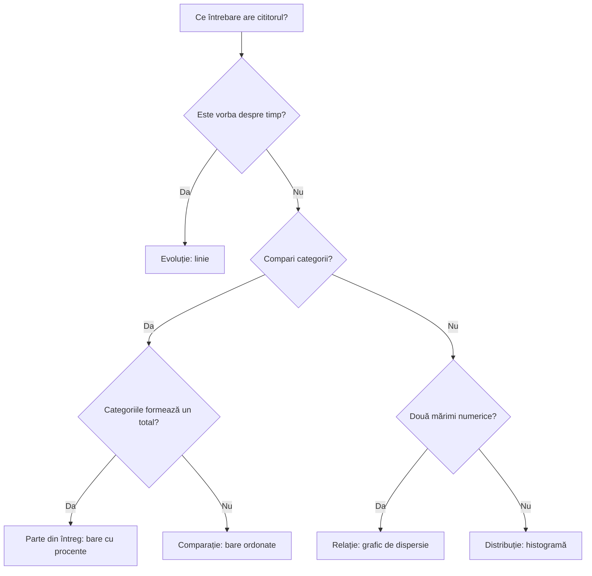

# Capitolul 6. Principiile vizualizării datelor: percepție, claritate, onestitate

## Ce vei putea face după acest capitol

- Să explici de ce un tabel cu medii și totaluri nu ajunge și să deosebești un grafic făcut pentru explorare de unul făcut pentru explicare.
- Să alegi codificarea vizuală potrivită (poziție, lungime, unghi, arie, culoare) pornind de la ce poate citi ochiul cu precizie.
- Să alegi forma unui grafic după întrebarea la care răspunde: evoluție, comparație, parte din întreg, relație, distribuție.
- Să construiești un grafic curat: titlu care spune concluzia, axe cu unități, etichete directe, culoare folosită cu sens și accesibilă.
- Să recunoști și să corectezi un grafic care înșală (axă trunchiată, axe duble, perioadă aleasă convenabil, 3D, arii) și să calculezi factorul de minciună.
- Să pregătești datele pentru grafic și să verifici un grafic după o listă de control înainte să îl trimiți.

Capitolul acesta tratează regulile valabile pentru orice grafic. Fiecare tip de grafic în parte (coloane, linii, diagramă circulară, histogramă, hartă de căldură și celelalte), ca și construirea unui dashboard, se discută în capitolul 7. Codul Python de aici este scurt și comentat; limbajul și biblioteca pandas se învață în capitolul 8.

Exemplele folosesc magazinul online fictiv „Cămara de la Dunăre” din Galați. Toate cifrele despre Cămara sunt date fictive, construite pentru exercițiu.

## 6.1 Ce este vizualizarea datelor și la ce folosește

### 6.1.1 O definiție pe înțeles

Vizualizarea datelor înseamnă să transformi numere în forme pe care ochiul le compară ușor: poziții, lungimi, pante, culori. Scopul este dublu. Întâi, să înțelegi tu ce se întâmplă în date: tipare, tendințe, excepții. Apoi, să îi faci pe alții să înțeleagă repede același lucru, ca să poată decide.

Un grafic bun nu este un grafic frumos. Este un grafic din care cititorul pleacă, în câteva secunde, cu concluzia corectă. Un grafic prost este fie unul din care nu pleci cu nimic, fie, mai grav, unul din care pleci cu o concluzie greșită.

> **Exemplu.** Proprietara Cămării primește în fiecare luni un fișier cu 48 de rânduri: 12 săptămâni, 4 canale, câte 10 coloane. Toată informația este acolo, dar nimeni nu „vede” în tabel că un canal a trecut pe pierdere în octombrie. O singură linie colorată care coboară sub zero arată asta în două secunde (o construim în secțiunea 6.4).

### 6.1.2 Explorare și explicare

Aceleași date se desenează în două situații foarte diferite, iar confuzia dintre ele produce cele mai multe grafice slabe.

| | Explorare | Explicare |
|---|---|---|
| Cine se uită | Tu, analistul | Altcineva: șeful, clientul, banca, colegii |
| Întrebarea | „Ce este aici?” | „Ce vreau să rețină?” |
| Câte grafice faci | Zeci, rapide, urâte | Unul sau câteva, lucrate |
| Ce contează | Viteza și varietatea unghiurilor | Claritatea unui singur mesaj |
| Titlul | Numele variabilelor | Concluzia |
| Ce păstrezi | Tot ce ar putea fi interesant | Doar ce susține mesajul |

În explorare cauți. Faci un grafic, vezi ceva ciudat, faci altul, tai datele altfel. Nimeni nu vede graficele acestea în afară de tine, deci nu merită timp pierdut cu aspectul lor. În explicare ai găsit deja ce aveai de găsit și trebuie să îl arăți cuiva care are trei minute și zece alte probleme.

> **Greșeală frecventă.** Să pui în prezentare graficele de explorare, exact cum au ieșit din program. Cititorul primește munca ta de căutare, nu rezultatul ei. Un grafic de explicare se reface de la zero, pornind de la mesaj.

O imagine ușor de ținut minte: explorarea seamănă cu deschisul a o sută de scoici ca să găsești două perle. În prezentare arăți perlele, nu scoicile.

### 6.1.3 De ce nu ajunge tabelul: cvartetul lui Anscombe

În 1973, statisticianul Francis Anscombe a publicat în revista *The American Statistician* un articol scurt, „Graphs in Statistical Analysis”, în care a construit patru seturi mici de date, fiecare cu 11 perechi de valori (x, y). Cele patru seturi au aproape exact aceleași statistici rezumative:

| Statistică | Valoare (aceeași în toate cele patru seturi) |
|---|---|
| Media lui x | 9 |
| Varianța lui x | 11 |
| Media lui y | 7,50 |
| Varianța lui y | aproximativ 4,125 |
| Corelația dintre x și y | 0,816 |
| Dreapta de regresie | y = 3,00 + 0,500 x |

(Valorile sunt cele din articolul lui Anscombe, așa cum sunt redate pe pagina Wikipedia „Anscombe's quartet”, accesată în noiembrie 2026.)

Dacă ai primi doar acest tabel, ai spune că cele patru seturi sunt la fel. Desenate ca grafice de dispersie, arată complet diferit:

- **Setul I**: un nor de puncte care urcă, împrăștiat în jurul unei drepte. Este ce ne imaginăm când auzim „corelație de 0,8”.
- **Setul II**: punctele stau pe o curbă netedă, care urcă și apoi coboară. Relația există, dar nu este o dreaptă.
- **Setul III**: zece puncte stau pe o dreaptă, iar al unsprezecelea este mult deasupra. Un singur punct aberant schimbă panta și scade corelația.
- **Setul IV**: zece puncte au același x (8) și nu arată nicio relație; un singur punct, aflat departe (x = 19), produce singur toată „corelația”.

Concluzia lui Anscombe: calculele și graficele se fac împreună. Media, totalul și corelația comprimă datele, iar comprimarea ascunde forma. În 2017, Justin Matejka și George Fitzmaurice au dus ideea mai departe cu „Datasaurus Dozen”: un set de puncte care desenează un dinozaur și alte douăsprezece seturi cu aceleași statistici rezumative.

Codul de mai jos reproduce cvartetul. Rulează-l și privește cele patru panouri: statisticile tipărite sunt identice, imaginile nu.

```python
import pandas as pd
import matplotlib.pyplot as plt

x123 = [10, 8, 13, 9, 11, 14, 6, 4, 12, 7, 5]
cvartet = {
    "I":   (x123, [8.04, 6.95, 7.58, 8.81, 8.33, 9.96, 7.24, 4.26, 10.84, 4.82, 5.68]),
    "II":  (x123, [9.14, 8.14, 8.74, 8.77, 9.26, 8.10, 6.13, 3.10, 9.13, 7.26, 4.74]),
    "III": (x123, [7.46, 6.77, 12.74, 7.11, 7.81, 8.84, 6.08, 5.39, 8.15, 6.42, 5.73]),
    "IV":  ([8, 8, 8, 8, 8, 8, 8, 19, 8, 8, 8],
            [6.58, 5.76, 7.71, 8.84, 8.47, 7.04, 5.25, 12.50, 5.56, 7.91, 6.89]),
}

fig, axe = plt.subplots(2, 2, figsize=(8, 6), sharex=True, sharey=True)
for ax, (nume, (x, y)) in zip(axe.flat, cvartet.items()):
    s = pd.DataFrame({"x": x, "y": y})
    print(nume, "media x:", round(s.x.mean(), 2), "media y:", round(s.y.mean(), 2),
          "corelatia:", round(s.x.corr(s.y), 3))
    ax.scatter(s.x, s.y, color="#0072B2")
    ax.plot([3, 20], [3 + 0.5 * 3, 3 + 0.5 * 20], color="gray", linewidth=1)
    ax.set_title("Setul " + nume, loc="left")
fig.suptitle("Aceleași medii și aceeași corelație, patru povești diferite")
fig.savefig("anscombe.png", dpi=150)
```

Rezultatul tipărit: media lui x este 9,0 și media lui y este 7,5 în toate seturile, iar corelația este 0,816 (0,817 la setul IV, din rotunjire).

> **Pentru afacerea ta.** „Valoarea medie a comenzii a rămas aproape la fel” poate ascunde două grupuri de clienți care s-au mișcat în direcții opuse. Înainte să raportezi o medie, desenează valorile din spatele ei: pe săptămâni, pe canale, pe produse. La Cămara, media pe magazin ascunde că pe canalul Reclame valoarea medie a comenzii a scăzut de la 150 la 105 lei (date fictive).

## 6.2 Cum vede ochiul

Un grafic funcționează pentru că sistemul vizual face o parte din muncă înainte să ne gândim conștient. Dacă știi ce face ochiul bine și ce face prost, știi ce să alegi.

### 6.2.1 Atribute preatenționale

Unele proprietăți vizuale sunt percepute aproape instantaneu, fără efort și fără să citim element cu element. Se numesc atribute preatenționale (în engleză *preattentive attributes*): le vedem înainte să fim atenți.

Stephen Few propune un exercițiu simplu în articolul „Tapping the Power of Visual Perception” (2004). Ți se arată patru rânduri de cifre gri și ți se cere să numeri de câte ori apare cifra 5. Trebuie să citești tot, cifră cu cifră. Apoi primești aceleași rânduri, dar cu cifrele 5 negre și restul gri deschis. Acum le numeri dintr-o privire. Nimic nu s-a schimbat în date; s-a schimbat un atribut preatențional, intensitatea culorii.

Principalele atribute preatenționale folosite în grafice:

| Atribut | Exemplu într-un grafic | Poate purta o valoare numerică? |
|---|---|---|
| Poziția în plan | Punctele dintr-un grafic de dispersie, capătul unei bare | Da, foarte precis |
| Lungimea | Barele | Da, precis |
| Orientarea, unghiul, panta | Linia care urcă sau coboară, felia de „plăcintă” | Aproximativ |
| Mărimea (aria) | Bulele, dreptunghiurile dintr-un treemap | Doar „mai mare sau mai mic” |
| Intensitatea culorii | De la deschis la închis într-o hartă de căldură | Doar „mai mult sau mai puțin” |
| Nuanța culorii | Albastru față de portocaliu | Nu; arată categorii |
| Forma | Cerc, pătrat, triunghi | Nu; arată categorii |
| Grosimea liniei, încadrarea | Linia îngroșată, chenarul în jurul unei zone | Nu; atrag atenția |

Few subliniază în același articol că numai două dintre atribute pot codifica valori cantitative cu precizie: poziția în plan și lungimea liniei. Intensitatea culorii și aria arată ordinea (care este mai mare), dar nu și cu cât. Nuanța nu arată nici măcar ordinea: nimeni nu „simte” că verdele este mai mult decât movul.

De aici vin două reguli practice:

1. Cifra importantă se codifică prin poziție sau lungime.
2. Culoarea, forma și grosimea rămân pentru categorii și pentru evidențiere.

### 6.2.2 Ierarhia preciziei: Cleveland și McGill

În 1984, William Cleveland și Robert McGill, cercetători la laboratoarele Bell, au publicat în *Journal of the American Statistical Association* articolul „Graphical Perception: Theory, Experimentation, and Application to the Development of Graphical Methods”. Ei au testat experimental cât de precis citesc oamenii valori codificate în feluri diferite. Rezultatul este o ordine a „sarcinilor perceptuale elementare”, de la cea mai precisă la cea mai puțin precisă:

| Loc | Ce compară ochiul | Unde apare |
|---|---|---|
| 1 | Poziția pe o scală comună | Bare aliniate la aceeași bază, puncte pe aceeași axă, linii |
| 2 | Poziția pe scale identice, dar nealiniate | Panouri alăturate cu aceeași axă |
| 3 | Lungimea, direcția, unghiul | Segmentele din mijlocul unei coloane suprapuse, pantele, feliile unei diagrame circulare |
| 4 | Aria | Bule, treemap |
| 5 | Volumul, curbura | Grafice 3D, pictograme „în relief” |
| 6 | Umbrirea, saturația culorii | Hărți colorate, hărți de căldură |

(Ordinea este redată după sinteza din cursul INFO 3312 al Universității Cornell, accesată în noiembrie 2026; vezi sursele. Coloana „Unde apare” este interpretarea noastră. Același curs arată că Heer și Bostock au extins rezultatele în 2010 și că poziția rămâne înaintea lungimii, a unghiului și a ariei.)

Ce înseamnă asta pentru tine:

- **Barele aliniate bat diagrama circulară** când cititorul trebuie să compare valori apropiate. La bare compari poziții pe o scală comună (locul 1). La diagrama circulară compari unghiuri și arii (locurile 3 și 4).
- **Într-o coloană suprapusă, doar segmentul de jos se citește bine.** El pornește de la bază, deci îi compari poziția. Segmentele de deasupra „plutesc”, deci le compari lungimile (locul 3).
- **Culoarea este slabă pentru valori exacte**, dar bună pentru tipare de ansamblu. O hartă de căldură arată unde este „cald”, nu dacă o celulă are 312 sau 340.

> **Exemplu.** În noiembrie, Reclame aduce 35,9% din comenzile Cămării, iar Căutare 31,3% (date fictive). Pe o diagramă circulară, cele două felii par aproape egale. Pe două bare orizontale aliniate, diferența se vede imediat, iar dacă scrii valoarea la capătul barei, cititorul are și cifra exactă.

Ierarhia nu spune „folosește mereu bare”. Spune: pune pe treapta cea mai precisă comparația care contează cel mai mult. Dacă vrei doar impresia generală („două canale aduc două treimi din comenzi”), o formă mai puțin precisă poate fi suficientă.

### 6.2.3 Memoria de lucru și limita de serii

Few amintește în articolul citat că memoria de scurtă durată reține doar câteva elemente simultan (el indică trei până la șapte) și recomandă cel mult șapte, preferabil cel mult cinci serii cu sens distinct într-un grafic. Un grafic cu nouă linii colorate și o legendă pe margine obligă cititorul să facă naveta între linie și legendă pentru fiecare serie.

Soluții, în ordinea preferinței: evidențiezi o serie și le lași pe celelalte gri; grupezi seriile mici în „Altele”; împarți graficul în panouri mici cu aceeași scală (în engleză *small multiples*, panouri multiple).

### 6.2.4 Principiile Gestalt aplicate la grafice

Psihologii școlii Gestalt (cuvânt german pentru „formă”, „întreg”) au descris felul în care creierul grupează automat ce vede. Knaflic le folosește în *Storytelling with Data* ca instrument de curățare a graficelor. Patru dintre ele ne interesează direct, plus două pe care le pomenim pe scurt.

| Principiu | Ce face creierul | Cum îl folosești | Cum te poate încurca |
|---|---|---|---|
| Proximitate | Lucrurile apropiate par un grup | Pui eticheta lângă linia ei; apropii barele din aceeași lună | O legendă departe de date pare fără legătură cu ele |
| Similaritate | Lucrurile cu aceeași culoare sau formă par înrudite | Același canal are aceeași culoare în toate graficele | Dacă două serii fără legătură au culori apropiate, cititorul le leagă |
| Închidere | Completăm singuri formele incomplete | Poți șterge chenarul graficului și o parte din liniile de fundal; graficul rămâne „întreg” | Rar o problemă |
| Continuitate | Ochiul urmează linia cea mai lină | Barele aliniate la bază nu au nevoie de linia axei; linia unei serii se urmărește și printre altele | La intersecția a două linii de aceeași culoare, ochiul poate „sări” pe seria greșită |

Celelalte două: **încadrarea** (ce este într-un chenar sau pe un fond umbrit pare un grup; utilă pentru a marca „perioada campaniei”) și **conexiunea** (punctele unite cu o linie par legate; de aceea unim cu linie numai puncte între care are sens o trecere, cum ar fi săptămâni succesive, și nu categorii fără ordine).

> **Greșeală frecventă.** Să unești cu linie categorii fără ordine, de exemplu comenzile pe canale: Căutare, Reclame, Email, Direct. Linia sugerează o trecere „de la Căutare la Reclame”, care nu există. Pentru categorii folosești bare; linia rămâne pentru timp sau pentru alte mărimi ordonate.

## 6.3 Alegerea formei după întrebare

Nu porni de la „ce grafic arată bine?”. Pornește de la întrebarea la care trebuie să răspundă graficul. În business, aproape orice întrebare cade într-una din cinci familii.

| Întrebarea | Familia | Forma de pornire | Exemplu la Cămara |
|---|---|---|---|
| Cum s-a schimbat în timp? | Evoluție | Linie (sau coloane, dacă sunt puține perioade) | Comenzile pe 12 săptămâni |
| Care este mai mare? Cu cât? | Comparație între categorii | Bare, ordonate după valoare | Contribuția pe canal în noiembrie |
| Cât din total reprezintă fiecare? | Parte din întreg | Bare cu procente, coloană suprapusă 100%; diagramă circulară doar cu 2-3 felii | Ponderea canalelor în comenzi |
| Se mișcă împreună două mărimi? | Relație | Grafic de dispersie | Cheltuiala de reclamă și comenzile din Reclame, pe săptămâni |
| Cum sunt răspândite valorile? | Distribuție | Histogramă | Valoarea comenzilor individuale |

Aceeași regulă, ca drum de decizie:



Trei precizări:

- **Aceleași date răspund la întrebări diferite.** Comenzile pe canal și pe săptămână pot arăta evoluția (patru linii), comparația (patru bare pentru noiembrie) sau structura (ponderea fiecărui canal). Alegi după ce vrei să spui, nu după ce ai în fișier.
- **Dacă ai două întrebări, fă două grafice.** Un grafic care încearcă să arate și evoluția, și structura, și comparația cu anul trecut nu arată nimic.
- **Uneori răspunsul nu este un grafic.** Poate fi un tabel sau un singur număr (secțiunea 6.8).

Detaliile fiecărui tip (date necesare, variante, capcane proprii) sunt în capitolul 7.

## 6.4 Anatomia unui grafic bun

Prezentarea de curs enumeră elementele unei diagrame: titlu, axe, etichete ale axelor, unități de măsură, legendă, grilă de fundal, adnotări și note, sursa datelor. Le luăm pe rând, cu regula de bună practică pentru fiecare.

### 6.4.1 Titlul spune concluzia

Un titlu descriptiv spune ce este în grafic: „Contribuție săptămânală pe canal”. Un titlu-concluzie spune ce trebuie să vadă cititorul: „Din octombrie, canalul Reclame pierde bani la fiecare comandă”. Într-un grafic de explicare, titlul este concluzia, iar descrierea coboară în subtitlu, împreună cu unitatea și perioada.

Test rapid: dacă cititorul ar citi numai titlul, ar pleca cu mesajul? Dacă nu, rescrie-l.

Există și greșeala inversă, la fel de importantă: titlul nu are voie să spună mai mult decât arată datele. „Reclamele distrug afacerea” nu este o concluzie, este o opinie. „Canalul Reclame a avut contribuție negativă în fiecare dintre ultimele 8 săptămâni” este o concluzie.

### 6.4.2 Axe, unități, scală

- Fiecare axă are etichetă și unitate: „Contribuție (lei)”, „Săptămâna”. Dacă unitatea este în subtitlu și axa este evidentă, eticheta poate lipsi, dar unitatea nu.
- Numerele se scriu ca pentru oameni: „85.400 lei”, nu „85400.0”. Miile se pot scurta: „85 mii lei”.
- Timpul curge de la stânga la dreapta, cu pași egali. Dacă lipsește o săptămână, locul ei rămâne gol; nu o sari.
- Categoriile se ordonează cu sens: după valoare (de regulă descrescător) sau după o ordine firească (luni, trepte de vârstă). Ordinea alfabetică ajută doar la căutare.
- Scala începe unde trebuie (secțiunea 6.6 discută pe larg axa de la zero).

### 6.4.3 Etichete directe în loc de legendă

Legenda obligă ochiul să plece de la date, să găsească pătrățelul colorat, să citească numele și să se întoarcă. Principiul proximității spune ce ai de făcut: scrie numele seriei lângă serie, la capătul liniei sau pe bară, în aceeași culoare. Legenda rămâne o soluție de rezervă, când seriile se încalecă și nu ai loc pentru etichete.

La fel pentru valori: dacă cititorul are nevoie de cifra exactă, scrie-o pe bară sau la capătul liniei. Dacă le scrii pe toate, poți renunța la axa verticală și la grilă.

### 6.4.4 Grilă discretă, adnotări, sursă

- **Grila**: linii subțiri, gri deschis, puține. Doar orizontale la coloane și linii. Dacă ai etichete de valori, nu mai ai nevoie de grilă.
- **Adnotările**: una sau două note scurte, puse exact pe locul la care se referă: „bugetul de reclame crește, apare codul de reducere de 20%”. O adnotare bună răspunde la întrebarea pe care cititorul o va pune oricum: „ce s-a întâmplat aici?”.
- **Sursa și definițiile**: sub grafic, mic. De unde vin datele, ce perioadă, cum este definit indicatorul („canalul unei comenzi = ultimul clic”; vezi capitolul 5 pentru definiții).

### 6.4.5 Raportul date-cerneală și „chartjunk”

Edward Tufte, în *The Visual Display of Quantitative Information* (prima ediție 1983, a doua 2001), propune o măsură simplă a economiei unui grafic, raportul date-cerneală (în engleză *data-ink ratio*):

> raport date-cerneală = cerneala folosită pentru a arăta datele / toată cerneala folosită în grafic

Ideea: cât mai mult din ce este desenat să fie informație. Tot Tufte a inventat cuvântul *chartjunk* („gunoi de grafic”) pentru elementele care nu informează sau care chiar ascund informația: fundaluri colorate, umbre, efecte 3D, chenare groase, grile dese, imagini decorative, zecimale inutile.

Curățarea se face prin întrebare, element cu element: „dacă șterg asta, pierde cititorul ceva?”. Dacă nu, ștergi.

> **Exemplu.** Graficul implicit dintr-un program de calcul tabelar pentru comenzile lunare ale Cămării are, de obicei: chenar, grilă, legendă cu o singură intrare („Comenzi”), axă cu valori din 100 în 100, uneori fond colorat și umbre. După curățare rămân: trei bare într-o singură culoare, valoarea scrisă deasupra fiecăreia (553, 688, 796), numele lunilor și titlul. Nimic din informație nu s-a pierdut, iar graficul se citește mai repede.

O nuanță: raportul date-cerneală este un ghid, nu un scop. Etichetele axelor, o adnotare sau o linie de referință la zero nu sunt „date”, dar ajută la citire. Tai ce nu ajută, nu tot ce nu este cifră.

### 6.4.6 Exemplu lucrat: contribuția pe canal

Datele din spatele graficului sunt contribuția săptămânală pe canal (marja brută minus marketing minus ambalare și livrare; date fictive, în lei, rotunjite; sunt arătate doar câteva săptămâni):

| Săptămâna | Căutare | Email | Direct | Reclame |
|---|---|---|---|---|
| 1 | 3.210 | 1.758 | 1.784 | 256 |
| 4 | 3.210 | 1.758 | 1.784 | 256 |
| 5 | 3.264 | 1.818 | 1.784 | -752 |
| 6 | 3.317 | 1.818 | 1.784 | -1.762 |
| 8 | 3.317 | 1.818 | 1.784 | -2.668 |
| 9 | 3.317 | 1.878 | 1.840 | -2.939 |
| 12 | 3.317 | 1.878 | 1.840 | -2.864 |

Descrierea graficului: patru linii pe 12 săptămâni. Trei dintre ele (Căutare, Email, Direct) sunt gri, subțiri și aproape orizontale. A patra, Reclame, este portocalie și groasă; stă puțin peste zero patru săptămâni, apoi coboară abrupt sub linia de zero și se oprește în jur de -2.900 de lei. Numele fiecărui canal este scris la capătul din dreapta al liniei. O linie verticală punctată între săptămânile 4 și 5 poartă nota despre buget și codul de reducere. Titlul spune concluzia.

```python
import pandas as pd
import matplotlib.pyplot as plt

df = pd.read_csv("camara_saptamanal.csv")
lat = df.pivot(index="saptamana", columns="canal", values="contributie")

decalaj = {"Email": 160, "Direct": -160}   # etichetele celor două linii apropiate nu se mai suprapun

fig, ax = plt.subplots(figsize=(9, 5))
for canal in lat.columns:
    accent = canal == "Reclame"
    ax.plot(lat.index, lat[canal],
            color="#D55E00" if accent else "#999999",
            linewidth=3 if accent else 1.5)
    ax.text(12.2, lat[canal].iloc[-1] + decalaj.get(canal, 0), canal, va="center",
            color="#D55E00" if accent else "#555555",
            fontweight="bold" if accent else "normal")

ax.axhline(0, color="black", linewidth=0.8)
ax.axvline(4.5, color="#bbbbbb", linestyle=":", linewidth=1)
ax.text(4.6, 2400, "bugetul de reclame crește,\napare codul de reducere de 20%", fontsize=9)
ax.set_title("Din octombrie, canalul Reclame pierde bani la fiecare comandă\n"
             "Contribuție săptămânală pe canal, lei (date fictive)", loc="left")
ax.set_xlabel("Săptămâna")
ax.set_ylabel("Contribuție (lei)")
ax.set_xticks(range(1, 13))
ax.set_xlim(1, 13.8)
ax.spines[["top", "right"]].set_visible(False)
ax.grid(axis="y", color="#eeeeee")
fig.tight_layout()
fig.savefig("contributie_canale.png", dpi=150)
```

Observă ce principii sunt la lucru: poziția pe o scală comună pentru valoare (locul 1 în ierarhie), culoarea folosită numai pentru evidențiere, etichete directe prin proximitate, linia de zero ca referință, o singură adnotare, titlu-concluzie. Codul presupune că fișierul CSV (*comma-separated values*, valori separate prin virgulă) se află în folderul de lucru.

## 6.5 Culoarea

Culoarea este un instrument puternic și ușor de folosit prost. Claus Wilke, în *Fundamentals of Data Visualization*, îi dă trei roluri: să distingă grupuri, să reprezinte valori și să evidențieze. Fiecărui rol îi corespunde un tip de scală.

### 6.5.1 Trei tipuri de scale

| Tip | La ce folosește | Cum arată | Exemplu la Cămara |
|---|---|---|---|
| Categorială (calitativă) | Categorii fără ordine | Câteva culori clar diferite, de „greutate” vizuală apropiată | Cele 4 canale |
| Secvențială | Valori de la mic la mare | De regulă o singură nuanță, de la deschis la închis | Comenzile pe canal și săptămână, într-o hartă de căldură |
| Divergentă | Abateri față de un punct de mijloc cu sens | Două nuanțe care pleacă dintr-un mijloc neutru, deschis | Contribuția pe canal și săptămână: sub zero într-o nuanță, peste zero în alta |

Reguli care decurg de aici:

- **Nu pune o scală secvențială pe categorii.** Dacă cele patru canale sunt colorate în patru tonuri de albastru, cititorul crede că unul este „mai mult” decât altul.
- **Nu pune culori categoriale pe valori.** Curcubeul nu are ordine firească. Wilke arată că scala-curcubeu nu este monotonă și poate scoate în evidență aspecte arbitrare ale datelor.
- **Scala divergentă cere un mijloc real.** Zero la profit, ținta la un indicator, media la o abatere. Dacă nu există un asemenea punct, folosește o scală secvențială.
- **Puține culori.** Wilke dă ca reper trei până la cinci categorii pentru o scală calitativă; spre opt-zece, potrivirea culorilor cu legenda devine prea obositoare și este mai bine să etichetezi direct.

Al patrulea caz, cel mai util în prezentări, este **culoarea de accent**: totul în gri, un singur element colorat. Este exact ce am făcut în graficul din 6.4.6.

### 6.5.2 Culoare cu sens consecvent

Principiul similarității lucrează și între grafice, nu doar în interiorul unuia. Dacă Reclame este portocaliu pe pagina 2, trebuie să fie portocaliu și pe pagina 7. Altfel, cititorul leagă greșit seriile.

Alte convenții de respectat:

- Aceeași mărime, aceeași culoare în tot documentul (venitul mereu albastru, costul mereu gri).
- Roșu și verde poartă deja sens („rău” și „bine”). Nu le folosi pentru două categorii neutre. Și nu te baza doar pe ele (vezi mai jos).
- Culoarea puternică este o resursă limitată. Dacă totul este colorat intens, nimic nu iese în evidență.

### 6.5.3 Accesibilitate: daltonism și contrast

O parte din publicul tău nu vede culorile ca tine. Institutul Național al Ochiului din Statele Unite (National Eye Institute, NEI) arată că aproximativ 1 din 12 bărbați are o deficiență de vedere a culorilor și că forma cea mai frecventă face greu de deosebit roșul de verde (NEI, pagina „Color Blindness”, https://www.nei.nih.gov/learn-about-eye-health/eye-conditions-and-diseases/color-blindness, accesată în noiembrie 2026). Wilke dă aceeași ordine de mărime: aproximativ 8% dintre bărbați și 0,5% dintre femei (Wilke, capitolul 19, https://clauswilke.com/dataviz/color-pitfalls.html, accesat în noiembrie 2026). Într-o sală cu 25 de bărbați, este de așteptat ca în medie doi să nu deosebească bine bara roșie de cea verde.

Standardul de referință pentru accesibilitatea web este WCAG (*Web Content Accessibility Guidelines*, Ghidul pentru accesibilitatea conținutului web), publicat de consorțiul W3C (*World Wide Web Consortium*). Trei criterii din versiunea 2.2 privesc direct graficele (https://www.w3.org/TR/WCAG22/, accesat în noiembrie 2026):

| Criteriu | Ce cere, pe scurt | Ce înseamnă pentru un grafic |
|---|---|---|
| 1.4.1 Folosirea culorii (nivel A) | Culoarea nu este singurul mijloc vizual de a transmite o informație | Seriile se disting și prin etichetă, formă, tip de linie sau model |
| 1.4.3 Contrast minim (nivel AA) | Textul are un raport de contrast de cel puțin 4,5:1 față de fond; textul mare, cel puțin 3:1 | Etichetele gri deschis pe fond alb pot fi ilizibile |
| 1.4.11 Contrastul elementelor non-text (nivel AA) | Elementele grafice vizate de criteriu au cel puțin 3:1 față de culorile alăturate | Liniile și barele trebuie să se distingă de fond și între ele |

De aici regula cea mai importantă a acestei secțiuni:

> **De reținut.** Nu transmite informația doar prin culoare. Dublează culoarea cu altceva: etichetă directă, formă diferită a punctelor, linie plină față de linie întreruptă, poziție. Test simplu: tipărește graficul alb-negru. Dacă încă se înțelege, este bine.

Practic:

- Evită perechea roșu-verde pentru „rău-bine”. Albastrul și portocaliul sunt o pereche mai sigură.
- Folosește o paletă gândită pentru deficiențele de vedere a culorilor. Wilke recomandă paleta Okabe-Ito, cu opt culori; din ea am luat albastrul `#0072B2` și portocaliul-roșcat `#D55E00` din exemplele de cod.
- Verifică graficul cu un simulator de daltonism (recomandarea este tot a lui Wilke: nu te baza doar pe paletă, testează).
- Verifică raportul de contrast al textului cu un instrument de calcul.

Referirea la WCAG de aici este orientativă și nu este consultanță juridică; dacă ai obligații legale de accesibilitate pentru un site sau un document, consultă textul oficial al standardului și legislația aplicabilă.

## 6.6 Onestitate: cum minte un grafic și cum îl corectezi

Un grafic poate fi fals fără să conțină nicio cifră falsă. Poate înșela prin felul în care este desenat, prin datele alese și prin ce lasă pe dinafară. Uneori autorul o face intenționat. De cele mai multe ori o face din grabă, cu setările implicite ale programului. Efectul asupra cititorului este același. Alberto Cairo a dedicat subiectului o carte întreagă, *How Charts Lie* (2019), bună ca lectură suplimentară.

Wilke formulează regula de bază ca „principiul cernelii proporționale” (pe care îl atribuie lui Bergstrom și West): mărimea suprafețelor colorate dintr-un grafic trebuie să fie proporțională cu valorile pe care le reprezintă.

### 6.6.1 Axa trunchiată la bare

Comenzile lunare ale Cămării (date fictive):

| Luna | Comenzi | Înălțimea barei cu axa de la 0 | Înălțimea barei cu axa de la 450 |
|---|---|---|---|
| Septembrie | 553 | 553 | 553 - 450 = 103 |
| Octombrie | 688 | 688 | 688 - 450 = 238 |
| Noiembrie | 796 | 796 | 796 - 450 = 346 |

Calculul:

- Creșterea reală din septembrie până în noiembrie: 796 / 553 = 1,44, adică +44%.
- Cu axa pornită de la 450, bara din noiembrie are 346 de unități, iar cea din septembrie 103. Raportul: 346 / 103 = 3,36. Bara din noiembrie pare de aproximativ 3,4 ori mai înaltă.

Cititorul compară lungimi (asta face ochiul cu barele) și pleacă cu impresia că magazinul și-a triplat comenzile. Cifrele de pe axă sunt corecte. Imaginea nu este.

Regula: **la bare, axa valorilor pornește de la zero.** Bara codifică valoarea prin lungime, iar o lungime tăiată nu mai înseamnă nimic. Wilke o spune fără nuanțe: pe o scală liniară, barele pornesc întotdeauna de la 0.

### 6.6.2 Factorul de minciună

Tufte a propus o măsură pentru cât exagerează un grafic, factorul de minciună (*lie factor*):

> factor de minciună = mărimea efectului arătat în grafic / mărimea efectului din date
>
> unde mărimea efectului = (a doua valoare - prima valoare) / prima valoare

Un grafic fidel are factorul 1. Peste 1, graficul exagerează; între 0 și 1, ascunde.

Pentru graficul cu axa de la 450:

- Efectul din date: (796 - 553) / 553 = 243 / 553 = 0,44 (creștere de 44%).
- Efectul din grafic: (346 - 103) / 103 = 243 / 103 = 2,36 (bara crește cu 236%).
- Factorul de minciună: 2,36 / 0,44 = 5,4.

Graficul arată o schimbare de peste cinci ori mai mare decât cea reală. Codul următor desenează ambele variante, una lângă alta, și tipărește calculul.

```python
import pandas as pd
import matplotlib.pyplot as plt

df = pd.read_csv("camara_saptamanal.csv")
luni = ["septembrie", "octombrie", "noiembrie"]
comenzi = df.groupby("luna")["comenzi"].sum().reindex(luni)

baza = 450
efect_date = (comenzi["noiembrie"] - comenzi["septembrie"]) / comenzi["septembrie"]
efect_grafic = ((comenzi["noiembrie"] - baza) - (comenzi["septembrie"] - baza)) / (comenzi["septembrie"] - baza)
print("Efect în date:", round(efect_date, 3))
print("Efect în grafic:", round(efect_grafic, 3))
print("Factor de minciună:", round(efect_grafic / efect_date, 2))

fig, (stanga, dreapta) = plt.subplots(1, 2, figsize=(9, 4))
stanga.bar(luni, comenzi, color="#999999")
stanga.set_ylim(baza, 820)
stanga.set_title("Înșelător: axa pornește de la 450", loc="left")
dreapta.bar(luni, comenzi, color="#0072B2")
dreapta.set_ylim(0, 900)
dreapta.set_title("Corect: axa pornește de la zero", loc="left")
for ax in (stanga, dreapta):
    ax.set_ylabel("Comenzi pe lună")
    ax.spines[["top", "right"]].set_visible(False)
    for i, v in enumerate(comenzi):
        ax.text(i, v + 8, str(v), ha="center")
fig.tight_layout()
fig.savefig("axa_trunchiata.png", dpi=150)
```

Rezultatul tipărit: efect în date 0,439; efect în grafic 2,359; factor de minciună 5,37.

### 6.6.3 Când este acceptabilă o axă care nu pornește de la zero

Regula cu zero ține de bare, pentru că barele se citesc prin lungime. Linia și punctele se citesc prin poziție și pantă, deci nu au o „lungime” care să fie falsificată. La ele, o axă care nu pornește de la zero este adesea alegerea corectă:

- **Când zero nu are sens sau este foarte departe.** Temperatura în grade Celsius; un curs de schimb care variază doar la a doua zecimală. Cu axa de la zero, linia ar fi dreaptă și nu ai vedea nimic.
- **Când variațiile mici contează.** O rată de conversie care trece de la 2,9% la 2,5% este o problemă serioasă, deși pe o axă 0-100% nu se vede.

Condițiile de onestitate rămân:

1. Axa este etichetată clar, iar cititorul vede de unde pornește.
2. Nu umpli cu culoare zona de sub linie. O arie umplută se citește ca suprafață și readuce problema barelor; Wilke arată acest efect pe un grafic de preț al unei acțiuni.
3. Intervalul axei nu este ales ca să dramatizeze. O variație de 1% nu trebuie să ocupe toată înălțimea graficului dacă pentru afacere este zgomot.
4. Dacă vrei să arăți diferența, desenează diferența: „schimbare față de septembrie”, cu zero ca punct de pornire.

Greșeala inversă există și ea: o axă întinsă excesiv (de la 0 la 10.000 pentru valori între 500 și 800) aplatizează tot și ascunde o schimbare reală. Factorul de minciună sub 1 descrie acest caz.

### 6.6.4 Axe duble

Un grafic cu două axe verticale (comenzi pe stânga, rezultat în lei pe dreapta) arată două linii care se intersectează undeva. Cititorul vede intersecția și îi dă sens: „aici s-a rupt ceva”. Dar punctul de intersecție depinde numai de cum ai ales cele două scale. Schimbi intervalul axei din dreapta și liniile se intersectează în altă săptămână, sau deloc.

Cu două axe poți face ca două serii să pară mult mai legate, sau mult mai divergente, decât sunt. De aceea, axele duble sunt de evitat în grafice de explicare.

Alternative:

- **Două panouri, unul sub altul, cu aceeași axă a timpului.** Fiecare mărime are scala ei, cinstit, și nu există o intersecție falsă.
- **Indexare**: ambele serii exprimate ca procent față de prima perioadă (septembrie = 100). Atunci au aceeași unitate și pot sta pe aceeași axă.
- **Un indicator derivat**: în loc de „venit” și „comenzi” pe două axe, desenezi „venit pe comandă”.

Exemplul pe Cămara, cu totalurile săptămânale (date fictive; săptămânile 2 și 3 seamănă cu 1 și 4 și au fost omise din tabel):

| Săptămâna | 1 | 4 | 5 | 6 | 7 | 8 | 9 | 10 | 11 | 12 |
|---|---|---|---|---|---|---|---|---|---|---|
| Comenzi | 138 | 138 | 154 | 168 | 180 | 186 | 195 | 200 | 202 | 199 |
| Rezultat simplificat (lei) | 4.508 | 4.508 | 3.613 | 2.656 | 2.183 | 1.750 | 1.596 | 1.724 | 1.768 | 1.670 |

```python
import pandas as pd
import matplotlib.pyplot as plt

df = pd.read_csv("camara_saptamanal.csv")
sapt = df.groupby("saptamana")[["comenzi", "contributie"]].sum()
sapt["rezultat"] = sapt["contributie"] - 2500   # costuri fixe: 2.500 lei pe săptămână

fig, (sus, jos) = plt.subplots(2, 1, figsize=(8, 6), sharex=True)
sus.plot(sapt.index, sapt["comenzi"], color="#0072B2", marker="o")
sus.set_ylim(0, 220)
sus.set_title("Comenzile cresc...", loc="left")
sus.set_ylabel("Comenzi pe săptămână")

jos.plot(sapt.index, sapt["rezultat"], color="#D55E00", marker="o")
jos.set_ylim(0, 5000)
jos.set_title("...dar rezultatul scade", loc="left")
jos.set_ylabel("Rezultat simplificat (lei)")
jos.set_xlabel("Săptămâna")
jos.set_xticks(range(1, 13))

for ax in (sus, jos):
    ax.spines[["top", "right"]].set_visible(False)
    ax.grid(axis="y", color="#eeeeee")
fig.tight_layout()
fig.savefig("doua_panouri.png", dpi=150)
```

Descrierea rezultatului: sus, o linie albastră care urcă de la 138 la aproximativ 200 de comenzi; jos, o linie portocalie care coboară de la aproximativ 4.500 la aproximativ 1.700 de lei. Cele două titluri de panou, citite împreună, formează mesajul. Am pornit ambele axe de la zero ca să nu dramatizăm nici creșterea, nici scăderea.

### 6.6.5 Perioade alese convenabil

Poți spune un neadevăr cu date corecte dacă alegi de unde începi și unde te oprești. În engleză practica se numește *cherry picking* (culesul cireșelor: iei numai ce îți convine).

> **Exemplu.** Rezultatul simplificat al Cămării a fost de 1.596 lei în săptămâna 9 și de 1.670 lei în săptămâna 12 (date fictive). Un grafic doar cu săptămânile 9-12 poate purta titlul „Rezultatul a crescut cu 4,6% în noiembrie”, iar calculul este corect: (1.670 - 1.596) / 1.596 = 4,6%. Graficul cu toate cele 12 săptămâni arată însă că rezultatul a scăzut de la aproximativ 4.500 la aproximativ 1.700 de lei pe săptămână. Ambele grafice folosesc date reale. Numai al doilea este onest.

Cum te aperi, ca autor și ca cititor:

- Arată o perioadă suficient de lungă încât să se vadă nivelul „normal” dinainte.
- Compară perioade comparabile: noiembrie cu noiembrie anul trecut, nu decembrie cu ianuarie, la un magazin cu vânzări sezoniere.
- Spune explicit de ce ai ales perioada.
- Când primești un grafic, întreabă: „ce era înainte de primul punct?”.

### 6.6.6 Efecte 3D

Al treilea „D” (de la tridimensional) nu adaugă nicio informație la un grafic cu două variabile. Adaugă în schimb perspectivă, iar perspectiva deformează: felia din față a unei diagrame circulare 3D pare mai mare decât una egală din spate; la coloanele 3D nu mai este clar unde se citește înălțimea, pe fața din față sau pe cea din spate. Wilke are un capitol întreg cu titlul „Don't go 3D”. Varianta corectată este graficul plat.

### 6.6.7 Arii și pictograme

Când valoarea este codificată printr-o figură (cerc, pictogramă, borcan desenat), apare o capcană de geometrie. Dacă mărești figura proporțional pe ambele dimensiuni, aria crește cu pătratul factorului.

Pe Cămara: vrei să arăți creșterea comenzilor cu 44% prin două borcane desenate. Faci al doilea borcan de 1,44 ori mai înalt și, ca să nu arate deformat, și de 1,44 ori mai lat. Aria lui este de 1,44 × 1,44 = 2,07 ori mai mare. Ochiul vede „dublu”, nu „+44%”. Factorul de minciună: (2,07 - 1) / 0,44 = 2,4. Dacă borcanul este desenat în relief, impresia merge spre volum: 1,44 × 1,44 × 1,44 = 2,99, aproape triplu.

Corect: fie aria (nu înălțimea) este proporțională cu valoarea, fie, mult mai simplu, folosești bare. Dacă ții la pictograme, repetă aceeași pictogramă de mărime fixă (un borcan = 100 de comenzi) și lasă cititorul să le numere.

### 6.6.8 Hărți care exagerează suprafața

Pe o hartă colorată pe regiuni (hartă coropletă, în engleză *choropleth*), ochiul este atras de suprafețele mari. Dar suprafața unui județ nu are legătură cu numărul de clienți din el. Un județ întins și rar populat ocupă mult loc pe hartă și domină imaginea, în timp ce un oraș mare, unde stau mulți clienți, abia se vede.

A doua capcană a hărților: valorile absolute. O hartă cu „număr de comenzi pe județ” seamănă de cele mai multe ori cu o hartă a populației: sunt mai multe comenzi acolo unde sunt mai mulți oameni. Întrebarea de business este de obicei alta: unde suntem puternici față de mărimea pieței? Pentru asta împarți la populație (comenzi la 10.000 de locuitori).

Reguli pentru hărți: colorează rate, nu totaluri; folosește o scală secvențială, cu puține trepte; întreabă-te dacă geografia chiar contează pentru mesaj. Dacă vrei doar să compari zece județe, un grafic cu bare ordonate este mai precis decât harta.

### 6.6.9 Rezumat: zece feluri de a înșela și corecția lor

| Tehnica | Ce impresie creează | Corecția |
|---|---|---|
| Bare cu axa care nu pornește de la zero | Diferențe mici par uriașe | Axa de la zero sau grafic al diferenței |
| Axă întinsă excesiv | O schimbare reală pare nimic | Interval potrivit cu variația care contează |
| Două axe verticale | Legături și intersecții create de scale | Două panouri sau indexare |
| Perioadă aleasă convenabil | Tendință opusă celei reale | Perioadă lungă, comparabilă, justificată |
| Efect 3D | Elementele din față par mai mari | Grafic plat |
| Figuri scalate pe ambele dimensiuni | Creșterea pare la pătrat | Arie proporțională sau bare |
| Hartă cu valori absolute | Hartă a populației, nu a performanței | Rate la populație |
| Pași inegali pe axa timpului | Pante false | Timp la scară, cu goluri vizibile |
| Cumulat în loc de valori pe perioadă | „Crește mereu”, orice s-ar întâmpla | Valori pe perioadă |
| Procente fără bază | „+100%” de la 2 la 4 comenzi | Scrie și valorile absolute |

> **Greșeală frecventă.** Graficul cu vânzări cumulate. O linie cumulată a vânzărilor nu coboară niciodată, chiar dacă vânzările lunare scad. Arată bine în orice prezentare și spune foarte puțin despre tendință. Dacă vrei tendința, desenezi valorile pe perioadă.

## 6.7 Pregătirea datelor înainte de grafic

Un grafic nu poate fi mai bun decât tabelul din spatele lui. Prezentarea de curs grupează pregătirea în trei etape: curățare, transformare, organizare. Le dezvoltăm aici pe scurt; tehnica în pandas se învață în capitolul 8.

### 6.7.1 Curățarea

**Valorile lipsă.** Întâi afli de ce lipsesc. O săptămână fără comenzi pe un canal este zero, nu „lipsă”. O săptămână în care urmărirea vizitelor nu a funcționat este lipsă, nu zero. Diferența se vede în grafic: zero trage linia în jos, lipsa lasă un gol. Opțiunile, în ordinea prudenței:

1. Lași golul vizibil și îl explici într-o notă. De cele mai multe ori este varianta cea mai cinstită.
2. Elimini rândul, dacă nu afectează mesajul și spui că ai făcut-o.
3. Înlocuiești cu o estimare (media sau mediana, cum sugerează prezentarea de curs), marcată distinct în grafic, de exemplu cu linie întreruptă.

**Valorile extreme** (în engleză *outliers*). O comandă de 4.800 de lei într-un magazin unde comanda obișnuită are 130 de lei poate fi o eroare de introducere (un zero în plus), o comandă de test sau un client real, firmă, care a cumpărat cadouri. Verifici, apoi decizi. Eroarea se corectează. Comanda reală rămâne în date, dar o poți arăta separat, ca să nu strice scala pentru toate celelalte. Nu ștergi o valoare doar pentru că strică graficul.

**Formatele.** Probleme mărunte care produc grafice greșite:

- Date calendaristice citite ca text sau cu ziua și luna inversate („03.11.2026” poate ajunge 11 martie).
- Zecimale cu virgulă citite ca text („85,4” nu este număr pentru un program setat pe engleză).
- Aceeași categorie scrisă în trei feluri: „Email”, „email”, „E-mail” apar ca trei bare.
- Luni sortate alfabetic: noiembrie, octombrie, septembrie.
- Rânduri duplicate, care dublează totalurile.

### 6.7.2 Transformarea

**Agregarea la nivelul potrivit.** Zilnic, datele unui magazin mic sunt zgomot: marțea sunt 14 comenzi, miercurea 22, fără nicio cauză. Lunar, pierzi momentul în care s-a schimbat ceva. Pentru Cămara, nivelul săptămânal arată clar ruptura din săptămâna 5. Regula: alegi cel mai fin nivel la care tiparul se vede fără zgomot.

**Procente și rate.** Pentru întrebări de tip „parte din întreg” calculezi ponderile înainte de grafic. Pentru comparații între unități de mărimi diferite, împarți la bază: comenzi la 100 de vizite, nu comenzi.

**Normalizarea.** Când vrei să compari evoluția unor mărimi cu unități diferite (vizite, comenzi, lei), le aduci la aceeași bază: septembrie = 100. Este alternativa cinstită la axele duble.

### 6.7.3 Organizarea

- **Sortarea**: cronologic pentru timp, după valoare pentru categorii.
- **Filtrarea**: doar ce ține de mesaj. Ce ai scos menționezi în notă.
- **Gruparea categoriilor mici în „Altele”**: zece produse cu sub 1% fiecare devin o singură bară. Atenție: „Altele” nu trebuie să ajungă cea mai mare categorie.

### 6.7.4 Format lat și format lung

Aceleași date pot sta în două forme, iar programele de grafică cer una sau alta.

**Format lung** (în engleză *long* sau *tidy*): un rând pentru fiecare observație, o coloană pentru fiecare variabilă. Așa este fișierul Cămării:

| saptamana | canal | comenzi |
|---|---|---|
| 1 | Căutare | 60 |
| 1 | Reclame | 16 |
| 1 | Email | 30 |
| 1 | Direct | 32 |
| 2 | Căutare | 60 |

**Format lat** (în engleză *wide*): un rând pentru fiecare săptămână, o coloană pentru fiecare canal:

| saptamana | Căutare | Direct | Email | Reclame |
|---|---|---|---|---|
| 1 | 60 | 32 | 30 | 16 |
| 2 | 60 | 32 | 30 | 16 |
| 3 | 61 | 31 | 31 | 16 |

| | Format lung | Format lat |
|---|---|---|
| Bun pentru | Stocare, filtrare, grupare, instrumente de tip dashboard | Citit de oameni, grafice simple în programe de calcul tabelar, o linie pe coloană în matplotlib |
| Adaugi un canal nou | Adaugi rânduri | Adaugi o coloană (și refaci formulele) |
| Semn că îl ai | O coloană „canal” cu valori repetate | Numele canalelor sunt titluri de coloane |

Regula practică: păstrezi datele în format lung și le treci în format lat doar când graficul o cere. În pandas, trecerea se face cu `pivot`, iar întoarcerea cu `melt`:

```python
import pandas as pd

df = pd.read_csv("camara_saptamanal.csv")
print(df.isna().sum().sum(), "valori lipsă")
print(df.duplicated(["saptamana", "canal"]).sum(), "rânduri duplicate")
print(df[["vizite", "comenzi", "venit"]].describe().loc[["min", "max"]])

# din format lung în format lat: un rând pe săptămână, o coloană pe canal
lat = df.pivot(index="saptamana", columns="canal", values="comenzi")
print(lat.head(3))

# și înapoi, din lat în lung
lung = lat.reset_index().melt(id_vars="saptamana", var_name="canal", value_name="comenzi")
print(lung.head(3))

# agregare la nivel de lună, cu ordinea corectă a lunilor
luni = ["septembrie", "octombrie", "noiembrie"]
df["luna"] = pd.Categorical(df["luna"], categories=luni, ordered=True)
print(df.groupby("luna", observed=True)[["comenzi", "venit"]].sum())
```

Primele trei instrucțiuni `print` sunt verificările minime dinaintea oricărui grafic: valori lipsă (0 în fișierul nostru), duplicate (0) și minimul și maximul fiecărei coloane, ca să prinzi valorile imposibile. Ultimul bloc rezolvă problema lunilor sortate alfabetic.

> **Pentru afacerea ta.** Dacă ții vânzările într-o foaie de calcul cu o coloană pentru fiecare lună și un rând pentru fiecare produs, ai format lat. Merge cât timp te uiți tu la el. În momentul în care vrei filtre, comparații pe categorii sau un dashboard (capitolul 7), treci la format lung: o comandă sau o zi pe rând, cu coloane „data”, „produs”, „canal”, „cantitate”, „valoare”.

## 6.8 De la grafic la poveste

Un grafic corect și curat poate totuși să nu producă nicio decizie. Lipsește povestea: de ce îl arăți, cui și ce vrei să se întâmple după. Cole Nussbaumer Knaflic organizează *Storytelling with Data* în jurul a șase lecții: înțelege contextul, alege forma potrivită, elimină încărcătura, concentrează atenția, gândește ca un designer, spune o poveste. Le grupăm în patru mișcări.

### 6.8.1 Context

Înainte să deschizi programul, răspunde în scris la trei întrebări:

- **Cine** este publicul? Ce știe deja, ce îl interesează, ce poate decide?
- **Ce** vrei să facă după ce vede graficul? Să aprobe, să oprească, să schimbe ceva?
- **Cum** susțin datele cererea ta?

Dacă nu poți răspunde la a doua întrebare, nu ai încă o prezentare. Ai o informare.

### 6.8.2 Mesaj

Knaflic recomandă să formulezi „ideea mare” (concept preluat de la Nancy Duarte): o singură propoziție completă, care spune punctul tău de vedere și ce este în joc. Dacă nu încape într-o propoziție, nu ești pregătit să desenezi.

Pentru Cămara: „Reclamele cu cod de reducere ne-au adus cu 44% mai multe comenzi, dar pierdem aproximativ 40 de lei la fiecare comandă venită pe acest canal; propun să oprim codul și să reducem bugetul la nivelul din septembrie.”

Propoziția are fapt, miză și cerere. Titlul graficului principal va fi o variantă scurtă a ei.

### 6.8.3 Evidențiere

Aici se aplică atributele preatenționale din 6.2. Întâi scoți tot ce nu servește mesajul (grilă, chenare, serii irelevante). Apoi dai un singur accent: culoarea, grosimea sau o adnotare pe elementul despre care vorbești. Restul devine gri.

Test: arată graficul cuiva timp de cinci secunde și întreabă ce a văzut. Dacă răspunsul nu este mesajul tău, accentul este în alt loc decât credeai.

### 6.8.4 Pași

O poveste are început, mijloc și sfârșit. Pentru o prezentare de business:

1. **Situația**: ce știam și ce ne propusesem. „În septembrie aveam 553 de comenzi și un rezultat de 18.088 lei.”
2. **Tensiunea**: ce s-a schimbat și de ce contează. „În noiembrie avem 796 de comenzi, dar rezultatul a scăzut la 6.758 lei.”
3. **Cauza**, cu graficul principal. „Scăderea vine dintr-un singur canal.”
4. **Propunerea**: ce cerem. „Oprim codul de 20% și readucem bugetul la 2.400 lei pe lună; testăm o reclamă fără reducere.” (Cum se testează corect o astfel de schimbare, în capitolul 9.)

Un grafic pe pas. Dacă prezinți pe diapozitive, construiește graficul complex în trepte: întâi cele trei canale stabile, apoi linia Reclame, apoi adnotarea.

### 6.8.5 Tabel sau grafic?

Distincția de lucru, în spiritul cărții lui Few *Show Me the Numbers* (al cărei subtitlu vorbește chiar despre proiectarea tabelelor și a graficelor): tabelul servește la căutarea și compararea unor valori individuale exacte; graficul servește la a vedea forma datelor, adică tendințe, tipare și excepții.

| Situația | Tabel | Grafic |
|---|---|---|
| Cititorul caută o valoare anume („cât am vândut în săptămâna 7?”) | Da | Nu |
| Contează cifrele exacte (prețuri, facturi, bugete) | Da | Nu |
| Sunt mai multe unități de măsură pe același rând (lei, bucăți, %) | Da | Greu |
| Vrei să arăți o tendință sau o ruptură | Nu | Da |
| Vrei să arăți o relație între două mărimi | Nu | Da |
| Sunt multe valori și contează imaginea de ansamblu | Nu | Da |
| Ai doar 2-4 cifre | Poate | Rar; mai bine text |

Un tabel se proiectează cu aceeași grijă ca un grafic: numere aliniate la dreapta, același număr de zecimale, linii puține, rândul important evidențiat.

### 6.8.6 Când un singur număr mare este cea mai bună vizualizare

Dacă mesajul stă într-una sau două cifre, un grafic doar îl diluează. Pentru acest caz ajunge text simplu: numărul scris mare, cu o propoziție de context.

> **Exemplu.** În loc de un grafic cu două bare (18.088 și 6.758), un diapozitiv cu „-63%” scris mare și dedesubt: „Rezultatul lunar a scăzut de la 18.088 lei în septembrie la 6.758 lei în noiembrie, deși comenzile au crescut cu 44% (date fictive).” Atât.

Condiții ca numărul mare să fie onest: are unitate, are perioadă, are termen de comparație. „6.758 lei” singur nu spune nimic; „6.758 lei, față de 18.088 în septembrie” spune tot.

## 6.9 Greșeli frecvente într-o prezentare de business: înainte și după

Fiecare rând descrie o greșeală întâlnită des și varianta corectată, pe datele Cămării (date fictive).

| Nr. | Înainte | De ce este o problemă | După |
|---|---|---|---|
| 1 | Titlu: „Comenzi pe canale, sept.-nov.” | Cititorul trebuie să găsească singur concluzia | Titlu: „Creșterea comenzilor vine aproape toată din Reclame”; subtitlu cu unitatea și perioada |
| 2 | Diagramă circulară 3D cu ponderea celor 4 canale în noiembrie, cu legendă | Unghiuri și arii deformate de perspectivă; Reclame (35,9%) și Căutare (31,3%) se deosebesc greu | Patru bare orizontale ordonate descrescător, cu procentul scris la capăt |
| 3 | Coloane cu comenzile lunare, axa de la 450 | Bara din noiembrie pare de 3,4 ori mai înaltă; factor de minciună 5,4 | Axa de la zero, valorile scrise pe bare, „+44%” în titlu |
| 4 | Comenzi (axa stângă) și rezultat (axa dreaptă) pe același grafic | Intersecția liniilor este un efect al scalelor | Două panouri suprapuse, cu aceeași axă a timpului |
| 5 | Patru linii în patru culori vii, legendă în dreapta | Niciun accent; drum între linie și legendă pentru fiecare serie | Trei linii gri, Reclame colorată, numele scrise la capătul liniilor |
| 6 | Roșu pentru canalul cu pierdere, verde pentru cele profitabile, fără etichete | O parte din public deosebește greu cele două culori | Portocaliu și gri, plus etichete directe și linia de zero |
| 7 | Grafic doar cu săptămânile 9-12: „rezultatul crește cu 4,6%” | Perioadă aleasă convenabil | Toate cele 12 săptămâni, cu momentul schimbării adnotat |
| 8 | Tabel cu 48 de rânduri și 10 coloane lipit pe diapozitiv | Nimeni nu citește 480 de celule proiectate pe perete | Un grafic cu mesajul; tabelul merge în anexă |
| 9 | Bare cu canalele în ordine alfabetică | Ordinea nu ajută comparația | Ordine descrescătoare după valoare |
| 10 | Axă cu „85400.0”, „97779.0”, fără unitate | Zecimale false, lipsa unității | „85 mii lei”, „98 mii lei”; unitatea în subtitlu |
| 11 | Venit cumulat pe 12 săptămâni | Linia urcă orice s-ar întâmpla | Venit pe săptămână; cumulatul apare doar dacă ținta este un total |
| 12 | Șase grafice mici pe un diapozitiv, „ca să fie tot” | Se citesc greu și nu există un mesaj | Un grafic pe diapozitiv, un mesaj pe grafic |

Două dintre ele, pe larg.

**Greșeala 2, diagrama circulară.** Datele: Căutare 249 de comenzi (31,3%), Reclame 286 (35,9%), Email 129 (16,2%), Direct 132 (16,6%). În varianta inițială, cititorul vede patru felii, dintre care două par aproape egale între ele și celelalte două la fel. Trebuie să caute culorile în legendă. În varianta corectată, barele sunt în ordinea Reclame, Căutare, Direct, Email; diferența de 37 de comenzi dintre primele două se vede ca diferență de lungime, iar procentul este scris la capăt. Dacă mesajul este „Reclame a devenit primul canal ca număr de comenzi”, bara Reclame este colorată, iar celelalte sunt gri.

**Greșeala 8, tabelul lipit.** Proprietara nu are nevoie de 480 de celule. Are nevoie de trei lucruri: rezultatul a scăzut, cauza este un canal, ce propui. Varianta corectată are trei diapozitive: numărul mare (-63%), graficul din 6.4.6, propunerea. Tabelul complet rămâne în anexă, pentru cine vrea să verifice.

> **Greșeală frecventă.** Să corectezi forma și să uiți definiția. Un grafic impecabil cu „profit pe canal” este înșelător dacă nu spui că este vorba de contribuție (fără costurile fixe) și că o comandă este atribuită ultimului clic. Definiția indicatorului face parte din grafic. Vezi capitolul 5.

## 6.10 Listă de verificare înainte de a trimite un grafic

**Mesaj**

- [ ] Pot spune mesajul într-o propoziție.
- [ ] Titlul este acea propoziție, nu numele variabilelor.
- [ ] Graficul răspunde la o singură întrebare.
- [ ] Un grafic chiar este forma potrivită (nu un tabel, nu un număr mare).

**Formă**

- [ ] Forma corespunde întrebării: evoluție, comparație, parte din întreg, relație, distribuție.
- [ ] Comparația cea mai importantă este codificată prin poziție sau lungime.
- [ ] Categoriile sunt ordonate cu sens; timpul curge de la stânga la dreapta, la scară.
- [ ] Sunt cel mult cinci serii cu sens distinct, sau una evidențiată și restul gri.

**Claritate**

- [ ] Axele au etichete și unități; numerele sunt formatate pentru oameni.
- [ ] Seriile sunt etichetate direct; legenda lipsește sau este lângă date.
- [ ] Grila este discretă; nu există chenare, umbre, fundaluri sau efecte 3D.
- [ ] Am șters tot ce puteam șterge fără să pierd informație.

**Culoare**

- [ ] Tipul de scală se potrivește cu datele (categorială, secvențială, divergentă).
- [ ] Aceeași categorie are aceeași culoare în tot documentul.
- [ ] Informația nu este transmisă doar prin culoare; graficul se înțelege și alb-negru.
- [ ] Textul are contrast suficient față de fond.

**Onestitate**

- [ ] Barele pornesc de la zero.
- [ ] Dacă axa unei linii nu pornește de la zero, intervalul este justificat și vizibil.
- [ ] Nu există două axe verticale cu scale diferite.
- [ ] Perioada nu este aleasă ca să favorizeze o concluzie.
- [ ] Ariile și pictogramele sunt proporționale cu valorile.
- [ ] Procentele sunt însoțite de valorile absolute.

**Date**

- [ ] Am verificat valorile lipsă, duplicatele și valorile extreme.
- [ ] Totalurile din grafic se potrivesc cu sursa.
- [ ] Sursa, perioada și definiția indicatorului sunt scrise sub grafic.
- [ ] Datele fictive sau estimate sunt marcate ca atare.

**Test final**

- [ ] Am arătat graficul cinci secunde cuiva care nu cunoaște subiectul și a spus mesajul corect.

## Aplicații

1. **Cvartetul (individual, 20 de minute).** Rulează codul din 6.1.3. Pentru fiecare dintre cele patru seturi, scrie o propoziție: ce ai face diferit ca analist după ce ai văzut graficul, față de situația în care ai fi văzut doar tabelul cu statistici?

2. **Cămara, axa trunchiată (individual, 30 de minute).** Din `camara_saptamanal.csv`, calculează venitul lunar (85.400, 97.779 și 109.125 lei; date fictive). Desenează-l cu bare, o dată cu axa de la zero și o dată cu axa de la 80.000. Calculează de câte ori pare mai înaltă bara din noiembrie decât cea din septembrie în a doua variantă și factorul de minciună. (Verificare: aproximativ 5,4 ori; factor aproximativ 15,8.)

3. **Cămara, un grafic pentru un mesaj (individual sau în perechi, 45 de minute).** Mesajul: „Pe canalul Reclame, din octombrie încoace, fiecare comandă ne costă mai mult decât aduce.” Alege forma, construiește graficul (în Python sau într-un program de calcul tabelar), scrie titlul-concluzie și o adnotare. Treci-l prin lista de verificare din 6.10 și notează ce ai corectat.

4. **Cămara, repară graficul (în perechi, 30 de minute).** Un coleg a făcut o diagramă circulară 3D cu veniturile pe canale în noiembrie (Căutare 37.350, Reclame 30.030, Email 21.285, Direct 20.460 lei; date fictive), cu patru culori vii și legendă. Enumeră cel puțin patru probleme, legând fiecare de un principiu din capitol, și descrie în cuvinte sau desenează varianta corectată.

5. **Vânătoare de grafice (individual, o săptămână).** Găsește în presă, pe rețele sociale sau într-un raport de firmă trei grafice: unul bun, unul neclar, unul înșelător. Pentru fiecare: ce întrebare își propune, ce codificare vizuală folosește, ce ai schimba. La cel înșelător, estimează factorul de minciună, dacă se poate.

6. **Pentru afacerea ta (individual, o oră).** Ia cel mai important indicator al afacerii tale sau al unei afaceri pe care o cunoști (vânzări, clienți noi, rezervări). Strânge valorile pe cel puțin 8 perioade. Scrie „ideea mare” într-o propoziție, alege între tabel, grafic și număr mare, construiește varianta aleasă și arat-o cinci secunde unei persoane din afara afacerii. Notează ce a înțeles și ce ai modificat după.

7. **Test de accesibilitate (individual, 20 de minute).** Ia un grafic colorat făcut de tine în ultimele luni. Transformă-l în tonuri de gri (sau tipărește-l alb-negru) și trece-l printr-un simulator de daltonism. Ce informație s-a pierdut? Refă-l astfel încât să nu depindă de culoare.

8. **Lat și lung (individual, 20 de minute).** Pornind de la `camara_saptamanal.csv`, construiește un tabel în format lat cu venitul pe săptămână și canal, apoi readu-l în format lung. Spune în ce situație concretă ai folosi fiecare formă.

## Întrebări de verificare

1. Care este diferența dintre un grafic de explorare și unul de explicare?
2. Ce demonstrează cvartetul lui Anscombe?
3. Ce sunt atributele preatenționale? Care două pot codifica precis valori numerice?
4. De ce barele aliniate se citesc mai precis decât feliile unei diagrame circulare?
5. Ce spune principiul proximității și cum îl aplici la etichetarea seriilor?
6. Ce formă de pornire alegi pentru: (a) evoluția în timp, (b) relația dintre două mărimi, (c) distribuția unei mărimi?
7. Ce este raportul date-cerneală și ce înseamnă „chartjunk”?
8. Când folosești o scală de culoare divergentă?
9. De ce nu este suficient să deosebești seriile doar prin culoare?
10. Comenzile cresc de la 553 la 796. Cu axa barelor pornită de la 450, care este factorul de minciună?
11. De ce sunt problematice graficele cu două axe verticale și ce alternative ai?
12. Când este un singur număr mare o alegere mai bună decât un grafic?

### Răspunsuri

1. Explorarea este pentru tine: multe grafice rapide, ca să găsești ce este în date. Explicarea este pentru altcineva: puține grafice lucrate, construite în jurul unui singur mesaj.
2. Că seturi de date cu aceleași medii, varianțe și corelații pot avea forme complet diferite; statisticile rezumative nu înlocuiesc graficul.
3. Proprietăți vizuale percepute instantaneu, fără efort conștient (poziție, lungime, orientare, mărime, culoare, formă). Precis pentru valori: poziția în plan și lungimea.
4. La bare aliniate compari poziții pe o scală comună, sarcina perceptuală cea mai precisă în ierarhia Cleveland și McGill; la felii compari unghiuri și arii, mai jos în ierarhie.
5. Elementele apropiate sunt percepute ca un grup. Scrii numele seriei lângă linia sau bara ei, în loc de o legendă aflată la distanță.
6. (a) Linie; (b) grafic de dispersie; (c) histogramă.
7. Partea din „cerneala” unui grafic care arată date, raportată la toată cerneala folosită. „Chartjunk” este tot ce nu informează sau ascunde informația: umbre, 3D, fundaluri, grile dese, decorațiuni.
8. Când valorile se abat în două direcții față de un punct de mijloc cu sens (zero, țintă, medie).
9. Pentru că o parte din public (aproximativ 1 din 12 bărbați, după NEI) nu deosebește bine anumite culori, iar graficul poate fi tipărit alb-negru. WCAG, criteriul 1.4.1, cere ca informația să nu fie transmisă numai prin culoare.
10. Efect în date: 243 / 553 = 0,44. Efect în grafic: 243 / 103 = 2,36. Factor: 2,36 / 0,44 = aproximativ 5,4.
11. Poziția relativă a liniilor și intersecțiile lor depind de scalele alese arbitrar, deci pot sugera relații inexistente. Alternative: două panouri cu aceeași axă a timpului, indexare la o bază comună, un indicator derivat.
12. Când mesajul stă în una sau două cifre. Numărul trebuie să aibă unitate, perioadă și termen de comparație.

## De reținut

- Graficul există pentru o întrebare. Întâi întrebarea și mesajul, apoi forma.
- Ochiul compară precis poziții și lungimi, aproximativ unghiuri și arii, slab culori. Pune cifra importantă pe treapta cea mai precisă.
- Titlul spune concluzia; etichetele stau lângă date; tot ce nu informează se șterge.
- Culoarea distinge, măsoară sau evidențiază. Alege tipul de scală după date și nu transmite niciodată informația doar prin culoare.
- Barele pornesc de la zero. Liniile pot avea alt interval, dacă este vizibil și justificat. Factorul de minciună măsoară cât exagerează un grafic.
- Axele duble, perioadele alese convenabil, efectele 3D, figurile scalate greșit și hărțile cu totaluri înșală chiar și cu cifre corecte.
- Un grafic nu poate fi mai bun decât datele din spatele lui: verifică valorile lipsă, extremele, duplicatele și formatele înainte să desenezi.
- Uneori cea mai bună vizualizare este un tabel sau un singur număr mare, cu context.

## Surse și lecturi recomandate

Surse deschise și folosite la scrierea capitolului (toate accesate în noiembrie 2026):

- Geru, M., „Tipuri de Grafice Folosite în Business”, prezentare de curs, eBusiness și Vizualizarea Datelor (diapozitivele despre introducere, pregătirea datelor, elementele unei diagrame, concluzii și referințe).
- Anscombe, F. J. (1973). „Graphs in Statistical Analysis”. *The American Statistician*, 27(1), 17-21. Datele și statisticile cvartetului au fost consultate pe pagina Wikipedia „Anscombe's quartet”: https://en.wikipedia.org/wiki/Anscombe%27s_quartet
- Matejka, J., Fitzmaurice, G. (2017). „Same Stats, Different Graphs: Generating Datasets with Varied Appearance and Identical Statistics through Simulated Annealing”. *Proceedings of the 2017 CHI Conference on Human Factors in Computing Systems*. Citat după aceeași pagină Wikipedia.
- Cleveland, W. S., McGill, R. (1984). „Graphical Perception: Theory, Experimentation, and Application to the Development of Graphical Methods”. *Journal of the American Statistical Association*, 79(387), 531-554. Articolul nu a putut fi deschis direct; ierarhia a fost preluată din sinteza cursului INFO 3312, Cornell University: https://info3312.infosci.cornell.edu/slides/04-graphical-perception.html ; referința apare și pe https://en.wikipedia.org/wiki/Graphical_perception
- Few, S. (2004). „Tapping the Power of Visual Perception”. Perceptual Edge (publicat inițial în *Intelligent Enterprise*): https://www.perceptualedge.com/articles/ie/visual_perception.pdf
- Wilke, C. O. *Fundamentals of Data Visualization*. O'Reilly Media. Manuscrisul complet este disponibil gratuit: https://clauswilke.com/dataviz/ . Capitole folosite: „Color scales” (https://clauswilke.com/dataviz/color-basics.html), „The principle of proportional ink” (https://clauswilke.com/dataviz/proportional-ink.html), „Common pitfalls of color use” (https://clauswilke.com/dataviz/color-pitfalls.html).
- National Eye Institute (NEI), „Color Blindness”: https://www.nei.nih.gov/learn-about-eye-health/eye-conditions-and-diseases/color-blindness
- World Wide Web Consortium (W3C), *Web Content Accessibility Guidelines (WCAG) 2.2*, Recomandare W3C: https://www.w3.org/TR/WCAG22/ ; „Understanding Success Criterion 1.4.1: Use of Color”: https://www.w3.org/WAI/WCAG22/Understanding/use-of-color.html
- Wikipedia, „Misleading graph” (formula factorului de minciună și a raportului date-cerneală, axe trunchiate, pictograme): https://en.wikipedia.org/wiki/Misleading_graph ; „Edward Tufte”: https://en.wikipedia.org/wiki/Edward_Tufte

Cărți de referință (recomandate pentru aprofundare):

- Tufte, E. R. (2001). *The Visual Display of Quantitative Information* (ediția a doua; prima ediție 1983). Graphics Press. Sursa noțiunilor de raport date-cerneală, „chartjunk” și factor de minciună.
- Knaflic, C. N. (2015). *Storytelling with Data: A Data Visualization Guide for Business Professionals*. Wiley. Pagina editurii: https://www.wiley.com/en-us/Storytelling+with+Data%3A+A+Data+Visualization+Guide+for+Business+Professionals-p-9781119002253
- Few, S. (2012). *Show Me the Numbers: Designing Tables and Graphs to Enlighten* (ediția a doua). Analytics Press.
- Few, S. (2009; ediția a doua 2021). *Now You See It*. Analytics Press. Lista cărților autorului: https://www.perceptualedge.com/library.php
- Cairo, A. (2019). *How Charts Lie: Getting Smarter about Visual Information*. W. W. Norton & Company: https://wwnorton.com/books/9781324001560
- Heer, J., Bostock, M. (2010). „Crowdsourcing Graphical Perception: Using Mechanical Turk to Assess Visualization Design”. *Proceedings of the CHI Conference on Human Factors in Computing Systems*. Pentru cei care vor să vadă cum se testează experimental ierarhia percepției.
