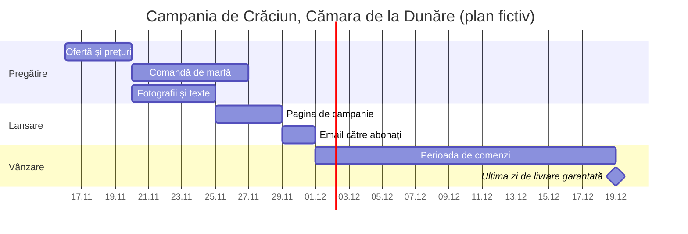
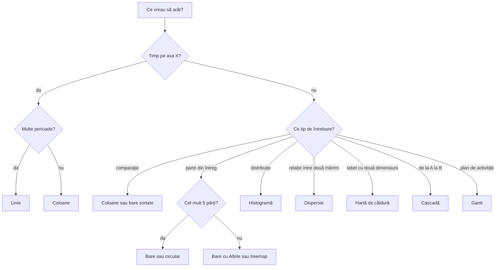

# Capitolul 7. Tipuri de grafice folosite în business și construirea unui dashboard

## Ce vei putea face după acest capitol

- Să alegi tipul de grafic pornind de la întrebarea de business, nu de la ce arată bine în meniu.
- Să pregătești un tabel de date în forma cerută de fiecare dintre cele zece tipuri de grafice din catalog.
- Să citești corect un grafic și să recunoști greșelile tipice ale fiecărui tip.
- Să construiești fiecare grafic în Excel sau Google Sheets și în Python, cu biblioteca matplotlib.
- Să deosebești un grafic cu bare de o histogramă, o linie de un șir de coloane și o diagramă circulară de un clasament cu bare.
- Să proiectezi un dashboard (tablou de bord) cu 4-6 indicatori și să îl publici într-un instrument gratuit de raportare.

Capitolul 6 a explicat principiile: cum percepe ochiul lungimi, unghiuri și culori, de ce axa trunchiată înșală, cum arată un grafic onest. Aici facem catalogul. Pentru fiecare tip de grafic găsești aceeași fișă: întrebarea la care răspunde, când îl folosești și când nu, cum arată datele, cum îl citești, un exemplu de business, greșelile frecvente și pașii de construcție.

Exemplul recurent este „Cămara de la Dunăre”, magazinul online fictiv din Galați care vinde dulcețuri, zacuscă, miere și siropuri de la producători locali. Toate cifrele despre Cămara sunt date fictive, construite pentru exercițiu, și sunt calculate din fișierul `camara_saptamanal.csv` (12 săptămâni, 4 canale de vânzare).

## 7.1 Înainte de catalog: întrebarea, datele, părțile unui grafic

### 7.1.1 Pornește de la întrebare

Un grafic este un răspuns. Dacă nu știi întrebarea, orice tip pare potrivit și niciunul nu convinge. În practică, întrebările de business se reduc la câteva familii:

| Familie | Întrebarea tipică | Tipuri din acest capitol |
|---|---|---|
| Comparație | Care categorie este mai mare? Cu cât? | Coloane și bare (simple, grupate, orizontale) |
| Evoluție | Cum s-a schimbat în timp? | Linie, coloane pentru puține perioade |
| Structură | Din ce este compus totalul? | Coloane suprapuse, circular, inel, treemap |
| Distribuție | Cum sunt împrăștiate valorile? Unde sunt cele mai multe? | Histogramă |
| Relație | Se mișcă două mărimi împreună? | Dispersie, hartă de căldură |
| Trecere de la A la B | Cum ajung de la venit la profit? | Cascadă |
| Plan în timp | Cine face ce și până când? | Gantt |
| Profil pe mai multe criterii | Cum arată un produs sau un canal pe 5-6 criterii? | Radar |

> **De reținut.** Scrie întrebarea într-o propoziție înainte să deschizi Excel sau Python. Dacă propoziția conține „în timp”, te gândești la linie. Dacă conține „față de”, te gândești la bare. Dacă conține „din total”, te gândești la structură. Dacă conține „are legătură cu”, te gândești la dispersie.

### 7.1.2 Părțile unui grafic

Indiferent de tip, un grafic de business are aproape mereu aceleași componente. Le folosim ca listă de verificare înainte de a trimite graficul cuiva.

| Element | La ce folosește | Verificare rapidă |
|---|---|---|
| Titlu | Spune subiectul sau, mai bine, concluzia | Se înțelege graficul doar din titlu? |
| Axa X (orizontală) | Categoriile sau timpul (variabila independentă) | Ordinea are sens (cronologică sau după mărime)? |
| Axa Y (verticală) | Valorile numerice (variabila dependentă) | Pornește de la zero la bare? |
| Etichetele axelor și unitatea | Explică ce se măsoară: lei, %, bucăți | Apare unitatea de măsură? |
| Legendă | Leagă o culoare de o serie | Se poate înlocui cu etichete puse direct pe serie? |
| Grilă | Linii fine care ajută la citirea valorilor | Este discretă, nu concurează cu datele? |
| Adnotări | Text scurt care explică un punct | Evenimentul important este marcat? |
| Sursa datelor | Transparență și credibilitate | Scrie de unde vin cifrele și pentru ce perioadă? |

La diagramele de tip flux sau organigramă mai apar conectorii (săgețile) care arată relațiile dintre elemente. În catalogul de față îi întâlnim doar la diagrama Gantt, unde arată dependențele dintre activități.

### 7.1.3 Pregătirea datelor

Cele mai multe grafice proaste pornesc de la un tabel prost pregătit. Înainte de orice grafic parcurgi trei pași.

1. **Cureți.** Cauți valorile lipsă și decizi ce faci cu ele: le elimini, le completezi sau le marchezi. Cauți valorile extreme (în engleză *outliers*) și verifici dacă sunt erori de introducere sau fapte reale. Uniformizezi formatele: aceeași scriere a datelor calendaristice, numere stocate ca numere, nu ca text.
2. **Transformi.** Agregi la nivelul potrivit întrebării: zilnic, săptămânal, lunar. Calculezi procentele dacă vrei un grafic de structură. Aduci la aceeași scară mărimile cu unități diferite, dacă le compari în același grafic.
3. **Organizezi.** Sortezi (cronologic la timp, descrescător la clasamente). Filtrezi ce nu ține de întrebare. Grupezi categoriile mărunte într-una numită „Altele”, ca să nu aglomerezi graficul.

Mai este un lucru practic: forma tabelului. Fișierul Cămării este în **format lung**: fiecare rând este o combinație săptămână-canal, iar valorile stau pe coloane (`venit`, `comenzi` și așa mai departe). Programele de foi de calcul desenează de obicei grafice din **format lat**: o coloană de categorii și câte o coloană pentru fiecare serie. Trecerea de la lung la lat se face cu un tabel pivot (PivotTable în Excel, Pivot table în Google Sheets) sau, în Python, cu `pivot_table` din pandas (vezi capitolul 8).

Format lung, primele rânduri:

| saptamana | luna | canal | venit |
|---|---|---|---|
| 1 | septembrie | Căutare | 9.000 |
| 1 | septembrie | Reclame | 2.400 |
| 1 | septembrie | Email | 4.950 |
| 1 | septembrie | Direct | 4.960 |

Format lat, aceleași date:

| saptamana | Căutare | Reclame | Email | Direct |
|---|---|---|---|---|
| 1 | 9.000 | 2.400 | 4.950 | 4.960 |

> **Greșeală frecventă.** Selectezi tot tabelul lung și apeși „Inserare grafic”. Programul nu știe ce vrei să însumezi și desenează 48 de coloane fără sens. Întâi faci tabelul pivot, apoi graficul.

### 7.1.4 Convenții pentru exemplele de cod

Fragmentele Python din capitol sunt scurte și complete: fiecare poate fi rulat singur, dacă fișierul `camara_saptamanal.csv` se află în folderul de lucru. Toate folosesc pandas și matplotlib (instalarea și bazele sunt în capitolul 8) și salvează graficul într-un fișier PNG. Pașii pentru Excel și Google Sheets folosesc denumirile din interfața în engleză. Dacă ai interfața în română, numele sunt traduse, dar ordinea meniurilor este aceeași.

## 7.2 Graficul cu coloane și bare

Graficul cu coloane (în engleză *bar chart* sau *column chart*) este cel mai folosit grafic din business. Fiecare categorie primește un dreptunghi, iar înălțimea sau lungimea lui este proporțională cu valoarea. Ochiul compară foarte bine lungimi care pornesc de la aceeași linie de bază (vezi capitolul 6), de aceea barele sunt alegerea sigură pentru comparații.

În vorbirea curentă, „coloane” înseamnă dreptunghiuri verticale, iar „bare” dreptunghiuri orizontale. Logica este aceeași. Avem patru variante: simple, grupate, suprapuse și orizontale.

### 7.2.1 Coloane simple

**La ce întrebare răspunde.** Care categorie are valoarea cea mai mare și cât de mari sunt diferențele?

**Când îl folosești.** Când compari o singură mărime între câteva categorii: venit pe canale, vânzări pe trimestre, comenzi pe județe. **Când nu:** dacă ai peste 12 categorii (treci la bare orizontale sau grupezi în „Altele”) sau dacă ai o serie lungă de timp (treci la linie).

**Structura datelor.** O coloană de categorii și o coloană de valori numerice. Categoriile sunt distincte, valorile sunt în aceeași unitate. Numărul comod de categorii este între 5 și 12, dar merge foarte bine și cu 3 sau 4.

| canal | venit în noiembrie (lei) |
|---|---|
| Căutare | 37.350 |
| Reclame | 30.030 |
| Email | 21.285 |
| Direct | 20.460 |

**Cum îl citești.** Te uiți întâi la ordinea coloanelor, apoi la raportul dintre ele. Aici Căutarea aduce cel mai mult, iar Reclamele sunt pe locul doi. Totalul este 109.125 lei.

> **Exemplu.** Cămara, noiembrie (date fictive, construite pentru exercițiu). Graficul cu coloane arată că Reclamele au ajuns al doilea canal ca venit, cu 30.030 lei. În septembrie aduceau 9.600 lei și erau pe ultimul loc. Graficul răspunde la „cine vinde cel mai mult”, dar nu spune nimic despre profit. Pentru asta avem nevoie de alt indicator (contribuția) și de alte grafice, mai jos.

**Greșeli frecvente.**

- Axa valorilor nu pornește de la zero. La bare, lungimea este mesajul, deci trunchierea falsifică raportul dintre categorii (vezi capitolul 6).
- Categoriile sunt lăsate în ordine alfabetică. Dacă ordinea nu are un sens propriu (cum au lunile), sortează descrescător.
- Fiecare coloană are altă culoare, fără ca aceasta să însemne ceva. O singură culoare, plus eventual una de accent pentru categoria despre care vorbești.
- Efecte 3D, umbre, gradient. Îngreunează citirea și nu adaugă informație.

**În Excel sau Google Sheets.**

1. Fă un tabel pivot: `canal` pe rânduri, suma `venit` la valori, filtru pe `luna` = noiembrie.
2. Sortează descrescător după venit.
3. Excel: Insert > Charts > Clustered Column. Sheets: Insert > Chart, apoi Chart type > Column chart.
4. Scrie un titlu cu unitatea de măsură și adaugă etichete de date (Data labels).

**În Python.**

```python
import pandas as pd
import matplotlib.pyplot as plt

df = pd.read_csv("camara_saptamanal.csv")
nov = df[df["luna"] == "noiembrie"]
venit = nov.groupby("canal")["venit"].sum().sort_values(ascending=False)

fig, ax = plt.subplots(figsize=(7, 4))
ax.bar(venit.index, venit.values, color="#4C72B0")
for i, v in enumerate(venit.values):
    ax.text(i, v, f"{v:,.0f}".replace(",", "."), ha="center", va="bottom")
ax.set_title("Venit pe canale, noiembrie (lei, date fictive)")
ax.set_ylabel("Venit (lei)")
ax.set_ylim(0, venit.max() * 1.15)
fig.tight_layout()
fig.savefig("coloane_simple.png", dpi=150)
```

### 7.2.2 Coloane grupate

**La ce întrebare răspunde.** Cum arată aceeași mărime în două sau mai multe situații, pentru fiecare categorie? Exemplul clasic din prezentare: buget planificat față de cheltuieli reale, pe departamente.

**Când îl folosești.** Când ai 2-4 serii comparabile, în aceeași unitate de măsură: plan față de realizat, anul acesta față de anul trecut, septembrie față de noiembrie. **Când nu:** dacă ai mai mult de 4 serii (grupurile devin garduri greu de citit) sau dacă seriile au unități diferite (lei și bucăți).

**Structura datelor.** O coloană de categorii principale și câte o coloană numerică pentru fiecare serie.

| canal | venit septembrie (lei) | venit noiembrie (lei) |
|---|---|---|
| Căutare | 36.150 | 37.350 |
| Reclame | 9.600 | 30.030 |
| Email | 19.965 | 21.285 |
| Direct | 19.685 | 20.460 |

**Cum îl citești.** În interiorul fiecărui grup compari coloanele între ele. Între grupuri compari coloanele de aceeași culoare. Aici trei canale au perechi aproape egale, iar la Reclame coloana de noiembrie este de peste trei ori mai înaltă decât cea de septembrie. Creșterea venitului total vine aproape în întregime dintr-un singur canal.

**Greșeli frecvente.**

- Prea multe serii în grup. Peste patru, ochiul nu mai urmărește culorile.
- Culori fără logică. Pentru „înainte și după” folosește două nuanțe ale aceleiași culori, cea închisă pentru perioada despre care vorbești.
- Ordinea seriilor diferă de ordinea din legendă sau de ordinea firească (septembrie trebuie să stea în stânga lui noiembrie).

**În Excel sau Google Sheets.** Tabel pivot cu `canal` pe rânduri, `luna` pe coloane și suma `venit` la valori. Păstrezi doar lunile de comparat. Excel: Insert > Clustered Column. Sheets: Insert > Chart > Column chart (seriile apar automat una lângă alta).

**În Python.**

```python
import pandas as pd
import matplotlib.pyplot as plt

df = pd.read_csv("camara_saptamanal.csv")
tabel = df.pivot_table(index="canal", columns="luna", values="venit", aggfunc="sum")
tabel = tabel[["septembrie", "noiembrie"]].sort_values("noiembrie", ascending=False)

fig, ax = plt.subplots(figsize=(7, 4))
tabel.plot(kind="bar", ax=ax, rot=0, color=["#A9C4E4", "#1F4E8C"])
ax.set_title("Venit pe canale: septembrie față de noiembrie (lei, date fictive)")
ax.set_xlabel("")
ax.set_ylabel("Venit (lei)")
ax.legend(title="")
fig.tight_layout()
fig.savefig("coloane_grupate.png", dpi=150)
```

### 7.2.3 Coloane suprapuse (stivuite)

**La ce întrebare răspunde.** Cât este totalul și din ce este compus, pentru fiecare categorie sau perioadă?

**Când îl folosești.** Când te interesează în primul rând totalul și abia apoi compoziția lui: vânzări pe trimestre, împărțite pe categorii de produse; venit săptămânal, împărțit pe canale. **Când nu:** dacă vrei să compari precis componentele între ele. Doar segmentul de jos pornește de la zero. Celelalte „plutesc” și lungimile lor se compară greu.

**Structura datelor.** Ca la coloanele grupate, cu o condiție în plus: valorile dintr-un rând se adună într-un total care are sens. Cel mult 5-6 componente, puse în aceeași ordine în toate coloanele.

| saptamana | Căutare | Direct | Email | Reclame | Total |
|---|---|---|---|---|---|
| 1 | 9.000 | 4.960 | 4.950 | 2.400 | 21.310 |
| 8 | 9.300 | 4.960 | 5.115 | 6.405 | 25.780 |
| 12 | 9.300 | 5.115 | 5.280 | 7.560 | 27.255 |

**Cum îl citești.** Întâi înălțimea totală a coloanelor (venitul crește de la 21.310 la 27.255 lei pe săptămână). Apoi segmentul care se schimbă. Pune componenta despre care vorbești jos, lângă axă, ca să poată fi citită precis, sau sus, ca să se vadă că ea „adaugă” creșterea. La Cămara, segmentul Reclame se triplează, celelalte rămân aproape la fel.

Varianta **100% suprapusă** aduce toate coloanele la aceeași înălțime și arată doar cotele. La Cămara, cota Reclamelor în venit trece de la 11,2% în septembrie la 27,5% în noiembrie. Varianta 100% ascunde însă totalul, deci nu o folosi când mesajul este creșterea.

**Greșeli frecvente.**

- Prea multe componente subțiri, imposibil de etichetat.
- Concluzii despre un segment din mijloc, care nu are o bază comună cu vecinii lui.
- Ordinea componentelor se schimbă de la o coloană la alta.

**În Excel sau Google Sheets.** Tabel pivot cu `saptamana` pe rânduri, `canal` pe coloane, suma `venit`. Excel: Insert > Stacked Column. Sheets: Insert > Chart > Stacked column chart.

**În Python.**

```python
import pandas as pd
import matplotlib.pyplot as plt

df = pd.read_csv("camara_saptamanal.csv")
tabel = df.pivot_table(index="saptamana", columns="canal", values="venit", aggfunc="sum")
tabel = tabel[["Căutare", "Direct", "Email", "Reclame"]]

fig, ax = plt.subplots(figsize=(8, 4))
tabel.plot(kind="bar", stacked=True, ax=ax, rot=0,
           color=["#B0B0B0", "#C8C8C8", "#DCDCDC", "#D1495B"])
ax.set_title("Venit săptămânal pe canale (lei, date fictive)")
ax.set_xlabel("Săptămâna")
ax.set_ylabel("Venit (lei)")
ax.legend(title="", ncol=4, loc="upper left")
fig.tight_layout()
fig.savefig("coloane_suprapuse.png", dpi=150)
```

Culorile sunt alese cu intenție: trei nuanțe de gri pentru canalele stabile și o culoare de accent pentru canalul despre care este povestea.

### 7.2.4 Bare orizontale

**La ce întrebare răspunde.** Aceeași ca la coloanele simple, dar pentru cazul în care etichetele sunt lungi sau categoriile sunt multe.

**Când îl folosești.** Clasamente (top 15 produse), denumiri lungi (departamente, producători, întrebări de chestionar), valori negative și pozitive pe același grafic. **Când nu:** pentru timp. Timpul curge de la stânga la dreapta, deci perioadele stau pe axa orizontală.

**Structura datelor.** O coloană de categorii și una de valori, sortate. Atenție: multe programe desenează primul rând al tabelului în partea de jos a graficului. Sortează crescător în tabel ca valoarea cea mai mare să ajungă sus.

| canal | contribuție în noiembrie (lei) |
|---|---|
| Căutare | 13.321,50 |
| Email | 7.572,25 |
| Direct | 7.359,00 |
| Reclame | -11.494,70 |

**Cum îl citești.** De sus în jos, ca pe un clasament. Barele din stânga liniei de zero sunt pierderi.

> **Exemplu.** Cămara, noiembrie (date fictive). Pe graficul cu venitul, Reclamele erau pe locul doi. Pe graficul cu contribuția (marja brută minus marketing minus ambalare și livrare, vezi capitolul 5), bara Reclamelor pleacă spre stânga: -11.494,70 lei. Același canal, același tip de grafic, alt indicator și concluzia se întoarce. Tipul de grafic nu poate repara alegerea greșită a indicatorului.

**Greșeli frecvente.** Bare nesortate. Etichete tăiate. Culoare diferită pentru fiecare bară. Lipsa liniei de zero atunci când există valori negative.

**În Excel sau Google Sheets.** Excel: Insert > Clustered Bar. Sheets: Insert > Chart > Bar chart. Dacă ordinea iese inversă, în Excel bifezi la axa categoriilor opțiunea „Categories in reverse order”.

**În Python.**

```python
import pandas as pd
import matplotlib.pyplot as plt

df = pd.read_csv("camara_saptamanal.csv")
nov = df[df["luna"] == "noiembrie"]
contributie = nov.groupby("canal")["contributie"].sum().sort_values()
culori = ["#D1495B" if v < 0 else "#4C72B0" for v in contributie.values]

fig, ax = plt.subplots(figsize=(7, 3.5))
ax.barh(contributie.index, contributie.values, color=culori)
ax.axvline(0, color="black", linewidth=0.8)
ax.set_title("Contribuția pe canale, noiembrie (lei, date fictive)")
ax.set_xlabel("Contribuție (lei)")
fig.tight_layout()
fig.savefig("bare_orizontale.png", dpi=150)
```

## 7.3 Graficul liniar

**La ce întrebare răspunde.** Cum a evoluat o mărime în timp? Crește, scade, are sezonalitate, are rupturi?

Graficul liniar (*line chart*) leagă puncte succesive printr-o linie. Linia sugerează continuitate: între două puncte vecine presupunem că fenomenul a trecut prin valori intermediare. De aceea se potrivește datelor ordonate în timp. Un comerciant își urmărește vânzările lunare pe doi ani ca să vadă vârfurile, scăderile și tiparele sezoniere, apoi își planifică stocurile și promoțiile. Un specialist în marketing urmărește traficul pe site și interacțiunile din rețelele sociale ca să vadă efectul campaniilor.

**Când îl folosești.** Serii de timp cu multe puncte (de la 8-10 în sus), una până la patru serii în aceeași unitate. **Când nu:** pentru categorii fără ordine (canale, produse, județe). O linie între „Email” și „Direct” sugerează o trecere care nu există.

**Structura datelor.** O coloană de timp, la intervale egale, și câte o coloană numerică pentru fiecare serie.

| saptamana | venit (lei) | contribuție (lei) |
|---|---|---|
| 1 | 21.310 | 7.007,50 |
| 4 | 21.310 | 7.007,50 |
| 5 | 22.765 | 6.113,45 |
| 8 | 25.780 | 4.250,30 |
| 12 | 27.255 | 4.170,35 |

**Cum îl citești.** Urmărești patru lucruri, în ordine:

1. **Tendința**: direcția generală (în sus, în jos, pe loc).
2. **Sezonalitatea**: tipare care se repetă (săptămânal, lunar, anual). Pentru a o vedea ai nevoie de cel puțin două cicluri complete.
3. **Rupturile**: locul în care panta se schimbă brusc. Întrebarea imediată este „ce s-a întâmplat atunci?”.
4. **Anomaliile**: puncte izolate, mult peste sau sub vecinii lor. Pot fi erori de date sau evenimente reale.

> **Exemplu.** Cămara, 12 săptămâni (date fictive, construite pentru exercițiu). Linia venitului stă la 21.310 lei patru săptămâni, apoi urcă din săptămâna 5 până la 27.255 lei în săptămâna 12, adică plus 28%. Linia contribuției face invers: de la 7.007,50 lei coboară la 4.170,35 lei, adică minus 40%. Cele două linii se despart exact în săptămâna 5, când bugetul de Reclame a fost mărit și a apărut codul de reducere de 20%. Un singur grafic cu două linii spune toată povestea: vindem mai mult și rămânem cu mai puțin.

**Greșeli frecvente.**

- **Graficul spaghetti**: 8-10 linii colorate care se încâlcesc. Păstrează cel mult patru sau evidențiază una și lasă restul gri.
- **Două axe verticale** cu scări diferite. Punctul în care liniile se intersectează depinde de cum ai ales scările, deci cititorul vede o „întâlnire” care nu înseamnă nimic. Mai bine două grafice mici, unul sub altul.
- **Intervale de timp inegale** desenate la distanțe egale (lipsesc luni, iar linia le sare fără semn).
- **Netezirea** liniei (opțiunea „smooth”). Inventează valori între puncte.
- **Axă tăiată** fără avertisment. La linii, o axă care nu pornește de la zero este acceptabilă când te interesează variația, dar trebuie să fie vizibil marcată (vezi capitolul 6).

**În Excel sau Google Sheets.**

1. Tabel pivot: `saptamana` pe rânduri, suma `venit` și suma `contributie` la valori.
2. Excel: Insert > Line > Line with Markers. Sheets: Insert > Chart > Line chart.
3. Șterge legenda și scrie numele seriilor la capătul liniilor (etichetă de date doar pe ultimul punct).
4. Adaugă o adnotare la săptămâna 5: casetă de text în Excel, notă în titlu sau subtitlu în Sheets.

**În Python.**

```python
import pandas as pd
import matplotlib.pyplot as plt

df = pd.read_csv("camara_saptamanal.csv")
sapt = df.groupby("saptamana")[["venit", "contributie"]].sum()

fig, ax = plt.subplots(figsize=(8, 4))
ax.plot(sapt.index, sapt["venit"], marker="o", color="#4C72B0")
ax.plot(sapt.index, sapt["contributie"], marker="o", color="#D1495B")
ax.text(12.2, sapt["venit"].iloc[-1], "Venit", color="#4C72B0", va="center")
ax.text(12.2, sapt["contributie"].iloc[-1], "Contribuție", color="#D1495B", va="center")
ax.axvline(5, color="gray", linestyle="--", linewidth=0.8)
ax.text(5.1, 15000, "săpt. 5: buget Reclame mărit,\ncod de reducere 20%", color="gray")
ax.set_title("Venit și contribuție pe săptămâni (lei, date fictive)")
ax.set_xlabel("Săptămâna")
ax.set_ylabel("Lei")
ax.set_xticks(range(1, 13))
ax.set_xlim(0.5, 14)
ax.set_ylim(0, 30000)
fig.tight_layout()
fig.savefig("linie.png", dpi=150)
```

## 7.4 Diagrama circulară și varianta inel

**La ce întrebare răspunde.** Ce parte din întreg reprezintă fiecare categorie?

Diagrama circulară (*pie chart*, „plăcinta”) împarte un cerc în sectoare. Fiecare sector este cota unei categorii, iar toate sectoarele fac împreună 100%. Varianta inel (*donut chart*) este aceeași diagramă cu centrul decupat. În centru se scrie de obicei totalul.

**Când o folosești.** Când sunt îndeplinite toate condițiile de mai jos:

- valorile sunt părți ale unui singur întreg și se adună la 100%;
- ai cel mult 4-5 categorii;
- cotele sunt clar diferite, sau mesajul este unul simplu, de tipul „un canal face mai mult de o treime”;
- nu ai nevoie de comparații precise.

**Când nu.** Când ai multe categorii, cote apropiate (24%, 26%, 25%), valori negative, valori care nu formează un întreg (de exemplu rate de conversie pe canale) sau când vrei să compari două perioade. Ochiul estimează prost unghiurile și ariile (vezi capitolul 6). Două „plăcinte” puse alături obligă cititorul să compare unghiuri între cercuri diferite, ceea ce aproape nimeni nu poate face corect.

**Structura datelor.** O coloană de categorii și o coloană de valori pozitive. Procentele le calculează programul.

| canal | venit noiembrie (lei) | cotă din venit |
|---|---|---|
| Căutare | 37.350 | 34,2% |
| Reclame | 30.030 | 27,5% |
| Email | 21.285 | 19,5% |
| Direct | 20.460 | 18,7% |
| Total | 109.125 | 100% |

Cotele rotunjite la o zecimală se adună aici la 99,9%. Este un efect normal al rotunjirii. Nu „ajusta” o cotă ca să iasă exact 100.

**Cum o citești.** Pornești de la ora 12 și mergi în sensul acelor de ceas, de la sectorul cel mai mare la cel mai mic. Reperele ușoare sunt sfertul (25%) și jumătatea (50%). Orice altă cotă trebuie scrisă ca etichetă, pentru că nu poate fi citită din desen.

**Rețeta pentru o diagramă circulară corectă.**

1. Cel mult cinci sectoare. Restul intră în „Altele”.
2. Sectoarele ordonate descrescător, începând de la ora 12.
3. Etichete puse direct pe sectoare sau lângă ele (nume și procent), fără legendă separată.
4. Fără 3D și fără sectoare „explodate”. Perspectiva mărește sectoarele din față.
5. Totalul scris în titlu sau în centrul inelului.
6. O întrebare de control: ar fi mai clar ca bare? Dacă da, fă bare.

> **Greșeală frecventă.** Diagramă circulară pentru întrebări cu răspuns multiplu. Dacă 60% dintre clienți au bifat „gust” și 45% au bifat „preț”, procentele nu se adună la 100% și nu sunt părți ale aceluiași întreg. Graficul corect este cel cu bare orizontale.

> **Exemplu.** Cămara, noiembrie (date fictive). Diagrama circulară a venitului pe canale arată patru sectoare relativ echilibrate și transmite un mesaj liniștitor: „venitul este diversificat”. Mesajul este corect pentru venit și înșelător pentru afacere, fiindcă sectorul Reclame, de 27,5%, are contribuție negativă. Contribuția pe canale nici nu poate fi desenată circular, pentru că are o valoare negativă. Când o mărime poate fi negativă, diagrama circulară iese din discuție.

**În Excel sau Google Sheets.** Sortezi descrescător. Excel: Insert > Pie (sau Doughnut). Sheets: Insert > Chart > Pie chart, iar pentru inel alegi Donut chart sau mărești „Donut hole” în fila Customize. Adaugi etichete cu numele categoriei și procentul, apoi ștergi legenda.

**În Python.**

```python
import pandas as pd
import matplotlib.pyplot as plt

df = pd.read_csv("camara_saptamanal.csv")
nov = df[df["luna"] == "noiembrie"]
venit = nov.groupby("canal")["venit"].sum().sort_values(ascending=False)

fig, ax = plt.subplots(figsize=(5, 5))
ax.pie(venit.values, labels=venit.index, autopct="%1.1f%%",
       startangle=90, counterclock=False,
       wedgeprops=dict(width=0.45, edgecolor="white"))
ax.text(0, 0, "109.125 lei", ha="center", va="center", fontsize=12)
ax.set_title("Cota canalelor în venit, noiembrie (date fictive)")
fig.tight_layout()
fig.savefig("inel.png", dpi=150)
```

Parametrul `wedgeprops=dict(width=0.45)` transformă cercul în inel. Dacă îl ștergi (și ștergi și textul din centru), obții diagrama circulară clasică.

## 7.5 Histograma

**La ce întrebare răspunde.** Cum sunt distribuite valorile unei variabile numerice? Unde se află cele mai multe, cât de împrăștiate sunt, există valori neobișnuite?

Histograma seamănă cu un grafic cu coloane, dar face altceva. Axa orizontală este o axă numerică împărțită în intervale egale (în engleză *bins*). Înălțimea fiecărei coloane arată câte observații cad în acel interval, adică frecvența. Histograma pornește de la date brute (un rând pentru fiecare angajat, comandă sau client) și numără.

**Când o folosești.** Pentru o variabilă numerică continuă sau cu multe valori posibile: salarii, valoarea comenzilor, timpul de livrare, vârsta clienților, timpul de răspuns la tichete. **Când nu:** pentru categorii (acolo folosești bare) și pentru seturi foarte mici de date (sub 30-40 de observații forma nu este stabilă).

**Structura datelor.** O singură coloană numerică, cu multe rânduri. Din ea se obține tabelul de frecvențe. Exemplul din prezentare este distribuția salariilor într-o firmă, cu intervale de 500 de lei. Tabelul de mai jos este o variantă a acelui exemplu, cu 120 de angajați, în care cifrele au fost puse de acord între ele. Sunt date fictive, construite pentru exercițiu.

| Interval salariu (lei) | Număr de angajați | Pondere |
|---|---|---|
| 2.500 - 2.999 | 6 | 5,0% |
| 3.000 - 3.499 | 18 | 15,0% |
| 3.500 - 3.999 | 46 | 38,3% |
| 4.000 - 4.499 | 26 | 21,7% |
| 4.500 - 4.999 | 12 | 10,0% |
| 5.000 - 5.499 | 7 | 5,8% |
| 5.500 - 5.999 | 3 | 2,5% |
| 6.000 și peste | 2 | 1,7% |
| Total | 120 | 100% |

**Cum o citești.** O histogramă se descrie prin patru trăsături.

- **Forma.** Simetrică (ca un clopot), asimetrică spre dreapta (coadă lungă spre valorile mari), asimetrică spre stânga sau cu mai multe vârfuri (multimodală). Aici distribuția este asimetrică spre dreapta: cei mai mulți angajați sunt între 3.500 și 4.500 de lei, iar coada se întinde spre salariile mari.
- **Centrul.** Media și mediana. În datele individuale generate pentru acest exemplu, media este de aproximativ 4.013 lei, iar mediana de aproximativ 3.889 lei. La o distribuție asimetrică spre dreapta, media este mai mare decât mediana, pentru că puținele valori mari trag media în sus.
- **Împrăștierea.** 75% dintre angajați (90 din 120) au salarii între 3.000 și 4.499 de lei. Structura salarială este relativ omogenă.
- **Valorile extreme.** Doi angajați (1,7%) au peste 6.000 de lei. Au fost grupați într-un singur interval, pentru că sunt prea puțini pentru intervale separate.

Mai citim de aici: grupul cel mai mare (46 de persoane, 38,3%) are salarii între 3.500 și 3.999 de lei; 10% dintre angajați (12 persoane) câștigă 5.000 de lei sau mai mult; 20% (24 de persoane) câștigă sub 3.500 de lei.

> **De reținut.** La o distribuție cu coadă spre dreapta, media este mai mare decât mediana. Dacă vezi afirmația inversă („mediana mai mare decât media confirmă asimetria pozitivă”), ea este greșită: o mediană peste medie indică o coadă spre stânga. Pentru salarii, valoarea comenzilor și timpul de răspuns, raportează mediana, nu doar media.

**La ce folosește în decizie.** Histograma salariilor ajută la evaluarea echității sistemului de plată, la planificarea bugetului de măriri, la comparația cu piața, la găsirea intervalelor salariale din care pleacă mulți oameni și la stabilirea pragurilor pentru bonusuri. Pentru un magazin online, aceeași tehnică aplicată valorii comenzilor arată unde merită pus pragul de transport gratuit: puțin peste intervalul în care se află cele mai multe comenzi.

**Alegerea intervalelor.** Lățimea intervalului schimbă imaginea. Intervale prea largi (2.000 de lei) ascund forma: rămân două coloane. Intervale prea înguste (50 de lei) fragmentează datele în zeci de coloane cu 1-3 angajați. Intervalele de 500 de lei dau aici opt coloane, suficient pentru a vedea forma. Regula practică: între 6 și 15 intervale, cu limite rotunde, ușor de citit. Încearcă două sau trei lățimi înainte să alegi.

**Greșeli frecvente.**

- Confuzia cu graficul cu bare (vezi secțiunea 7.12).
- Intervale de lățimi diferite, desenate ca și cum ar fi egale. Ultimul interval deschis („6.000 și peste”) trebuie etichetat clar.
- Spații între coloane. La histogramă coloanele se ating, pentru că axa este continuă.
- Limite ambigue. Un salariu de exact 4.000 de lei intră în 3.500 - 4.000 sau în 4.000 - 4.500? Scrie regula (aici: limita de jos inclusă, limita de sus exclusă).
- Concluzii din prea puține date.

**În Excel sau Google Sheets.**

- Excel: selectezi coloana cu salarii, apoi Insert > Insert Statistic Chart > Histogram. Clic dreapta pe axa orizontală > Format Axis, unde setezi „Bin width” la 500 și, dacă vrei, „Overflow bin” la 6000.
- Sheets: selectezi coloana, Insert > Chart > Histogram chart. În fila Customize, la secțiunea Histogram, setezi „Bucket size” la 500.
- Varianta manuală: construiești tabelul de frecvențe cu funcția `COUNTIFS` (în română `COUNTIFS` sau `NUMĂRARE.DACĂ.MULTIPLE`, în funcție de versiune) și desenezi coloane fără spațiu între ele.

**În Python.** Fragmentul generează 120 de salarii fictive care respectă tabelul de frecvențe, apoi desenează histograma.

```python
import numpy as np
import matplotlib.pyplot as plt

intervale = [(2500, 6), (3000, 18), (3500, 46), (4000, 26),  # (limita de jos, număr de angajați), date fictive
             (4500, 12), (5000, 7), (5500, 3), (6000, 2)]
salarii = np.concatenate([np.linspace(jos + 10, jos + 490, n) for jos, n in intervale])

fig, ax = plt.subplots(figsize=(7, 4))
ax.hist(salarii, bins=range(2500, 7000, 500), color="#4C72B0", edgecolor="white")
ax.axvline(np.median(salarii), color="black", linestyle="--")
ax.text(np.median(salarii) + 40, 42, f"mediana: {np.median(salarii):,.0f} lei".replace(",", "."))
ax.set_title("Distribuția salariilor, 120 de angajați (date fictive)")
ax.set_xlabel("Salariu (lei), intervale de 500 de lei")
ax.set_ylabel("Număr de angajați")
fig.tight_layout()
fig.savefig("histograma.png", dpi=150)

print(len(salarii), round(salarii.mean()), round(np.median(salarii)))
```

Ultimul rând afișează `120 4012 3889`: numărul de angajați, media și mediana.

## 7.6 Graficul de dispersie

**La ce întrebare răspunde.** Există o legătură între două mărimi numerice? Cât de strânsă este și ce formă are?

În graficul de dispersie (*scatter plot*), fiecare observație este un punct. Poziția pe orizontală este valoarea primei variabile, poziția pe verticală este valoarea celei de-a doua. Norul de puncte arată relația.

**Când îl folosești.** Buget de reclame și comenzi, preț și cantitate vândută, timp de răspuns și nota de satisfacție, vizite și comenzi pe zile. Este util și pentru a găsi grupuri de observații (*clustere*) și valori neobișnuite. **Când nu:** dacă una dintre variabile este o categorie (folosești bare) sau timpul (folosești linie).

**Structura datelor.** Două coloane numerice, câte un rând pentru fiecare observație. Opțional, o a treia coloană pentru culoare (grupul) sau pentru mărimea punctului. Convenția: pe axa X pui mărimea pe care o controlezi sau presupusa cauză, pe axa Y rezultatul.

Canalul Reclame, pe săptămâni (date fictive):

| saptamana | cost marketing (lei) | comenzi |
|---|---|---|
| 1 | 600 | 16 |
| 5 | 1.500 | 30 |
| 6 | 2.600 | 43 |
| 7 | 3.300 | 54 |
| 8 | 3.800 | 61 |
| 9 | 4.200 | 68 |
| 11 | 4.200 | 74 |

**Cum îl citești.**

- **Direcția.** Norul urcă spre dreapta (relație pozitivă), coboară (negativă) sau este fără direcție (nicio legătură liniară).
- **Forma.** Dreaptă sau curbă. O curbă care se aplatizează arată randamente descrescătoare: fiecare leu în plus aduce mai puțin.
- **Strângerea.** Puncte aproape de o linie înseamnă o relație puternică. Un nor larg înseamnă o relație slabă.
- **Grupurile și excepțiile.** Ciorchini separați de puncte sau puncte izolate, care merită investigate unul câte unul.

> **Exemplu.** Cămara, canalul Reclame, 12 săptămâni (date fictive, construite pentru exercițiu). Punctele se așază aproape perfect pe o dreaptă crescătoare: coeficientul de corelație dintre costul de marketing și numărul de comenzi este 0,996. Bugetul mai mare aduce, fără îndoială, mai multe comenzi. Tot graficul arată însă că panta este modestă: de la 600 la 4.200 de lei pe săptămână, comenzile cresc de la 16 la aproximativ 72. Asta înseamnă 3.600 de lei în plus pentru 56 de comenzi în plus, adică în jur de 64 de lei cheltuiți pe reclamă pentru fiecare comandă suplimentară. La o marjă brută de aproximativ 33 de lei pe o comandă de 105 lei, înainte de ambalare și livrare, fiecare astfel de comandă pierde bani. O corelație puternică spune că două mărimi se mișcă împreună. Nu spune că mișcarea este profitabilă.

**Greșeli frecvente.**

- **Corelația luată drept cauzalitate.** Două mărimi pot crește împreună pentru că depind amândouă de o a treia (sezonul, de exemplu). Cum se verifică o relație cauzală, prin experimente, vezi în capitolul 9.
- **Suprapunerea punctelor.** La mii de puncte, norul devine o pată. Soluții: puncte mai mici, transparență (parametrul `alpha` în matplotlib) sau un eșantion.
- **Linie de tendință pusă peste un nor fără formă.** Programul desenează o dreaptă oricând i-o ceri, chiar dacă relația nu există.
- **Extrapolarea.** Dreapta este valabilă în intervalul observat. Nu rezultă de aici că 40.000 de lei pe săptămână ar aduce 700 de comenzi.
- **Axe schimbate între ele** sau fără unități.

**În Excel sau Google Sheets.**

1. Filtrezi tabelul la `canal` = Reclame și păstrezi coloanele `cost_marketing` și `comenzi`, în această ordine (prima devine axa X).
2. Excel: Insert > Scatter. Sheets: Insert > Chart > Scatter chart.
3. Linie de tendință: în Excel, Chart Design > Add Chart Element > Trendline > Linear. În Sheets, fila Customize > Series > bifezi Trendline.
4. Denumești ambele axe, cu unități.

**În Python.**

```python
import numpy as np
import pandas as pd
import matplotlib.pyplot as plt

df = pd.read_csv("camara_saptamanal.csv")
reclame = df[df["canal"] == "Reclame"]
x, y = reclame["cost_marketing"], reclame["comenzi"]
panta, termen_liber = np.polyfit(x, y, 1)

fig, ax = plt.subplots(figsize=(6, 4.5))
ax.scatter(x, y, s=60, alpha=0.7, color="#D1495B")
ax.plot(x, panta * x + termen_liber, color="gray", linewidth=1)
ax.set_title("Reclame: buget săptămânal și comenzi (date fictive)")
ax.set_xlabel("Cost de marketing pe săptămână (lei)")
ax.set_ylabel("Comenzi pe săptămână")
ax.set_xlim(0)
ax.set_ylim(0)
fig.tight_layout()
fig.savefig("dispersie.png", dpi=150)

print(round(x.corr(y), 3), round(1 / panta, 1))
```

Ultimul rând afișează corelația (0,996) și inversul pantei dreptei de tendință, adică lei de reclamă pentru o comandă în plus: aproximativ 66. Valoarea este apropiată de cei 64 de lei obținuți mai sus din comparația simplă a capetelor.

## 7.7 Harta de căldură

**La ce întrebare răspunde.** Unde sunt valorile mari și unde sunt cele mici într-un tabel cu două dimensiuni?

Harta de căldură (*heat map*) este un tabel în care numerele sunt înlocuite sau dublate de culoare. Intensitatea culorii este proporțională cu valoarea. Ochiul găsește imediat zonele „fierbinți” și zonele „reci”, lucru greu de făcut într-un tabel cu 50 sau 500 de cifre.

**Când o folosești.** Comenzi pe zilele săptămânii și ore, indicatori pe canale și săptămâni, vânzări pe produse și județe, matrice de corelații între indicatori, retenția clienților pe cohorte. **Când nu:** dacă ai nevoie de valori exacte (rămâi la tabel) sau dacă ai doar câteva celule (un grafic cu bare este mai clar).

**Structura datelor.** O matrice: o categorie pe rânduri, o categorie pe coloane, o valoare numerică în fiecare celulă. Din formatul lung se obține cu un tabel pivot.

Contribuția pe comandă, pe canale și luni (lei, date fictive):

| canal | septembrie | octombrie | noiembrie |
|---|---|---|---|
| Căutare | 53,50 | 53,50 | 53,50 |
| Email | 58,60 | 58,65 | 58,70 |
| Direct | 55,75 | 55,75 | 55,75 |
| Reclame | 16,00 | -39,79 | -40,19 |

**Cum o citești.** Cauți întâi tiparele mari: un rând întreg de altă culoare (o categorie diferită de celelalte), o coloană de altă culoare (o perioadă diferită), un colț care se schimbă treptat. Apoi cauți celulele izolate. La Cămara, harta pe săptămâni are trei rânduri de aceeași nuanță de la un capăt la altul și un rând, Reclame, care își schimbă culoarea începând cu săptămâna 5.

**Alegerea paletei.** Sunt două situații (principiile generale despre culoare sunt în capitolul 6):

- **Paletă secvențială** (de la deschis la închis, o singură culoare) pentru valori care merg de la mic la mare: număr de comenzi, vizite.
- **Paletă divergentă** (două culori care se întâlnesc într-un punct neutru) pentru valori cu un mijloc cu sens: abateri față de plan, creșteri și scăderi, contribuție pozitivă și negativă. Punctul neutru trebuie să fie chiar zero sau ținta.

**Greșeli frecvente.**

- Paleta curcubeu. Nu are o ordine evidentă și creează praguri false între culori.
- Paletă roșu-verde ca singur purtător de informație. O parte dintre cititori nu disting cele două culori. Preferă roșu-albastru sau portocaliu-albastru.
- Lipsa legendei de culoare. Fără ea, cititorul nu știe ce înseamnă „închis”.
- O singură valoare extremă care „mănâncă” toată scala și lasă restul celulelor de aceeași nuanță. Limitează scala sau tratează separat valoarea extremă.
- Rânduri și coloane în ordine alfabetică. Ordonează-le după timp sau după mărime, ca tiparele să devină vizibile.

**În Excel sau Google Sheets.** Nu există un tip de grafic separat pentru harta de căldură în lista standard de grafice, dar o obții direct din tabel, cu formatare condiționată.

1. Construiești tabelul pivot (`canal` pe rânduri, `saptamana` pe coloane, valoarea dorită).
2. Selectezi celulele cu valori.
3. Excel: Home > Conditional Formatting > Color Scales. Sheets: Format > Conditional formatting > Color scale.
4. Pentru o paletă divergentă, alegi o scală în trei culori și setezi punctul din mijloc la valoarea 0.

**În Python.**

```python
import pandas as pd
import matplotlib.pyplot as plt

df = pd.read_csv("camara_saptamanal.csv")
df["contributie_pe_comanda"] = df["contributie"] / df["comenzi"]
tabel = df.pivot_table(index="canal", columns="saptamana", values="contributie_pe_comanda")
tabel = tabel.loc[["Email", "Direct", "Căutare", "Reclame"]]

fig, ax = plt.subplots(figsize=(9, 3))
imagine = ax.imshow(tabel.values, cmap="RdBu", vmin=-60, vmax=60, aspect="auto")
ax.set_xticks(range(12))
ax.set_xticklabels(tabel.columns)
ax.set_yticks(range(4))
ax.set_yticklabels(tabel.index)
for i in range(4):
    for j in range(12):
        ax.text(j, i, f"{tabel.values[i, j]:.0f}", ha="center", va="center", fontsize=8)
fig.colorbar(imagine, ax=ax, label="lei pe comandă")
ax.set_title("Contribuția pe comandă, pe canale și săptămâni (date fictive)")
ax.set_xlabel("Săptămâna")
fig.tight_layout()
fig.savefig("harta_de_caldura.png", dpi=150)
```

Limitele `vmin=-60` și `vmax=60` sunt simetrice față de zero. Astfel albul paletei „RdBu” (roșu-albastru) cade exact pe contribuția zero: albastru înseamnă că o comandă lasă bani, roșu înseamnă că o comandă costă bani.

## 7.8 Diagrama în cascadă

**La ce întrebare răspunde.** Cum ajung de la o valoare de pornire la o valoare finală și cât adaugă sau scade fiecare pas?

Diagrama în cascadă (*waterfall chart*) arată o valoare inițială, apoi o succesiune de creșteri și scăderi, apoi valoarea finală. Coloanele de la capete stau pe axă. Coloanele intermediare „plutesc”: fiecare pornește de unde s-a oprit cea dinainte.

**Când o folosești.** Trecerea de la venit la profit. Explicarea diferenței dintre buget și realizat. Trecerea de la rezultatul unei luni la rezultatul lunii următoare, pe cauze. Evoluția numărului de clienți: câți erau, câți au venit, câți au plecat, câți sunt. **Când nu:** dacă pașii nu se adună (nu poți pune în cascadă procente de natură diferită) sau dacă sunt peste 10-12 pași.

**Structura datelor.** O coloană cu numele pasului și una cu valoarea: pozitivă pentru creșteri, negativă pentru scăderi. Totalurile se marchează separat.

Cămara, noiembrie (lei, date fictive, calculate din CSV):

| Pas | Valoare | Tip | Nivel după pas |
|---|---|---|---|
| Venit | 109.125,00 | pornire | 109.125,00 |
| Costul mărfii | -64.222,95 | scădere | 44.902,05 |
| Marketing | -17.000,00 | scădere | 27.902,05 |
| Ambalare și livrare | -11.144,00 | scădere | 16.758,05 |
| Costuri fixe | -10.000,00 | scădere | 6.758,05 |
| Rezultat simplificat | 6.758,05 | total | 6.758,05 |

Nivelul de după costul mărfii, 44.902,05 lei, este marja brută. Nivelul de după ambalare și livrare, 16.758,05 lei, este contribuția.

**Cum o citești.** De la stânga la dreapta, ca pe o poveste: am încasat atât, am plătit marfa, am plătit reclamele, am plătit curierul, am plătit costurile fixe, a rămas atât. Lungimea fiecărei trepte arată cât de mult „mușcă” acel cost din venit.

> **Exemplu.** Cămara, septembrie față de noiembrie (date fictive, construite pentru exercițiu). În septembrie, cascada pornește de la 85.400 lei: costul mărfii 46.970, marketing 2.600, ambalare și livrare 7.742, costuri fixe 10.000, rezultat 18.088 lei. În noiembrie pornește de la 109.125 lei și ajunge la doar 6.758 lei. Puse una lângă alta, cele două cascade arată unde s-a dus diferența: treapta „Marketing” a crescut de la 2.600 la 17.000 de lei, iar treapta „Costul mărfii” a crescut mai repede decât venitul, din cauza codului de reducere (marja brută totală a coborât de la 45% la aproximativ 41% din venit). Venitul a crescut cu 23.725 lei, iar costurile cu 35.055 lei.

**Greșeli frecvente.**

- Coloana finală lăsată să plutească. Totalurile stau pe axă.
- Aceeași culoare pentru creșteri, scăderi și totaluri. Folosește trei culori: una pentru totaluri, una pentru creșteri, una pentru scăderi.
- Pași în ordine întâmplătoare. Respectă ordinea logică a calculului (venit, costul mărfii, marketing și așa mai departe) sau, la o analiză de abateri, ordonează după mărime.
- Axă trunchiată. Ca la orice grafic cu coloane, falsifică proporțiile.
- Lipsa valorilor scrise pe trepte. La cascadă, etichetele sunt aproape obligatorii.

**În Excel sau Google Sheets.**

- Excel (versiunile 2016 și mai noi, inclusiv Microsoft 365, conform paginii de asistență Microsoft): selectezi tabelul cu pașii și valorile, apoi Insert > Insert Waterfall > Waterfall. Faci clic dreapta pe coloana „Rezultat simplificat”, alegi Format Data Point și bifezi „Set as total”, ca să stea pe axă.
- Sheets: Insert > Chart > Waterfall chart. Introduci doar pașii (venitul pozitiv, costurile negative). Coloana de total final se adaugă din opțiunile de subtotal din fila Customize.
- În versiunile vechi de Excel se folosește o „păcăleală”: coloane suprapuse în care prima serie, cea de dedesubt, este făcută invizibilă. Resursa indicată în prezentare, ghidul TeamGantt despre diagrama în cascadă, descrie această metodă pas cu pas și oferă un șablon.

**În Python.** Matplotlib nu are o funcție dedicată, dar cascada se construiește din bare cu parametrul `bottom` (de unde pornește fiecare coloană).

```python
import pandas as pd
import matplotlib.pyplot as plt

df = pd.read_csv("camara_saptamanal.csv")
nov = df[df["luna"] == "noiembrie"].sum(numeric_only=True)

pasi = ["Venit", "Costul mărfii", "Marketing", "Ambalare\nși livrare", "Costuri fixe"]
valori = [nov["venit"], -(nov["venit"] - nov["marja_bruta"]), -nov["cost_marketing"],
          -nov["cost_ambalare_livrare"], -10000]

fig, ax = plt.subplots(figsize=(8, 4.5))
nivel = 0
for pas, v in zip(pasi, valori):
    culoare = "#4C72B0" if v > 0 else "#D1495B"
    ax.bar(pas, v, bottom=nivel, color=culoare)
    ax.text(pas, nivel + v / 2, f"{v:,.0f}".replace(",", "."), ha="center", va="center", color="white")
    nivel += v
ax.bar("Rezultat", nivel, color="#2E7D32")
ax.text("Rezultat", nivel, f"{nivel:,.0f}".replace(",", "."), ha="center", va="bottom")
ax.set_title("De la venit la rezultat, noiembrie (lei, date fictive)")
ax.set_ylabel("Lei")
fig.tight_layout()
fig.savefig("cascada.png", dpi=150)

print(round(nivel, 2))
```

Ultimul rând afișează 6758.05, rezultatul simplificat din noiembrie.

## 7.9 Diagrama Gantt

**La ce întrebare răspunde.** Ce activități are proiectul, când începe și când se termină fiecare, care depind una de alta și cine răspunde de ele?

Diagrama Gantt este un grafic cu bare orizontale așezate pe o axă a timpului. Fiecare bară este o activitate: capătul din stânga este data de început, lungimea este durata. Poartă numele inginerului american Henry Gantt, care a conceput-o în jurul anilor 1910-1915. Un instrument asemănător, numit harmonogramă, fusese creat încă din 1896 de inginerul polonez Karol Adamiecki (sursa: Wikipedia, articolul „Gantt chart”, https://en.wikipedia.org/wiki/Gantt_chart, accesat în noiembrie 2026).

Spre deosebire de celelalte grafice din catalog, Gantt nu descrie date trecute. Descrie un plan. Îl folosești ca să planifici timpul, să vezi dependențele dintre activități, să găsești perioadele aglomerate și să urmărești progresul față de termene.

**Când o folosești.** Proiecte cu 5-30 de activități și termene clare: lansarea unui produs, o campanie de sărbători, migrarea unui site, organizarea unui eveniment. **Când nu:** pentru muncă repetitivă fără început și sfârșit (acolo ajunge o listă de sarcini sau un tablou de tip kanban) și pentru proiecte cu sute de activități puse pe o singură pagină.

**Structura datelor.** Un rând pentru fiecare activitate: nume, dată de început, durată sau dată de sfârșit. Opțional: responsabil, activitatea de care depinde, procent realizat.

Plan fictiv pentru campania de Crăciun a Cămării:

| Activitate | Început | Durată (zile) | Responsabil | Depinde de |
|---|---|---|---|---|
| Stabilirea ofertei și a prețurilor | 16 noiembrie | 4 | proprietar | - |
| Comanda de marfă la producători | 20 noiembrie | 7 | achiziții | ofertă |
| Fotografii și texte pentru pachete | 20 noiembrie | 5 | marketing | ofertă |
| Pagina de campanie pe site | 25 noiembrie | 4 | marketing | fotografii |
| Email către abonați | 29 noiembrie | 2 | marketing | pagina de campanie |
| Perioada de comenzi | 1 decembrie | 18 | toată echipa | marfă, pagină |
| Ultima zi de livrare garantată | 19 decembrie | 1 | livrare | - |

**Cum o citești.**

- Pe verticală, la o dată anume: ce activități se desfășoară în paralel. Multe bare suprapuse înseamnă o perioadă aglomerată.
- Pe orizontală: ordinea și durata.
- Lanțul de activități care depind una de alta și care, împreună, dau durata totală se numește **drum critic**. Orice întârziere pe acest lanț întârzie tot proiectul. În exemplu: ofertă, fotografii, pagină, email, comenzi.
- Reperele punctuale (în engleză *milestones*), cum este ultima zi de livrare garantată, se marchează de obicei cu un romb.

Aceeași planificare, ca diagramă:



**Greșeli frecvente.**

- Activități prea vagi („marketing”) sau prea mărunte („trimite un email lui Andrei”).
- Dependențe nemarcate. Fără ele, diagrama este doar un calendar colorat.
- Nicio rezervă de timp. Orice plan în care toate barele se ating cap la cap va întârzia.
- Diagramă făcută la început și neactualizată. Un Gantt util se actualizează săptămânal, cu o linie verticală pentru „azi”.
- Fără responsabili. O activitate fără nume în dreptul ei nu este a nimănui.

> **Pentru afacerea ta.** Ia următoarea ta acțiune cu termen fix (o promoție, un târg, lansarea unui produs) și scrie 6-8 activități cu început, durată și responsabil. Numără înapoi de la data-limită. Vei vedea aproape de fiecare dată că trebuia să începi cu o săptămână mai devreme decât credeai.

**În Excel sau Google Sheets.** Nici Excel, nici Sheets nu au în lista standard de grafice un tip numit Gantt (paginile lor de asistență despre tipurile de grafice nu îl menționează). Se folosește un grafic cu bare suprapuse:

1. Tabel cu trei coloane: activitate, data de început, durata în zile.
2. Inserezi un grafic Stacked Bar cu două serii: data de început și durata.
3. Faci invizibilă prima serie (fără umplere). Rămân vizibile doar barele duratei, împinse la dreapta până la data de început.
4. Inversezi ordinea categoriilor, ca prima activitate să fie sus.

Pentru planuri simple, o variantă rapidă este chiar foaia de calcul: activitățile pe rânduri, zilele pe coloane și celule colorate, manual sau prin formatare condiționată.

**În Python.**

```python
import matplotlib.pyplot as plt

plan = [("Ofertă și prețuri", 0, 4), ("Comandă de marfă", 4, 7),  # (activitate, zi de început față de 16 nov., durată)
        ("Fotografii și texte", 4, 5), ("Pagina de campanie", 9, 4),
        ("Email către abonați", 13, 2), ("Perioada de comenzi", 15, 18)]

fig, ax = plt.subplots(figsize=(8, 3.5))
for nume, inceput, durata in plan:
    ax.barh(nume, durata, left=inceput, color="#4C72B0")
ax.scatter([33], [len(plan) - 1], marker="D", color="#D1495B", zorder=3)
ax.text(33.6, len(plan) - 1, "19 dec.", va="center")
ax.invert_yaxis()
ax.set_xlim(0, 38)
ax.set_xlabel("Zile de la 16 noiembrie")
ax.set_title("Campania de Crăciun: plan (fictiv)")
ax.grid(axis="x", linewidth=0.3)
fig.tight_layout()
fig.savefig("gantt.png", dpi=150)
```

Parametrul `left` face la Gantt ce face `bottom` la cascadă: mută începutul barei.

## 7.10 Diagrama radar

**La ce întrebare răspunde.** Cum arată profilul unui element (produs, furnizor, canal, angajat) pe mai multe criterii deodată și prin ce diferă de profilul altuia?

Diagrama radar (*radar chart* sau *spider chart*, „pânza de păianjen”) are trei sau mai multe axe care pornesc din același centru, câte una pentru fiecare criteriu. Valorile mici sunt aproape de centru, cele mari spre margine. Punctele de pe axe se unesc și formează un poligon. Fiecare element comparat are poligonul lui, explicat în legendă.

**Când o folosești.** Când compari 2-3 elemente pe 5-8 criterii aduse la aceeași scară: evaluarea furnizorilor (preț, calitate, termen, flexibilitate), profilul competențelor, comparația a două produse. **Când nu:** dacă ai nevoie de comparații precise, dacă ai peste trei poligoane sau criterii cu unități care nu pot fi aduse la aceeași scară.

**Structura datelor.** Criteriile pe rânduri, elementele comparate pe coloane, toate valorile pe aceeași scară (note de la 1 la 5 sau indici de la 0 la 100).

Profilul a două canale ale Cămării în noiembrie (date fictive). Fiecare indicator este exprimat ca procent din cea mai bună valoare dintre cele patru canale:

| Indicator | Valoare Reclame | Valoare Email | Indice Reclame | Indice Email |
|---|---|---|---|---|
| Vizite | 15.900 | 2.560 | 100 | 16 |
| Comenzi | 286 | 129 | 100 | 45 |
| Rata de conversie | 1,80% | 5,04% | 36 | 100 |
| Valoarea medie a comenzii | 105 lei | 165 lei | 64 | 100 |
| Marja brută | 31% | 45% | 69 | 100 |

**Cum o citești.** Te uiți la forma poligonului, nu la mărimea lui. Reclamele au un poligon întins spre „Vizite” și „Comenzi” și strâns pe celelalte trei axe: mult volum, calitate slabă. Emailul are forma opusă: volum mic, cea mai bună conversie, cea mai mare valoare medie a comenzii, marjă întreagă. Diagrama rezumă într-o imagine ideea „un canal de volum și un canal de valoare”.

**Greșeli frecvente.**

- **Aria poligonului luată drept scor total.** Aria depinde de ordinea în care pui axele. Aceleași date, cu axele rearanjate, dau altă arie.
- **Scări diferite pe axe**, fără normalizare. Un criteriu măsurat în mii strivește unul măsurat în procente.
- **Criterii cu sensuri opuse.** La unele „mare” înseamnă bine (calitate), la altele rău (cost, termen de livrare). Întoarce-le pe toate în același sens înainte de desen.
- **Prea multe poligoane** suprapuse, cu umplere opacă.
- **Normalizarea ascunsă.** Spune mereu cum ai adus valorile la aceeași scară. Indicii de mai sus arată poziția față de cel mai bun canal, nu valorile reale.

> **De reținut.** Dacă publicul trebuie să citească valori, un grafic cu bare grupate sau un tabel simplu este mai bun decât radarul. Radarul este pentru forme și profiluri.

**În Excel sau Google Sheets.** Pregătești tabelul cu indici (criteriile pe rânduri, o coloană pentru fiecare element). Excel: Insert > Insert Waterfall, Funnel, Stock, Surface or Radar Chart > Radar. Sheets: Insert > Chart > Radar chart.

**În Python.**

```python
import numpy as np
import pandas as pd
import matplotlib.pyplot as plt

df = pd.read_csv("camara_saptamanal.csv")
nov = df[df["luna"] == "noiembrie"].groupby("canal")[["vizite", "comenzi", "venit", "marja_bruta"]].sum()
profil = pd.DataFrame({
    "Vizite": nov["vizite"],
    "Comenzi": nov["comenzi"],
    "Rata de conversie": nov["comenzi"] / nov["vizite"],
    "Valoarea medie\na comenzii": nov["venit"] / nov["comenzi"],
    "Marja brută (%)": nov["marja_bruta"] / nov["venit"],
})
indici = profil / profil.max() * 100

unghiuri = np.linspace(0, 2 * np.pi, len(indici.columns), endpoint=False).tolist()
unghiuri += unghiuri[:1]

fig, ax = plt.subplots(figsize=(6, 6), subplot_kw=dict(polar=True))
for canal, culoare in [("Reclame", "#D1495B"), ("Email", "#4C72B0")]:
    valori = indici.loc[canal].tolist()
    valori += valori[:1]
    ax.plot(unghiuri, valori, color=culoare, label=canal)
    ax.fill(unghiuri, valori, color=culoare, alpha=0.15)
ax.set_xticks(unghiuri[:-1])
ax.set_xticklabels(indici.columns)
ax.set_ylim(0, 100)
ax.set_title("Profilul canalelor, noiembrie (indici, date fictive)")
ax.legend(loc="lower right", bbox_to_anchor=(1.2, 0))
fig.tight_layout()
fig.savefig("radar.png", dpi=150)

print(indici.loc[["Reclame", "Email"]].round(0))
```

## 7.11 Treemap

**La ce întrebare răspunde.** Cum se împarte un total pe categorii și subcategorii, atunci când sunt prea multe pentru o diagramă circulară?

Graficul treemap (uneori tradus „hartă arborescentă”) umple un dreptunghi mare cu dreptunghiuri mai mici, așezate unele în altele. Aria fiecărui dreptunghi este proporțională cu o valoare. Culoarea poate arăta o a doua valoare. Exemplul din prezentare: bugetul de marketing pe două niveluri (categorie și subcategorie), unde mărimea dreptunghiului este bugetul alocat, iar culoarea este rentabilitatea investiției (ROI, *Return on Investment*).

**Când îl folosești.** Structuri ierarhice cu multe elemente: vânzări pe categorii și produse, buget pe departamente și linii de cheltuieli, spațiu ocupat pe disc, portofoliu de clienți. **Când nu:** dacă ai puține categorii (bare), valori negative la mărime (aria nu poate fi negativă) sau dacă ai nevoie de comparații precise.

**Structura datelor.** Un rând pentru fiecare element de pe nivelul cel mai de jos: categoria (părintele), subcategoria, valoarea pentru mărime și, opțional, valoarea pentru culoare.

Cămara, noiembrie (date fictive). Mărimea este venitul, culoarea este contribuția pe comandă:

| Grup | Canal | Venit (lei) | Contribuție pe comandă (lei) |
|---|---|---|---|
| Canale neplătite | Căutare | 37.350 | 53,50 |
| Canale neplătite | Direct | 20.460 | 55,75 |
| Canale proprii | Email | 21.285 | 58,70 |
| Canale plătite | Reclame | 30.030 | -40,19 |

Gruparea pe trei tipuri de canale este o alegere făcută pentru acest exemplu, ca să avem două niveluri.

**Cum îl citești.** Întâi dreptunghiurile mari: ele sunt grosul totalului. Apoi culoarea: un dreptunghi mare într-o culoare „rea” este prima problemă de rezolvat. La Cămara, al doilea dreptunghi ca mărime (Reclame, 27,5% din venit) este singurul roșu. Combinația mare și roșu este exact ce caută un manager într-un treemap.

**Greșeli frecvente.**

- Prea multe niveluri de ierarhie. Două, cel mult trei.
- Zeci de dreptunghiuri minuscule, fără etichete. Grupează-le în „Altele”.
- Comparații fine între dreptunghiuri cu forme diferite. Un dreptunghi lung și subțire pare altfel decât unul pătrat cu aceeași arie.
- Culoare fără legendă sau cu o paletă fără punct neutru, deși valoarea poate fi negativă.
- Treemap pentru 4 categorii, doar pentru că arată modern. Exemplul nostru este didactic: în practică, la patru canale, barele orizontale sunt mai clare.

**În Excel sau Google Sheets.**

- Excel: tabel cu coloanele grup, canal, valoare. Insert > Insert Hierarchy Chart > Treemap. Excel colorează după grupul părinte, nu după o a doua valoare.
- Sheets: Insert > Chart > Tree map chart. Tabelul are forma: element, părinte, mărime și, opțional, o coloană pentru culoare. Trebuie să existe câte un rând și pentru fiecare părinte, inclusiv pentru rădăcină (de exemplu „Total”, cu părintele gol).

**În Python.** Matplotlib nu are treemap. Soluția scurtă este pachetul suplimentar `squarify` (se instalează cu `pip install squarify`), care calculează dreptunghiurile și le desenează cu matplotlib.

```python
import pandas as pd
import matplotlib.pyplot as plt
import squarify

df = pd.read_csv("camara_saptamanal.csv")
nov = df[df["luna"] == "noiembrie"].groupby("canal")[["venit", "comenzi", "contributie"]].sum()
nov["pe_comanda"] = nov["contributie"] / nov["comenzi"]
nov = nov.sort_values("venit", ascending=False)

culori = ["#D1495B" if v < 0 else "#4C72B0" for v in nov["pe_comanda"]]
etichete = [f"{canal}\n{venit:,.0f} lei\n{c:.0f} lei pe comandă".replace(",", ".")
            for canal, venit, c in zip(nov.index, nov["venit"], nov["pe_comanda"])]

fig, ax = plt.subplots(figsize=(7, 4.5))
squarify.plot(sizes=nov["venit"], label=etichete, color=culori, ax=ax,
              edgecolor="white", linewidth=2, text_kwargs=dict(color="white"))
ax.axis("off")
ax.set_title("Venit pe canale; culoarea arată contribuția pe comandă (noiembrie, date fictive)")
fig.tight_layout()
fig.savefig("treemap.png", dpi=150)
```

## 7.12 Ce grafic aleg

### 7.12.1 Tabel-sinteză

| Întrebarea ta | Tip recomandat | Alternativă | De evitat |
|---|---|---|---|
| Care categorie este mai mare? | Coloane simple, sortate | Bare orizontale (etichete lungi, multe categorii) | Circular, radar, 3D |
| Cum stă planul față de realizat, pe categorii? | Coloane grupate | Bare cu o linie-țintă | Două diagrame circulare |
| Cum a evoluat în timp (multe perioade)? | Linie | Coloane (sub 8 perioade) | Circular, bare orizontale |
| Din ce este compus totalul, la un moment dat? | Bare sortate cu procente | Circular sau inel (cel mult 5 părți) | Circular cu 10 sectoare, 3D |
| Cum se schimbă compoziția în timp? | Coloane suprapuse | Coloane 100% suprapuse, linii pe componente | Șir de diagrame circulare |
| Cum sunt distribuite valorile? | Histogramă | Tabel de frecvențe | Coloane cu media pe categorii |
| Au legătură două mărimi numerice? | Dispersie | Dispersie cu linie de tendință | Două linii pe două axe verticale |
| Unde sunt valorile mari într-un tabel cu două dimensiuni? | Hartă de căldură | Tabel cu formatare condiționată | Coloane 3D, zeci de linii |
| Cum ajung de la venit la profit? | Cascadă | Tabel cu trepte | Circular (costurile nu sunt „părți” ale profitului) |
| Cine face ce și până când? | Gantt | Listă cu termene, calendar | Orice grafic de date |
| Cum arată profilul pe 5-8 criterii? | Radar (2-3 elemente) | Bare grupate, tabel | Radar cu 6 poligoane |
| Cum se împarte totalul pe categorii și subcategorii? | Treemap | Bare grupate pe categorii | Circular cu zeci de sectoare |

Aceeași logică, sub formă de schemă de decizie:



### 7.12.2 Bare sau histogramă

Arată asemănător și sunt confundate des. Diferențele:

| | Grafic cu bare | Histogramă |
|---|---|---|
| Ce este pe axa X | Categorii (canale, produse) | Intervale ale unei variabile numerice |
| Ce arată înălțimea | Valoarea categoriei (lei, bucăți) | Numărul de observații din interval |
| Ordinea coloanelor | O alegi tu (de obicei după mărime) | Fixă, dată de axa numerică |
| Spațiu între coloane | Da | Nu |
| Date de pornire | Un tabel deja agregat | Date brute, câte un rând pe observație |
| Întrebare | Cine este mai mare? | Cum sunt împrăștiate valorile? |

Test rapid: dacă poți schimba ordinea coloanelor fără să strici sensul, este grafic cu bare. Dacă nu poți, este histogramă.

### 7.12.3 Linie sau coloane pentru timp

Ambele sunt corecte pentru timp, dar spun lucruri diferite. Linia pune accent pe formă: tendință, pantă, rupturi. Coloanele pun accent pe mărimea fiecărei perioade luate separat.

- Alege **linia** când ai multe perioade, când compari 2-4 serii sau când mesajul este schimbarea de direcție.
- Alege **coloanele** când ai puține perioade (4 trimestre, 3 luni), când fiecare perioadă este un total de sine stătător sau când vrei să arăți compoziția (coloane suprapuse).
- La coloane, axa pornește de la zero. La linie, poți restrânge axa, dacă spui acest lucru.

Pentru cele 12 săptămâni ale Cămării, linia este alegerea potrivită: ruptura din săptămâna 5 se vede dintr-o privire. Pentru cele trei luni (85.400, 97.779 și 109.125 lei), trei coloane sunt suficiente.

### 7.12.4 Circular sau bare pentru cote

Diagrama circulară spune un singur lucru bine: „acestea sunt părți ale unui întreg”. Barele spun bine tot restul: care parte este mai mare, cu cât, cum s-a schimbat.

- Alege **circularul** (sau inelul) când ai 2-5 părți, cote clar diferite și un mesaj simplu despre o parte dominantă.
- Alege **barele** când ai mai mult de 5 părți, cote apropiate, mai multe perioade de comparat sau când cititorul are nevoie de valori.
- Dacă eziți, alege barele și scrie procentele pe ele. Nu vei greși.

> **Exemplu.** Cotele canalelor în venitul Cămării în noiembrie sunt 34,2%, 27,5%, 19,5% și 18,7% (date fictive). Pe o diagramă circulară, Emailul și Directul par egale: diferența de 0,8 puncte procentuale nu se vede într-un unghi. Pe bare sortate, ordinea este imediat vizibilă. Dacă mai vrei să arăți și septembrie, circularul nu mai este o opțiune: îți trebuie coloane grupate.

## 7.13 Construirea unui dashboard

### 7.13.1 Ce este și ce nu este

Un **dashboard** (tablou de bord) este un ecran care adună cei mai importanți indicatori pentru un scop anume, astfel încât să poată fi urmăriți dintr-o privire. Definiția urmează, în parafrază, formularea lui Stephen Few din *Information Dashboard Design* (2006). Trei idei contează: puține informații, un singur ecran, un scop precis.

Un dashboard nu este un raport și nu este o analiză. Raportul explică în detaliu, cu text. Analiza caută un răspuns la o întrebare nouă. Dashboardul urmărește, zi de zi sau săptămână de săptămână, aceleași întrebări, și semnalează când ceva cere atenție. Analiza din capitolele 5 și 9 a descoperit problema Reclamelor. Un dashboard bun ar fi semnalat-o din săptămâna 6.

### 7.13.2 Scop și public

Înainte de orice grafic, răspunde în scris la patru întrebări:

1. **Cine îl folosește?** Proprietarul, omul de marketing, contabilul. Fiecare are alte întrebări.
2. **Ce decizie ia cu el?** „Măresc sau reduc bugetul de reclame săptămâna viitoare?” este o decizie. „Să văd cum stăm” nu este.
3. **Cât de des îl deschide?** Zilnic, săptămânal, lunar. De aici rezultă perioada afișată și ritmul de actualizare.
4. **Pe ce ecran?** Laptop, telefon, televizorul din birou.

| Tip de dashboard | Public | Ritm | Conținut tipic |
|---|---|---|---|
| Operațional | Cei care execută (livrare, suport) | Zilnic sau în timp real | Comenzi de expediat azi, tichete deschise, stocuri sub prag |
| Tactic | Cei care conduc un domeniu (marketing) | Săptămânal | Indicatori pe canale, costuri, conversii, comparație cu săptămâna trecută |
| Strategic | Proprietar, conducere | Lunar | Venit, marjă, rezultat, clienți noi, față de țintă și față de anul trecut |

> **Greșeală frecventă.** Un singur dashboard „pentru toată lumea”, cu 25 de grafice. Nimeni nu îl folosește, pentru că nimeni nu își găsește întrebarea în el. Mai bine trei ecrane mici, fiecare cu un public și o decizie.

### 7.13.3 Alegerea a 4-6 indicatori

Indicatorii de pe rândul de sus se aleg, nu se adună. Criteriile (definițiile indicatorilor și economia unei comenzi sunt în capitolul 5):

- **Leagă-i de decizie.** Dacă indicatorul se schimbă, faci ceva diferit? Dacă nu, nu are ce căuta pe primul rând.
- **Acoperă lanțul.** Cel puțin unul de volum (comenzi), unul de valoare (venit, valoarea medie a comenzii), unul de eficiență (rata de conversie, costul de marketing pe comandă) și unul de rezultat (contribuție, rezultat).
- **Ferește-te de indicatorii „de vanitate”.** Vizitele și numărul de urmăritori cresc ușor și nu plătesc facturi.
- **Dă fiecărei cifre un termen de comparație.** O cifră singură nu spune nimic. Pune lângă ea perioada anterioară, ținta sau aceeași perioadă a anului trecut.
- **Definește-i în scris.** O notă scurtă: formula, sursa, perioada. Altfel, două persoane vor citi aceeași cifră în două feluri.

Pentru Cămara, septembrie față de noiembrie (date fictive, calculate din CSV):

| Indicator | Septembrie | Noiembrie | Schimbare |
|---|---|---|---|
| Venit (lei) | 85.400 | 109.125 | +27,8% |
| Comenzi | 553 | 796 | +43,9% |
| Rata de conversie (comenzi / vizite) | 2,93% | 2,48% | -0,45 puncte procentuale |
| Valoarea medie a comenzii (lei) | 154,43 | 137,09 | -11,2% |
| Contribuția pe comandă (lei) | 50,79 | 21,05 | -58,6% |
| Rezultat simplificat (lei) | 18.088 | 6.758 | -62,6% |

Un dashboard care ar fi arătat doar primele două rânduri ar fi transmis „luna cea mai bună de până acum”. Ultimele două rânduri schimbă complet lectura.

### 7.13.4 Ierarhia vizuală

Cititorul parcurge ecranul din colțul stânga-sus spre dreapta-jos. Așază conținutul în aceeași ordine: de la cel mai important la detaliu.

1. **Rândul de sus: cifrele-cheie.** 4-6 casete, fiecare cu indicatorul, valoarea mare, comparația (săgeată și procent) și, eventual, o linie mică de evoluție.
2. **Mijloc: graficul principal.** De obicei o linie în timp, lată cât ecranul, care răspunde la „cum evoluăm”.
3. **Jos: detalierea.** Două sau trei grafice mai mici, care răspund la „de unde vine”: pe canale, pe produse, pe regiuni.
4. **Subsol:** sursa datelor, data ultimei actualizări, definițiile.

Reguli de formă (principiile sunt în capitolul 6):

- O singură culoare de bază și una de accent. Roșul și verdele se păstrează pentru „sub țintă” și „peste țintă”, dublate de un semn sau o săgeată.
- Aceeași culoare pentru aceeași categorie pe tot ecranul. Dacă Reclamele sunt roșii într-un grafic, sunt roșii peste tot.
- Aliniere pe o grilă, spații egale, fără chenare groase.
- Titluri care spun ce se vede („Venit pe săptămâni, lei”), fără titluri decorative.
- Fără vitezometre și cadrane. Ocupă mult loc pentru o singură cifră.
- Totul pe un ecran, fără derulare. Dacă nu încape, ai prea multe.

### 7.13.5 Filtre și interactivitate

Filtrele lasă cititorul să își pună singur întrebările următoare, fără să îți ceară alt raport. Cele uzuale: perioada, canalul, categoria de produse, regiunea.

- Pune filtrele sus, într-un singur loc, și arată mereu ce este selectat.
- Alege o stare implicită utilă (ultimele 4 săptămâni, toate canalele). Majoritatea oamenilor nu vor atinge niciodată filtrele.
- Puține filtre: două sau trei. Fiecare filtru în plus este o posibilitate în plus de a citi greșit ecranul.
- Verifică ce se întâmplă cu indicatorii calculați atunci când filtrezi. O medie de medii este greșită: valoarea medie a comenzii se recalculează ca venit total împărțit la comenzi totale, pentru selecția curentă.

### 7.13.6 Actualizarea și întreținerea

Un dashboard cu date vechi este mai periculos decât lipsa lui, pentru că arată sigur pe el.

- **Sursă unică.** Toate graficele citesc din același tabel. La Cămara: o foaie Google Sheets cu structura din CSV, la care se adaugă rânduri în fiecare luni.
- **Ritm fix.** Stabilește ziua și responsabilul actualizării. Afișează pe ecran data ultimei actualizări.
- **Format stabil.** Nu redenumi coloanele și nu schimba ordinea lor. Datele noi se adaugă ca rânduri (format lung), nu ca coloane noi.
- **Verificare.** După fiecare actualizare, compară un total din dashboard cu același total din sursă.
- **Revizuire.** O dată pe trimestru întreabă: ce grafic nu a mai folosit nimeni? Scoate-l.

### 7.13.7 Schița unui dashboard pentru Cămara

Public: proprietarul și persoana care se ocupă de marketing. Decizie: câți bani merg săptămâna viitoare pe fiecare canal. Ritm: săptămânal, lunea dimineața. Date fictive, construite pentru exercițiu.

**Titlu:** „Cămara de la Dunăre: vânzări și rentabilitate pe canale”. Dedesubt, cu litere mici: perioada selectată și data ultimei actualizări.

**Filtre (dreapta-sus):** luna (implicit: ultima lună), canalul (implicit: toate).

**Rândul 1, cinci casete cu cifre:**

| Caseta | Valoare (noiembrie) | Comparație cu septembrie |
|---|---|---|
| Venit | 109.125 lei | +27,8% |
| Comenzi | 796 | +43,9% |
| Valoarea medie a comenzii | 137,09 lei | -11,2% |
| Contribuția pe comandă | 21,05 lei | -58,6% |
| Rezultat simplificat | 6.758 lei | -62,6% |

**Rândul 2, graficul principal:** linie cu două serii pe 12 săptămâni, venit și contribuție, cu adnotare la săptămâna 5 (graficul din secțiunea 7.3). Este imaginea care arată că cele două se despart.

**Rândul 3, trei grafice de detaliu:**

- stânga: bare orizontale cu contribuția pe canale, sortate, cu roșu pentru valorile negative (secțiunea 7.2.4);
- mijloc: coloane suprapuse cu venitul săptămânal pe canale (secțiunea 7.2.3);
- dreapta: dispersie cu bugetul săptămânal de Reclame și comenzile aduse (secțiunea 7.6).

**Subsol:** „Sursa: evidența comenzilor și a costurilor. Contribuție = marjă brută - marketing - ambalare și livrare. Rezultat simplificat = contribuție - costuri fixe (10.000 lei pe lună). Canalul unei comenzi = ultimul clic.”

Ce am lăsat pe dinafară, cu intenție: diagrama circulară a venitului (nu ajută la decizie și poate liniști pe nedrept), vizitele ca cifră-cheie (indicator de vanitate în acest context), radarul și treemapul (bune într-o prezentare, prea greu de citit săptămânal).

> **Pentru afacerea ta.** Desenează întâi dashboardul pe hârtie: cinci casete sus, un grafic mare, două mici. Scrie în fiecare casetă indicatorul și cu ce îl compari. Abia apoi deschide instrumentul. Dacă nu poți completa schița, problema nu este instrumentul, ci faptul că nu ai încă datele sau nu ai ales decizia.

### 7.13.8 Listă de verificare înainte de publicare

- Are un public și o decizie, scrise într-o propoziție?
- Are cel mult șase cifre-cheie, fiecare cu un termen de comparație?
- Încape pe un ecran?
- Fiecare grafic răspunde la o întrebare pe care o poți formula?
- Culorile au același sens peste tot?
- Scrie sursa, definițiile și data ultimei actualizări?
- Ai verificat un total față de datele-sursă?
- L-ai arătat unei persoane care nu știe datele și a înțeles mesajul principal fără explicații?

## 7.14 Provocare: un dashboard interactiv în Data Studio

Prezentarea de curs se încheie cu o provocare: construiește un dashboard simplu, interactiv, în Google Data Studio, cu un grafic liniar, o diagramă circulară și un grafic cu bare, apoi trimite linkul colegilor și profesorului.

> **De reținut.** Despre numele produsului. Instrumentul gratuit de raportare al Google s-a numit Data Studio până în octombrie 2022, când a fost redenumit Looker Studio. În aprilie 2026, Google a anunțat revenirea la numele Data Studio (blogul Google Cloud, „Data Studio returns as new home for Data Cloud assets”, 11 aprilie 2026, https://cloud.google.com/blog/products/data-analytics/looker-studio-is-data-studio). Potrivit anunțului, rapoartele și sursele de date existente au fost preluate fără vreo acțiune din partea utilizatorilor, varianta gratuită rămâne, iar varianta plătită se numește Data Studio Pro. Documentația oficială folosește acum numele Data Studio și adresa https://datastudio.google.com. Multe tutoriale și videoclipuri din perioada 2022-2026 spun „Looker Studio”: este același produs. „Looker”, fără „Studio”, este alt produs, platforma Google pentru companii mari.

Pașii de mai jos urmează documentația Google (ghidul de pornire rapidă, paginile despre conectorii Google Sheets și CSV și pagina despre controale), consultată în noiembrie 2026. Etichetele din interfață sunt date în engleză. Interfețele se schimbă des, deci verifică documentația dacă un buton nu mai este unde te aștepți.

**Pasul 1. Pregătește datele.** Varianta comodă este Google Sheets: încarci `camara_saptamanal.csv` în Google Drive și îl deschizi ca foaie de calcul. Documentația cere ca datele să fie în format tabelar, cu antetul pe un singur rând și cu același tip de date în toate celulele unei coloane. Fișierul Cămării respectă deja aceste condiții. Formatul lung este cel potrivit aici: instrumentul face singur agregările.

Poți încărca și direct fișierul CSV, prin conectorul „CSV file upload”. Condițiile din documentație: codificare UTF-8, virgulă ca separator, primul rând cu nume de coloane unice, formate doar din litere, cifre și liniuță de subliniere. Coloanele noastre (`saptamana`, `cost_marketing` și celelalte) respectă regula.

**Pasul 2. Creează raportul.** Intri pe https://datastudio.google.com cu un cont Google. În panoul de navigare alegi Create > Report. Se deschide editorul, cu panoul „Add data to report”.

**Pasul 3. Conectează datele.** În fila „Connect to data” alegi conectorul Google Sheets, apoi foaia de calcul și foaia de lucru. Lași bifată opțiunea „Use first row as headers” și apeși Add. Dă un nume raportului: clic pe „Untitled report”, în antet.

**Pasul 4. Verifică tipurile câmpurilor.** Instrumentul împarte coloanele în dimensiuni (categorii după care grupezi: `luna`, `canal`, `saptamana`) și indicatori (*metrics*: valori care se însumează, cum sunt `venit` și `comenzi`). Verifică două lucruri: că `saptamana` este tratată ca dimensiune, nu ca număr de însumat, și că valorile bănești sunt recunoscute ca numere. Indicatorii calculați nu se obțin ca medie a rândurilor. Valoarea medie a comenzii se definește ca un câmp calculat de forma `SUM(venit) / SUM(comenzi)`.

**Pasul 5. Adaugă graficele.** Pentru fiecare: în bara de instrumente apeși „Add a chart”, alegi tipul, faci clic pe pânză unde vrei să apară, apoi stabilești dimensiunea și indicatorul în panoul de proprietăți.

| Grafic cerut în provocare | Dimensiune | Indicator | Observație |
|---|---|---|---|
| Linie (evoluție) | `saptamana` | `venit` (și `contributie`) | Sortează crescător după săptămână, nu după valoare |
| Circular (structură) | `canal` | `venit` | Patru sectoare, etichete cu procent |
| Bare (comparație) | `luna` sau `canal` | `venit` sau `contributie` | Lunile se sortează implicit alfabetic; vezi mai jos |
| Casete cu cifre (Scorecard) | - | `venit`, `comenzi`, câmpul calculat | Rândul de sus al dashboardului |

**Pasul 6. Adaugă un control de filtrare.** Documentația enumeră mai multe tipuri de controale, între care listele derulante (drop-down list) și controlul pentru interval de date (date range control). Pentru datele noastre, adaugă o listă derulantă pe câmpul `canal` și una pe `luna`. Controlul pentru interval de date are nevoie de un câmp de tip dată calendaristică, pe care fișierul nostru nu îl are (avem doar numărul săptămânii). Dacă vrei să îl folosești, adaugă în foaia de calcul o coloană cu data de început a fiecărei săptămâni.

**Pasul 7. Personalizează.** Aplică regulile din secțiunea 7.13.4: o culoare de bază și una de accent, aceeași culoare pentru același canal în toate graficele, titluri descriptive, aliniere pe grilă.

**Pasul 8. Verifică și partajează.** Apasă View ca să vezi raportul așa cum îl vede cititorul și încearcă filtrele. Compară un total (venitul din noiembrie trebuie să fie 109.125 lei) cu sursa. Apoi apasă Share și adaugă persoanele sau grupurile, cu drept de vizualizare sau de editare. Documentația avertizează că partajarea raportului nu partajează și sursa de date. Dacă cititorii văd sau nu datele depinde de felul în care este configurat accesul la sursa de date, deci testează linkul dintr-un alt cont sau dintr-o fereastră privată înainte să îl trimiți.

> **Greșeală frecventă.** Lunile apar pe axă în ordinea „noiembrie, octombrie, septembrie”, pentru că textul se sortează alfabetic. Soluții: sortezi graficul după `saptamana`, adaugi în date o coloană numerică a lunii (9, 10, 11) sau, cel mai bine, folosești o coloană de tip dată.

Dacă vrei să vezi cum arată dashboarduri făcute de alții, galeria Tableau Public (https://public.tableau.com), recomandată în prezentare, este o sursă bună de inspirație. Tableau este alt instrument, dar principiile de alcătuire sunt aceleași.

## Aplicații

1. **Cămara: de la întrebare la grafic.** Pentru fiecare întrebare de mai jos, alege tipul de grafic, scrie structura tabelului necesar (coloanele) și construiește graficul din `camara_saptamanal.csv`, în Sheets sau în Python: (a) Cum a evoluat numărul de vizite pe săptămâni? (b) Ce canal a adus cele mai multe comenzi în octombrie? (c) Cum s-a schimbat structura comenzilor pe canale, de la o lună la alta? (d) Există o legătură între vizite și comenzi pe canalul Căutare?

2. **Cămara: cascada pentru septembrie și octombrie.** Construiește diagrama în cascadă de la venit la rezultatul simplificat pentru septembrie și pentru octombrie, după modelul din secțiunea 7.8. Verifică rezultatele: 18.088 lei în septembrie și 10.203,09 lei în octombrie. Scrie în trei propoziții ce treaptă s-a schimbat cel mai mult între septembrie și noiembrie.

3. **Cămara: două hărți de căldură.** Construiește o hartă de căldură cu numărul de comenzi pe canale și săptămâni (paletă secvențială) și una cu contribuția pe canale și săptămâni (paletă divergentă, centrată pe zero). Ce observi în prima și nu se vede în a doua? Dar invers?

4. **Repară graficul.** Caută într-un raport, într-o prezentare sau într-o știre un grafic care încalcă cel puțin două reguli din acest capitol (de exemplu o diagramă circulară cu peste opt sectoare sau bare cu axa trunchiată). Notează greșelile, redesenează-l corect și explică ce se vede acum și nu se vedea înainte.

5. **Histograma, cu trei lățimi de interval.** Pornind de la codul din secțiunea 7.5, desenează histograma salariilor cu intervale de 250, 500 și 1.000 de lei. Care variantă arată cel mai bine forma distribuției? De ce nu este indicat să alegi lățimea care îți susține cel mai bine concluzia?

6. **Provocarea din curs.** Construiește în Data Studio dashboardul descris în secțiunea 7.14, pe datele Cămării: cinci casete cu cifre, un grafic liniar, un grafic cu bare, o diagramă circulară și cel puțin un control de filtrare. Partajează linkul cu un coleg și cere-i să spună, fără explicații din partea ta, care este mesajul principal. Notează ce a înțeles și ce ai schimba.

7. **Pentru afacerea ta.** Alege o afacere (a ta, a familiei sau una pe care o cunoști bine). Scrie: cine ar folosi dashboardul, ce decizie ar lua cu el și cât de des. Alege 4-6 indicatori, cu formulă și termen de comparație. Desenează pe hârtie schița (casete, grafic principal, două grafice de detaliu) și notează de unde ar veni datele și cine le-ar actualiza.

8. **Un plan Gantt.** Fă diagrama Gantt pentru lansarea unui produs nou sau pentru o campanie de 1 Martie: 6-10 activități, cu date, durate, responsabili și dependențe. Marchează drumul critic și cel puțin un reper punctual.

## Întrebări de verificare

1. De ce trebuie să pornească de la zero axa valorilor la un grafic cu bare?
2. Când alegi coloane grupate și când coloane suprapuse?
3. Care este principalul neajuns al coloanelor suprapuse?
4. În ce situații sunt preferabile barele orizontale?
5. De ce nu se trasează un grafic liniar între categorii fără ordine, cum sunt canalele?
6. Ce condiții trebuie îndeplinite pentru ca o diagramă circulară să fie o alegere acceptabilă?
7. Numește trei diferențe între un grafic cu bare și o histogramă.
8. Într-o distribuție asimetrică spre dreapta, care este mai mare: media sau mediana? De ce?
9. La Cămara, corelația dintre bugetul de Reclame și comenzi este 0,996. De ce nu rezultă de aici că merită crescut bugetul?
10. Când folosești o paletă divergentă la o hartă de căldură?
11. Ce reprezintă coloanele „plutitoare” dintr-o diagramă în cascadă și cum se desenează totalurile?
12. Ce deosebește un dashboard de un raport și câți indicatori-cheie ar trebui să aibă pe rândul de sus?

### Răspunsuri

1. Pentru că la bare mesajul este lungimea. O axă trunchiată schimbă raportul vizibil dintre bare și exagerează diferențele.
2. Grupate, când vrei să compari seriile între ele (plan față de realizat). Suprapuse, când te interesează totalul și compoziția lui.
3. Doar segmentul de la bază are o linie comună de pornire. Celelalte segmente se compară greu între coloane.
4. La etichete lungi, la multe categorii (clasamente) și când există valori negative și pozitive. Nu pentru timp.
5. Linia sugerează continuitate și o trecere între puncte vecine. Între categorii fără ordine, această trecere nu există.
6. Părțile formează un întreg (100%), sunt cel mult 4-5, cotele sunt clar diferite, nu există valori negative și nu este nevoie de comparații precise sau între perioade.
7. Pe axa X: categorii față de intervale numerice. Înălțimea: valoare față de număr de observații. Ordinea: liberă față de fixă. În plus, la histogramă coloanele se ating, iar datele de pornire sunt brute.
8. Media. Puținele valori foarte mari o trag în sus, iar mediana (valoarea de la mijloc) rămâne aproape neschimbată.
9. Corelația arată că bugetul și comenzile cresc împreună, nu că aceste comenzi sunt profitabile. Fiecare comandă suplimentară costă în jur de 64 de lei în reclame, iar contribuția pe comandă a canalului este de aproximativ -40 de lei.
10. Când valorile au un punct neutru cu sens (zero, ținta, media) și contează de ce parte a lui se află: abateri, creșteri și scăderi, contribuții pozitive și negative.
11. Coloanele plutitoare sunt creșterile și scăderile succesive. Fiecare pornește de la nivelul la care s-a oprit precedenta. Totalurile (valoarea de pornire și cea finală) stau pe axă.
12. Dashboardul urmărește periodic aceiași indicatori, pe un singur ecran, pentru o decizie anume. Raportul explică în detaliu. Pe rândul de sus: 4-6 indicatori, fiecare cu un termen de comparație.

## De reținut

- Tipul de grafic se alege după întrebare: comparație (bare), evoluție (linie), structură (suprapuse, circular, treemap), distribuție (histogramă), relație (dispersie, hartă de căldură), trecere de la A la B (cascadă), plan (Gantt), profil (radar).
- Barele sortate sunt alegerea sigură. Când eziți între un grafic spectaculos și bare, alege barele.
- Diagrama circulară merge doar pentru cel mult cinci părți ale unui întreg, cu cote clar diferite. Histograma numără observații pe intervale și nu este un grafic cu bare.
- Fiecare tip cere o anumită formă a tabelului. Cele mai multe grafice nereușite se repară în date (agregare, sortare, tabel pivot), nu în setările de culoare.
- Tipul de grafic nu repară indicatorul greșit. La Cămara, venitul pe canale arată un succes, iar contribuția pe canale arată o pierdere de 11.494,70 lei pe Reclame în noiembrie (date fictive).
- O corelație puternică într-un grafic de dispersie nu dovedește nici cauzalitate, nici rentabilitate.
- Un dashboard are un public, o decizie, 4-6 indicatori cu termen de comparație, un singur ecran și o dată a ultimei actualizări.
- Numele instrumentelor se schimbă (Data Studio, Looker Studio, din nou Data Studio). Principiile de alegere și de alcătuire rămân.

## Surse și lecturi recomandate

**Surse folosite pentru verificare (accesate în noiembrie 2026)**

- Google Cloud Blog, „Data Studio returns as new home for Data Cloud assets”, 11 aprilie 2026 (revenirea de la numele Looker Studio la Data Studio): https://cloud.google.com/blog/products/data-analytics/looker-studio-is-data-studio
- Google Cloud, documentația Data Studio, ghidul de pornire rapidă (crearea raportului, adăugarea datelor și a graficelor, vizualizare, partajare): https://docs.cloud.google.com/looker/docs/studio/quick-start-guide
- Google Cloud, documentația Data Studio, fluxul de lucru tipic: https://docs.cloud.google.com/looker/docs/studio/a-typical-looker-studio-workflow
- Google Cloud, documentația Data Studio, conectarea la Google Sheets: https://docs.cloud.google.com/looker/docs/studio/connect-to-google-sheets
- Google Cloud, documentația Data Studio, încărcarea fișierelor CSV: https://docs.cloud.google.com/looker/docs/studio/upload-csv-files-to-looker-studio
- Google Cloud, documentația Data Studio, despre controale: https://docs.cloud.google.com/looker/docs/studio/about-controls
- Google, Ajutor Editori Documente Google, tipurile de grafice din Google Sheets: https://support.google.com/docs/answer/190718
- Microsoft, asistență Office, tipurile de diagrame disponibile: https://support.microsoft.com/en-us/office/available-chart-types-in-office-a6187218-807e-4103-9e0a-27cdb19afb90
- Microsoft, asistență Office, crearea unei diagrame în cascadă în Excel: https://support.microsoft.com/en-us/office/create-a-waterfall-chart-8de1ece4-ff21-4d37-acd7-546f5527f185
- Matplotlib, documentație, exemplul „Annotated heatmap”: https://matplotlib.org/stable/gallery/images_contours_and_fields/image_annotated_heatmap.html
- TeamGantt, „Waterfall Chart: Excel Template & How-to Tips” (resursa indicată în prezentare): https://www.teamgantt.com/waterfall-chart-and-excel-template
- Wikipedia, „Gantt chart” (istoricul diagramei): https://en.wikipedia.org/wiki/Gantt_chart

**Cărți și articole recomandate în prezentarea de curs**

- Bertin, J. (1983). *Semiology of Graphics: Diagrams, Networks, Maps*. University of Wisconsin Press.
- Cairo, A. (2016). *The Truthful Art: Data, Charts, and Maps for Communication*. New Riders.
- Few, S. (2009). *Now You See It: Simple Visualization Techniques for Quantitative Analysis*. Analytics Press.
- Heer, J., Bostock, M., & Ogievetsky, V. (2010). A Tour Through the Visualization Zoo. *Communications of the ACM*, 53(6), 59-67.
- Knaflic, C. N. (2015). *Storytelling with Data: A Data Visualization Guide for Business Professionals*. Wiley.
- McCandless, D. (2012). *Information is Beautiful*. HarperCollins (ediție revăzută; prima ediție a apărut în 2009).
- Munzner, T. (2014). *Visualization Analysis and Design*. CRC Press.
- Tufte, E. R. (2001). *The Visual Display of Quantitative Information* (ediția a doua). Graphics Press.
- Wexler, S., Shaffer, J., & Cotgreave, A. (2017). *The Big Book of Dashboards: Visualizing Your Data Using Real-World Business Scenarios*. Wiley.
- Wilkinson, L. (2005). *The Grammar of Graphics* (ediția a doua). Springer.

În plus față de lista din prezentare, pentru secțiunea despre dashboard: Few, S. (2006). *Information Dashboard Design: The Effective Visual Communication of Data*. O'Reilly.

**Resurse sugerate de profesor pentru exemple de vizualizări**

Lista de mai jos este preluată din prezentare, ca sugestii pentru a vedea zilnic grafice și hărți. Conturile de pe rețelele sociale își pot schimba numele sau conținutul. Privește graficele de acolo cu ochi critic și aplică-le regulile din acest capitol și din capitolul 6.

- Site-uri: Tableau Public, galerie de vizualizări publicate de utilizatori (https://public.tableau.com); Trading Economics, indicatori economici pe țări (https://tradingeconomics.com).
- Instagram: @geopolitical.guy, @theeconomist, @everythingaboutmaps, @the.world.in.maps, @statsandgraphs.
- TikTok: @worlddata.stats.
- YouTube: @EconomicsExplained, @TwoMinutePapers, @EuropeanCommission, @principlesbyraydalio, @CaptainGizmo, @DataIsBeautifulOfficial.
