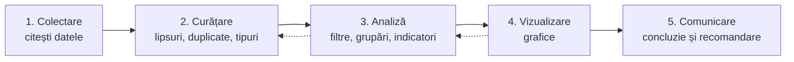

# Capitolul 8. Python pentru analiza datelor: de la bazele limbajului la pandas și grafice

În capitolul 5 am privit cifrele magazinului „Cămara de la Dunăre” cu ochii unui manager: comenzile cresc, banii rămași la sfârșitul lunii scad. În capitolele 6 și 7 am văzut cum arată un grafic bun. Acum facem totul cu mâna noastră, în cod. Pornim de la zero: ce este o variabilă, ce este o listă, cum citești un mesaj de eroare. Ajungem la un caiet de lucru care încarcă fișierul cu date, reface investigația și desenează graficele.

Nu trebuie să fi programat vreodată. Dacă ai mai scris cod, parcurge repede secțiunea 8.3 și oprește-te la casetele cu greșeli frecvente, apoi treci la pandas.

Toate cifrele despre Cămara de la Dunăre sunt date fictive, construite pentru exercițiu.

## Ce vei putea face după acest capitol

- Să pornești un mediu de lucru Python, în browser (Google Colab) sau pe calculatorul tău (mediu virtual și Jupyter).
- Să scrii și să citești cod de bază: variabile, liste, dicționare, condiții, bucle, funcții, obiecte.
- Să citești un mesaj de eroare și să găsești singur cauza.
- Să încarci un fișier CSV în pandas, să îl verifici, să îl cureți și să calculezi indicatori pe luni și pe canale.
- Să desenezi și să salvezi grafice cu Matplotlib: linie, bare, dispersie, cascadă.
- Să reproduci în cod o investigație de business și să îi verifici totalurile.

## 8.1 De ce Python pentru analiza datelor

Python este un limbaj de programare general, gratuit și cu sursă deschisă (open-source). Se folosește la site-uri web, la automatizări, în cercetare și în inteligența artificială. Pentru noi contează trei lucruri.

**Se citește ușor.** Codul seamănă cu engleza simplă. Linia `if comenzi > 100:` înseamnă exact ce pare: „dacă sunt mai mult de 100 de comenzi”. Limbajul nu îți cere să declari dinainte tipul fiecărei valori și nu îți cere acolade sau punct și virgulă.

**Are unelte gata făcute pentru date.** Limbajul în sine știe puțin despre tabele. Puterea vine din biblioteci, adică pachete de cod scrise de alții, pe care le instalezi și le folosești: pandas pentru tabele, Matplotlib pentru grafice, scikit-learn pentru modele de predicție. Le prezentăm în secțiunea 8.4.

**Analiza rămâne scrisă.** Aici este diferența mare față de un tabel de calcul. În Excel, o analiză este o succesiune de clicuri pe care nu o mai vede nimeni: ai filtrat, ai copiat, ai șters un rând, ai tras o formulă. În Python, fiecare pas este o linie de cod. Luna viitoare schimbi numele fișierului și rulezi din nou. Un coleg poate citi exact ce ai făcut. O greșeală se poate găsi și corecta.

Asta nu înseamnă că renunți la Excel. Tabelul următor te ajută să alegi.

| Situație | Unealta potrivită | De ce |
|---|---|---|
| Un tabel mic, o întrebare rapidă, o singură dată | Excel sau Google Sheets | Vezi datele, calculezi în două minute |
| Același raport în fiecare săptămână sau lună | Python | Scrii o dată, rulezi de câte ori vrei |
| Date din mai multe fișiere care trebuie lipite | Python | Lipirea manuală produce erori greu de văzut |
| Sute de mii de rânduri | Python | Tabelele de calcul devin lente |
| Analiză pe care trebuie să o poată verifica altcineva | Python | Fiecare pas este vizibil în cod |
| Introducerea manuală a câtorva valori | Excel sau Google Sheets | Un caiet de cod nu este un formular |

> **Pentru afacerea ta.** Dacă în fiecare luni dimineață descarci un export din platforma magazinului și refaci aceleași tabele pivot, ai deja un candidat bun pentru Python. Primul caiet de lucru te costă câteva ore. Din a doua săptămână, raportul durează cât apăsarea unui buton.

## 8.2 Mediul de lucru

Ai două drumuri. Ambele duc la același loc: un **caiet de lucru** (notebook), adică un document împărțit în celule. Într-o celulă scrii cod, o rulezi, iar rezultatul apare imediat dedesubt. Între celulele de cod poți pune celule de text cu explicații. Formatul se numește Jupyter Notebook, iar fișierele au extensia `.ipynb`.

### 8.2.1 Drumul scurt: Google Colab, fără instalare

Colab (prescurtare de la Colaboratory) este un serviciu Google care găzduiește caiete Jupyter. Documentația oficială îl descrie ca pe un serviciu care nu cere nicio configurare: nu descarci și nu instalezi nimic, lucrezi din browser (Google, Colab FAQ, https://research.google.com/colaboratory/faq.html, accesat în noiembrie 2026). Utilizarea de bază este gratuită, cu resurse care nu sunt garantate și cu limite care se pot schimba. Caietele se salvează în Google Drive.

Pașii:

1. Deschide https://colab.research.google.com și autentifică-te cu un cont Google.
2. Creează un caiet nou (meniul File, apoi New notebook).
3. Scrie în prima celulă `print("Salut, Cămara!")` și apasă Shift+Enter. Textul apare sub celulă.
4. Încarcă fișierul `camara_saptamanal.csv` în sesiune. Poți folosi panoul de fișiere din stânga sau celula de mai jos, care deschide o fereastră de alegere a fișierului.

```python
from google.colab import files
incarcate = files.upload()
```

Colab vine de obicei cu bibliotecile uzuale de analiză gata instalate, deci poți trece direct la secțiunea 8.3. Dacă un `import` dă totuși `ModuleNotFoundError`, instalează pachetul dintr-o celulă, cu `!pip install` urmat de numele lui.

> **Greșeală frecventă.** Codul din Colab rulează pe o mașină virtuală temporară. Documentația spune că mașinile virtuale sunt șterse după o perioadă de inactivitate (Google, Colab FAQ). Fișierele încărcate în sesiune dispar odată cu ea. Caietul rămâne în Drive, dar fișierul CSV trebuie încărcat din nou. Dacă primești `FileNotFoundError` într-un caiet care ieri mergea, aceasta este aproape sigur cauza.

### 8.2.2 Drumul lung: instalare pe calculatorul tău

Merită dacă lucrezi des, dacă datele nu au voie să părăsească firma sau dacă vrei să lucrezi fără internet.

**Pasul 1. Instalează Python** de pe https://www.python.org/downloads/, urmând instrucțiunile pentru sistemul tău de operare. Verifică apoi într-un terminal că instalarea a reușit: comanda `python --version` (pe macOS și Linux, `python3 --version`) trebuie să afișeze numărul versiunii.

**Pasul 2. Creează un mediu virtual.** Un mediu virtual este un dosar care conține o copie izolată de Python împreună cu bibliotecile unui singur proiect. Astfel, proiectele nu se încurcă între ele: unul poate folosi o versiune de pandas, altul alta. Modulul `venv` vine odată cu Python (Python Software Foundation, „venv: Creation of virtual environments”, https://docs.python.org/3/library/venv.html, accesat în noiembrie 2026).

Deschide un terminal în dosarul proiectului. Pe Windows:

```bash
python -m venv .venv
.venv\Scripts\activate.bat
```

În PowerShell, activarea se face cu `.venv\Scripts\Activate.ps1`. Pe macOS sau Linux:

```bash
python3 -m venv .venv
source .venv/bin/activate
```

După activare, numele mediului apare la începutul liniei de comandă. De acum, tot ce instalezi ajunge în dosarul `.venv`, nu în Python-ul sistemului.

**Pasul 3. Instalează bibliotecile.**

```bash
python -m pip install pandas matplotlib numpy scikit-learn openpyxl jupyterlab
```

`pip` este programul care descarcă și instalează pachete Python. Pachetul `openpyxl` este necesar doar dacă vrei să citești fișiere Excel (pandas, „Installation”, https://pandas.pydata.org/docs/getting_started/install.html, accesat în noiembrie 2026).

**Pasul 4. Pornește Jupyter.**

```bash
jupyter lab
```

Comanda deschide JupyterLab în browser (Project Jupyter, „Installing Jupyter”, https://jupyter.org/install, accesat în noiembrie 2026). Creează un caiet nou și pune fișierul `camara_saptamanal.csv` în același dosar cu el.

### 8.2.3 Versiunile cu care a fost testat capitolul

Tot codul din acest capitol a fost rulat, iar rezultatele afișate sunt copiate din execuția reală. Versiunile folosite:

| Componentă | Versiune |
|---|---|
| Python | 3.14.2 |
| pandas | 3.1.1 |
| NumPy | 2.5.5 |
| Matplotlib | 3.11.2 |
| scikit-learn | 1.9.1 |

Dacă ai versiuni mai vechi, codul funcționează în continuare, dar unele afișări pot arăta puțin diferit. Două diferențe sunt de așteptat. În pandas 2, coloanele de text apar cu tipul `object`, nu `str`: tipul dedicat pentru text a devenit implicit în pandas 3.0 (pandas, „What's new in 3.0.0”, https://pandas.pydata.org/docs/whatsnew/v3.0.0.html, accesat în noiembrie 2026). Tot acolo s-a schimbat regula despre copii, pe care o discutăm în secțiunea 8.15. Textul mesajelor de eroare diferă și el ușor de la o versiune de Python la alta.

Îți poți verifica versiunile astfel:

```python
import sys, pandas, numpy, matplotlib
print(sys.version)
print(pandas.__version__, numpy.__version__, matplotlib.__version__)
```

## 8.3 Bazele limbajului

Parcurgem opt noțiuni. Pentru fiecare ai un exemplu, o greșeală frecventă cu mesajul ei de eroare și un exercițiu. Scrie codul cu mâna ta, nu îl copia: degetele învață mai repede decât ochii.

O convenție: în acest capitol afișăm totul cu `print(...)`, ca să fie limpede ce produce fiecare linie. Într-un caiet, ultima expresie dintr-o celulă se afișează singură, chiar și fără `print`.

### 8.3.1 Variabile și tipuri

O variabilă este un nume pe care îl dai unei valori, ca o etichetă lipită pe un borcan. Semnul `=` înseamnă „pune valoarea din dreapta sub numele din stânga”. Nu este semnul de egalitate din matematică.

```python
nume = "Batman"
cafele_bune = 99
e_student_fericit = False
pret_zacusca = 18.5

print(nume, cafele_bune, e_student_fericit, pret_zacusca)
print(type(nume), type(cafele_bune), type(e_student_fericit), type(pret_zacusca))
```

```text
Batman 99 False 18.5
<class 'str'> <class 'int'> <class 'bool'> <class 'float'>
```

Python a ghicit singur tipul fiecărei valori. Cele patru tipuri de bază sunt:

| Tip | Nume în Python | Exemplu | La ce folosește |
|---|---|---|---|
| Text (șir de caractere) | `str` | `"Batman"`, `"Reclame"` | Nume, canale, luni |
| Număr întreg | `int` | `99`, `553` | Comenzi, vizite |
| Număr cu zecimale | `float` | `18.5`, `0.45` | Prețuri, marje, rate |
| Valoare logică | `bool` | `True`, `False` | Da sau nu |

Două lucruri de ținut minte. Textul se scrie între ghilimele, altfel Python crede că este numele unei variabile. Zecimalele se scriu cu punct, nu cu virgulă: `18.5`, nu `18,5`. De aceea, în rezultatele din acest capitol vei vedea `18088.0` acolo unde în text scriem 18.088 lei.

Cu variabilele poți calcula. Să luăm prima săptămână din septembrie pe canalul Căutare:

```python
vizite = 2380
comenzi = 60
venit = 9000

rata_conversie = comenzi / vizite * 100
valoare_medie = venit / comenzi

print(rata_conversie)
print(round(rata_conversie, 2))
print(f"Rata de conversie: {rata_conversie:.2f}%, valoarea medie a comenzii: {valoare_medie:.0f} lei")
```

```text
2.5210084033613445
2.52
Rata de conversie: 2.52%, valoarea medie a comenzii: 150 lei
```

Ultima linie folosește un **f-string**: un text cu litera `f` în față, în care tot ce pui între acolade este înlocuit cu valoarea variabilei. După două puncte vine formatul: `.2f` înseamnă două zecimale.

> **Greșeală frecventă.** Încerci să lipești un text de un număr.
>
> `print("Am băut " + cafele_bune + " cafele")`
>
> Python răspunde: `TypeError: can only concatenate str (not "int") to str`. Semnul `+` adună numere sau lipește texte, dar nu le amestecă. Soluția este un f-string: `print(f"Am băut {cafele_bune} cafele")`.

A doua greșeală clasică este o literă greșită în numele variabilei:

```python
print(cafele_bun)
```

```text
NameError: name 'cafele_bun' is not defined
```

Versiunile recente de Python îți sugerează chiar numele corect. Citește mesajul până la capăt.

> **Exercițiu.** În septembrie, Cămara a avut 18.860 de vizite și 553 de comenzi, cu un venit de 85.400 lei (date fictive). Creează trei variabile și afișează, cu un f-string, rata de conversie cu două zecimale și valoarea medie a comenzii. Ar trebui să obții 2,93% și aproximativ 154 lei.

### 8.3.2 Liste

O listă este un șir ordonat de valori, scris între paranteze drepte. O poți modifica după ce ai creat-o.

```python
lista_cumparaturi = ["Red Bull", "Pizza", "Speranță"]

lista_cumparaturi.append("Somn")        # adăugăm ceva esențial
lista_cumparaturi.remove("Speranță")    # scoatem ce nu găsim

print(lista_cumparaturi)
print(lista_cumparaturi[0])
print(len(lista_cumparaturi))
```

```text
['Red Bull', 'Pizza', 'Somn']
Red Bull
3
```

Tot ce urmează după semnul `#` pe o linie este un comentariu: Python îl ignoră, este pentru oameni. Elementele se numără de la zero, deci `lista_cumparaturi[0]` este primul element. Cui nu îi place regula îi amintim că și etajele unui bloc încep cu parterul.

Acum o listă utilă. Comenzile totale ale Cămării în cele patru săptămâni din septembrie:

```python
comenzi_septembrie = [138, 138, 139, 138]

print(sum(comenzi_septembrie))
print(max(comenzi_septembrie))
print(sum(comenzi_septembrie) / len(comenzi_septembrie))
print(comenzi_septembrie[-1])
print(comenzi_septembrie[:2])
```

```text
553
139
138.25
138
[138, 138]
```

Indexul `-1` înseamnă „ultimul element”. Scrierea `[:2]` se numește feliere (slicing) și înseamnă „de la început până la poziția 2, fără ea”, adică primele două elemente. Totalul de 553 este chiar numărul de comenzi din septembrie.

> **Greșeală frecventă.** Lista are patru elemente, cu pozițiile 0, 1, 2 și 3. Dacă ceri `comenzi_septembrie[4]`, primești `IndexError: list index out of range`. Ultima poziție validă este întotdeauna `len(lista) - 1`.

> **Exercițiu.** Creează lista bugetelor săptămânale de reclame din octombrie: 1500, 2600, 3300, 3800 (date fictive). Afișează totalul, apoi adaugă cu `append` bugetul primei săptămâni din noiembrie, 4200, și afișează lungimea listei.

### 8.3.3 Dicționare

Lista ține valori în ordine. Dicționarul ține perechi **cheie: valoare**, scrise între acolade. Cauți după cheie, nu după poziție, exact ca într-un dicționar adevărat: cauți cuvântul și găsești definiția.

```python
produs = {"nume": "Zacuscă de vinete", "pret": 22.0, "stoc": 40}

print(produs["pret"])

produs["stoc"] = produs["stoc"] - 3     # s-au vândut trei borcane
produs["producator"] = "Gospodăria Ionescu"   # adăugăm o cheie nouă

print(produs)
print(list(produs.keys()))
```

```text
22.0
{'nume': 'Zacuscă de vinete', 'pret': 22.0, 'stoc': 37, 'producator': 'Gospodăria Ionescu'}
['nume', 'pret', 'stoc', 'producator']
```

Dicționarele sunt importante pentru analiză din două motive. Primul: multe date de pe internet vin în formatul JSON (JavaScript Object Notation, un format text pentru schimb de date), care arată exact ca niște dicționare și liste puse unele în altele. Al doilea: un tabel pandas se poate construi dintr-un dicționar în care fiecare cheie este numele unei coloane, iar valoarea este lista cu datele din acea coloană. Îl vei vedea la lucru în secțiunea 8.3.7.

```python
buget_reclame = {"septembrie": 2400, "octombrie": 11200, "noiembrie": 16800}

for luna, buget in buget_reclame.items():
    print(luna, buget)

print(buget_reclame["noiembrie"] / buget_reclame["septembrie"])
```

```text
septembrie 2400
octombrie 11200
noiembrie 16800
7.0
```

Bugetul de reclame din noiembrie este de șapte ori mai mare decât cel din septembrie. Ține minte cifra, ne întoarcem la ea.

> **Greșeală frecventă.** Cheile trebuie scrise exact, cu aceleași litere mari și mici și cu aceleași diacritice.

```python
print(produs["preț"])
```

```text
KeyError: 'preț'
```

`KeyError` înseamnă „nu există cheia aceasta”. Cheia noastră se numește `pret`, fără diacritice. Vei întâlni aceeași eroare în pandas când greșești numele unei coloane. De aceea, în fișierul Cămării numele coloanelor sunt scrise fără diacritice și fără spații: `saptamana`, `cost_marketing`.

> **Exercițiu.** Creează un dicționar `comenzi_noiembrie` cu cheile Căutare, Reclame, Email și Direct și valorile 249, 286, 129 și 132 (date fictive). Afișează totalul cu `sum(comenzi_noiembrie.values())`. Ar trebui să obții 796.

### 8.3.4 Condiții: if, elif, else

Cu `if` spui programului să facă ceva doar dacă o condiție este adevărată. Linia cu `if` se termină cu două puncte, iar liniile care depind de ea sunt împinse spre dreapta cu patru spații. Această împingere se numește **indentare** și în Python nu este decor: ea spune ce cod aparține blocului.

```python
cafele_bune = 99

if cafele_bune > 3:
    print("Poate ajunge pe azi.")

print("Linia aceasta se execută oricum.")
```

```text
Poate ajunge pe azi.
Linia aceasta se execută oricum.
```

Cu `elif` (prescurtare de la „else if”) verifici o altă condiție dacă prima a fost falsă. Cu `else` prinzi tot ce a rămas. Se execută un singur bloc: primul a cărui condiție este adevărată.

```python
contributie_pe_comanda = -40.19

if contributie_pe_comanda > 20:
    verdict = "canal sănătos"
elif contributie_pe_comanda > 0:
    verdict = "canal la limită"
else:
    verdict = "fiecare comandă pierde bani"

print(verdict)
```

```text
fiecare comandă pierde bani
```

Operatorii de comparație sunt `==` (egal), `!=` (diferit), `>`, `<`, `>=`, `<=`. Condițiile se combină cu `and` (ambele adevărate), `or` (cel puțin una) și `not` (negare).

> **Greșeală frecventă.** Un singur `=` atribuie o valoare. Două, `==`, compară. Dacă le încurci într-o condiție, Python te oprește înainte să ruleze ceva.

```python
canal = "Reclame"
if canal = "Reclame":
    print("Verifică bugetul.")
```

```text
SyntaxError: invalid syntax. Maybe you meant '==' or ':=' instead of '='?
```

A doua greșeală este indentarea uitată:

```python
if cafele_bune > 3:
print("Poate ajunge pe azi.")
```

```text
IndentationError: expected an indented block after 'if' statement on line 1
```

Ambele sunt erori de sintaxă: Python nu a înțeles propoziția, deci nu a rulat nimic din celulă. Mesajul îți spune și linia la care s-a împiedicat.

> **Exercițiu.** Cămara oferă livrare gratuită la comenzi de cel puțin 200 de lei și percepe 14 lei la restul. Scrie un `if` cu `else` care, pornind de la variabila `valoare_comanda`, afișează costul livrării. Testează cu 150 și cu 200. Atenție la diferența dintre `>` și `>=`.

### 8.3.5 Bucle: for și while

O buclă repetă un bloc de cod. Bucla `for` ia pe rând fiecare element dintr-o colecție.

```python
curs = ["slide 1", "slide 2"]

for slide in curs:
    print("Nu înțeleg nimic.")
    print("...dar e frumos fundalul.")
```

```text
Nu înțeleg nimic.
...dar e frumos fundalul.
Nu înțeleg nimic.
...dar e frumos fundalul.
```

Blocul indentat s-a executat de două ori, o dată pentru fiecare element. Variabila `slide` ia pe rând valoarea fiecărui element. Să o și folosim:

```python
bugete_reclame = [600, 1500, 2600, 3300, 3800, 4200]
comenzi_reclame = [16, 30, 43, 54, 61, 68]

for buget, comenzi in zip(bugete_reclame, comenzi_reclame):
    cost_pe_comanda = buget / comenzi
    print(f"Buget {buget} lei, {comenzi} comenzi, {cost_pe_comanda:.1f} lei marketing pe comandă")
```

```text
Buget 600 lei, 16 comenzi, 37.5 lei marketing pe comandă
Buget 1500 lei, 30 comenzi, 50.0 lei marketing pe comandă
Buget 2600 lei, 43 comenzi, 60.5 lei marketing pe comandă
Buget 3300 lei, 54 comenzi, 61.1 lei marketing pe comandă
Buget 3800 lei, 61 comenzi, 62.3 lei marketing pe comandă
Buget 4200 lei, 68 comenzi, 61.8 lei marketing pe comandă
```

Funcția `zip` parcurge două liste în paralel, ca un fermoar. Cifrele sunt bugetul de reclame și comenzile din reclame în săptămânile 4-9 (date fictive). Bugetul crește de șapte ori, iar costul de marketing pe comandă urcă de la 37,5 la aproape 62 de lei. Un `for` de trei rânduri a arătat deja o parte din problemă.

Bucla `while` repetă blocul cât timp o condiție rămâne adevărată. O folosești când nu știi dinainte de câte ori trebuie să repeți.

```python
buget_ramas = 16800
saptamana = 0

while buget_ramas > 0:
    saptamana = saptamana + 1
    buget_ramas = buget_ramas - 4200
    print(f"După săptămâna {saptamana} au rămas {buget_ramas} lei")
```

```text
După săptămâna 1 au rămas 12600 lei
După săptămâna 2 au rămas 8400 lei
După săptămâna 3 au rămas 4200 lei
După săptămâna 4 au rămas 0 lei
```

> **Greșeală frecventă.** Bucla infinită. Dacă ștergi linia `buget_ramas = buget_ramas - 4200`, condiția rămâne adevărată pentru totdeauna, iar programul nu se mai oprește. Nu primești niciun mesaj de eroare: celula rulează la nesfârșit. O oprești din butonul de stop al celulei (sau din meniul Kernel, Interrupt, în Jupyter) și verifici dacă ceva din interiorul buclei schimbă condiția.

La `for`, greșeala tipică este tot indentarea:

```python
for buget in bugete_reclame:
print(buget)
```

```text
IndentationError: expected an indented block after 'for' statement on line 1
```

O veste bună: în pandas vei scrie foarte rar bucle. Operațiile se aplică pe o coloană întreagă dintr-o singură linie. Trebuie totuși să înțelegi buclele, pentru că apar peste tot în jurul analizei: parcurgi mai multe fișiere, desenezi mai multe grafice, repeți un calcul pentru fiecare canal.

> **Exercițiu.** Pornind de la lista `comenzi_septembrie` din secțiunea 8.3.2, scrie un `for` care afișează pentru fiecare săptămână costul de ambalare și livrare, la 14 lei pe comandă. Apoi calculează totalul lunii. Ar trebui să obții 7.742 lei.

### 8.3.6 Funcții

O funcție este un bloc de cod cu nume, pe care îl scrii o dată și îl folosești de câte ori vrei. Primește date de intrare (argumente) și întoarce un rezultat cu `return`. Ai folosit deja funcții scrise de alții: `print`, `len`, `sum`, `round`. Acum scriem una a noastră.

```python
def contributie_pe_comanda(valoare_medie, marja_pct, marketing_pe_comanda, ambalare=14):
    """Câți lei rămân dintr-o comandă după marketing, ambalare și livrare."""
    marja_bruta = valoare_medie * marja_pct
    return marja_bruta - marketing_pe_comanda - ambalare

print(contributie_pe_comanda(150, 0.45, 37.5))
print(round(contributie_pe_comanda(105, 0.31, 58.74), 2))
print(contributie_pe_comanda(150, 0.45, 37.5, ambalare=20))
```

```text
16.0
-40.19
10.0
```

Prima apelare descrie canalul Reclame în septembrie: comandă medie de 150 de lei, marjă brută de 45%, 37,5 lei de marketing pe comandă. Rămân 16 lei. A doua descrie același canal în noiembrie: comandă de 105 lei, marjă de 31%, 58,74 lei de marketing. Fiecare comandă pierde aproximativ 40 de lei. Sunt exact cifrele din firul comun al cursului, iar în secțiunea 8.10 le vom obține direct din fișier.

Argumentul `ambalare=14` are o valoare implicită. Dacă nu îl precizezi, se folosește 14. Textul dintre ghilimele triple este un **docstring**: o explicație scurtă pe care o vede oricine cere ajutor despre funcție.

> **Greșeală frecventă.** Uiți `return`. Funcția calculează, dar nu întoarce nimic, iar rezultatul ei este valoarea specială `None` („nimic”).

```python
def marja_bruta(valoare_medie, marja_pct):
    rezultat = valoare_medie * marja_pct

m = marja_bruta(150, 0.45)
print(m)
print(m - 14)
```

```text
None
TypeError: unsupported operand type(s) for -: 'NoneType' and 'int'
```

Eroarea apare abia la linia unde încerci să folosești rezultatul, nu în funcție. Când vezi `NoneType` într-un mesaj, caută un `return` lipsă.

> **Exercițiu.** Scrie funcția `rata_conversie(comenzi, vizite)` care întoarce rata în procente, rotunjită la două zecimale. Testeaz-o cu 60 de comenzi și 2.380 de vizite (rezultat: 2,52). Ce se întâmplă dacă o apelezi cu 0 vizite? Adaugă un `if` care întoarce 0 în acest caz.

### 8.3.7 Clase și obiecte

Ultima noțiune sună cel mai abstract, dar ai nevoie doar de ideea de bază. O **clasă** este un șablon. Un **obiect** este un lucru concret făcut după șablon. Obiectul are **atribute** (date pe care le ține) și **metode** (funcții pe care le știe executa asupra datelor proprii).

```python
class Canal:
    def __init__(self, nume, vizite, comenzi):
        self.nume = nume
        self.vizite = vizite
        self.comenzi = comenzi

    def rata_conversie(self):
        return round(self.comenzi / self.vizite * 100, 2)

email = Canal("Email", 2400, 121)
reclame = Canal("Reclame", 3220, 64)

print(email.nume, email.rata_conversie())
print(reclame.nume, reclame.rata_conversie())
```

```text
Email 5.04
Reclame 1.99
```

`Canal` este șablonul. `email` și `reclame` sunt două obiecte făcute după el, fiecare cu datele lui (cifrele din septembrie, date fictive). Metoda specială `__init__` se execută la crearea obiectului și îi pune datele la locul lor. Cuvântul `self` înseamnă „obiectul acesta”.

Regula de scriere este punctul: `obiect.atribut` pentru date, `obiect.metoda()` pentru acțiuni, cu paranteze.

Nu vei scrie des clase în analiza datelor. Vei folosi însă, în fiecare linie, obiecte făcute de alții. Tabelul pandas este un astfel de obiect:

```python
import pandas as pd

tabel = pd.DataFrame({
    "canal": ["Email", "Reclame"],
    "vizite": [2400, 3220],
    "comenzi": [121, 64],
})

print(type(tabel))
print(tabel.shape)
print(tabel.head())
```

```text
<class 'pandas.DataFrame'>
(2, 3)
     canal  vizite  comenzi
0    Email    2400      121
1  Reclame    3220       64
```

Recunoști piesele: un dicționar cu liste a devenit un tabel. `tabel` este un obiect din clasa `DataFrame`. `tabel.shape` este un atribut (fără paranteze): numărul de rânduri și de coloane. `tabel.head()` este o metodă (cu paranteze): întoarce primele rânduri. Tot restul capitolului este o plimbare printre metodele acestui obiect.

> **Greșeală frecventă.** Scrii greșit numele unei metode sau al unui atribut.

```python
print(tabel.heads())
```

```text
AttributeError: 'DataFrame' object has no attribute 'heads'. Did you mean: 'head'?
```

`AttributeError` înseamnă „obiectul acesta nu are așa ceva”. Verifică literele. Într-un caiet, apasă tasta Tab după punct și primești lista metodelor disponibile.

> **Exercițiu.** Adaugă clasei `Canal` atributul `venit` și metoda `valoare_medie_comanda()`. Creează obiectul pentru Reclame în noiembrie: 15.900 de vizite, 286 de comenzi, venit de 30.030 lei (date fictive). Ar trebui să obții o valoare medie de 105 lei.

### 8.3.8 Cum citești un mesaj de eroare

Erorile nu sunt un semn că nu ești făcut pentru programare. Sunt felul în care calculatorul îți spune ce nu a înțeles. Programatorii cu experiență văd la fel de multe erori ca tine, doar că le citesc mai repede.

Tutorialul oficial Python împarte erorile în două familii (Python Software Foundation, „Errors and Exceptions”, https://docs.python.org/3/tutorial/errors.html, accesat în noiembrie 2026). **Erorile de sintaxă** sunt prinse înainte să ruleze ceva: propoziția este scrisă greșit. **Excepțiile** apar în timpul rulării: propoziția este corectă, dar ceva nu a mers. Iată o excepție, așa cum apare când rulezi un fișier `exemplu.py` (calea fișierului este scurtată):

```python
def valoare_medie(venit, comenzi):
    return venit / comenzi

print(valoare_medie(9000, 60))
print(valoare_medie(2400, 0))
```

```text
150.0
Traceback (most recent call last):
  File "exemplu.py", line 5, in <module>
    print(valoare_medie(2400, 0))
          ~~~~~~~~~~~~~^^^^^^^^^
  File "exemplu.py", line 2, in valoare_medie
    return venit / comenzi
           ~~~~~~^~~~~~~~~
ZeroDivisionError: division by zero
```

Se citește de jos în sus:

1. **Ultima linie** spune ce s-a întâmplat: tipul erorii și o explicație. Aici, o împărțire la zero.
2. **Liniile de deasupra** spun unde: fișierul, numărul liniei și codul, cu săgeți sub bucata vinovată. Când o funcție a apelat altă funcție, vezi tot drumul. Cel mai de jos loc este cel unde s-a produs eroarea.
3. Prima apelare a mers (a afișat 150.0). A doua a primit 0 comenzi.

Tabelul următor adună erorile pe care le-ai întâlnit până acum.

| Eroare | Ce înseamnă | Cauza obișnuită |
|---|---|---|
| `SyntaxError` | Python nu înțelege propoziția | `=` în loc de `==`, paranteză neînchisă, două puncte lipsă |
| `IndentationError` | Spațiile de la începutul liniei sunt greșite | Bloc neindentat după `if`, `for`, `def` |
| `NameError` | Nume necunoscut | Literă greșită, celulă nerulată |
| `TypeError` | Operație pe un tip nepotrivit | Text adunat cu număr, calcul cu `None` |
| `IndexError` | Poziție inexistentă în listă | Ai uitat că numărătoarea începe de la 0 |
| `KeyError` | Cheie sau coloană inexistentă | Nume scris altfel decât în date |
| `AttributeError` | Obiectul nu are metoda cerută | Nume de metodă greșit |
| `ZeroDivisionError` | Împărțire la zero | O săptămână fără comenzi sau fără vizite |
| `FileNotFoundError` | Fișierul nu este unde îl cauți | Nume greșit, alt dosar, sesiune Colab nouă |

> **De reținut.** Citește ultima linie a mesajului, apoi uită-te la linia de cod indicată. Dacă tot nu înțelegi, copiază ultima linie a mesajului într-un motor de căutare. Aproape sigur a mai pățit-o cineva.

## 8.4 Ecosistemul: cinci biblioteci și rolul lor

O bibliotecă se instalează o dată (cu `pip`) și se importă în fiecare caiet în care o folosești. Prin convenție, bibliotecile de date se importă cu nume scurte, pe care le vei vedea în orice exemplu de pe internet.

| Biblioteca | Import obișnuit | La ce folosește | Exemplu la Cămara |
|---|---|---|---|
| NumPy | `import numpy as np` | Calcule numerice rapide pe șiruri de numere; fundația pe care stau celelalte | Dreapta de regresie din secțiunea 8.13 |
| pandas | `import pandas as pd` | Tabele (DataFrame): citire, filtrare, grupare, curățare | Tot ce facem în secțiunile 8.6-8.10 |
| Matplotlib | `import matplotlib.pyplot as plt` | Grafice statice, cu control asupra fiecărui detaliu | Graficele din secțiunea 8.11 |
| Seaborn | `import seaborn as sns` | Grafice statistice construite peste Matplotlib, cu mai puțin cod | Distribuții și comparații rapide în explorare |
| scikit-learn | `from sklearn... import ...` | Modele de învățare automată (machine learning): predicție, clasificare, grupare | Regresia liniară din secțiunea 8.13 |

Prezentarea de curs numește pandas „Excel-ul programatorilor de Python”. Comparația este bună: un DataFrame are rânduri, coloane și un cap de tabel, ca o foaie de calcul. Diferența este că nu dai clic pe celule. Scrii ce vrei să se întâmple cu o coloană întreagă.

În acest capitol lucrăm cu pandas și Matplotlib, folosim puțin NumPy și scikit-learn la final și lăsăm Seaborn pentru explorare pe cont propriu.

## 8.5 Fluxul unei analize

Orice analiză de date, mică sau mare, trece prin aceiași pași. Prezentarea de curs enumeră patru. Adăugăm un al cincilea, fără de care primii patru nu folosesc nimănui.



Săgețile punctate contează. În practică te întorci des: un grafic ciudat îți arată o problemă în date, o grupare scoate la iveală un canal scris în două feluri. Este normal.

| Pas | Întrebarea la care răspunzi | Unelte pandas și Matplotlib |
|---|---|---|
| Colectare | Ce date am și de unde vin? | `read_csv`, `read_excel` |
| Curățare | Pot avea încredere în ele? | `info`, `isna`, `duplicated`, `astype` |
| Analiză | Ce s-a întâmplat și unde? | filtre, coloane calculate, `groupby`, `pivot_table` |
| Vizualizare | Cum arăt asta dintr-o privire? | `plot`, `bar`, `scatter`, `savefig` |
| Comunicare | Ce recomand și cât de sigur sunt? | o frază, un tabel, un grafic (vezi capitolele 6, 7 și 9) |

Parcurgem acum toți pașii pe fișierul Cămării. Pentru claritatea expunerii, facem întâi analiza pe fișierul curat și abia apoi, în secțiunea 8.9, arătăm curățarea pe o copie stricată intenționat. Într-un proiect real, verificarea și curățarea vin întotdeauna primele.

## 8.6 Colectare: citim fișierul și facem cunoștință cu el

Fișierul `camara_saptamanal.csv` are 48 de rânduri: 12 săptămâni înmulțite cu 4 canale. CSV (Comma-Separated Values, valori separate prin virgulă) este cel mai simplu format de tabel: un fișier text în care fiecare rând este o linie, iar coloanele sunt despărțite prin virgule. Îl poți deschide și cu un editor de text.

```python
import pandas as pd

df = pd.read_csv("camara_saptamanal.csv")

print(df.shape)
print(df.head())
```

```text
(48, 10)
   saptamana        luna  ...  cost_ambalare_livrare  contributie
0          1  septembrie  ...                    840       3210.0
1          2  septembrie  ...                    840       3210.0
2          3  septembrie  ...                    854       3263.5
3          4  septembrie  ...                    840       3210.0
4          5   octombrie  ...                    854       3263.5

[5 rows x 10 columns]
```

Trei lucruri s-au întâmplat. Am importat pandas sub numele scurt `pd`. Funcția `read_csv` a citit fișierul și a întors un DataFrame, pe care l-am numit `df` (numele obișnuit pentru „tabelul meu”). Atributul `shape` confirmă 48 de rânduri și 10 coloane, iar metoda `head()` arată primele cinci rânduri.

Coloana fără nume din stânga (0, 1, 2...) este **indexul**: eticheta fiecărui rând, pusă automat de pandas. Punctele de suspensie arată că tabelul este prea lat pentru afișare și pandas a ascuns coloanele din mijloc. Îi putem cere să le arate pe toate:

```python
pd.set_option("display.max_columns", 20)
pd.set_option("display.width", 200)

print(df.head(3))
```

```text
   saptamana        luna    canal  vizite  comenzi  venit  marja_bruta  cost_marketing  cost_ambalare_livrare  contributie
0          1  septembrie  Căutare    2380       60   9000       4050.0               0                    840       3210.0
1          2  septembrie  Căutare    2410       60   9000       4050.0               0                    840       3210.0
2          3  septembrie  Căutare    2450       61   9150       4117.5               0                    854       3263.5
```

Fiecare rând descrie un canal într-o săptămână. Semnificația coloanelor:

| Coloană | Ce conține |
|---|---|
| `saptamana` | Numărul săptămânii, de la 1 la 12 |
| `luna` | septembrie, octombrie sau noiembrie |
| `canal` | Căutare, Reclame, Email sau Direct (canalul ultimului clic, vezi capitolul 3) |
| `vizite`, `comenzi` | Câte vizite și câte comenzi a adus canalul în acea săptămână |
| `venit` | Valoarea comenzilor, în lei |
| `marja_bruta` | Venitul minus costul produselor vândute, în lei |
| `cost_marketing` | Cheltuiala de marketing a canalului, în lei |
| `cost_ambalare_livrare` | 14 lei pentru fiecare comandă |
| `contributie` | Marja brută minus marketing minus ambalare și livrare |

Indicatorii sunt explicați pe larg în capitolul 5. Aici îi calculăm.

### 8.6.1 info: structura tabelului

```python
df.info()
```

```text
<class 'pandas.DataFrame'>
RangeIndex: 48 entries, 0 to 47
Data columns (total 10 columns):
 #   Column                 Non-Null Count  Dtype  
---  ------                 --------------  -----  
 0   saptamana              48 non-null     int64  
 1   luna                   48 non-null     str    
 2   canal                  48 non-null     str    
 3   vizite                 48 non-null     int64  
 4   comenzi                48 non-null     int64  
 5   venit                  48 non-null     int64  
 6   marja_bruta            48 non-null     float64
 7   cost_marketing         48 non-null     int64  
 8   cost_ambalare_livrare  48 non-null     int64  
 9   contributie            48 non-null     float64
dtypes: float64(2), int64(6), str(2)
memory usage: 3.9 KB
```

`info()` este prima verificare serioasă. Pentru fiecare coloană vezi câte valori nu lipsesc (`Non-Null Count`) și ce tip are (`Dtype`). Citim rezultatul astfel:

- Toate coloanele au 48 de valori din 48, deci nu lipsește nimic.
- `vizite`, `comenzi`, `venit` și costurile sunt `int64`, adică numere întregi. `marja_bruta` și `contributie` sunt `float64`, numere cu zecimale.
- `luna` și `canal` sunt `str`, adică text (în pandas 2 ar fi apărut `object`).

Dacă o coloană care ar trebui să fie numerică apare ca text, ai o problemă de curățare. O vedem în secțiunea 8.9.

### 8.6.2 describe: un rezumat statistic

```python
print(df[["vizite", "comenzi", "venit", "contributie"]].describe().round(1))
```

```text
       vizite  comenzi   venit  contributie
count    48.0     48.0    48.0         48.0
mean   1612.1     42.4  6089.7       1355.2
std    1098.4     17.2  2127.3       1900.8
min     590.0     16.0  2400.0      -2938.6
25%     755.0     31.0  4960.0       1360.2
50%     930.0     33.0  5115.0       1817.8
75%    2452.5     61.0  8077.5       2256.2
max    4100.0     74.0  9450.0       3370.5
```

Pentru fiecare coloană numerică, `describe()` dă numărul de valori, media, abaterea standard, minimul, maximul și cele trei cuartile (25%, 50%, 75%). Rândul `50%` este mediana. Folosește tabelul ca pe un detector de ciudățenii. Aici, un lucru sare în ochi: contribuția minimă este negativă, -2.938,6 lei. Există cel puțin un rând în care un canal a pierdut bani într-o săptămână. Avem primul fir de urmărit.

### 8.6.3 Dacă datele sunt în Excel

Prezentarea de curs folosește `read_excel`. Funcționează la fel, cu condiția să ai instalat pachetul `openpyxl`. Ca să avem pe ce exersa, salvăm tabelul nostru ca fișier Excel și îl citim înapoi:

```python
df.to_excel("camara_saptamanal.xlsx", index=False)

din_excel = pd.read_excel("camara_saptamanal.xlsx", sheet_name=0)
print(din_excel.shape)
print(din_excel.equals(df))
```

```text
(48, 10)
True
```

Argumentul `sheet_name` alege foaia: după poziție (0 este prima) sau după nume. `index=False` îi spune lui pandas să nu scrie în fișier și coloana de index. Metoda `equals` confirmă că tabelul citit din Excel este identic cu cel inițial.

> **Greșeală frecventă.** `FileNotFoundError: [Errno 2] No such file or directory: 'camara.csv'`. Python caută fișierul în dosarul din care rulează caietul. Verifică trei lucruri: numele exact (cu extensie), dosarul și, în Colab, dacă ai încărcat fișierul în sesiunea curentă.

> **Pentru afacerea ta.** Aproape orice platformă de magazin online, de facturare sau de publicitate are un buton de export în CSV sau Excel. Descarcă exportul comenzilor pe ultimele trei luni și rulează pe el doar `read_csv`, `head`, `info` și `describe`. În zece minute vei ști ce coloane ai, ce lipsește și dacă sumele seamănă cu cele din contabilitate.

## 8.7 Selectare, filtrare și coloane calculate

### 8.7.1 Selectarea coloanelor

O coloană se alege cu numele ei între paranteze drepte, ca la dicționare. Mai multe coloane se aleg cu o listă de nume, de unde parantezele duble.

```python
print(df["venit"].sum())
print(df[["canal", "venit"]].head(3))
```

```text
292304
     canal  venit
0  Căutare   9000
1  Căutare   9000
2  Căutare   9150
```

O singură coloană este un obiect de tip `Series` (o coloană cu index). Are metode proprii: `sum()`, `mean()`, `min()`, `max()`, `unique()`. Venitul total pe cele 12 săptămâni este 292.304 lei (date fictive).

### 8.7.2 Filtrarea rândurilor

Filtrarea se face în doi pași, chiar dacă îi scriem de obicei pe o singură linie. Întâi construim o **mască**: o coloană de valori `True` și `False`, câte una pentru fiecare rând.

```python
masca = df["canal"] == "Reclame"
print(masca.head(3))
print(masca.sum())
```

```text
0    False
1    False
2    False
Name: canal, dtype: bool
12
```

Primele rânduri sunt de pe canalul Căutare, deci masca este `False`. Suma unei măști numără valorile `True`: 12 rânduri sunt de pe canalul Reclame. Apoi punem masca între parantezele drepte ale tabelului, iar pandas păstrează doar rândurile cu `True`.

```python
reclame = df[df["canal"] == "Reclame"]
print(reclame[["saptamana", "luna", "vizite", "comenzi", "venit", "cost_marketing"]])
```

```text
    saptamana        luna  vizite  comenzi  venit  cost_marketing
12          1  septembrie     790       16   2400             600
13          2  septembrie     810       16   2400             600
14          3  septembrie     800       16   2400             600
15          4  septembrie     820       16   2400             600
16          5   octombrie    1600       30   3540            1500
17          6   octombrie    2400       43   4644            2600
18          7   octombrie    3000       54   5670            3300
19          8   octombrie    3400       61   6405            3800
20          9   noiembrie    3800       68   7140            4200
21         10   noiembrie    4000       72   7560            4200
22         11   noiembrie    4100       74   7770            4200
23         12   noiembrie    4000       72   7560            4200
```

Iată povestea într-un singur tabel. În septembrie, 600 de lei pe săptămână aduc 16 comenzi. Din săptămâna 5, bugetul urcă treptat până la 4.200 de lei pe săptămână. Comenzile cresc și ele, dar mai încet.

Condițiile se combină cu `&` (și) și `|` (sau). Fiecare condiție trebuie pusă între paranteze rotunde.

```python
filtru = (df["canal"] == "Reclame") & (df["luna"] == "noiembrie")

print(df[filtru][["saptamana", "comenzi", "venit", "contributie"]])
print(df.loc[filtru, "contributie"].sum())
```

```text
    saptamana  comenzi  venit  contributie
20          9       68   7140      -2938.6
21         10       72   7560      -2864.4
22         11       74   7770      -2827.3
23         12       72   7560      -2864.4
-11494.699999999999
```

Forma `df.loc[rânduri, coloane]` alege dintr-o singură mișcare și rândurile (cu o mască), și coloanele (cu un nume sau o listă de nume). Folosește-o ori de câte ori vrei și să modifici valorile alese (vezi secțiunea 8.15). În noiembrie, canalul Reclame a avut o contribuție de -11.494,70 lei. Șirul de 9 de la sfârșitul rezultatului nu este o greșeală a ta: calculatorul memorează numerele cu zecimale în baza 2 și apar rotunjiri minuscule. La afișare folosește `round(valoare, 2)`.

Să răspundem și la întrebarea rămasă de la `describe`: unde este contribuția negativă?

```python
negative = df[df["contributie"] < 0]
print(len(negative))
print(negative["canal"].unique().tolist())
print(negative["saptamana"].min())
```

```text
8
['Reclame']
5
```

Opt rânduri, toate pe canalul Reclame, începând cu săptămâna 5. Niciun alt canal nu a avut vreo săptămână pe minus.

### 8.7.3 Coloane calculate

O coloană nouă se creează prin atribuire. Operația se aplică pe toate rândurile deodată, fără buclă.

```python
df["rata_conversie"] = df["comenzi"] / df["vizite"] * 100
df["valoare_medie_comanda"] = df["venit"] / df["comenzi"]
df["marja_pct"] = df["marja_bruta"] / df["venit"] * 100
df["marketing_pe_comanda"] = df["cost_marketing"] / df["comenzi"]
df["contributie_pe_comanda"] = df["contributie"] / df["comenzi"]

indicatori = ["rata_conversie", "valoare_medie_comanda", "marja_pct",
              "marketing_pe_comanda", "contributie_pe_comanda"]

reclame = df[df["canal"] == "Reclame"].set_index("saptamana")
print(reclame.loc[[1, 5, 12], indicatori].round(2).T)
```

```text
saptamana                   1       5       12
rata_conversie            2.03    1.88    1.80
valoare_medie_comanda   150.00  118.00  105.00
marja_pct                45.00   33.00   31.00
marketing_pe_comanda     37.50   50.00   58.33
contributie_pe_comanda   16.00  -25.06  -39.78
```

Am ales trei săptămâni de pe canalul Reclame (prima, a cincea și ultima) și am întors tabelul cu `.T` (transpunere), ca indicatorii să fie pe rânduri. `set_index("saptamana")` face din numărul săptămânii eticheta rândului, așa că `loc[[1, 5, 12]]` înseamnă „săptămânile 1, 5 și 12”.

| Indicator | Formula | Ce spune |
|---|---|---|
| Rata de conversie | comenzi / vizite × 100 | Din 100 de vizite, câte se termină cu o comandă |
| Valoarea medie a comenzii | venit / comenzi | Cât cheltuie un client la o comandă |
| Marja procentuală | marjă brută / venit × 100 | Cât rămâne din 100 de lei încasați după costul produselor |
| Marketing pe comandă | cost marketing / comenzi | Cât a costat să obții o comandă |
| Contribuție pe comandă | contribuție / comenzi | Cât rămâne dintr-o comandă pentru acoperirea costurilor fixe |

Între săptămâna 1 și săptămâna 12, pe canalul Reclame, toți cei cinci indicatori s-au înrăutățit. Valoarea medie a comenzii a scăzut de la 150 la 105 lei, iar marja de la 45% la 31%: este efectul codului de reducere de 20%. Marketingul pe comandă a urcat de la 37,5 la peste 58 de lei. Contribuția pe comandă a trecut de la +16 lei la aproape -40 de lei. Săptămâna 5 arată că ruptura s-a produs repede: chiar din prima săptămână cu buget mărit, o comandă din reclame pierdea 25 de lei.

> **De reținut.** Verifică orice coloană primită de-a gata, dacă o poți recalcula. Fișierul are deja coloana `contributie`. O refacem din componente și comparăm.

```python
recalculat = df["marja_bruta"] - df["cost_marketing"] - df["cost_ambalare_livrare"]
diferenta_maxima = (recalculat - df["contributie"]).abs().max()
print(round(diferenta_maxima, 6))

print((df["cost_ambalare_livrare"] == df["comenzi"] * 14).all())
```

```text
0.0
True
```

Diferența maximă este zero, deci coloana `contributie` respectă formula: marjă brută minus marketing minus ambalare și livrare. A doua verificare confirmă ipoteza de 14 lei pe comandă pentru ambalare și livrare, pe toate rândurile.

## 8.8 Grupare, tabele pivot și sortare

### 8.8.1 groupby: „pentru fiecare..., calculează...”

Întrebările de business au aproape mereu forma „cât pe fiecare lună?”, „cât pe fiecare canal?”. În pandas, aceasta este metoda `groupby`. Ea face trei lucruri: împarte rândurile în grupuri, aplică un calcul pe fiecare grup și lipește rezultatele într-un tabel nou.

```python
print(df.groupby("luna")["comenzi"].sum())
```

```text
luna
noiembrie     796
octombrie     688
septembrie    553
Name: comenzi, dtype: int64
```

Cifrele sunt corecte: 553 de comenzi în septembrie, 796 în noiembrie. Ordinea însă este alfabetică, pentru că pandas nu știe că „septembrie” vine înaintea lui „octombrie”. Pentru el sunt simple texte. Îi spunem noi ordinea, transformând coloana într-o **categorie ordonată**:

```python
ordine_luni = ["septembrie", "octombrie", "noiembrie"]
df["luna"] = pd.Categorical(df["luna"], categories=ordine_luni, ordered=True)

coloane_sume = ["vizite", "comenzi", "venit", "marja_bruta",
                "cost_marketing", "cost_ambalare_livrare", "contributie"]

lunar = df.groupby("luna")[coloane_sume].sum()
print(lunar[["vizite", "comenzi", "venit", "contributie"]])
```

```text
            vizite  comenzi   venit  contributie
luna                                            
septembrie   18860      553   85400     28088.00
octombrie    26380      688   97779     20203.09
noiembrie    32140      796  109125     16758.05
```

Acum lunile apar în ordinea calendarului, iar totalurile coincid cu cele din firul cursului: 18.860 de vizite, 553 de comenzi și 85.400 lei în septembrie; 32.140 de vizite, 796 de comenzi și 109.125 lei în noiembrie.

> **Greșeală frecventă.** Media ratelor nu este rata din totaluri. Pare firesc să calculezi rata de conversie a lunii ca medie a ratelor săptămânale, cu `mean()`. Rezultatul este greșit, pentru că dă aceeași greutate unui canal cu 600 de vizite și unuia cu 4.000.

```python
media_ratelor = df.groupby("luna")["rata_conversie"].mean()
rata_din_totaluri = lunar["comenzi"] / lunar["vizite"] * 100

print(pd.DataFrame({"media_ratelor": media_ratelor,
                    "rata_din_totaluri": rata_din_totaluri}).round(2))
```

```text
            media_ratelor  rata_din_totaluri
luna                                        
septembrie           3.26               2.93
octombrie            3.22               2.61
noiembrie            3.21               2.48
```

Media ratelor spune că în noiembrie conversia este în jur de 3,2%. Rata reală, calculată din totaluri, este sub 2,5%. Regula: aduni întâi numărătorul și numitorul, apoi împarți. Același lucru este valabil pentru valoarea medie a comenzii, marja procentuală și orice alt raport.

### 8.8.2 Mai multe calcule deodată, pe canale

Cu `agg` ceri mai multe calcule într-o singură grupare și dai nume coloanelor rezultate.

```python
pe_canal = df.groupby("canal").agg(
    vizite=("vizite", "sum"),
    comenzi=("comenzi", "sum"),
    venit=("venit", "sum"),
    contributie=("contributie", "sum"),
)
pe_canal["contributie_pe_comanda"] = pe_canal["contributie"] / pe_canal["comenzi"]

print(pe_canal.sort_values("contributie", ascending=False).round(2))
```

```text
         vizite  comenzi   venit  contributie  contributie_pe_comanda
canal                                                                
Căutare   29380      736  110400     39376.00                   53.50
Email      7440      375   61875     21993.75                   58.65
Direct    11040      388   60140     21631.00                   55.75
Reclame   29520      538   59889    -17951.61                  -33.37
```

Fiecare rând din `agg` se citește: „coloana nouă = (coloana sursă, calculul)”. `sort_values` ordonează tabelul după o coloană, iar `ascending=False` înseamnă descrescător. Pe toate cele trei luni, Reclame este singurul canal cu o contribuție totală negativă, deși a adus mai multe comenzi decât Email sau Direct.

### 8.8.3 pivot_table: un canal pe rând, o lună pe coloană

Tabelul pivot din Excel are un echivalent direct. Alegi ce pui pe rânduri (`index`), ce pui pe coloane (`columns`), ce valoare calculezi (`values`) și cum (`aggfunc`).

```python
pivot = df.pivot_table(index="canal", columns="luna",
                       values="contributie", aggfunc="sum")
print(pivot.round(0))
print(pivot.sum().round(2))
```

```text
luna     septembrie  octombrie  noiembrie
canal                                    
Căutare     12894.0    13161.0    13322.0
Direct       7080.0     7192.0     7359.0
Email        7090.0     7331.0     7572.0
Reclame      1024.0    -7481.0   -11495.0
luna
septembrie    28088.00
octombrie     20203.09
noiembrie     16758.05
dtype: float64
```

Acesta este tabelul care lămurește investigația. Trei canale au o contribuție aproape constantă, în ușoară creștere. Al patrulea trece de la +1.024 lei la -11.495 lei. `pivot.sum()` adună pe coloane și dă contribuția totală a fiecărei luni.

### 8.8.4 Sortare: cele mai slabe săptămâni

```python
cele_mai_slabe = df.sort_values("contributie").head(3)
print(cele_mai_slabe[["saptamana", "canal", "comenzi", "cost_marketing", "contributie"]])
```

```text
    saptamana    canal  comenzi  cost_marketing  contributie
20          9  Reclame       68            4200      -2938.6
23         12  Reclame       72            4200      -2864.4
21         10  Reclame       72            4200      -2864.4
```

Cele mai slabe trei rânduri din tot fișierul sunt săptămâni din noiembrie pe canalul Reclame. Observă indexul din stânga: rândurile își păstrează eticheta inițială (20, 23, 21) chiar dacă au fost reordonate.

> **Exemplu.** Un lanț de metode se citește de la stânga la dreapta, ca o propoziție. Linia `df[df["luna"] == "noiembrie"].groupby("canal")["comenzi"].sum().sort_values(ascending=False)` înseamnă: ia rândurile din noiembrie, grupează-le pe canale, adună comenzile, ordonează descrescător. Când lanțul devine greu de citit, rupe-l în pași cu nume.

## 8.9 Curățare: valori lipsă, duplicate și tipuri greșite

Fișierul Cămării este curat pentru că a fost construit pentru curs. Datele reale nu sunt. Un export real are rânduri dublate, celule goale, sume scrise ca text și același canal scris în trei feluri. Ca să exersăm, stricăm intenționat o copie.

### 8.9.1 Construim o copie murdară

```python
murdar = pd.read_csv("camara_saptamanal.csv")

murdar["venit"] = murdar["venit"].astype(str) + " lei"     # (1) venitul devine text
murdar.loc[5, "venit"] = "9.300 lei"                       #     un rând are și separator de mii

murdar["comenzi"] = murdar["comenzi"].astype(float)
murdar.loc[[14, 30], "comenzi"] = float("nan")             # (2) două valori lipsă

murdar.loc[20, "canal"] = "reclame "                       # (3) același canal, scris diferit
murdar.loc[40, "canal"] = "DIRECT"

murdar = pd.concat([murdar, murdar.iloc[[0, 1]]], ignore_index=True)   # (4) două rânduri dublate

murdar.to_csv("camara_murdar.csv", index=False)
```

Am citit din nou fișierul original, am modificat copia din memorie și am salvat-o sub alt nume. Fișierul original a rămas neatins. `float("nan")` este felul în care Python scrie „valoare lipsă” (NaN vine de la Not a Number, „nu este un număr”). `pd.concat` lipește tabele unul sub altul, iar `iloc[[0, 1]]` alege rândurile după poziție.

### 8.9.2 Diagnosticul

Uităm cum am stricat fișierul și îl privim ca pe un export primit de la altcineva.

```python
murdar = pd.read_csv("camara_murdar.csv")
murdar.info()
```

```text
<class 'pandas.DataFrame'>
RangeIndex: 50 entries, 0 to 49
Data columns (total 10 columns):
 #   Column                 Non-Null Count  Dtype  
---  ------                 --------------  -----  
 0   saptamana              50 non-null     int64  
 1   luna                   50 non-null     str    
 2   canal                  50 non-null     str    
 3   vizite                 50 non-null     int64  
 4   comenzi                48 non-null     float64
 5   venit                  50 non-null     str    
 6   marja_bruta            50 non-null     float64
 7   cost_marketing         50 non-null     int64  
 8   cost_ambalare_livrare  50 non-null     int64  
 9   contributie            50 non-null     float64
dtypes: float64(3), int64(4), str(3)
memory usage: 4.0 KB
```

`info()` arată deja trei simptome. Tabelul are 50 de rânduri, nu 48. Coloana `comenzi` are doar 48 de valori din 50 și a devenit `float64`. Coloana `venit` este text (`str`), nu număr. Continuăm cu trei verificări punctuale:

```python
print(murdar.isna().sum().loc[["comenzi", "venit"]])
print(murdar.duplicated().sum())
print(murdar["canal"].value_counts())
```

```text
comenzi    2
venit      0
dtype: int64
2
canal
Căutare     14
Email       12
Reclame     11
Direct      11
reclame      1
DIRECT       1
Name: count, dtype: int64
```

`isna()` marchează valorile lipsă, iar `sum()` le numără pe fiecare coloană. `duplicated()` marchează rândurile identice cu unul de mai sus. `value_counts()` numără de câte ori apare fiecare valoare și este cel mai rapid mod de a prinde scrierile diferite: avem șase „canale” în loc de patru.

De ce contează? Pentru că pandas nu se plânge. Calculează ce îi ceri, pe ce are:

```python
print(murdar["comenzi"].sum())
print(murdar["venit"].head(3).sum())
```

```text
2109.0
9000 lei9000 lei9150 lei
```

Totalul corect al comenzilor este 2.037. Am obținut altceva, fără niciun avertisment: sumele sar peste valorile lipsă (pandas, „Working with missing data”, https://pandas.pydata.org/docs/user_guide/missing_data.html, accesat în noiembrie 2026), iar rândurile dublate se numără de două ori. La venit este și mai rău: „suma” unor texte este lipirea lor.

### 8.9.3 Tratamentul

```python
curat = murdar.drop_duplicates()

curat["canal"] = curat["canal"].str.strip().str.capitalize()

curat["venit"] = (curat["venit"]
                  .str.replace(" lei", "")
                  .str.replace(".", "")
                  .astype(int))

curat["comenzi"] = curat["comenzi"].fillna(curat["cost_ambalare_livrare"] / 14).astype(int)

curat.info()
```

```text
<class 'pandas.DataFrame'>
RangeIndex: 48 entries, 0 to 47
Data columns (total 10 columns):
 #   Column                 Non-Null Count  Dtype  
---  ------                 --------------  -----  
 0   saptamana              48 non-null     int64  
 1   luna                   48 non-null     str    
 2   canal                  48 non-null     str    
 3   vizite                 48 non-null     int64  
 4   comenzi                48 non-null     int64  
 5   venit                  48 non-null     int64  
 6   marja_bruta            48 non-null     float64
 7   cost_marketing         48 non-null     int64  
 8   cost_ambalare_livrare  48 non-null     int64  
 9   contributie            48 non-null     float64
dtypes: float64(2), int64(6), str(2)
memory usage: 3.9 KB
```

Pas cu pas:

1. `drop_duplicates()` elimină rândurile identice și păstrează prima apariție.
2. `.str` dă acces la metodele de text pentru o coloană întreagă. `strip()` taie spațiile de la capete, iar `capitalize()` face prima literă mare și restul mici. Astfel, „reclame ” și „DIRECT” devin „Reclame” și „Direct”.
3. La venit ștergem unitatea de măsură și punctul folosit ca separator de mii, apoi transformăm textul în număr întreg cu `astype(int)`.
4. La comenzi umplem lipsurile cu `fillna`. Aici avem noroc: știm că ambalarea și livrarea costă 14 lei pe comandă, deci putem reconstitui numărul de comenzi din costul lor.

Punctul 4 merită o discuție. Nu există o regulă unică pentru valorile lipsă. Alegerea depinde de ce știi despre date.

| Opțiune | Cod | Când se potrivește | Risc |
|---|---|---|---|
| Elimini rândul | `dropna()` | Lipsuri puține și întâmplătoare | Pierzi și celelalte coloane ale rândului; totalurile scad |
| Pui zero | `fillna(0)` | Lipsa înseamnă chiar „nimic” (nicio cheltuială) | Dacă lipsa înseamnă „nu știm”, inventezi un zero |
| Pui media sau mediana | `fillna(col.mean())` | Analize statistice pe multe rânduri | Netezești datele; totalurile devin aproximative |
| Reconstitui din alte coloane | ca mai sus | Există o relație exactă între coloane | Relația trebuie verificată pe rândurile complete |
| Întrebi sursa | fără cod | Oricând se poate | Durează, dar este singura variantă sigură |

Verificăm rezultatul față de fișierul original:

```python
original = pd.read_csv("camara_saptamanal.csv")

print(curat["canal"].unique().tolist())
print(curat["comenzi"].sum(), curat["venit"].sum())
print(curat.equals(original))
```

```text
['Căutare', 'Reclame', 'Email', 'Direct']
2037 292304
True
```

Patru canale, 2.037 de comenzi, 292.304 lei, iar tabelul curățat este identic cu originalul.

> **Greșeală frecventă.** Încerci conversia înainte de curățare. `murdar["venit"].astype(float)` dă `ValueError: could not convert string to float: '9000 lei'`. Mesajul îți arată exact valoarea care l-a încurcat. Curăță textul, apoi convertește.

> **Pentru afacerea ta.** Exporturile românești au două capcane tipice: virgula folosită ca separator zecimal („18,50”) și punctul folosit ca separator de mii („1.250”). `read_csv` are argumente pentru ele: `decimal=","` și `thousands="."`. Dacă fișierul are coloanele despărțite prin punct și virgulă, adaugă `sep=";"`. Verifică apoi cu `info()` că sumele au ajuns numere.

## 8.10 Reproducerea investigației: comenzile cresc, rezultatul scade

Avem toate uneltele. Refacem în cod raționamentul din capitolul 5, pe tabelul `df` (cel curat, cu lunile ordonate).

### 8.10.1 Tabloul lunar

Rezultatul simplificat este contribuția minus costurile fixe de 10.000 de lei pe lună. Punem costurile fixe într-o constantă cu nume, scrisă cu majuscule, ca să fie ușor de găsit și de schimbat.

```python
COSTURI_FIXE_LUNA = 10_000

lunar["rezultat"] = lunar["contributie"] - COSTURI_FIXE_LUNA
print(lunar[["comenzi", "venit", "marja_bruta", "cost_marketing", "contributie", "rezultat"]])
```

```text
            comenzi   venit  marja_bruta  cost_marketing  contributie  rezultat
luna                                                                           
septembrie      553   85400     38430.00            2600     28088.00  18088.00
octombrie       688   97779     41235.09           11400     20203.09  10203.09
noiembrie       796  109125     44902.05           17000     16758.05   6758.05
```

Scrierea `10_000` este tot numărul zece mii: liniuțele de subliniere sunt permise în numere, ca să se citească mai ușor. Calculăm și variațiile dintre septembrie și noiembrie:

```python
sep = lunar.loc["septembrie"]
nov = lunar.loc["noiembrie"]

for indicator in ["comenzi", "venit", "cost_marketing", "rezultat"]:
    variatie = (nov[indicator] / sep[indicator] - 1) * 100
    print(f"{indicator}: {sep[indicator]:.0f} -> {nov[indicator]:.0f} ({variatie:+.0f}%)")
```

```text
comenzi: 553 -> 796 (+44%)
venit: 85400 -> 109125 (+28%)
cost_marketing: 2600 -> 17000 (+554%)
rezultat: 18088 -> 6758 (-63%)
```

Am regăsit cifrele din firul cursului: comenzi de la 553 la 796 (+44%), venit de la 85.400 la 109.125 lei (+28%), rezultat de la 18.088 la 6.758 lei (-63%). Tabelul lunar arată și suspectul principal: costul de marketing a crescut de la 2.600 la 17.000 de lei pe lună, de peste șase ori.

### 8.10.2 Tabelul pe canale

Totalurile lunare ascund ce se întâmplă în interior. Grupăm după două coloane deodată, lună și canal, și calculăm indicatorii din totaluri (nu ca medie a ratelor săptămânale).

```python
canale = df.groupby(["luna", "canal"])[coloane_sume].sum()

canale["valoare_medie_comanda"] = canale["venit"] / canale["comenzi"]
canale["marja_pct"] = canale["marja_bruta"] / canale["venit"] * 100
canale["marketing_pe_comanda"] = canale["cost_marketing"] / canale["comenzi"]
canale["contributie_pe_comanda"] = canale["contributie"] / canale["comenzi"]

de_afisat = ["comenzi", "valoare_medie_comanda", "marja_pct",
             "marketing_pe_comanda", "contributie_pe_comanda", "contributie"]

print(canale.loc["septembrie", de_afisat].round(2))
```

```text
         comenzi  valoare_medie_comanda  marja_pct  marketing_pe_comanda  contributie_pe_comanda  contributie
canal                                                                                                        
Căutare      241                  150.0       45.0                  0.00                   53.50     12893.50
Direct       127                  155.0       45.0                  0.00                   55.75      7080.25
Email        121                  165.0       45.0                  1.65                   58.60      7090.25
Reclame       64                  150.0       45.0                 37.50                   16.00      1024.00
```

În septembrie toate canalele câștigă bani la fiecare comandă. Reclame este cel mai slab, cu 16 lei pe comandă, dar este pe plus.

```python
print(canale.loc["noiembrie", de_afisat].round(2))
```

```text
         comenzi  valoare_medie_comanda  marja_pct  marketing_pe_comanda  contributie_pe_comanda  contributie
canal                                                                                                        
Căutare      249                  150.0       45.0                  0.00                   53.50     13321.50
Direct       132                  155.0       45.0                  0.00                   55.75      7359.00
Email        129                  165.0       45.0                  1.55                   58.70      7572.25
Reclame      286                  105.0       31.0                 58.74                  -40.19    -11494.70
```

Acesta este tabelul central al investigației. Citește rândul Reclame:

- comenzile au crescut de la 64 la 286;
- valoarea medie a comenzii a scăzut de la 150 la 105 lei, iar marja de la 45% la 31% (efectul codului de reducere de 20%);
- marketingul pe comandă a crescut de la 37,50 la 58,74 lei;
- contribuția pe comandă a ajuns la -40,19 lei.

Celelalte trei canale arată aproape la fel ca în septembrie. Creșterea de comenzi a venit aproape în întregime dintr-un canal pe care fiecare comandă pierde în jur de 40 de lei. Cu cât vinzi mai mult acolo, cu atât pierzi mai mult.

O ultimă întrebare, de tipul „ce ar fi fost dacă”:

```python
contributie_fara_reclame = canale.loc["noiembrie", "contributie"].drop("Reclame").sum()
print(round(contributie_fara_reclame - COSTURI_FIXE_LUNA, 2))
```

```text
18252.75
```

Fără canalul Reclame, rezultatul simplificat din noiembrie ar fi fost de aproximativ 18.253 de lei în loc de 6.758. Calculul este o simplificare: presupune că restul canalelor nu ar fi fost afectate și ignoră faptul că unii clienți aduși de reclame pot reveni mai târziu pe alte canale. Despre cum se verifică astfel de presupuneri, cu experimente, vorbim în capitolul 9.

> **De reținut.** Un total care crește poate ascunde un segment care pierde. Când un indicator general se mișcă ciudat, desparte-l pe segmente (canale, produse, luni) și calculează indicatorii pe unitate: pe comandă, pe vizită, pe client.

## 8.11 Grafice cu Matplotlib

Principiile unui grafic bun sunt în capitolul 6, iar alegerea tipului de grafic în capitolul 7. Aici învățăm mecanica: cum ceri un grafic în cod și cum îl salvezi. Neavând imagini în acest suport, descriem în cuvinte ce apare. Rulează codul și vei vedea graficele în caietul tău.

Matplotlib lucrează cu două obiecte. **Figura** (`fig`) este foaia întreagă. **Axele** (`ax`) sunt zona în care se desenează datele, cu titlu, axe și legendă. Documentația recomandă stilul în care le creezi explicit și apelezi metode pe ele (Matplotlib, „Quick start guide”, https://matplotlib.org/stable/users/explain/quick_start.html, accesat în noiembrie 2026). Rețeta are mereu aceiași pași: creezi figura și axele, desenezi, pui titlu și etichete, salvezi.

### 8.11.1 Linie: venitul și contribuția pe săptămâni

```python
import matplotlib.pyplot as plt
from pathlib import Path

Path("grafice").mkdir(exist_ok=True)

saptamanal = df.groupby("saptamana")[["venit", "contributie"]].sum()
print(saptamanal.loc[[1, 12]])

fig, ax = plt.subplots(figsize=(8, 4.5))
ax.plot(saptamanal.index, saptamanal["venit"], marker="o", linewidth=2, label="Venit")
ax.plot(saptamanal.index, saptamanal["contributie"], marker="o", linewidth=2, label="Contribuție")

ax.set_title("Venitul săptămânal crește, contribuția scade (date fictive)")
ax.set_xlabel("Săptămâna")
ax.set_ylabel("Lei")
ax.set_xticks(saptamanal.index)
ax.set_ylim(0, None)
ax.grid(axis="y", alpha=0.3)
ax.spines[["top", "right"]].set_visible(False)
ax.legend()

fig.savefig("grafice/venit_saptamanal.png", dpi=150, bbox_inches="tight")
plt.show()
```

```text
           venit  contributie
saptamana                    
1          21310      7007.50
12         27255      4170.35
```

Ce face fiecare parte:

- `plt.subplots(figsize=(8, 4.5))` creează figura și axele, cu lățimea de 8 și înălțimea de 4,5 inci.
- `ax.plot(x, y, ...)` desenează o linie. `marker="o"` pune un punct la fiecare valoare, iar `label` este numele din legendă.
- `set_title`, `set_xlabel`, `set_ylabel` pun titlul și etichetele axelor. Titlul spune concluzia, nu doar subiectul (vezi capitolul 6).
- `set_ylim(0, None)` pornește axa verticală de la zero.
- `savefig` salvează imaginea, iar `plt.show()` o afișează.

Graficul arată două linii. Cea a venitului urcă de la 21.310 lei în prima săptămână la peste 27.000 de lei în ultima. Cea a contribuției coboară de la aproximativ 7.000 la aproximativ 4.200 de lei, cu o coborâre treptată între săptămânile 5 și 9, exact când crește bugetul de reclame, după care rămâne pe loc. Ambele serii sunt în lei, deci pot sta pe aceeași axă. Nu pune niciodată pe același grafic două axe verticale cu unități diferite (vezi capitolul 6).

> **De reținut.** `savefig` alege formatul după extensia fișierului: `.png` pentru prezentări și documente, `.pdf` sau `.svg` când ai nevoie de imagini care nu se pixelează la mărire. `dpi=150` stabilește rezoluția, iar `bbox_inches="tight"` taie marginile albe (Matplotlib, „matplotlib.pyplot.savefig”, https://matplotlib.org/stable/api/_as_gen/matplotlib.pyplot.savefig.html, accesat în noiembrie 2026). Apelează `savefig` înainte de `plt.show()`.

### 8.11.2 Bare: venitul pe canale

```python
venit_nov = df[df["luna"] == "noiembrie"].groupby("canal")["venit"].sum().sort_values()
print(venit_nov)

etichete = [f"{valoare:,.0f} lei".replace(",", ".") for valoare in venit_nov]

fig, ax = plt.subplots(figsize=(7, 3.5))
bare = ax.barh(venit_nov.index, venit_nov.values, color="#2a78b5")
ax.bar_label(bare, labels=etichete, padding=4)

ax.set_title("Venit pe canale, noiembrie (date fictive)")
ax.set_xlabel("Lei")
ax.set_xlim(0, venit_nov.max() * 1.2)
ax.spines[["top", "right"]].set_visible(False)

fig.savefig("grafice/venit_canale_noiembrie.png", dpi=150, bbox_inches="tight")
plt.show()
```

```text
canal
Direct     20460
Email      21285
Reclame    30030
Căutare    37350
Name: venit, dtype: int64
```

`barh` desenează bare orizontale, potrivite când etichetele sunt cuvinte. Am sortat valorile înainte, ca barele să fie ordonate. `bar_label` scrie valoarea la capătul fiecărei bare. Linia cu `etichete` construiește textele, punând punctul ca separator de mii, după obiceiul românesc. Ea folosește o **comprehensiune de listă**: un `for` scris pe un singur rând, între paranteze drepte, care produce o listă.

Graficul arată patru bare. Căutare este prima, cu 37.350 de lei. Reclame este a doua, cu 30.030 de lei. Cine ar privi doar acest grafic ar spune că reclamele sunt al doilea cel mai bun canal. Refă-l cu `contributie` în loc de `venit` (aplicația 4) și bara Reclame va coborî sub zero. Alegerea indicatorului schimbă complet povestea.

### 8.11.3 Dispersie: bugetul de reclame față de comenzi

Graficul de dispersie (scatter plot) pune un punct pentru fiecare pereche de valori. Îl folosim când vrem să vedem relația dintre două mărimi.

```python
reclame = df[df["canal"] == "Reclame"]

fig, ax = plt.subplots(figsize=(6.5, 4.5))
ax.scatter(reclame["cost_marketing"], reclame["comenzi"], s=80, color="#2a78b5", alpha=0.5)

ax.set_title("Reclame: buget săptămânal și comenzi (date fictive)")
ax.set_xlabel("Buget de reclame pe săptămână (lei)")
ax.set_ylabel("Comenzi din reclame")
ax.set_xlim(0, None)
ax.set_ylim(0, None)
ax.spines[["top", "right"]].set_visible(False)

fig.savefig("grafice/buget_vs_comenzi.png", dpi=150, bbox_inches="tight")
plt.show()

print(reclame["cost_marketing"].nunique(), "niveluri de buget în 12 săptămâni")
```

```text
6 niveluri de buget în 12 săptămâni
```

`scatter(x, y)` pune câte un punct pentru fiecare rând. Argumentul `s` este mărimea punctului, iar `alpha=0.5` îl face pe jumătate transparent: acolo unde se suprapun mai multe puncte, culoarea iese mai închisă. Punctele urcă de la stânga jos la dreapta sus: mai mult buget, mai multe comenzi. Dar se îngrămădesc. Cele patru săptămâni din septembrie stau aproape una peste alta, la 600 de lei și 16 comenzi. La fel cele din noiembrie, la 4.200 de lei și în jur de 70 de comenzi. Avem 12 puncte, dar numai șase niveluri diferite de buget. Ne întoarcem la acest detaliu în secțiunea 8.13.

### 8.11.4 Cascadă: de la rezultatul din septembrie la cel din noiembrie

Graficul în cascadă (waterfall) arată cum ajungi de la o valoare la alta, prin pași care adaugă sau scad. Matplotlib nu are o funcție dedicată, dar îl putem construi din bare obișnuite, folosind argumentul `bottom`, care spune de unde pornește fiecare bară.

```python
pasi = {
    "Marjă brută": nov["marja_bruta"] - sep["marja_bruta"],
    "Marketing": -(nov["cost_marketing"] - sep["cost_marketing"]),
    "Ambalare\nși livrare": -(nov["cost_ambalare_livrare"] - sep["cost_ambalare_livrare"]),
}

fig, ax = plt.subplots(figsize=(8, 4.5))

nivel = sep["rezultat"]
ax.bar("Rezultat\nseptembrie", nivel, color="#7f7f7f")
ax.text(0, nivel + 400, f"{nivel:.0f}", ha="center")

for pozitie, (nume, variatie) in enumerate(pasi.items(), start=1):
    culoare = "#2a78b5" if variatie >= 0 else "#c8553d"
    ax.bar(nume, variatie, bottom=nivel, color=culoare)
    ax.text(pozitie, max(nivel, nivel + variatie) + 400, f"{variatie:+.0f}", ha="center")
    nivel = nivel + variatie
    print(f"{nume.replace(chr(10), ' ')}: {variatie:+.2f} lei, nivel după pas: {nivel:.2f}")

ax.bar("Rezultat\nnoiembrie", nivel, color="#7f7f7f")
ax.text(4, nivel + 400, f"{nivel:.0f}", ha="center")

ax.set_title("De la 18.088 lei la 6.758 lei: ce a schimbat rezultatul (date fictive)")
ax.set_ylabel("Lei")
ax.set_ylim(0, 28000)
ax.spines[["top", "right"]].set_visible(False)

fig.savefig("grafice/cascada_rezultat.png", dpi=150, bbox_inches="tight")
plt.show()
```

```text
Marjă brută: +6472.05 lei, nivel după pas: 24560.05
Marketing: -14400.00 lei, nivel după pas: 10160.05
Ambalare și livrare: -3402.00 lei, nivel după pas: 6758.05
```

Graficul are cinci bare. Prima, gri, este rezultatul din septembrie: 18.088 lei. A doua, albastră, urcă: marja brută a crescut cu 6.472 de lei, pentru că s-a vândut mai mult. A treia, roșie, coboară abrupt: marketingul a costat cu 14.400 de lei mai mult. A patra, tot roșie, coboară cu încă 3.402 lei: mai multe comenzi înseamnă mai multe colete. Ultima bară, gri, este rezultatul din noiembrie: 6.758 lei. Costurile fixe nu apar, pentru că nu s-au schimbat.

Valorile tipărite sub cod sunt verificarea: pornind de la 18.088 și aplicând cei trei pași, ajungem exact la 6.758,05 lei, adică la rezultatul calculat separat în tabelul lunar. Un grafic în cascadă ai cărui pași nu se adună la valoarea finală este greșit, oricât de bine ar arăta.

## 8.12 Pragul de rentabilitate, calculat în cod

Pragul de rentabilitate (break-even) este punctul în care nu câștigi și nu pierzi. Conceptul este explicat în capitolul 5. Aici îl calculăm în două feluri.

### 8.12.1 Câte comenzi acoperă costurile fixe

Dacă fiecare comandă lasă în medie o anumită contribuție, numărul de comenzi necesar pentru acoperirea costurilor fixe este raportul dintre costurile fixe și contribuția pe comandă.

```python
import math

lunar["contributie_pe_comanda"] = lunar["contributie"] / lunar["comenzi"]
lunar["prag_comenzi"] = (COSTURI_FIXE_LUNA / lunar["contributie_pe_comanda"]).apply(math.ceil)

print(lunar[["comenzi", "contributie_pe_comanda", "prag_comenzi"]].round(2))
```

```text
            comenzi  contributie_pe_comanda  prag_comenzi
luna                                                     
septembrie      553                   50.79           197
octombrie       688                   29.36           341
noiembrie       796                   21.05           475
```

`apply(math.ceil)` aplică fiecărei valori funcția de rotunjire în sus: nu poți vinde o fracțiune de comandă. În septembrie, cu aproape 51 de lei contribuție pe comandă, magazinul își acoperea costurile fixe din 197 de comenzi și a avut 553. În noiembrie, contribuția medie pe comandă a scăzut la 21 de lei, iar pragul a urcat la 475 de comenzi. Magazinul vinde mai mult și este mult mai aproape de prag.

### 8.12.2 Cât își permite să plătească pe o comandă din reclame

A doua întrebare este mai utilă pentru decizie: care este cel mai mare cost de marketing pe comandă la care canalul Reclame nu pierde bani? Răspunsul este marja brută pe comandă minus ambalarea și livrarea.

```python
AMBALARE_LIVRARE = 14

r = canale.xs("Reclame", level="canal").copy()
r["marja_pe_comanda"] = r["marja_bruta"] / r["comenzi"]
r["marketing_maxim_pe_comanda"] = r["marja_pe_comanda"] - AMBALARE_LIVRARE
r["buget_maxim"] = r["marketing_maxim_pe_comanda"] * r["comenzi"]

print(r[["comenzi", "marja_pe_comanda", "marketing_maxim_pe_comanda",
         "marketing_pe_comanda", "buget_maxim", "cost_marketing"]].round(2))
```

```text
            comenzi  marja_pe_comanda  marketing_maxim_pe_comanda  marketing_pe_comanda  buget_maxim  cost_marketing
luna                                                                                                                
septembrie       64             67.50                       53.50                 37.50      3424.00            2400
octombrie       188             33.78                       19.78                 59.57      3719.09           11200
noiembrie       286             32.55                       18.55                 58.74      5305.30           16800
```

`xs` (de la „cross-section”, secțiune) alege din tabelul cu index dublu toate rândurile unui canal. În septembrie, o comandă din reclame lăsa 67,50 lei marjă brută. După ambalare și livrare rămâneau 53,50 lei, iar marketingul costa 37,50 lei: sub prag. În noiembrie, cu reducerea de 20%, marja pe comandă a scăzut la 32,55 lei. După ambalare și livrare rămân 18,55 lei, iar marketingul costă 58,74 lei: de peste trei ori pragul.

Coloana `buget_maxim` spune același lucru în lei pe lună. Pentru cele 286 de comenzi din noiembrie, canalul și-ar fi acoperit costurile cu un buget de cel mult 5.305 lei. S-au cheltuit 16.800.

> **Exemplu.** Același prag, exprimat ca randament al cheltuielii cu reclamele, ROAS (Return on Ad Spend, venit obținut pentru fiecare leu cheltuit pe reclame).

```python
nov_r = r.loc["noiembrie"]
roas_real = nov_r["venit"] / nov_r["cost_marketing"]
roas_prag = nov_r["valoare_medie_comanda"] / nov_r["marketing_maxim_pe_comanda"]

print(f"ROAS realizat: {roas_real:.2f}, ROAS de prag: {roas_prag:.2f}")
```

```text
ROAS realizat: 1.79, ROAS de prag: 5.66
```

Fiecare leu de reclamă a adus 1,79 lei venit. Cu marja și costurile din noiembrie, ar fi trebuit să aducă cel puțin 5,66 lei ca să nu producă pierdere. Un ROAS supraunitar nu înseamnă profit: contează cât din venit rămâne după costul produselor și al livrării.

## 8.13 Pasul următor: o regresie liniară simplă

Prezentarea de curs se încheie cu ideea că Python nu se oprește la descrierea trecutului: cu scikit-learn poți construi modele care fac predicții. Facem un prim pas, cel mai simplu posibil: o dreaptă care leagă bugetul săptămânal de reclame de numărul de comenzi din reclame.

Regresia liniară caută dreapta care trece cel mai aproape de puncte. Dreapta are două numere: **panta** (cu cât cresc comenzile când bugetul crește cu un leu) și **termenul liber** (câte comenzi ar prezice la buget zero). Cu NumPy:

```python
import numpy as np

x = reclame["cost_marketing"]
y = reclame["comenzi"]

panta, termen_liber = np.polyfit(x, y, 1)

print(f"comenzi ≈ {termen_liber:.1f} + {panta:.4f} × buget")
print(f"O comandă în plus costă aproximativ {1 / panta:.0f} lei de reclame")
print(f"Coeficientul de corelație: {np.corrcoef(x, y)[0, 1]:.3f}")
```

```text
comenzi ≈ 6.5 + 0.0151 × buget
O comandă în plus costă aproximativ 66 lei de reclame
Coeficientul de corelație: 0.996
```

`np.polyfit(x, y, 1)` potrivește un polinom de gradul 1, adică o dreaptă. Același calcul cu scikit-learn, unde toate modelele urmează același tipar: creezi modelul, îl potrivești pe date cu `fit`, apoi îi ceri predicții cu `predict` (scikit-learn, „LinearRegression”, https://scikit-learn.org/stable/modules/generated/sklearn.linear_model.LinearRegression.html, accesat în noiembrie 2026).

```python
from sklearn.linear_model import LinearRegression

X = reclame[["cost_marketing"]]
model = LinearRegression().fit(X, y)

print(round(model.coef_[0], 4), round(model.intercept_, 1))
print(round(model.score(X, y), 3))

scenariu = pd.DataFrame({"cost_marketing": [2000]})
print(model.predict(scenariu).round(1))
```

```text
0.0151 6.5
0.992
[36.8]
```

Cele două biblioteci dau aceeași dreaptă. Metoda `score` întoarce coeficientul de determinare R², care arată cât din variația comenzilor este descrisă de dreaptă: 1 ar însemna potrivire perfectă. Pentru un buget de 2.000 de lei pe săptămână, modelul prezice în jur de 37 de comenzi.

Cifra interesantă este cea din mijloc. În aceste date, o comandă în plus din reclame este asociată cu aproximativ 66 de lei de buget suplimentar. Am văzut în secțiunea 8.12 că, în condițiile din noiembrie, o comandă din reclame poate suporta cel mult 18,55 lei de marketing. Dreapta spune, pe altă cale, același lucru ca tabelul pe canale.

Urmează partea cea mai importantă a secțiunii: ce **nu** ai voie să conchizi.

> **Greșeală frecventă.** O dreaptă care se potrivește bine nu este o dovadă. Patru motive de prudență, toate valabile aici:
>
> 1. **12 puncte sunt puține.** Mai mult, opt dintre ele stau în două grămezi (septembrie și noiembrie), deci dreapta este trasă practic între două locuri. Un R² de peste 0,99 pe asemenea date impresionează mai mult decât merită.
> 2. **Relația nu dovedește cauzalitate.** În aceleași săptămâni în care a crescut bugetul a apărut și codul de reducere de 20%. Nu putem separa din aceste date efectul bugetului de efectul reducerii. Poate că reducerea a adus comenzile, iar reclamele doar au anunțat-o.
> 3. **Nu extrapola.** Dreapta descrie intervalul 600-4.200 de lei pe săptămână. Nu spune nimic despre 10.000 de lei. În publicitate, randamentul scade de obicei pe măsură ce bugetul crește, deci relația reală nu rămâne o dreaptă.
> 4. **Sunt date observate, nu un experiment.** Nimeni nu a ales la întâmplare săptămânile cu buget mare. Ca să afli efectul real al bugetului, ai nevoie de un test controlat (vezi capitolul 9).

Folosește regresia ca pe o unealtă de descriere și de formulare a ipotezelor. Decizia de a tăia sau de a păstra bugetul se sprijină pe tabelul contribuției pe comandă și, ideal, pe un experiment.

## 8.14 Bune practici

Un caiet de analiză este citit de mai multe ori decât este scris: de colegi, de profesor, de tine peste trei luni. Câteva obiceiuri îl fac demn de încredere.

**Nume clare.** `contributie_pe_comanda` se înțelege singur. `x2` sau `df_final_bun_v3` nu. Convenția Python este să scrii numele cu litere mici și liniuțe de subliniere, iar constantele cu majuscule (`COSTURI_FIXE_LUNA`). Evită diacriticele și spațiile în numele variabilelor și ale coloanelor.

**Comentarii care spun de ce, nu ce.** Comentariul `# împarte venitul la comenzi` repetă codul. Comentariul `# rata se calculează din totaluri, nu ca medie a ratelor săptămânale` explică o decizie pe care cititorul altfel nu o vede.

**Caiete reproductibile.** Într-un caiet poți rula celulele în orice ordine, iar asta este o capcană: caietul poate funcționa doar pentru că ai rulat cândva o celulă pe care apoi ai șters-o. Înainte să trimiți un caiet, repornește-l și rulează tot, de sus până jos. În JupyterLab opțiunea se află în meniul Kernel, iar în Colab în meniul Runtime (numele exact poate diferi de la o versiune la alta). Dacă trece, este reproductibil. Notează și versiunile bibliotecilor, cum am făcut în secțiunea 8.2.3.

**Nu modifica fișierul original.** Datele brute se citesc și atât. Orice curățare se face în cod, iar rezultatul se salvează sub alt nume. Dacă greșești, rulezi din nou. Dacă ai modificat cu mâna fișierul primit, nu mai ai la ce te întoarce.

**Verifică totalurile.** După fiecare pas care poate pierde sau dubla rânduri (filtrare, curățare, lipire de tabele), compară numărul de rânduri și un total cunoscut. În acest capitol am verificat de trei ori: contribuția recalculată din componente, tabelul curățat față de original, pașii cascadei față de rezultatul final.

**O constantă, un singur loc.** Costurile fixe și costul de ambalare apar în cod o singură dată, sus, cu nume. Când se schimbă ipoteza, schimbi un singur rând.

Lista de verificare pentru un caiet pe care îl predai:

| Verificare | Cum o faci |
|---|---|
| Rulează de la zero | Repornește și rulează toate celulele |
| Fișierul original este neatins | Niciun `to_csv` peste numele lui |
| Numărul de rânduri este cel așteptat | `df.shape` după citire și după curățare |
| Nu există lipsuri sau duplicate neexplicate | `isna().sum()`, `duplicated().sum()` |
| Tipurile sunt corecte | `info()`: numerele sunt numere |
| Totalurile coincid cu o sursă independentă | Compară cu raportul platformei sau cu contabilitatea |
| Ratele sunt calculate din totaluri | Nicio medie de procente |
| Graficele au titlu, etichete și unități | Vezi capitolul 6 |
| Concluzia este scrisă în cuvinte | O celulă de text la final |

## 8.15 Greșeli frecvente ale începătorilor în pandas

Le-am adunat într-un singur loc, cu mesajele reale. Când te lovești de una, vei ști ce să cauți.

### 8.15.1 Numele coloanei scris altfel

```python
print(df["Venit"].sum())
```

```text
KeyError: 'Venit'
```

Coloana se numește `venit`, cu literă mică. Numele coloanelor sunt sensibile la majuscule, la diacritice și la spații. Afișează `df.columns` și copiază numele de acolo.

### 8.15.2 Un egal în loc de două

```python
print(df[df["canal"] = "Reclame"])
```

```text
SyntaxError: cannot assign to subscript here. Maybe you meant '==' instead of '='?
```

Este aceeași greșeală ca la `if`: comparația se scrie cu `==`.

### 8.15.3 and în loc de &, paranteze uitate

```python
print(df[(df["canal"] == "Reclame") and (df["comenzi"] > 70)])
```

```text
ValueError: The truth value of a Series is ambiguous. Use a.empty, a.item(), a.any() or a.all().
```

Mesajul pare criptic, dar cauza este simplă. Cuvintele `and` și `or` lucrează cu o singură valoare adevărată sau falsă. O coloană întreagă are 48 de valori, iar Python nu știe ce înseamnă „adevărul” ei. Pentru coloane se folosesc `&` și `|`. Și parantezele sunt obligatorii:

```python
print(df[df["canal"] == "Reclame" & df["comenzi"] > 70])
```

```text
TypeError: Cannot perform 'rand_' with a dtyped [int64] array and scalar of type [bool]
```

Fără paranteze, Python încearcă întâi să calculeze `"Reclame" & df["comenzi"]`, ceea ce nu are sens. Forma corectă:

```python
print(len(df[(df["canal"] == "Reclame") & (df["comenzi"] > 70)]))
```

```text
3
```

### 8.15.4 Indentarea

Am văzut-o în secțiunea 8.3. Apare cel mai des când copiezi cod de pe internet și amesteci spații cu taburi sau când lipești un bloc la alt nivel de indentare. Regula: patru spații pentru fiecare nivel, peste tot la fel. Editoarele de caiete le pun singure după o linie terminată cu două puncte.

### 8.15.5 Copii și vederi: modificarea care nu se întâmplă

Vrei să pui pe zero costul de marketing pentru Reclame, într-un scenariu de test. Scrii, firesc, un filtru urmat de o atribuire:

```python
test = df.copy()
test[test["canal"] == "Reclame"]["cost_marketing"] = 0
```

```text
ChainedAssignmentError: A value is being set on a copy of a DataFrame or Series through chained assignment.
Such chained assignment never works to update the original DataFrame or Series, because the intermediate object on which we are setting values always behaves as a copy (due to Copy-on-Write).

Try using '.loc[row_indexer, col_indexer] = value' instead, to perform the assignment in a single step.

See the documentation for a more detailed explanation: https://pandas.pydata.org/docs/dev/user_guide/migration.html#chained-assignment
```

Pandas nu oprește programul, dar afișează un avertisment lung. Verificăm ce s-a ales de modificare:

```python
print(test["cost_marketing"].sum())
```

```text
31000
```

Suma este neschimbată: 31.000 de lei. Filtrul `test[...]` a produs un tabel nou, temporar, iar atribuirea a modificat acel tabel temporar, care a fost apoi aruncat. Aceasta se numește atribuire înlănțuită (chained assignment). În pandas 3, orice selecție se comportă ca o copie, deci atribuirea înlănțuită nu funcționează niciodată, iar pandas te avertizează cu `ChainedAssignmentError` (pandas, „Copy-on-Write”, https://pandas.pydata.org/docs/user_guide/migration.html, accesat în noiembrie 2026). În pandas 2, aceeași linie producea avertismentul `SettingWithCopyWarning` și uneori modifica tabelul, alteori nu, ceea ce era și mai derutant.

Soluția este aceeași în toate versiunile: o singură operație, cu `loc`.

```python
test.loc[test["canal"] == "Reclame", "cost_marketing"] = 0

print(test["cost_marketing"].sum())
print(df["cost_marketing"].sum())
```

```text
600
31000
```

Acum au rămas doar cei 600 de lei cheltuiți pe email. Tabelul `df` este neatins, pentru că am lucrat pe o copie făcută explicit cu `.copy()`. Fă la fel de fiecare dată când încerci un scenariu.

O rudă a acestei greșeli: uiți să păstrezi rezultatul. Majoritatea metodelor pandas întorc un tabel nou și nu îl modifică pe cel vechi. Linia `df.sort_values("venit")`, singură, nu schimbă nimic în `df`. Trebuie să scrii `df = df.sort_values("venit")` sau să dai rezultatului alt nume.

### 8.15.6 Text în loc de numere

```python
preturi = pd.Series(["100", "200"])

print(preturi.sum())
print(preturi.mean())
```

```text
100200
TypeError: Cannot perform reduction 'mean' with string dtype
```

„Suma” a lipit textele, iar media a dat eroare. Simptomele unei coloane numerice citite ca text: tipul `str` (sau `object`) în `info()`, sume absurde, sortare ciudată (în ordine alfabetică, „1000” vine înaintea lui „200”). Soluția este conversia:

```python
preturi = pd.to_numeric(preturi)
print(preturi.sum(), preturi.mean())
```

```text
300 150.0
```

Tabelul de mai jos rezumă secțiunea.

| Simptom | Cauza probabilă | Soluția |
|---|---|---|
| `KeyError: 'Venit'` | Nume de coloană scris altfel | Verifică `df.columns` |
| `SyntaxError` la un filtru | `=` în loc de `==` | Două semne egal |
| `ValueError: The truth value of a Series is ambiguous` | `and`, `or` sau `if` pe o coloană întreagă | `&`, `\|`, fiecare condiție în paranteze |
| `TypeError` cu `&` | Paranteze lipsă în jurul condițiilor | Pune paranteze |
| Modificarea nu apare, `ChainedAssignmentError` | Atribuire înlănțuită | `df.loc[masca, "coloana"] = valoare` |
| Sume lipite sau `TypeError` la medie | Numere stocate ca text | `pd.to_numeric`, `astype` după curățare |
| Totaluri prea mari | Rânduri dublate | `duplicated().sum()`, `drop_duplicates()` |
| Totaluri prea mici | Valori lipsă ignorate de `sum` | `isna().sum()` |
| Luni în ordine alfabetică | Text fără ordine | `pd.Categorical(..., ordered=True)` |

## 8.16 Mini-proiect ghidat: raportul lunar al Cămării, dintr-o singură funcție

Punem cap la cap ce am învățat. Scopul: o funcție care primește calea unui fișier CSV cu structura cunoscută și produce raportul pe luni și canale, verificat și salvat. Luna viitoare, când apare fișierul nou, apelezi funcția și ai terminat.

**Pasul 1. Scriem funcția.** Fiecare bloc din ea este un pas din fluxul analizei.

```python
def raport_lunar(cale_csv, costuri_fixe_luna=10_000):
    """Citește datele săptămânale și întoarce (tabel pe luni, tabel pe luni și canale)."""
    # 1. Colectare
    date = pd.read_csv(cale_csv)

    # 2. Verificări: ne oprim cu un mesaj clar dacă datele nu sunt în regulă
    if date.isna().sum().sum() > 0:
        raise ValueError("Fișierul are valori lipsă. Curăță-l înainte.")
    if date.duplicated().sum() > 0:
        raise ValueError("Fișierul are rânduri dublate. Curăță-l înainte.")

    # păstrăm lunile în ordinea în care apar în fișier, nu alfabetic
    ordine = date["luna"].unique()
    date["luna"] = pd.Categorical(date["luna"], categories=ordine, ordered=True)

    # 3. Analiză: totaluri, apoi indicatori calculați din totaluri
    sume = ["vizite", "comenzi", "venit", "marja_bruta",
            "cost_marketing", "cost_ambalare_livrare", "contributie"]

    pe_luni = date.groupby("luna")[sume].sum()
    pe_luni["rezultat"] = pe_luni["contributie"] - costuri_fixe_luna

    pe_canale = date.groupby(["luna", "canal"])[sume].sum()
    pe_canale["contributie_pe_comanda"] = pe_canale["contributie"] / pe_canale["comenzi"]

    # 4. Verificarea totalurilor: canalele trebuie să se adune la totalul lunii
    diferenta = pe_canale["contributie"].groupby("luna").sum() - pe_luni["contributie"]
    if diferenta.abs().max() > 0.01:
        raise ValueError("Totalurile pe canale nu coincid cu totalurile lunare.")

    return pe_luni, pe_canale
```

Cuvântul `raise` oprește funcția și produce o eroare cu mesajul nostru. Este mai bine ca raportul să se oprească zgomotos decât să producă în liniște cifre greșite.

**Pasul 2. O rulăm pe fișierul curat.**

```python
pe_luni, pe_canale = raport_lunar("camara_saptamanal.csv")

print(pe_luni[["comenzi", "venit", "contributie", "rezultat"]])
print(pe_canale["contributie_pe_comanda"].unstack().round(2))
```

```text
            comenzi   venit  contributie  rezultat
luna                                              
septembrie      553   85400     28088.00  18088.00
octombrie       688   97779     20203.09  10203.09
noiembrie       796  109125     16758.05   6758.05
canal       Căutare  Direct  Email  Reclame
luna                                       
septembrie     53.5   55.75  58.60    16.00
octombrie      53.5   55.75  58.65   -39.79
noiembrie      53.5   55.75  58.70   -40.19
```

`unstack()` mută al doilea nivel al indexului (canalul) pe coloane și transformă lista lungă într-un tabel compact: o lună pe rând, un canal pe coloană. Dintr-o privire se vede că Reclame trece de la +16 la aproape -40 de lei pe comandă, în timp ce restul canalelor stau pe loc.

**Pasul 3. O rulăm pe fișierul murdar.**

```python
pe_luni_murdar, pe_canale_murdar = raport_lunar("camara_murdar.csv")
```

```text
ValueError: Fișierul are valori lipsă. Curăță-l înainte.
```

Funcția a refuzat fișierul, cu mesajul scris de noi. Exact asta voiam.

**Pasul 4. Salvăm rezultatele**: tabelul într-un fișier CSV nou și un grafic cu bare al contribuției pe canale în ultima lună.

```python
pe_luni.round(2).to_csv("raport_lunar.csv")

ultima_luna = pe_luni.index[-1]
contributii = pe_canale.loc[ultima_luna, "contributie"].sort_values()
culori = ["#c8553d" if valoare < 0 else "#2a78b5" for valoare in contributii]

fig, ax = plt.subplots(figsize=(7, 3.5))
ax.barh(contributii.index, contributii.values, color=culori)
ax.axvline(0, color="black", linewidth=0.8)
ax.set_title(f"Contribuția pe canale, {ultima_luna} (date fictive)")
ax.set_xlabel("Lei")
ax.spines[["top", "right"]].set_visible(False)
fig.savefig("grafice/contributie_canale.png", dpi=150, bbox_inches="tight")
plt.show()

print(ultima_luna)
print(contributii.round(2))
```

```text
noiembrie
canal
Reclame   -11494.70
Direct      7359.00
Email       7572.25
Căutare    13321.50
Name: contributie, dtype: float64
```

Graficul are trei bare albastre spre dreapta (Căutare, Email, Direct) și una roșie spre stânga, mai lungă decât barele pentru Email și Direct: Reclame, cu aproape -11.500 de lei.

**Pasul 5. Scriem concluzia.** Un raport fără o frază de concluzie este doar un tabel. De exemplu: „În noiembrie, comenzile au crescut cu 44% față de septembrie, dar rezultatul simplificat a scăzut cu 63%. Cauza este canalul Reclame: bugetul a crescut de șapte ori, iar cu reducerea de 20% fiecare comandă de pe acest canal pierde aproximativ 40 de lei. Recomandăm limitarea costului de marketing la cel mult 18,55 lei pe comandă sau renunțarea la codul de reducere, urmată de un test controlat.” Cum formulezi și cum testezi o astfel de recomandare este subiectul capitolului 9.

**Ce poți adăuga singur:** un argument pentru costul de ambalare, o coloană cu pragul de rentabilitate, un al doilea grafic, o buclă care rulează funcția pe mai multe fișiere dintr-un dosar.

## Aplicații

1. **Primii pași (Cămara).** Încarcă `camara_saptamanal.csv` într-un caiet nou. Afișează `shape`, `head`, `info` și `describe`. Răspunde în scris: câte rânduri și coloane are tabelul, ce tipuri au coloanele, care este cea mai mare valoare a costului de marketing dintr-un rând și pe ce canal apare.

2. **Octombrie, luna de mijloc (Cămara).** Capitolul compară septembrie cu noiembrie. Refă tabelul pe canale pentru octombrie: comenzi, valoare medie a comenzii, marjă procentuală, marketing pe comandă, contribuție pe comandă. În ce săptămână din octombrie devine negativă contribuția canalului Reclame? Ar fi putut un raport săptămânal să dea alarma mai devreme?

3. **Scenariu (Cămara).** Lucrând pe o copie (`df.copy()`), presupune că în noiembrie bugetul de reclame ar fi rămas la 600 de lei pe săptămână și că rândurile canalului Reclame ar fi arătat ca în septembrie. Folosește `loc` ca să înlocuiești valorile, recalculează contribuția și rezultatul lunii. Compară cu 6.758 lei. Scrie două motive pentru care scenariul este doar o aproximare.

4. **Grafice (Cămara).** Refă graficul cu bare din secțiunea 8.11.2 folosind contribuția în locul venitului și colorează diferit bara negativă. Apoi desenează un grafic cu linii al contribuției săptămânale, cu câte o linie pentru fiecare canal (indiciu: `pivot_table` cu `index="saptamana"` și `columns="canal"`, apoi un `for` peste coloane). Salvează ambele grafice ca PNG.

5. **Curățare.** Rulează codul din secțiunea 8.9.1, apoi strică fișierul în alt fel: schimbă două valori din `cost_marketing` în text cu virgulă zecimală (de exemplu „4200,00”) și șterge o valoare din `venit`. Scrie pașii de diagnostic și de curățare. Pentru venitul lipsă, ce variantă din tabelul cu opțiuni alegi și de ce? (Indiciu: pe canalele fără reducere, marja brută este 45% din venit.)

6. **Funcții.** Scrie funcția `prag_marketing(valoare_medie, marja_pct, ambalare=14)` care întoarce costul maxim de marketing pe comandă la care contribuția este zero. Testeaz-o cu valorile canalului Reclame din septembrie și din noiembrie și compară cu secțiunea 8.12.2. Apoi folosește un `for` ca să afișezi pragul pentru reduceri de 0%, 10%, 20% și 30% aplicate unei comenzi de 150 de lei cu marjă de 45% la preț întreg. Atenție: reducerea scade venitul, dar costul produselor rămâne același.

7. **Pentru afacerea ta.** Exportă din platforma ta (sau a unei firme pe care o cunoști) comenzile din ultimele trei luni, în CSV sau Excel. Dacă nu ai date, construiește un fișier cu cel puțin 30 de rânduri, cu structura celui al Cămării. Parcurge fluxul complet: citire, `info`, curățare, un `groupby` pe lună și unul pe canal sau pe categorie de produs, un grafic salvat și o concluzie de trei fraze. Notează ce coloană ți-a lipsit ca să poți calcula contribuția pe comandă. Nu pune în caiet date personale ale clienților (nume, telefoane, adrese): pentru această analiză nu ai nevoie de ele.

## Întrebări de verificare

1. Ce diferență este între `=` și `==`?
2. Lista `comenzi = [138, 138, 139, 138]` are patru elemente. Ce întoarce `comenzi[1]` și ce se întâmplă la `comenzi[4]`?
3. Prin ce diferă un dicționar de o listă și ce eroare primești dacă ceri o cheie care nu există?
4. Ce rol are indentarea în Python?
5. Când folosești `while` în loc de `for` și care este riscul principal?
6. Ce întoarce o funcție din care lipsește `return`?
7. În `df.shape` și `df.head()`, care este atribut și care este metodă? Cum le deosebești?
8. Ce informații îți dă `df.info()` și de ce este prima verificare după citire?
9. De ce rata de conversie lunară nu se calculează ca medie a ratelor săptămânale?
10. De ce `df[df["canal"] == "Reclame"]["venit"] = 0` nu modifică tabelul și cum se scrie corect?
11. Fișierul are două valori lipsă la comenzi. De ce este periculos că `sum()` nu dă nicio eroare?
12. Regresia din secțiunea 8.13 are R² de peste 0,99. Dă două motive pentru care nu poți spune că bugetul de reclame „cauzează” comenzile în proporția arătată de dreaptă.

### Răspunsuri

1. `=` atribuie o valoare unui nume. `==` compară două valori și întoarce `True` sau `False`.
2. `comenzi[1]` întoarce 138, al doilea element, pentru că numărătoarea începe de la 0. `comenzi[4]` dă `IndexError: list index out of range`.
3. Lista ține valori în ordine și le găsești după poziție. Dicționarul ține perechi cheie-valoare și le găsești după cheie. O cheie inexistentă dă `KeyError`.
4. Arată ce linii aparțin unui bloc (`if`, `for`, `def`, `class`). Indentarea greșită dă `IndentationError` sau, mai rău, schimbă logica programului.
5. Când nu știi dinainte numărul de repetări și te oprești la îndeplinirea unei condiții. Riscul este bucla infinită, dacă nimic din buclă nu schimbă condiția.
6. Valoarea `None`. Orice calcul ulterior cu ea dă `TypeError` cu mențiunea `NoneType`.
7. `shape` este atribut (o dată a obiectului, fără paranteze). `head()` este metodă (o acțiune, cu paranteze).
8. Numărul de rânduri, numele coloanelor, câte valori nu lipsesc în fiecare și tipul fiecăreia. Arată imediat lipsurile și coloanele numerice citite ca text.
9. Media simplă dă aceeași greutate unor rânduri cu volume foarte diferite de vizite. Corect este să aduni comenzile și vizitele, apoi să împarți.
10. Filtrul produce un tabel temporar, iar atribuirea se face pe acesta (atribuire înlănțuită). Corect: `df.loc[df["canal"] == "Reclame", "venit"] = 0`.
11. Suma sare peste lipsuri și întoarce un total mai mic, care arată perfect plauzibil. Fără o verificare cu `isna().sum()`, eroarea ajunge în raport.
12. Oricare două dintre: sunt doar 12 puncte, grupate în câteva niveluri de buget; în același timp s-a introdus codul de reducere, deci efectele nu pot fi separate; datele sunt observate, nu provin dintr-un experiment; dreapta nu poate fi extrapolată în afara intervalului observat.

## De reținut

- Python păstrează analiza scrisă: fiecare pas este o linie de cod care poate fi citită, verificată și rulată din nou. De aici vine avantajul față de clicurile dintr-un tabel de calcul.
- Opt noțiuni de limbaj ajung pentru început: variabile, liste, dicționare, condiții, bucle `for` și `while`, funcții, obiecte. Un DataFrame este un obiect cu atribute și metode.
- Mesajele de eroare se citesc de jos în sus: ultima linie spune ce s-a întâmplat, liniile de deasupra spun unde.
- După orice citire de date, rulează `head`, `info` și `describe`. Curăță lipsurile, duplicatele și tipurile înainte de orice calcul, fără să modifici fișierul original.
- Ratele și mediile pe grupuri se calculează din totaluri: aduni întâi, împarți apoi.
- Un total care crește poate ascunde un segment care pierde. La Cămara, tabelul pe canale arată că Reclame a trecut de la +16 la aproximativ -40 de lei contribuție pe comandă (date fictive).
- Pentru a modifica valori alese cu un filtru, folosește `df.loc[masca, "coloana"] = valoare`, pe o copie făcută cu `.copy()` când testezi scenarii.
- O regresie pe 12 puncte descrie o legătură, nu dovedește o cauză. Deciziile se verifică prin experimente (capitolul 9).

## Surse și lecturi recomandate

Documentație oficială folosită la scrierea și verificarea capitolului (toate accesate în noiembrie 2026):

- Python Software Foundation, „venv: Creation of virtual environments”, documentația Python 3: https://docs.python.org/3/library/venv.html
- Python Software Foundation, „Errors and Exceptions”, The Python Tutorial: https://docs.python.org/3/tutorial/errors.html
- Python Software Foundation, pagina de descărcare Python: https://www.python.org/downloads/
- Google, „Colaboratory: Frequently Asked Questions”: https://research.google.com/colaboratory/faq.html
- Project Jupyter, „Installing Jupyter”: https://jupyter.org/install
- pandas, „Installation”, documentația pandas 3.1: https://pandas.pydata.org/docs/getting_started/install.html
- pandas, „What's new in 3.0.0” (tipul implicit pentru text, regula Copy-on-Write): https://pandas.pydata.org/docs/whatsnew/v3.0.0.html
- pandas, „Copy-on-Write (CoW)”, ghid de migrare (atribuirea înlănțuită și `loc`): https://pandas.pydata.org/docs/user_guide/migration.html
- pandas, „Working with missing data”: https://pandas.pydata.org/docs/user_guide/missing_data.html
- Matplotlib, „Quick start guide” (figură, axe, stiluri de lucru): https://matplotlib.org/stable/users/explain/quick_start.html
- Matplotlib, „matplotlib.pyplot.savefig”: https://matplotlib.org/stable/api/_as_gen/matplotlib.pyplot.savefig.html
- scikit-learn, „LinearRegression”: https://scikit-learn.org/stable/modules/generated/sklearn.linear_model.LinearRegression.html

Lecturi recomandate pentru aprofundare:

- Wes McKinney, „Python for Data Analysis”, ediția a 3-a, O'Reilly Media, 2022. Cartea autorului bibliotecii pandas, cu multe exemple lucrate.
- The Python Tutorial, tutorialul oficial al limbajului: https://docs.python.org/3/tutorial/
- pandas, „Getting started tutorials”, tutorialele oficiale pentru începători: https://pandas.pydata.org/docs/getting_started/intro_tutorials/

Material de curs: prezentarea „Python pentru Analiza Datelor” (structura secțiunilor 8.1, 8.3-8.5 și exemplele cu variabile, liste și bucle). Setul de date `camara_saptamanal.csv` este fictiv, construit pentru exercițiu.
