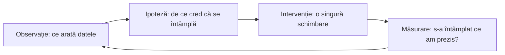
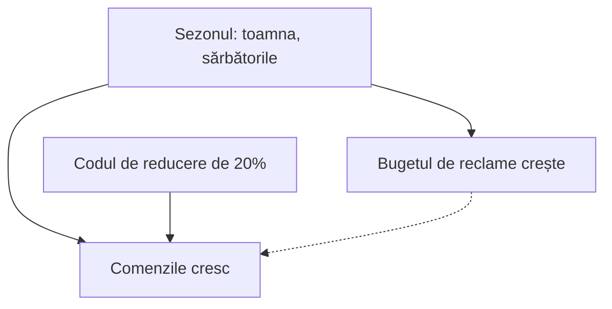

# Capitolul 9. De la analiză la decizie: experimente, cauzalitate și un proiect aplicat

## Ce vei putea face după acest capitol

- Să deosebești o observație de o ipoteză și să formulezi ipoteze care pot fi verificate.
- Să explici de ce o corelație nu dovedește o cauză și să numești cele trei explicații alternative: a treia cauză, cauzalitatea inversă și coincidența.
- Să proiectezi un experiment simplu (test A/B, săptămâni alternate, cod de reducere pentru jumătate din listă) pe care îl poate rula și o firmă mică.
- Să completezi o fișă de decizie: o intervenție, datele care o susțin, ce măsori, când verifici și la ce rezultat renunți.
- Să compari opțiuni prin scenarii, analiză de sensibilitate și cel mai rău caz, ținând cont de costul fiecărei pârghii.
- Să planifici un proiect de analiză pe date reale cu respectarea regulilor de protecție a datelor personale.

## 9.1 Punctul de plecare: știm ce s-a întâmplat. Ce facem?

În capitolul 5 am urmărit pas cu pas cazul magazinului „Cămara de la Dunăre”, un magazin online fictiv din Galați care vinde dulcețuri, zacuscă, miere și siropuri de la producători locali. Reluăm aici doar concluziile, fiindcă de la ele pornim. Toate cifrele despre Cămară sunt date fictive, construite pentru exercițiu.

| Indicator (date fictive) | Septembrie | Noiembrie | Variație |
|---|---|---|---|
| Vizite | 18.860 | 32.140 | +70% |
| Comenzi | 553 | 796 | +44% |
| Venit (lei) | 85.400 | 109.125 | +28% |
| Rezultat simplificat (lei) | 18.088 | 6.758 | -63% |
| Buget lunar de Reclame (lei) | 2.400 | 16.800 | de 7 ori mai mare |

Explicația la care am ajuns: bugetul de reclame plătite pe rețelele sociale a crescut de șapte ori, iar campania a venit cu un cod de reducere de 20%. Pe canalul Reclame, valoarea medie a comenzii a coborât de la 150 la 105 lei, marja brută de la 45% la 31%, iar contribuția pe comandă a trecut de la +16 lei la -40 de lei. Fiecare comandă adusă de reclame în noiembrie a scos bani din firmă.

Analiza de până aici răspunde la două întrebări: ce s-a întâmplat și de ce s-a întâmplat, probabil. Cuvântul „probabil” contează. Avem o explicație care se potrivește cu datele, dar nu am testat-o. Iar proprietara nu are nevoie de o explicație, are nevoie de o hotărâre pentru luna decembrie: oprește reducerea? taie bugetul? încearcă altceva?

Capitolul acesta acoperă drumul de la „am înțeles” la „am hotărât și verific”. Drumul are patru pași, pe care îi reluăm în cerc:

> **De reținut.** O analiză care nu se termină cu o decizie, cu un termen de verificare și cu un prag de renunțare rămâne un raport. Scopul analizei într-o firmă este să schimbe ce faci luni dimineață.

## 9.2 Observație și ipoteză

### Cum le deosebești

O **observație** este ceva ce se poate citi direct în date. Doi oameni care se uită la același tabel trebuie să ajungă la aceeași observație. „În noiembrie au fost 796 de comenzi” este o observație.

O **ipoteză** este o explicație propusă sau o predicție. Conține, de obicei, un „pentru că”, un „din cauza” sau un „dacă facem X, atunci Y”. Doi oameni rezonabili pot să nu fie de acord cu ea. „Comenzile au crescut pentru că reclamele au funcționat” este o ipoteză.

Trei teste rapide te ajută să le separi:

1. **Testul tabelului.** Pot arăta cu degetul celula sau calculul din care rezultă afirmația? Dacă da, este observație.
2. **Testul lui „pentru că”.** Afirmația explică un motiv sau prezice viitorul? Atunci este ipoteză, oricât de plauzibilă ar suna.
3. **Testul contrazicerii.** Ce rezultat m-ar face să renunț la afirmație? O ipoteză bună poate fi infirmată de date. Dacă nimic nu o poate contrazice, nu este o ipoteză utilă, este o părere.

Mai există o a treia categorie, care se strecoară des în rapoarte: **judecata de valoare**. „Campania a fost un succes” nu este nici observație, nici ipoteză, până nu spui după ce criteriu judeci. După numărul de comenzi, da. După rezultat, nu.

### Exercițiu lucrat: opt afirmații despre Cămară

| Nr. | Afirmație | Ce este | De ce |
|---|---|---|---|
| 1 | În noiembrie, comenzile au fost cu 44% mai multe decât în septembrie. | Observație | Se calculează direct: 796 față de 553. |
| 2 | Reclamele au adus clienți noi. | Ipoteză | Datele arată comenzi atribuite canalului Reclame după ultimul clic. Nu arată dacă acei oameni erau clienți noi. |
| 3 | Pe canalul Reclame, valoarea medie a comenzii a scăzut de la 150 la 105 lei. | Observație | Venit împărțit la comenzi, pe canal. |
| 4 | Valoarea medie a scăzut din cauza codului de 20%. | Ipoteză | Reducerea explică o parte. Dar 150 de lei minus 20% înseamnă 120, nu 105. Poate că publicul nou cumpără și coșuri mai mici. |
| 5 | Clienții veniți prin reclame nu vor mai comanda a doua oară. | Ipoteză | Este o predicție. Setul de date nu urmărește clienții în timp. |
| 6 | Canalele Căutare, Email și Direct au rămas aproape neschimbate. | Observație | 489 de comenzi în septembrie, 510 în noiembrie, pe cele trei canale la un loc. |
| 7 | Dacă oprim reducerea, pierdem jumătate din comenzile din reclame. | Ipoteză | Predicție despre o intervenție. Se poate testa. |
| 8 | Campania a fost o greșeală. | Judecată de valoare | Depinde de criteriu și de ce nu știm încă (de exemplu, câți dintre clienții noi revin). |

Afirmația 4 merită un minut în plus. Sună ca o observație, pentru că reducerea și scăderea coșului au apărut în același timp. Dar un calcul simplu arată că reducerea singură nu explică toată scăderea. Asta este valoarea separării: te obligă să verifici dacă explicația „evidentă” acoperă toată diferența.

> **Greșeală frecventă.** Într-o ședință, cineva spune o ipoteză pe tonul unei observații („reclamele ne-au adus clienți mai slabi”), nimeni nu o contestă, iar peste o săptămână ea circulă ca fapt. Obișnuiește-te să notezi pe două coloane: „ce știm” și „ce credem”. Tot ce se află în a doua coloană are nevoie de o verificare.

### Cum scrii o ipoteză care poate fi verificată

O formulă utilă: **„Dacă [schimbăm un lucru], atunci [indicatorul] va [crește sau scădea] cu aproximativ [cât], în [interval de timp], pentru că [mecanism].”**

> **Exemplu.** Ipoteză slabă: „Reducerea strică marja.” Ipoteză verificabilă: „Dacă oprim codul de 20% pe canalul Reclame și păstrăm bugetul, atunci marja brută a comenzilor din reclame va reveni la aproximativ 45% în două săptămâni, iar numărul de comenzi săptămânale din reclame va scădea cu cel mult 30%, pentru că o parte dintre cumpărători vin pentru produs, nu pentru reducere.” A doua variantă spune ce măsori, când și ce rezultat ar contrazice-o.

## 9.3 Corelație și cauzalitate

### Ce este o corelație

Două mărimi sunt **corelate** când se mișcă împreună: când una crește, cealaltă tinde să crească și ea (corelație pozitivă) sau să scadă (corelație negativă). Corelația se vede într-un grafic de dispersie (vezi capitolul 7) și se poate rezuma printr-un coeficient între -1 și +1, pe care îl calculează orice foaie de calcul.

În datele Cămării, pe cele 12 săptămâni, cheltuiala totală de marketing și numărul total de comenzi sunt corelate aproape perfect: coeficientul este 0,995 (calculat din setul `camara_saptamanal.csv`, date fictive). În săptămânile cu buget mai mare sunt mai multe comenzi. Tentația este să tragem concluzia: reclamele aduc comenzi, deci mai multe reclame aduc și mai multe comenzi.

Concluzia poate fi adevărată. Dar corelația singură nu o dovedește. Când două lucruri se mișcă împreună, există patru explicații posibile, iar „A îl produce pe B” este doar una dintre ele.

| Explicație | Pe scurt | La Cămară |
|---|---|---|
| A produce B | Reclamele aduc comenzi. | Explicația pe care o presupunem. |
| A treia cauză | Altceva le mișcă pe amândouă. | Toamna crește pofta de zacuscă și tot toamna a fost mărit bugetul. Codul de 20% a pornit odată cu bugetul. |
| Cauzalitate inversă | B produce A. | Vânzările bune o fac pe proprietară să mărească bugetul. |
| Coincidență | Cu puține date, tiparele apar și din întâmplare. | Avem doar 12 săptămâni. |

### A treia cauză: sezonul și reducerea

O **a treia cauză** (în engleză *confounder*, variabilă de confuzie) este un factor care influențează în același timp și presupusa cauză, și presupusul efect.

La Cămară avem doi candidați. Primul este sezonul: conservele și dulcețurile se vând mai bine toamna și înainte de sărbători, iar proprietarii măresc bugetele exact atunci. Al doilea este codul de reducere, care a pornit în aceeași săptămână cu majorarea bugetului. Când două schimbări pornesc simultan, datele nu pot spune singure care dintre ele a adus comenzile. Poate că reclamele fără reducere ar fi adus jumătate. Poate că reducerea trimisă pe email, fără nicio reclamă, ar fi adus la fel de mult.

Putem totuși să scoatem ceva din date. Canalele pe care nu s-a schimbat nimic (Căutare, Email, Direct) arată cât a crescut cererea „de la sine”: de la 489 la 510 comenzi, adică aproximativ 4%. Dacă sezonul ar fi fost motorul principal, am fi văzut o creștere mare și pe aceste canale. Nu o vedem. Deci sezonul explică puțin, iar grosul creșterii vine din pachetul „buget plus reducere”. Ce nu putem face este să despărțim bugetul de reducere. Pentru asta trebuie un experiment.

> **De reținut.** Un canal sau un grup la care nu ai schimbat nimic este cel mai ieftin „martor” pe care îl ai. Înainte să atribui o creștere unei acțiuni, uită-te cât a crescut acolo unde nu ai făcut nimic.

### Cauzalitatea inversă

Uneori săgeata merge în sens opus față de cum o desenăm. Exemple din practica unui magazin mic:

- După o săptămână bună, proprietara are bani în cont și mărește bugetul de reclame. În date apare „buget mare, vânzări mari”, dar vânzările au produs bugetul.
- Platformele de publicitate arată reclamele cu precădere oamenilor care au deja șanse mari să cumpere, de exemplu celor care au vizitat recent site-ul. O parte dintre ei ar fi comandat oricum. Regula ultimului clic (vezi capitolul 5) trece comanda în dreptul Reclamelor, deși reclama doar a prins din urmă o decizie deja luată.
- Clienții mulțumiți scriu mai des la asistență ca să mai comande. Cineva vede corelația „cine scrie la asistență cumpără mai mult” și propune ca toți clienții să fie împinși spre chat.

### Coincidența la eșantioane mici

Douăsprezece săptămâni înseamnă douăsprezece puncte pe grafic. Cu atât de puține puncte, tiparele apar ușor din întâmplare. Pentru acest capitol am făcut o simulare: 20.000 de perechi de șiruri de câte 12 numere complet aleatoare, fără nicio legătură între ele. Aproximativ una din zece perechi a avut un coeficient de corelație mai mare de 0,5 în valoare absolută. Când șirurile au o tendință în timp (fiecare valoare pornește de la cea dinainte, cum se întâmplă cu vânzările, bugetele sau numărul de abonați), proporția urcă la aproximativ patru din zece.

Concluzia practică: două serii care cresc amândouă în timp vor fi aproape mereu corelate, indiferent dacă au vreo legătură. Numărul de comenzi ale Cămării este corelat și cu numărul de zile scurse de la 1 septembrie, și cu scăderea temperaturii de afară, și cu prețul benzinei, dacă s-a întâmplat să crească în acea toamnă.

> **Greșeală frecventă.** „Am postat mai des pe Instagram și vânzările au crescut.” Dacă ambele au crescut treptat timp de trei luni, corelația este garantată și nu spune nimic. Întreabă-te: în săptămânile în care am postat mai mult decât tendința, am vândut mai mult decât tendința?

### Lista de verificare pentru orice „X a adus Y”

1. Ce altceva s-a schimbat în aceeași perioadă (preț, reducere, stoc, sezon, concurență, o apariție în presă)?
2. Ce s-a întâmplat acolo unde nu am schimbat nimic?
3. Se poate ca Y să fi produs X?
4. Câte puncte de date am? Sunt săptămâni sau luni independente, sau o singură tendință?
5. Am un mecanism credibil și, mai ales, o predicție pe care o pot verifica?
6. Pot face un test în care schimb doar X?

Dacă răspunsul la întrebarea 6 este „da”, restul devin mai puțin importante. Experimentul este metoda care taie nodul.

## 9.4 Experimentul: cum afli dacă o schimbare chiar funcționează

### Ideea de bază

Un **experiment controlat** compară două grupuri care diferă printr-un singur lucru: schimbarea pe care vrei să o testezi. Forma cea mai cunoscută în mediul online este **testul A/B**: o parte dintre vizitatori văd varianta A (cea actuală), cealaltă parte văd varianta B (cea nouă), în aceeași perioadă. La final compari indicatorul ales.

Lucrarea de referință a domeniului este cartea lui Ron Kohavi, Diane Tang și Ya Xu, *Trustworthy Online Controlled Experiments: A Practical Guide to A/B Testing* (Cambridge University Press, 2020), scrisă de oameni care au condus programele de experimente de la Microsoft, Google și LinkedIn. Mesajul ei central este că intuiția, chiar și a oamenilor cu experiență, greșește des când prezice ce va funcționa, și că un rezultat de experiment merită crezut doar dacă experimentul a fost construit cu grijă. Tot acolo este reluată o regulă veche din statistică, legea lui Twyman: o cifră care arată neobișnuit de bine este, de cele mai multe ori, o greșeală de măsurare. Când un test îți arată o îmbunătățire spectaculoasă, primul gest sănătos este să cauți eroarea.

### Cele patru ingrediente

**Grupul de control.** Este grupul la care nu schimbi nimic. Fără el, nu ai cu ce compara. „Am schimbat pagina de produs și conversia a crescut” nu spune nimic dacă în aceeași săptămână a început sezonul cadourilor. Grupul de control trece prin același sezon, aceleași zile de salariu, aceeași vreme. Tot ce îl deosebește de grupul de test este schimbarea ta.

**Randomizarea.** Cine ajunge în fiecare grup se hotărăște prin tragere la sorți, nu prin alegere. Dacă trimiți oferta nouă „celor mai buni clienți”, grupul de test va cumpăra mai mult oricum. Tragerea la sorți face ca grupurile să semene între ele la tot ce contează, inclusiv la lucrurile pe care nu te-ai gândit să le măsori. Într-o foaie de calcul, randomizarea se face în trei pași: adaugi o coloană cu un număr aleator (funcția `RAND()` sau `ALEATORIU()`), sortezi după ea, tai lista la jumătate.

**O singură schimbare o dată.** Dacă varianta B are alt titlu, altă fotografie și alt preț, iar B câștigă, nu știi care dintre cele trei a contat. Exact asta s-a întâmplat la Cămară, la scară mare: bugetul și reducerea au fost schimbate împreună.

**Un indicator ales dinainte.** Hotărăști înainte de test ce măsori și ce înseamnă succes. La Cămară, indicatorul potrivit nu este numărul de comenzi (care crește la orice reducere), ci contribuția pe vizitator sau pe destinatar: câți lei rămân, după costurile variabile, pentru fiecare om inclus în test. Alegi și unul sau două **indicatoare de pază**, care nu au voie să se strice: rata de retur, numărul de reclamații, valoarea medie a comenzii.

### Cât durează un test

Două reguli simple acoperă majoritatea cazurilor unei firme mici:

- **Săptămâni întregi.** Oamenii cumpără altfel lunea față de sâmbăta. Un test de patru zile compară bucăți de săptămână diferite. Rulează cel puțin o săptămână completă, de preferat două.
- **Durata se fixează dinainte.** Scrii „test de 14 zile” și te uiți la rezultat în ziua a 14-a. De ce contează atât de mult, vezi mai jos, la capcane.

Evită perioadele atipice: Black Friday, săptămâna dinaintea Crăciunului, o zi în care ai apărut la televiziunea locală. Ce afli atunci nu se aplică unei săptămâni obișnuite.

### Mărimea eșantionului, la nivel de intuiție

Vânzările au zgomot. Dacă la 1.000 de vizite te aștepți la 25 de comenzi (o rată de conversie de 2,5%), într-o săptămână vei avea 21, în alta 29, fără să se fi schimbat nimic. Abaterea obișnuită este cam cât rădăcina pătrată a numărului de comenzi: la 25 de comenzi, plus sau minus 5. Adică plus sau minus 20%, doar din întâmplare.

De aici rezultă ideea de bază: **cu cât efectul pe care îl cauți este mai mic, cu atât ai nevoie de mai mulți oameni în test**, iar creșterea este abruptă. Ca să vezi un efect de două ori mai mic, îți trebuie de patru ori mai mulți vizitatori. O regulă practică răspândită, reluată și în cartea lui Kohavi, Tang și Xu, spune că numărul necesar în fiecare grup este de aproximativ 16 ori varianța indicatorului, împărțit la pătratul diferenței pe care vrei să o detectezi. Nu trebuie să reții formula. Reține ordinul de mărime din tabelul de mai jos, calculat cu această regulă pentru o rată de conversie de pornire de 2,5%.

| Vrei să detectezi o creștere a conversiei | Creștere relativă | Vizitatori necesari în fiecare grup (aproximativ) |
|---|---|---|
| de la 2,5% la 3,5% | +40% | 3.900 |
| de la 2,5% la 3,0% | +20% | 15.600 |
| de la 2,5% la 2,75% | +10% | 62.400 |

Cămara are în jur de 8.000 de vizite pe săptămână în noiembrie (date fictive). Un test pe tot site-ul, împărțit în două, ar putea detecta în două săptămâni doar efecte mari, de ordinul a 30-40%. Pentru o îmbunătățire de 10% ar trebui să ruleze aproape patru luni. Concluzia pentru o firmă mică: **testează schimbări mari**, nu culoarea unui buton. O ofertă nouă, un prag de transport gratuit, un alt preț, o altă primă pagină. Schimbările mici se hotărăsc cu bun-simț, nu cu teste.

### Semnificația statistică, fără formule grele

Să zicem că ai trimis un email la 4.000 de abonați, împărțiți la întâmplare în două (cifre ipotetice, pentru ilustrare). Grupul A, cu mesajul obișnuit: 2.000 de destinatari, 40 de comenzi, adică 2,0%. Grupul B, cu oferta nouă: 2.000 de destinatari, 52 de comenzi, adică 2,6%. B pare cu 30% mai bun.

Întrebarea la care răspunde un test statistic este una singură: **dacă oferta nouă nu ar avea niciun efect, cât de des aș vedea, din pură întâmplare, o diferență cel puțin atât de mare?** Răspunsul se numește valoarea p (*p-value*). Prin convenție, un rezultat este numit „semnificativ statistic” când această probabilitate este sub 5%.

Pentru cifrele de mai sus, testul obișnuit pentru compararea a două proporții (cel pe care îl aplică și calculatoarele online de teste A/B) dă o valoare p de aproximativ 0,20. Adică, fără niciun efect real, ai vedea o asemenea diferență cam o dată din cinci încercări. Rezultatul este încurajator, dar nu este o dovadă. Ai trei variante oneste: repeți testul pe încă o trimitere și aduni datele, accepți riscul pentru că decizia este ieftină și reversibilă, sau renunți.

Trei precizări ca să nu citești greșit cuvântul „semnificativ”:

- **Semnificativ nu înseamnă important.** Cu un milion de vizitatori, o diferență de 0,05 puncte procentuale poate fi semnificativă statistic și complet irelevantă pentru afacere.
- **Nesemnificativ nu înseamnă „fără efect”.** Înseamnă că testul tău nu a fost destul de mare ca să vadă efectul, dacă există.
- **5% este o convenție, nu o lege a naturii.** Pentru o decizie ușor de întors, poți accepta mai multă incertitudine. Pentru una greu de întors (schimbi furnizorul, renunți la un canal), cere mai multă siguranță.

### Capcane

| Capcană | Ce se întâmplă | Cum o eviți |
|---|---|---|
| Oprirea prea devreme | Te uiți zilnic și oprești testul când B conduce. La început diferențele sar mult; dacă oprești la primul vârf, „câștigi” des din întâmplare. | Fixează durata dinainte. Uită-te zilnic doar ca să prinzi defecte, nu ca să decizi. |
| Prea multe variante | Testezi 20 de titluri. La pragul de 5%, unul dintre ele va părea câștigător din întâmplare, în medie. | Două, cel mult trei variante. Câștigătorul surprinzător se retestează. |
| Prea mulți indicatori | Varianta B nu câștigă la conversie, dar „câștigă la clienții de pe mobil din Moldova, joia”. | Indicatorul principal se alege înainte. Restul sunt idei pentru testul următor. |
| Efectul de noutate | Clienții vechi dau clic pe orice arată altfel. După două săptămâni efectul dispare. | Rulează mai mult sau uită-te separat la vizitatorii noi. |
| Grupuri care se amestecă | Clientul din grupul de control află codul de reducere de la un prieten din grupul de test. | Coduri unice sau cu utilizare limitată; măsoară câte comenzi cu cod vin din afara grupului. |
| Grupuri inegale | Ai împărțit 50/50, dar în raport apar 2.000 și 1.700 de oameni. | Semn de defect tehnic. Nu interpreta rezultatul până nu afli unde s-au pierdut 300 de oameni. |

### Ce poate testa o firmă mică fără instrumente scumpe

Nu ai nevoie de o platformă de experimente ca să înveți din date. Iată trei metode, de la cea mai slabă la cea mai bună.

**1. Înainte și după, cu atenție la sezon.** Schimbi ceva și compari perioada de după cu cea dinainte. Este cea mai slabă metodă, pentru că orice altceva s-a schimbat între timp se amestecă în rezultat. O poți întări în trei feluri: compari cu aceeași perioadă a anului trecut, nu doar cu luna trecută; folosești un „martor” la care nu ai umblat (un canal, o categorie de produse, un oraș); alegi săptămâni obișnuite, fără sărbători și fără alte campanii.

> **Exemplu.** Cămara oprește codul de 20% pe Reclame în săptămâna 13. Comenzile din reclame scad de la 72 la 50. Înainte să tragi concluzia, uită-te la Căutare: dacă și acolo comenzile au scăzut cu 10% (a trecut vârful de sezon), atunci doar o parte din scăderea de pe Reclame vine de la oprirea codului. Diferența dintre cele două scăderi este estimarea ta.

**2. Săptămâni alternate.** Aplici schimbarea în săptămânile cu număr impar și revii la varianta veche în cele cu număr par, timp de 6-8 săptămâni. Tendința de sezon afectează ambele tipuri de săptămâni aproape la fel, așa că se anulează în mare parte. Metoda merge bine pentru lucruri care se pot porni și opri curat: un prag de transport gratuit, un banner, o ordine a produselor pe prima pagină. Merge prost pentru lucruri cu efect întârziat (un client care a văzut oferta săptămâna trecută comandă săptămâna aceasta) și pentru prețuri, unde clienții se pot simți nedreptățiți.

**3. Cod de reducere doar pentru jumătate din listă.** Este un test A/B adevărat, făcut cu instrumente pe care le ai deja. Împarți la întâmplare lista de email în două. Jumătate primește oferta, cealaltă jumătate primește același email fără ofertă. După 7-10 zile compari, pentru fiecare jumătate, numărul de comenzi, venitul și, mai ales, contribuția totală. Capcana clasică este să compari doar comenzile făcute cu cod: așa nu afli câte dintre ele ar fi venit oricum. Comparația corectă este între toți oamenii din grupul A și toți oamenii din grupul B.

> **Pentru afacerea ta.** Începe cu lista de email sau de mesaje, pentru că acolo controlezi cine ce primește. Alege o singură întrebare care te costă bani dacă greșești (de obicei: „merită reducerea asta?”). Împarte lista în două cu un număr aleator, trimite, așteaptă o săptămână, compară lei rămași, nu comenzi. Un asemenea test durează o oră de pregătire.

## 9.5 Fișa de decizie

### De ce o pagină scrisă

O decizie luată din vorbe se rescrie singură în memorie. Peste o lună, dacă a mers bine, toată lumea „a știut de la început”. Dacă a mers prost, nimeni nu-și mai amintește ce se aștepta. **Fișa de decizie** este o pagină pe care o completezi înainte de a schimba ceva. Are șase rubrici:

1. **Intervenția:** o singură schimbare, descrisă atât de concret încât altcineva să o poată executa.
2. **Datele care o susțin:** observațiile, cu cifre. Separat, ipoteza.
3. **Ce măsurăm:** un indicator principal și unul sau două de pază.
4. **Când verificăm:** o dată din calendar.
5. **Cum arată succesul și la ce rezultat renunțăm:** două praguri numerice, scrise dinainte.
6. **Riscuri și ce nu știm.**

Rubrica 5 este cea mai importantă și cea mai des sărită. Pragul de renunțare scris dinainte te apără de tine: fără el, vei găsi mereu un motiv să mai aștepți o săptămână.

Mai jos sunt trei fișe lucrate pentru Cămară. Toate calculele pornesc de la setul de date fictiv și de la ipotezele cazului: marjă brută de 45% la preț întreg, 14 lei pe comandă pentru ambalare și livrare. Unde am adăugat ipoteze noi, am spus-o explicit. Calculele sunt pe săptămână, pe canalul Reclame, cu media din noiembrie ca punct de plecare: aproximativ 72 de comenzi, buget de 4.200 de lei, contribuție de aproximativ -2.874 de lei pe săptămână.

### Fișa 1. Oprim reducerea de 20%, păstrăm bugetul

| Rubrică | Conținut |
|---|---|
| Intervenția | De luni, reclamele rulează fără codul de 20%. Bugetul rămâne 4.200 de lei pe săptămână. Nimic altceva nu se schimbă. |
| Datele care o susțin | Observație: marja brută pe Reclame a scăzut de la 45% la 31%; contribuția pe comandă este -40 de lei. Ipoteză: o parte dintre clienți ar cumpăra și fără reducere. |
| Ce măsurăm | Principal: contribuția săptămânală a canalului Reclame. De pază: numărul de comenzi din reclame, valoarea medie a comenzii. |
| Când verificăm | După trei săptămâni complete. |
| Succes | Contribuția canalului urcă peste -1.000 de lei pe săptămână, cu cel puțin 65 de comenzi. |
| Renunțăm dacă | Comenzile din reclame scad sub 30 pe săptămână. Sub acest nivel, varianta fără cod pierde mai mult decât cea cu cod. |
| Riscuri | Scăderea comenzilor poate fi mai mare decât credem. Rezultatul se suprapune cu sezonul de sărbători. |

Calculul din spate, pe scurt. Coșul de 105 lei cu reducere ar costa aproximativ 131 de lei la preț întreg. La marja de 45%, asta înseamnă cam 59 de lei marjă brută, din care scădem 14 lei ambalare și livrare: rămân 45 de lei pe comandă înainte de costul reclamei. Întrebarea este câte comenzi rămân după ce dispare reducerea.

| Scenariu (ipoteze de lucru) | Comenzi pe săptămână | Contribuție înainte de reclame | Buget | Contribuția canalului |
|---|---|---|---|---|
| Situația de acum, cu cod | 72 | 1.326 | 4.200 | -2.874 |
| Optimist: nu pierdem comenzi | 72 | 3.240 | 4.200 | -960 |
| Mediu: pierdem 30% | 50 | 2.250 | 4.200 | -1.950 |
| Pesimist: pierdem 50% | 36 | 1.620 | 4.200 | -2.580 |

Tabelul spune două lucruri. Primul: oprirea reducerii îmbunătățește situația în toate cele trei scenarii, chiar dacă pierdem jumătate din comenzi. Abia sub 30 de comenzi pe săptămână ajungem mai rău decât acum. Al doilea, mai puțin plăcut: în niciun scenariu canalul nu ajunge pe plus. La 45 de lei pe comandă și un buget de 4.200 de lei, ar fi nevoie de 93 de comenzi pe săptămână doar ca reclamele să se plătească singure. Fișa 1 oprește o parte din pierdere, nu rezolvă problema.

### Fișa 2. Coborâm bugetul la nivelul din septembrie

| Rubrică | Conținut |
|---|---|
| Intervenția | Bugetul de Reclame revine la 600 de lei pe săptămână, cu campania din septembrie, fără cod de reducere. |
| Datele care o susțin | Observație: în septembrie, la 600 de lei pe săptămână, canalul aducea 16 comenzi de câte 150 de lei și o contribuție de +256 de lei. Observație: comenzile de pe celelalte canale au crescut doar cu 4% în perioada cu buget mare. Ipoteză: revenirea la bugetul vechi readuce și rezultatele vechi. |
| Ce măsurăm | Principal: rezultatul simplificat lunar. De pază: comenzile pe Căutare și Direct (ca să vedem dacă reclamele le susțineau indirect). |
| Când verificăm | După patru săptămâni complete. |
| Succes | Contribuția canalului Reclame revine pe plus, iar rezultatul lunar trece de 15.000 de lei. |
| Renunțăm dacă | Comenzile pe Căutare și Direct, la un loc, scad cu peste 20% față de noiembrie. Ar însemna că reclamele aduceau indirect mult mai mult decât arată ultimul clic. |
| Riscuri | Pierdem aproximativ 220 de comenzi pe lună și clienții noi pe care îi aduceau. Nu știm câți dintre ei ar fi revenit. Venitul scade vizibil. |

Dacă ipoteza se confirmă întocmai, contribuția canalului trece de la -11.495 de lei pe lună la +1.024, iar rezultatul simplificat urcă de la 6.758 la aproximativ 19.277 de lei. Venitul lunar coboară de la 109.125 la aproximativ 88.700 de lei. Aici stă dificultatea omenească a deciziei: trebuie să accepți un magazin care arată mai mic pe ecran și câștigă de aproape trei ori mai mult.

Fișa 2 are și o problemă de metodă, pe care e bine să o recunoști: schimbă două lucruri deodată (bugetul și reducerea). Dacă merge, nu vei ști care a contat. Varianta „curată” ar fi fișa 1 timp de trei săptămâni, apoi fișa 2. Numai că fiecare săptămână de așteptare costă aproape 2.900 de lei. Este un compromis clasic între a învăța și a câștiga. Când pierderea curentă este mare și decizia se poate întoarce ușor (bugetul se mărește la loc într-o zi), este rezonabil să oprești întâi pierderea și să înveți după aceea, cu teste mici.

### Fișa 3. Prag de transport gratuit la 200 de lei

Această fișă cere o ipoteză suplimentară. În modelul simplificat al cazului, firma suportă 14 lei pe comandă pentru ambalare și livrare. Presupunem, pentru exercițiu, că restul costului de curier este plătit astăzi de client ca taxă de livrare, de 15 lei, și că pragul de transport gratuit ar muta această sumă în sarcina firmei pentru comenzile de peste 200 de lei.

| Rubrică | Conținut |
|---|---|
| Intervenția | Comenzile de peste 200 de lei au transport gratuit. Mesajul apare în coș: „Mai adaugă X lei pentru transport gratuit”. Se aplică pe tot site-ul, în săptămâni alternate, timp de 8 săptămâni. |
| Datele care o susțin | Observație: valoarea medie a comenzii pe Căutare, Email și Direct este între 150 și 165 de lei, deci multe coșuri sunt la un produs sau două distanță de prag. Ipoteză: o parte dintre clienți vor adăuga un produs ca să scape de taxa de livrare. |
| Ce măsurăm | Principal: contribuția pe comandă, în săptămânile cu prag față de cele fără. De pază: ponderea comenzilor de peste 200 de lei, rata de conversie. |
| Când verificăm | După 8 săptămâni (4 cu prag, 4 fără). |
| Succes | Contribuția pe comandă crește cu cel puțin 1 leu, iar conversia nu scade. |
| Renunțăm dacă | Pentru fiecare comandă care trecea oricum de prag nu apare cel puțin o comandă „urcată” peste prag. |
| Riscuri | Clienții care comandau oricum peste 200 de lei primesc un cadou de 15 lei fără să-și schimbe comportamentul. Efectul total este mic. |

Calculul, pe 100 de comenzi de pe canalele neplătite (ipoteze de lucru): 15 comenzi trec deja de 200 de lei, iar celelalte 85 au în medie 142 de lei. Cele 15 comenzi mari primesc transportul gratuit fără să aducă nimic în plus: cost 15 × 15 = 225 de lei. Un client care își urcă coșul de la 142 la 207 lei aduce 65 de lei venit în plus, adică aproximativ 29 de lei marjă brută, din care firma plătește 15 lei transport. Rămân cam 14 lei câștig net pe fiecare comandă urcată. Ca să acopere cei 225 de lei, trebuie 16 comenzi urcate la 100. De aici regula din fișă: o comandă urcată pentru fiecare comandă care trecea oricum de prag.

Pe cele aproximativ 510 comenzi lunare ale canalelor neplătite, rezultatul ar fi între -420 și +1.030 de lei pe lună, după cum se urcă 10, 20 sau 30 de comenzi din 100. Este o idee bună de testat, dar efectul ei este de zece ori mai mic decât al fișei 2.

> **De reținut.** Pune fișele una lângă alta și compară ordinul de mărime al efectului. Energia unei firme mici este limitată. Întâi se rezolvă problema de 12.000 de lei pe lună, apoi cea de 500.

## 9.6 Compromisuri: orice pârghie are un cost

### Trei costuri care se uită ușor

**Randamentul descrescător al reclamelor.** Primii lei cheltuiți ajung la oamenii cei mai interesați. Pe măsură ce mărești bugetul, platforma arată reclama unui public tot mai larg și mai puțin interesat. Fiecare comandă în plus costă mai mult decât cea dinainte. Datele Cămării arată efectul, cu rezerva că în săptămânile 5-12 rula și reducerea:

| Buget săptămânal (lei) | Comenzi din reclame | Cost mediu pe comandă (lei) | Costul unei comenzi în plus față de treapta anterioară (lei) |
|---|---|---|---|
| 600 | 16 | 37,5 | - |
| 1.500 | 30 | 50,0 | 64 |
| 2.600 | 43 | 60,5 | 85 |
| 3.300 | 54 | 61,1 | 64 |
| 3.800 | 61 | 62,3 | 71 |

Coloana din dreapta este cea care contează pentru decizie. Costul mediu ascunde faptul că fiecare comandă adăugată peste primele 16 a costat între 64 și 85 de lei. O comandă de 150 de lei la preț întreg lasă 53,50 lei după marfă, ambalare și livrare. Atât poți plăti, cel mult, ca să o obții, dacă judeci doar prima comandă. La 37,50 lei, reclamele din septembrie erau o afacere bună. Orice treaptă de deasupra a costat mai mult decât aduce, chiar și fără reducere.

> **Greșeală frecventă.** „Costul mediu pe comandă este 50 de lei, sub limita noastră de 53, deci mai mărim bugetul.” Media include comenzile ieftine de la început. Decizia de a mări bugetul se judecă după costul comenzilor suplimentare, nu după medie.

**Reducerea taie din marjă, nu din preț.** O reducere de 20% la un produs cu marjă brută de 45% nu micșorează câștigul cu 20%. Dintr-un produs de 100 de lei, 55 de lei sunt costul mărfii și 45 de lei marja. După reducere încasezi 80 de lei, costul rămâne 55, marja scade la 25 de lei. Ai dat 20% din preț și ai pierdut 44% din marjă. Ca să câștigi aceiași bani, trebuie să vinzi cu 80% mai multe bucăți (45 împărțit la 25 este 1,8). Puține reduceri aduc atât.

**Costuri pe comandă față de costuri fixe.** Costurile fixe (10.000 de lei pe lună la Cămară) nu se schimbă dacă vinzi 500 sau 800 de comenzi. Ele se acoperă din contribuția comenzilor. O comandă cu contribuție pozitivă, oricât de mică, ajută la acoperirea lor. O comandă cu contribuție negativă mărește gaura, indiferent cât de mult „volum” aduce. Fraza „pierdem puțin pe fiecare comandă, dar recuperăm din volum” este greșită aritmetic. Volumul ajută doar când contribuția pe comandă este pozitivă sau când volumul reduce el însuși costurile (un tarif mai bun la curier, un preț mai bun la borcane), iar asta se demonstrează cu oferta furnizorului în mână, nu se presupune.

### Cum compari opțiuni: scenarii

Un **scenariu** este un set coerent de ipoteze dus până la un rezultat în lei. Lucrezi de obicei cu trei: pesimist, mediu, optimist. Rostul lor nu este să ghicești viitorul, ci să vezi cât de mult depinde decizia de lucrurile pe care nu le știi.

| Opțiune | Pesimist (lei pe lună) | Mediu (lei pe lună) | Optimist (lei pe lună) |
|---|---|---|---|
| Nu schimbăm nimic | 6.758 | 6.758 | 6.758 |
| Fișa 1: fără reducere, buget păstrat | 7.934 | 10.454 | 14.414 |
| Fișa 2: buget ca în septembrie | 13.626 | 16.451 | 19.277 |
| Fișa 3: prag de transport gratuit (adăugat la situația curentă) | 6.337 | 7.064 | 7.791 |

Cifrele pentru fișa 1 și fișa 3 vin din calculele de mai sus, aduse la nivel de lună. Pentru fișa 2, scenariul optimist presupune că celelalte canale nu sunt afectate, cel mediu că pierd 10% din contribuție, iar cel pesimist că pierd 20%, în ideea că reclamele le susțineau indirect.

### Analiza de sensibilitate

**Analiza de sensibilitate** pune o singură întrebare: cât de mult trebuie să greșesc la o ipoteză ca să se schimbe decizia? Iei ipoteza cea mai nesigură și o miști până când opțiunea aleasă nu mai este cea mai bună.

La fișa 2, ipoteza nesigură este efectul indirect al reclamelor asupra celorlalte canale. Contribuția lunară a canalelor Căutare, Email și Direct este de aproximativ 28.250 de lei. Fișa 2 aduce 12.519 lei față de situația de acum. Ca avantajul să dispară, celelalte canale ar trebui să piardă 12.519 din 28.250, adică 44% din contribuție. Datele spun că aceste canale au crescut cu doar 4% când bugetul a crescut de șapte ori. O cădere de 44% la reducerea bugetului este foarte greu de imaginat. Decizia este **robustă**: rămâne bună chiar dacă ipotezele sunt mult greșite.

La fișa 3, lucrurile stau invers. Pragul de rentabilitate este la 16 comenzi urcate din 100, iar scenariile noastre merg de la 10 la 30. Decizia este **sensibilă**: o mică eroare de estimare schimbă semnul rezultatului. Tocmai de aceea fișa 3 este un candidat bun pentru un test, iar fișa 2 se poate aplica direct.

> **De reținut.** Deciziile robuste se iau. Deciziile sensibile se testează. Analiza de sensibilitate îți spune în ce categorie ești și, prin urmare, unde merită să cheltuiești timp cu un experiment.

### Cel mai rău caz

Ultima întrebare este cea a supraviețuirii: dacă iese scenariul pesimist, pot trăi cu el? Uită-te pe coloana „Pesimist” din tabel. Fișa 2 are cel mai bun cel mai rău caz (13.626 de lei), dublu față de situația curentă. Fișa 3 poate pierde câteva sute de lei pe lună, o sumă pe care firma o suportă ușor ca preț al învățării.

Două întrebări completează tabloul. Prima: **cât de reversibilă este decizia?** Un buget de reclame se schimbă la loc într-o zi. Un contract pe un an cu un depozit, nu. La deciziile reversibile poți accepta mai multă incertitudine. A doua: **cât costă să nu decizi?** La Cămară, fiecare săptămână de amânare înseamnă aproape 2.900 de lei pierduți pe canalul Reclame. A nu hotărî nimic este și ea o decizie, cu un cost care se poate calcula.

## 9.7 De la descriptiv la prescriptiv într-o firmă mică

În capitolul 1 am întâlnit cele patru niveluri de analiză din prezentarea de curs: descriptiv (ce s-a întâmplat?), diagnostic (de ce s-a întâmplat?), predictiv (ce se va întâmpla?) și prescriptiv (ce ar trebui să facem?). Prezentarea le asociază cu instrumente tot mai grele, de la tablouri de bord până la platforme de inteligență artificială. Pentru o firmă cu trei oameni, întrebarea realistă este alta: ce pot face la fiecare nivel cu ce am deja?

| Nivel | Întrebarea | Ce poți face realist într-o firmă mică | Instrumente suficiente |
|---|---|---|---|
| Descriptiv | Ce s-a întâmplat? | Un tabel săptămânal cu 5-7 indicatori pe canal și un tablou de bord simplu (vezi capitolul 7). | Exportul din platforma magazinului, foaie de calcul. |
| Diagnostic | De ce? | Descompunere pe canale, produse, clienți noi și vechi; comparație cu un martor; economia unei comenzi (vezi capitolul 5). | Tabele pivot, pandas (vezi capitolul 8). |
| Predictiv | Ce va fi? | Prognoză simplă: media ultimelor 4 săptămâni, corectată cu aceeași perioadă a anului trecut; scenarii pesimist, mediu, optimist. | Foaie de calcul. Modele statistice doar când ai cel puțin doi-trei ani de date. |
| Prescriptiv | Ce facem? | Fișe de decizie, teste mici, reguli scrise de tipul „dacă, atunci”. | O pagină de text, un calendar, disciplină. |

Câteva observații despre acest tabel.

**Nivelurile de sus nu le înlocuiesc pe cele de jos.** Fără date descriptive curate, orice prognoză este o ghicitoare cu zecimale. Cele mai multe firme mici câștigă cel mai mult din primele două niveluri făcute bine și regulat.

**Predicția unei firme mici este modestă și utilă.** Nu ai nevoie de învățare automată (*machine learning*) ca să știi că în decembrie vei vinde mai multă miere. Ai nevoie de vânzările din decembrie trecut, de tendința ultimelor săptămâni și de un interval, nu de un singur număr: „între 700 și 900 de comenzi” este o prognoză mai onestă și mai folositoare decât „812”.

**Prescriptivul la scară mică înseamnă reguli de decizie.** O regulă scrisă dinainte este o formă simplă de analiză prescriptivă. De exemplu: „Dacă două săptămâni la rând costul reclamei pe comandă depășește 50 de lei, bugetul scade cu 20%.” Sau: „Nicio reducere peste 10% fără un calcul al marjei rămase.” Regulile de acest fel iau decizia la rece, înainte ca emoția momentului să intervină.

**Atenție la prescriptivul automat al platformelor.** Platformele de publicitate oferă licitare automată și recomandări de buget. Ele optimizează obiectivul pe care li-l dai, de regulă numărul de conversii sau venitul atribuit. Nu îți cunosc marja, costul de livrare sau costurile fixe. O recomandare de tipul „mărește bugetul ca să obții mai multe conversii” este corectă pentru obiectivul platformei și poate fi dăunătoare pentru rezultatul tău. Cazul Cămării este exact povestea unei optimizări reușite pe indicatorul greșit.

### Rolul și limitele instrumentelor de inteligență artificială

Asistenții bazați pe modele lingvistice mari (în engleză *Large Language Models*, LLM) au intrat repede în munca de analiză. Merită folosiți, cu ochii deschiși.

La ce ajută cu adevărat:

- **Scriu și explică formule și cod.** Poți cere o formulă de foaie de calcul sau o secvență pandas pentru o descompunere pe canale și poți cere explicația fiecărei linii (vezi capitolul 8).
- **Propun explicații alternative.** Întrebarea „ce altceva ar putea explica această creștere?” primește de obicei o listă mai lungă decât a ta. Este un bun antidot la părtinirea de confirmare (vezi secțiunea 9.8).
- **Structurează.** Transformă notițe dezordonate într-o fișă de decizie, într-un plan de test sau într-un chestionar.
- **Rezumă text.** Recenzii, răspunsuri deschise la chestionare, mesaje de la clienți, grupate pe teme.

Unde trebuie prudență:

- **Pot greși calcule și pot inventa.** Un răspuns fluent nu este un răspuns verificat. Orice cifră care intră într-o decizie se recalculează de tine, din datele tale. Orice sursă citată se deschide.
- **Nu îți cunosc contextul.** Nu știu că furnizorul de miere a scumpit în octombrie sau că ai avut site-ul căzut două zile. Dacă nu le spui, vor explica datele fără aceste fapte.
- **Nu fac minuni cauzale.** Dacă datele sunt observaționale, un asistent nu poate scoate din ele o cauză. Poate cel mult să formuleze ipoteze. Diferența dintre corelație și cauzalitate rămâne valabilă oricât de inteligent ar fi instrumentul.
- **Sunt de acord prea ușor.** Dacă întrebi „nu-i așa că reclamele au funcționat?”, ai șanse mari să primești argumente pentru. Întreabă neutru sau cere explicit contraargumente.
- **Datele personale nu se încarcă la întâmplare.** O listă de clienți cu nume, emailuri și adrese este un set de date personale. Trimiterea ei către un serviciu extern este o prelucrare care are nevoie de temei legal și de garanții contractuale (vezi secțiunea 9.9). Pentru analiză ajung aproape întotdeauna date agregate sau anonimizate: tabelul săptămânal al Cămării nu conține niciun client.

> **De reținut.** Folosește inteligența artificială ca pe un coleg rapid și neobosit, care nu a văzut niciodată firma ta și care nu răspunde pentru rezultat. Răspunderea pentru decizie rămâne la om.

## 9.8 Capcane de judecată în decizii

Datele bune nu ajung. Felul în care le citim are tipare previzibile de eroare, descrise sistematic de psihologii Amos Tversky și Daniel Kahneman începând cu anii 1970 și popularizate de Kahneman în cartea *Thinking, Fast and Slow* (2011). Iată cele care apar cel mai des în deciziile unui mic magazin online.

| Capcana | Cum arată la Cămară | Antidot |
|---|---|---|
| Părtinirea de confirmare | Proprietara a decis campania, deci se uită la comenzi (+44%) și nu la rezultat (-63%). | Scrie dinainte ce rezultat te-ar face să recunoști că ai greșit. Cere cuiva să apere poziția opusă. |
| Părtinirea supraviețuitorului | „Toate magazinele de succes pe care le urmăresc fac reclame agresive.” Cele care au făcut la fel și au închis nu mai postează. | Întreabă: pe cine nu văd în aceste date? |
| Ancorarea | Discuția este „20% sau 15% reducere?”, deși întrebarea corectă este dacă trebuie vreo reducere. Prima cifră pusă pe masă a devenit reper. | Pornește calculul de la zero: ce reducere își permite marja? |
| Costurile scufundate | „Am băgat deja 28.000 de lei în reclame în două luni, nu putem opri acum.” | Banii cheltuiți nu se întorc, orice ai face. Contează doar ce aduce leul următor. |
| Media care ascunde segmentele | Valoarea medie a comenzii a scăzut de la 154 la 137 de lei. Pare că toți clienții cumpără mai puțin. De fapt trei canale sunt neschimbate și unul s-a prăbușit. | Nu decide pe o medie până nu ai văzut-o pe segmente. |

### Supraviețuitorii din datele tale

Părtinirea supraviețuitorului merită un paragraf în plus, pentru că se ascunde în aproape orice set de date de firmă. Recenziile vin de la clienții care au primit coletul și au avut chef să scrie. Chestionarul de satisfacție este completat de cei care nu au plecat. Analiza „clienților fideli” îi include doar pe cei care au rămas. În fiecare caz, concluzia se trage dintr-un grup care a trecut deja printr-un filtru. Întrebarea de control este mereu aceeași: cine lipsește din tabel și de ce lipsește?

### Paradoxul lui Simpson: când media merge într-un sens și segmentele în celălalt

Statisticianul britanic Edward Simpson a descris în 1951 o situație care contrazice intuiția: o tendință care apare în fiecare grup luat separat poate să dispară sau să se inverseze când grupurile sunt adunate. Cauza este schimbarea ponderii grupurilor.

Datele reale ale cazului arată o versiune blândă a fenomenului. Rata de conversie a magazinului a scăzut de la 2,93% în septembrie la 2,48% în noiembrie. Pe canale, însă, Căutarea a rămas la 2,5%, Emailul la 5,0%, Directul la 3,5%. Doar Reclamele au coborât puțin, de la 2,0% la 1,8%. Scăderea de ansamblu vine aproape în întregime din faptul că Reclamele, canalul cu cea mai slabă conversie, au trecut de la 17% la 49% din vizite.

Ca să vedem paradoxul complet, construim un exemplu ipotetic pe aceleași canale. Să presupunem că în decembrie echipa îmbunătățește pagina de produs și conversia crește pe fiecare grup de canale.

| Grup de canale (exemplu ipotetic) | Perioada 1: vizite | Comenzi | Conversie | Perioada 2: vizite | Comenzi | Conversie |
|---|---|---|---|---|---|---|
| Reclame | 3.000 | 60 | 2,0% | 16.000 | 352 | 2,2% |
| Celelalte canale | 15.000 | 480 | 3,2% | 16.000 | 544 | 3,4% |
| **Total** | 18.000 | 540 | **3,0%** | 32.000 | 896 | **2,8%** |

Conversia a crescut pe Reclame. A crescut și pe celelalte canale. Iar pe total a scăzut, de la 3,0% la 2,8%. Nicio cifră nu este greșită. Totalul a scăzut pentru că în perioada a doua jumătate din vizite vin din grupul cu conversie mică, față de o șesime înainte.

Imaginează-ți ședința în care cineva vede doar ultima linie: „Am schimbat pagina de produs și conversia a scăzut. Revenim la varianta veche.” Ar anula o îmbunătățire reală pe baza unei medii.

> **Greșeală frecventă.** A compara o medie pe două perioade fără a verifica dacă amestecul s-a schimbat. Ori de câte ori compari rate (conversie, marjă, valoare medie), pune alături ponderea fiecărui segment în cele două perioade. Dacă ponderile s-au mutat, compară pe segmente.

## 9.9 Etica datelor și cadrul legal

Această secțiune explică, pe înțeles, regulile de bază pentru lucrul cu date despre oameni. **Textul nu este consultanță juridică.** Pentru o situație concretă, citește sursele oficiale indicate și consultă un specialist.

### Ce este GDPR și când te privește

Regulamentul general privind protecția datelor, cunoscut după acronimul englezesc GDPR (*General Data Protection Regulation*; în română apare și ca RGPD), este Regulamentul (UE) 2016/679. Se aplică direct în toate statele Uniunii Europene. În România, autoritatea de supraveghere este Autoritatea Națională de Supraveghere a Prelucrării Datelor cu Caracter Personal (ANSPDCP), care primește plângeri și poate aplica sancțiuni.

Potrivit portalului oficial Your Europe al Uniunii Europene, regulamentul se aplică oricărei firme cu sediul în UE care prelucrează date personale, indiferent de mărime. **Datele personale** sunt orice informații despre o persoană identificată sau identificabilă: nume, adresă, venit, adresă IP. Ghidul pentru întreprinderi mici al Comitetului european pentru protecția datelor (EDPB, *European Data Protection Board*) adaugă exemple apropiate de un magazin online: numărul de telefon, adresa de email, identificatorul de client, istoricul de navigare și de cumpărături. Regulamentul nu se aplică datelor despre persoane juridice: cifra de afaceri a unei societăți comerciale nu este o dată personală.

Un magazin ca al nostru prelucrează date personale în fiecare zi: numele și adresa de livrare, telefonul pentru curier, emailul pentru confirmare, istoricul comenzilor.

### Temeiul: de ce ai voie să folosești o dată

Orice prelucrare are nevoie de un **temei legal**. Regulamentul prevede șase, enumerate pe portalul Your Europe: consimțământul persoanei, executarea unui contract, o obligație legală, protejarea intereselor vitale, o sarcină de interes public și interesul legitim al firmei, cu condiția ca acesta să nu calce drepturile și libertățile persoanei.

| Ce face magazinul | Temei plauzibil | Observații |
|---|---|---|
| Folosește adresa ca să livreze comanda | Contract | Nu ai nevoie de consimțământ separat pentru ce este necesar livrării. |
| Păstrează facturile | Obligație legală | Legislația fiscală impune păstrarea documentelor. |
| Trimite newsletter unui abonat | Consimțământ | Dat printr-un gest clar, de exemplu bifarea unei căsuțe. Nebifată dinainte. |
| Analizează vânzările pe săptămâni și canale | De regulă interes legitim, iar pe date agregate riscul este minim | Tabelul săptămânal nu mai conține persoane. |

Consimțământul, pentru a fi valabil, trebuie să fie liber, specific, informat și lipsit de ambiguitate, exprimat printr-un act pozitiv, iar persoana trebuie să-l poată retrage (Your Europe). Ghidul EDPB atrage atenția asupra unui lucru practic: dacă prelucrarea este oricum necesară, de pildă pentru livrare, consimțământul nu este temeiul potrivit.

### Principiile, cu accent pe minimizare

Ghidul EDPB pentru întreprinderi mici rezumă șase principii: legalitate, echitate și transparență; limitarea scopului; minimizarea datelor; exactitatea; limitarea stocării; securitatea. Firma trebuie, în plus, să poată demonstra că le respectă.

Pentru cine face analiză, două dintre ele au efect imediat:

- **Limitarea scopului.** Datele strânse pentru livrare nu devin automat materie primă pentru orice altă idee. Un scop nou cere o verificare nouă a temeiului.
- **Minimizarea.** Colectezi și păstrezi doar ce îți trebuie pentru scopul declarat. Dacă nu ai nevoie de data nașterii ca să vinzi dulceață, nu o cere. În analiză, minimizarea are o formă simplă: lucrează pe cel mai agregat nivel care răspunde la întrebare. Pentru decizia despre bugetul de reclame, tabelul săptămânal pe canale a fost suficient.

### Drepturile oamenilor din tabel

Persoanele ale căror date le prelucrezi au, potrivit regulamentului, dreptul de acces la date, de rectificare, de ștergere, de restricționare, de portabilitate și de opoziție. În cazul marketingului direct, prelucrarea trebuie oprită întotdeauna la cerere. Cererile se rezolvă gratuit, cât mai repede și în cel mult o lună de la primire, cu posibilitate de prelungire pentru cereri complexe (Your Europe, „Protecția datelor conform RGPD”, accesat în noiembrie 2026).

Tot de acolo, două cifre care arată cât de serios este tratat subiectul: o încălcare a securității datelor care prezintă un risc pentru persoane se notifică autorității în 72 de ore de la constatare, iar amenzile pot ajunge până la 20 de milioane de euro sau 4% din cifra de afaceri globală.

### Cookie-uri și consimțământ

**Cookie-urile** sunt fișiere mici pe care un site le salvează în browserul vizitatorului. Regulile lor vin din legislația europeană privind confidențialitatea comunicațiilor electronice, transpusă în România prin Legea nr. 506/2004. Articolul 4 alineatul (5) din lege permite stocarea de informații în echipamentul utilizatorului numai dacă acesta și-a exprimat acordul și a primit înainte informații clare și complete despre scop.

Portalul Your Europe explică aplicarea practică:

- **Nu au nevoie de consimțământ** cookie-urile strict necesare unui serviciu cerut explicit de utilizator: cele care țin minte coșul de cumpărături, datele introduse într-un formular sau autentificarea.
- **Au nevoie de consimțământ** cookie-urile de urmărire folosite pentru publicitate comportamentală, analiză sau cercetare de piață, inclusiv cele plasate de terți. Ele nu pot fi activate la prima încărcare a paginii, înainte ca vizitatorul să fi acceptat.
- Refuzul trebuie să fie la fel de simplu ca acceptarea, iar consimțământul se dă separat pe scopuri.

Pentru analiză, urmarea este importantă: o parte dintre vizitatori refuză cookie-urile de măsurare, deci cifrele de trafic din instrumentele de analiză sunt incomplete. Vizitele raportate sunt o subestimare, iar proporția celor care refuză poate diferi între canale. Este încă un motiv să te bazezi, pentru decizii, pe datele pe care le deții sigur: comenzi, încasări, costuri.

Aceeași lege reglementează mesajele comerciale. Articolul 12 interzice comunicările comerciale prin poștă electronică fără consimțământul prealabil expres al destinatarului. Există o excepție pentru adresa obținută direct de la un client cu ocazia unei vânzări: poate fi folosită pentru produse sau servicii similare, cu condiția ca omul să se poată opune simplu și gratuit, atât la colectarea adresei, cât și la fiecare mesaj.

### Dincolo de lege: trei întrebări de etică

Legea fixează minimul. Trei întrebări te ajută să rămâi și corect, și respectat de clienți:

1. **Ar fi clientul surprins să afle ce fac cu datele lui?** Dacă da, ori îi spui clar, ori nu faci.
2. **Am nevoie de date despre persoane sau ajung totalurile?** Aproape orice decizie din acest suport de curs se poate lua pe date agregate.
3. **Experimentul meu tratează oamenii corect?** Să testezi două mesaje este în regulă. Să afișezi prețuri diferite pentru același produs unor clienți diferiți, fără să le spui, îți poate costa încrederea chiar dacă testul „iese”.

> **Pentru afacerea ta.** Fă o listă cu toate datele personale pe care le strângi (formular de comandă, newsletter, chat, cookie-uri). Pentru fiecare, scrie pe un rând: de ce o strâng, pe ce temei, cât o păstrez, cine o mai vede (curier, platformă de email, contabil). Unde nu ai un răspuns la „de ce”, șterge câmpul din formular.

## 9.10 Proiect aplicat: angajabilitatea absolvenților, un studiu făcut de studenți

### De la un titlu provocator la o întrebare de cercetare

Schița de proiect a profesorului pornește de la un titlu care atrage atenția: „De ce angajatorii nu vor studenți? Un studiu pentru studenți făcut de studenți”. Titlul este bun pentru un afiș. Pentru o cercetare, aplică-i testele din secțiunea 9.2: „angajatorii nu vor studenți” este o ipoteză, nu o observație. Poate că îi vor, dar pe alte posturi. Poate că diferă mult între specializări. Poate că nu este adevărat deloc.

Primul pas al proiectului este deci să transformi titlul în întrebări la care datele pot răspunde:

- **Întrebare descriptivă:** Ce proporție dintre absolvenții unui program lucrează la un an, la trei ani și la cinci ani de la absolvire, și cum se compară cu media națională a domeniului?
- **Întrebare descriptivă:** În ce ramuri de activitate și în ce județe lucrează absolvenții? Câți lucrează în domeniul în care au studiat?
- **Întrebare de diagnostic:** Diferă parcursul celor care au lucrat în timpul facultății față de al celor care nu au lucrat?
- **Întrebare despre angajatori:** Ce spun angajatorii din regiune că le lipsește la un absolvent proaspăt?

Observă că a treia întrebare este o capcană de cauzalitate pregătită pentru tine. Dacă studenții care au lucrat în facultate se angajează mai repede, asta nu dovedește că munca din facultate ajută. Poate că studenții mai întreprinzători fac și una, și alta. Proiectul trebuie să spună deschis ce poate și ce nu poate concluziona.

### Ce date există public: platforma UEFISCDI

Prima resursă din schiță este platforma de angajabilitate a absolvenților, operată de Unitatea Executivă pentru Finanțarea Învățământului Superior, a Cercetării, Dezvoltării și Inovării (UEFISCDI), la adresa https://angajabilitate.uefiscdi.ro/. Descrierea de mai jos reflectă ce prezenta platforma la data accesării, în noiembrie 2026. Verifică pe site forma actuală.

- **Ce este.** Platforma oferă statistici construite prin legarea datelor despre parcursul educațional de datele despre evoluția pe piața muncii.
- **Sursele ei.** Registrul Matricol Unic (RMU) pentru școlaritate, Registrul General de Evidență a Salariaților (REGES) pentru contractele de muncă și chestionarele naționale adresate absolvenților. La secțiunea de venituri sunt citate și date fiscale.
- **Generațiile acoperite.** La data accesării, selecția era limitată la generațiile de absolvenți 2016-2019, cele pentru care s-au făcut interogări în registrul salariaților. Angajabilitatea este urmărită în primii cinci ani de la absolvire.
- **Indicatori.** Inserția pe piața muncii, tipul contractului și norma de lucru, potrivirea dintre studii și ocupație, venitul, ramura de activitate a angajatorului (cod CAEN, Clasificarea Activităților din Economia Națională), județul și regiunea de angajare.
- **Filtre și comparații.** Program de studii de licență sau master de la orice universitate, cu referință națională, instituțională sau pe domeniu, și comparații între subgrupuri (de exemplu mediu de proveniență, bursă, angajare în timpul studiilor).
- **Acces.** Pagina principală arată un set restrâns de indicatori fără autentificare. Modulele extinse cer un cont gratuit.
- **Ce nu oferă.** Datele sunt statistici agregate. Platforma nu arată cariera unei persoane anume.

Limitele trebuie scrise în raport, nu ascunse. Registrul salariaților nu îi cuprinde pe absolvenții care lucrează în străinătate, pe cei din profesiile liberale și mai multe categorii din sectorul public. Un absolvent care lucrează la Viena apare în statistici ca neangajat în România, ceea ce nu înseamnă că este șomer. Iar generațiile disponibile au absolvit înainte de pandemie, deci nu descriu neapărat piața muncii de astăzi.

### Variabilele utile

Schița profesorului enumeră ce ar fi interesant de știut despre un absolvent. Tabelul le pune lângă sursa de unde pot fi obținute corect.

| Variabilă | La ce întrebare ajută | De unde se poate obține corect |
|---|---|---|
| Anul absolvirii | Compararea generațiilor; timp scurs de la absolvire | Platforma UEFISCDI (agregat); chestionar |
| Facultatea și specializarea | Diferențe între programe | Platforma UEFISCDI (agregat); chestionar |
| Localitatea sau județul actual | Câți rămân în regiune | Platforma UEFISCDI (județ, agregat); chestionar, la nivel de județ sau țară |
| Angajatorul | Legătura cu datele financiare ale firmelor | Chestionar, opțional; se păstrează separat și se raportează doar agregat |
| Funcția | Potrivirea dintre studii și ocupație | Platforma UEFISCDI (ocupații, agregat); chestionar, pe categorii |
| Ramura de activitate | Unde ajung absolvenții | Platforma UEFISCDI (cod CAEN); chestionar |
| A lucrat în timpul studiilor | Întrebarea de diagnostic | Platforma UEFISCDI (subgrup); chestionar |

### Date financiare publice despre firme

A doua parte a schiței propune o analiză financiară a angajatorilor: cât de mari sunt, dacă au profit, dacă cresc. Sunt date despre persoane juridice, deci nu date personale, iar statul publică o parte dintre ele:

- **Ministerul Finanțelor** are pe site o pagină de informații despre agenții economici, cu selecție după codul unic de identificare (CUI). Potrivit descrierii de pe pagină, ea oferă date de identificare, informații fiscale și bilanțurile din ultimii ani ale societăților comerciale. Căutarea se face firmă cu firmă, cu un cod de validare, deci este gândită pentru consultare manuală.
- **Portalul de date deschise data.gov.ro** publică seturi anuale numite „Situații financiare”, cu indicatori extrași din situațiile financiare anuale depuse la administrația fiscală, în fișiere care se pot descărca și prelucra cu pandas (vezi capitolul 8).
- **Agenția Națională de Administrare Fiscală (ANAF)** documentează un serviciu web public pentru informații din situațiile financiare, interogabil după an și cod fiscal.

Schița menționează și site-uri comerciale care reîmpachetează aceste date (Listafirme, Risco, Termene). Sunt comode pentru consultare. Pentru un proiect academic, pornește de la sursa oficială și citește condițiile de utilizare ale oricărui serviciu privat înainte de a prelua date din el în mod sistematic.

Indicatorii utili despre un angajator: cifra de afaceri, profitul sau pierderea, numărul mediu de salariați, ramura de activitate și evoluția lor pe trei-cinci ani. O atenție: datele despre persoane fizice autorizate sau întreprinderi individuale duc direct la un om, deci tratează-le cu prudența cuvenită datelor personale.

### LinkedIn: de ce nu colectăm automat profiluri

Schița indică pagina de absolvenți a universității de pe LinkedIn și lista de informații care apar pe profiluri: anul absolvirii, specializarea, locația, compania, funcția, industria. Tentația este evidentă: un program care parcurge profilurile și le pune într-un tabel. Există trei motive serioase pentru care proiectul nu va face asta.

**1. Termenii platformei interzic.** Acordul de utilizare LinkedIn (versiunea în vigoare din 3 noiembrie 2025, consultată în noiembrie 2026) interzice, la secțiunea 8.2, dezvoltarea sau folosirea de programe care extrag sau copiază serviciile, „inclusiv profiluri și alte date”, precum și folosirea de roboți sau alte metode automate neautorizate de acces. Încălcarea termenilor poate duce la restricționarea contului și expune autorul la răspundere contractuală.

**2. Sunt date personale.** Numele, locul de muncă și funcția unui om sunt date personale chiar dacă el le-a făcut vizibile. Faptul că o informație este publică nu înseamnă că oricine o poate strânge într-o bază de date pentru scopurile sale. Colectarea ar avea nevoie de un temei legal, de informarea persoanelor, de respectarea drepturilor lor și de măsuri de securitate. Un grup de studenți nu poate îndeplini realist aceste obligații pentru sute de persoane care nu știu că sunt studiate.

**3. Datele ar fi oricum părtinitoare.** Aici revine părtinirea supraviețuitorului din secțiunea 9.8. Au profil complet și actualizat mai ales absolvenții cu un parcurs pe care vor să îl arate. Cei fără loc de muncă, cei care lucrează în alt domeniu sau cei care nu folosesc platforma lipsesc. Un studiu construit pe aceste profiluri ar supraestima sistematic reușita.

Ce este în regulă: să te uiți, ca orice utilizator, la statisticile agregate pe care platforma le afișează ea însăși pe pagina unei universități și să le citezi ca atare, cu data consultării și cu mențiunea limitelor. Ce nu este în regulă: să copiezi profil cu profil, manual sau automat, într-un tabel cu nume.

> **Greșeală frecventă.** „Datele sunt publice, deci le putem folosi.” Trei întrebări diferite se amestecă aici: pot vedea datele? îmi permit termenii sursei să le copiez? am un temei legal să prelucrez date despre acești oameni? Răspunsul „da” la prima nu spune nimic despre celelalte două.

### Alternative corecte

| Metodă | Ce obții | Condiții |
|---|---|---|
| Date agregate oficiale (platforma UEFISCDI) | Indicatori pe programe și generații, comparabili la nivel național | Citezi sursa, data accesării și limitele de acoperire. |
| Chestionar cu consimțământ, adresat absolvenților | Date recente, inclusiv despre cei plecați în străinătate și despre păreri | Informare clară, participare voluntară, întrebări puține, fără nume. |
| Date introduse voluntar de absolvenți | Detalii despre parcurs (angajator, funcție) | Câmpuri opționale; omul știe exact la ce folosesc și poate cere ștergerea. |
| Interviuri sau chestionar cu angajatori | Răspuns direct la întrebarea din titlu | Persoana răspunde în numele firmei; ceri acordul pentru citare. |
| Date financiare oficiale despre firme | Profilul economic al angajatorilor din regiune | Surse oficiale; atenție la persoanele fizice autorizate. |

**Reguli pentru chestionar.** Prima pagină spune cine face studiul, în ce scop, ce date se strâng, cât se păstrează și la cine poate scrie omul ca să își retragă răspunsul. Participarea începe cu un acord explicit. Nu ceri nume, email sau telefon decât dacă ai neapărată nevoie, iar atunci le ții într-un fișier separat. Preferi categoriile în locul valorilor exacte: „venit între 4.000 și 6.000 de lei”, nu suma; județul, nu adresa. Înainte de lansare, discută planul cu coordonatorul și întreabă dacă universitatea cere avizul comisiei de etică sau al responsabilului cu protecția datelor.

**Reguli pentru anonimizare.** Potrivit considerentului 26 din regulament, regulile de protecție a datelor nu se aplică informațiilor anonime, adică celor care nu mai permit identificarea persoanei. Atenție: același considerent spune că datele doar pseudonimizate, care pot fi legate din nou de o persoană cu ajutorul unor informații suplimentare, rămân date personale. A șterge coloana „nume” nu înseamnă a anonimiza. Dacă în tabel a rămas „absolventă 2019, Informatică economică, director financiar, Tulcea”, colegii o recunosc imediat. De aceea, ca bună practică de lucru, nu publica nicio celulă de tabel cu mai puțin de cinci persoane: unește categoriile mici sau scrie „sub 5”.

### Plan de lucru pe echipe

Proiectul se întinde pe șase săptămâni. Fiecare echipă are un rol principal și livrează ceva verificabil. Toate echipele citesc și comentează fișa metodologică din prima săptămână.

| Echipa | Ce face | Livrabil | Termen |
|---|---|---|---|
| Colectare | Extrage indicatorii de pe platforma UEFISCDI pentru programele alese; construiește și distribuie chestionarul; descarcă datele financiare oficiale | Fișiere brute, cu sursa și data accesării; chestionarul și textul de informare | Săptămânile 1-3 |
| Curățare | Unifică denumirile, tratează valorile lipsă, anonimizează, documentează fiecare transformare (vezi capitolul 8) | Set de date curat și dicționar de variabile | Săptămânile 3-4 |
| Analiză | Calculează indicatorii, compară cu referința națională, separă observațiile de ipoteze | Caiet de analiză cu rezultate și limite | Săptămânile 4-5 |
| Vizualizare | Alege graficele potrivite și construiește un tablou de bord (vezi capitolele 6 și 7) | 5-7 grafice finale, cu titluri care spun concluzia | Săptămâna 5 |
| Prezentare | Scrie raportul și pregătește prezentarea; verifică fiecare cifră cu echipa de analiză | Raport de 8-10 pagini, prezentare de 10 minute | Săptămâna 6 |

Livrabilele finale ale proiectului:

1. **Fișa metodologică** (o pagină): întrebările de cercetare, sursele, ce nu acoperă datele.
2. **Setul de date curat și anonimizat**, cu dicționarul de variabile.
3. **Caietul de analiză**, din care oricine poate reface cifrele.
4. **Raportul**, cu o secțiune obligatorie „Ce nu putem concluziona”.
5. **Prezentarea**, urmată de întrebări.
6. **Nota de etică și protecția datelor**: ce date personale s-au strâns, pe ce temei, cum au fost protejate și când vor fi șterse.

### Grilă de evaluare

| Criteriu | Ce urmărește evaluatorul | Puncte |
|---|---|---|
| Întrebarea de cercetare | Este clară, verificabilă, separă observația de ipoteză | 10 |
| Calitatea și legalitatea colectării | Surse oficiale citate corect; consimțământ; nicio colectare automată de profiluri | 20 |
| Curățarea și documentarea | Transformări explicate; analiza se poate reface | 15 |
| Analiza | Calcule corecte; comparații cu o referință; atenție la segmente și la mărimea eșantionului | 20 |
| Prudența concluziilor | Nu confundă corelația cu cauza; limitele sunt spuse deschis | 15 |
| Vizualizare | Grafice potrivite, lizibile, oneste | 10 |
| Prezentare și lucru în echipă | Mesaj clar, timp respectat, contribuții vizibile | 10 |
| **Total** | | **100** |

Un proiect care încalcă regulile de colectare (profiluri copiate, date personale fără consimțământ) nu primește punctele de la al doilea criteriu, indiferent cât de bună este analiza. Regula reproduce situația din viața profesională: o analiză strălucită pe date obținute incorect nu poate fi folosită.

## 9.11 Proiect final alternativ pentru antreprenori

Dacă ai deja o afacere sau lucrezi într-una, poți alege ca proiect final aplicarea întregului cadru pe ea. Nu trebuie să dezvălui cifre confidențiale. Ai trei moduri de a le proteja: înmulțești toate sumele cu același factor ales de tine și nedeclarat, raportezi doar procente și indici (septembrie = 100) sau schimbi numele produselor și al clienților. Raționamentul rămâne intact.

Structura proiectului urmează capitolele suportului de curs:

| Pas | Ce livrezi | Capitol de sprijin |
|---|---|---|
| 1. Modelul de afaceri | O pagină: cui vinzi, din ce vin banii, pe ce canale | 2 și 3 |
| 2. Indicatorii | 5-7 indicatori urmăriți săptămânal, cu definiții, pe cel puțin 8 săptămâni | 5 |
| 3. Economia unei unități | Contribuția pe comandă (sau pe client, pe abonament), pe canale | 5 |
| 4. Tabloul de bord | O pagină cu 4-6 grafice | 6 și 7 |
| 5. Observații și ipoteze | Tabel pe două coloane: ce știm, ce credem | 9.2 |
| 6. Fișe de decizie | Două fișe complete, cu scenarii și prag de renunțare | 9.5 și 9.6 |
| 7. Un test rulat | Un experiment mic, de cel puțin o săptămână, cu rezultat și interpretare | 9.4 |
| 8. Nota privind datele | Ce date personale folosești, pe ce temei, ce ai agregat sau anonimizat | 9.9 |

Evaluarea folosește aceeași grilă ca la proiectul despre angajabilitate, cu o singură înlocuire: în loc de „calitatea și legalitatea colectării” se punctează „calitatea fișelor de decizie și a testului”. Nu contează dacă testul „a ieșit”. Un test onest care arată că ideea nu funcționează valorează la fel de mult ca unul reușit și te scutește de o cheltuială.

> **Pentru afacerea ta.** Alege pentru test decizia la care te gândești de cel mai mult timp fără să o iei. De obicei este un preț, o reducere sau un canal de publicitate. Scrie fișa, fixează data de verificare și spune-i cuiva pragul de renunțare. Un martor te ajută să te ții de el.

## Aplicații

1. **Observație sau ipoteză? (Cămara).** Deschide `camara_saptamanal.csv`. Scrie zece afirmații despre magazin: cinci observații, fiecare cu calculul din care rezultă, și cinci ipoteze, fiecare cu rezultatul care ar contrazice-o. Schimbă lista cu un coleg și verificați-vă reciproc clasificările.

2. **Vânătoarea de corelații (Cămara).** Calculează într-o foaie de calcul, pe cele 12 săptămâni, coeficientul de corelație dintre bugetul de Reclame și: (a) comenzile totale, (b) comenzile din Căutare, (c) numărul săptămânii. Explică de ce toate trei ies mari și ce spune asta despre valoarea de dovadă a unei corelații între serii cu tendință.

3. **Proiectează un test (Cămara).** Proprietara vrea să afle dacă un email cu rețete, fără nicio reducere, aduce comenzi. Lista are 4.000 de abonați (cifră ipotetică). Scrie planul: cum împarți lista, ce primește fiecare grup, ce indicator principal și ce indicator de pază alegi, cât durează, ce diferență ți s-ar părea convingătoare și de ce nu ajunge să numeri comenzile din grupul de test.

4. **A patra fișă de decizie (Cămara).** Completează o fișă pentru intervenția „creștem frecvența newsletterului de la unul la două pe săptămână”. Folosește datele canalului Email din set. Construiește trei scenarii și calculează de câte comenzi suplimentare este nevoie ca schimbarea să merite, dacă al doilea email costă 50 de lei pe săptămână. Adaugă un indicator de pază legat de dezabonări.

5. **Sensibilitate.** Reia fișa 3 (prag de transport gratuit) și schimbă o singură ipoteză: taxa de livrare preluată de firmă este 20 de lei, nu 15. Câte comenzi urcate din 100 sunt necesare acum? Dar dacă pragul ar fi la 250 de lei și doar 8 comenzi din 100 l-ar depăși deja? Ce concluzie tragi despre alegerea pragului?

6. **Simpson la tine în date.** Construiește un exemplu numeric propriu, cu două segmente și două perioade, în care un indicator crește în ambele segmente și scade pe total. Apoi caută în cifrele unei afaceri pe care o cunoști un indicator mediu care ar putea ascunde un asemenea efect.

7. **Auditul datelor personale (pentru afacerea ta).** Fă inventarul datelor personale pe care le strânge afacerea ta sau un magazin online pe care îl folosești des: ce câmpuri are formularul de comandă, ce cookie-uri cere, ce spune politica de confidențialitate. Pentru fiecare dată, notează scopul și temeiul probabil. Găsește cel puțin un câmp la care s-ar putea renunța.

8. **Fișa metodologică a proiectului.** Pentru proiectul despre angajabilitate, intră pe platforma UEFISCDI, alege un program de studii și notează trei indicatori disponibili fără autentificare. Scrie o fișă metodologică de o pagină: două întrebări de cercetare, sursele, trei limite ale datelor și cinci întrebări pentru chestionarul adresat absolvenților, împreună cu textul de informare și consimțământ.

## Întrebări de verificare

1. Care este diferența dintre o observație și o ipoteză? Dă câte un exemplu din cazul Cămării.
2. Numește cele patru explicații posibile pentru o corelație între două mărimi.
3. De ce nu dovedește corelația dintre bugetul de reclame și comenzi că reclamele au adus comenzile, în cazul Cămării?
4. La ce folosește grupul de control într-un experiment?
5. De ce se face împărțirea în grupuri prin tragere la sorți?
6. Ce se întâmplă dacă te uiți zilnic la un test și îl oprești când varianta nouă conduce?
7. Ce înseamnă, pe înțeles, că un rezultat are valoarea p de 0,20?
8. De ce este pragul de renunțare cea mai importantă rubrică din fișa de decizie?
9. De ce se judecă majorarea unui buget de reclame după costul comenzilor suplimentare și nu după costul mediu?
10. Ce arată analiza de sensibilitate și cum te ajută să alegi între „decid acum” și „testez întâi”?
11. Cum poate conversia să crească pe fiecare canal și să scadă pe total?
12. De ce nu este acceptabilă colectarea automată a profilurilor de pe LinkedIn pentru proiectul despre angajabilitate? Dă două motive și o alternativă.

### Răspunsuri

1. Observația se citește direct în date și nu depinde de cine se uită („796 de comenzi în noiembrie”). Ipoteza este o explicație sau o predicție care poate fi contrazisă („comenzile au crescut datorită reclamelor”).
2. A produce B; o a treia cauză le produce pe amândouă; B produce A (cauzalitate inversă); coincidență, mai ales la date puține.
3. În aceeași perioadă a pornit codul de reducere de 20% și a venit sezonul de toamnă. Două schimbări simultane nu pot fi despărțite din date observaționale, iar 12 săptămâni cu tendință dau corelații mari aproape în orice caz.
4. Arată ce s-ar fi întâmplat fără schimbare, în aceeași perioadă și în aceleași condiții. Fără el, efectul schimbării se amestecă cu sezonul și cu orice alt eveniment.
5. Ca grupurile să semene între ele la toate caracteristicile, cunoscute și necunoscute. Dacă alegi tu, alegerea ta devine o a treia cauză.
6. Crește mult șansa de a declara câștigătoare o variantă care conduce doar din întâmplare, fiindcă la început diferențele variază puternic.
7. Dacă schimbarea nu ar avea niciun efect, o diferență cel puțin la fel de mare ar apărea din întâmplare cam o dată din cinci. Rezultatul nu este o dovadă solidă.
8. Pentru că te obligă să hotărăști la rece ce înseamnă eșec. Fără el, după ce ai investit timp și bani, vei găsi mereu motive să continui.
9. Din cauza randamentului descrescător: comenzile suplimentare costă mai mult decât cele de la început, iar media le amestecă. Decizia privește doar leii suplimentari.
10. Arată cât de mult trebuie să greșești la o ipoteză ca să se schimbe decizia. Dacă trebuie o eroare uriașă, decizia este robustă și o iei. Dacă ajunge o eroare mică, este sensibilă și merită un test.
11. Când ponderea segmentelor se schimbă: dacă segmentul cu conversie mică ajunge să aducă o parte mult mai mare din vizite, media scade chiar dacă fiecare segment s-a îmbunătățit (paradoxul lui Simpson).
12. Termenii platformei interzic extragerea automată; profilurile conțin date personale, care cer temei legal și informarea persoanelor; în plus, eșantionul ar fi părtinitor. Alternative: date agregate de pe platforma UEFISCDI sau un chestionar cu consimțământ.

## De reținut

- Separă mereu ce știi de ce crezi. Observațiile vin din date; ipotezele au nevoie de verificare, oricât de plauzibile ar suna.
- O corelație, mai ales pe puține săptămâni și între serii care cresc amândouă, nu dovedește o cauză. Caută a treia cauză, sensul invers și coincidența.
- Experimentul este cea mai sigură cale spre o concluzie cauzală: grup de control, tragere la sorți, o singură schimbare, durată și indicator fixate dinainte.
- O firmă mică testează schimbări mari, cu mijloace simple: lista de email împărțită în două, săptămâni alternate, comparații cu un martor.
- Fișa de decizie pune pe o pagină intervenția, dovezile, măsura, data verificării și pragul de renunțare. Pragul se scrie înainte, nu după.
- Orice pârghie are un cost. Compară opțiunile prin scenarii, verifică sensibilitatea la ipoteza cea mai nesigură și întreabă-te dacă poți trăi cu cel mai rău caz.
- Mediile pot ascunde segmente care se mișcă altfel. Înainte de o decizie, descompune.
- Datele despre oameni se folosesc cu temei, cât mai puține și cât mai agregate. Faptul că o informație este vizibilă nu îți dă dreptul să o colectezi.

## Surse și lecturi recomandate

Surse folosite în capitol (toate adresele web au fost accesate în noiembrie 2026):

- Prezentările de curs: „Introducere în eBusiness și economia digitală” (nivelurile de analiză) și schița de proiect „Angajabilitate studenți: de ce angajatorii nu vor studenți? Un studiu pentru studenți făcut de studenți”.
- Setul de date fictiv `camara_saptamanal.csv`, construit pentru acest suport de curs.
- Kohavi, R., Tang, D., Xu, Y. (2020). *Trustworthy Online Controlled Experiments: A Practical Guide to A/B Testing*. Cambridge University Press. https://doi.org/10.1017/9781108653985
- Kahneman, D. (2011). *Thinking, Fast and Slow*. Farrar, Straus and Giroux.
- Tversky, A., Kahneman, D. (1974). „Judgment under Uncertainty: Heuristics and Biases”. *Science*, 185.
- Simpson, E. H. (1951). „The Interpretation of Interaction in Contingency Tables”. *Journal of the Royal Statistical Society, Series B*, 13.
- UEFISCDI, Platforma de angajabilitate a absolvenților. https://angajabilitate.uefiscdi.ro/
- Regulamentul (UE) 2016/679 (Regulamentul general privind protecția datelor), text oficial pe EUR-Lex. https://eur-lex.europa.eu/eli/reg/2016/679/oj/ron
- Uniunea Europeană, portalul Your Europe, „Protecția datelor conform RGPD”. https://europa.eu/youreurope/business/dealing-with-customers/data-protection/data-protection-gdpr/index_ro.htm
- Uniunea Europeană, portalul Your Europe, „Confidențialitatea online” (cookie-uri). https://europa.eu/youreurope/business/dealing-with-customers/data-protection/online-privacy/index_ro.htm
- Comitetul european pentru protecția datelor (EDPB), Ghidul privind protecția datelor pentru întreprinderile mici, secțiunea despre noțiunile de bază. https://www.edpb.europa.eu/sme-data-protection-guide/data-protection-basics_ro
- Autoritatea Națională de Supraveghere a Prelucrării Datelor cu Caracter Personal (ANSPDCP). https://www.dataprotection.ro/
- Legea nr. 506/2004 privind prelucrarea datelor cu caracter personal și protecția vieții private în sectorul comunicațiilor electronice, formă consolidată, Portalul Legislativ. https://legislatie.just.ro/Public/DetaliiDocument/56973
- LinkedIn, User Agreement (în vigoare din 3 noiembrie 2025), secțiunea 8.2. https://www.linkedin.com/legal/user-agreement
- Ministerul Finanțelor, „Agenți economici și instituții publice: date de identificare, informații fiscale, bilanțuri”. https://mfinante.gov.ro/apps/agenticod.html?pagina=domenii
- Portalul de date deschise al Guvernului României, seturile „Situații financiare”. https://data.gov.ro/dataset?q=situatii+financiare
- ANAF, documentația serviciului web pentru informații publice din situațiile financiare. https://static.anaf.ro/static/10/Anaf/Informatii_R/doc_WS_Bilant_V1.txt
