# E-Business și Vizualizarea Datelor

**Suport de curs**

Construit pe baza prezentărilor de curs ale disciplinei (titular: Marius Geru) și completat cu surse externe verificate, citate la finalul fiecărui capitol.

Versiune: noiembrie 2026

---

## Cum folosești acest suport

Suportul are nouă capitole și trei anexe. Primele patru capitole explică felul în care funcționează o afacere digitală. Următoarele patru arată cum măsori ce se întâmplă în ea și cum prezinți datele. Ultimul capitol leagă totul de decizie: ce faci cu ce ai aflat și cum verifici dacă a mers.

Fiecare capitol are aceeași structură:

- **Ce vei putea face după acest capitol:** obiectivele, formulate ca lucruri pe care le poți face, nu ca teme de memorat.
- **Conținutul**, cu exemple, tabele și casete marcate: *Exemplu*, *Greșeală frecventă*, *De reținut*, *Pentru afacerea ta*.
- **Aplicații:** exerciții practice. Unele se fac pe datele magazinului folosit ca exemplu, altele pe propria afacere sau pe una pe care o cunoști.
- **Întrebări de verificare**, cu răspunsuri scurte.
- **De reținut:** ideile cu care e bine să pleci.
- **Surse și lecturi recomandate.**

Capitolele pot fi citite și separat. Când un subiect este tratat pe larg în altă parte, textul te trimite acolo.

## Magazinul din exemple: Cămara de la Dunăre

Aproape toate exemplele folosesc aceeași afacere: **Cămara de la Dunăre**, un mic magazin online din Galați care vinde dulcețuri, zacuscă, miere și siropuri de la producători locali.

Magazinul este **fictiv**, iar toate cifrele lui sunt construite pentru exercițiu. Le-am păstrat aceleași de la un capăt la altul al suportului, ca să poți urmări o singură poveste:

| | Septembrie | Noiembrie | Schimbare |
|---|---|---|---|
| Vizite | 18.860 | 32.140 | +70% |
| Comenzi | 553 | 796 | +44% |
| Venit | 85.400 lei | 109.125 lei | +28% |
| Rezultat simplificat | 18.088 lei | 6.758 lei | -63% |

Comenzile cresc, venitul crește, iar rezultatul scade la aproape o treime. Întrebarea „de ce?” traversează tot suportul: capitolul 5 face investigația în cifre, capitolele 6 și 7 arată cum o pui în grafice, capitolul 8 o reface în Python, iar capitolul 9 discută ce decizie iei.

Setul de date complet (12 săptămâni, 4 canale) este descris în Anexa C și se găsește în fișierul `date/camara_saptamanal.csv`, alături de acest document.

## Legătura cu lecția interactivă

Lecția 1 a cursului există și ca prezentare interactivă (fișierul `lectia-1-interactiva/lectia-1-ebusiness.html`). Ea folosește aceeași Cămară și aceleași cifre. Dacă vrei să te joci cu datele înainte să citești, simulatorul și laboratorul din lecție corespund capitolelor 5 și 9.

## Despre cifre și surse

- Cifrele despre Cămara sunt fictive și marcate ca atare.
- Cifrele despre lumea reală apar doar împreună cu sursa lor. Unde nu am găsit o sursă primară, am preferat să omitem cifra.
- Trimiterile la legislație au rol de orientare. Nu țin loc de consultanță juridică sau fiscală.

---

## Cuprins

**Capitolul 1. eBusiness și economia digitală: concepte de bază**

- 1.1 De ce începem cu o cămară
- 1.2 Transformarea digitală și economia digitală, pe înțeles
- 1.3 De ce contează pentru o firmă mică din România
- 1.4 Ce este eBusiness
- 1.5 eCommerce față de eBusiness
- 1.6 Procesele digitale ale unei firme: traseul unei comenzi
- 1.7 Sistemele din spate, explicate simplu
- 1.8 Scurt istoric al internetului comercial și al comerțului electronic
- 1.9 Niveluri de maturitate digitală ale unei firme mici
- 1.10 Cadrul legal de bază pentru cine vinde online

**Capitolul 2. Modele de afaceri online: cine vinde cui și din ce vin banii**

- 2.1 Ce este un model de afaceri
- 2.2 Două axe pe care nu trebuie să le amesteci
- 2.3 Axa 1: relația dintre participanți
- 2.4 Axa 2: mecanismul de venit
- 2.5 Matricea relație × mecanism
- 2.6 Platforme și marketplace-uri
- 2.7 Economia unui model: de ce venitul nu este profit
- 2.8 Cum analizezi modelul unei afaceri digitale existente
- 2.9 Greșeli frecvente la alegerea modelului

**Capitolul 3. Ecosistemul digital: site, căutare, rețele sociale, email și integrarea canalelor**

- 3.1 Ce este ecosistemul digital al unei firme
- 3.2 Site-ul: centrul ecosistemului
- 3.3 Căutarea: cum te găsesc oamenii care te caută deja
- 3.4 Rețelele sociale
- 3.5 Email marketing
- 3.6 Reclame plătite, pe scurt
- 3.7 Integrarea canalelor: de la multe canale la o singură experiență
- 3.8 Atribuirea: cui îi revine meritul pentru o comandă
- 3.9 Exemplu lucrat: plan de canale pe 90 de zile pentru Cămara de la Dunăre

**Capitolul 4. Digital Customer Support: asistența digitală pentru clienți**

- 4.1 Ce este customer service și ce este asistența digitală
- 4.2 Canalele digitale de suport
- 4.3 Cine are nevoie de asistență digitală și cât costă satisfacția clientului
- 4.4 Componentele unui customer service bun
- 4.5 Strategia de business și customer service
- 4.6 Oamenii din suport: profilul specialistului și responsabilitățile angajatorului
- 4.7 Structuri organizaționale pentru echipa de suport
- 4.8 Construirea unui flux digital de customer service
- 4.9 Drepturile consumatorului pe care suportul trebuie să le cunoască
- 4.10 Politica de customer service
- 4.11 Monitorizarea performanței și revizuirea structurii
- 4.12 Întrebări de discuție și tema de proiect

**Capitolul 5. Datele în decizie: indicatori, pâlnia de conversie și economia unei comenzi**

- 5.1 Date, informație, decizie
- 5.2 Indicatori: ce este un KPI și ce nu este
- 5.3 Catalogul indicatorilor
- 5.4 Pâlnia de conversie
- 5.5 Economia unei comenzi
- 5.6 Analiza de sensibilitate: ce pârghie contează cel mai mult
- 5.7 Studiu de caz complet: de ce a scăzut rezultatul Cămării deși comenzile au crescut
- 5.8 Cele patru tipuri de analiză
- 5.9 Calitatea datelor și jurnalul de indicatori

**Capitolul 6. Principiile vizualizării datelor: percepție, claritate, onestitate**

- 6.1 Ce este vizualizarea datelor și la ce folosește
- 6.2 Cum vede ochiul
- 6.3 Alegerea formei după întrebare
- 6.4 Anatomia unui grafic bun
- 6.5 Culoarea
- 6.6 Onestitate: cum minte un grafic și cum îl corectezi
- 6.7 Pregătirea datelor înainte de grafic
- 6.8 De la grafic la poveste
- 6.9 Greșeli frecvente într-o prezentare de business: înainte și după
- 6.10 Listă de verificare înainte de a trimite un grafic

**Capitolul 7. Tipuri de grafice folosite în business și construirea unui dashboard**

- 7.1 Înainte de catalog: întrebarea, datele, părțile unui grafic
- 7.2 Graficul cu coloane și bare
- 7.3 Graficul liniar
- 7.4 Diagrama circulară și varianta inel
- 7.5 Histograma
- 7.6 Graficul de dispersie
- 7.7 Harta de căldură
- 7.8 Diagrama în cascadă
- 7.9 Diagrama Gantt
- 7.10 Diagrama radar
- 7.11 Treemap
- 7.12 Ce grafic aleg
- 7.13 Construirea unui dashboard
- 7.14 Provocare: un dashboard interactiv în Data Studio

**Capitolul 8. Python pentru analiza datelor: de la bazele limbajului la pandas și grafice**

- 8.1 De ce Python pentru analiza datelor
- 8.2 Mediul de lucru
- 8.3 Bazele limbajului
- 8.4 Ecosistemul: cinci biblioteci și rolul lor
- 8.5 Fluxul unei analize
- 8.6 Colectare: citim fișierul și facem cunoștință cu el
- 8.7 Selectare, filtrare și coloane calculate
- 8.8 Grupare, tabele pivot și sortare
- 8.9 Curățare: valori lipsă, duplicate și tipuri greșite
- 8.10 Reproducerea investigației: comenzile cresc, rezultatul scade
- 8.11 Grafice cu Matplotlib
- 8.12 Pragul de rentabilitate, calculat în cod
- 8.13 Pasul următor: o regresie liniară simplă
- 8.14 Bune practici
- 8.15 Greșeli frecvente ale începătorilor în pandas
- 8.16 Mini-proiect ghidat: raportul lunar al Cămării, dintr-o singură funcție

**Capitolul 9. De la analiză la decizie: experimente, cauzalitate și un proiect aplicat**

- 9.1 Punctul de plecare: știm ce s-a întâmplat. Ce facem?
- 9.2 Observație și ipoteză
- 9.3 Corelație și cauzalitate
- 9.4 Experimentul: cum afli dacă o schimbare chiar funcționează
- 9.5 Fișa de decizie
- 9.6 Compromisuri: orice pârghie are un cost
- 9.7 De la descriptiv la prescriptiv într-o firmă mică
- 9.8 Capcane de judecată în decizii
- 9.9 Etica datelor și cadrul legal
- 9.10 Proiect aplicat: angajabilitatea absolvenților, un studiu făcut de studenți
- 9.11 Proiect final alternativ pentru antreprenori

**Anexa A. Glosar**


**Anexa B. Formule esențiale**

- B.1 De la vizite la venit
- B.2 De la venit la rezultat
- B.3 Economia unei comenzi
- B.4 Pragul de rentabilitate
- B.5 Reclame
- B.6 Reducerea de preț și marja
- B.7 Creșteri și comparații
- B.8 Suport pentru clienți

**Anexa C. Setul de date „Cămara de la Dunăre”**

- C.1 Coloanele fișierului
- C.2 Ipotezele modelului
- C.3 Totaluri pe luni
- C.4 Canalele în septembrie
- C.5 Canalele în octombrie
- C.6 Canalele în noiembrie
- C.7 Date săptămânale, toate canalele la un loc
- C.8 Canalul Reclame, săptămână cu săptămână

---

# Capitolul 1. eBusiness și economia digitală: concepte de bază

## Ce vei putea face după acest capitol

- Să explici, în cuvintele tale, ce înseamnă transformare digitală, economie digitală și eBusiness, cu câte un exemplu pentru fiecare.
- Să clasifici corect un proces al unei firme: este eCommerce, este eBusiness fără să fie eCommerce sau nu este digital deloc.
- Să descrii traseul unei comenzi online, de la prima vizită până la suportul de după livrare, și să spui ce date lasă în urmă fiecare etapă.
- Să recunoști sistemele din spatele unui magazin online (platforma de magazin, procesatorul de plăți, CRM, ERP, SCM) și să spui cum arată ele într-o firmă mică față de una mare.
- Să evaluezi nivelul de maturitate digitală al unei firme mici cu ajutorul unei liste de autoevaluare și să alegi următorul pas realist.
- Să identifici principalele obligații legale ale celui care vinde online în România (protecția datelor, dreptul de retragere, e-Factura) și să știi unde verifici forma lor actuală.

## 1.1 De ce începem cu o cămară

Suportul acesta de curs are un fir roșu: un magazin online fictiv din Galați, numit „Cămara de la Dunăre”. Magazinul vinde dulcețuri, zacuscă, miere și siropuri de la producători locali. Nu există în realitate. L-am construit pentru exercițiu, iar toate cifrele despre el sunt date fictive, construite pentru exercițiu. Îl vei întâlni în fiecare capitol, pentru că aceeași firmă, privită din unghiuri diferite, te ajută să legi conceptele între ele.

Iată povestea pe scurt. Avem 12 săptămâni de date: câte patru în septembrie, octombrie și noiembrie. Clienții ajung pe site pe patru canale: Căutare (Google, neplătit), Reclame (plătite, pe rețele sociale), Email și Direct (cei care tastează adresa sau o au salvată). Fiecare comandă este atribuită canalului de pe care a venit ultimul clic.

| Indicator (date fictive, construite pentru exercițiu) | Septembrie | Noiembrie | Variație |
|---|---|---|---|
| Vizite pe site | 18.860 | 32.140 | +70% |
| Comenzi | 553 | 796 | +44% |
| Venit (lei) | 85.400 | 109.125 | +28% |
| Rezultat simplificat (lei) | 18.088 | 6.758 | -63% |

Citește tabelul de sus în jos. Vizitele cresc, comenzile cresc, venitul crește. Dacă te-ai opri aici, ai spune că toamna a fost excelentă. Ultimul rând spune altceva: banii rămași după ce scazi costurile s-au redus cu aproape două treimi.

Cauza este o decizie de marketing. Bugetul lunar de Reclame a crescut de la 2.400 lei la 16.800 lei, iar reclamele au promovat un cod de reducere de 20%. Pe canalul Reclame, valoarea medie a comenzii a scăzut de la 150 lei la 105 lei, marja brută a coborât de la 45% la 31%, iar contribuția pe comandă a trecut de la +16 lei la -40 lei. Altfel spus, fiecare comandă adusă de reclame în noiembrie a costat firma, în medie, 40 de lei. Mai multe comenzi au însemnat mai puțini bani.

Nu trebuie să înțelegi acum toți termenii. Marja, contribuția și economia unei comenzi se explică pe larg în capitolul 5. Reține doar ideea care justifică întregul curs: o firmă care vinde online produce date la fiecare pas, iar datele acestea pot arăta lucruri pe care intuiția nu le vede. Proprietarul „simțea” că afacerea merge bine, pentru că telefonul suna, coletele plecau și contul se umplea. Datele, citite corect, arătau o problemă.

Capitolul 1 pune fundația. Înainte să măsori și să desenezi grafice, trebuie să știi ce măsori: ce este un eBusiness, din ce procese este făcut, ce sisteme îl țin în funcțiune și ce reguli trebuie să respecte.

> **De reținut.** Toate cifrele despre „Cămara de la Dunăre” sunt fictive. Rolul lor este să îți dea un teren de antrenament pe care poți greși fără costuri. Cifrele despre lumea reală din acest capitol au sursa indicată imediat după ele.

## 1.2 Transformarea digitală și economia digitală, pe înțeles

### 1.2.1 Trei cuvinte care se confundă

În limbajul de zi cu zi, „digitalizare” acoperă aproape orice. Ca să gândești limpede, desparte trei lucruri.

**Digitizarea** înseamnă să muți o informație de pe hârtie într-un fișier. Scanezi o factură. Treci lista de prețuri din caiet într-un tabel. Informația este aceeași, doar suportul s-a schimbat.

**Digitalizarea** înseamnă să faci un proces cu ajutorul tehnologiei. Nu mai scrii factura de mână și apoi o scanezi, ci o emiți direct dintr-un program de facturare, care o numerotează, calculează taxa pe valoarea adăugată (TVA) și o trimite clientului pe email. Procesul exista și înainte, dar acum rulează altfel: mai repede, cu mai puține greșeli, cu date care rămân.

**Transformarea digitală** înseamnă să schimbi felul în care firma funcționează și câștigă bani, pentru că tehnologia face posibile lucruri care înainte nu erau. Un producător de dulcețuri care vindea doar la târguri își deschide un magazin online, ajunge la clienți din toată țara, află ce produse se cumpără împreună și își planifică producția după comenzile din anul trecut. Aici nu s-a schimbat un singur proces. S-a schimbat modelul de lucru.

Westerman, Bonnet și McAfee, în cartea „Leading Digital” (2014), descriu transformarea digitală ca pe o schimbare a modului în care organizațiile operează, creează valoare și se raportează la clienți și parteneri. Ideea lor centrală, parafrazată: tehnologia singură nu transformă nimic. Contează ce schimbă firma în procese și în decizii odată ce are tehnologia.

> **Exemplu.** La „Cămara de la Dunăre” (firmă fictivă), cele trei trepte ar arăta așa. Digitizare: fișele producătorilor, ținute într-un dosar, sunt trecute într-un tabel. Digitalizare: comenzile nu se mai preiau la telefon, ci prin site, care trimite singur confirmarea. Transformare digitală: firma descoperă din date că mierea de salcâm se cumpără des împreună cu siropul de soc, creează un pachet, îl promovează prin email clienților care au cumpărat doar unul dintre produse și negociază cu producătorii cantități pe baza cererii estimate.

> **Greșeală frecventă.** „Avem pagină de Facebook, deci suntem digitalizați.” O pagină pe o rețea socială este un canal de comunicare. Dacă mesajele primite acolo sunt copiate de mână într-un caiet, iar stocul se numără o dată pe lună, firma are o vitrină digitală și un interior analogic.

### 1.2.2 Ce este economia digitală

Economia digitală este partea din economie în care valoarea se creează, se vinde sau se livrează cu ajutorul tehnologiilor digitale și al internetului. Definiția este largă cu intenție, pentru că fenomenul este larg. Ca să o faci concretă, gândește-te la trei cercuri.

1. **Miezul:** firmele care produc tehnologia. Telecomunicații, software, centre de date, echipamente.
2. **Firmele născute digital:** afaceri care nu ar putea exista fără internet. Un magazin exclusiv online, o platformă de anunțuri, un serviciu de streaming.
3. **Firmele tradiționale care folosesc digitalul:** brutăria care primește comenzi pe site, service-ul auto cu programări online, cabinetul de contabilitate care lucrează în cloud.

Al treilea cerc este cel mai mare și cel mai interesant pentru tine. Cele mai multe firme din România nu sunt firme de tehnologie. Sunt firme obișnuite, pentru care digitalul este un mijloc.

Ce are economia digitală diferit față de comerțul clasic? Patru trăsături, fiecare cu o consecință practică.

| Trăsătură | Ce înseamnă | Consecința pentru o firmă mică |
|---|---|---|
| Distanța contează mai puțin | Un magazin din Galați poate vinde în Cluj sau în altă țară din Uniunea Europeană (UE) | Piața este mai mare, dar și concurența vine de peste tot |
| Fiecare pas lasă date | Vizite, clicuri, comenzi, plăți și retururi sunt înregistrate automat | Poți măsura ce funcționează, dacă știi unde să te uiți |
| Costul unei copii este aproape zero | O pagină de produs poate fi văzută de 10 sau de 10.000 de oameni fără cost suplimentar semnificativ | Merită să investești în conținut bun, făcut o singură dată |
| Intermediarii se schimbă | Dispar unii (agentul, angrosistul), apar alții (platforme de anunțuri, marketplace-uri, curieri, procesatori de plăți) | Depinzi de parteneri digitali, cu comisioane și reguli proprii |

Ultimul rând merită atenție. Internetul nu a eliminat intermediarii, i-a înlocuit. Un mic producător care vinde printr-un marketplace (o platformă care găzduiește ofertele mai multor vânzători) nu mai plătește chirie pentru un spațiu, dar plătește comision și respectă regulile platformei. Modelele de afaceri și sursele de venit se discută în capitolul 2.

## 1.3 De ce contează pentru o firmă mică din România

Cifrele de mai jos vin din statisticile oficiale europene. Le folosim ca să răspundem la două întrebări: câți clienți cumpără online și câte firme vând online.

### 1.3.1 Clienții sunt deja online

În 2025, 73,6% dintre persoanele de 16-74 de ani din UE au cumpărat ceva online în ultimele 12 luni. În România, proporția a fost de 60,3%, în creștere de la 56,1% în 2024 (Eurostat, setul de date „Internet purchases by individuals”, cod isoc_ec_ib20, date 2025, https://ec.europa.eu/eurostat/databrowser/view/isoc_ec_ib20/default/table?lang=en).

Dacă îi numărăm doar pe cei care folosesc internetul, 78% dintre utilizatorii de internet din UE au cumpărat online în 2025, față de 62% în 2015. România este printre țările cu cea mai mare creștere din deceniu, cu 46 de puncte procentuale în plus față de 2015, dar rămâne cu una dintre cele mai mari diferențe între câți oameni folosesc internetul și câți cumpără online: 31 de puncte procentuale (Eurostat, „E-commerce statistics for individuals”, date extrase în februarie 2026, https://ec.europa.eu/eurostat/statistics-explained/index.php?title=E-commerce_statistics_for_individuals).

Ce înseamnă asta pentru cineva care vrea să vândă? Că aproximativ șase din zece adulți din România au făcut deja cel puțin o comandă online într-un an. Clientul pentru zacuscă artizanală nu trebuie convins că se poate cumpăra de pe internet. Trebuie convins să cumpere de la tine.

### 1.3.2 Firmele vin din urmă

Partea de ofertă arată diferit. În 2024, 23,6% dintre firmele din UE au avut vânzări electronice (e-sales), față de 18,9% în 2014. România a avut 14,6%, cea mai mică valoare din UE, alături de Luxemburg (14,7%). Mărimea firmei contează mult: au vândut electronic 48,5% dintre firmele mari (de la 250 de angajați în sus), 31,7% dintre cele mijlocii (50-249) și 21,4% dintre cele mici (10-49). Vânzările electronice au adus 19,5% din cifra de afaceri totală a firmelor din UE, dar numai 8,7% din cea a firmelor mici (Eurostat, „E-commerce statistics”, anul de referință 2024, date extrase în februarie 2026, https://ec.europa.eu/eurostat/statistics-explained/index.php?title=E-commerce_statistics).

Două precizări te ajută să citești corect aceste cifre.

Prima: „vânzări electronice” înseamnă aici două lucruri diferite. Unul sunt vânzările prin web (site, aplicație, marketplace). Celălalt sunt vânzările prin schimb electronic de date (EDI, Electronic Data Interchange), adică mesaje standardizate trimise direct între sistemele informatice ale firmelor, folosite mai ales între companii mari. Firmele mici vând aproape numai prin web: 91,2% dintre firmele mici cu vânzări electronice au avut vânzări web. Dintre firmele din UE cu vânzări web, 85,7% au vândut prin site-ul sau aplicația proprie și 45% au folosit un marketplace (aceeași sursă Eurostat).

A doua: clasele de mărime din aceste statistici pornesc de la 10 angajați. Microîntreprinderile (sub 10 angajați), adică exact tipul de firmă din care face parte „Cămara de la Dunăre”, nu se regăsesc în procentele de mai sus. Imaginea pentru cei mai mici vânzători este deci incompletă.

### 1.3.3 Cât de digitalizate sunt firmele mici

UE urmărește un indicator numit intensitate digitală (Digital Intensity Index). Eurostat îl calculează pornind de la tehnologiile digitale pe care le folosește o firmă. Ținta europeană pentru 2030 este ca peste 90% dintre întreprinderile mici și mijlocii (IMM; în engleză SME, small and medium-sized enterprises) să atingă cel puțin nivelul de bază.

În 2025, 71% dintre IMM-urile din UE aveau cel puțin un nivel de bază de intensitate digitală. În România, proporția era de 44%, a doua cea mai mică din UE după Bulgaria (38%). La folosirea inteligenței artificiale (AI, artificial intelligence), 20% dintre firmele din UE declarau că o folosesc în 2025, iar România avea cea mai mică valoare, 5% (Eurostat, „Digitalisation in Europe, 2026 edition”, https://ec.europa.eu/eurostat/web/interactive-publications/digitalisation-2026).

| Indicator | UE | România | An | Sursă |
|---|---|---|---|---|
| Persoane (16-74 ani) care au cumpărat online în ultimele 12 luni | 73,6% | 60,3% | 2025 | Eurostat, isoc_ec_ib20 |
| Firme (10+ angajați) cu vânzări electronice | 23,6% | 14,6% | 2024 | Eurostat, E-commerce statistics |
| IMM-uri cu cel puțin nivel de bază de intensitate digitală | 71% | 44% | 2025 | Eurostat, Digitalisation in Europe 2026 |
| Firme care folosesc AI | 20% | 5% | 2025 | Eurostat, Digitalisation in Europe 2026 |

### 1.3.4 Cum citești aceste cifre ca antreprenor

Pune rândurile unul lângă altul. Cumpărătorii români sunt cu vreo 13 puncte procentuale sub media europeană. Firmele românești care vând online sunt cu 9 puncte sub medie, pornind de la o bază mult mai mică. Raportat la medie, decalajul firmelor este mai mare decât al cumpărătorilor.

De aici ies două concluzii opuse, ambele adevărate.

- **Oportunitate.** Într-o piață în care puține firme vând online, un magazin corect făcut iese în evidență mai ușor decât într-o piață matură. Mai ales pe nișe locale, cum sunt produsele de la producători mici.
- **Presiune.** Clientul român care cumpără online nu compară magazinul tău doar cu alte firme mici din România. Îl compară cu cei mai buni vânzători pe care i-a folosit, inclusiv marketplace-uri mari și magazine din alte țări. Așteptările lui la livrare, retur și răspuns la mesaje sunt setate de aceștia.

> **Pentru afacerea ta.** Statisticile îți spun cum arată piața în medie, nu cum arată clienții tăi. Notează trei întrebări la care poți răspunde din datele proprii în 30 de minute: câte comenzi ai primit luna trecută, pe ce canal au venit și câte au fost de la clienți care au mai cumpărat. Dacă nu poți răspunde la niciuna, acesta este primul tău proiect de digitalizare.

## 1.4 Ce este eBusiness

### 1.4.1 Definiția, în două variante

Varianta de manual: eBusiness (electronic business, afaceri electronice) înseamnă integrarea tehnologiilor informației și comunicațiilor (TIC; în engleză ICT, information and communication technologies) în procesele unei organizații, cu scopul de a crea, livra și capta valoare. Aceasta este definiția din prezentarea de curs, atribuită acolo lui Turban și colegilor săi („Electronic Commerce 2018”). Tot prezentarea reține de la Laudon și Traver („E-commerce: Business, Technology, Society”) un accent apropiat: folosirea tehnologiilor digitale și a internetului pentru a executa principalele procese de afaceri ale unei firme.

Varianta pe înțeles: o firmă face eBusiness atunci când treburile ei importante, nu doar vânzarea, se fac cu ajutorul unor sisteme digitale legate între ele. Comanda, plata, stocul, livrarea, facturarea, relația cu clientul și cu furnizorul circulă ca date, nu ca hârtii și telefoane.

Trei cuvinte din definiție merită despachetate.

- **A crea valoare:** a face ceva pentru care clientul este dispus să plătească. Un borcan de dulceață bună, găsit ușor și comandat în două minute.
- **A livra valoare:** a face ca produsul sau serviciul să ajungă efectiv la client, la timp și în starea promisă.
- **A capta valoare:** a păstra o parte din bani după ce plătești toate costurile. Aici a avut probleme „Cămara de la Dunăre” în noiembrie: a creat și a livrat valoare pentru mai mulți clienți, dar a captat mai puțină.

### 1.4.2 Cele trei dimensiuni

Prezentarea de curs descrie eBusiness prin trei dimensiuni. Gândește-te la ele ca la trei întrebări pe care le pui despre orice firmă.

**Dimensiunea tehnologică: cu ce lucrăm?** Infrastructura digitală, platformele și aplicațiile. Site-ul, găzduirea, programul de facturare, sistemul de plăți, conturile de reclame, instrumentul de analiză a traficului, tabelele partajate.

**Dimensiunea proceselor: cum lucrăm?** Felul în care tehnologia schimbă pașii prin care se face treaba. Aceeași tehnologie poate fi folosită prost. Un magazin online în care fiecare comandă este recopiată de mână în programul de facturare are tehnologie, dar procesul este rupt la mijloc.

**Dimensiunea valorii: ce iese din asta și pentru cine?** Beneficiile pentru cei implicați (în engleză stakeholders, părți interesate): clienți, proprietar, angajați, furnizori. Unele se văd în bani: costuri mai mici, vânzări mai mari. Altele se văd mai greu: încrederea clientului, timp eliberat, decizii mai bune.

| Dimensiune | Întrebarea | Exemplu la „Cămara de la Dunăre” (fictiv) | Ce se întâmplă dacă lipsește |
|---|---|---|---|
| Tehnologie | Cu ce lucrăm? | Platformă de magazin online, procesator de plăți, program de facturare, serviciu de email | Totul se face manual; firma nu poate crește fără să angajeze proporțional |
| Procese | Cum lucrăm? | Comanda plătită scade stocul, generează factura și creează automat documentul de transport pentru curier | Instrumente scumpe, folosite ca niște mașini de scris; erori la fiecare recopiere |
| Valoare | Ce iese și pentru cine? | Clientul primește coletul în două zile și știe mereu unde este; producătorul află din timp ce cantități se cer | Firma „se digitalizează” fără să câștige ceva: cheltuială fără rezultat |

> **Exemplu.** Un producător de miere își face cont la un serviciu de email marketing (tehnologie). Trimite același mesaj tuturor, o dată pe an, înainte de Crăciun (proces neschimbat). Nu vede nicio diferență în vânzări (valoare zero). Aceeași unealtă, folosită cu un proces gândit (mesaj la trei săptămâni după livrare, când borcanul este probabil pe terminate), ar putea aduce comenzi repetate. Diferența nu a fost în tehnologie.

> **Greșeală frecventă.** A începe cu tehnologia. Întrebarea „ce platformă să cumpăr?” vine a treia. Prima este „ce valoare vreau să obțin?”, a doua este „ce proces trebuie să schimb?”. Abia apoi alegi unealta.

## 1.5 eCommerce față de eBusiness

### 1.5.1 Unde este diferența

Cei doi termeni sunt folosiți des ca sinonime. Nu sunt.

**eCommerce** (electronic commerce, comerț electronic) este cumpărarea și vânzarea de produse sau servicii prin internet, împreună cu plata și schimbul de date care însoțesc tranzacția. Este partea în care firma și clientul fac schimbul: ofertă, comandă, plată.

**eBusiness** cuprinde toate procesele digitalizate ale firmei. Include tranzacția comercială, dar și tot ce se întâmplă înainte, după și în jurul ei: gestiunea stocurilor, relația cu furnizorii, relația cu clienții, contabilitatea, analiza datelor.

Relația dintre ele este de incluziune: eCommerce ⊂ eBusiness. Orice activitate de eCommerce este și eBusiness. Invers nu.

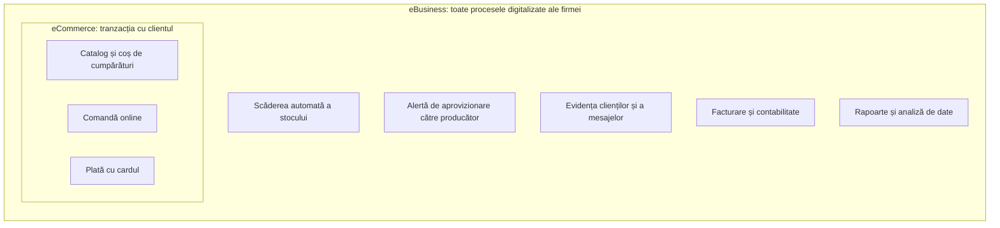

### 1.5.2 Exemplul-cheie: plata și stocul

Un client al „Cămării de la Dunăre” pune în coș două borcane de dulceață de caise și plătește cu cardul.

- **Plata cu cardul este eCommerce.** Este un schimb comercial între firmă și client, făcut prin internet. Fiind eCommerce, este automat și eBusiness.
- **Scăderea automată a stocului după plată este eBusiness, dar nu este eCommerce.** Nimeni nu cumpără și nimeni nu vinde nimic în acel moment. Este un proces intern al firmei, declanșat de tranzacție: sistemul modifică stocul de la 40 la 38 de borcane, ca următorul client să nu poată comanda ceva ce nu mai există.

Testul pe care îl poți aplica oricărui proces are două întrebări:

1. Procesul se desfășoară cu ajutorul unui sistem digital? Dacă nu, nu este nici eBusiness, nici eCommerce.
2. Procesul este el însuși o cumpărare sau o vânzare (ofertă, comandă, plată) între firmă și un client ori un partener? Dacă da, este eCommerce (și, implicit, eBusiness). Dacă nu, este eBusiness fără a fi eCommerce.

### 1.5.3 Tabel comparativ

| Criteriu | eCommerce | eBusiness |
|---|---|---|
| Ce acoperă | Cumpărarea și vânzarea prin internet, cu plata și datele aferente | Toate procesele firmei făcute cu sisteme digitale |
| Orientare | Spre tranzacție și venit | Spre funcționarea întregii firme |
| Cine este implicat | Firma și clientul (sau firma și un partener comercial) | Și oameni din interior: gestiune, contabilitate, aprovizionare, suport |
| Întrebarea tipică | „Câte comenzi am și cât încasez?” | „Cum lucrăm mai bine de la un capăt la altul?” |
| Exemple | Magazin online, ofertă pe un marketplace, plată online | Gestiune automată a stocului, evidența clienților, alerte de aprovizionare, rapoarte |
| Sisteme tipice | Platformă de magazin, procesator de plăți | CRM, ERP, SCM, instrumente de analiză (vezi secțiunea 1.7) |
| Relația | Parte a eBusiness | Întregul |

### 1.5.4 Exercițiu lucrat: clasificarea proceselor

Mai jos sunt douăsprezece situații. Acoperă ultimele două coloane și încearcă întâi singur.

| Nr. | Situația | Clasificare | De ce |
|---|---|---|---|
| 1 | Clientul plătește comanda cu cardul pe site | eCommerce (deci și eBusiness) | Este tranzacția însăși |
| 2 | După plată, stocul produsului scade automat | eBusiness, nu eCommerce | Proces intern, fără cumpărare sau vânzare |
| 3 | Firma listează zacusca pe un marketplace și primește comenzi acolo | eCommerce | Vânzare prin internet, pe platforma altcuiva |
| 4 | Când stocul scade sub 10 borcane, sistemul trimite un email producătorului | eBusiness, nu eCommerce | Alertă de aprovizionare; nu este încă o comandă |
| 5 | Firma comandă borcane goale de pe site-ul unui furnizor de ambalaje | eCommerce | Firma este acum cumpărător; este comerț electronic între firme |
| 6 | Contabilul descarcă lunar un fișier cu toate facturile din programul de facturare | eBusiness, nu eCommerce | Proces administrativ digital |
| 7 | Clientul primește automat un email cu numărul de urmărire al coletului | eBusiness, nu eCommerce | Comunicare după tranzacție; nu se vinde nimic |
| 8 | Proprietarul notează comenzile primite la telefon într-un caiet | Niciuna | Nu există sistem digital |
| 9 | Proprietarul se uită săptămânal la un raport cu vizitele și comenzile pe canale | eBusiness, nu eCommerce | Analiză de date pentru decizie |
| 10 | Un client rezervă și plătește online un loc la un atelier de gătit organizat de firmă | eCommerce | Vânzare de serviciu prin internet |
| 11 | Firma transmite factura în sistemul național RO e-Factura | eBusiness, nu eCommerce | Obligație fiscală îndeplinită digital |
| 12 | Clientul comandă pe site și alege plata la livrare, în numerar | eCommerce | Comanda s-a făcut online; plata în numerar nu schimbă natura comenzii |

Situațiile 5 și 12 sunt, de obicei, cele mai înșelătoare. La 5, firma noastră cumpără, nu vinde, dar tot comerț electronic este. La 12, ai putea crede că fără plată online nu avem eCommerce. Comanda plasată prin internet este suficientă.

> **Greșeală frecventă.** „Am magazin online, deci am un eBusiness.” Ai eCommerce, care este o parte din eBusiness. Dacă restul firmei merge pe hârtie, dimensiunea proceselor lipsește aproape complet. Testul practic: după ce clientul apasă „Trimite comanda”, câte lucruri se întâmplă singure și câte așteaptă să le facă un om?

## 1.6 Procesele digitale ale unei firme: traseul unei comenzi

Cel mai simplu mod de a vedea un eBusiness întreg este să urmărești o singură comandă de la un capăt la altul. Traseul are șapte etape.

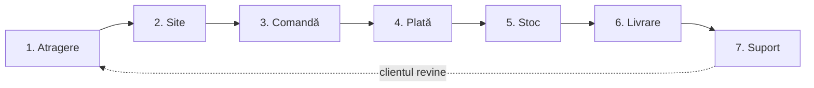

Pentru fiecare etapă punem trei întrebări: ce se întâmplă, ce date apar și ce indicator ne ajută. Indicatorii sunt doar numiți aici. Definițiile exacte, formulele și capcanele lor sunt în capitolul 5.

### 1.6.1 Atragere

**Ce se întâmplă.** Un om află că magazinul există și ajunge pe site. La „Cămara de la Dunăre” poate veni din Căutare, din Reclame, din Email sau Direct. Canalele și felul în care lucrează împreună sunt subiectul capitolului 3.

**Ce date apar.** Numărul de vizite, sursa fiecărei vizite, costul reclamelor, cuvintele căutate, dispozitivul folosit.

**Ce indicator ajută.** Vizitele pe canal și costul pe vizită la canalele plătite. Întrebarea de fond: de unde vin oamenii și cât ne costă să îi aducem?

### 1.6.2 Site

**Ce se întâmplă.** Vizitatorul se uită la produse, citește descrieri, compară, poate adaugă ceva în coș. Site-ul face aici munca unui vânzător: prezintă, răspunde la obiecții, inspiră încredere.

**Ce date apar.** Paginile văzute, timpul petrecut, produsele căutate în motorul intern de căutare, produsele adăugate în coș, punctul în care vizitatorul pleacă.

**Ce indicator ajută.** Proporția vizitelor care ajung la o pagină de produs și proporția celor care adaugă în coș. Întrebarea de fond: găsesc oamenii ce caută?

### 1.6.3 Comandă

**Ce se întâmplă.** Vizitatorul devine client: completează datele de livrare, alege metoda de plată și de transport, confirmă. Este momentul în care se încheie contractul la distanță, cu consecințe juridice (vezi secțiunea 1.10).

**Ce date apar.** Produsele și cantitățile, valoarea comenzii, adresa, codul de reducere folosit, canalul atribuit comenzii, data și ora. Apar și datele personale ale clientului, pe care firma devine responsabilă să le protejeze.

**Ce indicator ajută.** Rata de conversie (câte vizite din o sută se termină cu o comandă) și valoarea medie a comenzii. În septembrie, la „Cămara de la Dunăre”, 553 de comenzi din 18.860 de vizite înseamnă cam 2,9 comenzi la 100 de vizite, iar venitul de 85.400 lei împărțit la 553 de comenzi dă o valoare medie de aproximativ 154 lei (date fictive, construite pentru exercițiu).

### 1.6.4 Plată

**Ce se întâmplă.** Banii trec de la client la firmă: cu cardul, prin transfer sau în numerar la livrare. La plata cu cardul, în configurația obișnuită pentru un magazin mic, clientul introduce datele cardului într-o pagină a procesatorului de plăți, nu în baza de date a magazinului. Procesatorul verifică tranzacția cu banca și îi spune magazinului doar „acceptat” sau „respins”.

**Ce date apar.** Starea plății, metoda, suma, comisionul procesatorului, plățile respinse, rambursările.

**Ce indicator ajută.** Proporția plăților reușite și ponderea fiecărei metode de plată. Întrebarea de fond: pierdem comenzi în ultimul pas?

### 1.6.5 Stoc

**Ce se întâmplă.** Comanda rezervă produsele și stocul scade. Dacă un produs se apropie de zero, cineva (sau ceva) trebuie să anunțe producătorul. La produse alimentare apare și termenul de valabilitate: se vinde întâi lotul care expiră primul.

**Ce date apar.** Stocul pe produs, intrările de la producători, ieșirile prin comenzi, loturile și termenele de valabilitate, zilele în care un produs a fost indisponibil.

**Ce indicator ajută.** Numărul de produse cu stoc epuizat și zilele de stoc rămase la ritmul actual de vânzare. Întrebarea de fond: putem onora ce promite site-ul?

### 1.6.6 Livrare

**Ce se întâmplă.** Comanda este ambalată, se generează documentul de transport, curierul preia coletul și îl duce la client. Clientul primește mesaje cu starea livrării. La „Cămara de la Dunăre”, ambalarea și livrarea costă 14 lei pe comandă (ipoteză fictivă, folosită în tot suportul).

**Ce date apar.** Data predării către curier, data livrării, costul transportului, coletele refuzate sau întoarse, borcanele sparte.

**Ce indicator ajută.** Durata de la comandă la livrare și proporția comenzilor livrate fără incident. Întrebarea de fond: ne ținem promisiunea?

### 1.6.7 Suport

**Ce se întâmplă.** Clientul întreabă ceva, reclamă ceva sau vrea să returneze. Felul în care este tratat aici cântărește mult în decizia lui de a mai cumpăra. Asistența digitală pentru clienți are un capitol întreg, capitolul 4.

**Ce date apar.** Mesajele primite, motivul fiecăruia, timpul până la primul răspuns, retururile și motivele lor, recenziile.

**Ce indicator ajută.** Timpul de răspuns și numărul de solicitări la 100 de comenzi. Întrebarea de fond: ce nu merge, văzut prin ochii clientului?

### 1.6.8 Traseul într-un singur tabel

| Etapă | Ce se întâmplă | Ce date apar | Indicator de pornire |
|---|---|---|---|
| Atragere | Omul află de magazin și vine pe site | Vizite, sursă, cost reclame | Vizite pe canal |
| Site | Caută, compară, adaugă în coș | Pagini văzute, coșuri create | Proporția vizitelor cu adăugare în coș |
| Comandă | Completează datele și confirmă | Produse, valoare, canal, date de contact | Rata de conversie, valoarea medie a comenzii |
| Plată | Banii ajung la firmă | Metodă, stare, comisioane | Proporția plăților reușite |
| Stoc | Produsele sunt rezervate și scăzute | Stoc, loturi, lipsuri | Produse epuizate |
| Livrare | Ambalare, curier, predare | Date, costuri, incidente | Durata de livrare |
| Suport | Întrebări, reclamații, retururi | Mesaje, motive, timp de răspuns | Timp până la primul răspuns |

> **Exemplu.** O comandă urmărită pas cu pas (situație fictivă). Marți seara, o clientă din Brăila caută pe Google „zacuscă de casă cu vinete” și intră pe site din rezultatele neplătite (atragere, canal Căutare). Citește două pagini de produs și pune în coș trei borcane (site). Completează adresa și confirmă o comandă de 152 lei (comandă). Plătește cu cardul; procesatorul confirmă în câteva secunde (plată). Stocul de zacuscă scade de la 31 la 28 de borcane, iar factura se generează singură (stoc). Miercuri dimineață coletul este ambalat, joi ajunge la destinație, iar clienta primește două mesaje cu starea livrării (livrare). Vineri scrie că un capac este ușor îndoit; primește răspuns în aceeași zi și un cod pentru transport gratuit la următoarea comandă (suport). În urma acestei singure comenzi au rămas zeci de înregistrări în mai multe sisteme diferite.

> **De reținut.** Etapele 1-4 sunt, în mare, eCommerce. Etapele 5-7 sunt eBusiness care nu este eCommerce. Clientul vede mai ales primele patru. Costurile, promisiunea ținută și dorința clientului de a reveni depind mult de ultimele trei.

## 1.7 Sistemele din spate, explicate simplu

Fiecare etapă de mai sus se sprijină pe un sistem. Numele lor sună intimidant, dar fiecare răspunde la o întrebare simplă.

### 1.7.1 Platforma de magazin

Este programul care afișează catalogul, ține coșul de cumpărături și înregistrează comenzile. Răspunde la întrebarea „ce vindem și cine ce a comandat?”. Există două familii: platforme închiriate lunar, în care furnizorul se ocupă de găzduire și actualizări (de exemplu Shopify), și platforme instalate pe găzduirea ta, pe care le administrezi singur sau cu un specialist (de exemplu WooCommerce, o extensie pentru WordPress). Prima variantă îți cere mai puține cunoștințe tehnice. A doua îți dă mai mult control și mai multă răspundere.

### 1.7.2 Procesatorul de plăți

Este firma care face legătura dintre magazinul tău, banca clientului și banca ta. Răspunde la întrebarea „a plătit sau nu?”. În varianta cu pagină de plată găzduită, clientul introduce datele cardului pe pagina procesatorului, nu pe a ta. Procesatorul verifică plata, reține un comision și îți virează banii. Pentru o firmă mică, avantajul major este că nu ajunge să stocheze date de card, deci nu își asumă riscurile care vin cu ele.

### 1.7.3 CRM

CRM vine de la Customer Relationship Management, managementul relațiilor cu clienții. Este sistemul în care ții minte cine sunt clienții tăi, ce au cumpărat, ce au întrebat și ce le-ai promis. Răspunde la întrebarea „ce știm despre omul acesta?”. Fără CRM, fiecare mesaj al unui client vechi este tratat ca venind de la un necunoscut.

### 1.7.4 ERP

ERP vine de la Enterprise Resource Planning, planificarea resurselor întreprinderii. Este sistemul care ține la un loc banii, stocurile, achizițiile și facturile, astfel încât o singură operațiune să actualizeze toate evidențele. Răspunde la întrebarea „ce avem, ce datorăm și ce ni se datorează?”. Într-un ERP, o vânzare scade stocul, creează factura și apare în contabilitate fără ca cineva să o introducă de trei ori.

### 1.7.5 SCM

SCM vine de la Supply Chain Management, managementul lanțului de aprovizionare. Acoperă tot drumul produsului: de la furnizor, prin depozit, până la client. Răspunde la întrebarea „de unde vine marfa, când vine și cum pleacă?”. La un magazin cu produse de la producători locali, SCM înseamnă să știi ce cantitate poate livra fiecare producător, în cât timp și ce faci când recolta de caise a fost slabă.

### 1.7.6 Firma mică față de firma mare

Când auzi „ERP”, e ușor să îți imaginezi un sistem uriaș și scump, potrivit doar pentru corporații. La o firmă mică, aceeași funcție există, doar că arată modest. Tabelul de mai jos este cel mai util din această secțiune.

| Sistem | Întrebarea la care răspunde | Într-o firmă mică | Într-o firmă mare |
|---|---|---|---|
| Platformă de magazin | Ce vindem și cine ce a comandat? | Un abonament la o platformă gata făcută, cu o temă standard | Platformă adaptată sau construită la comandă, cu echipă proprie de dezvoltare |
| Procesator de plăți | A plătit sau nu? | Un singur procesator, integrat printr-un modul gata făcut | Mai mulți procesatori, rate, portofele electronice, reguli antifraudă proprii |
| CRM | Ce știm despre client? | Lista de clienți din platforma de magazin, plus serviciul de email și un tabel | Sistem dedicat, cu istoric complet pe toate canalele și echipe de vânzări și suport |
| ERP | Ce avem, ce datorăm, ce ni se datorează? | Program de facturare și gestiune, legat de contabil | Sistem integrat: financiar, achiziții, producție, resurse umane |
| SCM | De unde vine marfa și cum pleacă? | Un tabel cu producătorii, telefonul și contul de la firma de curierat | Sisteme de planificare a cererii, depozite automatizate, schimb electronic de date cu furnizorii |

Două observații practice.

Prima: la o firmă mică, sistemele sunt de obicei bucăți separate, iar valoarea vine din felul în care le legi. Legătura se numește integrare. Poate fi un modul gata făcut care trimite comenzile din platforma de magazin în programul de facturare, sau un export săptămânal într-un tabel. Fiecare loc în care un om recopiază date dintr-un sistem în altul este un loc în care apar erori și se pierde timp.

A doua: un tabel bine ținut este un sistem legitim. O firmă mică poate funcționa bine cu un tabel partajat pe post de CRM și de SCM. Problema nu este tabelul. Problema apare când sunt cinci tabele care se contrazic și nimeni nu știe care este cel corect.

> **Exemplu.** La „Cămara de la Dunăre” (situație fictivă), harta sistemelor ar putea arăta astfel: platforma de magazin ține catalogul și comenzile; procesatorul de plăți confirmă plățile cu cardul; un program de facturare și gestiune emite facturile și ține stocul (un ERP în miniatură); serviciul de email ține lista de abonați; un tabel partajat conține producătorii, prețurile de achiziție și termenele lor de livrare (un SCM în miniatură). Setul de date pe care îl vei analiza în capitolele următoare, cu vizite, comenzi, venit și costuri pe săptămâni și canale, este exact genul de fișier care rezultă atunci când aduni la un loc exporturi din aceste sisteme.

> **Pentru afacerea ta.** Desenează pe o foaie sistemele pe care le folosești și trage o săgeată de fiecare dată când o informație trece dintr-unul în altul. Scrie pe săgeată „automat” sau „manual”. Săgețile manuale pe care trec multe date sunt candidații pentru următoarea ta investiție.

## 1.8 Scurt istoric al internetului comercial și al comerțului electronic

Nu ai nevoie de o istorie completă. Ai nevoie de câteva repere care explică de ce lucrurile arată azi așa. Am inclus doar momente verificate în sursele indicate.

| An | Ce s-a întâmplat | De ce contează | Sursă |
|---|---|---|---|
| 1986 | Fundația Națională pentru Știință din SUA (NSF, National Science Foundation) lansează rețeaua NSFNET, care leagă cercetătorii de centrele de supercalculatoare | Rețeaua devine coloana vertebrală a internetului american; scopul ei este academic, nu comercial | NSF, „Birth of the Commercial Internet” |
| 1989 | Tim Berners-Lee, cercetător britanic la CERN (Organizația Europeană pentru Cercetare Nucleară), inventează World Wide Web, gândit pentru schimbul automat de informații între oameni de știință | Apare „web-ul”: pagini legate între ele, accesibile printr-un browser | CERN, „The birth of the Web” |
| 1993 | La 30 aprilie, CERN pune software-ul World Wide Web în domeniul public | Oricine poate folosi și dezvolta software-ul web fără licență | CERN, „The birth of the Web” |
| 1995 | NSF închide NSFNET, după extinderea rapidă a serviciilor comerciale de internet | Infrastructura internetului trece la operatori comerciali | NSF, „Birth of the Commercial Internet” |
| 1995 | În iulie, Amazon se deschide ca librărie online, din casa fondatorului Jeff Bezos din Bellevue, statul Washington | Un magazin care a pornit direct pe internet, fără magazin fizic | Amazon, „About Amazon” |
| 2014 | 18,9% dintre firmele din UE au vânzări electronice | Punct de referință pentru deceniul următor | Eurostat, E-commerce statistics |
| 2018 | De la 25 mai se aplică Regulamentul general privind protecția datelor (GDPR) | Datele clienților devin o responsabilitate reglementată unitar în UE | Regulamentul (UE) 2016/679, art. 99 |
| 2024 | 23,6% dintre firmele din UE au vânzări electronice; în România, facturarea electronică devine obligatorie între firme de la 1 ianuarie | Vânzarea electronică a crescut, dar rămâne minoritară între firme; statul digitalizează fiscalitatea | Eurostat; Comisia Europeană, „eInvoicing in Romania” |
| 2025 | 78% dintre utilizatorii de internet din UE cumpără online, față de 62% în 2015 | Cumpărăturile online au devenit comportament majoritar | Eurostat, E-commerce statistics for individuals |

Din tabel se văd trei etape.

**Internetul ca unealtă academică.** NSFNET a fost construită pentru cercetători, iar web-ul însuși a apărut ca soluție la o problemă a oamenilor de știință: cum împarți informații între universități și institute din țări diferite.

**Deschiderea comercială.** Două momente din tabel au pregătit terenul pentru comerțul electronic: software-ul web a fost pus la dispoziția tuturor (1993), iar infrastructura a trecut la operatori comerciali (1995). În același an 1995 se deschidea și librăria online Amazon. Cărțile sunt un produs ușor de descris pe o pagină și ușor de expediat.

**Maturizarea.** În ultimii zece ani, cumpărăturile online au devenit obișnuință pentru majoritatea europenilor. În paralel s-au adunat reguli: protecția datelor, drepturile consumatorului la distanță, facturarea electronică. Cine vinde online azi trebuie să cunoască și piața, și regulile.

> **De reținut.** Comerțul electronic are cam treizeci de ani, iar cumpărăturile online au devenit comportament majoritar în UE abia în ultimul deceniu. În România, mai puțin de una din șase firme cu cel puțin 10 angajați vinde electronic. Cine intră azi pe piață nu a pierdut trenul.

## 1.9 Niveluri de maturitate digitală ale unei firme mici

### 1.9.1 Cinci trepte

Maturitatea digitală arată cât de mult se sprijină o firmă pe sisteme și date în munca de zi cu zi. Modelul de mai jos este o simplificare didactică, făcută pentru acest suport, nu un standard oficial. Indicele de intensitate digitală al Eurostat, amintit în secțiunea 1.3, măsoară ceva înrudit la scara întregii economii.

| Nivel | Nume | Cum arată | Semn distinctiv | Riscul principal |
|---|---|---|---|---|
| 0 | Pe hârtie | Comenzi la telefon, caiet, facturi scrise sau făcute într-un editor de text | Proprietarul ține totul în cap | Firma se oprește când proprietarul lipsește |
| 1 | Prezență online | Pagină pe o rețea socială sau site de prezentare; comenzile vin prin mesaje | Clienții te găsesc, dar tot manual lucrezi | Mesaje pierdute, comenzi încurcate |
| 2 | Vânzare online | Magazin online sau cont pe un marketplace, plată online, program de facturare | Clientul poate comanda singur, la orice oră | Sisteme nelegate, date recopiate de mână |
| 3 | Procese integrate | Comanda actualizează singură stocul, factura, documentul de transport și lista de clienți | După „Trimite comanda”, aproape totul curge automat | Dependență de furnizori și de integrări pe care nu le înțelege nimeni din firmă |
| 4 | Decizii pe bază de date | Indicatori urmăriți săptămânal, teste, bugete alocate după rezultate măsurate | Deciziile se iau cu cifrele în față | Măsori multe și decizi puțin; indicatori aleși greșit |

Câteva lămuriri.

Nivelurile nu se sar ușor. O firmă de nivel 1 care vrea direct „inteligență artificială” nu are datele pe care aceasta să lucreze.

Nivelul mai înalt nu este automat mai bun pentru orice firmă. Un producător care vinde tot ce face la două târguri pe an nu are nevoie de nivelul 3. Întrebarea corectă este ce nivel cere strategia ta.

Diferența dintre nivelurile 3 și 4 este cea mai subtilă și cea mai importantă pentru acest curs. La nivelul 3, firma are datele. La nivelul 4, le folosește. „Cămara de la Dunăre” din povestea noastră seamănă cu o firmă de nivel 3 care a luat o decizie de buget fără să se uite la contribuția pe comandă. Datele săptămânale pe canale, pe care le vei analiza și tu, conțineau tot ce trebuia ca problema să fie văzută. Capitolele 5-9 te duc de la nivelul 3 la nivelul 4.

### 1.9.2 Listă de autoevaluare

Răspunde cu „da” sau „nu” la fiecare afirmație, pentru firma ta sau pentru o firmă pe care o cunoști bine. Fii sever: „da” înseamnă că se întâmplă de regulă, nu că s-a întâmplat o dată.

**A. Prezență și vânzare**

1. Firma poate fi găsită online cu informații corecte: ce vinde, program, contact.
2. Un client poate plasa o comandă fără să vorbească cu cineva.
3. Clientul poate plăti online.
4. Site-ul se folosește comod de pe telefon.

**B. Procese**

5. Fiecare comandă ajunge într-un singur loc, indiferent de canalul pe care a venit.
6. Stocul se actualizează fără intervenție manuală.
7. Factura se generează din comandă, fără recopierea datelor.
8. Clientul primește automat confirmarea comenzii și starea livrării.
9. Există o procedură scrisă pentru retururi, pe care o știe toată echipa.

**C. Clienți și date**

10. Poți afla în cinci minute de câte ori a cumpărat un anumit client.
11. Știi pe ce canal a venit fiecare comandă.
12. Lista de email conține doar persoane care și-au dat acordul.
13. Există o copie de siguranță a datelor, făcută automat.

**D. Decizii**

14. Te uiți la aceiași trei până la cinci indicatori în fiecare săptămână.
15. Știi cât câștigi, în medie, la o comandă după toate costurile variabile.
16. Ultima decizie importantă de buget a fost luată pe baza unor cifre, nu a unei impresii.

**E. Conformitate**

17. Site-ul are informare despre prelucrarea datelor personale și despre dreptul de retragere.
18. Facturile se transmit în RO e-Factura în termenul legal.

**Cum interpretezi rezultatul** (orientativ):

| Răspunsuri „da” | Nivel probabil | Următorul pas rezonabil |
|---|---|---|
| 0-3 | 0 sau 1 | Un singur loc în care se adună toate comenzile, chiar și un tabel |
| 4-8 | 2 | Leagă platforma de magazin de facturare și de stoc |
| 9-13 | 3 | Alege trei indicatori și uită-te la ei în fiecare săptămână |
| 14-18 | 4 | Testează sistematic: o schimbare pe rând, măsurată (vezi capitolul 9) |

Atenție la blocul E. Întrebările 17 și 18 nu țin de maturitate, ci de obligații legale. Un „nu” acolo se rezolvă înaintea oricărei alte îmbunătățiri.

> **Pentru afacerea ta.** Nu încerca să urci toate treptele deodată. Alege o singură afirmație la care ai răspuns „nu” și care te costă cel mai mult timp sau cei mai mulți bani. Stabilește un termen de 30 de zile și o măsură clară a reușitei, de exemplu „nicio factură recopiată de mână”.

> **Greșeală frecventă.** A confunda numărul de instrumente cu maturitatea. O firmă cu zece abonamente la aplicații care nu comunică între ele este mai puțin matură decât una cu trei sisteme bine legate și un tabel săptămânal de indicatori.

## 1.10 Cadrul legal de bază pentru cine vinde online

> **De reținut.** Secțiunea aceasta este o orientare, nu consultanță juridică sau fiscală. Regulile se modifică des; cele privind facturarea electronică s-au schimbat de mai multe ori în ultimii ani. Înainte de a lua o decizie, verifică forma actuală a actelor normative și cere părerea unui avocat sau a unui contabil. Informațiile de mai jos reflectă sursele consultate în noiembrie 2026.

Cine vinde online către consumatori din România are de-a face, din prima zi, cu cel puțin trei familii de reguli.

### 1.10.1 Protecția datelor personale (GDPR)

GDPR vine de la General Data Protection Regulation, Regulamentul general privind protecția datelor. Este Regulamentul (UE) 2016/679 și se aplică din 25 mai 2018 (art. 99 din regulament). Fiind regulament european, se aplică direct în toate statele membre.

De ce te privește: orice comandă online conține date personale. Nume, adresă, telefon, email, istoric de cumpărături. Firma care le colectează și decide ce face cu ele se numește operator și răspunde pentru ele.

Regulamentul cere respectarea a șapte principii. Le redăm pe scurt, după prezentarea Comisiei Europene („Principles of the GDPR”):

1. **Legalitate, echitate și transparență.** Ai un temei legal și îi spui omului ce faci cu datele lui.
2. **Limitarea scopului.** Folosești datele pentru scopul anunțat, nu pentru altceva.
3. **Reducerea la minimum a datelor.** Ceri doar ce îți trebuie. Pentru a livra un borcan de miere nu ai nevoie de data nașterii.
4. **Limitarea stocării.** Nu păstrezi datele mai mult decât este necesar.
5. **Exactitate.** Ții datele corecte și la zi.
6. **Integritate și confidențialitate.** Le protejezi: parole, acces limitat, copii de siguranță.
7. **Responsabilitate.** Poți demonstra că respecți toate cele de mai sus.

Orice prelucrare are nevoie de un temei legal. Articolul 6 din regulament prevede șase: consimțământul persoanei, executarea unui contract, o obligație legală, protejarea intereselor vitale ale unei persoane, o sarcină de interes public și interesul legitim al operatorului.

Pentru un magazin online, trei dintre ele apar zilnic:

| Ce faci cu datele | Temei probabil | Observație |
|---|---|---|
| Folosești adresa ca să livrezi comanda | Executarea contractului | Prelucrarea este necesară pentru a onora comanda |
| Păstrezi facturile | Obligație legală | Legislația fiscală și contabilă îți cere să le păstrezi |
| Trimiți newsletter cu oferte | Consimțământ, de regulă | Cere acordul explicit și oferă o dezabonare simplă; verifică detaliile cu un specialist |

Dacă se produce o încălcare a securității datelor (de exemplu, lista de clienți ajunge la cine nu trebuie), operatorul trebuie să anunțe autoritatea de supraveghere, dacă este posibil, în cel mult 72 de ore de când a aflat, cu excepția cazului în care este improbabil ca incidentul să genereze un risc pentru persoane (art. 33). Amenzile maxime prevăzute de regulament ajung, pentru încălcările cele mai grave, la 20 de milioane de euro sau, pentru o întreprindere, la 4% din cifra de afaceri mondială anuală, oricare valoare este mai mare (art. 83). În România, autoritatea de supraveghere este Autoritatea Națională de Supraveghere a Prelucrării Datelor cu Caracter Personal.

Listă de pornire pentru un magazin mic (bune practici, nu o listă completă de obligații): o politică de confidențialitate scrisă clar; formulare care cer doar datele necesare; căsuță de abonare la newsletter nebifată din oficiu; un mod simplu de dezabonare; acces la datele clienților doar pentru cine are nevoie; un răspuns pregătit pentru clientul care întreabă ce date ai despre el.

### 1.10.2 Drepturile consumatorului la vânzarea la distanță

Când vinzi online către o persoană fizică, încheiați un contract la distanță. În România, regulile sunt în Ordonanța de urgență a Guvernului (OUG) nr. 34/2014 privind drepturile consumatorilor, iar pe portalul „Your Europe” al UE găsești prezentarea lor pe scurt, valabilă în toată Uniunea. Ideea de bază: clientul nu a putut vedea și atinge produsul, deci are dreptul să se răzgândească.

Punctele principale, pe scurt:

- **Dreptul de retragere în 14 zile.** Consumatorul poate renunța la contract în 14 zile, fără să dea un motiv. La produse, termenul curge din ziua în care intră în posesia lor (portalul „Your Europe”, pagina despre returnări; OUG nr. 34/2014, art. 9).
- **Dacă nu l-ai informat.** Dacă vânzătorul nu l-a informat pe consumator despre dreptul de retragere, perioada de retragere expiră la 12 luni de la sfârșitul celor 14 zile inițiale (OUG nr. 34/2014, art. 10).
- **Rambursarea.** Vânzătorul restituie banii fără întârziere nejustificată și cel mai târziu în 14 zile de la data la care a fost informat despre retragere, inclusiv costul livrării standard. Poate amâna rambursarea până primește produsele înapoi sau o dovadă că au fost expediate (OUG nr. 34/2014, art. 13).
- **Costul returului.** De regulă, consumatorul suportă costul direct al returnării, în afară de cazul în care vânzătorul a acceptat să îl suporte sau nu l-a informat că îi revine consumatorului (OUG nr. 34/2014, art. 14; „Your Europe”).
- **Excepții.** Dreptul de retragere nu se aplică, printre altele, la produsele făcute după specificațiile clientului sau personalizate clar, la produsele care se pot deteriora sau care expiră rapid și la produsele sigilate care nu pot fi returnate din motive de sănătate sau igienă și care au fost desigilate (OUG nr. 34/2014, art. 16).
- **Garanția legală de conformitate.** Separat de dreptul de retragere, consumatorul are o garanție legală de cel puțin 2 ani pentru produsele cumpărate de la un comerciant din UE („Your Europe”, pagina despre garanții).

Am consultat textul OUG nr. 34/2014 într-o reproducere neoficială. Verifică forma consolidată la zi pe Portalul legislativ înainte de a-ți scrie politica de retur.

> **Exemplu.** Ce înseamnă asta pentru un magazin de produse alimentare ca „Cămara de la Dunăre” (firmă fictivă)? Un borcan de dulceață cu termen de valabilitate de un an nu este, la prima vedere, un produs care „expiră rapid”, deci clientul l-ar putea returna sigilat în 14 zile. Un borcan desfăcut intră probabil sub excepția produselor sigilate, desigilate, care nu pot fi returnate din motive de igienă. Un coș cadou cu numele destinatarului gravat este un produs personalizat. Formulările sunt prudente cu intenție: încadrarea exactă a fiecărui produs se stabilește cu un jurist, iar politica de retur se scrie pe site înainte de prima comandă.

> **Greșeală frecventă.** „Nu acceptăm retururi” scris pe site. Pentru vânzările la distanță către consumatori, dreptul de retragere este prevăzut de lege, cu excepțiile enumerate de ea. O frază în termeni și condiții nu îl face să dispară. În plus, dacă nu informezi clientul despre acest drept, termenul lui de retragere se prelungește.

### 1.10.3 Facturarea electronică (RO e-Factura)

RO e-Factura este sistemul național de facturare electronică, operat prin Agenția Națională de Administrare Fiscală (ANAF), în care facturile se transmit în format electronic structurat. Cadrul legal de bază este OUG nr. 120/2021, modificată de mai multe ori.

Calendarul, pe scurt, după fișa de țară a Comisiei Europene („eInvoicing in Romania”, actualizată în octombrie 2026) și după materialul ANAF privind OUG nr. 89/2025:

| Relația | Ce înseamnă | De când este obligatorie transmiterea în RO e-Factura |
|---|---|---|
| B2G (business to government) | Firmă către instituții publice | De la 1 iulie 2022, pentru furnizorii instituțiilor publice |
| B2B (business to business) | Firmă către firmă | De la 1 ianuarie 2024 |
| B2C (business to consumer) | Firmă către persoane fizice | De la 1 ianuarie 2025 (opțional între 1 iulie și 31 decembrie 2024) |

Câteva detalii utile pentru un magazin online:

- **Termenul de transmitere.** De la 1 ianuarie 2026, termenul-limită este de 5 zile lucrătoare de la data emiterii facturii. Până la acea dată, termenul era de 5 zile calendaristice (OUG nr. 120/2021, art. 10 alin. (7) și art. 10^1 alin. (2^1), așa cum au fost modificate prin OUG nr. 89/2025; material informativ ANAF, ianuarie 2026).
- **Bonurile fiscale.** Bonurile fiscale emise cu casa de marcat, care îndeplinesc condițiile unei facturi simplificate, sunt exceptate de la transmiterea în relația B2C (OUG nr. 120/2021, art. 10^1 alin. (2)).
- **Clientul persoană fizică primește în continuare factura** de la vânzător, potrivit regulilor din Codul fiscal (OUG nr. 120/2021, art. 10^1 alin. (4)). În practică, magazinele o trimit de obicei pe email. Transmiterea în sistemul național nu înlocuiește comunicarea cu clientul.
- **Formatul.** Factura se transmite ca fișier XML, conform specificațiilor naționale RO_CIUS, bazate pe standardul european EN 16931 (Comisia Europeană, „eInvoicing in Romania”). De obicei, programul de facturare generează și transmite fișierul în locul tău.

Legătura cu restul capitolului: e-Factura este un exemplu curat de eBusiness care nu este eCommerce. Este un proces intern, obligatoriu, făcut integral digital. Este și un argument practic pentru integrare. Un magazin cu 796 de comenzi pe lună (cât are „Cămara de la Dunăre” în noiembrie, date fictive) ar pierde ore întregi dacă ar încărca facturile manual, una câte una. Are nevoie ca platforma de magazin, programul de facturare și sistemul național să fie legate.

### 1.10.4 Ce nu am acoperit

Lista de mai sus este un minim. În funcție de ce vinzi, mai pot apărea: reguli privind informarea despre prețuri și reduceri, reguli privind cookie-urile și comunicările comerciale, cerințe sanitare și de etichetare pentru alimente, obligații privind ambalajele, reguli de TVA pentru vânzările către alte țări din UE. Nu le tratăm aici. Reține doar că există și că merită o discuție cu un specialist înainte de lansare.

## Aplicații

**Aplicația 1. Clasifică procesele Cămării.** Pentru fiecare dintre situațiile de mai jos, spune dacă este eCommerce, eBusiness fără a fi eCommerce sau niciuna, și justifică într-o propoziție: (a) un client folosește codul de reducere de 20% la finalizarea comenzii; (b) sistemul trimite un email automat clienților care au lăsat produse în coș; (c) proprietarul sună producătorul de miere ca să mai ceară 50 de borcane; (d) firma plătește online factura la reclamele de pe o rețea socială; (e) un tabel partajat calculează săptămânal contribuția pe canal; (f) curierul încasează numerar la livrare pentru o comandă plasată pe site.

**Aplicația 2. Harta datelor unei comenzi la Cămară.** Ia exemplul comenzii din secțiunea 1.6.8 (clienta din Brăila). Desenează un tabel cu șapte rânduri, câte unul pentru fiecare etapă, și trei coloane: ce date s-au înregistrat, în ce sistem ajung (platformă de magazin, procesator de plăți, program de facturare și gestiune, serviciu de email, tabel) și cine din firmă are nevoie de ele. Marchează datele personale. Apoi răspunde: care dintre aceste date apar, agregate, în coloanele fișierului `camara_saptamanal.csv` (saptamana, luna, canal, vizite, comenzi, venit, marja_bruta, cost_marketing, cost_ambalare_livrare, contributie) și care nu apar deloc?

**Aplicația 3. Citește tabelul Cămării ca un proprietar.** Folosind doar tabelul din secțiunea 1.1 (date fictive, construite pentru exercițiu), calculează pentru septembrie și pentru noiembrie: numărul de comenzi la 100 de vizite și venitul mediu pe comandă. Scrie trei propoziții pe care proprietarul le-ar putea spune dacă s-ar uita doar la vizite, comenzi și venit, apoi trei propoziții pe care le-ar spune dacă s-ar uita și la rezultat. Ce date suplimentare ai cere ca să confirmi că problema vine de la canalul Reclame?

**Aplicația 4. Trei dimensiuni, o firmă reală.** Alege o firmă locală pe care o cunoști ca client (o florărie, o cafenea cu comenzi online, un magazin de bricolaj). Descrie-o pe cele trei dimensiuni ale eBusiness: ce tehnologie se vede din exterior, ce procese par automate și care par manuale, ce valoare primește clientul din asta. Folosește doar ce poți observa direct; nu presupune ce nu vezi. Propune o singură îmbunătățire și spune pe ce dimensiune acționează.

**Aplicația 5. Pentru afacerea ta: autoevaluarea.** Completează lista din secțiunea 1.9.2 pentru afacerea ta. Dacă nu ai una, completează lista pentru afacerea unui prieten sau a unui membru al familiei, discutând cu el. Stabilește nivelul probabil, alege un singur „nu” pe care vrei să îl transformi în „da” în 30 de zile și scrie: ce schimbi, ce unealtă folosești, cât costă și cum vei ști că ai reușit.

**Aplicația 6. Pentru afacerea ta: harta sistemelor.** Desenează sistemele pe care le folosește afacerea ta (sau cea aleasă la aplicația 5), cu săgeți între ele pentru fiecare flux de date. Notează pe fiecare săgeată „automat” sau „manual” și estimează câte minute pe săptămână consumă săgețile manuale. Care este cea mai scumpă?

**Aplicația 7. Verificare de conformitate, la nivel de observator.** Deschide site-urile a două magazine online mici din România. Fără să tragi concluzii juridice, verifică dacă găsești ușor: datele de identificare ale vânzătorului, informații despre dreptul de retragere și despre cum se face returul, o politică de confidențialitate, o căsuță de abonare la newsletter care nu este bifată din oficiu. Notează cât timp ți-a luat să găsești fiecare informație. Ce ai face altfel pe site-ul tău?

**Aplicația 8. Actualizează cifrele.** Deschide setul de date Eurostat isoc_ec_ib20 și caută valoarea cea mai recentă pentru România și pentru UE la indicatorul „ultima cumpărătură online în ultimele 12 luni”. S-a schimbat față de valorile din secțiunea 1.3? Scrie două propoziții despre tendință, cu sursa și data accesării.

## Întrebări de verificare

1. Care este diferența dintre digitizare, digitalizare și transformare digitală?
2. Numește cele trei dimensiuni ale eBusiness și dă câte un exemplu pentru fiecare.
3. De ce spunem că eCommerce este inclus în eBusiness și nu invers?
4. Plata cu cardul și scăderea automată a stocului: cum se clasifică fiecare și de ce?
5. O comandă plasată pe site, cu plata în numerar la livrare, este eCommerce? Argumentează.
6. Care sunt cele șapte etape ale traseului unei comenzi?
7. La ce întrebare răspunde fiecare dintre sistemele CRM, ERP și SCM?
8. Cum arată un „ERP” într-o firmă cu trei oameni?
9. Ce diferență este între nivelul 3 și nivelul 4 de maturitate digitală din modelul capitolului?
10. În cât timp poate un consumator să se retragă dintr-un contract la distanță și ce se întâmplă dacă vânzătorul nu l-a informat despre acest drept?
11. De când este obligatorie transmiterea facturilor în RO e-Factura în relația cu persoanele fizice și care este termenul de transmitere aplicabil din 2026?
12. În povestea „Cămării de la Dunăre”, de ce au crescut comenzile, dar a scăzut rezultatul?

### Răspunsuri

1. Digitizarea mută o informație de pe hârtie în format digital. Digitalizarea face un proces cu ajutorul tehnologiei. Transformarea digitală schimbă felul în care firma funcționează și câștigă bani.
2. Tehnologie (platforma de magazin), procese (comanda scade stocul și generează factura), valoare (clientul primește coletul repede, firma are costuri mai mici).
3. eCommerce acoperă doar cumpărarea și vânzarea prin internet. eBusiness acoperă toate procesele digitalizate, inclusiv cele interne, deci îl cuprinde pe primul.
4. Plata cu cardul este eCommerce (și, implicit, eBusiness), pentru că este tranzacția. Scăderea stocului este eBusiness, dar nu eCommerce, pentru că este un proces intern în care nu se cumpără și nu se vinde nimic.
5. Da. Comanda s-a făcut prin internet; metoda de plată nu schimbă natura ei.
6. Atragere, site, comandă, plată, stoc, livrare, suport.
7. CRM: ce știm despre client. ERP: ce avem, ce datorăm și ce ni se datorează. SCM: de unde vine marfa, când vine și cum pleacă.
8. De regulă, un program de facturare și gestiune legat de contabil, eventual completat de un tabel.
9. La nivelul 3, firma are procese integrate și date. La nivelul 4, folosește datele în mod regulat ca să ia decizii.
10. În 14 zile, fără motiv; la produse, din ziua în care le primește. Dacă nu a fost informat, perioada de retragere expiră la 12 luni de la sfârșitul celor 14 zile.
11. De la 1 ianuarie 2025. Din 1 ianuarie 2026, termenul este de 5 zile lucrătoare de la emiterea facturii.
12. Bugetul de Reclame a crescut de la 2.400 la 16.800 lei pe lună, cu un cod de reducere de 20%. Comenzile aduse astfel au avut valoare și marjă mai mici, iar contribuția pe comandă pe acest canal a ajuns la -40 lei (date fictive, construite pentru exercițiu).

## De reținut

- Transformarea digitală nu înseamnă să cumperi tehnologie, ci să schimbi procese și decizii cu ajutorul ei.
- eBusiness are trei dimensiuni: tehnologie (cu ce lucrăm), procese (cum lucrăm) și valoare (ce iese și pentru cine). Ordinea sănătoasă de gândire este inversă: valoare, proces, apoi tehnologie.
- eCommerce ⊂ eBusiness. Plata cu cardul este eCommerce. Scăderea automată a stocului după plată este eBusiness, dar nu eCommerce.
- O comandă parcurge șapte etape: atragere, site, comandă, plată, stoc, livrare, suport. Fiecare lasă date, iar fiecare are cel puțin un indicator care merită urmărit.
- CRM, ERP și SCM sunt funcții, nu neapărat produse scumpe. Într-o firmă mică pot fi un program de facturare, un serviciu de email și un tabel bine ținut, cu condiția să fie legate între ele.
- În România, aproximativ șase din zece adulți cumpără online, dar puține firme vând online. Este o oportunitate și o presiune în același timp.
- Maturitatea digitală se construiește treaptă cu treaptă. Pentru acest curs, pasul care contează este cel de la „avem datele” la „le folosim în decizii”.
- Cine vinde online are obligații din prima zi: protecția datelor (GDPR), dreptul de retragere de 14 zile al consumatorului și transmiterea facturilor în RO e-Factura. Regulile se schimbă, deci se verifică la sursă.

## Surse și lecturi recomandate

**Statistici și documente oficiale**

- Eurostat, „E-commerce statistics for individuals” (Statistics Explained), date extrase în februarie 2026. https://ec.europa.eu/eurostat/statistics-explained/index.php?title=E-commerce_statistics_for_individuals (accesat în noiembrie 2026).
- Eurostat, setul de date „Internet purchases by individuals (2020 onwards)”, cod isoc_ec_ib20, valori 2024 și 2025 pentru UE și România, obținute prin interfața de date Eurostat. https://ec.europa.eu/eurostat/databrowser/view/isoc_ec_ib20/default/table?lang=en (accesat în noiembrie 2026).
- Eurostat, „E-commerce statistics” (Statistics Explained), anul de referință 2024, date extrase în februarie 2026. https://ec.europa.eu/eurostat/statistics-explained/index.php?title=E-commerce_statistics (accesat în noiembrie 2026).
- Eurostat, „Digitalisation in Europe, 2026 edition”. https://ec.europa.eu/eurostat/web/interactive-publications/digitalisation-2026 (accesat în noiembrie 2026).

**Reglementări**

- Regulamentul (UE) 2016/679 (Regulamentul general privind protecția datelor), art. 6, 33, 83 și 99, consultat în reproducerea de pe https://gdpr-info.eu/ (accesat în noiembrie 2026). Textul oficial se găsește pe EUR-Lex: https://eur-lex.europa.eu/eli/reg/2016/679/oj
- Comisia Europeană, „Principles of the GDPR”. https://commission.europa.eu/law/law-topic/data-protection/rules-business-and-organisations/principles-gdpr_en (accesat în noiembrie 2026).
- Uniunea Europeană, portalul „Your Europe”, „Returnări” și „Garanții și returnări”. https://europa.eu/youreurope/citizens/consumers/shopping/returns/index_ro.htm și https://europa.eu/youreurope/citizens/consumers/shopping/guarantees-returns/index_ro.htm (accesate în noiembrie 2026).
- Ordonanța de urgență a Guvernului nr. 34/2014 privind drepturile consumatorilor în cadrul contractelor încheiate cu profesioniștii, art. 9, 10, 13, 14 și 16, text consultat în reproducerea neoficială de pe https://legeaz.net/monitorul-oficial-427-2014/oug-34-2014-drepturile (accesat în noiembrie 2026). Pentru forma consolidată la zi, vezi Portalul legislativ: https://legislatie.just.ro
- Ordonanța de urgență a Guvernului nr. 120/2021 privind sistemul național RO e-Factura, forma de bază, pe Portalul legislativ. https://legislatie.just.ro/Public/DetaliiDocument/255162 (accesat în noiembrie 2026).
- ANAF, Direcția Generală Regională a Finanțelor Publice Brașov, „Modificări aduse OUG nr. 120/2021 [...] de OUG 89/2025”, material informativ din 8 ianuarie 2026. https://static.anaf.ro/static/10/Brasov/Brasov/facturare_electronica_89.pdf (accesat în noiembrie 2026).
- Comisia Europeană, „eInvoicing in Romania”, pagină actualizată în octombrie 2026. https://ec.europa.eu/digital-building-blocks/sites/display/DIGITAL/eInvoicing+in+Romania (accesat în noiembrie 2026).

**Istoric**

- CERN, „The birth of the Web”. https://home.cern/science/computing/the-birth-of-the-web/ (accesat în noiembrie 2026).
- U.S. National Science Foundation, „Birth of the Commercial Internet”. https://www.nsf.gov/impacts/internet (accesat în noiembrie 2026).
- Amazon, „About Amazon”, articol despre primul sediu al companiei. https://www.aboutamazon.com/news/workplace/first-amazon-office-jeff-bezos-garage (accesat în noiembrie 2026).

**Cărți (lecturi recomandate; citate în prezentările de curs, parafrazate aici)**

- Westerman, G., Bonnet, D., McAfee, A. (2014). *Leading Digital: Turning Technology into Business Transformation*. Harvard Business Review Press.
- Laudon, K. C., Traver, C. G. *E-commerce: Business, Technology, Society*. Pearson (mai multe ediții).
- Turban, E., Outland, J., King, D., Lee, J. K., Liang, T.-P., Turban, D. C. (2018). *Electronic Commerce 2018: A Managerial and Social Networks Perspective*. Springer.
- Chaffey, D., Ellis-Chadwick, F. (2019). *Digital Marketing: Strategy, Implementation and Practice* (ediția a 7-a). Pearson.
- Jelassi, T., Martínez-López, F. J. (2020). *Strategies for e-Business: Concepts and Cases on Value Creation and Digital Business Transformation* (ediția a 4-a). Springer.

---

# Capitolul 2. Modele de afaceri online: cine vinde cui și din ce vin banii

## Ce vei putea face după acest capitol

- Să descrii modelul unei afaceri online în cinci întrebări simple și să îl așezi pe Business Model Canvas.
- Să deosebești relația dintre participanți (B2C, B2B, C2C, B2G, G2B) de mecanismul de venit (vânzare directă, abonament, comision, publicitate, freemium, licențiere).
- Să alegi, pentru o idee de afacere, combinațiile relație × mecanism care au sens și să explici de ce altele nu au.
- Să compari vânzarea pe un marketplace cu vânzarea în magazinul propriu, cu avantaje, costuri și riscul de dependență.
- Să explici de ce venitul nu este profit, folosind costuri fixe, costuri variabile și marjă.
- Să analizezi modelul unei afaceri digitale existente cu o grilă de opt întrebări și să spui ce date ți-ar mai trebui.

## 2.1 Ce este un model de afaceri

### 2.1.1 Definiția, pe înțeles

În manuale, modelul de afaceri este descris ca logica prin care o organizație creează, livrează și captează valoare. Formularea este corectă, dar greu de folosit luni dimineața. O rescriem în cinci întrebări la care orice antreprenor trebuie să poată răspunde în câte o propoziție:

1. **Ce problemă rezolvi și de ce te-ar alege cineva pe tine?** Aceasta este propunerea de valoare.
2. **Pentru cine?** Aceștia sunt clienții, grupați în segmente.
3. **Cum ajungi la ei și cum ajunge produsul la ei?** Acestea sunt canalele.
4. **Din ce încasezi bani?** Acestea sunt veniturile, mai precis mecanismul de venit.
5. **Pe ce cheltuiești ca să faci toate acestea?** Acestea sunt costurile.

Dacă una dintre cele cinci propoziții lipsește sau sună vag („pentru toată lumea”, „din vânzări”), modelul nu este încă gândit până la capăt.

> **Exemplu.** Cămara de la Dunăre, magazinul online fictiv din Galați pe care îl urmărim în tot suportul de curs, răspunde așa: (1) aduce într-un singur loc dulcețuri, zacuscă, miere și siropuri de la producători locali, cu livrare acasă; (2) pentru familii din orașe care vor produse făcute ca la țară și nu au de unde să le cumpere; (3) printr-un site propriu, la care oamenii ajung din căutări pe Google, din reclame, din email și direct; (4) din vânzarea produselor, cu un adaos peste prețul plătit producătorilor; (5) cheltuiește pe marfă, pe ambalare și livrare, pe reclame și pe costurile fixe ale firmei.

Două lucruri merită observate de la început. Primul: modelul de afaceri nu este același lucru cu produsul. Două firme pot vinde aceeași zacuscă având modele complet diferite: una o vinde bucată cu bucată în magazinul propriu, alta o trimite lunar într-o cutie cu abonament, a treia o livrează en-gros restaurantelor. Al doilea: modelul de afaceri nu este același lucru cu planul de afaceri. Planul este un document cu termene și bugete. Modelul este schema de funcționare, care trebuie să încapă pe o pagină.

Clasificările pe care le folosim în acest capitol au o istorie. Paul Timmers a propus în 1998 una dintre primele tipologii ale modelelor de afaceri pentru piețele electronice, iar manualele de comerț electronic (de exemplu Laudon și Traver) folosesc de atunci două criterii: cine participă la tranzacție și cum se obține venitul. Prezentarea de la curs pornește de la primul criteriu. Noi le vom ține pe amândouă, separat, pentru că amestecarea lor este cea mai frecventă sursă de confuzie.

### 2.1.2 Business Model Canvas, pe scurt

Business Model Canvas este o schemă pe o singură pagină, propusă de Alexander Osterwalder și Yves Pigneur în cartea „Business Model Generation” (2010). Împarte modelul în nouă căsuțe. Cele cinci întrebări de mai sus se regăsesc toate; canvasul adaugă detalii despre partea „din spate” a afacerii: ce resurse, ce activități și ce parteneri îți trebuie.

Tabelul 2.1 arată cele nouă căsuțe completate pentru Cămara. Datele despre Cămara sunt fictive, construite pentru exercițiu.

**Tabelul 2.1.** Business Model Canvas pentru Cămara de la Dunăre

| Căsuța | Întrebarea la care răspunde | Cămara de la Dunăre (exemplu fictiv) |
|---|---|---|
| Segmente de clienți | Pentru cine creăm valoare? | Familii din orașe, 30-55 de ani, care cumpără produse tradiționale; oameni care caută cadouri; pe viitor, cafenele și pensiuni |
| Propunerea de valoare | Ce problemă rezolvăm? De ce noi? | Produse de la producători locali verificați, într-un singur coș, livrate acasă; povestea fiecărui producător |
| Canale | Cum află clienții de noi și cum primesc produsul? | Site propriu; trafic din Căutare, Reclame, Email și Direct; livrare prin curier |
| Relații cu clienții | Ce fel de legătură păstrăm? | Newsletter, răspuns rapid la întrebări, recomandări de rețete (vezi capitolul 4 pentru asistența clienților) |
| Fluxuri de venit | Din ce încasăm? | Vânzare directă, cu marjă brută de 45% la preț întreg |
| Resurse cheie | Ce trebuie să avem? | Relațiile cu producătorii, un spațiu de depozitare, site-ul, lista de email |
| Activități cheie | Ce trebuie să facem bine? | Selecția produselor, ambalarea fără borcane sparte, livrarea la timp, marketingul |
| Parteneri cheie | Pe cine ne bazăm? | Producătorii locali, firma de curierat, procesatorul de plăți |
| Structura costurilor | Pe ce cheltuim? | Marfa, ambalare și livrare (14 lei pe comandă), reclame, costuri fixe (10.000 lei pe lună) |

Cum folosești canvasul în practică:

- Completează-l în 20-30 de minute, cu propoziții scurte. Dacă îți ia o zi, scrii un plan de afaceri, nu un canvas.
- Începe din dreapta (clienți, propunere de valoare), nu din stânga. Resursele și partenerii decurg din ce promiți clientului.
- Tratează fiecare căsuță ca pe o ipoteză. „Familiile din orașe vor plăti 25 de lei pe un borcan de dulceață” este o presupunere până când ai comenzi care o confirmă.
- Refă-l când schimbi ceva important. Un canvas vechi de doi ani descrie o altă firmă.

> **De reținut.** Canvasul nu îți spune dacă modelul este bun. Îți arată doar dacă este complet și coerent: dacă promiți livrare în 24 de ore, trebuie să apară undeva partenerul și costul care fac promisiunea posibilă.

## 2.2 Două axe pe care nu trebuie să le amesteci

Când cineva spune „am un business B2B”, îți spune **cui vinde**. Când spune „am un business pe abonament”, îți spune **cum încasează**. Sunt răspunsuri la două întrebări diferite:

- **Axa 1, relația dintre participanți:** cine vinde și cine cumpără. Aici intră B2C, B2B, C2C, B2G și G2B.
- **Axa 2, mecanismul de venit:** pentru ce anume plătește clientul și cum se face încasarea. Aici intră vânzarea directă, abonamentul, comisionul, publicitatea, freemium, licențierea.

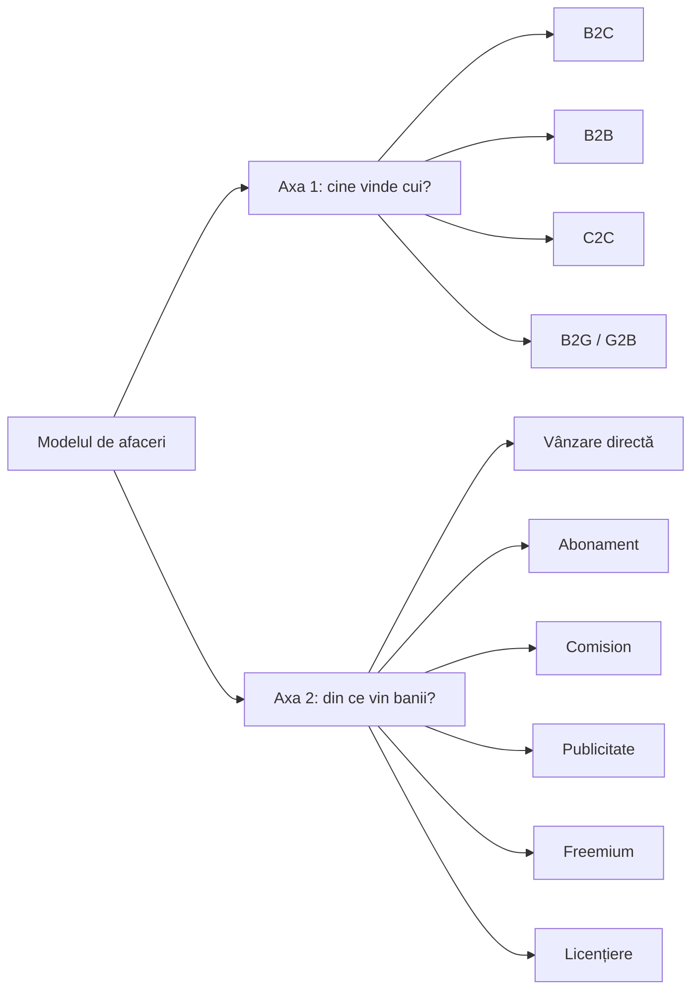

Axele sunt independente. Abonamentul există și în B2C (o cutie lunară cu dulcețuri pentru o familie), și în B2B (un program de facturare plătit lunar de o firmă). Comisionul există și în C2C (o platformă de anunțuri între persoane), și în B2B (o platformă de comenzi pentru restaurante). De aceea „abonamentul” nu este nici B2C, nici B2B: este un mecanism care se poate așeza peste oricare relație.

> **Greșeală frecventă.** „Modelul nostru este B2C” ca răspuns la întrebarea „din ce faceți bani?”. B2C spune doar că vinzi către persoane fizice. Nu spune dacă încasezi pe bucată, lunar, din comisioane sau din reclame. O descriere completă are mereu două părți: „vindem către consumatori (B2C), prin vânzare directă și, pentru o parte din clienți, prin abonament”.

De ce contează separarea? Pentru că fiecare axă schimbă alte lucruri în afacere. Relația îți schimbă ciclul de vânzare, felul în care comunici și valoarea unei comenzi. Mecanismul de venit îți schimbă fluxul de numerar și indicatorii la care te uiți. Dacă le amesteci, vei copia practici care nu ți se potrivesc: vei încerca, de exemplu, să vinzi unei cafenele cu un cod de reducere pe Instagram, deși proprietarul cafenelei vrea o listă de prețuri, o factură cu termen de plată și o persoană de contact.

## 2.3 Axa 1: relația dintre participanți

### 2.3.1 B2C: firma vinde consumatorului

B2C înseamnă Business-to-Consumer, adică de la firmă la consumator. Firma vinde persoanelor fizice, care cumpără pentru ele sau pentru familie.

**Caracteristici.** Multe tranzacții, fiecare de valoare mică. Clientul decide singur și repede, uneori din impuls. Nu negociază prețul: îl acceptă sau pleacă. Nu semnează un contract negociat: acceptă termenii afișați pe site.

**Cum arată ciclul de vânzare.** Scurt. Omul vede o reclamă sau caută „zacuscă de casă”, intră pe site, compară două sau trei produse, pune în coș și plătește. De la prima vizită la comandă pot trece zece minute sau câteva zile, rar mai mult.

**Ce contează pentru client.** Încrederea (cine sunteți, ce spun alții), simplitatea comenzii, costul și durata livrării, posibilitatea de retur, felul în care arată produsul în poze. În B2C, experiența de cumpărare este o parte din produs.

**Cât de mare este fenomenul.** În Uniunea Europeană, 78% dintre utilizatorii de internet au cumpărat online în 2025, față de 62% în 2015. România are cea mai mare creștere dintre țările menționate în analiza Eurostat: 46 de puncte procentuale între 2015 și 2025 (Eurostat, „E-commerce statistics for individuals”, date extrase în februarie 2026, https://ec.europa.eu/eurostat/statistics-explained/index.php?title=E-commerce_statistics_for_individuals).

> **Exemplu.** Cămara este în primul rând un magazin B2C. În septembrie a avut 553 de comenzi și un venit de 85.400 lei, adică o comandă medie de aproximativ 154 de lei (date fictive, construite pentru exercițiu). Multe comenzi mici, de la oameni care nu se cunosc între ei și care decid singuri: profilul tipic al relației B2C.

**D2C, un caz particular.** D2C înseamnă Direct-to-Consumer, adică direct către consumator: producătorul vinde el însuși clientului final, fără distribuitor și fără magazin intermediar. Un apicultor care își vinde mierea pe propriul site lucrează D2C. Cămara nu este D2C, pentru că nu produce: este un comerciant care revinde. Diferența contează la marjă. Producătorul D2C păstrează și adaosul pe care altfel l-ar lua comerciantul, dar preia și toată munca acestuia: site, marketing, ambalare, relația cu clienții.

### 2.3.2 B2B: firma vinde altei firme

B2B înseamnă Business-to-Business, adică de la firmă la firmă. Cumpărătorul este o organizație, care folosește produsul în activitatea ei sau îl revinde.

**Caracteristici.** Mai puține tranzacții, de valoare mai mare. Relații pe termen lung. Prețuri negociate, adesea diferite de la un client la altul, cu reduceri de volum. Plata se face de regulă pe factură, la termen (de exemplu la 30 de zile), nu cu cardul în momentul comenzii.

**Cum arată ciclul de vânzare.** Lung și în mai mulți pași: primul contact, mostre, ofertă de preț, negociere, uneori contract, prima comandă de probă, apoi comenzi repetate. Decizia aparține rareori unui singur om. Cine folosește produsul (barista), cine decide (proprietarul) și cine plătește (contabilitatea) pot fi trei persoane diferite, fiecare cu alte întrebări.

**Ce contează pentru client.** Siguranța aprovizionării (ai marfă și luna viitoare?), calitatea constantă, prețul la volum, termenele de plată, documentele corecte (factură, aviz, declarații de conformitate), un om de contact care răspunde. Aspectul site-ului contează mai puțin; fiabilitatea contează mai mult.

**Cât de mare este fenomenul.** Publicul vede mai ales comerțul B2C, dar vânzările dintre firme sunt cel puțin la fel de mari. În 2024, vânzările pe web ale firmelor din UE către alte firme și către instituții publice au reprezentat 4,34% din cifra de afaceri totală, față de 4,04% pentru vânzările pe web către consumatori (Eurostat, „E-commerce statistics”, date extrase în februarie 2026, https://ec.europa.eu/eurostat/statistics-explained/index.php?title=E-commerce_statistics).

> **Exemplu.** Trei cafenele din Galați și Brăila vor siropurile și dulcețurile Cămării pentru meniul lor. Nu vor cumpăra din site, cu coș și card. Vor cere o listă de prețuri en-gros, borcane mai mari, livrare în aceeași zi a săptămânii și factură cu plata la 30 de zile. Cămara vinde aceleași produse, dar într-o relație cu totul diferită.

### 2.3.3 C2C: consumatorul vinde altui consumator

C2C înseamnă Consumer-to-Consumer, adică de la consumator la consumator. Două persoane fizice fac o tranzacție între ele, iar o platformă le ajută să se găsească. Platformele de anunțuri și cele de haine la mâna a doua sunt exemplele obișnuite.

**Caracteristici.** Vânzătorul nu este un profesionist. Produsele sunt adesea unicat sau folosite. Platforma nu deține marfa: ea pune la dispoziție locul de întâlnire, căutarea, uneori plata și livrarea.

**Cum arată ciclul de vânzare.** Cumpărătorul caută, scrie vânzătorului, negociază direct, apoi plătește și primește coletul sau se întâlnește cu vânzătorul. Ciclul este scurt, dar nesigur: nimeni nu garantează că produsul arată ca în poze.

**Ce contează pentru client.** Încrederea într-un necunoscut. De aceea platformele C2C investesc în mecanisme de reputație: calificative, recenzii, profil verificat, plată ținută de platformă până la confirmarea primirii. Fără aceste mecanisme, piața se blochează, pentru că nimeni nu vrea să plătească primul.

**De unde vin banii.** Aici se vede bine separarea celor două axe. Relația este C2C, dar platforma este o firmă, iar veniturile ei vin din mecanisme de pe axa a doua: comision din tranzacție, taxă de listare, taxă pentru promovarea anunțului, publicitate.

> **De reținut.** În C2C există de fapt trei participanți: vânzătorul, cumpărătorul și platforma. Când analizezi un model C2C, întreabă mereu „cine plătește platforma și pentru ce?”.

**C2B, pe scurt.** C2B înseamnă Consumer-to-Business, adică de la consumator la firmă: o persoană fizică oferă ceva unei firme. Exemple: un fotograf amator care își vinde pozele printr-o bancă de imagini, un creator de conținut plătit de o marcă pentru o recomandare. Pentru Cămara, un client care trimite o rețetă filmată și primește în schimb un voucher este un mic aranjament C2B.

### 2.3.4 B2G și G2B: firma și statul

B2G înseamnă Business-to-Government, adică de la firmă la administrația publică: firma vinde statului (unei primării, unei școli, unui spital). G2B înseamnă Government-to-Business, adică de la administrație la firmă: statul oferă firmelor servicii digitale, de la înregistrarea societății la depunerea declarațiilor.

**Caracteristici.** Proceduri standardizate și reglementate strict. Accent pe transparență și pe conformitate: contează să respecți forma, termenele și documentele cerute. Prețul și calitatea nu se negociază la o cafea; se evaluează după criterii anunțate dinainte.

**B2G în România: achizițiile publice electronice.** Legea nr. 98/2016 privind achizițiile publice definește SEAP, Sistemul Electronic de Achiziții Publice, ca sistemul informatic de utilitate publică, accesibil prin internet, folosit pentru aplicarea prin mijloace electronice a procedurilor de atribuire și pentru publicarea anunțurilor la nivel național (Legea nr. 98/2016, art. 3, Portalul Legislativ, https://legislatie.just.ro/Public/DetaliiDocument/178667). Platforma se află la adresa e-licitatie.ro și este operată de Autoritatea pentru Digitalizarea României (ADR), care o descrie ca platforma electronică prin care autoritățile publice cumpără bunuri și servicii și atribuie lucrări (ADR, „Platforme operate”, https://www.adr.gov.ro/en/platforme-operate). În practică vei auzi și numele SICAP, folosit pentru versiunea modernizată a aceleiași platforme; legea și site-ul oficial folosesc denumirea SEAP.

Pentru o firmă mică, două lucruri sunt utile de știut:

- **Achiziția directă.** Sub un anumit prag valoric, o autoritate poate cumpăra direct, fără licitație. În forma legii afișată pe Portalul Legislativ la data consultării, pragul este de 270.120 lei fără TVA pentru produse și servicii (art. 7 alin. (5)). Pragurile se modifică periodic, deci verifică textul la zi.
- **Catalogul electronic.** Firmele înscrise în SEAP își pot publica produsele într-un catalog electronic, din care autoritățile pot cumpăra. În aceeași formă a legii, pentru achizițiile directe de peste 200.000 lei fără TVA la produse și servicii, autoritatea trebuie să folosească fie catalogul electronic, fie un anunț public (art. 7 alin. (7)).

**Ciclul de vânzare în B2G.** Te înregistrezi în sistem ca operator economic, îți publici oferta în catalog sau urmărești anunțurile, depui oferta în formatul cerut, aștepți evaluarea, semnezi contractul, livrezi, facturezi electronic, încasezi la termenul din contract. Totul lasă urme documentate. Ciclul este mai lung decât în B2C și mai formal decât în B2B.

**G2B în România: serviciile digitale ale statului pentru firme.** Chiar dacă nu vinzi niciodată statului, vei folosi serviciile lui digitale. Câteva exemple verificabile în surse oficiale:

| Serviciu | Ce face pentru o firmă | Sursa oficială |
|---|---|---|
| Spațiul Privat Virtual (SPV) al Agenției Naționale de Administrare Fiscală (ANAF) | Canalul electronic de comunicare cu fiscul; prin el se accesează și sistemul RO e-Factura | Ghidul ANAF privind RO e-Factura, https://static.anaf.ro/static/10/Anaf/AsistentaContribuabili_r/Ghid_RO_eFactura.pdf |
| RO e-Factura | Sistemul național de facturare electronică: factura este un fișier XML transmis prin sistem | Același ghid ANAF |
| Portalul Oficiului Național al Registrului Comerțului (ONRC) | Portalul de servicii online al registrului comerțului, instituția la care se înregistrează firmele | https://www.onrc.ro/index.php/ro/servicii-online |
| Ghișeul.ro | Plata online, cu cardul, a taxelor, impozitelor locale și amenzilor | ADR, „Platforme operate” |
| Punctul de Contact Unic electronic (PCUe) și platforma care îl înlocuiește, ROePAS | Proceduri la distanță: declarații, notificări, cereri de autorizare | ADR, „Platforme operate” |

Despre RO e-Factura merită reținut calendarul descris în ghidul ANAF (ediția 2023): în relația B2G, utilizarea sistemului este obligatorie de la 1 iulie 2022; în relația B2B, firmele stabilite în România au avut obligația de a raporta facturile în sistem de la 1 ianuarie 2024 și de a le transmite destinatarilor prin sistem de la 1 iulie 2024. Regulile pentru facturile emise către persoane fizice au fost modificate după apariția acestui ghid, așa că verifică situația la zi pe anaf.ro. Observă și un detaliu interesant: ghidul fiscal folosește chiar etichetele din acest capitol (B2G, B2B, B2C) ca să spună ce reguli se aplică fiecărei facturi. Clasificarea după relație nu este doar teorie de manual; determină obligații concrete.

> **Pentru afacerea ta.** Dacă vinzi produse pe care le cumpără și instituțiile (papetărie, alimente, servicii de curățenie, cursuri), înscrierea în SEAP și publicarea ofertei în catalogul electronic îți deschid un canal pe care concurenții mici îl ignoră adesea. Costul principal este timpul de învățare a procedurilor. Acest paragraf și toată secțiunea sunt informare generală, nu consultanță juridică sau fiscală: înainte să acționezi, citește textele oficiale la zi sau întreabă un specialist.

> **Exemplu.** O primărie vrea 300 de pachete cu produse locale pentru un eveniment. Cămara, înscrisă în SEAP, are în catalog „pachet cadou cu trei produse”. Primăria cumpără direct din catalog, Cămara livrează și emite factura prin RO e-Factura. Aceleași borcane, a treia relație: B2G.

### 2.3.5 Comparație între relații

| Criteriu | B2C | B2B | C2C | B2G |
|---|---|---|---|---|
| Cine cumpără | Persoane fizice | Firme | Persoane fizice, de la alte persoane | Instituții publice |
| Valoarea unei tranzacții | Mică | Mare | Mică, variabilă | Medie spre mare |
| Numărul de clienți | Mare | Mic | Foarte mare | Mic |
| Cine decide | Un om, repede | Mai mulți oameni, în pași | Un om | O comisie, după reguli |
| Ciclul de vânzare | Minute sau zile | Săptămâni sau luni | Ore sau zile | Săptămâni sau luni |
| Prețul | Afișat, același pentru toți | Negociat, cu reduceri de volum | Negociat între persoane | Ofertat, evaluat după criterii publice |
| Plata | Imediat (card, ramburs) | Factură la termen | Imediat | Factură la termen, după recepție |
| Ce cântărește cel mai mult | Experiența, încrederea, livrarea | Fiabilitatea, prețul la volum, relația | Reputația celuilalt | Conformitatea, transparența |

Tabelul descrie tipare, nu legi. Un abonament la un program de 50 de lei pe lună vândut unei microîntreprinderi este B2B, dar se cumpără ca în B2C: cu cardul, în zece minute, fără negociere. Folosește tabelul ca punct de plecare, apoi uită-te la clienții tăi reali.

## 2.4 Axa 2: mecanismul de venit

Trecem la a doua întrebare: pentru ce plătește clientul și cum ajung banii la tine. Fiecare mecanism are propria logică, propriii indicatori și propriile riscuri. Indicatorii sunt doar numiți aici; definițiile și calculele lor sunt în capitolul 5.

### 2.4.1 Vânzarea directă

**Cum funcționează.** Clientul plătește o dată, pentru un produs sau un serviciu. Cumperi sau produci cu un cost, vinzi cu un preț mai mare, diferența este marja ta.

**Când se potrivește.** La produse fizice, la servicii cu început și sfârșit clar, la orice lucru pe care clientul îl vrea „acum, o dată”.

**Ce indicatori urmărești.** Numărul de comenzi, valoarea medie a comenzii, marja brută, rata de conversie, cât de des revine un client.

**Riscuri.** Fiecare lună pornește de la zero: dacă nu aduci din nou clienți, nu ai venit. Banii stau blocați în stoc. Reducerile cresc vânzările, dar mănâncă marja.

> **Exemplu.** Exact asta s-a întâmplat la Cămara în noiembrie. Cu un buget de reclame crescut de la 2.400 la 16.800 lei pe lună și un cod de reducere de 20%, comenzile au crescut cu 44%, iar venitul cu 28%. Rezultatul simplificat a scăzut însă cu 63%, de la 18.088 la 6.758 lei (date fictive, construite pentru exercițiu). La vânzarea directă, volumul fără marjă nu ajută. Analiza completă este în capitolul 5.

### 2.4.2 Abonamentul

**Cum funcționează.** Clientul plătește periodic (lunar, anual) și primește acces continuu sau livrări repetate. Venitul devine recurent: știi la începutul lunii, cu aproximație, cât vei încasa.

**Când se potrivește.** Când nevoia clientului se repetă (cafea, lame de ras, hrană pentru animale), când produsul este un serviciu folosit continuu (programe informatice, conținut video sau muzică) sau când clientul apreciază surpriza și comoditatea (cutii lunare).

**Ce indicatori urmărești.** Venitul lunar recurent (MRR, Monthly Recurring Revenue), numărul de abonați activi și, mai ales, rata de renunțare (churn rate): ce procent dintre abonați anulează într-o lună. La vânzarea directă te întrebi „câți au cumpărat?”. La abonament te întrebi „câți au rămas?”.

**Riscuri.** Renunțarea. Dacă pierzi 8% din abonați în fiecare lună, un abonat rămâne în medie cam un an și trebuie înlocuit. Costul de a atrage un abonat se plătește la început, iar banii vin în rate: poți crește repede și rămâne fără numerar. Un alt risc este oboseala: după câteva luni, clientului i se umple cămara de borcane și anulează.

> **Exemplu.** Cămara se gândește la „Cutia lunii”: trei produse alese de echipă, 129 lei pe lună, livrare inclusă. Calcul ipotetic, pentru exercițiu: marja brută de 45% înseamnă 58,05 lei; după 14 lei ambalare și livrare rămân 44,05 lei contribuție pe abonat, pe lună. Cu 200 de abonați, venitul recurent ar fi 25.800 lei pe lună, iar contribuția 8.810 lei, aproape cât costurile fixe ale firmei. Dacă atragerea unui abonat costă 90 de lei, banii se recuperează abia în a treia lună. Un abonat care anulează după prima cutie aduce pierdere.

### 2.4.3 Comisionul

**Cum funcționează.** Nu vinzi tu produsul. Pui în legătură un vânzător cu un cumpărător și reții un procent sau o sumă fixă din fiecare tranzacție. Este mecanismul tipic al marketplace-urilor, al platformelor de rezervări și al procesatorilor de plăți.

**Când se potrivește.** Când poți aduna multă cerere și multă ofertă în același loc și când tranzacția trece prin tine, astfel încât o poți măsura și taxa.

**Ce indicatori urmărești.** Valoarea totală a tranzacțiilor care trec prin platformă (GMV, Gross Merchandise Value, adică valoarea brută a mărfurilor vândute), rata comisionului, numărul de vânzători activi și de cumpărători activi.

**Riscuri.** Venitul tău este doar comisionul, nu toată valoarea tranzacțiilor: o platformă prin care trec 100.000 de lei, la un comision de 15%, are venituri de 15.000 de lei. Ai nevoie de volum mare. Părțile pot încerca să te ocolească: se cunosc pe platformă și fac următoarea tranzacție direct. Și răspunzi în ochii clientului pentru calitatea unor produse pe care nu le controlezi.

> **Exemplu.** Cămara ar putea lista pe site produsele altor producători (brânzeturi maturate, vin), care le livrează singuri, și ar reține un comision de 15%. La o comandă de 150 de lei, Cămara încasează 22,50 lei, fără stoc și fără ambalare. Pare puțin față de marja de 67,50 lei de la vânzarea directă, dar nu blochează bani în marfă și nu riscă borcane expirate. Cifrele sunt ipotetice.

Două exemple reale, ca să vezi cum arată un comision publicat. eMAG Marketplace anunță pe pagina pentru vânzători comisioane între 7% și 25%, în funcție de categoria produsului, reținute doar pentru ce se vinde (eMAG Marketplace, „Taxes and commissions”, https://marketplace.emag.ro/infocenter/start-selling/taxes-and-commissions/?lang=en). Etsy, o platformă de produse lucrate manual, percepe o taxă de listare de 0,20 dolari pe anunț, indiferent dacă produsul se vinde, plus o taxă de tranzacție de 6,5% din valoarea comenzii, incluzând transportul facturat clientului (Etsy Help, „Etsy Fees Basics”, https://help.etsy.com/hc/en-us/articles/360035902374-Etsy-Fees-Basics). Observă că aceeași platformă poate combina două mecanisme: o taxă fixă de listare și un comision din vânzare. Tarifele se schimbă; verifică paginile oficiale înainte de orice calcul.

### 2.4.4 Publicitatea

**Cum funcționează.** Utilizatorii primesc gratuit conținutul sau serviciul. Cei care plătesc sunt firmele care vor să ajungă la acești utilizatori. Motoarele de căutare, rețelele sociale și site-urile de știri funcționează în mare parte așa.

**Când se potrivește.** Când poți aduna o audiență foarte mare sau una mică, dar foarte precisă și valoroasă pentru cineva (de exemplu un site citit de medici stomatologi).

**Ce indicatori urmărești.** Numărul de utilizatori activi, timpul petrecut, numărul de afișări ale reclamelor, venitul la o mie de afișări.

**Riscuri.** Ai doi „clienți” cu interese diferite: utilizatorul vrea conținut fără reclame, firma vrea atenția utilizatorului. Depinzi de volum și de platformele care intermediază reclamele. Pentru un site mic, sumele sunt neglijabile.

> **Exemplu.** Cămara are un blog cu rețete. Ar putea vinde spațiu publicitar? În noiembrie a avut 32.140 de vizite (date fictive). Chiar la un tarif ipotetic de 20 de lei la o mie de afișări și cu o singură reclamă văzută la fiecare vizită, ar încasa în jur de 640 de lei pe lună, sub 1% din venitul lunii. În plus, reclamele ar trimite vizitatorii pe alte site-uri tocmai când erau aproape de coș. Pentru un magazin, publicitatea este un mecanism de venit slab; blogul își face treaba aducând cumpărători.

### 2.4.5 Freemium

**Cum funcționează.** Numele vine din „free” (gratuit) și „premium”. Versiunea de bază este gratuită pentru totdeauna, iar o parte dintre utilizatori plătesc pentru funcții suplimentare: mai mult spațiu, fără reclame, funcții pentru echipe. Chris Anderson a popularizat ideea în cartea „Free” (2009).

**Când se potrivește.** La produse digitale, unde servirea unui utilizator în plus costă aproape nimic. Utilizatorii gratuiți sunt, de fapt, canalul tău de marketing: încearcă produsul, îl recomandă, iar o parte fac pasul spre versiunea plătită.

**Ce indicatori urmărești.** Rata de conversie de la gratuit la plătit, costul servirii unui utilizator gratuit, apoi indicatorii de abonament pentru cei care plătesc.

**Riscuri.** Versiunea gratuită este atât de bună încât nimeni nu plătește, sau atât de slabă încât nimeni nu rămâne. Costurile cu utilizatorii gratuiți cresc mai repede decât veniturile de la cei plătitori.

> **Greșeală frecventă.** A confunda freemium cu perioada de probă și cu mostra gratuită. Perioada de probă (free trial) este limitată în timp: 14 zile, apoi plătești sau pierzi accesul. Freemium este gratuit pe termen nelimitat, cu funcții limitate. Mostra gratuită a unui produs fizic este o cheltuială de marketing, nu un model freemium: fiecare borcan dăruit te costă marfă și transport.

### 2.4.6 Licențierea

**Cum funcționează.** Deții ceva ce se poate folosi fără să se consume: un program, o marcă, o rețetă, o fotografie, un curs. Acorzi altcuiva dreptul de a-l folosi, în schimbul unei taxe fixe sau al unei redevențe (un procent din vânzările lui).

**Când se potrivește.** Când ai proprietate intelectuală valoroasă și nu vrei sau nu poți să o exploatezi singur pe toate piețele.

**Ce indicatori urmărești.** Numărul de licențe active, venitul pe licență, rata de reînnoire.

**Riscuri.** Pierzi controlul asupra felului în care îți este folosită marca. Protecția juridică și urmărirea respectării contractului costă.

> **Exemplu.** Dacă marca „Cămara de la Dunăre” devine cunoscută, un lanț de magazine din alt oraș ar putea plăti pentru dreptul de a vinde o gamă sub acest nume, respectând rețetele și standardele Cămării. Cămara ar încasa o redevență fără să producă sau să livreze nimic. Este un scenariu ipotetic și îndepărtat, dar arată că aceeași firmă poate ajunge, în timp, la un mecanism de venit complet diferit.

### 2.4.7 Alte mecanisme, pe scurt

- **Plata la utilizare (pay-per-use):** plătești cât consumi. Exemple: servicii de găzduire în cloud, trotinete electrice închiriate la minut.
- **Afilierea:** recomanzi produsele altcuiva și primești un comision pentru fiecare vânzare venită prin linkul tău. Este un comision fără platformă proprie.
- **Vânzarea de date sau de rapoarte:** aduni date și vinzi analize pe baza lor. Mecanismul ridică probleme serioase de protecție a datelor și nu este un punct de pornire pentru o firmă mică.
- **Donații și finanțare participativă (crowdfunding):** susținătorii plătesc voluntar sau în avans, pentru un produs care urmează să existe.

### 2.4.8 Comparație între mecanisme

| Mecanism | Pentru ce plătește clientul | Când intră banii | Indicatorul la care te uiți întâi | Riscul principal |
|---|---|---|---|---|
| Vânzare directă | Un produs, o dată | La fiecare comandă | Comenzi, valoare medie, marjă | Fiecare lună pornește de la zero |
| Abonament | Acces sau livrări repetate | Periodic, previzibil | Rata de renunțare, venit recurent | Clienții anulează mai repede decât îi recuperezi |
| Comision | Intermedierea unei tranzacții | La fiecare tranzacție a altora | Valoarea tranzacțiilor, rata comisionului | Volum insuficient, ocolirea platformei |
| Publicitate | Atenția audienței tale (plătește altcineva) | La afișare sau la clic | Utilizatori activi, afișări | Audiență prea mică |
| Freemium | Funcții suplimentare | Periodic, de la o minoritate | Conversia de la gratuit la plătit | Costul utilizatorilor gratuiți |
| Licențiere | Dreptul de folosire | Taxă fixă sau redevență | Licențe active, reînnoiri | Pierderea controlului asupra mărcii |

## 2.5 Matricea relație × mecanism

Punem acum cele două axe una peste alta. Fiecare celulă a tabelului este un model posibil. Am completat matricea cu idei pentru Cămara; toate sunt ipotetice.

| Mecanism \ Relație | B2C (familii) | B2B (cafenele, pensiuni, firme) | C2C (între persoane) | B2G (instituții) |
|---|---|---|---|---|
| **Vânzare directă** | Magazinul online actual | Livrare en-gros către cafenele; cadouri de firmă | Nu se aplică: Cămara ar fi doar gazda | Pachete pentru evenimente, prin catalogul SEAP |
| **Abonament** | „Cutia lunii”, 129 lei pe lună | Aprovizionare săptămânală fixă pentru cafenele | Nu are sens | Rar: contract-cadru cu livrări periodice |
| **Comision** | Produse ale altor producători listate pe site (plătește producătorul) | Platformă de comenzi între producători și restaurante | Târg online de conserve făcute în casă | Nu are sens |
| **Publicitate** | Blog de rețete cu reclame: venit neglijabil | Producători care plătesc pentru loc pe prima pagină | Anunțuri promovate | Nu are sens |
| **Freemium** | Nu are sens la borcane; posibil la un club de rețete | Posibil la un instrument digital pentru producători | Nu are sens | Nu are sens |
| **Licențiere** | Nu are sens | Marca și rețetele, licențiate unui lanț de magazine | Nu are sens | Nu are sens |

Câteva lecturi ale matricei:

**Nu orice combinație are sens.** Freemium cu produse fizice nu funcționează, pentru că fiecare „utilizator gratuit” costă marfă și transport. Publicitatea nu merge fără audiență mare. Licențierea către consumatori individuali nu are obiect în cazul unui magazin de dulcețuri. Celulele goale nu sunt o slăbiciune a matricei; sunt informație.

**Unele combinații sunt legale doar cu condiții.** „Târgul online de conserve făcute în casă” (C2C cu comision) sună simpatic, dar vânzarea de alimente este reglementată sanitar-veterinar, iar platforma ar purta o parte din răspundere și din riscul de imagine. Un model poate fi coerent economic și totuși greu de pus în practică.

**Aceeași firmă poate ocupa mai multe celule.** Cămara poate avea magazinul B2C cu vânzare directă, „Cutia lunii” pe abonament și livrări en-gros către cafenele. Fiecare celulă ocupată înseamnă însă alți clienți, alte procese și alți indicatori. Trei modele la o firmă cu doi angajați înseamnă trei lucruri făcute pe jumătate.

**Mută-te în celula vecină, nu în colțul opus.** De la magazin B2C la abonament B2C păstrezi clienții și schimbi doar mecanismul. De la magazin B2C la livrări B2B păstrezi mecanismul și schimbi relația. De la magazin B2C la platformă cu comision pentru restaurante schimbi totul deodată.

### 2.5.1 Mini studiu de caz: Cămara vinde cafenelelor

Să vedem ce se schimbă, concret, când aceleași produse trec din B2C în B2B. Calculul este ipotetic, pentru exercițiu.

Un borcan de dulceață se vinde pe site cu 25 de lei. La marja brută de 45%, costul mărfii este 13,75 lei, iar marja 11,25 lei. O cafenea nu va plăti prețul de raft; cere preț en-gros. Cămara oferă 19 lei pe borcan pentru comenzi de minimum 40 de borcane.

| | Comandă B2C tipică | Comandă B2B (cafenea) |
|---|---|---|
| Valoarea comenzii | 150 lei | 40 × 19 = 760 lei |
| Marja brută, în lei | 67,50 lei | 40 × 5,25 = 210 lei |
| Marja brută, în procente | 45% | circa 28% |
| Ambalare și livrare | 14 lei | 30 lei (o cursă locală) |
| Contribuție înainte de marketing | 53,50 lei | 180 lei |
| Când încasezi | La comandă | La 30 de zile de la livrare |
| Probabilitatea de a recomanda luna viitoare | Mică | Mare, dacă ești punctual |

Ce vedem? Marja procentuală scade mult, de la 45% la aproximativ 28%. Dar contribuția în lei pe comandă este de peste trei ori mai mare, iar clientul revine lunar fără reclame. Prețul plătit este altul: aștepți banii 30 de zile, depinzi de câțiva clienți mari și trebuie să ai marfă constant. Dacă o cafenea care face un sfert din vânzările tale B2B închide, simți imediat.

> **Pentru afacerea ta.** Înainte să adaugi o relație nouă (de exemplu B2B lângă B2C), scrie pe o foaie trei lucruri: ce preț vei avea acolo, când încasezi și ce se întâmplă dacă cel mai mare client pleacă. Dacă al treilea răspuns este „închidem”, ai o dependență, nu un model.

## 2.6 Platforme și marketplace-uri

### 2.6.1 Ce este o platformă și ce sunt efectele de rețea

Un magazin obișnuit cumpără marfă și o revinde. O platformă nu vinde ea însăși: creează locul în care două grupuri se întâlnesc și fac schimb între ele. Un marketplace este o platformă de comerț: vânzători de o parte, cumpărători de cealaltă. Economiștii numesc aceste afaceri piețe cu două fețe (Rochet și Tirole, 2003), iar cartea „Platform Revolution” (Parker, Van Alstyne și Choudary, 2016) le explică pe larg pentru publicul de afaceri.

Ce le face speciale sunt **efectele de rețea**: valoarea serviciului pentru un utilizator depinde de câți alți utilizatori există.

- **Efecte directe:** cu cât sunt mai mulți utilizatori de același fel, cu atât serviciul valorează mai mult pentru fiecare. O aplicație de mesagerie pe care o folosesc toți prietenii tăi este utilă; una pe care ești singur nu este.
- **Efecte indirecte (între cele două fețe):** mai mulți vânzători atrag mai mulți cumpărători, pentru că oferta este mai bogată. Mai mulți cumpărători atrag mai mulți vânzători, pentru că au cui vinde.

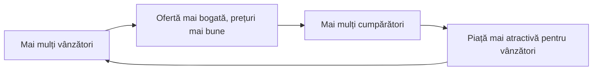

Cercul din diagramă explică de ce platformele mari tind să devină și mai mari și de ce este greu să concurezi una deja instalată. Efectele de rețea pot lucra și în sens invers: prea mulți vânzători cu același produs înseamnă concurență pe preț și nemulțumire, iar prea multe anunțuri slabe îi alungă pe cumpărători.

### 2.6.2 Problema „oul sau găina”

Cercul de mai sus are un punct slab: începutul. Cumpărătorii nu vin pe o platformă fără vânzători. Vânzătorii nu vin pe o platformă fără cumpărători. Literatura economică numește asta chiar problema „oul și găina” (Caillaud și Jullien, 2003). Strategiile obișnuite de ieșire sunt descrise, între alții, de Eisenmann, Parker și Van Alstyne (2006):

- **Subvenționezi o parte.** O parte intră gratuit sau chiar primește stimulente, iar cealaltă plătește. De regulă este subvenționată partea mai greu de atras sau mai sensibilă la preț.
- **Începi tu ca vânzător.** Pornești ca magazin obișnuit, cu marfa ta, aduni cumpărători, apoi deschizi platforma și altor vânzători.
- **Începi foarte îngust.** Un singur oraș, o singură categorie, o singură comunitate. Este mai ușor să ai destulă ofertă și destulă cerere pentru „produse locale în Galați” decât pentru „orice, oriunde”.
- **Aduci o parte la pachet.** Convingi o asociație de producători sau un târg existent să vină împreună pe platformă.

> **Exemplu.** Dacă ar vrea să devină un marketplace pentru producători locali, Cămara are deja jumătate din răspuns: cumpărătorii. Clienții din spatele celor 796 de comenzi din noiembrie (date fictive) sunt „găina”. Poate invita cinci producători noi să își listeze produsele și le poate arăta trafic real din prima zi. Un marketplace pornit de la zero nu ar avea ce să le arate.

### 2.6.3 Marketplace sau magazin propriu?

Pentru un vânzător mic, întrebarea practică este alta: unde vând? Pe un marketplace mare, în magazinul meu, sau în amândouă?

Datele Eurostat arată că firmele europene le folosesc pe amândouă, dar nu în aceeași măsură. Dintre firmele din UE care au vândut pe web în 2024, 85,65% au vândut prin site-ul sau aplicația proprie, iar 45% au folosit un marketplace. Ca valoare, vânzările prin site-uri și aplicații proprii au reprezentat 7,08% din cifra de afaceri totală a firmelor din UE, iar cele prin marketplace-uri 1,30%. România are cea mai mică pondere din UE a firmelor care fac vânzări electronice: 14,57%, față de 23,59% media UE (Eurostat, „E-commerce statistics”, date extrase în februarie 2026, https://ec.europa.eu/eurostat/statistics-explained/index.php?title=E-commerce_statistics). Altfel spus, în România mai este loc: cele mai multe firme încă nu vând deloc online.

| Criteriu | Pe un marketplace | În magazinul propriu |
|---|---|---|
| Trafic | Vine cu platforma: cumpărătorii sunt deja acolo | Îl aduci tu, cu timp sau cu bani |
| Cost de pornire | Mic: cont, listări | Mai mare: site, plăți, fotografii, texte |
| Cost pe vânzare | Comision la fiecare comandă, plus eventuale taxe de servicii | Fără comision de platformă, dar cu cost de marketing pe comandă |
| Încrederea cumpărătorului | Împrumutată de la platformă | O construiești singur, în timp |
| Datele despre clienți | Rămân în mare parte la platformă | Sunt ale tale: adrese de email, istoric de comenzi |
| Marca | Ești un vânzător într-o listă, lângă concurenți | Tot spațiul vorbește despre tine |
| Regulile | Le stabilește platforma și le poate schimba | Le stabilești tu, în limitele legii |
| Riscul de dependență | Ridicat dacă vinzi doar acolo | Scăzut față de platformă, dar depinzi de sursele de trafic |

**Să punem cifre pe comparație.** Ipoteză de lucru: un marketplace reține un comision de 15% (o valoare din interiorul intervalului de 7-25% publicat de eMAG Marketplace; comisionul real depinde de categorie și de contract).

| Pe o comandă de 150 lei la preț întreg | Marketplace (comision ipotetic 15%) | Magazin propriu |
|---|---|---|
| Marja brută (45%) | 67,50 lei | 67,50 lei |
| Comision platformă | 22,50 lei | 0 lei |
| Ambalare și livrare | 14 lei | 14 lei |
| Rămâne înainte de marketing | 31 lei | 53,50 lei |
| Cost de marketing pe comandă | De regulă mic, dacă nu plătești promovare în platformă | Depinde de canal |

Concluzia calculului: magazinul propriu este mai rentabil decât marketplace-ul cât timp aduci o comandă cu mai puțin de 22,50 lei cheltuiți pe marketing. Pe canalele Căutare, Email și Direct, Cămara este mult sub acest prag. Pe canalul Reclame, în noiembrie, contribuția pe comandă a ajuns la -40 de lei (date fictive): acolo, o comandă venită printr-un marketplace ar fi fost mai bună decât una cumpărată cu reclame și cod de reducere.

**Dependența.** Riscul cel mare al marketplace-ului nu este comisionul de azi, ci faptul că nu controlezi regulile de mâine. Platforma poate schimba comisioanele, criteriile de afișare în rezultate sau condițiile de retur, iar tu afli dintr-o notificare. Uniunea Europeană a recunoscut acest dezechilibru: Regulamentul (UE) 2019/1150, cunoscut ca regulamentul „platformă către întreprinderi” (P2B, Platform-to-Business), se aplică din 12 iulie 2020 și cere platformelor, între altele, să comunice vânzătorilor principalii factori care determină ordinea în rezultatele căutării. De notat că, în noiembrie 2025, Comisia Europeană a propus abrogarea lui, cu argumentul că reguli mai noi acoperă aceeași zonă (Comisia Europeană, „Platform-to-business trading practices”, https://digital-strategy.ec.europa.eu/en/policies/platform-business-trading-practices). Verifică stadiul la zi; textul de față nu este consultanță juridică.

**O strategie rezonabilă pentru început.** Mulți vânzători mici folosesc marketplace-ul pentru a fi găsiți și magazinul propriu pentru a păstra relația: clientul te descoperă pe platformă, iar tu faci produsul și ambalajul suficient de memorabile încât a doua oară să te caute direct. Verifică și programele dedicate producătorilor mici. eMAG Marketplace, de exemplu, descrie programul „Open Romania”, care din septembrie 2025 este deschis producătorilor români din orice domeniu, inclusiv alimentar, cu cifră de afaceri anuală de până la 2 milioane de lei, cu comisioane între 5% și 10% în funcție de categorie (eMAG Marketplace, „The Open Romania program”, https://marketplace.emag.ro/infocenter/the-open-romania-program-new-opportunities-for-local-entrepreneurs/?lang=en). Condițiile se schimbă; citește pagina oficială și contractul înainte de a te baza pe ele.

> **Greșeală frecventă.** „Vând pe marketplace, deci nu am costuri de marketing.” Comisionul este costul tău de marketing, plătit sub altă formă. Tratează-l ca atare și compară-l cu ce te-ar costa să aduci singur aceeași comandă.

## 2.7 Economia unui model: de ce venitul nu este profit

Un model de afaceri poate fi elegant pe hârtie și totuși să piardă bani la fiecare comandă. Ca să vezi asta, îți trebuie patru noțiuni. Le introducem aici; calculele pas cu pas, pe datele săptămânale ale Cămării, sunt în capitolul 5.

**Venitul** este tot ce încasezi din vânzări. Este cifra cea mai vizibilă și cea mai înșelătoare.

**Costurile variabile** cresc odată cu fiecare comandă: marfa, ambalajul, curierul, comisionul procesatorului de plăți, comisionul de marketplace. Dacă nu vinzi nimic, sunt zero.

**Costurile fixe** se plătesc oricum, fie că ai o comandă, fie că ai o mie: chiria depozitului, salariile, abonamentele la programe, contabilul.

**Marja** este ce rămâne dintr-un leu încasat după ce scazi anumite costuri. Marja brută scade doar costul mărfii. Contribuția scade și marketingul, ambalarea și livrarea. Rezultatul scade și costurile fixe.

Pentru Cămara, ipotezele de lucru din tot suportul de curs sunt: marjă brută de 45% la preț întreg, 14 lei ambalare și livrare pe comandă, costuri fixe de 10.000 de lei pe lună. Formulele simplificate sunt:

```text
contribuție        = marjă brută - marketing - ambalare și livrare
rezultat simplificat = contribuție - costuri fixe
```

Să urmărim o singură comandă de 150 de lei, la preț întreg:

| Pas | Calcul | Rămâne |
|---|---|---|
| Venit | 150 lei | 150,00 lei |
| Minus costul mărfii (55%) | 150 × 0,55 = 82,50 lei | 67,50 lei (marja brută) |
| Minus ambalare și livrare | 14 lei | 53,50 lei |
| Minus marketing pe comandă | Depinde de canal | ? |
| Minus partea din costurile fixe | Depinde de numărul de comenzi | ? |

Din 150 de lei încasați, înainte de marketing și de costurile fixe au rămas 53,50 lei. De aici se vede și un prag util: ca să acopere costurile fixe de 10.000 de lei pe lună, Cămara are nevoie de circa 187 de asemenea comenzi (10.000 împărțit la 53,50), fără să cheltuiască nimic pe marketing. Acesta este pragul de rentabilitate: punctul în care nu pierzi și nu câștigi. Orice leu cheltuit pe reclame ridică pragul.

Acum privește lunile reale ale Cămării (date fictive, construite pentru exercițiu):

| | Septembrie | Noiembrie | Schimbare |
|---|---|---|---|
| Comenzi | 553 | 796 | +44% |
| Venit | 85.400 lei | 109.125 lei | +28% |
| Rezultat simplificat | 18.088 lei | 6.758 lei | -63% |
| Rezultat ca parte din venit | circa 21% | circa 6% | |

Dacă te uiți doar la primele două rânduri, noiembrie este o lună excelentă. Al treilea rând spune altceva. Bugetul de reclame a crescut de la 2.400 la 16.800 de lei, iar codul de reducere de 20% a coborât, pe canalul Reclame, valoarea medie a comenzii de la 150 la 105 lei și marja brută de la 45% la 31%. Fiecare comandă adusă de reclame a ajuns să coste mai mult decât aducea.

> **De reținut.** Venitul îți spune cât de mare este afacerea. Marja îți spune dacă merită să fie mai mare. Un model sănătos este unul în care fiecare comandă în plus lasă ceva după ce își plătește costurile variabile; abia apoi are sens să vorbești despre creștere.

Mecanismul de venit schimbă și forma costurilor. La comision aproape că nu ai cost al mărfii, dar ai costuri fixe de platformă. La abonament plătești atragerea clientului la început și recuperezi în luni. La un produs digital, costul variabil pe client este aproape zero, iar aproape tot ce cheltuiești este fix. De aceea aceeași cifră de venit poate însemna afaceri foarte diferite.

## 2.8 Cum analizezi modelul unei afaceri digitale existente

Tema de la curs îți cere să alegi trei afaceri digitale de succes și să le analizezi. Grila profesorului are opt întrebări. Le luăm pe rând, cu indicații despre unde găsești răspunsul când nu ai acces la datele interne ale firmei.

| Nr. | Întrebarea | Ce cauți | Unde găsești răspunsul din afară |
|---|---|---|---|
| 1 | Ce model de business folosește? | Relația (axa 1) și propunerea de valoare | Site-ul, pagina „Despre noi”, termenii și condițiile |
| 2 | Care sunt factorii critici de succes? | Cele 3-5 lucruri fără de care modelul cade | Recenzii, ce laudă și ce reclamă clienții |
| 3 | Cum generează venit? | Mecanismul sau mecanismele (axa 2) | Pagina de prețuri, pagina pentru parteneri sau vânzători, rapoartele anuale |
| 4 | La ce indicatori se uită managementul? | Indicatorii care decurg din mecanism | Deducție din model; rapoarte pentru investitori, interviuri |
| 5 | Cum îi măsoară? | Instrumente și surse de date | Deducție: analiza traficului, sistemul de comenzi, platforma de email |
| 6 | Care este concurența? | Concurenți direcți și înlocuitori | Căutări pe Google după produsele lor, marketplace-uri |
| 7 | Ce face pe rețelele sociale? | Canale, frecvență, tip de conținut, reacții | Paginile publice ale firmei |
| 8 | La ce alte date te-ai uita? | Ce nu poți vedea din afară și ai cere | Lista ta de întrebări pentru o întâlnire cu firma |

Trei reguli pentru o analiză bună:

1. **Separă ce ai observat de ce ai dedus.** „Site-ul afișează livrare gratuită peste 200 de lei” este observație. „Probabil vor să crească valoarea medie a comenzii” este deducție. Scrie-le diferit.
2. **Leagă indicatorii de mecanism.** Nu înșira toți indicatorii pe care îi știi. Dacă firma trăiește din abonamente, primul indicator este rata de renunțare. Dacă trăiește din comisioane, este valoarea tranzacțiilor.
3. **Nu inventa cifre.** Dacă nu ai găsit cifra de afaceri într-o sursă publică, scrie „nu am găsit” și treci întrebarea la punctul 8.

### 2.8.1 Exemplu lucrat complet: Cămara de la Dunăre

Aplicăm grila pe Cămara, ca și cum am fi consultanți care au primit și datele interne. Toate cifrele sunt fictive, construite pentru exercițiu.

**1. Ce model de business folosește?**
Comerț online B2C: un comerciant care selectează produse alimentare tradiționale de la producători locali și le vinde consumatorilor, printr-un site propriu. Nu este producător, deci nu este D2C. Nu este marketplace, pentru că deține marfa și facturează el clientul. Propunerea de valoare: produse locale verificate, adunate într-un singur coș, livrate acasă.

**2. Care sunt factorii critici de succes?**
- Selecția: produse pe care clientul nu le găsește în supermarket.
- Încrederea: povestea și numele fiecărui producător, recenzii reale.
- Livrarea fără incidente: borcanele sunt grele și fragile; un colet spart înseamnă client pierdut și cost dublu.
- Recumpărarea: produsele se consumă, deci un client mulțumit ar trebui să revină. Fără recumpărare, fiecare comandă trebuie „cumpărată” din nou cu marketing.
- Disciplina la reduceri: marja de 45% suportă 14 lei de livrare, dar nu suportă și o reducere de 20%, și reclame scumpe, cum a arătat luna noiembrie.

**3. Cum generează venit?**
Printr-un singur mecanism: vânzare directă, cu marjă brută de 45% la preț întreg. Nu are abonamente, comisioane sau venituri din publicitate. Un singur mecanism înseamnă simplitate, dar și faptul că fiecare lună pornește de la zero.

**4. La ce indicatori se uită managementul?**
Din model decurg direct: numărul de comenzi, venitul, valoarea medie a comenzii, marja brută, costul de marketing, contribuția pe comandă și pe canal, rezultatul lunar. Întrebarea mai interesantă este la ce s-a uitat managementul în toamnă. Judecând după decizii, s-a uitat la comenzi și la venit, care au crescut cu 44% și cu 28%. Dacă s-ar fi uitat săptămânal la contribuția pe canal, ar fi văzut că pe Reclame ea a trecut de la +16 lei la -40 de lei pe comandă.

**5. Cum îi măsoară?**
- Vizitele și canalul din care vin: cu un instrument de analiză a traficului, canalul fiind atribuit după ultimul clic.
- Comenzile și venitul: din platforma magazinului online.
- Costul mărfii: din facturile producătorilor.
- Costul reclamelor: din conturile de publicitate.
- Totul reunit într-un tabel săptămânal, cu un rând pentru fiecare canal (fișierul `camara_saptamanal.csv`, folosit în capitolele 5, 7 și 8).

Limita măsurării: regula „ultimul clic” atribuie comanda canalului din care clientul a venit ultima dată. Un client adus prima oară de o reclamă, care revine peste o lună din newsletter, apare la Email. Canalul Reclame arată astfel puțin mai rău decât este, iar Email puțin mai bine (vezi capitolele 3 și 9).

**6. Care este concurența?**
- Directă: alte magazine online cu produse tradiționale și producătorii care vând singuri pe site-ul lor (D2C).
- Marketplace-urile generaliste, unde aceiași producători își pot lista produsele.
- Înlocuitori: raftul „produse tradiționale” din supermarket, piața agroalimentară, târgurile de sezon, borcanele primite de la bunici.
Pentru un produs alimentar, concurentul cel mai puternic este adesea obiceiul clientului, nu alt site.

**7. Ce face pe rețelele sociale?**
Rulează reclame plătite, care în noiembrie au fost purtate de un cod de reducere de 20%. Ce am verifica în plus: dacă există și conținut neplătit (rețete, filmări de la producători), cât de des se postează, ce întrebări pun oamenii în comentarii și cât de repede primesc răspuns. Tipurile de conținut și rolul fiecărei rețele sunt tratate în capitolul 3.

**8. La ce alte date ne-am uita?**
- Câți dintre clienții din noiembrie sunt noi și câți au mai cumpărat. Datele săptămânale pe canale nu spun asta.
- Câți dintre clienții aduși cu cod de reducere comandă a doua oară la preț întreg. De acest răspuns depinde dacă noiembrie a fost o pierdere sau o investiție.
- Marja pe produs: care produse aduc bani și care doar ocupă loc.
- Rata coletelor deteriorate și a retururilor.
- Sezonalitatea: cât din creșterea din noiembrie se datorează apropierii sărbătorilor și cât reclamelor.
- Costul real al timpului: cine ambalează și cât durează.

**Concluzia analizei, în trei propoziții.** Cămara are un model simplu și coerent: B2C, vânzare directă, marjă decentă. Slăbiciunea lui este că nu are nimic recurent, așa că presiunea de a cumpăra comenzi cu reclame și reduceri este mare. Direcțiile naturale de testat sunt celulele vecine din matrice: abonamentul B2C („Cutia lunii”) și livrările B2B către cafenele.

> **Pentru afacerea ta.** Fă aceeași analiză pe cel mai bun concurent al tău, apoi pe tine, cu aceeași sinceritate. Diferențele de la întrebările 2 și 4 (ce face el bine și la ce se uită) sunt de obicei cele mai utile.

## 2.9 Greșeli frecvente la alegerea modelului

Antreprenorii la început repetă câteva greșeli. Le-am adunat într-o listă, fiecare cu un antidot.

**1. Copiezi mecanismul unei firme mari fără condițiile ei.** „Facem gratuit și trăim din reclame” funcționează la audiențe de milioane. La câteva mii de vizitatori pe lună nu acoperă nici găzduirea. Antidot: fă calculul cu audiența ta de azi, nu cu cea visată.

**2. Confunzi venitul cu profitul.** Te bucuri de comenzile în creștere și afli la sfârșit de trimestru că ai plătit ca să vinzi. Antidot: calculează contribuția pe comandă înainte de a mări bugetul de reclame (capitolul 5).

**3. Alegi abonamentul pentru că „e la modă”.** Abonamentul are sens doar dacă nevoia clientului se repetă în ritmul în care îl taxezi. O cutie lunară cu șase borcane, pentru o familie care mănâncă două, se anulează în luna a treia. Antidot: întreabă zece clienți cât de des ar vrea de fapt produsul.

**4. Pornești un marketplace fără niciuna dintre părți.** Problema „oul sau găina” nu se rezolvă cu un site frumos. Antidot: începe ca vânzător, adună cumpărători, apoi deschide platforma.

**5. Depinzi de un singur canal sau de o singură platformă.** Tot traficul dintr-o rețea socială, toate vânzările pe un singur marketplace, jumătate din venit de la un singur client B2B. Antidot: urmărește ponderea celui mai mare canal și a celui mai mare client; dacă trece de jumătate, ai o prioritate.

**6. Tratezi clienții B2B ca pe consumatori.** Le trimiți coduri de reducere și newslettere cu emoticoane, când ei vor listă de prețuri, termen de plată și un număr de telefon. Antidot: pentru fiecare relație, scrie separat ciclul de vânzare.

**7. Faci prea multe modele deodată.** Magazin, abonament, en-gros și marketplace în primul an. Antidot: un model principal, cel mult un test în paralel, cu dată de evaluare stabilită dinainte.

**8. Stabilești prețul fără să numeri toate costurile variabile.** Uiți comisionul procesatorului de plăți, ambalajul de protecție, retururile, coletele sparte. Antidot: fă lista costurilor pe o comandă reală, cu facturile în față.

**9. Ignori obligațiile care vin odată cu relația.** Vânzarea către consumatori, către firme și către stat vine cu reguli diferite de facturare, de retur și de informare. Antidot: verifică în surse oficiale ce se aplică relației tale, înainte de lansare, sau întreabă un specialist.

**10. Nu îți scrii ipotezele.** Crezi că „oamenii vor plăti 129 de lei pe lună”, dar nu ai notat nicăieri ce ar trebui să vezi ca să afli că te-ai înșelat. Antidot: lângă fiecare căsuță din canvas, scrie cum vei verifica și până când.

**Listă de verificare înainte de a alege un model:**

- [ ] Pot spune într-o propoziție cui vând (axa 1) și într-o altă propoziție din ce încasez (axa 2).
- [ ] Știu cât îmi rămâne dintr-o comandă tipică după costurile variabile.
- [ ] Știu câte comenzi (sau câți abonați) îmi acoperă costurile fixe.
- [ ] Știu care este indicatorul principal al mecanismului ales și de unde îl voi citi.
- [ ] Știu ce se întâmplă dacă cel mai mare canal sau cel mai mare client dispare.
- [ ] Am vorbit cu cel puțin zece clienți posibili despre preț și frecvență.
- [ ] Am verificat regulile care se aplică relației mele (consumatori, firme, instituții).

## Aplicații

**1. Canvasul Cămării, varianta 2 (pe Cămara).** Pornește de la tabelul 2.1 și refă canvasul pentru scenariul în care Cămara adaugă „Cutia lunii” pe abonament. Marchează căsuțele care se schimbă și scrie, pentru fiecare, ipoteza pe care ar trebui să o verifici mai întâi.

**2. Abonamentul, în cifre (pe Cămara).** Folosește ipotezele din secțiunea 2.4.2: 129 lei pe lună, marjă brută 45%, 14 lei ambalare și livrare. (a) Câți abonați îi trebuie Cămării pentru ca abonamentul singur să acopere costurile fixe de 10.000 de lei pe lună? (b) Dacă 8% dintre abonați renunță lunar, câți abonați noi trebuie aduși în fiecare lună ca să rămână la 250? (c) Cât poate cheltui cel mult pe atragerea unui abonat, dacă vrea să recupereze banii în trei luni?

**3. Marketplace sau reclame? (pe Cămara).** Refă tabelul din secțiunea 2.6.3 pentru o comandă de 105 lei cu marjă brută de 31% (situația de pe canalul Reclame din noiembrie), la un comision de marketplace de 10%, apoi de 20%. În care situație marketplace-ul lasă o contribuție pozitivă? Ce ai recomanda proprietarului?

**4. Clasifică zece afaceri.** Alege zece site-uri sau aplicații pe care le folosești. Pentru fiecare, completează două coloane: relația (B2C, B2B, C2C, B2G) și mecanismul sau mecanismele de venit. Notează sursa din care ai aflat mecanismul (pagina de prețuri, termeni, raport). Unde ai găsit două mecanisme la aceeași firmă?

**5. Analiză cu grila în opt întrebări.** Alege o afacere digitală reală și aplică grila din secțiunea 2.8. Folosește doar informații publice, cu sursă. La fiecare răspuns marchează „observat” sau „dedus”. Încheie cu cinci întrebări pe care i le-ai pune managerului.

**6. Furnizor pentru stat.** Intră pe e-licitatie.ro și caută, în secțiunea publică, anunțuri sau achiziții pentru un produs simplu (de exemplu „miere” sau „papetărie”). Notează ce fel de autorități cumpără, ce documente se cer și la ce valori. Scrie o jumătate de pagină: ar merita pentru o firmă mică să vândă pe acest canal?

**7. Pentru afacerea ta.** Completează matricea relație × mecanism din secțiunea 2.5 pentru afacerea ta sau pentru o idee pe care o ai. Marchează celula în care ești acum, două celule vecine în care te-ai putea muta și cel puțin trei celule care nu au sens, cu motivul. Pentru una dintre celulele vecine, calculează contribuția pe o comandă tipică.

**8. Oul sau găina.** Imaginează-ți o platformă care leagă studenții care dau meditații de elevii din orașul tău. Care parte este mai greu de atras? Propune trei acțiuni concrete pentru primele 60 de zile și spune ce mecanism de venit ai folosi și din ce moment.

## Întrebări de verificare

1. Care sunt cele cinci întrebări la care răspunde un model de afaceri?
2. Câte căsuțe are Business Model Canvas și cine l-a propus?
3. Care sunt cele două axe după care descriem un model de afaceri online?
4. De ce „abonamentul” nu este nici B2C, nici B2B?
5. Numește trei diferențe între ciclul de vânzare B2C și cel B2B.
6. Cine sunt cei trei participanți într-un model C2C și cine plătește de obicei platforma?
7. Ce este SEAP și cine îl operează?
8. Care este indicatorul specific abonamentului pe care vânzarea directă nu îl are?
9. O platformă intermediază tranzacții de 200.000 de lei pe lună, cu un comision de 12%. Care este venitul ei?
10. Ce sunt efectele de rețea indirecte?
11. La un comision de marketplace de 15% pe o comandă de 150 de lei, sub ce cost de marketing pe comandă este mai rentabil magazinul propriu?
12. De ce a scăzut rezultatul Cămării în noiembrie, deși venitul a crescut?

### Răspunsuri

1. Ce problemă rezolvi (propunerea de valoare), pentru cine (clienți), cum ajungi la ei (canale), din ce încasezi (venituri), pe ce cheltuiești (costuri).
2. Nouă căsuțe; Alexander Osterwalder și Yves Pigneur, în „Business Model Generation” (2010).
3. Relația dintre participanți (cine vinde cui) și mecanismul de venit (din ce vin banii).
4. Pentru că este un mecanism de venit, pe a doua axă. Se poate aplica oricărei relații: o cutie lunară pentru familii este abonament B2C, un program plătit lunar de o firmă este abonament B2B.
5. În B2C decide un singur om, repede, la preț afișat, cu plata pe loc. În B2B decid mai mulți oameni, în pași, la preț negociat, cu plata pe factură la termen.
6. Vânzătorul, cumpărătorul și platforma. Platforma este plătită de regulă de vânzător (comision, taxă de listare, promovare) sau din publicitate.
7. Sistemul Electronic de Achiziții Publice, platforma prin care autoritățile publice din România cumpără electronic și publică anunțuri; este operat de Autoritatea pentru Digitalizarea României, la e-licitatie.ro.
8. Rata de renunțare (churn rate): procentul de abonați care anulează într-o perioadă.
9. 24.000 de lei pe lună (12% din 200.000). Venitul platformei este comisionul, nu valoarea tranzacțiilor.
10. Situația în care mai mulți utilizatori de pe o parte a platformei (vânzători) cresc valoarea ei pentru cealaltă parte (cumpărători) și invers.
11. Sub 22,50 lei pe comandă, adică valoarea comisionului.
12. Creșterea a fost cumpărată cu un buget de reclame de șapte ori mai mare și cu un cod de reducere de 20%, care a scăzut valoarea medie a comenzii și marja pe canalul Reclame; contribuția pe comandă a devenit acolo negativă.

## De reținut

- Un model de afaceri răspunde la cinci întrebări: ce valoare, pentru cine, prin ce canale, din ce venituri, cu ce costuri. Business Model Canvas le așază pe o pagină, în nouă căsuțe.
- Relația (B2C, B2B, C2C, B2G, G2B) și mecanismul de venit (vânzare directă, abonament, comision, publicitate, freemium, licențiere) sunt două axe independente. Descrie-le mereu pe amândouă.
- Relația schimbă ciclul de vânzare și ce contează pentru client. Mecanismul schimbă fluxul de numerar și indicatorii la care te uiți.
- Nu orice combinație are sens. Celulele goale din matrice sunt informație, iar mutarea sănătoasă este spre o celulă vecină.
- Platformele trăiesc din efecte de rețea și se lovesc la început de problema „oul sau găina”. Pentru vânzător, comisionul de marketplace este un cost de marketing, iar riscul principal este dependența.
- Venitul nu este profit. Întâi afli ce rămâne dintr-o comandă după costurile variabile, apoi câte comenzi acoperă costurile fixe.
- O analiză bună a unei afaceri existente separă observațiile de deducții, leagă indicatorii de mecanismul de venit și se încheie cu lista datelor care lipsesc.

## Surse și lecturi recomandate

**Surse oficiale și statistice (accesate în noiembrie 2026)**

- Eurostat, „E-commerce statistics for individuals”, Statistics Explained, date extrase în februarie 2026. https://ec.europa.eu/eurostat/statistics-explained/index.php?title=E-commerce_statistics_for_individuals
- Eurostat, „E-commerce statistics” (firme), Statistics Explained, date extrase în februarie 2026. https://ec.europa.eu/eurostat/statistics-explained/index.php?title=E-commerce_statistics
- Legea nr. 98/2016 privind achizițiile publice, Portalul Legislativ al Ministerului Justiției. https://legislatie.just.ro/Public/DetaliiDocument/178667
- Autoritatea pentru Digitalizarea României, „Platforme operate” (SEAP, Ghișeul.ro, PCUe, ROePAS). https://www.adr.gov.ro/en/platforme-operate
- Sistemul Electronic de Achiziții Publice. https://www.e-licitatie.ro
- Ministerul Finanțelor și ANAF, „Ghid privind utilizarea sistemului național de facturare electronică RO e-Factura”, 2023. https://static.anaf.ro/static/10/Anaf/AsistentaContribuabili_r/Ghid_RO_eFactura.pdf
- Oficiul Național al Registrului Comerțului, „Servicii online”. https://www.onrc.ro/index.php/ro/servicii-online
- Comisia Europeană, „Platform-to-business trading practices” (despre Regulamentul (UE) 2019/1150). https://digital-strategy.ec.europa.eu/en/policies/platform-business-trading-practices

**Pagini ale unor platforme (accesate în noiembrie 2026; tarifele se pot schimba)**

- eMAG Marketplace, „Taxes and commissions”. https://marketplace.emag.ro/infocenter/start-selling/taxes-and-commissions/?lang=en
- eMAG Marketplace, „The Open Romania program”. https://marketplace.emag.ro/infocenter/the-open-romania-program-new-opportunities-for-local-entrepreneurs/?lang=en
- Etsy Help, „Etsy Fees Basics”. https://help.etsy.com/hc/en-us/articles/360035902374-Etsy-Fees-Basics
- Strategyzer, „The Business Model Canvas”. https://www.strategyzer.com/library/the-business-model-canvas

**Cărți și articole**

- Osterwalder, A., Pigneur, Y. (2010). *Business Model Generation*. Wiley.
- Timmers, P. (1998). „Business Models for Electronic Markets”. *Electronic Markets*, 8(2).
- Laudon, K. C., Traver, C. G. *E-commerce: Business, Technology, Society*. Pearson (ediții succesive).
- Parker, G. G., Van Alstyne, M. W., Choudary, S. P. (2016). *Platform Revolution*. W. W. Norton.
- Rochet, J.-C., Tirole, J. (2003). „Platform Competition in Two-Sided Markets”. *Journal of the European Economic Association*, 1(4).
- Caillaud, B., Jullien, B. (2003). „Chicken & Egg: Competition among Intermediation Service Providers”. *RAND Journal of Economics*, 34(2).
- Eisenmann, T., Parker, G., Van Alstyne, M. W. (2006). „Strategies for Two-Sided Markets”. *Harvard Business Review*, octombrie 2006.
- Anderson, C. (2009). *Free: The Future of a Radical Price*. Hyperion.

**Materialul de curs**

- Geru, M., „Introducere în eBusiness și economia digitală”, prezentare de curs (secțiunea „Modele de afaceri online” și tema „Identifică și analizează trei modele de succes în eBusiness”).

---

# Capitolul 3. Ecosistemul digital: site, căutare, rețele sociale, email și integrarea canalelor

## Ce vei putea face după acest capitol

- Să descrii ecosistemul digital al unei firme și să încadrezi fiecare canal ca deținut, plătit sau câștigat.
- Să evaluezi un site după cele patru funcții ale lui și după cinci principii de construcție: mobil întâi, viteză, accesibilitate, securitate, conformitate.
- Să explici cum ajunge o pagină în rezultatele Google și să alegi între optimizarea pentru căutare și reclamele în căutare.
- Să proiectezi un program minim de email (consimțământ, segmente, secvențe automate) și să citești corect indicatorii lui.
- Să explici de ce costul unei comenzi aduse din reclame crește când extinzi publicul și să recunoști momentul în care reclama produce pierdere.
- Să compari modelele de atribuire și să construiești un plan de canale pe 90 de zile pentru o firmă mică.

## 3.1 Ce este ecosistemul digital al unei firme

### 3.1.1 O definiție pe înțeles

În prezentarea cursului, ecosistemul digital este descris ca o rețea interconectată de tehnologii, platforme și canale care facilitează interacțiunile digitale și crearea de valoare. Pe înțeles: ecosistemul digital al unei firme este totalitatea locurilor din mediul online în care un om poate da peste firmă, poate afla ceva despre ea, poate cumpăra și poate cere ajutor, împreună cu legăturile dintre aceste locuri.

Partea a doua a definiției contează cel mai mult. Un site, o pagină de Instagram și o listă de email care nu știu unul de altul sunt trei proiecte separate. Devin ecosistem abia când omul care a văzut un clip ajunge ușor pe pagina produsului, când cel care a cumpărat primește emailul potrivit și când firma poate vedea traseul întreg.

> **Exemplu.** Cămara de la Dunăre, magazinul online fictiv din Galați pe care îl folosim în tot suportul, are un site cu magazin, o listă de abonați la newsletter, conturi pe rețele sociale pe care rulează reclame și o prezență în rezultatele Google. În datele ei (date fictive, construite pentru exercițiu) aceste locuri apar ca patru canale: Căutare, Reclame, Email și Direct.

### 3.1.2 Canale deținute, plătite și câștigate

Cea mai utilă împărțire a canalelor pornește de la o întrebare simplă: cine controlează canalul și cu ce îl plătești?

| Tip de canal | Ce înseamnă | Exemple | Cu ce plătești | Ce riști |
|---|---|---|---|---|
| Deținut (owned) | Îl controlezi tu: tu decizi ce apare și când | Site, magazin online, lista de email, blog, aplicație | Timp, găzduire, abonamente la instrumente | Crește încet; dacă îl neglijezi, îmbătrânește |
| Plătit (paid) | Cumperi atenție pe platforma altcuiva | Reclame în căutare, reclame în rețele sociale, colaborări plătite cu creatori | Bani, pe clic sau pe afișare | Se oprește în ziua în care oprești bugetul |
| Câștigat (earned) | Vorbesc alții despre tine, fără plată | Recenzii, recomandări, distribuiri, articole în presă, poziții bune în căutare | Calitatea produsului și a serviciului, răbdare | Nu îl controlezi: poate fi și negativ |

Câteva observații care te feresc de confuzii:

- **Contul tău de pe o rețea socială este „deținut” doar pe jumătate.** Tu decizi ce publici, dar platforma decide cui arată și își poate schimba regulile oricând. Lista de email și site-ul sunt singurele locuri în care legătura cu clientul îți aparține cu adevărat.
- **Poziția în rezultatele neplătite din Google este câștigată, nu cumpărată.** Google spune explicit că nu acceptă plată ca să acceseze mai des un site sau ca să îl claseze mai sus (Google Search Central, „How Search works”, https://developers.google.com/search/docs/fundamentals/how-search-works).
- **Cele trei tipuri lucrează împreună.** Reclama (plătit) aduce omul pe site (deținut), unde se abonează la newsletter (deținut), cumpără, apoi scrie o recenzie (câștigat) pe care o văd următorii vizitatori.

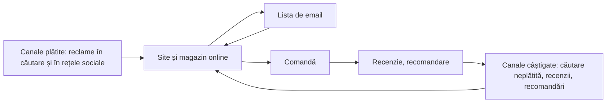

Diagrama arată de ce site-ul stă în centru: aproape orice drum trece prin el. De aceea începem cu site-ul.

### 3.1.3 Rolul fiecărui tip de canal

- **Canalele deținute păstrează valoarea.** Aici se întâmplă vânzarea și tot aici rămân datele despre clienți. Ce construiești pe ele (pagini bune, o listă de abonați) îți rămâne.
- **Canalele plătite cumpără viteză.** Sunt singurele pe care le poți porni mâine și regla din buget. Sunt și singurele cu factură lunară directă, deci cele mai ușor de transformat în pierdere.
- **Canalele câștigate aduc încredere.** O recenzie de la un necunoscut convinge de multe ori mai bine decât textul tău de prezentare, tocmai pentru că nu ai scris-o tu.

> **De reținut.** O firmă mică sănătoasă își construiește întâi canalele deținute, apoi folosește canalele plătite ca accelerator, nu ca motor unic. Dacă toate comenzile tale depind de reclame, ai chirie, nu ai afacere.

## 3.2 Site-ul: centrul ecosistemului

### 3.2.1 Cele patru funcții ale site-ului

Prezentarea cursului numește patru funcții strategice ale site-ului. Le luăm pe rând, cu întrebarea de control potrivită fiecăreia.

| Funcția | Ce face | Întrebare de control | La Cămara de la Dunăre |
|---|---|---|---|
| Informare (hub informațional) | Prezintă oferta și valorile firmei | Găsește vizitatorul în 10 secunde ce vinzi, cui și la ce preț? | Categorii clare: dulcețuri, zacuscă, miere, siropuri; pagină „Producătorii noștri” |
| Conversie | Transformă vizita în comandă sau în contact | Există pe fiecare pagină un pas următor evident? | Butonul „Adaugă în coș”, formular de abonare la newsletter |
| Servicii | Livrează valoare după sau în afara vânzării | Poate clientul să se descurce singur? | Starea comenzii, retur, întrebări frecvente, rețete cu produsele cumpărate |
| Brand | Construiește identitatea și încrederea | Ar recunoaște clientul site-ul fără logo? | Fotografii reale din gospodării, tonul cald, povestea fiecărui producător |

Funcția de servicii se leagă direct de asistența pentru clienți, pe care o tratăm în capitolul 4. Indicatorii site-ului pomeniți în prezentare (rata de conversie, rata de respingere, timpul petrecut pe site, valoarea medie a comenzii) sunt definiți și calculați în capitolul 5.

> **Greșeală frecventă.** Site-ul gândit ca broșură: arată bine, spune povestea firmei, dar nu are niciun pas următor. O pagină fără acțiune clară (cumpără, abonează-te, scrie-ne) îndeplinește doar funcția de informare și lasă celelalte trei pe dinafară.

De ce merită efortul? Cumpăratul online a devenit comportament obișnuit: 78% dintre utilizatorii de internet din Uniunea Europeană au cumpărat sau au comandat online bunuri sau servicii în 2025 (Eurostat, „E-commerce statistics for individuals”, date extrase în februarie 2026, https://ec.europa.eu/eurostat/statistics-explained/index.php?title=E-commerce_statistics_for_individuals).

### 3.2.2 Principiul 1: mobil întâi

„Mobil întâi” (mobile-first) înseamnă că proiectezi pagina pentru ecranul telefonului și abia apoi o extinzi pentru ecrane mari, nu invers. Motivul practic: pe un ecran mic nu încape tot, așa că ești obligat să decizi ce contează.

Există și un motiv tehnic. Google folosește indexarea „mobile-first”: pentru indexare și clasare ia în calcul versiunea de mobil a conținutului, accesată cu robotul său pentru smartphone (Google Search Central, „Mobile-first indexing best practices”, https://developers.google.com/search/docs/crawling-indexing/mobile/mobile-sites-mobile-first-indexing). Consecința: ce lipsește din versiunea de mobil lipsește, practic, și pentru Google. Aceeași documentație recomandă designul adaptabil (responsive web design), adică aceeași adresă și același cod HTML, cu aranjarea ajustată după lățimea ecranului.

Test rapid, de făcut pe telefonul tău: poți citi textul fără să mărești? Poți apăsa butoanele cu degetul mare fără să nimerești alt buton? Poți termina o comandă cu o singură mână, în autobuz?

### 3.2.3 Principiul 2: viteza și Core Web Vitals

Prezentarea cere „timp de încărcare sub 3 secunde”. Este o regulă empirică rezonabilă, dar azi există o măsură mai precisă: Core Web Vitals (în română, „indicatorii web esențiali”), un set de trei indicatori definiți de Google pentru experiența reală a utilizatorilor pe o pagină.

| Indicator | Ce măsoară, pe înțeles | Prag pentru „bun” |
|---|---|---|
| LCP (Largest Contentful Paint, afișarea celui mai mare element de conținut) | Cât durează până apare elementul principal al paginii, de obicei fotografia mare sau titlul | Cel mult 2,5 secunde de la începutul încărcării |
| INP (Interaction to Next Paint, de la interacțiune la următoarea afișare) | Cât de repede răspunde pagina când apeși, atingi sau tastezi | Cel mult 200 de milisecunde |
| CLS (Cumulative Layout Shift, deplasarea cumulată a aranjării) | Cât de mult „sar” elementele în timp ce pagina se încarcă | Cel mult 0,1 |

Pragurile sunt cele din documentația Google (web.dev, „Web Vitals”, pagină actualizată la 31 octombrie 2024, https://web.dev/articles/vitals). Două detalii din aceeași sursă merită reținute. Primul: pragul se judecă la percentila 75 a încărcărilor de pagină, separat pe mobil și pe desktop. Adică pagina este „bună” dacă măcar trei sferturi dintre vizitele reale se încadrează, nu dacă merge bine pe laptopul tău. Al doilea: INP este indicatorul de interactivitate din set; dacă întâlnești prin tutoriale mai vechi alt indicator la acest capitol, sunt depășite.

Contează viteza și pentru căutare? Google spune că indicatorii Core Web Vitals sunt folosiți de sistemele sale de clasare, dar și că nu există un singur semnal pentru experiența paginii, iar conținutul relevant rămâne esențial (Google Search Central, „Understanding page experience in Google Search results”, https://developers.google.com/search/docs/appearance/page-experience). Tradus: o pagină rapidă cu conținut slab nu urcă, dar între două pagini la fel de utile, cea plăcută de folosit are un avantaj.

> **Exemplu.** Pagina „Zacuscă de vinete” de la Cămara are o fotografie de 4 MB, făcută cu telefonul și urcată direct. Pe o conexiune mobilă slabă, fotografia apare târziu, deci LCP iese prost. Remediul nu cere programator: redimensionezi fotografia la lățimea la care se afișează, o salvezi într-un format comprimat și îi declari dimensiunile în pagină, ca textul să nu sară când apare (ceea ce ajută și CLS).

Măsori gratuit cu PageSpeed Insights (https://pagespeed.web.dev/) sau cu raportul „Core Web Vitals” din Google Search Console, care arată date de la vizitatori reali.

### 3.2.4 Principiul 3: accesibilitatea

Accesibilitatea înseamnă că site-ul poate fi folosit și de oameni cu deficiențe de vedere, de auz, motorii sau cognitive. În practică ajută pe toată lumea: omul cu telefonul în soare, omul cu mâna în ghips, omul în vârstă cu ochelarii uitați acasă.

Standardul de referință este WCAG (Web Content Accessibility Guidelines, „Ghidul pentru accesibilitatea conținutului web”), publicat de W3C (World Wide Web Consortium, consorțiul care stabilește standardele webului). Prezentarea pomenește WCAG 2.1. Versiunea pe care W3C o recomandă acum este WCAG 2.2, publicată la 5 octombrie 2023 și actualizată la 12 decembrie 2024; W3C încurajează folosirea celei mai noi versiuni și precizează că un conținut conform cu 2.2 este conform și cu 2.1 și 2.0. WCAG 3 există doar ca proiect timpuriu (W3C, „WCAG 2 Overview”, pagină actualizată la 17 septembrie 2026, https://www.w3.org/WAI/standards-guidelines/wcag/).

WCAG are patru principii și trei niveluri de conformitate (A, AA, AAA). Nivelul AA este ținta obișnuită.

| Principiu | Întrebare de control | Verificare în 2 minute |
|---|---|---|
| Perceptibil | Poate fi perceput conținutul și fără vedere sau fără auz? | Fotografiile au text alternativ? Textul are contrast suficient față de fundal? |
| Operabil | Poți folosi site-ul fără mouse? | Parcurge pagina doar cu tasta Tab: vezi mereu unde ești? Ajungi la buton? |
| Inteligibil | Înțelegi ce ți se cere și ce s-a întâmplat? | Mesajele de eroare din formular spun ce e greșit și cum repari? |
| Robust | Funcționează cu tehnologii asistive? | Titlurile sunt titluri reale (H1, H2), nu text îngroșat? Câmpurile au etichete? |

Accesibilitatea este și obligație legală în anumite situații. Actul european privind accesibilitatea (Directiva (UE) 2019/882) acoperă, printre altele, serviciile de comerț electronic, iar statele membre au avut termen până în iunie 2022 să îl transpună în legislația națională (Comisia Europeană, „European Accessibility Act”, https://commission.europa.eu/strategy-and-policy/policies/justice-and-fundamental-rights/disability/union-equality-strategy-rights-persons-disabilities-2021-2030/european-accessibility-act_en). Data de la care se aplică cerințele și excepțiile pentru firmele foarte mici trebuie verificate în textul directivei și în legea națională de transpunere. Textul de față nu este consultanță juridică.

### 3.2.5 Principiul 4: securitatea (HTTPS)

HTTPS (HyperText Transfer Protocol Secure, protocolul securizat de transfer al paginilor web) criptează comunicarea dintre browserul vizitatorului și site. Fără el, datele dintr-un formular (nume, adresă, parolă) pot fi citite pe drum, iar browserele afișează avertismentul „Nesecurizat”, care alungă cumpărătorii exact pe pagina de plată.

Ce ai de făcut concret:

- Certificat valid pe tot site-ul, nu doar pe pagina de plată. Majoritatea firmelor de găzduire îl oferă inclus.
- Redirecționare automată de la adresa cu http la cea cu https.
- Plata cu cardul printr-un procesator de plăți autorizat. Un magazin mic nu trebuie să stocheze date de card pe serverul lui.
- Platforma și modulele ținute la zi, parole puternice și autentificare în doi pași pentru conturile de administrare.

Google întreabă explicit, în lista de autoevaluare pentru experiența paginii, dacă paginile sunt servite securizat, iar Search Console are un raport dedicat pentru HTTPS (Google Search Central, „Understanding page experience”, link mai sus).

### 3.2.6 Principiul 5: conformitatea (GDPR și cookie-uri)

GDPR (General Data Protection Regulation, Regulamentul general privind protecția datelor, adică Regulamentul (UE) 2016/679) stabilește cum poți colecta și folosi date personale. Pentru un site mic, punctele care apar zilnic sunt acestea:

- **Temei pentru fiecare prelucrare.** Pentru livrarea comenzii ai nevoie de nume și adresă, iar temeiul este contractul. Pentru newsletter ai nevoie, de regulă, de consimțământ.
- **Consimțământ adevărat.** GDPR îl definește, în esență, ca o manifestare de voință liberă, specifică, informată și lipsită de ambiguitate, exprimată printr-o declarație sau o acțiune pozitivă clară (art. 4 pct. 11). O căsuță bifată dinainte nu este acțiunea omului.
- **Retragere la fel de ușoară.** Retragerea consimțământului trebuie să fie la fel de simplă ca acordarea lui (art. 7 alin. 3).
- **Informare.** O politică de confidențialitate scrisă pe înțeles: ce date aduni, de ce, cât le păstrezi, cui le dai.
- **Minimizare.** Nu cere data nașterii dacă nu faci nimic cu ea.

Pentru cookie-uri (fișiere mici pe care site-ul le salvează în browserul vizitatorului) regula vine din legislația privind viața privată în comunicațiile electronice, transpusă în România prin Legea nr. 506/2004. Stocarea de informații în echipamentul utilizatorului este permisă cu acordul lui, dat după o informare clară și completă; acordul nu este necesar pentru ce este strict necesar furnizării unui serviciu cerut expres de utilizator (art. 4 alin. 5 și 6, Portalul legislativ, https://legislatie.just.ro/Public/DetaliiDocument/56973). Pe înțeles: cookie-ul care ține minte coșul de cumpărături merge fără acord; cele de statistică și de publicitate așteaptă un „da”.

> **Greșeală frecventă.** Bannerul de cookie-uri cu un buton mare „Accept” și refuzul ascuns la trei clicuri distanță, în timp ce scripturile de publicitate pornesc oricum înainte de orice alegere. Un asemenea banner decorează, nu cere acord. Verifică în browser, la instrumentele pentru dezvoltatori, ce cookie-uri apar înainte să apeși ceva.

Descrierea de mai sus este orientativă și nu ține loc de consultanță juridică. Pentru cazul tău, citește textul regulamentului și ghidurile autorității naționale (ANSPDCP, Autoritatea Națională de Supraveghere a Prelucrării Datelor cu Caracter Personal) sau consultă un specialist.

### 3.2.7 Listă de verificare pentru pagina de produs

Pagina de produs este locul în care se ia decizia. Parcurge lista cu telefonul în mână.

1. **Numele produsului** spune ce este, nu doar cum l-ai botezat: „Dulceață de caise fără zahăr adăugat, 250 g”, nu „Soare de vară”.
2. **Prețul** este vizibil fără derulare, cu TVA inclus și cu prețul pe unitate (lei/kg) acolo unde legea îl cere.
3. **Fotografii** reale: produsul întreg, eticheta lizibilă, produsul în folosire, o fotografie de scară (borcanul în mână).
4. **Disponibilitate** clară: în stoc, ultimele bucăți sau data la care revine.
5. **Costul și durata livrării** spuse înainte de coș. Costurile apărute abia la final sunt motivul clasic de abandon.
6. **Descriere pe două niveluri**: trei rânduri pentru cel grăbit, apoi detalii (ingrediente, alergeni, producător, valabilitate, păstrare).
7. **Buton de comandă** unic, contrastant, ușor de atins cu degetul mare.
8. **Recenzii** autentice, cu dată, inclusiv cele mai puțin entuziaste. Răspunde la cele negative.
9. **Politica de retur** și datele de contact la un clic distanță.
10. **Titlu de pagină și descriere** unice (vezi 3.3) și text alternativ la imagini.
11. **Date structurate de tip produs**, dacă platforma le oferă. Cu ele, Google poate afișa direct în rezultate prețul, disponibilitatea și evaluările, fără să garanteze că o va face (Google Search Central, „Product structured data”, https://developers.google.com/search/docs/appearance/structured-data/product).
12. **Produse care merg împreună** („Se potrivește cu...”), ca să crești valoarea comenzii fără reducere.

### 3.2.8 Listă de verificare pentru pagina de finalizare a comenzii

Aici omul a decis deja. Treaba ta este să nu îl încurci.

1. **Comandă fără cont obligatoriu.** Contul se poate oferi după plată, cu un singur clic.
2. **Cât mai puține câmpuri.** Fiecare câmp în plus este un motiv de plecare. Ce nu folosești nu ceri.
3. **Tastatura potrivită pe mobil**: numerică la telefon și la cod poștal, cu „@” la email. Completarea automată din browser lăsată activă.
4. **Erori explicate lângă câmp**, pe loc, cu datele deja introduse păstrate.
5. **Total complet vizibil permanent**: produse, livrare, reducere, total de plată.
6. **Metodele de plată pe care le așteaptă publicul tău**: card, ramburs, eventual transfer.
7. **Semnale de încredere** discrete: HTTPS, numele procesatorului de plăți, telefonul firmei.
8. **Căsuțe de consimțământ nebifate** dinainte, separate: una pentru termeni, alta (opțională) pentru newsletter.
9. **Câmpul „cod de reducere”** discret. Un câmp mare și gol îl trimite pe client să caute coduri pe internet și uneori nu se mai întoarce.
10. **Pagina de confirmare și emailul de confirmare** spun exact ce urmează: când pleacă pachetul, cum îl urmărești, cui scrii.

> **Pentru afacerea ta.** Roagă trei oameni care nu ți-au văzut site-ul să cumpere ceva de pe telefon, în fața ta, vorbind cu voce tare. Nu îi ajuta. Notează unde ezită. O jumătate de oră de asemenea observație îți dă mai multe idei decât o lună de dezbateri despre culoarea butonului.

## 3.3 Căutarea: cum te găsesc oamenii care te caută deja

### 3.3.1 Cum funcționează un motor de căutare, pe scurt

Documentația Google descrie trei etape (Google Search Central, „How Search works”, link mai sus):

1. **Accesarea (crawling).** Programe automate, numite roboți sau crawlere, descarcă textul, imaginile și clipurile din paginile pe care le găsesc. Cele mai multe pagini noi sunt descoperite urmând linkuri din pagini deja cunoscute.
2. **Indexarea.** Google analizează conținutul paginii și îl stochează în index, o bază de date uriașă. Indexarea nu este garantată: nu orice pagină procesată ajunge în index.
3. **Afișarea rezultatelor.** Când cineva caută, Google alege din index paginile pe care le consideră cele mai relevante și de cea mai bună calitate pentru acea interogare. Clasarea se face automat, prin program.

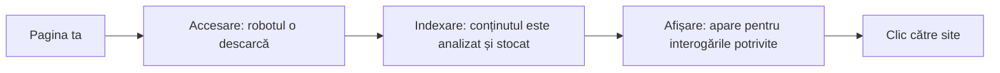

De aici rezultă ordinea corectă a întrebărilor când „nu apar pe Google”: Poate robotul să ajungă la pagină? Este pagina în index? Abia apoi: de ce nu este clasată mai sus?

### 3.3.2 SEO: conținut, tehnic, autoritate

SEO (Search Engine Optimization, optimizarea pentru motoarele de căutare) înseamnă munca prin care îți faci paginile ușor de găsit, de înțeles și de ales, în rezultatele neplătite. Se sprijină pe trei picioare.

| Componentă | Întrebarea la care răspunde | Ce faci concret |
|---|---|---|
| Conținut | Răspunde pagina la ce caută omul? | Pagini utile, scrise pentru oameni; cuvintele pe care le folosesc clienții puse în titluri și subtitluri; conținut ținut la zi |
| Tehnic | Poate Google să găsească și să înțeleagă pagina? | Linkuri care pot fi urmate, versiune de mobil completă, titluri unice, viteză, HTTPS, date structurate |
| Autoritate | Au și alții încredere în tine? | Linkuri și mențiuni de la site-uri relevante, recenzii, prezență în comunitățile de profil |

Câteva lucruri pe care Google le spune negru pe alb în ghidul său pentru începători (Google Search Central, „SEO Starter Guide”, https://developers.google.com/search/docs/fundamentals/seo-starter-guide):

- Un titlu bun este unic pentru pagină, clar, concis și descrie corect conținutul.
- O descriere meta bună este scurtă, unică pentru pagină și cuprinde punctele ei cele mai relevante. Google o poate folosi pentru fragmentul afișat în rezultate.
- Textul unui link ar trebui să spună ceva despre pagina spre care duce. „Vezi rețeta de zacuscă” este mai bun decât „click aici”.
- Textul alternativ al unei imagini trebuie să explice legătura dintre imagine și conținut.
- Google Search nu folosește eticheta meta „keywords”. Timpul petrecut cu ea este pierdut.
- Repetarea excesivă a acelorași cuvinte obosește cititorul și intră sub incidența politicilor antispam.
- Unele schimbări se văd în câteva ore, altele în câteva luni. Ghidul recomandă să aștepți câteva săptămâni înainte să judeci efectul.

Tot Google recomandă conținutul „în primul rând pentru oameni”: creat ca să ajute cititorul, nu ca să manipuleze clasarea. Pentru evaluarea calității folosește ideea de E-E-A-T (Experience, Expertise, Authoritativeness, Trustworthiness, adică experiență, expertiză, autoritate, încredere), cu precizarea că E-E-A-T nu este în sine un factor de clasare specific (Google Search Central, „Creating helpful, reliable, people-first content”, https://developers.google.com/search/docs/fundamentals/creating-helpful-content). Pentru un magazin cu produse alimentare, experiența se arată simplu: cine face dulceața, unde, din ce, cu fotografii proprii.

> **Greșeală frecventă.** Descrierea de produs copiată de la furnizor sau de la concurență. Pagina ta devine una dintre zecile de pagini identice, iar Google nu are niciun motiv să o aleagă tocmai pe a ta. Trei propoziții scrise de tine, despre lucruri pe care doar tu le știi despre produs, valorează mai mult decât un paragraf lung preluat.

### 3.3.3 SEO față de reclamele în căutare

În pagina de rezultate apar două feluri de poziții: rezultate neplătite (numite și organice) și reclame, marcate ca atare. Reclamele în căutare se cumpără prin licitație, de obicei cu plată pe clic. O abreviere pe care o vei întâlni: PPC (pay per click, plată pe clic).

| Criteriu | SEO (rezultate neplătite) | Reclame în căutare |
|---|---|---|
| Cost | Timp și muncă; clicul în sine nu costă | Plătești fiecare clic |
| Viteză | Săptămâni sau luni | Ore sau zile |
| Durată | Efectul rămâne o vreme și după ce te oprești | Se oprește odată cu bugetul |
| Control | Redus: nu alegi tu poziția | Mare: alegi cuvintele, mesajul, bugetul, orele |
| Potrivit pentru | Cerere stabilă, întrebări, categorii de produse | Lansări, sezon, verificarea rapidă a unei idei |
| Risc | Depinzi de schimbările de algoritm | Plătești clicuri care nu cumpără |

Cele două se completează. Reclamele îți arată repede ce interogări aduc comenzi. Apoi scrii conținut pentru acele interogări, ca peste câteva luni să primești o parte din clicuri fără plată.

### 3.3.4 Intenția de căutare

În spatele fiecărei căutări este o intenție. Dacă pagina ta nu răspunde intenției, nu contează cât de bine este scrisă. Împărțirea folosită curent în practica de marketing are patru tipuri.

| Intenție | Ce vrea omul | Exemplu de căutare | Pagina potrivită |
|---|---|---|---|
| Informațională | Să afle ceva | „cum se păstrează mierea cristalizată” | Articol sau ghid |
| De navigare | Să ajungă la un site anume | „cămara de la dunăre” | Pagina principală |
| Comercială (de comparare) | Să aleagă între variante | „cea mai bună zacuscă de casă” | Pagină de categorie, comparație, recenzii |
| Tranzacțională | Să cumpere acum | „dulceață de caise fără zahăr livrare galați” | Pagina de produs |

> **Exemplu.** Cine caută „cum se face zacusca” vrea o rețetă, nu un borcan. Dacă îi arăți pagina de produs, pleacă. Dacă îi dai rețeta bunicii, cu fotografii, și la final spui cinstit „dacă nu ai o zi liberă pentru asta, o facem noi după aceeași rețetă”, ai câștigat un cititor și uneori un client.

Metoda cea mai simplă de a afla intenția: caută tu expresia și uită-te la primele rezultate. Dacă apar doar rețete, Google a învățat că oamenii vor rețete.

### 3.3.5 Ce poate face o firmă mică în prima lună

| Săptămâna | Ce faci | Rezultat |
|---|---|---|
| 1 | Îți verifici site-ul în Google Search Console, serviciu gratuit prin care urmărești prezența site-ului în căutare (https://support.google.com/webmasters/answer/9128668). Cauți pe Google `site:domeniultau.ro` ca să vezi ce pagini sunt indexate. Îți completezi profilul firmei pe Google, dacă ai adresă fizică sau zonă de livrare. | Știi ce vede Google din site-ul tău |
| 2 | Rescrii titlurile și descrierile pentru cele mai importante 10 pagini. Verifici versiunea de mobil și viteza cu PageSpeed Insights. Repari linkurile rupte. | Paginile principale sunt clare pentru om și pentru robot |
| 3 | Notezi 10 întrebări pe care ți le pun clienții pe telefon, pe chat sau la târg. Scrii două pagini care răspund la primele două, cu fotografii proprii. | Primele pagini pentru intenția informațională |
| 4 | Ceri recenzii de la clienții mulțumiți. Rogi producătorii parteneri și asociațiile locale să pună link către tine. Te uiți în Search Console la interogările pentru care apari deja. | Primele semnale de autoritate și prima listă de teme |

Ce nu faci: nu cumperi pachete de linkuri, nu umpli paginile cu același cuvânt, nu promiți nimănui „locul 1 în 30 de zile”. Google precizează că nici respectarea tuturor recomandărilor nu garantează accesarea, indexarea sau afișarea unei pagini (Google Search Central, „Google Search Essentials”, https://developers.google.com/search/docs/essentials).

> **Exemplu.** La Cămara, canalul Căutare a adus în septembrie 9.640 de vizite și 241 de comenzi, cu zero cost de marketing direct, iar în noiembrie 9.920 de vizite și 249 de comenzi (date fictive, construite pentru exercițiu). Este canalul cu cea mai mare contribuție din toate cele patru și aproape nu s-a mișcat în trei luni. Asta spune două lucruri: căutarea este temelia magazinului și nimeni nu a mai lucrat la ea.

## 3.4 Rețelele sociale

### 3.4.1 Ce sunt și la ce folosesc

Kaplan și Haenlein (2010) definesc rețelele sociale ca aplicații pe internet care permit crearea și schimbul de conținut produs de utilizatori. Pe înțeles: locuri în care publicul scrie, filmează și comentează alături de tine, nu doar te citește. De aici vin și puterea, și riscul.

Pentru o firmă, rețelele sociale au patru roluri:

- **Descoperire.** Omul nu te caută, dar dă peste tine pentru că algoritmul platformei i-a recomandat un clip sau un prieten a distribuit o postare. Rețelele creează cerere, în timp ce căutarea prinde cererea care există deja.
- **Comunitate.** Clienții care te urmăresc, comentează și își arată unii altora ce au gătit cu produsele tale. O comunitate vie produce conținut și recomandări, adică un canal câștigat.
- **Suport.** Oamenii întreabă și reclamă în comentarii și în mesaje private, fie că îți convine sau nu. Regulile unui suport bun sunt în capitolul 4.
- **Reclame.** Spațiu plătit, cu public ales după interese, comportament și locație (vezi 3.6).

### 3.4.2 Cele cinci strategii din prezentare

**1. Conținut.** Publici lucruri utile sau plăcute pentru publicul tău, nu doar oferte. O regulă simplă de pornire: din cinci postări, cel mult una vinde direct. Pentru Cămara, teme firești sunt producătorii, sezonul (ce se culege acum), rețetele și culisele (cum se umple un borcan).

**2. Influenceri și creatori de conținut.** Colaborezi cu oameni care au deja atenția publicului tău. Pentru o firmă mică, creatorii mici, de nișă, sunt de multe ori alegerea mai potrivită: publicul lor este mai restrâns, dar mai apropiat de subiect. Trei reguli: verifici potrivirea cu publicul tău (nu doar numărul de urmăritori), stabilești în scris ce se livrează și marchezi clar conținutul plătit ca publicitate, pentru că practicile comerciale înșelătoare sunt interzise de regulile de protecție a consumatorului.

**3. Comunitate.** Răspunzi la comentarii, pui întrebări, moderezi. O comunitate nu se construiește prin postări, ci prin răspunsuri. Stabilește cine răspunde, în cât timp și pe ce ton.

**4. Ascultare socială (social listening).** Urmărești sistematic ce se spune despre tine, despre concurenți și despre categoria ta. Pentru o firmă mică, „sistematic” poate însemna o oră pe săptămână: citești comentariile și mesajele, cauți numele firmei și al produselor pe platforme, notezi într-un tabel întrebările și nemulțumirile care se repetă. Din tabelul acela ies idei de produse, de pagini de ajutor și de articole pentru căutare.

**5. Reclame plătite.** Afișezi mesaje unui public ales și plătești pentru afișări sau clicuri. Mecanismul este în secțiunea 3.6.

> **Greșeală frecventă.** Să judeci munca de pe rețele sociale după numărul de urmăritori și de aprecieri. Sunt indicatori de vanitate: arată bine, dar nu plătesc facturi. Întreabă mai bine: câți oameni au ajuns pe site din rețele, câți s-au abonat la newsletter, câți au cumpărat?

### 3.4.3 Cum alegi platforma după public

Prezentarea cursului caracterizează platformele mari astfel: Facebook, cu public larg și opțiuni avansate de țintire a reclamelor; Instagram, cu accent pe vizual și public mai tânăr; LinkedIn, pentru relații profesionale și vânzări între firme; TikTok, pentru video scurt, cu un algoritm de recomandare puternic; X (fost Twitter), pentru comunicare în timp real.

Cifrele despre numărul de utilizatori se schimbă de la an la an și diferă mult de la o țară la alta, așa că nu le reproducem aici. Când ai nevoie de ele, ia-le din rapoartele oficiale ale companiilor sau din estimările de public pe care fiecare platformă ți le arată în instrumentul ei de reclame, pentru țara și vârsta care te interesează.

Mai important decât mărimea platformei este răspunsul la patru întrebări:

1. **Unde își petrece timpul publicul tău?** Nu ghici: întreabă zece clienți reali ce aplicații deschid zilnic.
2. **Ce format poți produce constant?** Dacă nu poți filma două clipuri pe săptămână, o platformă de video scurt te va epuiza.
3. **Se potrivește produsul cu formatul?** Mâncarea, hainele și obiectele frumoase cer imagine. Serviciile pentru firme cer explicații și dovezi.
4. **Cât timp ai, cinstit?** Un cont lucrat bine bate patru conturi abandonate.

| Tip de afacere | Punct de plecare rezonabil | De ce |
|---|---|---|
| Produse alimentare artizanale, pentru persoane fizice | O platformă vizuală plus una cu grupuri locale | Produsul se vinde prin imagine și prin recomandări din comunitate |
| Servicii pentru firme (contabilitate, software) | O rețea profesională | Decidenții caută competență și referințe |
| Produse pentru public foarte tânăr | O platformă de video scurt | Acolo se face descoperirea |
| Serviciu local (salon, service) | Profilul firmei pe Google plus o platformă cu grupuri locale | Oamenii caută aproape de casă și cer recomandări |

> **Pentru afacerea ta.** Alege o singură platformă principală pentru următoarele trei luni și una secundară, pe care doar republici. Scrie pe o foaie: cui vorbesc, ce public de două ori pe săptămână, cine răspunde la mesaje și în cât timp, ce număr urmăresc (vizite pe site sau abonări, nu aprecieri).

## 3.5 Email marketing

### 3.5.1 De ce emailul rămâne important

Emailul este canalul deținut prin excelență. Lista este a ta, mesajul ajunge fără ca un algoritm să decidă cui îl arată, iar costul unui mesaj în plus este aproape zero. Prețul acestui avantaj: ai nevoie de permisiunea omului și trebuie să o meriți la fiecare trimitere. Ideea a fost formulată de Seth Godin sub numele de „marketing bazat pe permisiune”: vorbești cu oameni care au cerut să audă de la tine, în loc să întrerupi oameni care nu au cerut nimic.

În circulație sunt multe cifre spectaculoase despre randamentul emailului. Nu le reluăm aici, pentru că nu le-am putut verifica într-o sursă primară. Ai la îndemână ceva mai bun: propriile date.

> **Exemplu.** La Cămara, în septembrie, emailul a adus 2.400 de vizite și 121 de comenzi, cu un cost de 200 de lei pe lună pentru platforma de trimitere. Asta înseamnă o rată de conversie de aproximativ 5%, față de 2,5% la Căutare și 2% la Reclame, și o contribuție de 7.090 de lei (date fictive, construite pentru exercițiu). Atenție la interpretare: abonații sunt oameni care te cunosc deja. Emailul nu este „mai bun” decât reclama, ci lucrează în alt punct al relației.

### 3.5.2 Cele patru tipuri de mesaje

| Tip | Când pleacă | Scop | Exemplu la Cămara |
|---|---|---|---|
| Newsletter | Periodic, la o dată anunțată | Să rămâi în minte, să oferi ceva util | „Ce s-a copt luna asta”: un producător, o rețetă, două produse de sezon |
| Tranzacțional | Declanșat de o acțiune a clientului | Să informeze despre o tranzacție | Confirmarea comenzii, expedierea, factura, resetarea parolei |
| Secvență automată (drip) | Automat, în pași, după un eveniment | Să conducă omul spre pasul următor | Seria de bun venit după abonare: povestea, cele mai iubite produse, o primă ofertă |
| Reactivare | Când un abonat nu a mai deschis sau cumpărat de mult | Să recâștigi sau să cureți lista | „Mai vrei să primești vești de la noi?” după 6 luni de tăcere |

Două precizări. Mesajele tranzacționale se trimit pentru că fac parte din serviciu, nu pentru că omul a acceptat marketing; nu le transforma în reclame deghizate. Iar secvențele automate sunt cel mai bun raport între muncă și rezultat pentru o firmă mică: le scrii o dată și lucrează luni întregi. Trei secvențe de pornit: bun venit, coș abandonat, mesaj după livrare (cu cerere de recenzie).

### 3.5.3 Consimțământ și dezabonare

Regulile, pe scurt și cu prudența cuvenită:

- **Acord prealabil.** Legea nr. 506/2004 interzice comunicările comerciale prin email fără acordul prealabil expres al destinatarului (art. 12 alin. 1, https://legislatie.just.ro/Public/DetaliiDocument/56973).
- **Excepția pentru clienții existenți.** Dacă ai obținut adresa cu ocazia unei vânzări, o poți folosi pentru produse sau servicii similare ale tale, cu condiția să îi oferi clientului, clar și gratuit, posibilitatea de a refuza, atât la colectare, cât și în fiecare mesaj (art. 12 alin. 2).
- **Identitate reală.** Nu ascunzi cine trimite și incluzi o adresă validă la care omul poate cere oprirea mesajelor (art. 12 alin. 3).
- **Dreptul de opoziție.** GDPR dă persoanei dreptul de a se opune oricând prelucrării datelor în scop de marketing direct; după opoziție, datele nu mai pot fi folosite în acest scop (art. 21 alin. 2 și 3).
- **Dovada.** Tu trebuie să poți demonstra că omul și-a dat acordul (art. 7 alin. 1 din GDPR). Păstrează data, sursa și textul formularului.

La cerințele legale se adaugă cele ale furnizorilor de email. Google cere tuturor celor care trimit către conturi Gmail să își autentifice mesajele și să țină rata de raportare ca spam sub 0,30%. Celor care trimit peste 5.000 de mesaje pe zi le cere în plus autentificare completă (SPF, DKIM și DMARC, trei mecanisme prin care domeniul dovedește că mesajul vine de la el) și dezabonare cu un singur clic la mesajele de marketing (Google, „Email sender guidelines”, https://support.google.com/a/answer/81126). Chiar dacă trimiți mult mai puțin, regulile acestea sunt un standard bun.

> **Greșeală frecventă.** Lista cumpărată sau „împrumutată” de la un partener. Oamenii aceia nu ți-au dat ție acordul, vor marca mesajele ca spam, iar reputația domeniului tău scade până când nici clienții adevărați nu îți mai primesc emailurile. La fel de greșit: bifa de newsletter pusă dinainte în formularul de comandă.

Acest text nu este consultanță juridică. Verifică situația ta cu textele oficiale și, la nevoie, cu un specialist.

### 3.5.4 Segmentarea

Segmentarea înseamnă să împarți lista în grupuri și să trimiți fiecărui grup ce îl privește. Pornește simplu, cu date pe care le ai deja:

| Segment | Cum îl definești | Ce îi trimiți |
|---|---|---|
| Abonați care nu au cumpărat încă | Abonare fără nicio comandă | Seria de bun venit, cele mai apreciate produse, garanții |
| Clienți cu o singură comandă | O comandă în ultimele 90 de zile | Idei de folosire, produse complementare, invitație la recenzie |
| Clienți fideli | Trei comenzi sau mai multe | Acces în avans la loturi mici, mulțumiri, întrebări pentru feedback |
| Iubitori ai unei categorii | Au cumpărat de două ori miere, de exemplu | Noutăți din categoria respectivă |
| Inactivi | Niciun clic în 6 luni | O singură încercare de reactivare, apoi scoatere din listă |

Segmentarea are și un efect financiar direct: clienților fideli nu trebuie să le dai reducere ca să cumpere. Un cod de 20% trimis întregii liste scade marja exact la oamenii care ar fi cumpărat oricum.

### 3.5.5 Testarea A/B a subiectului

Subiectul decide dacă mesajul este deschis. Într-un test A/B trimiți două variante de subiect către două părți mici, alese la întâmplare, din listă, apoi trimiți restului varianta câștigătoare. Majoritatea platformelor de email fac asta automat.

Trei reguli practice:

- Schimbi un singur lucru între variante, altfel nu știi ce a contat. De exemplu: „Zacusca de anul acesta a sosit” față de „Am scos primele 200 de borcane de zacuscă”.
- Alegi dinainte indicatorul după care judeci. Clicurile sunt mai de încredere decât deschiderile (vezi mai jos).
- Pe o listă mică, diferențele mici sunt zgomot. Dacă varianta A are 41 de clicuri și B are 44, nu ai aflat nimic.

Cum se proiectează și se interpretează corect un experiment (mărimea eșantionului, semnificația diferenței) este subiectul capitolului 9.

### 3.5.6 Indicatorii și limitele lor

| Indicator | Formulă | Ce îți spune | Limite |
|---|---|---|---|
| Rata de livrare | mesaje livrate / mesaje trimise | Cât de curată este lista | Livrat nu înseamnă ajuns în căsuța principală |
| Rata de deschidere | deschideri unice / mesaje livrate | Cât de bine au lucrat subiectul și numele expeditorului | Măsurare nesigură (vezi explicația) |
| Rata de clic | clicuri unice / mesaje livrate | Cât de interesant a fost conținutul | Nu spune dacă omul a și cumpărat |
| Rata de dezabonare | dezabonări / mesaje livrate | Dacă trimiți prea des sau nepotrivit | O dezabonare e mai bună decât o raportare ca spam |
| Rata de raportare ca spam | raportări / mesaje livrate | Dacă oamenii consideră că nu ți-au dat acordul | Pragul Google, amintit mai sus: sub 0,30% |
| Venit pe mesaj trimis | venit atribuit emailului / mesaje trimise | Cât valorează o trimitere | Depinde de modelul de atribuire (vezi 3.8) |

De ce este nesigură rata de deschidere? Deschiderea se măsoară cu o imagine invizibilă din mesaj: când programul de email o descarcă, platforma notează „deschis”. Două lucruri strică măsurătoarea. Unele programe blochează imaginile, deci omul citește fără să fie numărat. Altele fac invers: funcția Mail Privacy Protection de la Apple îi împiedică pe expeditori să vadă dacă destinatarul a deschis mesajul (Apple, „Use Mail Privacy Protection on iPhone”, https://support.apple.com/guide/iphone/use-mail-privacy-protection-iphf084865c7/ios), iar pentru platforma de trimitere asemenea mesaje pot apărea ca deschise fără ca omul să le fi văzut. Aceeași pagină Apple precizează că protecția nu se extinde la linkuri, motiv pentru care clicurile rămân măsurabile.

> **De reținut.** Folosește rata de deschidere doar ca să compari între ele mesajele tale, pe aceeași listă, în timp. Nu o compara cu „media industriei” și nu lua decizii mari pe baza ei. Pentru decizii, uită-te la clicuri, la comenzi și la dezabonări.

## 3.6 Reclame plătite, pe scurt

### 3.6.1 Licitația

Spațiul de reclamă se vinde prin licitație automată, ținută de fiecare dată când există o ocazie de afișare: o căutare pe Google sau un loc liber în fluxul cuiva dintr-o rețea socială.

Nu câștigă neapărat cine oferă cel mai mult. La Google Ads, documentația enumeră mai mulți factori care decid ce reclame apar și în ce ordine: suma licitată, calitatea reclamei și a paginii de destinație, pragurile minime de calitate, contextul căutării, efectul așteptat al elementelor reclamei și nivelul concurenței din licitație. Suma licitată este maximul pe care accepți să îl plătești pe clic, iar suma plătită efectiv este adesea mai mică (Google Ads Help, „How the Google Ads auction works”, https://support.google.com/google-ads/answer/6366577). Meta descrie o logică asemănătoare pentru Facebook și Instagram: licitația caută să potrivească reclama cu oamenii cei mai susceptibili să fie interesați, iar relevanța se judecă după ratele de acțiune estimate și după calitatea reclamei, nu doar după ofertă (Meta, „Licitația pentru reclame”, https://www.facebook.com/business/ads/ad-auction).

Concluzia practică: o reclamă relevantă, care duce la o pagină bună, cumpără atenție mai ieftin decât una slabă cu buget mare. Munca la pagina de produs din secțiunea 3.2 scade și costul reclamelor.

### 3.6.2 Vocabularul minim

- **Cost pe clic** (CPC, cost per click): cât plătești, în medie, pentru o vizită adusă de reclamă. Se calculează ca buget cheltuit împărțit la numărul de clicuri.
- **Public țintă**: grupul de oameni cărora platforma le arată reclama. Îl definești prin locație, vârstă, interese, comportament sau prin liste proprii.
- **Redirecționare** (retargeting sau remarketing): reclame arătate oamenilor care au interacționat deja cu tine, de exemplu au vizitat site-ul sau au pus ceva în coș. Google o descrie ca folosirea datelor proprii pentru a reveni la oamenii care au mai interacționat cu marca (Google Ads Help, „About your data segments”, https://support.google.com/google-ads/answer/2453998). Atenție: redirecționarea se bazează pe cookie-uri și identificatori de publicitate, deci are nevoie de acordul vizitatorului (vezi 3.2.6).
- **Public asemănător**: platforma caută oameni care seamănă cu clienții tăi actuali.
- **Cost pe comandă**: bugetul cheltuit împărțit la numărul de comenzi aduse. Acesta este numărul care se compară cu marja, nu costul pe clic. Indicatorii financiari ai reclamelor sunt tratați pe larg în capitolul 5.

### 3.6.3 De ce crește costul când extinzi publicul

Gândește-te la publicul posibil ca la cercuri concentrice.

1. În centru sunt oamenii care te cunosc: foști clienți, abonați, vizitatori recenți. Sunt puțini, dar cumpără ușor.
2. În al doilea cerc sunt oamenii care seamănă cu clienții tăi și au deja interes pentru categorie.
3. În cercul mare sunt oamenii care nu te știu și nu căutau nimic.

Cu un buget mic, platforma îți cheltuie banii în primele două cercuri, pentru că acolo găsește cele mai probabile comenzi. Când mărești bugetul de câteva ori, cercurile din centru se epuizează repede și sistemul trebuie să iasă spre margine. Acolo se întâmplă trei lucruri deodată: oamenii fac clic mai rar, cei care fac clic cumpără mai rar, iar pentru a câștiga mai multe licitații ajungi să plătești mai mult pe fiecare. Economiștii numesc asta randament descrescător: fiecare leu în plus aduce mai puțin decât leul dinainte.

Datele Cămării arată exact acest tipar (date fictive, construite pentru exercițiu).

| Canalul Reclame | Septembrie | Noiembrie |
|---|---|---|
| Buget | 2.400 lei | 16.800 lei |
| Vizite | 3.220 | 15.900 |
| Comenzi | 64 | 286 |
| Cost pe vizită | 0,75 lei | 1,06 lei |
| Rata de conversie | 1,99% | 1,80% |
| Cost pe comandă | 37,50 lei | 58,74 lei |
| Valoarea medie a comenzii | 150 lei | 105 lei |
| Contribuția pe comandă | +16 lei | -40 lei |

Bugetul a crescut de 7 ori, comenzile doar de aproximativ 4,5 ori. Și mai grăitor este calculul la margine: cei 14.400 de lei în plus au adus 222 de comenzi în plus, adică aproape 65 de lei pe fiecare comandă suplimentară, față de 37,50 lei înainte.

A doua jumătate a problemei a fost codul de reducere de 20%. La preț întreg, o comandă de 150 de lei lasă o marjă brută de 45%, adică 67,50 lei; după 14 lei de ambalare și livrare rămân 53,50 lei din care se poate plăti reclama. Cu reducerea, comanda medie a coborât la 105 lei, cu o marjă de 31%: aproximativ 32,55 lei, din care rămân 18,55 lei după ambalare și livrare. Nicio reclamă către un public rece nu aduce o comandă cu mai puțin de 18,55 lei. Fiecare comandă din reclame a pierdut, în medie, 40 de lei, iar 286 de asemenea comenzi explică de ce rezultatul lunii a scăzut cu 63%, deși comenzile totale au crescut cu 44%. Calculul complet al economiei unei comenzi este în capitolul 5.

> **Greșeală frecventă.** „Reclama merge, hai să dublăm bugetul.” Rezultatul de la 2.400 de lei nu se înmulțește cu 7 la 16.800 de lei. Crește bugetul în pași mici (de exemplu cu 20-30% o dată), așteaptă o săptămână sau două și verifică de fiecare dată costul pe comandă al pasului adăugat, nu media pe toată luna.

> **Pentru afacerea ta.** Înainte de a porni o reclamă, calculează-ți plafonul: marja brută pe o comandă medie minus costurile de ambalare și livrare. Atât poți plăti, cel mult, ca să aduci o comandă fără să pierzi bani la prima vânzare. Scrie numărul pe un bilet și lipește-l pe monitor.

## 3.7 Integrarea canalelor: de la multe canale la o singură experiență

### 3.7.1 Multichannel față de omnichannel

O firmă este **multichannel** („cu mai multe canale”) când este prezentă pe mai multe canale, dar fiecare lucrează separat: echipă, obiective și date proprii. Este **omnichannel** („pe toate canalele, ca un întreg”) când canalele sunt gestionate împreună. Verhoef, Kannan și Inman (2015) descriu trecerea ca pe un management sinergic al canalelor și al punctelor de contact, astfel încât să fie optimizate și experiența clientului, și performanța de ansamblu a canalelor.

Pe înțeles: în multichannel, clientul se adaptează la organizarea firmei. În omnichannel, firma se organizează după drumul clientului.

| | Multichannel | Omnichannel |
|---|---|---|
| Punct de pornire | Canalul („ce facem pe Instagram?”) | Clientul („ce are nevoie Ioana acum?”) |
| Date | Câte o listă în fiecare instrument | Un singur profil al clientului |
| Mesaje | Fiecare canal are calendarul lui | Mesajele țin cont de ce s-a întâmplat pe celelalte canale |
| Obiective | Fiecare canal își apără cifrele | Rezultatul total și experiența clientului |
| Măsurare | Ultimul clic, pe canal | Traseul întreg |

### 3.7.2 Cele patru componente

Prezentarea numește patru componente ale integrării.

1. **Consistență între canale.** Același preț, aceeași ofertă, același ton, aceeași informație despre stoc și livrare, oriunde te întâlnește omul.
2. **Date unificate despre client** (single customer view, „o singură imagine a clientului”). Toate interacțiunile unei persoane sunt legate de același profil: comenzi, abonare, mesaje, conversații cu suportul. Pentru o firmă mică, asta începe cu un lucru modest: adresa de email ca identificator comun între magazin, platforma de email și instrumentul de suport.
3. **Orchestrare.** Mesajele se declanșează și se opresc în funcție de ce face clientul, cât mai aproape de timpul real. Exemplu: emailul „ai uitat ceva în coș” nu mai pleacă dacă omul a cumpărat între timp.
4. **Atribuire.** Înțelegi ce rol a jucat fiecare canal în drumul spre comandă (secțiunea 3.8).

### 3.7.3 Povestea Ioanei

Ioana are 34 de ani, locuiește în Brăila și caută un cadou pentru mama ei. Săptămâna ei arată așa:

- **Luni seara, pe telefon.** Vede pe o rețea socială reclama Cămării: zacuscă și dulceață, cu codul TOAMNA20, reducere de 20%. Apasă, se uită la două produse, se abonează la newsletter și închide. Era în autobuz.
- **Miercuri dimineața.** Primește newsletterul săptămânal. Îl deschide pe telefon și vede un set-cadou cu trei borcane.
- **Miercuri seara, pe laptop.** Apasă pe linkul din email, alege setul-cadou și comandă.
- **Vineri.** Scrie pe chat: „Când ajunge comanda? Aș vrea să o am până duminică.”

**Varianta cu canale separate.** Să vedem ce se strică, pas cu pas.

| Moment | Ce pățește Ioana | Cauza din spate |
|---|---|---|
| Luni | Pagina din reclamă arată alt preț decât reclama | Reclama a fost făcută de o agenție, prețul din site s-a schimbat între timp |
| Miercuri dimineața | Newsletterul anunță „10% reducere la tot”, deși reclama promitea 20% | Emailul și reclamele au calendare diferite; nimeni nu le-a pus alături |
| Miercuri seara | Coșul început luni pe telefon nu mai există pe laptop; codul TOAMNA20 „nu este valabil pentru seturi” | Coșul ține doar de dispozitiv; condițiile codului nu erau scrise în reclamă |
| Joi | Vede în continuare reclama cu produsul pe care tocmai l-a cumpărat | Lista de cumpărători nu ajunge la platforma de reclame |
| Joi | Primește emailul „Ai uitat ceva în coș?” pentru coșul de luni | Platforma de email nu știe de comanda de miercuri |
| Vineri | Operatorul de pe chat îi cere numele, emailul și numărul comenzii, apoi caută trei minute | Chatul nu este legat de magazin |
| La raportare | Comanda apare la canalul Email; reclama pare să nu fi adus nimic | Atribuire pe ultimul clic |

Niciuna dintre aceste probleme nu este o catastrofă. Împreună, îi spun Ioanei că are de-a face cu o firmă dezorganizată, iar firmei îi spun lucruri greșite despre ce funcționează.

**Varianta integrată.** Aceeași săptămână, cu legăturile făcute:

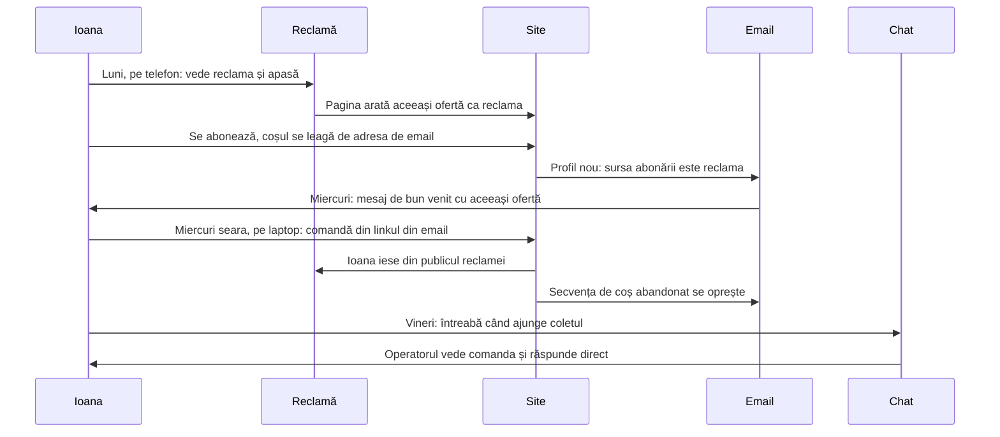

Ce a fost nevoie ca să arate așa:

- O singură sursă pentru prețuri și oferte, din care se alimentează site-ul, emailul și reclamele.
- Adresa de email ca identificator comun. Coșul și comenzile se leagă de ea.
- Un nou abonat intră în seria de bun venit, nu direct în newsletterul general. Seria respectă oferta prin care a venit.
- Lista de cumpărători este trimisă periodic către platforma de reclame, ca excludere, cu respectarea regulilor de consimțământ.
- Chatul afișează operatorului comenzile asociate adresei de email (detalii în capitolul 4).
- La raportare, firma se uită la traseu, nu doar la ultimul clic.

> **De reținut.** Integrarea nu începe cu un software scump. Începe cu trei decizii: un calendar comun al ofertelor, un identificator comun al clientului și o regulă simplă pentru fiecare eveniment important (abonare, comandă, reclamație): ce se pornește și ce se oprește pe celelalte canale.

## 3.8 Atribuirea: cui îi revine meritul pentru o comandă

### 3.8.1 Problema

Ioana a atins două canale înainte să cumpere. Alți clienți ating cinci. Comanda este una singură. Atribuirea este regula prin care împarți meritul unei comenzi între canalele care au contribuit la ea. Nu există o regulă „adevărată”; există reguli mai potrivite sau mai puțin potrivite pentru decizia pe care o ai de luat.

### 3.8.2 Modelele

Să luăm un traseu ceva mai lung, pentru o comandă de 120 de lei: reclamă pe rețele sociale (luni), căutare pe Google după numele magazinului (marți), email (miercuri), intrare directă pe site și comandă (joi).

| Model | Regula | Reclame | Căutare | Email | Direct |
|---|---|---|---|---|---|
| Primul contact | Tot meritul merge la primul canal | 120 lei | 0 | 0 | 0 |
| Ultimul clic | Tot meritul merge la ultimul canal | 0 | 0 | 0 | 120 lei |
| Ultimul clic, fără Direct | Ca mai sus, dar intrările directe sunt ignorate | 0 | 0 | 120 lei | 0 |
| Împărțită egal (liniară) | Fiecare contact primește la fel | 30 lei | 30 lei | 30 lei | 30 lei |
| Împărțită după poziție | De exemplu 40% primul, 40% ultimul, restul la mijloc | 48 lei | 12 lei | 12 lei | 48 lei |
| Bazată pe date | Un algoritm estimează contribuția fiecărui contact, comparând traseele care se termină cu o comandă cu cele care nu se termină | după estimare | după estimare | după estimare | după estimare |

Câteva lămuriri:

- **Primul contact** răsplătește canalele care fac cunoștință (reclame, rețele sociale) și ignoră tot ce a convins omul după aceea.
- **Ultimul clic** răsplătește canalele care încheie (email, direct, căutarea după numele firmei) și ignoră cine a adus omul prima dată.
- **Modelele împărțite** sunt un compromis: recunosc că au contat mai multe canale, dar ponderile sunt alese de tine, nu descoperite.
- **Modelul bazat pe date** are nevoie de volum mare de comenzi și rămâne o cutie neagră: primești rezultatul, nu și explicația.

Instrumentele se schimbă, așa că verifică ce îți oferă al tău. În Google Analytics 4, de exemplu, modelele disponibile sunt cel bazat pe date și două variante de ultim clic; modelele primul clic, liniar, cu depreciere în timp și bazat pe poziție nu mai sunt disponibile din noiembrie 2023 (Google Analytics Help, „Get started with attribution”, https://support.google.com/analytics/answer/10596866). Regulile simple rămân însă utile ca mod de a gândi și le poți aplica oricând pe propriile date.

### 3.8.3 Limitele oricărui model

- **Schimbarea dispozitivului.** Ioana a apăsat pe reclamă de pe telefon și a comandat de pe laptop. Dacă nu s-a autentificat pe ambele, pentru sistem sunt doi oameni diferiți.
- **Refuzul cookie-urilor.** Vizitatorii care nu acceptă cookie-urile de statistică lipsesc din trasee. Este dreptul lor, iar tu trebuie să accepți că imaginea este parțială.
- **Contactele fără clic.** Cine a văzut un clip fără să apese, a auzit de tine de la o prietenă sau a văzut borcanul la cineva acasă nu apare nicăieri.
- **„Direct” este o cutie cu de toate.** Aici ajung oamenii care au tastat adresa, dar și vizitele a căror sursă s-a pierdut pe drum (linkuri din aplicații de mesagerie, din documente, din unele aplicații de email).
- **Atribuirea nu este cauzalitate.** Faptul că un canal apare înaintea comenzii nu dovedește că a produs-o. Redirecționarea arată reclame unor oameni care oricum urmau să cumpere și apoi își trece comanda în cont. Ca să afli ce s-ar fi întâmplat fără reclamă, ai nevoie de un experiment (capitolul 9).

### 3.8.4 De ce contează când împarți bugetul

Bugetul urmează raportul. Dacă raportul folosește ultimul clic, canalele de început par slabe și li se taie banii. Peste două luni scad și canalele de încheiere, pentru că nu mai are cine să le aducă oameni noi. Dacă raportul folosește primul contact, se întâmplă invers: reclamele par eroii, iar emailul pare inutil.

În datele Cămării, canalul unei comenzi este **ultimul clic**. Asta are trei consecințe pe care trebuie să le ții minte când citești tabelele din acest suport:

1. **Email și Direct sunt probabil supraevaluate ca sursă de clienți noi.** O parte dintre comenzile lor aparțin unor oameni care au aflat de magazin dintr-o reclamă sau dintr-o căutare, ca Ioana.
2. **Reclamele sunt probabil subevaluate ca sursă de primă întâlnire.** Abonații noi câștigați în octombrie și noiembrie pot cumpăra în ianuarie, prin email, la preț întreg.
3. **Concluzia principală rămâne în picioare.** Reclamele din noiembrie au pierdut aproximativ 40 de lei pe fiecare comandă atribuită lor, iar vizitele și comenzile de pe Email și Direct au rămas aproape neschimbate din septembrie în noiembrie (Email: de la 121 la 129 de comenzi; Direct: de la 127 la 132; date fictive). Dacă reclamele ar fi împins masiv oameni spre celelalte canale, am fi văzut acolo o creștere. Nu o vedem, cel puțin nu încă.

> **Exemplu.** Un test simplu de bun-simț, înainte de orice model: pune pe același grafic bugetul de reclame și comenzile totale ale magazinului, pe săptămâni (tipurile de grafice sunt în capitolul 7). Dacă bugetul crește de 7 ori și comenzile din celelalte canale stau pe loc, niciun model de atribuire nu va scoate reclamele pe plus.

Ce poate face o firmă mică, fără instrumente scumpe:

- Marchează linkurile din emailuri și reclame cu parametri de campanie (parametri UTM, etichete adăugate la adresa linkului care spun instrumentului de analiză de unde vine vizita).
- Pune în formularul de comandă întrebarea opțională „De unde ai aflat de noi?”. Răspunsurile acoperă exact ce nu vede niciun instrument.
- Compară lunar două modele (primul contact și ultimul clic) pe aceleași comenzi. Canalele la care diferența este mare sunt cele despre care știi cel mai puțin.
- Urmărește separat clienții noi și cei care revin. Un canal care aduce doar clienți vechi nu crește afacerea.

## 3.9 Exemplu lucrat: plan de canale pe 90 de zile pentru Cămara de la Dunăre

### 3.9.1 Punctul de plecare

Suntem la sfârșitul lui noiembrie. Rezumatul situației (date fictive, construite pentru exercițiu):

| Canal (noiembrie) | Vizite | Comenzi | Venit | Cost de marketing | Contribuție |
|---|---|---|---|---|---|
| Căutare | 9.920 | 249 | 37.350 lei | 0 lei | 13.321,50 lei |
| Reclame | 15.900 | 286 | 30.030 lei | 16.800 lei | -11.494,70 lei |
| Email | 2.560 | 129 | 21.285 lei | 200 lei | 7.572,25 lei |
| Direct | 3.760 | 132 | 20.460 lei | 0 lei | 7.359,00 lei |
| Total | 32.140 | 796 | 109.125 lei | 17.000 lei | 16.758,05 lei |

După costurile fixe de 10.000 de lei, rezultatul simplificat al lunii este 6.758 de lei, față de 18.088 de lei în septembrie.

Diagnosticul, în trei propoziții. Canalele deținute și câștigate (Căutare, Email, Direct) produc toată contribuția și nu au mai fost dezvoltate. Canalul plătit a fost mărit de 7 ori și legat de o reducere care a coborât marja sub costul de achiziție. Canalele lucrează separat: reclamele nu alimentează planificat lista de email, iar raportarea se face doar pe ultimul clic.

### 3.9.2 Obiective și reguli

Obiectivul pe 90 de zile: rezultatul simplificat lunar revine peste nivelul din septembrie, fără ca numărul de comenzi să coboare sub cel din septembrie.

Reguli de lucru:

1. **Plafon de cost pe comandă pentru reclame: 35 de lei**, la preț întreg. Rațiunea: 53,50 lei rămân dintr-o comandă medie după marfă, ambalare și livrare, iar plafonul lasă o rezervă.
2. **Fără cod general de reducere în reclame.** Stimulentele se dau țintit (prima comandă a unui abonat, coș abandonat) și se verifică la marjă.
3. **Bugetul de reclame crește doar în pași de cel mult 25%**, și doar dacă pasul anterior a respectat plafonul.
4. **Fiecare vizită plătită are două ținte**: comanda sau abonarea la newsletter.
5. **O singură foaie de calcul comună** cu ofertele, mesajele și datele de pe toate canalele.

### 3.9.3 Planul, lună cu lună

| | Zilele 1-30: oprește pierderea, repară temelia | Zilele 31-60: construiește canalele deținute | Zilele 61-90: crește controlat și măsoară |
|---|---|---|---|
| Site | Verificare pe mobil; fotografiile comprimate; listele din 3.2.7 și 3.2.8 aplicate pe primele 10 produse și pe pagina de finalizare | Pagini de categorie rescrise; seturi-cadou ca produse separate; recenzii cerute după livrare | Întrebarea „De unde ai aflat de noi?” în formular; date structurate de produs |
| Căutare | Search Console configurat; titluri și descrieri pentru primele 10 pagini | Patru articole pe întrebări reale (păstrarea mierii, zacuscă fără conservanți, idei de cadou, rețete) | Analiza interogărilor din Search Console; încă patru articole; linkuri de la producători |
| Rețele sociale | O platformă principală; două postări pe săptămână despre producători | Serie de clipuri scurte „din cămară”; răspuns la comentarii în aceeași zi | O colaborare cu un creator local de conținut culinar, marcată ca publicitate |
| Email | Serie de bun venit (3 mesaje); mesaj de coș abandonat; formular de abonare vizibil | Segmente: fără comandă, o comandă, fideli; newsletter la două săptămâni | Reactivarea inactivilor; test A/B pe subiect la fiecare newsletter |
| Reclame | Buget redus la 3.000 lei; cod general oprit; redirecționare și public asemănător clienților | Buget până la 3.750 lei, doar dacă plafonul de 35 lei a fost respectat; reclame pentru seturi-cadou | Încă un pas de cel mult 25%, sub aceeași condiție; cumpărătorii excluși din public |
| Integrare și măsurare | Calendar comun de oferte; linkuri marcate cu parametri UTM | Adresa de email ca identificator comun între magazin, email și chat | Raport lunar cu două modele de atribuire; clienți noi și clienți care revin, separat |

### 3.9.4 Ce urmărim și când schimbăm direcția

| Indicator | Nivel de pornire (noiembrie) | Țintă la 90 de zile | Semnal de alarmă |
|---|---|---|---|
| Cost pe comandă la Reclame | 58,74 lei | Sub 35 lei | Peste 45 lei două săptămâni la rând |
| Contribuția pe comandă la Reclame | -40 lei | Pozitivă | Negativă după prima lună |
| Comenzi din Căutare | 249 pe lună | În creștere față de noiembrie | Scădere două luni la rând |
| Comenzi din Email | 129 pe lună | În creștere, pe măsură ce crește lista | Dezabonări în creștere după fiecare trimitere |
| Abonați noi pe lună | De măsurat (nu apare în date) | Urmărit săptămânal | Zero abonări din vizitele plătite |
| Rezultat simplificat lunar | 6.758 lei | Peste 18.088 lei | Sub nivelul din noiembrie |

Țintele sunt alegeri de lucru, nu previziuni. Un calcul de verificare arată însă că direcția este realistă: dacă în prima lună Reclamele revin doar la situația din septembrie (64 de comenzi, contribuție de 1.024 de lei), iar celelalte trei canale rămân la nivelul din noiembrie, contribuția totală ar fi 13.321,50 + 7.572,25 + 7.359,00 + 1.024 = 29.276,75 lei, iar rezultatul simplificat, după 10.000 de lei costuri fixe, aproximativ 19.277 de lei. Adică mai puține comenzi decât în noiembrie (574 față de 796) și un rezultat aproape de trei ori mai mare.

> **De reținut.** Planul nu spune „renunță la reclame”. Spune: reclama este un canal plătit, deci are un plafon; canalele deținute se construiesc mai încet, dar ce construiești rămâne; iar deciziile se iau pe contribuție, nu pe număr de comenzi.

## Aplicații

1. **Harta canalelor (Cămara).** Desenează ecosistemul digital al Cămării de la Dunăre: toate punctele de contact pe care le poți deduce din capitol, fiecare încadrat ca deținut, plătit sau câștigat. Marchează cu roșu legăturile care lipsesc în varianta „canale separate” din povestea Ioanei.

2. **Auditul unei pagini de produs.** Alege un magazin online românesc mic și o pagină de produs. Parcurge lista din 3.2.7 de pe telefon și notează, pentru fiecare dintre cele 12 puncte, „da”, „parțial” sau „nu”. Rulează pagina prin PageSpeed Insights și notează valorile LCP, INP și CLS, cu data măsurătorii. Propune primele trei îmbunătățiri, în ordinea efectului așteptat.

3. **Intenția de căutare (Cămara).** Scrie 12 căutări posibile legate de produsele Cămării, câte trei pentru fiecare tip de intenție. Pentru fiecare, spune ce pagină ar trebui să existe pe site și dacă ai urmări-o prin SEO, prin reclame în căutare sau prin ambele.

4. **Randamentul reclamelor (Cămara).** Din fișierul `camara_saptamanal.csv`, calculează pentru canalul Reclame, pe fiecare dintre cele 12 săptămâni: costul pe vizită, rata de conversie, costul pe comandă și contribuția pe comandă. Găsește săptămâna în care contribuția pe comandă devine negativă. Ce decizie ai fi luat în acea săptămână? (Calculul în Python este explicat în capitolul 8; poți lucra și într-o foaie de calcul.)

5. **Seria de bun venit.** Scrie cele trei mesaje ale unei serii de bun venit pentru Cămara: subiect (în două variante, pentru un test A/B), ideea principală, acțiunea cerută și ziua trimiterii. Precizează ce se întâmplă cu seria dacă abonatul comandă după primul mesaj.

6. **Atribuire pe hârtie.** Un client are traseul: clip văzut pe o rețea socială (fără clic), căutare pe Google după „miere de salcâm Galați” (clic pe rezultat neplătit), reclamă de redirecționare (clic), email (clic și comandă de 200 de lei). Împarte cei 200 de lei după modelele: primul contact, ultimul clic, liniar, pe poziție (40-20-40). Ce contact nu apare în niciun model și de ce?

7. **Pentru afacerea ta.** Pentru afacerea ta sau pentru una pe care o cunoști bine, scrie un plan de canale pe 90 de zile după modelul din 3.9: diagnostic în trei propoziții, plafonul de cost pe comandă (cu calculul), un tabel cu trei luni și cel mult cinci canale, plus trei indicatori cu semnal de alarmă.

8. **Verificarea consimțământului.** Abonează-te la newsletterele a trei magazine online. Notează pentru fiecare: cum ți s-a cerut acordul, dacă ai primit un email de confirmare, cât de ușor găsești linkul de dezabonare și din câte clicuri te dezabonezi. Compară cu regulile din 3.5.3.

## Întrebări de verificare

1. Care este diferența dintre un canal deținut, unul plătit și unul câștigat? Dă câte un exemplu.
2. Care sunt cele patru funcții ale unui site, potrivit prezentării cursului?
3. Ce măsoară LCP, INP și CLS și care sunt pragurile pentru „bun”?
4. Ce înseamnă indexarea „mobile-first” și ce consecință practică are?
5. Care este versiunea WCAG recomandată în prezent de W3C și care sunt cele patru principii?
6. Care sunt cele trei etape prin care o pagină ajunge în rezultatele Google?
7. Prin ce diferă SEO de reclamele în căutare ca viteză, cost și durată a efectului?
8. De ce este rata de deschidere a emailurilor un indicator nesigur?
9. De ce a crescut costul pe comandă la Cămara când bugetul de reclame a crescut de la 2.400 la 16.800 de lei?
10. Care sunt cele patru componente ale integrării omnichannel?
11. Ce canal primește meritul comenzii Ioanei în modelul „ultimul clic” și ce canal în modelul „primul contact”?
12. De ce atribuirea nu dovedește cauzalitatea?

### Răspunsuri

1. Deținut: îl controlezi tu (site, listă de email). Plătit: cumperi atenție pe platforma altcuiva (reclame). Câștigat: vorbesc alții despre tine fără plată (recenzii, poziții în căutarea neplătită).
2. Informare, conversie, servicii, brand.
3. LCP: cât de repede apare elementul principal, cel mult 2,5 secunde. INP: cât de repede răspunde pagina la interacțiune, cel mult 200 de milisecunde. CLS: cât de stabilă este aranjarea, cel mult 0,1. Toate se judecă la percentila 75 a vizitelor reale.
4. Google folosește versiunea de mobil a paginii pentru indexare și clasare. Conținutul care lipsește de pe mobil lipsește, practic, și pentru Google.
5. WCAG 2.2. Principiile: perceptibil, operabil, inteligibil, robust.
6. Accesare (crawling), indexare, afișarea rezultatelor.
7. SEO: lent, fără cost pe clic, cu efect care durează. Reclame: rapide, plătite pe clic, cu efect care se oprește odată cu bugetul.
8. Se măsoară printr-o imagine invizibilă. Unele programe blochează imaginile, iar funcții de protecție a vieții private, cum este Mail Privacy Protection de la Apple, îi împiedică pe expeditori să vadă dacă mesajul a fost deschis.
9. Publicul apropiat s-a epuizat și reclamele au ajuns la oameni mai puțin interesați: costul pe vizită a urcat de la 0,75 la 1,06 lei, iar conversia a scăzut de la 1,99% la 1,80%. Codul de 20% a redus în plus valoarea comenzii și marja (date fictive).
10. Consistență între canale, date unificate despre client, orchestrare, atribuire.
11. Ultimul clic: Email. Primul contact: Reclame.
12. Arată ce canale au apărut înaintea comenzii, nu ce s-ar fi întâmplat fără ele. O parte dintre clienți ar fi cumpărat oricum. Doar un experiment poate separa efectul.

## De reținut

- Ecosistemul digital înseamnă canalele firmei plus legăturile dintre ele. Site-ul stă în centru, pentru că aproape orice drum trece prin el.
- Canalele deținute păstrează valoarea, cele plătite cumpără viteză, cele câștigate aduc încredere. Construiește-le în această ordine.
- Un site bun este gândit întâi pentru mobil, rapid (LCP cel mult 2,5 s, INP cel mult 200 ms, CLS cel mult 0,1), accesibil (WCAG 2.2), securizat (HTTPS) și conform (GDPR, cookie-uri cu acord).
- În căutare câștigi cu pagini care răspund intenției omului. Google nu vinde poziții în rezultatele neplătite, iar efectele muncii se văd în săptămâni sau luni.
- Emailul se sprijină pe permisiune. Segmentează, automatizează trei secvențe de bază și judecă după clicuri și comenzi, nu după deschideri.
- Reclamele au randament descrescător: când extinzi publicul, costul pe comandă crește. Stabilește un plafon din marjă înainte să pornești.
- Integrarea canalelor începe cu un calendar comun, un identificator comun al clientului și reguli simple de pornit și oprit mesaje.
- Orice model de atribuire este o convenție. În datele Cămării canalul înseamnă ultimul clic, deci citește cifrele pe canale cu această rezervă.

## Surse și lecturi recomandate

Surse deschise și folosite la scrierea capitolului (toate accesate în noiembrie 2026):

- Google, web.dev, „Web Vitals” (pagină actualizată la 31 octombrie 2024): https://web.dev/articles/vitals
- Google Search Central, „In-depth guide to how Google Search works”: https://developers.google.com/search/docs/fundamentals/how-search-works
- Google Search Central, „SEO Starter Guide”: https://developers.google.com/search/docs/fundamentals/seo-starter-guide
- Google Search Central, „Google Search Essentials”: https://developers.google.com/search/docs/essentials
- Google Search Central, „Creating helpful, reliable, people-first content”: https://developers.google.com/search/docs/fundamentals/creating-helpful-content
- Google Search Central, „Understanding page experience in Google Search results”: https://developers.google.com/search/docs/appearance/page-experience
- Google Search Central, „Mobile-first indexing best practices”: https://developers.google.com/search/docs/crawling-indexing/mobile/mobile-sites-mobile-first-indexing
- Google Search Central, „Product structured data”: https://developers.google.com/search/docs/appearance/structured-data/product
- Google, Search Console Help, „About Search Console”: https://support.google.com/webmasters/answer/9128668
- Google Ads Help, „How the Google Ads auction works”: https://support.google.com/google-ads/answer/6366577
- Google Ads Help, „About your data segments”: https://support.google.com/google-ads/answer/2453998
- Google Analytics Help, „Get started with attribution”: https://support.google.com/analytics/answer/10596866
- Google Workspace Admin Help, „Email sender guidelines”: https://support.google.com/a/answer/81126
- Meta, „Licitația pentru reclame”: https://www.facebook.com/business/ads/ad-auction
- Apple, „Use Mail Privacy Protection on iPhone”: https://support.apple.com/guide/iphone/use-mail-privacy-protection-iphf084865c7/ios
- W3C, Web Accessibility Initiative, „WCAG 2 Overview” (pagină actualizată la 17 septembrie 2026): https://www.w3.org/WAI/standards-guidelines/wcag/
- Comisia Europeană, „European Accessibility Act”: https://commission.europa.eu/strategy-and-policy/policies/justice-and-fundamental-rights/disability/union-equality-strategy-rights-persons-disabilities-2021-2030/european-accessibility-act_en
- Eurostat, „E-commerce statistics for individuals” (date extrase în februarie 2026): https://ec.europa.eu/eurostat/statistics-explained/index.php?title=E-commerce_statistics_for_individuals
- Regulamentul (UE) 2016/679 (GDPR), art. 4, 7 și 21, consultate în ediția adnotată: https://gdpr-info.eu/ ; textul oficial: https://eur-lex.europa.eu/eli/reg/2016/679/oj
- Legea nr. 506/2004 privind prelucrarea datelor cu caracter personal și protecția vieții private în sectorul comunicațiilor electronice, Portalul legislativ: https://legislatie.just.ro/Public/DetaliiDocument/56973

Instrumente gratuite pomenite în capitol:

- PageSpeed Insights: https://pagespeed.web.dev/
- Google Search Console: https://search.google.com/search-console/about

Lecturi recomandate:

- Chaffey, D., Ellis-Chadwick, F. (2019). *Digital Marketing* (ediția a 7-a). Pearson.
- Verhoef, P. C., Kannan, P. K., Inman, J. J. (2015). „From Multi-Channel Retailing to Omni-Channel Retailing: Introduction to the Special Issue on Multi-Channel Retailing”. *Journal of Retailing*, 91(2).
- Kaplan, A. M., Haenlein, M. (2010). „Users of the world, unite! The challenges and opportunities of Social Media”. *Business Horizons*, 53(1).
- Godin, S. (1999). *Permission Marketing: Turning Strangers into Friends and Friends into Customers*. Simon & Schuster.
- Krug, S. (2014). *Don't Make Me Think, Revisited: A Common Sense Approach to Web Usability*. New Riders.
- Parker, G. G., Van Alstyne, M. W., Choudary, S. P. (2016). *Platform Revolution*. W. W. Norton.

---

# Capitolul 4. Digital Customer Support: asistența digitală pentru clienți

## Ce vei putea face după acest capitol

- Să explici ce este customer service, ce este asistența digitală pentru clienți și prin ce canale se oferă.
- Să alegi canalele de suport potrivite pentru o afacere mică și să verifici dacă sunt folosite eficient.
- Să compari cele șapte tipuri de structură organizațională a unei echipe de suport și să o alegi pe cea potrivită mărimii firmei.
- Să proiectezi un flux digital de rezolvare a unei probleme, cu roluri, termene, tichete, răspunsuri pregătite și reguli de escaladare.
- Să scrii o politică de customer service scurtă și aplicabilă, care respectă drepturile de bază ale consumatorului.
- Să calculezi și să interpretezi principalii indicatori de suport: timp până la primul răspuns, timp de rezolvare, rezolvare la primul contact, CSAT, NPS, CES și tichete la 100 de comenzi.

## 4.1 Ce este customer service și ce este asistența digitală

### Customer service, pe înțeles

Customer service (în română: serviciul de asistență pentru clienți, pe scurt „suport”) este interacțiunea directă dintre un om care cumpără sau vrea să cumpere și un reprezentant al firmei care vinde. Definiția mai largă din prezentarea cursului spune că este vorba de asistența și sfaturile pe care o companie le oferă celor interesați să îi cumpere sau să îi folosească produsele.

Reține două lucruri din această definiție:

1. Suportul începe înainte de vânzare. Întrebarea „zacusca voastră conține țelină?” vine de la cineva care nu a cumpărat încă. Dacă nu primește răspuns, nu mai cumpără.
2. Suportul continuă după vânzare. „Unde e coletul meu?” și „mi-a venit un borcan spart” sunt momentele în care clientul decide dacă mai comandă a doua oară.

Majoritatea comercianților văd această interacțiune ca pe un factor care hotărăște două rezultate: dacă cumpărătorul rămâne mulțumit și dacă revine. Din acest motiv, un customer service bun se judecă de obicei după retenție, adică după câți clienți păstrezi.

### Asistența digitală

Digital customer support (asistență digitală pentru clienți) înseamnă același serviciu, oferit prin canale digitale: chat pe site, email, rețele sociale, aplicații de mesagerie, partajare de ecran, pagini de ajutor și alte aplicații de gestiune a relației cu clientul.

Canalele tradiționale sunt puține: telefonul, poșta, discuția față în față. Canalele digitale sunt mai multe și mai flexibile. Poți răspunde în scris când ai timp, poți trimite o fotografie sau un link, poți păstra istoricul conversației și poți lăsa clientul să se descurce singur la orice oră. Firmele care le folosesc ajung mai ușor la clienți, în locul și la ora care le convin acestora.

### Automatizare și om

O bună parte din suport este astăzi preluată de sisteme automate: mesaje de confirmare, pagini de urmărire a coletului, roboți de conversație. Totuși, cele mai multe afaceri păstrează posibilitatea de a vorbi cu un om. Motivul este practic: sistemele automate rezolvă bine întrebările repetitive, dar se blochează la situațiile neobișnuite, exact acolo unde clientul este deja supărat.

> **De reținut.** Customer service înseamnă interacțiunea dintre cumpărător și firma care vinde. Automatizarea preia întrebările simple și repetitive. Omul rămâne necesar pentru excepții, pentru situații cu emoție și pentru decizii care cer judecată.

## 4.2 Canalele digitale de suport

### Ce canale există

Tabelul de mai jos trece prin canalele din prezentare și adaugă, pentru fiecare, la ce este bun și unde te poate încurca.

| Canal | La ce se potrivește | Ce așteaptă clientul | Risc principal |
|---|---|---|---|
| Email | Probleme care cer detalii, fotografii, documente (factură, retur) | Răspuns în aceeași zi lucrătoare sau a doua zi | Mesaje pierdute într-o căsuță comună, fără responsabil |
| Chat pe site (live chat) | Întrebări scurte în timpul cumpărării | Răspuns în câteva minute, cât e pe site | Chat afișat ca „online” fără nimeni la tastatură |
| Rețele sociale (comentarii, mesaje private) | Întrebări publice, reclamații vizibile | Răspuns rapid și public | Reclamația fără răspuns e văzută de toți |
| Aplicații de mesagerie (WhatsApp, Messenger) | Conversații scurte, clienți care preferă telefonul mobil | Ton informal, răspuns rapid | Conversații amestecate cu cele personale, fără istoric comun |
| Telefon | Urgențe, clienți care nu scriu, situații delicate | Să răspundă cineva | Nu lasă urmă scrisă dacă nu notezi apelul |
| Partajare de ecran (screen sharing) | Software, servicii complexe, configurări | Să fie ghidat pas cu pas | Consumă mult timp; cere programare |
| Bază de cunoștințe (knowledge base) și pagină de întrebări frecvente | Întrebări care se repetă: livrare, plată, retur, ingrediente | Să găsească singur răspunsul în sub un minut | Informații vechi, care contrazic ce spune echipa |
| Self-service (cont client, urmărire comandă, formular de retur) | Acțiuni simple pe care clientul le poate face singur | Să funcționeze la orice oră | Proces blocat la jumătate, fără cale către un om |

Termenul self-service (autoservire) acoperă tot ce îi permite clientului să își rezolve singur problema: să vadă unde e coletul, să își schimbe adresa, să descarce factura, să citească ce alergeni are un produs. Baza de cunoștințe este o colecție organizată de articole scurte de ajutor. Pentru un magazin mic, ea poate fi o singură pagină „Întrebări frecvente” bine scrisă.

### Ce folosim deja

Aproape orice afacere mică folosește deja asistență digitală, de multe ori fără să o numească așa: o adresă de email pe site, un număr de WhatsApp, mesajele de pe pagina de Facebook sau Instagram, un formular de contact, mesajele automate ale firmei de curierat. La acestea se adaugă instrumente dedicate: aplicații de tichete (helpdesk), sisteme de gestiune a relațiilor cu clienții (CRM, din engleză Customer Relationship Management), widgeturi de chat și chatboți.

Problema obișnuită este alta: canalele există, dar nimeni nu le-a gândit împreună.

### Întrebarea care contează: le folosim eficient?

Prezentarea pune patru întrebări de control. Le poți folosi ca pe un audit rapid:

1. Oferă canalele o experiență pozitivă pentru client? Adică primește răspuns, în timp rezonabil, pe canalul pe care a scris?
2. Sunt canalele integrate între ele? Dacă un client scrie pe Instagram și apoi pe email, cel care răspunde vede ambele mesaje?
3. Contribuie canalele la loializare? Clientul care a avut o problemă mai comandă?
4. Ajută canalele echipa să fie eficientă sau o fac să răspundă de cinci ori la aceeași întrebare?

> **Exemplu.** Cămara de la Dunăre (magazin fictiv) are email, WhatsApp, mesaje pe Instagram și pe Facebook. Un client scrie duminică seara pe Instagram că i-a sosit un borcan de zacuscă spart. Luni dimineață, nevăzând răspuns, trimite și un email cu fotografii. Fondatoarea răspunde pe Instagram, colegul de la ambalare răspunde la email, fiecare cu altă soluție: una promite banii înapoi, celălalt un borcan nou. Clientul primește două răspunsuri diferite și trage concluzia că firma e dezorganizată. Cele patru canale funcționau. Lipsea legătura dintre ele.

> **Greșeală frecventă.** Deschizi un canal nou „ca să fim peste tot” fără să stabilești cine îl verifică și cât de des. Un canal pe care nu răspunde nimeni face mai mult rău decât lipsa lui. Mai bine două canale urmărite zilnic decât șase lăsate la voia întâmplării.

O notă despre cifre: prezentările pe această temă citează des procente spectaculoase despre comportamentul clienților (câți caută online înainte să cumpere, câte site-uri nu au formular de contact funcțional). Nu le reluăm aici, pentru că nu am putut identifica sursa lor primară. Ideea din spatele lor rămâne valabilă și o poți testa singur: clienții caută întâi singuri răspunsul, iar multe firme le îngreunează contactul. Verifică propriul formular de contact chiar azi, trimițându-ți un mesaj de test.

> **Pentru afacerea ta.** Fă un inventar de 15 minute. Scrie toate locurile în care un client îți poate scrie (email, formular, telefon, WhatsApp, Instagram, Facebook, recenzii Google, marketplace). Lângă fiecare notează: cine verifică, cât de des, unde se păstrează istoricul. Orice rând fără nume este o problemă care așteaptă să apară.

## 4.3 Cine are nevoie de asistență digitală și cât costă satisfacția clientului

### Cine are nevoie

Răspunsul scurt: oricine are clienți. Prezentarea distinge șase situații, care arată că suportul nu servește numai clientului.

| Cine | De ce are nevoie de suport digital |
|---|---|
| Firmele care vând online | Clientul nu poate întreba la tejghea; are nevoie de canale rapide |
| Firmele care vor relații mai bune cu clienții | Satisfacția și loialitatea se construiesc în momentele cu probleme |
| Departamentele de marketing | Conversațiile cu clienții arată ce nu se înțelege din site și din reclame |
| Firmele care își digitalizează procesele | Fluxurile clare scurtează timpul de reacție |
| Departamentele care vor transparență | Un sistem de tichete arată cine a promis ce, când și cui |
| Managerii care decid pe bază de date | Datele agregate din suport arată unde pierde firma bani și clienți |

Ultimele trei rânduri merită atenție. Un sistem de suport bine ținut este și o sursă de date. Dacă 12% dintre mesaje întreabă același lucru despre livrare, ai aflat ce trebuie rescris pe pagina de livrare. Despre cum transformi astfel de date în decizii, vezi capitolul 5.

### Costul satisfacției clientului

De zeci de ani, firmele încearcă să reducă costurile cu personalul prin automatizare. În suport, asta a dus la meniuri telefonice automate, formulare, roboți de conversație și pagini de ajutor care răspund fără intervenția unui om. Logica economică e simplă: un răspuns automat costă aproape zero, un răspuns scris de un om costă minute de salariu.

Calculul are însă două coloane. În prima stă costul suportului. În a doua stă costul clienților pierduți din cauza unui suport slab, iar acesta nu apare în nicio factură. Chiar și companiile mari de comerț online, care automatizează cât pot, păstrează căi de contact cu oameni reali. Există situații în care interacțiunea umană este de neînlocuit și devine un avantaj față de concurență: o discuție empatică și politicoasă cu un om pregătit poate face diferența dintre un client pierdut și unul păstrat.

De ce contează atât de mult păstrarea clientului? Pentru că un client nou costă. O sinteză publicată de Harvard Business Review arată că, în funcție de studiu și de industrie, atragerea unui client nou este de 5 până la 25 de ori mai scumpă decât păstrarea unuia existent (Amy Gallo, „The Value of Keeping the Right Customers”, Harvard Business Review, 2014, https://hbr.org/2014/10/the-value-of-keeping-the-right-customers). Intervalul este foarte larg tocmai pentru că depinde de domeniu. Ia-l ca ordin de mărime și calculează-ți propriile cifre.

> **Exemplu.** Date fictive, construite pentru exercițiu. În noiembrie, Cămara a cheltuit 16.800 lei pe reclame și a obținut 286 de comenzi pe canalul Reclame: aproximativ 59 de lei cheltuiți pentru fiecare comandă adusă de reclame. Un borcan spart înlocuit gratuit costă firma în jur de 42 de lei (un produs de 28 de lei plus 14 lei ambalare și livrare). Dacă înlocuirea rapidă păstrează clientul, ai „cumpărat” următoarea lui comandă mai ieftin decât prin reclame. Dacă refuzi sau întârzii, ai economisit 42 de lei și ai pierdut un client pentru care plătiseși deja 59.

Concluzia practică: automatizează ce se repetă și nu cere judecată, apoi folosește timpul economisit pentru cazurile în care un om schimbă rezultatul.

## 4.4 Componentele unui customer service bun

### Trei reguli de bază

Proprietarii de afaceri mici înțeleg de obicei instinctiv ce înseamnă suport bun, pentru că își cunosc clienții pe nume. Firmele mari au studiat subiectul în detaliu și au ajuns la câteva concluzii simple:

1. **Răspuns la timp.** Un client lăsat să aștepte începe conversația deja iritat. Timpul de așteptare strică interacțiunea înainte ca ea să înceapă.
2. **O singură etapă pentru client.** Pe cât se poate, clientul explică problema o singură dată, unei singure persoane, care o urmărește până la rezolvare. Complexitatea internă (curier, depozit, contabilitate) rămâne treaba firmei.
3. **Revenire după transfer.** Dacă trebuie să implici alt coleg sau alt departament, cel care a preluat inițial cazul revine la client și verifică dacă problema s-a rezolvat cu adevărat.

La acestea se adaugă, din practica zilnică, două componente pe care le vom dezvolta mai jos: consecvența (același răspuns indiferent cine răspunde, vezi secțiunea 4.10) și urma scrisă (orice caz lasă o înregistrare, vezi secțiunea 4.8).

> **Exemplu.** Un client al Cămării întreabă unde îi este coletul. Varianta slabă: „Vă rugăm să sunați la curier, noi l-am predat.” Varianta bună: „Am verificat: coletul a ajuns ieri în depozitul din Brașov și este programat la livrare mâine. Vă scriu eu mâine după-amiază să confirm că a ajuns.” În a doua variantă, clientul a făcut un singur pas, iar firma și-a asumat urmărirea.

### Legătura cu marketingul și cu managementul

Suportul nu este o insulă. Prezentarea îl leagă de trei concepte de marketing și de patru zone de management.

**Concepte de marketing:**

- **Valoarea percepută de client.** Este ce crede clientul că primește, raportat la ce plătește. Un borcan de dulceață la 28 de lei pare scump sau ieftin și în funcție de cât de ușor a fost să afli ce conține și cât de corect ai fost tratat când a apărut o problemă.
- **Satisfacția clientului.** Este diferența dintre ce aștepta și ce a primit. Suportul influențează ambele părți: stabilește așteptări realiste („livrăm în 2-3 zile lucrătoare”) și repară situațiile în care realitatea a ieșit mai prost.
- **Loialitatea clientului.** Este disponibilitatea de a cumpăra din nou și de a recomanda. Se măsoară prin retenție, prin recomandări și prin indicatori ca NPS (secțiunea 4.11).

**Zone de management:**

- **Managementul calității.** Reclamațiile sunt cea mai ieftină formă de control al calității: clientul îți spune gratuit ce nu merge.
- **Inovația centrată pe client.** Multe idei de produse și de îmbunătățiri vin din întrebările repetate ale clienților.
- **Managementul relațiilor cu clienții (CRM).** A devenit în timp un domeniu de sine stătător; suportul îi furnizează o mare parte din date.
- **Managementul riscurilor.** Un suport atent prinde devreme problemele care pot deveni grave: un lot cu capace defecte, o etichetă greșită la alergeni.

### Alte idei din definițiile prezentării

- Fiecare industrie cere un nivel diferit de customer service, dar scopul economic e același peste tot: un serviciu bine prestat susține veniturile (vezi Lucas, *Customer Service: Skills for Success*, în lista de lecturi).
- Felul în care o firmă face suport îi reflectă valorile și strategia. O firmă care se prezintă drept „de familie” și răspunde cu mesaje seci, copiate, se contrazice singură.
- Percepția clientului depinde mult de capacitatea angajatului de a se adapta la omul din fața lui: unul vrea detalii, altul vrea doar soluția.
- Pentru unele firme, suportul este un activ necorporal: nu apare în bilanț, dar le diferențiază pe piață.
- O singură experiență bună poate schimba părerea unui client despre întreaga organizație. La fel și una proastă.

### Valoarea pe viață a clientului

Valoarea pe viață a clientului (CLV, din engleză Customer Lifetime Value) este suma pe care te aștepți să o câștigi de la un client pe toată durata relației cu el, după ce scazi costurile de a-l servi. O formulă simplificată, suficientă pentru o primă estimare:

```
CLV simplificat = contribuția pe comandă × numărul de comenzi pe an × numărul de ani
```

> **Exemplu.** Date fictive, construite pentru exercițiu. Un client al Cămării care cumpără la preț întreg aduce, la o comandă de 150 de lei, o marjă brută de 45%, adică 67,50 lei. După ambalare și livrare (14 lei) rămân 53,50 lei pe comandă, înainte de costurile de marketing. Dacă acest client comandă de 4 ori pe an, timp de 2 ani, CLV simplificat este 53,50 × 4 × 2 = 428 lei. Acum întrebarea despre borcanul spart arată altfel: merită să cheltuiești 42 de lei ca să nu pierzi 428?

Calculul complet al economiei unei comenzi îl găsești în capitolul 5. Aici este suficient să reții că suportul trebuie judecat față de valoarea clientului în timp, nu față de valoarea unei singure comenzi.

## 4.5 Strategia de business și customer service

### Patru dimensiuni ale relației cu clientul

Prezentarea leagă suportul de patru dimensiuni ale managementului relațiilor cu clienții, descrise în literatura de CRM (prezentarea trimite la Ngai, 2005; clasificarea în aceste patru dimensiuni apare explicit în Ngai, Xiu și Chau, 2009, vezi lista de surse). Pentru fiecare, tabelul arată ce înseamnă și cu ce contribuie suportul.

| Dimensiune | Ce înseamnă | Ce aduce suportul | Exemplu la Cămara (fictiv) |
|---|---|---|---|
| Identificarea clienților | Afli cine sunt oamenii care merită abordați ca potențiali clienți | Întrebările de dinainte de cumpărare arată cine este interesat și de ce | Multe întrebări despre produse fără zahăr adăugat: există un segment nedeservit |
| Atragerea clienților | Pașii prin care le captezi interesul | Răspunsul rapid la o întrebare înainte de comandă transformă un vizitator în cumpărător | „Da, zacusca de vinete nu conține țelină” trimis în 10 minute |
| Retenția clienților | Tot ce faci ca un client să rămână | Rezolvarea corectă a problemelor este principalul motiv pentru care un client supărat revine | Borcan spart înlocuit în 48 de ore, fără discuții |
| Dezvoltarea clienților | Creșterea relației cu clienții existenți | Suportul vede ce cumpără clientul și ce i s-ar mai potrivi | Clientului care cumpără lunar miere i se propune abonament |

Dimensiunea „dezvoltarea clienților” folosește patru instrumente pe care le vei întâlni des:

- **Analiza valorii pe viață a clientului (CLV)**, explicată mai sus.
- **Upselling** (vânzare la un nivel superior): îi propui clientului o variantă mai valoroasă a produsului pe care îl vrea. Exemplu: borcanul de 720 g în locul celui de 314 g.
- **Cross-selling** (vânzare încrucișată): îi propui un produs complementar. Exemplu: la miere, un sirop de cătină.
- **Analiza coșului de cumpărături** (market basket analysis): cauți în datele de comenzi ce produse se cumpără împreună, ca să faci pachete și recomandări.

> **Greșeală frecventă.** Transformi suportul în canal de vânzare agresiv. Un client care reclamă un borcan spart nu vrea să audă de oferta săptămânii. Întâi rezolvi problema. Recomandările vin doar când sunt utile și cerute de context.

### Cinci tipuri de inovație care îmbunătățesc suportul

Al doilea pilon al strategiei, după relația cu clientul, este inovația. Prezentarea enumeră cinci tipuri. Niciunul nu cere bugete mari; cele mai multe pornesc din ce auzi de la clienți.

| Tip de inovație | Ce înseamnă | Exemplu pornit din suport (Cămara, fictiv) |
|---|---|---|
| De produs | Produse noi sau caracteristici noi la cele existente | Clienții cer des cadouri: apare „cutia de degustare” cu patru borcane mici |
| De proces | Schimbi felul în care produci sau livrezi | Prea multe borcane sparte: treci la separatoare de carton și test de cădere la ambalare |
| Administrativă | Optimizezi procesele interne | O singură căsuță comună pentru toate mesajele, cu un responsabil pe zi |
| De marketing | Comunici mai bine valoarea | Pagina de produs primește secțiunea „Alergeni și ingrediente”, pentru că asta se întreabă cel mai des |
| De servicii | Îmbunătățești asistența | Mesaj automat cu link de urmărire trimis în ziua expedierii |

## 4.6 Oamenii din suport: profilul specialistului și responsabilitățile angajatorului

### Ce face un specialist în asistență pentru clienți

Responsabilitățile de bază: răspunde la întrebări, recomandă soluții și ghidează clienții prin caracteristicile produsului. Ca să reușească, are nevoie de două lucruri mai presus de orice: să comunice clar și să câștige încrederea omului cu care vorbește.

Prezentarea descrie un profil ideal. Îl rescriem ca listă de abilități observabile:

| Abilitate | Cum se vede în practică |
|---|---|
| Recunoaște tipare în mesaje și în emoții | Observă că trei clienți din aceeași zi reclamă același lot; simte din ton când un client e pe punctul de a renunța |
| Înțelege repede nevoia reală | Din „nu mai vreau comanda” deduce că problema este de fapt întârzierea, și o rezolvă |
| Decide rapid | Aplică politica fără să ceară aprobare pentru fiecare caz mărunt |
| Atenție la detalii | Verifică numărul comenzii și adresa înainte să promită ceva |
| Ascultare și răbdare | Lasă clientul să termine; rămâne în conversație până la rezolvare |
| Comunicare clară | Propoziții scurte, fără jargon; la telefon vorbește rar și calm, chiar dacă celălalt ridică tonul |
| Stabilitate | Reacționează constructiv în situații tensionate și nu ia personal nemulțumirea clientului |
| Motivație intrinsecă | Îi place să rezolve probleme, dincolo de salariu |

Prezentarea menționează și „tendința spre perfecțiune, uneori cu orice preț”. Ia-o cu măsură: atenția la detalii ajută, dar perfecționismul fără limită întârzie răspunsurile și epuizează omul. Un răspuns corect azi valorează mai mult decât unul impecabil peste trei zile. Pregătirea în rezolvarea conflictelor este utilă pentru oricine lucrează direct cu clienții.

### Ce datorează angajatorul echipei

Calitatea suportului depinde de management cel puțin la fel de mult ca de omul care răspunde. Trei obligații reies din prezentare:

1. **Informare la zi.** Echipa de suport trebuie să afle prima, nu ultima, despre produse noi, schimbări de preț, promoții, întârzieri la curier și modificări de politică. Un agent care află de la client că există o promoție nu are cum să arate competent.
2. **Evaluare periodică.** Verifici regulat experiența pe care o oferi: citești conversații, îți trimiți singur o întrebare ca un client obișnuit, te uiți pe indicatori.
3. **Sondaje regulate.** Le dai clienților ocazia să spună cum a fost și ce ar îmbunătăți.

Aceste elemente stau de regulă într-un manual intern al echipei de suport (prezentarea îl numește „Cartea albastră de asistență pentru clienți”). Dacă ceva lipsește din el, angajatul are datoria să întrebe și să ceară clarificări. Obligația este reciprocă: firma trebuie să îi dea acces la oamenii care au răspunsurile.

De ce insistă prezentarea pe acest punct? Pentru că sursa cea mai mare de stres în suport nu este clientul nervos. Este neputința: agentul a promis un răspuns și nu poate da de curier, de depozit sau de șeful care aprobă returul. Stresul acesta se acumulează și se vede apoi în tonul răspunsurilor.

> **Pentru afacerea ta.** Dacă ești singur în firmă, ești și agent, și manager. Rezervă 20 de minute pe săptămână pentru rolul de manager: recitește cinci conversații alese la întâmplare și întreabă-te dacă ai fi mulțumit ca client. Notează o singură îmbunătățire și aplic-o săptămâna următoare.

## 4.7 Structuri organizaționale pentru echipa de suport

### Structura după mărimea firmei

Cum organizezi suportul depinde în primul rând de câți oameni și câți clienți ai. Prezentarea descrie trei trepte.

| Etapă | Cum arată structura | Cine face suportul | Ce contează |
|---|---|---|---|
| Start-up | Simplă, suplă (lean), versatilă | Fondatorul și 1-2 oameni care fac de toate | Oameni polivalenți: de la suport tehnic la relaționare și feedback pentru produs |
| Firmă medie, în creștere | Echipă dedicată, cu sub-echipe specializate | Agenți pe canale sau pe tipuri de probleme; apare rolul de Customer Success Manager | Alinierea echipei la obiectivele de creștere și de retenție |
| Firmă cu resurse | Echipă integrată, organizată după criterii complexe | Echipe pe regiuni, pe canale de vânzare (online, magazine, B2B) sau pe etape din călătoria cumpărătorului (pre-vânzare, post-vânzare, loializare) | Standarde stricte de calitate, procese standardizate, măsurarea performanței |

Două explicații de termeni. B2B (business-to-business) înseamnă vânzare către alte firme. Customer Success Manager (manager pentru succesul clienților) este persoana care se ocupă proactiv ca un client să obțină rezultatul pentru care a cumpărat, înainte să apară o reclamație. Rolul este frecvent la firmele care vând abonamente și software.

La un start-up, structura poate fi desenată în câteva căsuțe:

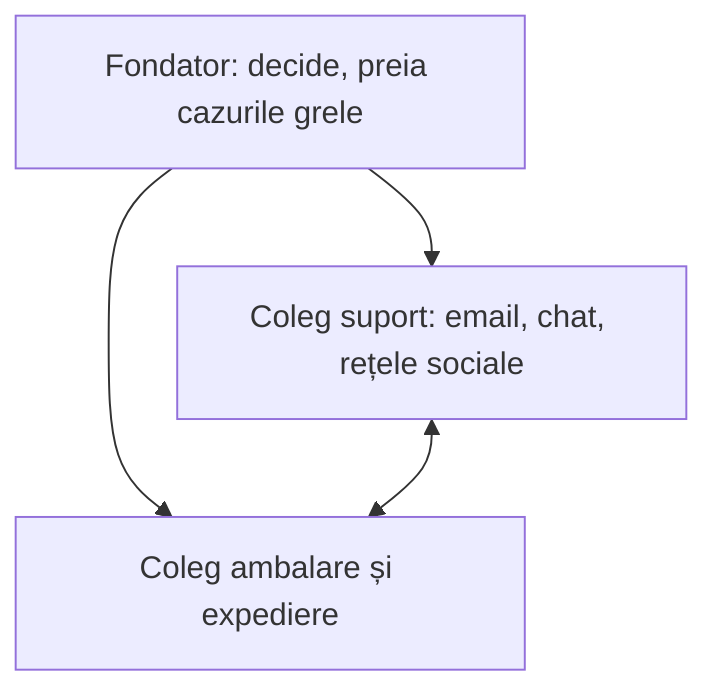

### Cele șapte tipuri de structură

Când firma crește, apare întrebarea „după ce criteriu împărțim echipa?”. Prezentarea trece prin șapte răspunsuri posibile.

#### 1. Structura funcțională

**Cum arată.** Ierarhie clasică, de sus în jos. În vârf stă liderul echipei, sub el urmează niveluri succesive: agenții de suport general, apoi serviciile specializate (tehnic, facturare, retururi).

**Când se potrivește.** Firme mici și medii cu o gamă de produse omogenă. Rolurile sunt clare, fiecare știe cui raportează.

**Riscuri.** Departamentele devin „silozuri”: suportul nu vorbește cu marketingul, iar clientul este plimbat între niveluri.

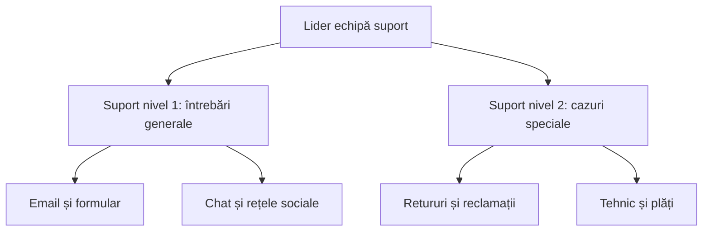

#### 2. Structura pe produs

**Cum arată.** Echipele se formează în jurul produselor. Fiecare linie de produs are propriii oameni de vânzări, marketing și asistență. Prezentarea dă exemplul ipotetic al unui producător de electronice care ar avea câte o echipă pentru tabletă, pentru telefon și pentru dispozitivul TV.

**Când se potrivește.** Produse foarte diferite între ele, care cer cunoștințe diferite.

**Riscuri.** Dublarea rolurilor și a costurilor; clientul care are două produse vorbește cu două echipe; experiența diferă de la un produs la altul.

#### 3. Structura pe piață

**Cum arată.** Seamănă cu structura pe produs, dar echipele se formează în jurul segmentelor de clienți: persoane fizice, firme mici, clienți mari; sau începători și avansați.

**Când se potrivește.** Când segmentele au nevoi cu adevărat diferite. O echipă care înțelege în profunzime un tip de client oferă servicii vizibil mai bune.

**Riscuri.** Segmentare făcută „din birou”, care nu corespunde clienților reali; clienți care nu se încadrează clar în niciun segment.

#### 4. Structura geografică

**Cum arată.** Echipe pe țări, regiuni sau orașe. Fiecare cunoaște limba, obiceiurile, curierii și regulile locale.

**Când se potrivește.** Firme care vând în mai multe țări sau regiuni cu diferențe mari de limbă, fus orar și legislație.

**Riscuri.** Standarde diferite de la o regiune la alta; costuri mari; cunoștințe care nu circulă între echipe.

#### 5. Structura pe proces

**Cum arată.** Echipele urmează procesele firmei: pre-vânzare, procesarea comenzilor, livrare, retururi, loializare. Pentru fiecare proces iei în calcul sarcinile, abilitățile necesare și legăturile cu celelalte procese.

**Când se potrivește.** Activități cu flux clar și repetitiv, cum este comerțul online, unde aproape orice problemă ține de o etapă precisă a comenzii.

**Riscuri.** Predările între procese: cazul „cade între scaune” când trece de la o echipă la alta. Cere fluxuri documentate (secțiunea 4.8).

#### 6. Structura matriceală

**Cum arată.** Fiecare om are doi șefi: liderul de departament (de exemplu, șeful suportului) și liderul de proiect sau de linie de produs. Echipele de marketing, vânzări și asistență colaborează transversal și împart responsabilități.

**Când se potrivește.** Organizații mari și complexe, cu multe produse și proiecte care au nevoie de aceiași specialiști.

**Riscuri.** Confuzie la decizii („cine are ultimul cuvânt?”), priorități contradictorii, ședințe multe. Funcționează doar cu o comunicare foarte bună.

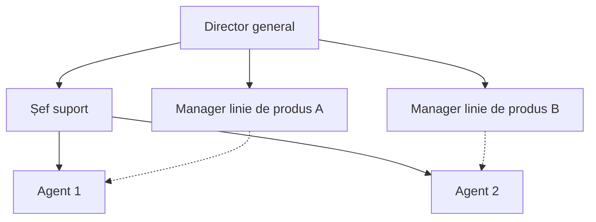

Liniile continue arată raportarea ierarhică, cele punctate raportarea pe linia de produs.

#### 7. Structura circulară

**Cum arată.** Tot o ierarhie, dar desenată în cercuri concentrice. Managerii de nivel superior stau în centru și își transmit viziunea spre exterior. Angajații care pun viziunea în practică stau în inelele exterioare, cele mai aproape de clienți.

**Când se potrivește.** Organizații care vor să încurajeze circulația liberă a informației și să sublinieze că toți lucrează în aceeași direcție.

**Riscuri.** Nu e limpede cine cui raportează; oamenii noi se orientează greu; deciziile pot întârzia.

### Tabel comparativ

| Structură | Criteriul de împărțire | Avantaj principal | Risc principal | Potrivită pentru |
|---|---|---|---|---|
| Funcțională | Funcția și nivelul ierarhic | Roluri clare, ușor de condus | Silozuri, client plimbat între niveluri | Firme mici și medii, ofertă omogenă |
| Pe produs | Linia de produs | Expertiză profundă pe produs | Dublarea resurselor | Produse foarte diferite |
| Pe piață | Segmentul de clienți | Înțelegerea nevoilor segmentului | Segmente definite greșit | Clienți cu nevoi distincte (persoane fizice și firme) |
| Geografică | Regiunea | Limbă și cunoștințe locale | Standarde inegale | Vânzări în mai multe țări |
| Pe proces | Etapa din proces | Eficiență pe flux | Cazuri pierdute la predare | Comerț online, logistică |
| Matriceală | Departament și proiect, simultan | Flexibilitate, aliniere strategică | Doi șefi, decizii neclare | Organizații mari, complexe |
| Circulară | Apropierea de viziune și de client | Comunicare deschisă | Raportare neclară | Organizații cu cultură colaborativă |

> **Exemplu.** Cămara de la Dunăre are trei oameni. Nu are nevoie de niciun „tip” sofisticat de structură: are nevoie de structura suplă de start-up, cu o singură regulă clară despre cine răspunde în fiecare zi. Dacă într-un an ar ajunge la zece oameni și ar vinde și către restaurante, ar putea trece la o structură pe proces (pre-vânzare, comenzi și livrare, reclamații) sau pe piață (persoane fizice și clienți HoReCa, adică hoteluri, restaurante și cafenele).

> **Greșeală frecventă.** Copiezi organigrama unei corporații într-o firmă de cinci oameni. Structura trebuie să rezolve o problemă pe care o ai acum. Dacă nu poți spune ce problemă rezolvă o căsuță din organigramă, căsuța nu trebuie să existe.

## 4.8 Construirea unui flux digital de customer service

Un flux de lucru (workflow) este succesiunea de pași prin care o cerere a clientului ajunge de la primul mesaj la rezolvare: cine preia, ce verifică, ce decide, ce comunică și când. Prezentarea propune o construcție în mai mulți pași. Îi urmăm în ordine.

### Pasul 1. Înțelege procesul actual

Înainte să desenezi ceva, află ce se întâmplă de fapt:

- Ce face echipa zilnic? Ce sarcini se repetă?
- Ce procese există „în capul oamenilor”, dar nu sunt scrise nicăieri?
- Ce întrebări primiți cel mai des?

Cel mai simplu instrument este un tabel în care notezi, timp de două săptămâni, fiecare cerere: data, canalul, tipul, cât a durat rezolvarea.

> **Exemplu.** Date fictive, construite pentru exercițiu. În noiembrie, Cămara a primit 143 de solicitări la 796 de comenzi. Clasificate după subiect:
>
> | Tip de solicitare | Număr | Pondere |
> |---|---|---|
> | „Unde e coletul meu?” | 52 | 36% |
> | Produs deteriorat la livrare (de regulă borcan spart) | 19 | 13% |
> | Alergeni și ingrediente | 17 | 12% |
> | Modificare sau anulare de comandă | 14 | 10% |
> | Codul de reducere nu funcționează | 13 | 9% |
> | Termen de valabilitate | 12 | 8% |
> | Plată și factură | 11 | 8% |
> | Altele | 5 | 4% |
> | **Total** | **143** | **100%** |
>
> Trei tipuri (colet, alergeni, valabilitate) fac 57% din volum și sunt întrebări de informare. Pot fi reduse mult prin self-service: link de urmărire trimis automat, secțiune de alergeni pe pagina de produs, o frază despre termenul de valabilitate. Borcanul spart este altceva: cere un flux cu decizie și cu cost.

### Pasul 2. Identifică provocările

Întreabă-te ce vrei să îmbunătățești. Prezentarea sugerează trei locuri în care să cauți:

- **Indicatorii.** Poate indicatorii-cheie de performanță (KPI, din engleză Key Performance Indicators) arată prost: răspunsuri târzii, multe reveniri pe același caz.
- **Resursele.** Poate oamenii sunt alocați greșit: toată lumea răspunde dimineața, nimeni seara, când vin cele mai multe mesaje.
- **Tehnologia.** Poate setul de instrumente folosit nu mai face față: o căsuță de email comună a fost suficientă la 10 mesaje pe zi și nu mai este la 50.

Echipa trebuie să aibă o idee clară despre ce vrea să schimbe înainte să construiască sau să refacă fluxurile. Altfel desenezi diagrame frumoase pentru probleme pe care nu le ai.

### Pasul 3. Rezolvarea problemei clientului, pas cu pas

Rezolvarea unei plângeri trebuie făcută corect și empatic. Dacă nu, clientul devine frustrat, ajunge să considere agentul și firma incompetente și simte că nu este luat în seamă. Uneori, o reclamație tratată prost este picătura care umple paharul după alte mici neplăceri.

Fluxul general din prezentare are patru etape:

1. Clientul raportează problema.
2. Se generează un tichet și i se atribuie un nivel de gravitate sau de prioritate.
3. Clientul este direcționat către agentul cel mai potrivit.
4. Agentul și clientul discută până la soluționare.

Un **tichet** este fișa unui caz: un număr unic, cine a scris, despre ce, cine răspunde de caz, în ce stadiu se află și tot istoricul conversației. Poate fi un rând într-un tabel sau o înregistrare într-o aplicație de helpdesk.

În etapa a patra, conversația are la rândul ei șase pași:

1. **Salută** prietenos și invită clientul să explice problema.
2. **Ascultă** (sau citește) cu atenție, până la capăt.
3. **Reformulează** problema și cere confirmarea că ai înțeles corect.
4. **Prezintă soluția** și ține clientul la curent cât timp o pui în aplicare.
5. **Întreabă** dacă mai poți ajuta cu ceva; dacă nu, încheie politicos.
6. **Confirmă în scris**, prin email sau mesaj, că problema a fost soluționată.

Pasul 3 pare formal, dar previne cele mai multe neînțelegeri. Pasul 6 lasă o dovadă pentru ambele părți.

### Pasul 4. Identifică rolurile

Prezentarea propune patru acțiuni:

1. **Alege structura potrivită** (secțiunea 4.7) și stabilește ce roluri cere ea.
2. **Analizează canalele.** Uită-te unde pierzi cei mai mulți clienți, actuali sau potențiali: pe email, la telefon, pe rețelele sociale sau pe chat. Acolo ai nevoie de oameni mai întâi.
3. **Formează echipe specializate** pe competențe și nevoi: apeluri, emailuri, rețele sociale, suport tehnic și feedback. Fiecare echipă are o responsabilitate clară. Într-o firmă mică, „echipă” înseamnă „o persoană, într-un interval orar”.
4. **Stabilește ierarhia și triajul.** Când suportul lucrează împreună cu marketingul și cu partea tehnică, trebuie să fie clar cum se împart și cum se triază sarcinile: cine preia, cine decide, cui se escaladează.

**Escaladarea** înseamnă trecerea unui caz către cineva cu mai multă autoritate sau expertiză, atunci când primul nivel nu îl poate rezolva. O regulă de escaladare bună spune trei lucruri: când se escaladează, către cine și în cât timp trebuie să răspundă acea persoană.

### Pasul 5. Construiește fluxurile

Pentru desenarea fluxurilor poți folosi instrumente vizuale dedicate (prezentarea amintește InVision și Microsoft Visio) sau unele la îndemână: Excel, Google Sheets, o diagramă Mermaid ca cele din acest capitol ori chiar o foaie de hârtie. Instrumentul contează puțin. Contează ce pui în flux:

- cunoștințele tale despre proces;
- informațiile de la colegi (ei știu unde se blochează lucrurile);
- indicatorii pe care îi ai deja;
- feedbackul clienților.

Fiecare etapă se descrie clar, cu responsabil și termen. Așa vezi ce resurse cere și unde apar blocajele.

### Exemplu lucrat: fluxul „borcan spart la livrare”

Iată fluxul Cămării pentru cel mai costisitor tip de solicitare (magazin fictiv).

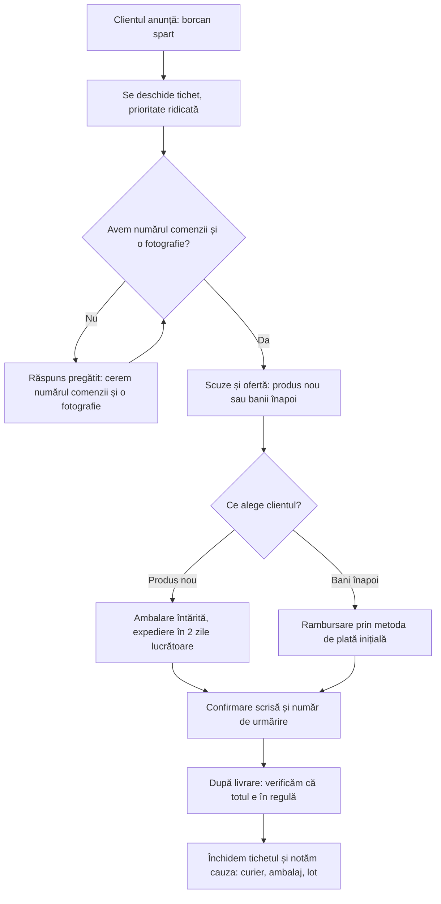

Același flux, ca tabel cu responsabili și termene:

| Pas | Ce se întâmplă | Cine | Termen |
|---|---|---|---|
| 1 | Mesajul intră pe orice canal și devine tichet cu eticheta „deteriorat” | Responsabilul de suport al zilei | La citire |
| 2 | Primul răspuns: scuze, cerere de fotografie și număr de comandă (dacă lipsesc) | Responsabilul de suport | 4 ore lucrătoare |
| 3 | Ofertă: înlocuire gratuită sau rambursare, la alegerea clientului | Responsabilul de suport, fără aprobare până la 150 de lei | La primirea fotografiei |
| 4 | Expedierea produsului nou sau rambursarea | Colegul de la ambalare, respectiv fondatoarea (plăți) | 2 zile lucrătoare, respectiv 5 zile lucrătoare |
| 5 | Confirmare scrisă către client, cu număr de urmărire | Responsabilul de suport | În ziua expedierii |
| 6 | Verificare după livrare: „a ajuns întreg?” | Responsabilul de suport | La 1-2 zile după livrare |
| 7 | Închiderea tichetului și notarea cauzei | Responsabilul de suport | La confirmarea clientului |
| 8 | Analiză lunară: câte cazuri, pe ce curier, ce ambalaj | Fondatoarea | Prima săptămână a lunii |

Trei observații despre acest flux:

- Clientul nu trimite borcanul spart înapoi. Costul și riscul returului depășesc valoarea produsului, iar fotografia este o dovadă suficientă.
- Agentul are o limită de decizie (150 de lei). Sub ea rezolvă singur, deci clientul nu așteaptă aprobări.
- Pasul 8 transformă reclamațiile în date. Fără el plătești borcane sparte la nesfârșit, fără să afli de ce se sparg.

### Pasul 6. Automatizează ce merită

Prezentarea pornește de la o întrebare simplă: dacă agentul creează manual un tichet după fiecare apel, este acesta cel mai eficient mod? De multe ori nu. Alternativele: chat, self-service și integrarea cu un CRM, astfel încât tichetul să se creeze singur și să fie legat de comanda clientului.

Patru niveluri de automatizare, de la simplu la complex:

**1. Sistem de tichete.** Toate mesajele, de pe toate canalele, ajung într-un singur loc. Fiecare primește număr, responsabil și stare (nou, în lucru, în așteptarea clientului, rezolvat). Rezolvă problema celor două răspunsuri diferite din exemplul de la secțiunea 4.2.

**2. Răspunsuri pregătite.** Șabloane pentru situațiile frecvente, pe care agentul le personalizează. Economisesc timp și asigură consecvența.

```
Subiect: Comanda {numar_comanda}: ne pare rău pentru borcanul spart

Bună ziua, {prenume},

Ne pare rău că {produs} a ajuns spart. Nu așa trebuia să primiți comanda.

Vă propunem, la alegere:
1. vă trimitem gratuit un produs nou, în cel mult 2 zile lucrătoare;
2. vă returnăm contravaloarea produsului, {suma} lei.

Nu este nevoie să ne trimiteți nimic înapoi. Vă rugăm doar să aruncați
cu grijă produsul, din cauza cioburilor.

Ne spuneți ce variantă preferați?

Cu drag,
{nume_agent}, Cămara de la Dunăre
```

**3. Mesaje automate declanșate de evenimente.** Confirmarea comenzii, emailul cu numărul de urmărire în ziua expedierii, mesajul „coletul a fost livrat, totul în regulă?”. Acestea previn întrebările înainte să apară.

**4. Chatbot.** Un chatbot este un program care poartă o conversație în scris cu clientul. Variantele simple urmează un arbore de opțiuni („1. Unde e coletul? 2. Retur 3. Altceva”). Variantele bazate pe modele de limbaj formulează răspunsuri libere, pornind de la o bază de cunoștințe.

Un chatbot este util când răspunde la întrebări frecvente cu răspuns stabil, când caută starea unei comenzi sau când adună datele cazului (număr de comandă, fotografie) înainte să îl predea unui om. Are însă limite pe care trebuie să le cunoști:

- **Poate greși cu siguranță de sine.** Un chatbot bazat pe model de limbaj poate formula un răspuns plauzibil, dar fals. La un magazin alimentar, un răspuns greșit despre alergeni poate face rău unui om. Întrebările despre alergeni trebuie să primească doar informația exactă de pe etichetă sau să ajungă la un om.
- **Nu simte situația.** Un client supărat care primește „Am înțeles! Cu ce te mai pot ajuta?” se supără mai tare.
- **Nu poate decide excepții.** Politica spune 14 zile, clientul scrie în ziua 16 pentru că a fost în spital. Aici e nevoie de judecată.
- **Are nevoie de întreținere.** Dacă schimbi costul livrării și uiți să actualizezi robotul, el va da informații greșite, politicos și la orice oră.
- **Trebuie să aibă ieșire.** Clientul trebuie să poată ajunge la un om în orice moment, fără să rămână blocat într-o buclă.

> **Greșeală frecventă.** Pui chatbotul ca zid între client și echipă, ca să scazi numărul de tichete. Tichetele scad, pentru că oamenii renunță să mai scrie, și tot atunci renunță să mai cumpere. Chatbotul trebuie să scurteze drumul clientului către răspuns.

### Pasul 7. Testează și îmbunătățește

Fluxurile bune nu ies din prima. Se obțin prin testarea mai multor variante, colectarea de date și ajustări treptate. Dacă o etapă durează prea mult, elimini ineficiența sau refaci fluxul. Ținta: un flux clar, rapid și previzibil, atât pentru echipă, cât și pentru client.

Listă de verificare pentru testarea unui flux:

- Parcurge fluxul ca un client: trimite o reclamație de test de pe o adresă personală.
- Încearcă pe fiecare canal: ajunge cazul în același loc?
- Testează cazurile-limită: client fără număr de comandă, client care nu răspunde, client care scrie în weekend.
- Cronometrează fiecare pas și compară cu termenul promis.
- Întreabă un coleg nou dacă poate aplica fluxul doar citind documentul.
- După o lună, compară indicatorii de dinainte cu cei de după (secțiunea 4.11).

## 4.9 Drepturile consumatorului pe care suportul trebuie să le cunoască

Echipa de suport este cea care aplică, în practică, drepturile legale ale clientului. Un agent care nu le cunoaște poate promite prea puțin (și expune firma la reclamații și sancțiuni) sau prea mult. Textul de mai jos este o prezentare generală, cu trimitere la surse oficiale. Nu este consultanță juridică; pentru situația firmei tale, verifică textele în vigoare și cere părerea unui jurist.

### Dreptul de retragere la cumpărăturile la distanță

În Uniunea Europeană, cine cumpără online, prin telefon sau în afara unui magazin are dreptul să se retragă din contract în 14 zile, fără să dea vreo explicație (portalul Your Europe al Uniunii Europene, pagina „Returnări”, https://europa.eu/youreurope/citizens/consumers/shopping/returns/index_ro.htm). În România, regula se găsește în Ordonanța de urgență a Guvernului nr. 34/2014 (OUG 34/2014), care transpune Directiva 2011/83/UE. Din textul consolidat al ordonanței reies câteva reguli pe care suportul le aplică zilnic:

| Regulă | Ce prevede, pe scurt | Unde |
|---|---|---|
| Termenul de retragere | 14 zile, fără justificare; pentru bunuri, se numără din ziua în care consumatorul intră în posesia lor | art. 9 |
| Rambursarea | Vânzătorul returnează toate sumele primite, inclusiv costul livrării inițiale, în cel mult 14 zile de la data la care a fost informat despre retragere, prin aceeași metodă de plată; nu datorează suplimentul pentru o livrare mai scumpă decât cea standard, aleasă de client | art. 13 alin. (1)-(3) |
| Amânarea rambursării | Vânzătorul poate aștepta până primește produsele sau dovada că au fost expediate | art. 13 alin. (4) |
| Returnarea produselor | Consumatorul le trimite înapoi în cel mult 14 zile de la anunțarea retragerii | art. 14 alin. (1) |
| Costul returului | Îl suportă consumatorul, dacă vânzătorul nu a acceptat să îl plătească și dacă l-a informat dinainte despre acest cost | art. 14 alin. (2) |
| Excepții | Printre altele: produse care se pot deteriora sau expiră rapid; produse sigilate care nu pot fi returnate din motive de sănătate sau igienă și care au fost desigilate; produse personalizate | art. 16 |

Pentru un magazin alimentar, excepțiile contează mult. Un borcan sigilat de dulceață, cu termen lung de valabilitate, nu este în mod evident un produs care „expiră rapid”, deci poate intra sub dreptul de retragere cât timp rămâne sigilat. Un borcan deschis intră, cel mai probabil, la excepția produselor desigilate care nu pot fi returnate din motive de igienă. Încadrarea exactă a fiecărui tip de produs este o chestiune juridică: confirm-o cu un specialist înainte să o scrii în politica de retur.

### Livrarea și coletul deteriorat

Dacă nu ai convenit altceva cu clientul, trebuie să livrezi în cel mult 30 de zile de la încheierea contractului (OUG 34/2014, art. 18). Riscul de pierdere sau de deteriorare trece la consumator abia când acesta intră în posesia fizică a produselor (art. 20). Portalul Your Europe formulează aceeași regulă pe înțeles: comerciantul răspunde de eventuala deteriorare a produselor de la expediere până când clientul le primește (pagina „Expediere și livrare”, https://europa.eu/youreurope/citizens/consumers/shopping/shipping-delivery/index_ro.htm). Excepția: clientul și-a ales singur un transportator pe care vânzătorul nu l-a oferit.

Consecința pentru suport este directă. „Curierul l-a spart, vorbiți cu curierul” nu este un răspuns acceptabil. Față de client răspunde vânzătorul, care își recuperează apoi paguba de la firma de curierat, dacă e cazul.

### Garanția legală de conformitate

Un produs trebuie să corespundă descrierii și să fie bun pentru utilizarea lui normală. În Uniunea Europeană, vânzătorul răspunde pentru neconformitățile care apar în minimum 2 ani de la livrare (Your Europe, pagina „Garanții și returnări”, https://europa.eu/youreurope/citizens/consumers/shopping/guarantees-returns/index_ro.htm). În România, regulile sunt în Ordonanța de urgență a Guvernului nr. 140/2021 (OUG 140/2021), aplicabilă contractelor încheiate după 1 ianuarie 2022:

- vânzătorul răspunde pentru neconformitatea care exista la livrare și este constatată în termen de 2 ani (art. 9);
- neconformitatea constatată în primul an de la livrare se prezumă că exista la livrare, până la proba contrarie (art. 10);
- consumatorul poate cere aducerea în conformitate (reparare sau înlocuire), reducerea proporțională a prețului sau încetarea contractului (art. 11);
- repararea sau înlocuirea se face gratuit, într-un termen rezonabil care nu poate depăși 15 zile calendaristice (art. 12).

La produse alimentare, garanția legală se întâlnește în practică rar ca „reparație”. Situațiile tipice sunt produsul livrat greșit, deteriorat, alterat înainte de termen sau diferit de descriere. Soluția firească este înlocuirea sau banii înapoi.

### Informații despre aliment la vânzarea online

Regulamentul (UE) nr. 1169/2011 privind informarea consumatorilor despre alimente stabilește ce informații sunt obligatorii, între care lista ingredientelor, alergenii, cantitatea netă și data de valabilitate. Pentru alimentele preambalate vândute la distanță, informațiile obligatorii trebuie să fie disponibile înainte de încheierea cumpărării, pe site sau prin alt mijloc clar indicat, fără costuri suplimentare. Excepție face data durabilității minimale sau data-limită de consum, care trebuie să fie disponibilă la livrare, împreună cu toate celelalte mențiuni (Comisia Europeană, pagina „Distance selling”, https://food.ec.europa.eu/food-safety/labelling-and-nutrition/food-information-consumers-legislation/distance-selling_en). Alergenii se evidențiază în lista de ingrediente, de exemplu prin alt font sau altă culoare de fundal (Your Europe, „Etichetarea produselor alimentare: reguli generale”, https://europa.eu/youreurope/business/product-requirements/food-labelling/general-rules/index_ro.htm).

Pentru suport, asta înseamnă două lucruri. Întrebările despre alergeni scad vizibil dacă pagina de produs afișează corect ingredientele. Iar când totuși apar, agentul răspunde citind eticheta lotului, nu din memorie.

> **De reținut.** Trei reguli pe care orice om din suportul unui magazin online trebuie să le știe: 14 zile pentru retragere la cumpărăturile la distanță (cu excepții), răspunderea vânzătorului pentru colet până ajunge la client și garanția legală de conformitate de 2 ani. Politica firmei poate oferi mai mult decât legea. Nu poate oferi mai puțin.

## 4.10 Politica de customer service

### Ce este și de ce contează

Politica de customer service este un document oficial al firmei care spune cum se face suportul: ce proceduri se urmează, în ce termene, pe ce ton și ce se întâmplă în situațiile frecvente. Este scrisă pentru echipă, ca toți să lucreze la fel. O parte din ea (termene, retururi) se publică de obicei și pentru clienți.

Rolurile ei, după prezentare:

- este punctul de referință pentru manageri și angajați;
- asigură consecvența: clientul primește același tratament indiferent cine răspunde și de unde;
- previne tratamentul subiectiv („lui i-ați dat banii înapoi, mie de ce nu?”);
- susține încrederea și loialitatea.

Importanța ei crește odată cu firma. Mai mulți clienți înseamnă mai multe interacțiuni, pe mai multe canale, purtate de mai mulți oameni. Fără reguli scrise, riscul de inconsecvență și de erori crește cu fiecare angajat nou. Într-o firmă de trei oameni, politica ține loc de memorie comună. Într-una de treizeci, fără ea fiecare agent își inventează propriile reguli.

### Ce conține

Prezentarea enumeră următoarele secțiuni ale unei politici interne:

1. **Prezentarea produselor și serviciilor.** O privire de ansamblu, cu linkuri către documentație internă, videoclipuri demonstrative, broșuri sau ghiduri de utilizare.
2. **Standardele de customer service.** Valorile firmei, așteptările privind interacțiunea cu clienții, comportamentele așteptate: empatie, claritate, promptitudine.
3. **Comunicare.** Cum înțelegi o problemă, cum îi găsești cauza și cum propui o soluție.
4. **Monitorizare.** Cum se urmărește calitatea și cum te asiguri că problema clientului a fost într-adevăr rezolvată.
5. **Reclamații.** Exemple de tratare a reclamațiilor, sfaturi pentru diferite tipuri de clienți și pentru păstrarea profesionalismului.
6. **Retenție.** De ce contează păstrarea clienților (vezi secțiunea 4.3) și ce poate face fiecare agent pentru ea.
7. **Colectarea feedbackului și a sugestiilor.** Cum notează angajații ce aud de la clienți, de exemplu printr-un formular intern (Google Forms, Typeform sau un simplu tabel).
8. **Monitorizarea performanței.** Ce indicatori se urmăresc și ce se așteaptă de la fiecare. Oamenii trebuie să știe după ce sunt evaluați.

La acestea se adaugă ghiduri pas cu pas pentru interacțiunile frecvente (de exemplu, procesarea unui retur) și criterii standard pentru situațiile care se repetă.

### Model de politică: Cămara de la Dunăre

Modelul de mai jos este scris pentru magazinul fictiv din acest suport. Îl poți adapta afacerii tale. Termenele și sumele sunt alegeri ale firmei, cu excepția celor care vin din lege (marcate ca atare). Înainte de a folosi un asemenea document într-o firmă reală, verifică-l cu un jurist.

---

**POLITICA DE CUSTOMER SERVICE**
**Cămara de la Dunăre (document intern, versiunea 1.0)**

**1. Scop și cui se aplică**

Documentul stabilește cum răspundem clienților, în ce termene și cum rezolvăm problemele. Se aplică tuturor celor care comunică cu clienții în numele Cămării, pe orice canal, inclusiv colaboratorilor ocazionali.

**2. Ce vindem**

Dulcețuri, zacuscă, miere și siropuri de la producători locali din zona Galați. Fișele de produs, cu ingrediente, alergeni, gramaj, producător și condiții de păstrare, se află în dosarul comun „Produse”. Fișa se actualizează la fiecare lot nou. Cine răspunde unei întrebări despre un produs verifică fișa, nu memoria.

**3. Principii**

1. Clientul explică problema o singură dată.
2. Cine preia un caz îl urmărește până la închidere.
3. Spunem adevărul, inclusiv când vestea e proastă („coletul întârzie două zile”).
4. Promitem doar ce putem face și facem ce am promis.
5. Rezolvăm întâi problema clientului și abia apoi căutăm vinovatul.

**4. Canale și program**

| Canal | Program de răspuns | Observații |
|---|---|---|
| Email și formularul de pe site | Luni-vineri, 9:00-17:00 | Canalul principal; aici se păstrează istoricul complet |
| WhatsApp (numărul firmei) | Luni-vineri, 9:00-17:00 | Pentru întrebări scurte; cazurile cu rambursare se confirmă și pe email |
| Instagram și Facebook (mesaje și comentarii) | Luni-vineri, verificare la 9:00, 13:00 și 16:30 | Reclamațiile publice primesc un răspuns public scurt, apoi continuăm în privat |
| Telefon | Luni-vineri, 10:00-14:00 | Fiecare apel se notează în registrul de tichete |

În afara programului, clientul primește un mesaj automat care spune când vom răspunde. Toate solicitările se trec în registrul unic de tichete, indiferent de canal.

**5. Termene de răspuns și de rezolvare**

| Situație | Primul răspuns | Rezolvare |
|---|---|---|
| Orice mesaj primit în program | Cel mult 4 ore lucrătoare | În funcție de tip, vezi mai jos |
| Mesaj primit în afara programului | Până la ora 11:00 a următoarei zile lucrătoare | În funcție de tip |
| „Unde e coletul?” | 4 ore lucrătoare | În aceeași zi lucrătoare, cu starea verificată la curier |
| Produs deteriorat sau greșit | 4 ore lucrătoare, cu prioritate | Reexpediere în 2 zile lucrătoare sau rambursare în 5 zile lucrătoare |
| Întrebare despre alergeni | 2 ore lucrătoare | La primul răspuns, cu textul exact de pe etichetă |
| Retragere din contract (retur) | 1 zi lucrătoare | Rambursare în cel mult 14 zile de la anunțul clientului (termen legal maxim) |

**6. Ton și limbaj**

- Ne adresăm cu „dumneavoastră”, cald și simplu. Trecem la „tu” doar dacă clientul o face primul.
- Începem cu numele clientului și semnăm cu prenumele nostru.
- La orice reclamație, prima propoziție recunoaște problema. Scuzele vin înaintea explicațiilor.
- Scriem propoziții scurte, fără jargon („AWB” devine „numărul de urmărire al coletului”).
- Nu dăm vina pe client, pe curier sau pe un coleg.
- Nu scriem cu majuscule, nu folosim ironie, nu răspundem la nervi cu nervi.
- Nu folosim: „conform politicii noastre, nu se poate”. Folosim: „iată ce putem face”.

**7. Situații frecvente**

*7.1 „Unde e coletul?”* Verificăm starea la curier înainte să răspundem. Trimitem clientului starea și data estimată. Dacă întârzierea depășește 3 zile lucrătoare față de termenul anunțat, contactăm noi curierul și revenim la client în 24 de ore. Dacă un colet nu a fost livrat la 10 zile lucrătoare de la expediere, oferim reexpediere sau rambursare, la alegerea clientului.

*7.2 Produs deteriorat la livrare (borcan spart, capac desfăcut).* Cerem o fotografie și numărul comenzii. Oferim, la alegerea clientului, produs nou trimis gratuit sau rambursarea produsului. Nu cerem returnarea produsului deteriorat. Dacă mai mult de jumătate din comandă este afectată, oferim înlocuirea sau rambursarea întregii comenzi, inclusiv a costului de livrare.

*7.3 Produs greșit sau lipsă.* Trimitem produsul corect pe cheltuiala noastră, în 2 zile lucrătoare. Clientul păstrează produsul primit din greșeală.

*7.4 Întrebări despre alergeni și ingrediente.* Răspundem numai cu informația de pe eticheta lotului aflat în stoc. Dacă nu avem informația, spunem „verific și revin în 2 ore” și întrebăm producătorul. Nu răspundem niciodată „cred că nu conține”. Nu dăm sfaturi medicale.

*7.5 Termen de valabilitate.* Comunicăm data de pe lotul din stoc. Nu expediem produse cu mai puțin de 3 luni până la data durabilității minimale fără acordul clientului. Dacă un produs ajunge cu termen mai scurt decât cel promis, îl tratăm ca produs neconform (7.2).

*7.6 Retragere din contract (retur fără motiv).* Clientul are 14 zile de la primirea coletului pentru a ne anunța că se retrage (drept legal). Acceptăm produsele sigilate, nedesfăcute. Produsele desigilate nu pot fi returnate, din motive de igienă. Costul transportului de retur este suportat de client, lucru anunțat pe site, în pagina „Livrare și retur”. Rambursăm prețul produselor și costul livrării standard inițiale, prin aceeași metodă de plată, în cel mult 14 zile de la anunț; putem aștepta primirea produselor sau dovada expedierii lor.

*7.7 Produs neconform descoperit ulterior (gust alterat, capac bombat, corp străin).* Prioritate maximă. Îi cerem clientului să nu consume produsul, apoi cerem fotografie și numărul lotului. Oferim rambursare sau înlocuire. Anunțăm fondatoarea în aceeași zi, pentru verificarea lotului și contactarea producătorului.

**8. Limite de decizie și escaladare**

| Nivel | Cine | Ce poate decide singur |
|---|---|---|
| 1 | Responsabilul de suport al zilei | Înlocuiri și rambursări până la 150 de lei pe caz; gest comercial (cod de reducere de 10%) |
| 2 | Fondatoarea | Orice sumă peste 150 de lei; excepții de la politică; cazuri de siguranță alimentară |

Se escaladează obligatoriu, în aceeași zi:

- orice suspiciune legată de siguranța alimentului sau orice reacție alergică semnalată;
- al doilea mesaj al aceluiași client despre aceeași problemă nerezolvată;
- clientul care anunță că face reclamație la autorități sau în presă;
- recenziile publice negative;
- trei reclamații asemănătoare despre același lot sau același curier, în 7 zile.

Fondatoarea răspunde la o escaladare în cel mult 4 ore lucrătoare. Până atunci, responsabilul de suport îi spune clientului ce urmează și când.

**9. Reclamații publice și recenzii negative**

Răspundem public, în cel mult o zi lucrătoare, scurt și fără a ne apăra: recunoaștem problema, ne cerem scuze, invităm la continuarea discuției în privat. Nu ștergem comentarii critice și nu cerem ștergerea recenziilor. După rezolvare, putem adăuga o notă publică despre soluție, fără date personale.

**10. Feedback și sugestii**

Orice sugestie sau observație repetată a clienților se notează în tabelul „Vocea clientului” (data, canalul, ideea, produsul). Tabelul se citește lunar, împreună cu indicatorii.

**11. Indicatori urmăriți lunar**

Timpul până la primul răspuns (țintă: mediana sub 4 ore lucrătoare), timpul de rezolvare, rezolvarea la primul contact (țintă: peste 75%), CSAT (țintă: peste 90%), tichete la 100 de comenzi (țintă: sub 12), numărul de produse deteriorate la 100 de comenzi (țintă: sub 1).

**12. Date personale**

Folosim datele clientului doar pentru rezolvarea solicitării. Nu cerem date de card prin mesaje. Fotografiile primite se păstrează doar în tichet.

**13. Revizuire**

Politica se revizuiește la 6 luni sau ori de câte ori se schimbă produsele, curierul ori legislația. Responsabil: fondatoarea.

---

> **Pentru afacerea ta.** Nu ai nevoie de 13 secțiuni din prima zi. Începe cu o pagină: canale și program, termenul primului răspuns, ce faci la produs deteriorat, ce faci la retur, cine decide excepțiile. Scrie-o, aplic-o o lună, apoi completeaz-o cu situațiile care au apărut între timp.

## 4.11 Monitorizarea performanței și revizuirea structurii

Un flux pe care nu îl măsori nu se îmbunătățește singur. Prezentarea recomandă managerilor să urmărească retenția clienților, timpul până la rezolvare, timpul până la primul răspuns, numărul de actualizări ale unui tichet și Net Promoter Score. Le completăm cu alți indicatori uzuali. Datele vin din sistemul de tichete, din platforma CRM, din rețelele sociale și din sondajele trimise clienților.

Toate cifrele despre Cămara din această secțiune sunt date fictive, construite pentru exercițiu.

### Timpul până la primul răspuns

Timpul până la primul răspuns (FRT, din engleză First Response Time) măsoară cât așteaptă clientul până primește primul răspuns de la un om. Mesajul automat „am primit solicitarea” nu se pune la socoteală.

```
FRT pentru un tichet = ora primului răspuns - ora primirii mesajului
```

La nivel de lună se raportează media sau, mai bine, mediana (valoarea din mijloc, după ordonare).

> **Exemplu.** Cinci tichete au avut timpii de așteptare: 12 minute, 35 de minute, 1 oră și 50 de minute, 4 ore și 19 ore (un mesaj trimis sâmbătă seara). În minute: 12, 35, 110, 240, 1.140. Media este 1.537 / 5 = 307 minute, adică peste 5 ore. Mediana este 110 minute, adică 1 oră și 50 de minute. Media este trasă în sus de un singur caz. Mediana spune ce trăiește clientul obișnuit. Raportează-le pe amândouă și uită-te separat la cazurile extreme.

Stabilește dinainte dacă măsori în ore calendaristice sau în ore lucrătoare. Ambele variante sunt corecte, cu condiția să nu le amesteci și să știi că pe client îl interesează ceasul real.

### Timpul de rezolvare

Timpul de rezolvare măsoară durata de la primul mesaj al clientului până la închiderea cazului.

```
Timp de rezolvare = momentul închiderii tichetului - momentul deschiderii
```

> **Exemplu.** La Cămara, în noiembrie, timpul median de rezolvare a fost de 9 ore, iar media de 26 de ore. Diferența vine din cazurile de produs deteriorat, care durează 2-4 zile din cauza reexpedierii.

Un indicator înrudit este numărul de actualizări ale tichetului („modificările agentului” din prezentare): câte mesaje și schimbări de stare a cerut un caz. Multe actualizări arată un caz complicat sau un flux neclar, în care clientul este întrebat același lucru de mai multe ori.

### Rezolvarea la primul contact

Rezolvarea la primul contact (FCR, din engleză First Contact Resolution) este procentul de cazuri închise după un singur răspuns al firmei, fără reveniri.

```
FCR = tichete rezolvate la primul contact / total tichete × 100
```

> **Exemplu.** Din 143 de tichete, 103 s-au închis după un singur răspuns. FCR = 103 / 143 × 100 = 72%. Cele 40 rămase sunt mai ales cazuri în care clientul a trebuit să revină cu numărul comenzii sau cu o fotografie. Un formular de contact care cere aceste date de la început ar ridica FCR fără niciun efort în plus din partea echipei.

### CSAT: satisfacția după o interacțiune

CSAT (Customer Satisfaction Score, scorul de satisfacție a clientului) se obține printr-o singură întrebare trimisă după închiderea cazului, de tipul „Cât de mulțumit sunteți de felul în care am rezolvat solicitarea?”, cu răspuns pe o scală de la 1 la 5. Convenția cea mai răspândită numără notele de 4 și 5:

```
CSAT = răspunsuri de 4 și 5 / total răspunsuri × 100
```

> **Exemplu.** Din 143 de clienți care au primit sondajul, au răspuns 60. Dintre aceștia, 51 au dat nota 4 sau 5. CSAT = 51 / 60 × 100 = 85%. Atenție la rata de răspuns: 60 din 143 înseamnă 42%. Nu știi nimic despre ceilalți 58%, iar cei foarte supărați și cei foarte încântați răspund de obicei mai des decât restul.

### NPS: disponibilitatea de a recomanda

Net Promoter Score (NPS, scorul net de promovare) a fost propus de Frederick F. Reichheld în articolul „The One Number You Need to Grow”, publicat în Harvard Business Review în decembrie 2003 (https://hbr.org/2003/12/the-one-number-you-need-to-grow). Ideea articolului: firmele cheltuiesc mult pe instrumente complicate de măsurare a satisfacției, deși o singură întrebare despre recomandare spune mai mult despre loialitate și creștere.

Întrebarea, în forma folosită de Bain & Company, firma la care lucra autorul: cât de probabil este să ne recomandați unui prieten sau coleg? Răspunsul se dă pe o scală de la 0 la 10, iar respondenții se împart în trei grupe (Bain & Company, „Measuring Your Net Promoter Score”, https://www.netpromotersystem.com/about/measuring-your-net-promoter-score/):

| Notă | Grupă | Ce înseamnă |
|---|---|---|
| 9-10 | Promotori | Clienți loiali, care recomandă și cumpără din nou |
| 7-8 | Pasivi | Mulțumiți deocamdată, dar ușor de atras de un concurent |
| 0-6 | Detractori | Nemulțumiți, pot vorbi de rău firma |

```
NPS = % promotori - % detractori
```

Rezultatul este un număr între -100 și +100. Pasivii intră în total, dar nu apar în diferență.

> **Exemplu.** Cămara trimite întrebarea, la 10 zile după livrare, tuturor clienților din noiembrie. Răspund 80: 44 dau 9 sau 10, 24 dau 7 sau 8, 12 dau între 0 și 6. Promotori: 44 / 80 = 55%. Detractori: 12 / 80 = 15%. NPS = 55 - 15 = 40. Se scrie „40”, fără semnul de procent.

Câteva precauții. NPS măsoară relația cu firma în ansamblu, nu calitatea unei conversații de suport; pentru aceasta folosești CSAT sau CES. Cu puține răspunsuri, scorul sare mult de la o lună la alta: la 80 de răspunsuri, patru oameni care trec de la promotori la detractori mută scorul cu 10 puncte. Iar comparațiile între industrii și între țări sunt înșelătoare. Compară-te în primul rând cu tine, de la o perioadă la alta, și citește comentariile libere, care valorează mai mult decât numărul.

### CES: efortul clientului

Customer Effort Score (CES, scorul de efort al clientului) vine din articolul „Stop Trying to Delight Your Customers”, semnat de Matthew Dixon, Karen Freeman și Nicholas Toman și publicat în Harvard Business Review în numărul iulie-august 2010 (https://hbr.org/2010/07/stop-trying-to-delight-your-customers). Autorii pun sub semnul întrebării ideea că firmele trebuie să își „încânte” clienții cu gesturi peste așteptări. Teza lor: loialitatea se câștigă mai ales scutindu-l pe client de efort, adică rezolvându-i problema repede și simplu. De aici întrebarea de măsurat: cât de mult s-a chinuit clientul ca să i se rezolve cererea?

În practică circulă mai multe forme ale întrebării și mai multe scale. O formă des folosită astăzi este o afirmație cu care clientul își exprimă acordul, de exemplu „Firma mi-a rezolvat ușor problema”, pe o scală de la 1 (dezacord total) la 7 (acord total). Se raportează media sau procentul celor care au răspuns cu 5, 6 sau 7.

```
CES (medie) = suma notelor / numărul de răspunsuri
CES (procent) = răspunsuri de 5, 6 și 7 / total răspunsuri × 100
```

> **Exemplu.** După închiderea tichetelor, 40 de clienți ai Cămării răspund la afirmația „Mi-a fost ușor să îmi rezolv problema”. Suma notelor este 228, deci CES mediu = 228 / 40 = 5,7 din 7. Dintre cei 40, 32 au dat 5, 6 sau 7: 80%. Cei 8 cu note mici sunt aproape toți clienți care au scris pe două canale până au primit un răspuns. Problema lor a fost până la urmă rezolvată. I-a nemulțumit drumul până acolo.

Întrucât scalele diferă de la o firmă la alta (în unele variante nota mare înseamnă efort mare, în altele efort mic), notează mereu întrebarea exactă și sensul scalei lângă rezultat.

### Tichete la 100 de comenzi

Acest indicator leagă volumul de suport de volumul de vânzări. Arată câtă „frecare” produce afacerea ta.

```
Tichete la 100 de comenzi = număr de tichete / număr de comenzi × 100
```

> **Exemplu.** Mini studiu de caz. În septembrie, Cămara a avut 72 de tichete la 553 de comenzi: 72 / 553 × 100 = 13,0 tichete la 100 de comenzi. În noiembrie: 143 / 796 × 100 = 18,0. Comenzile au crescut cu 44%, tichetele aproape s-au dublat. De ce?
>
> Împărțim tichetele din noiembrie după canalul comenzii:
>
> | Canalul comenzii (noiembrie) | Comenzi | Tichete | Tichete la 100 de comenzi |
> |---|---|---|---|
> | Reclame | 286 | 80 | 28,0 |
> | Căutare, Email și Direct, împreună | 510 | 63 | 12,4 |
> | **Total** | **796** | **143** | **18,0** |
>
> Clienții veniți din reclame, cu codul de reducere de 20%, scriu de peste două ori mai des: sunt clienți noi, nu cunosc magazinul, au probleme cu codul și întreabă mai mult despre livrare. Dacă un tichet consumă în medie 12 minute, cele 80 de tichete înseamnă 16 ore de muncă într-o lună. Din capitolul 5 știm că o comandă din Reclame avea deja o contribuție de -40 lei. Costul suportului nici măcar nu este inclus în acea cifră. Suportul confirmă astfel, din altă direcție, că promoția din noiembrie a costat mai mult decât părea.

### Retenția

Retenția arată ce parte dintre clienți cumpără din nou. O variantă simplă pentru un magazin online este rata de recumpărare:

```
Rata de recumpărare la 90 de zile = clienți cu a doua comandă în 90 de zile / clienți cu o primă comandă × 100
```

> **Exemplu.** Din 400 de clienți care au comandat prima dată în august, 96 au mai comandat o dată în următoarele 90 de zile: 96 / 400 = 24%. Mai interesant este să compari clienții care au avut o problemă rezolvată bine cu cei care nu au avut nicio problemă. Dacă primii revin la fel de des sau mai des, suportul își face treaba.

### Tablou rezumativ

| Indicator | Ce măsoară | Formulă | Cămara, noiembrie (fictiv) |
|---|---|---|---|
| Timp până la primul răspuns (FRT) | Cât așteaptă clientul primul răspuns | Ora răspunsului - ora mesajului | Mediană: 1 oră și 50 de minute (pe eșantionul din exemplu) |
| Timp de rezolvare | Cât durează până la închidere | Ora închiderii - ora deschiderii | Mediană: 9 ore; medie: 26 de ore |
| Rezolvare la primul contact (FCR) | Câte cazuri se închid dintr-un răspuns | Rezolvate la primul contact / total | 72% |
| CSAT | Mulțumirea după interacțiune | Note de 4-5 / total răspunsuri | 85% |
| NPS | Disponibilitatea de a recomanda | % promotori - % detractori | 40 |
| CES | Cât de ușor a fost pentru client | Media notelor (scală 1-7) | 5,7 |
| Tichete la 100 de comenzi | Câtă frecare produce afacerea | Tichete / comenzi × 100 | 18,0 |
| Rata de recumpărare | Câți clienți revin | Clienți cu a doua comandă / clienți noi | 24% la 90 de zile |

Cum prezinți acești indicatori într-un grafic sau într-un tablou de bord afli în capitolele 6 și 7.

> **Greșeală frecventă.** Urmărești un singur indicator și îl transformi în țintă pentru oameni. Dacă premiezi doar viteza primului răspuns, vei primi răspunsuri rapide și goale („am preluat solicitarea”). Dacă premiezi doar numărul de tichete închise, cazurile grele vor fi închise prematur. Urmărește mereu o pereche: un indicator de viteză și unul de calitate.

### Revizuirea structurii

Indicatorii servesc și la o întrebare mai mare: structura echipei mai este potrivită? Semne că trebuie regândită:

- timpul până la primul răspuns crește lună de lună, deși oamenii lucrează la fel de mult;
- un tip de solicitare crește mult mai repede decât comenzile;
- aceleași cazuri se escaladează repetat, pentru că primul nivel nu are autoritatea să le rezolve;
- un canal are rezultate mult mai slabe decât celelalte;
- oamenii din suport sunt epuizați sau pleacă.

Răspunsul obișnuit nu este mărirea echipei. Vine dintr-o ordine de verificări: întâi elimini cauza întrebărilor (o informație lipsă pe site), apoi automatizezi ce se repetă, apoi regândești rolurile și abia la urmă angajezi.

## 4.12 Întrebări de discuție și tema de proiect

### Întrebări pentru discuție

Prezentarea se încheie cu șase întrebări pentru seminar. Lângă fiecare am adăugat un punct de pornire, nu un răspuns definitiv.

1. **Care dintre structurile organizaționale este cea mai potrivită pentru un start-up și de ce?** Punct de pornire: gândește-te la numărul de oameni și la câte roluri are fiecare. O structură funcțională foarte simplă sau una pe proces cu oameni polivalenți sunt candidatele firești; matricea este aproape sigur prea mult.
2. **Ce roluri-cheie ar trebui să existe într-o echipă de customer service eficientă?** Punct de pornire: cine preia, cine decide excepțiile, cine ține la zi baza de cunoștințe, cine analizează datele. La o firmă mică pot fi aceeași persoană, dar rolurile trebuie numite.
3. **Cum ar trebui să reacționeze o firmă când un client lasă feedback negativ online?** Punct de pornire: răspunsul public are doi cititori, clientul supărat și toți viitorii clienți care vor citi schimbul de replici.
4. **Ce instrumente digitale ai folosi pentru a măsura performanța echipei?** Punct de pornire: ce date produce deja sistemul de tichete, ce trebuie cerut prin sondaj și ce poți calcula într-o foaie de calcul.
5. **Este mai important timpul până la primul răspuns sau timpul până la rezolvarea completă?** Punct de pornire: primul liniștește clientul, al doilea îi rezolvă problema. Depinde și de tipul cererii: la „unde e coletul?” cele două aproape coincid; la un borcan spart, nu.
6. **Ce tip de inovație este esențial pentru îmbunătățirea experienței clienților?** Punct de pornire: caută cauza celor mai dese reclamații. Dacă ține de produs, inovația de servicii nu o va repara.

### Tema: proiectarea unui flux de customer service adaptat unui tip de afacere

**Obiectiv.** Analizezi un model de afacere și construiești un flux de customer service care ține cont de structura organizațională, canalele de comunicare, tipologia clienților, instrumentele folosite și indicatorii de performanță.

**Sarcina de lucru:**

1. Alege un tip de firmă (de exemplu: start-up de comerț online, firmă SaaS, firmă de livrări, ONG). SaaS (Software as a Service) înseamnă software oferit ca serviciu, pe bază de abonament.
2. Definește structura organizațională recomandată (funcțională, pe produs, pe proces etc.) și justific-o.
3. Proiectează un flux de customer service în minimum 5 pași, ca diagramă sau ca tabel.
4. Alege minimum 3 indicatori relevanți pentru monitorizare.
5. Sugerează 1-2 instrumente digitale care pot eficientiza procesul (chatbot, CRM, helpdesk).
6. Opțional: propune o politică internă simplificată, cu 2-3 reguli esențiale.

### Exemplu lucrat: o firmă SaaS mică

Ca să nu repetăm exemplul Cămării, luăm o firmă fictivă de alt tip: „Agenda Salon”, o aplicație cu abonament lunar prin care saloanele de înfrumusețare primesc programări online. Firma are 6 angajați și 300 de saloane abonate.

**1. Tipul de firmă și clienții.** SaaS, vânzare către firme mici (B2B). Clienții sunt proprietari de salon, ocupați, cu pregătire tehnică redusă, care folosesc aplicația mai ales pe telefon. O problemă nerezolvată îi costă direct: dacă programările nu funcționează, își pierd clienții. Clientul final (cel care se programează) nu contactează firma, ci salonul.

**2. Structura.** Funcțională simplă, pe două niveluri: doi agenți de suport (nivelul 1) și un dezvoltator de serviciu prin rotație (nivelul 2), sub coordonarea unui responsabil de suport. Unul dintre agenți are și rol de Customer Success: sună saloanele noi în prima săptămână. Justificare: un singur produs, un singur tip de client, o singură țară. Structurile pe produs, pe piață sau geografică nu ar avea ce împărți.

**3. Fluxul pentru „nu pot primi programări”** (problemă critică):

| Pas | Ce se întâmplă | Cine | Termen |
|---|---|---|---|
| 1 | Salonul scrie pe chatul din aplicație; se creează automat un tichet legat de contul lui | Sistemul | Imediat |
| 2 | Chatbotul pune două întrebări de triaj: problema este la toți clienții salonului sau la unul? de când? | Chatbot | 1 minut |
| 3 | Tichetul primește prioritatea „critic” și ajunge la agentul disponibil | Sistemul | Imediat |
| 4 | Agentul salută, reformulează problema, verifică starea contului și setările de program | Agent nivel 1 | Primul răspuns în 15 minute |
| 5 | Dacă e o setare greșită, agentul o corectează împreună cu clientul, eventual prin partajare de ecran | Agent nivel 1 | 1 oră |
| 6 | Dacă e o eroare a aplicației, escaladează la dezvoltatorul de serviciu și îi spune clientului ce urmează | Agent, apoi nivel 2 | Escaladare în 30 de minute |
| 7 | După remediere, agentul confirmă cu salonul că programările funcționează și trimite un rezumat scris | Agent nivel 1 | În aceeași zi |
| 8 | Cauza se notează; dacă se repetă la trei saloane, devine articol în baza de cunoștințe sau cerere de modificare a produsului | Responsabil suport | Săptămânal |

**4. Indicatori.** Timpul până la primul răspuns la tichetele critice (țintă: 15 minute în program); rezolvarea la primul contact (țintă: 70%); CES după fiecare tichet închis; rata lunară de renunțare la abonament, ca indicator de retenție.

**5. Instrumente.** O aplicație de helpdesk cu chat integrat în produs, care creează tichete automat și vede datele contului; o bază de cunoștințe publică, cu articole scurte și capturi de ecran pentru cele mai frecvente 20 de întrebări.

**6. Politică simplificată, în trei reguli.**

1. Orice salon care nu poate primi programări primește un răspuns de la un om în 15 minute, în program.
2. Agentul care a preluat cazul îl urmărește până la confirmarea clientului, inclusiv după escaladare.
3. Nu închidem un tichet fără confirmarea scrisă că problema este rezolvată.

Compară acest flux cu cel al borcanului spart. Pașii de bază sunt aceiași (preluare, triaj, soluție, confirmare, învățare), dar termenele, canalele și indicatorii diferă, pentru că diferă clientul și paguba pe care o suferă cât timp așteaptă.

## Aplicații

1. **Cămara: clasificarea solicitărilor.** Pornind de la tabelul cu cele 143 de solicitări din noiembrie (secțiunea 4.8), propune pentru fiecare tip o măsură care să îi reducă volumul sau timpul de rezolvare. Estimează câte tichete ar dispărea dacă emailul cu link de urmărire ar elimina jumătate din întrebările „unde e coletul?” și recalculează tichetele la 100 de comenzi.

2. **Cămara: indicatori.** Într-o săptămână din decembrie (date fictive), Cămara are 210 comenzi și 31 de tichete. Dintre acestea, 24 s-au rezolvat la primul contact. La sondajul de satisfacție au răspuns 15 clienți, cu notele: 5, 5, 4, 5, 3, 5, 4, 2, 5, 5, 4, 5, 1, 5, 4. Calculează tichetele la 100 de comenzi, FCR și CSAT. Compară cu țintele din politica model și spune unde ai interveni mai întâi.

3. **Cămara: flux nou.** Desenează, ca diagramă Mermaid sau ca tabel cu minimum 6 pași, fluxul pentru solicitarea „codul de reducere nu funcționează”. Include un răspuns pregătit, o limită de decizie pentru agent și un pas de învățare (ce schimbi ca problema să nu mai apară).

4. **Cămara: NPS.** La un sondaj răspund 120 de clienți: 58 dau 9 sau 10, 41 dau 7 sau 8, 21 dau între 0 și 6. Calculează NPS. Apoi presupune că 10 dintre pasivi devin promotori și recalculează. Ce observi despre sensibilitatea indicatorului?

5. **Audit de canale.** Alege un magazin online real din România de la care ai cumpărat. Fără să trimiți solicitări false, notează: ce canale de contact afișează, dacă publică un termen de răspuns, dacă pagina de retur menționează cele 14 zile și cine plătește transportul, dacă are pagină de întrebări frecvente. Scrie trei recomandări.

6. **Pentru afacerea ta.** Scrie o politică de customer service de o pagină pentru afacerea ta (sau pentru una pe care ai vrea să o pornești): canale și program, termenul primului răspuns, două situații frecvente cu soluția standard, regula de escaladare, doi indicatori pe care îi vei urmări. Dă-o unui coleg și cere-i să răspundă, doar pe baza ei, la o reclamație inventată de tine.

7. **Structuri.** O firmă de 40 de angajați vinde echipamente de cafea către cafenele (B2B) și către persoane fizice, în România și Bulgaria. Propune două structuri posibile pentru echipa de suport, din cele șapte, și compară-le într-un tabel cu avantaje, riscuri și roluri necesare.

8. **Chatbot cu limite.** Pentru Cămara, scrie lista de întrebări la care un chatbot ar putea răspunde singur și lista celor pe care trebuie să le predea imediat unui om. Justifică fiecare încadrare într-o frază.

## Întrebări de verificare

1. Ce este customer service și în ce momente ale relației cu clientul apare?
2. Numește cinci canale digitale de suport și un risc pentru fiecare.
3. Care sunt cele patru întrebări prin care verifici dacă îți folosești eficient canalele?
4. De ce rămâne necesar elementul uman, chiar dacă automatizarea reduce costurile?
5. Care sunt cele trei componente de bază ale unui customer service bun, după prezentare?
6. Ce este valoarea pe viață a clientului (CLV) și de ce contează pentru deciziile de suport?
7. Care sunt cele patru dimensiuni ale relației cu clientul la care contribuie suportul?
8. Prin ce diferă structura pe produs de structura pe piață?
9. Care este riscul principal al structurii matriceale?
10. Ce este un tichet și ce informații conține?
11. Cum se calculează NPS și cine l-a propus?
12. Ce măsoară CES și prin ce diferă de CSAT?

### Răspunsuri

1. Interacțiunea directă dintre un cumpărător (sau potențial cumpărător) și un reprezentant al firmei; apare înainte de vânzare (întrebări), în timpul ei și după (livrare, probleme, retur).
2. De exemplu: email (mesaje pierdute fără responsabil), chat (afișat online fără operator), rețele sociale (reclamație publică fără răspuns), mesagerie (lipsa unui istoric comun), bază de cunoștințe (informații vechi).
3. Oferă o experiență pozitivă? Sunt integrate între ele? Contribuie la loializare? Ajută echipa să fie eficientă?
4. Pentru că sistemele automate se blochează la excepții, la situațiile cu emoție și la deciziile care cer judecată, adică exact acolo unde se pierde sau se păstrează clientul.
5. Răspunsul la timp; un proces cu o singură etapă pentru client, urmărit până la rezolvare; revenirea la client după un transfer.
6. Suma câștigată de la un client pe toată durata relației, după costurile de servire. Arată că merită să cheltuiești pentru rezolvarea unei probleme mai mult decât ar justifica o singură comandă.
7. Identificarea, atragerea, retenția și dezvoltarea clienților.
8. Prima împarte echipele după produsul gestionat, a doua după segmentul de clienți deservit.
9. Dubla subordonare: confuzie la decizii și priorități contradictorii, dacă nu există o comunicare foarte bună.
10. Fișa unui caz: număr unic, client, subiect, responsabil, prioritate, stare și istoricul conversației.
11. Procentul promotorilor (note de 9-10) minus procentul detractorilor (note de 0-6), la întrebarea despre probabilitatea de a recomanda firma, pe o scală de la 0 la 10. L-a propus Frederick Reichheld, în Harvard Business Review, în 2003.
12. CES măsoară cât de ușor i-a fost clientului să își rezolve problema; CSAT măsoară cât de mulțumit este de interacțiune. Un client poate fi mulțumit de rezultat și totuși obosit de drumul până la el.

## De reținut

- Customer service începe înainte de vânzare și continuă după ea. Calitatea lui se judecă în primul rând după câți clienți păstrezi.
- Un canal pe care nu răspunde nimeni face mai mult rău decât lipsa lui. Puține canale, urmărite și legate între ele, bat multe canale lăsate la întâmplare.
- Automatizează ce se repetă (urmărirea coletului, întrebările frecvente, crearea tichetelor) și păstrează oamenii pentru excepții. Un chatbot trebuie să aibă mereu o ieșire către un om.
- Structura echipei urmează mărimea și problemele firmei. Un start-up are nevoie de oameni polivalenți și de reguli clare, mai mult decât de o organigramă.
- Un flux bun spune, pentru fiecare pas, cine face, în cât timp și ce se întâmplă dacă nu merge. Se testează și se ajustează pe bază de date.
- Politica de customer service asigură același tratament pentru toți clienții, indiferent cine răspunde. Poate oferi mai mult decât legea (14 zile pentru retragere, răspunderea pentru colet până la client, garanția legală de 2 ani). Nu poate oferi mai puțin.
- Măsoară în perechi: un indicator de viteză (timp până la primul răspuns, timp de rezolvare) și unul de calitate (FCR, CSAT, CES). NPS arată relația de ansamblu, iar tichetele la 100 de comenzi arată câtă frecare produce afacerea.
- Reclamațiile sunt date. Notează cauza fiecărui caz și uită-te lunar la tipare; așa suportul ajunge să îmbunătățească produsul, ambalajul și site-ul.

## Surse și lecturi recomandate

**Sursa de bază**

- Geru, M., „Digital Customer Support”, prezentare de curs, disciplina eBusiness și Vizualizarea Datelor. Structura capitolului și conceptele principale urmează această prezentare. Statisticile din prezentare care nu au putut fi verificate într-o sursă primară au fost omise.

**Articole și cărți**

- Reichheld, F. F. (2003). „The One Number You Need to Grow”. *Harvard Business Review*, decembrie 2003. https://hbr.org/2003/12/the-one-number-you-need-to-grow (accesat în noiembrie 2026).
- Dixon, M., Freeman, K., Toman, N. (2010). „Stop Trying to Delight Your Customers”. *Harvard Business Review*, iulie-august 2010. https://hbr.org/2010/07/stop-trying-to-delight-your-customers (accesat în noiembrie 2026).
- Gallo, A. (2014). „The Value of Keeping the Right Customers”. *Harvard Business Review*, 29 octombrie 2014. https://hbr.org/2014/10/the-value-of-keeping-the-right-customers (accesat în noiembrie 2026).
- Bain & Company, „Measuring Your Net Promoter Score”. https://www.netpromotersystem.com/about/measuring-your-net-promoter-score/ (accesat în noiembrie 2026).
- Ngai, E. W. T. (2005). „Customer relationship management research (1992-2002): An academic literature review and classification”. *Marketing Intelligence & Planning*, 23(6). Lucrare citată în prezentare.
- Ngai, E. W. T., Xiu, L., Chau, D. C. K. (2009). „Application of data mining techniques in customer relationship management: A literature review and classification”. *Expert Systems with Applications*, 36(2). Aici apar cele patru dimensiuni: identificarea, atragerea, retenția și dezvoltarea clienților.
- Lucas, R. W. (2015). *Customer Service: Skills for Success* (ediția a 6-a). McGraw-Hill Education. Lucrare citată în prezentare.

**Surse oficiale privind drepturile consumatorului**

- Uniunea Europeană, portalul Your Europe, „Returnări”. https://europa.eu/youreurope/citizens/consumers/shopping/returns/index_ro.htm (accesat în noiembrie 2026).
- Uniunea Europeană, portalul Your Europe, „Garanții și returnări”. https://europa.eu/youreurope/citizens/consumers/shopping/guarantees-returns/index_ro.htm (accesat în noiembrie 2026).
- Uniunea Europeană, portalul Your Europe, „Expediere și livrare”. https://europa.eu/youreurope/citizens/consumers/shopping/shipping-delivery/index_ro.htm (accesat în noiembrie 2026).
- Uniunea Europeană, portalul Your Europe, „Etichetarea produselor alimentare: reguli generale”. https://europa.eu/youreurope/business/product-requirements/food-labelling/general-rules/index_ro.htm (accesat în noiembrie 2026).
- Comisia Europeană, „Distance selling” (informarea consumatorilor despre alimentele vândute la distanță, Regulamentul (UE) nr. 1169/2011). https://food.ec.europa.eu/food-safety/labelling-and-nutrition/food-information-consumers-legislation/distance-selling_en (accesat în noiembrie 2026).
- Ordonanța de urgență a Guvernului nr. 34/2014 privind drepturile consumatorilor în cadrul contractelor încheiate cu profesioniștii, cu modificările ulterioare (transpune Directiva 2011/83/UE). Text consolidat consultat în noiembrie 2026 într-o copie publică a actului (https://www.engie.ro/wp-content/uploads/2022/05/OUG-nr.-34-din-2014.pdf); pentru forma la zi, vezi Portalul Legislativ, https://legislatie.just.ro.
- Ordonanța de urgență a Guvernului nr. 140/2021 privind anumite aspecte referitoare la contractele de vânzare de bunuri (transpune Directiva (UE) 2019/771). Portalul Legislativ: https://legislatie.just.ro/Public/DetaliiDocumentAfis/303291 (accesat în noiembrie 2026).

Informațiile juridice din acest capitol sunt orientative și nu reprezintă consultanță juridică.

---

# Capitolul 5. Datele în decizie: indicatori, pâlnia de conversie și economia unei comenzi

## Ce vei putea face după acest capitol

- Să deosebești datele de informație și de decizie și să clasifici datele unei firme după structură și după sursă.
- Să alegi indicatorii potriviți pentru o decizie concretă și să recunoști un indicator de vanitate.
- Să calculezi și să interpretezi principalii indicatori dintr-un magazin online: rata de conversie, valoarea medie a comenzii, costul de achiziție, ROAS, valoarea pe viață a clientului și ceilalți din catalog.
- Să construiești o pâlnie de conversie și să găsești etapa în care se pierd cei mai mulți clienți.
- Să descompui o comandă în venit, costuri și contribuție, să calculezi pragul de rentabilitate și să faci o analiză de sensibilitate.
- Să conduci o investigație pe date, de la „ce s-a întâmplat” la „ce facem”, pe exemplul complet al magazinului „Cămara de la Dunăre”.

Acesta este capitolul cu cele mai multe calcule din suport. Nu ai nevoie de mai mult decât cele patru operații și de un tabel de calcul. Toate cifrele despre „Cămara de la Dunăre” sunt **date fictive, construite pentru exercițiu**, și vin din fișierul `camara_saptamanal.csv`. Le poți reface singur, rând cu rând.

## 5.1 Date, informație, decizie

### 5.1.1 Trei cuvinte care nu înseamnă același lucru

O **dată** este o înregistrare brută: „comanda 1.204, 3 borcane, 147 lei, venită din email, 14 octombrie”. Singură, nu spune nimic despre mersul afacerii.

**Informația** este data pusă în context și comparată cu ceva: „comenzile venite din email au o valoare medie de 165 lei, cu 10% peste cele din căutare”. Acum ai aflat ceva.

**Decizia** este ce faci cu informația: „trimitem newsletterul de două ori pe lună, nu o dată, și măsurăm ce se întâmplă”.

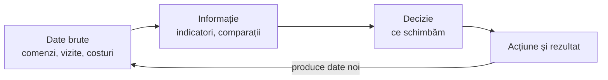

Expresia „decizii bazate pe date” (în engleză *data-driven decision making*) descrie tocmai acest circuit: nu hotărăști după impresie sau după cine vorbește mai tare în ședință, ci te uiți întâi la ce arată cifrele, apoi decizi și verifici dacă ai avut dreptate. Datele nu iau decizia în locul tău. Ele îți micșorează numărul de lucruri pe care trebuie să le ghicești.

Lanțul se rupe ușor în două locuri. Primul: ai date, dar nu le transformi în informație (exporturi pe care nu le deschide nimeni). Al doilea: ai informație, dar nu schimbă nimic (rapoarte citite cu interes și urmate de aceleași decizii ca înainte). Un raport care nu poate schimba nicio decizie este o cheltuială, nu o resursă.

### 5.1.2 Tipuri de date după structură

Prezentarea cursului împarte datele după cât de ordonate sunt. Împărțirea contează practic, pentru că îți spune cât de greu este să calculezi ceva din ele.

| Tip | Ce înseamnă | Exemple la Cămara | Cât de ușor se analizează |
|---|---|---|---|
| Structurate | Stau în tabele, cu rânduri și coloane fixe; fiecare coloană are un singur fel de valori | Tabelul de comenzi, lista de produse cu prețuri, stocul, fișierul `camara_saptamanal.csv` | Ușor: se sortează, se filtrează, se adună direct |
| Semistructurate | Au o organizare (etichete, câmpuri), dar nu formă de tabel; câmpurile pot lipsi sau varia | Răspunsul în format JSON primit de la procesatorul de plăți, fișierul XML al unei facturi electronice, un email (are expeditor, dată și subiect, dar corpul este text liber) | Mediu: trebuie întâi „desfăcute” în tabel |
| Nestructurate | Nu au câmpuri predefinite | Recenziile scrise de clienți, mesajele din chat, fotografiile produselor, înregistrările apelurilor | Greu: trebuie citite, etichetate sau prelucrate cu instrumente speciale |

O firmă mică își ia aproape toate deciziile din date structurate, pentru că acolo calculul este ieftin. Asta nu înseamnă că restul este inutil. Zece recenzii citite cu atenție pot explica de ce a scăzut un indicator pe care tabelul doar îl constată. O regulă bună de lucru: tabelul îți spune **cât**, textul clienților îți spune **de ce**.

> **Exemplu.** Tabelul de comenzi al Cămării arată că zacusca de vinete se vinde mai slab în noiembrie. Abia mesajele clienților („a ajuns cu capacul umflat”, „borcanul era spart”) arată că problema este la ambalare, nu la gust sau la preț. Prima informație vine din date structurate, a doua din date nestructurate.

### 5.1.3 Tipuri de date după sursă

A doua clasificare din prezentare ține de proveniență. În engleză se folosesc termenii *first-party*, *second-party* și *third-party data*.

| Sursă | Ce înseamnă | Exemple la Cămara | La ce să fii atent |
|---|---|---|---|
| Date proprii (*first-party*) | Le strângi tu, direct de la clienții și din operațiunile tale | Comenzi, vizite pe site, adrese de email ale abonaților, costuri, retururi | Sunt cele mai valoroase și cele mai ieftine; depind de cât de curat le înregistrezi |
| Date de la parteneri (*second-party*) | Datele proprii ale altei firme, primite printr-o înțelegere | Statusurile de livrare de la curier, vânzările raportate de un marketplace pe care listezi produse, stocurile anunțate de producători | Definițiile partenerului pot diferi de ale tale (ce numește el „livrat”?) |
| Date cumpărate sau publice (*third-party*) | Strânse de cineva care nu are legătură directă cu clienții tăi | Un studiu de piață plătit, statistici publice despre comerțul online, audiențe puse la dispoziție de platformele de reclame | Sunt generale, nu despre clienții tăi; verifică metodologia și data |

Pentru o afacere la început, ordinea priorităților este chiar ordinea din tabel. Întâi pune în ordine datele proprii. Abia apoi are sens să cauți altele.

Datele despre persoane (nume, adresă, email, istoricul comenzilor) sunt date cu caracter personal. Folosirea lor este reglementată în Uniunea Europeană de Regulamentul general privind protecția datelor (GDPR). Capitolul de față lucrează numai cu date agregate, pe săptămâni și canale, în care nu apare niciun client. Dacă lucrezi cu date la nivel de client, verifică obligațiile legale la sursa oficială sau cu un specialist; textul acesta nu este consultanță juridică.

> **Pentru afacerea ta.** Fă un inventar pe o singură pagină: ce date ai, unde stau (platforma magazinului, contabilitate, contul de reclame, un caiet), cine le poate exporta și cât de des. Majoritatea firmelor mici descoperă că au deja datele pentru toate calculele din acest capitol, doar că împrăștiate în trei sau patru locuri.

## 5.2 Indicatori: ce este un KPI și ce nu este

### 5.2.1 De la cifră la indicator

O firmă produce mii de cifre. Un **indicator** este o cifră calculată după o regulă fixă, urmărită în timp. Un **indicator-cheie de performanță**, pe scurt **KPI** (din engleză *Key Performance Indicator*), este un indicator ales special pentru că arată dacă te apropii de un obiectiv important.

Ce deosebește un KPI de o cifră oarecare:

1. **Este legat de un obiectiv.** „Vrem un rezultat lunar de cel puțin 15.000 lei” duce la indicatori precum contribuția pe comandă. Fără obiectiv, orice cifră pare interesantă.
2. **Are o definiție scrisă.** Ce intră la numărător, ce intră la numitor, din ce sursă, pe ce perioadă.
3. **Are un termen de comparație.** O țintă, luna trecută, aceeași lună a anului trecut. „Conversie 2,5%” nu spune nimic; „2,5%, față de 2,9% acum două luni” spune.
4. **Are un responsabil.** Cineva se uită la el și poate acționa.
5. **Poate schimba o decizie.** Dacă indiferent de valoare ai face același lucru, nu este cheie.

Câți KPI îți trebuie? Puțini. Dacă urmărești treizeci de „indicatori-cheie”, niciunul nu mai este cheie. O firmă mică se descurcă bine cu cinci până la opt, restul rămânând indicatori de sprijin, pe care îi deschizi când cauți o explicație.

### 5.2.2 Indicatori de vanitate și indicatori utili

Un **indicator de vanitate** este o cifră care arată bine și crește frumos, dar nu te ajută să decizi nimic. Termenul a fost popularizat în literatura pentru antreprenori (vezi Croll și Yoskovitz, *Lean Analytics*, 2013). Exemple tipice: numărul total de vizite, numărul de urmăritori, numărul total de conturi create de la înființare, aprecierile la o postare.

| Indicator de vanitate | De ce păcălește | Varianta utilă |
|---|---|---|
| Vizite totale pe site | Cresc și când cumperi trafic care nu cumpără nimic | Rata de conversie pe canal; contribuția pe canal |
| Urmăritori pe rețelele sociale | Nu spun câți ajung pe site și câți cumpără | Comenzi și venit din vizitele venite de pe rețelele sociale |
| Venitul total | Crește și când vinzi în pierdere | Marja brută și contribuția |
| Numărul total de clienți din toate timpurile | Nu poate scădea niciodată, deci nu avertizează | Clienți care au comandat în ultimele 90 de zile; rata de revenire |
| Numărul de comenzi | Crește și când dai reduceri care îți mănâncă marja | Contribuția pe comandă |

Testul practic este o singură întrebare: **„Dacă cifra asta crește cu 20%, ce fac altfel de mâine?”** Dacă răspunsul este „nimic, dar mă bucur”, ai în față un indicator de vanitate.

Studiul de caz al Cămării, de la finalul capitolului, este exact povestea a doi indicatori de vanitate. Comenzile au crescut cu 44%, venitul cu 28%, iar rezultatul a scăzut cu 63% (date fictive, construite pentru exercițiu).

### 5.2.3 Pornește de la decizie, nu de la cifră

Greșeala clasică este să deschizi platforma de analiză, să te uiți la ce grafice oferă și să te întrebi ce ai putea afla din ele. Drumul sănătos este invers:

1. **Decizia.** Ce am de hotărât? Exemplu: „Mărim bugetul de reclame în decembrie?”
2. **Întrebarea.** Ce ar trebui să știu ca să decid? „Comenzile aduse de reclame lasă bani după ce plătim marfa, reclama și livrarea?”
3. **Indicatorul.** Ce cifră răspunde la întrebare? „Contribuția pe comandă pe canalul Reclame.”
4. **Datele.** De ce am nevoie ca să o calculez? „Venit, marjă, cost de marketing și cost de livrare, pe canal.”
5. **Pragul.** La ce valoare aleg o variantă sau alta? „Dacă este sub zero, nu mărim bugetul.”

> **De reținut.** Stabilește pragul înainte să vezi cifra. Dacă îl alegi după, vei găsi mereu o explicație pentru care valoarea obținută este „de fapt în regulă”.

> **Greșeală frecventă.** Să alegi indicatorii pentru că îi afișează instrumentul, nu pentru că îți trebuie. Platformele de reclame, de exemplu, pun în față indicatorii care le avantajează pe ele (afișări, clicuri, venit atribuit), nu pe cei care îți arată ție profitul.

## 5.3 Catalogul indicatorilor

Prezentarea cursului grupează indicatorii din eBusiness în trei familii: **financiari** (CLV, CAC, ROAS, MRR), **de implicare** (NPS, CSAT, utilizatori activi, rata de renunțare) și **operaționali** (rata de conversie, abandonul coșului, valoarea medie a comenzii, performanța site-ului). Păstrăm gruparea. Pentru fiecare indicator găsești definiția, formula, un exemplu, decizia la care ajută și felul în care te poate păcăli.

O precizare despre exemple. Fișierul Cămării conține vizite, comenzi, venit și costuri pe săptămâni și canale. Nu conține date despre clienți individuali, abonamente sau sondaje. Acolo unde indicatorul are nevoie de astfel de date, exemplul folosește ipoteze suplimentare, marcate ca atare.

Nu vei găsi în acest catalog „valori medii pe industrie”. Ele depind puternic de domeniu, de preț, de țară, de dispozitiv și de felul în care fiecare firmă își definește indicatorul. Cel mai bun termen de comparație pentru o firmă mică este propria ei cifră din perioada anterioară.

### 5.3.1 Indicatori financiari

**Costul de achiziție a unui client, CAC** (*Customer Acquisition Cost*). Cât cheltuiești, în medie, ca să câștigi un client nou.

```
CAC = cheltuieli de marketing și vânzări dintr-o perioadă / număr de clienți noi din aceeași perioadă
```

Pe datele Cămării nu putem separa clienții noi de cei vechi, așa că vom calcula ruda apropiată a CAC-ului: **costul de marketing pe comandă**. Pe canalul Reclame, în septembrie: 2.400 lei / 64 comenzi = 37,50 lei pe comandă. În noiembrie: 16.800 lei / 286 comenzi = 58,74 lei pe comandă.

- *Decizia:* cât îți permiți să plătești pentru un client; ce canal merită buget.
- *Cum păcălește:* dacă împarți tot bugetul la toate comenzile magazinului, obții un cost mic și liniștitor (în noiembrie, 17.000 / 796 = 21,36 lei), deși canalul plătit costă aproape de trei ori mai mult. Clienții veniți singuri „subvenționează” media. A doua capcană: CAC lasă pe dinafară costuri reale, cum ar fi reducerea oferită sau timpul omului care face reclamele.

**Rentabilitatea cheltuielilor cu reclamele, ROAS** (*Return on Ad Spend*). Câți lei de venit aduce fiecare leu cheltuit pe reclame.

```
ROAS = venit atribuit reclamelor / cheltuiala cu reclamele
```

Documentația Google Ads descrie ROAS-ul țintă ca valoarea medie a conversiilor (de exemplu venitul) pe care vrei să o obții pentru fiecare unitate monetară cheltuită pe reclame și îl exprimă ca procent: 5 dolari vânzări la 1 dolar cheltuit înseamnă 500% (Google Ads Help, „About Target ROAS bidding”, https://support.google.com/google-ads/answer/6268637). La Cămara, pe canalul Reclame: septembrie 9.600 / 2.400 = 4,00; noiembrie 30.030 / 16.800 = 1,79.

- *Decizia:* oprești, păstrezi sau mărești o campanie.
- *Cum păcălește:* ROAS măsoară **venit**, nu profit. Un ROAS de 1,79 sună a „câștig 79 de bani la fiecare leu”. În realitate, din 1,79 lei venit, la o marjă brută de 31% rămân 0,55 lei, din care trebuie plătite reclama (1 leu) și livrarea. Mai jos, la secțiunea 5.5, calculăm ROAS-ul de la care canalul începe să lase bani.

> **Exemplu.** ROAS-ul de echilibru al canalului Reclame. La preț întreg, o comandă de 150 lei lasă 67,50 lei marjă brută; după 14 lei ambalare și livrare rămân 53,50 lei, adică maximul pe care îl poți plăti pe reclamă fără să pierzi. ROAS-ul de echilibru este 150 / 53,50 = 2,80. Cu reducerea de 20%, comanda medie este de 105 lei, cu marjă brută de 32,55 lei; după livrare rămân 18,55 lei. ROAS-ul de echilibru urcă la 105 / 18,55 = 5,66. Cămara a obținut 1,79. (Date fictive, construite pentru exercițiu.)

**Valoarea pe viață a clientului, CLV** (*Customer Lifetime Value*, uneori scris LTV). Câți bani îți lasă un client pe toată durata relației cu tine.

```
CLV (variantă simplă) = contribuția medie pe comandă × comenzi pe an × ani cât rămâne client
```

Exemplu cu ipoteze suplimentare: un client al Cămării comandă de trei ori pe an, la preț întreg (150 lei, marjă 45%, 14 lei livrare, deci 53,50 lei pe comandă înainte de marketing), și rămâne client doi ani. CLV = 53,50 × 3 × 2 = 321 lei. Un astfel de client merită un cost de achiziție de 58 lei. Un client care cumpără o singură dată, cu cod de reducere, lasă 18,55 lei și nu îl merită.

- *Decizia:* cât poți plăti pentru achiziție; în ce clienți investești (programe de fidelitate, email).
- *Cum păcălește:* este o **estimare** despre viitor, construită din ipoteze. Se calculează adesea din venit în loc de contribuție, ceea ce o umflă. Iar clienții aduși cu reduceri mari revin, de regulă, mai rar decât cei veniți la preț întreg, deci nu le poți atribui CLV-ul mediu al magazinului fără să verifici.

Raportul **CLV / CAC** leagă cei doi indicatori: arată de câte ori își scoate un client costul de achiziție. Sub 1 înseamnă că pierzi bani cu fiecare client câștigat. Cât de mult peste 1 trebuie să fie depinde de marjă, de cât de repede se recuperează banii și de cât de sigure sunt ipotezele din CLV.

**Venitul lunar recurent, MRR** (*Monthly Recurring Revenue*). Venitul care se repetă în fiecare lună din abonamente.

```
MRR = număr de abonați activi × prețul lunar mediu al abonamentului
```

Cămara nu vinde abonamente, deci nu are MRR. Să presupunem că ar lansa „Cutia lunii”, la 120 lei pe lună, și ar avea 80 de abonați: MRR = 9.600 lei. Avantajul acestui venit este că îl cunoști dinainte.

- *Decizia:* planificarea stocului, a angajărilor, a investițiilor; evaluarea unui model pe bază de abonament (vezi capitolul 2).
- *Cum păcălește:* dacă pui la MRR și vânzări care nu se repetă (taxe de instalare, comenzi unice), cifra arată o stabilitate care nu există. MRR-ul trebuie citit mereu împreună cu rata de renunțare.

### 5.3.2 Indicatori de implicare

**Rata de renunțare** (*churn rate*). Ce parte dintre clienți te părăsește într-o perioadă.

```
Rata de renunțare = clienți pierduți în perioadă / clienți la începutul perioadei
```

Pentru „Cutia lunii”: din 80 de abonați la 1 noiembrie, 6 renunță până la sfârșitul lunii. Rata de renunțare este 6 / 80 = 7,5% pe lună. Pare puțin. Dar cu 7,5% pe lună, din 100 de abonați de astăzi mai rămân aproximativ 39 după un an (0,925 la puterea 12).

- *Decizia:* investești în păstrarea clienților sau în aducerea altora noi.
- *Cum păcălește:* într-un magazin fără abonamente, clientul nu „își dă demisia”, pur și simplu nu mai comandă. Trebuie să alegi tu o regulă (de exemplu: nicio comandă în ultimele 180 de zile), iar cifra depinde de regula aleasă. În plus, o medie pe toți clienții ascunde diferențe mari între cei vechi și cei abia sosiți.

**Scorul net de recomandare, NPS** (*Net Promoter Score*). Măsoară cât de dispuși sunt clienții să te recomande. A fost propus de Frederick Reichheld în articolul „The One Number You Need to Grow” (Harvard Business Review, decembrie 2003). Clienții răspund la o singură întrebare, „Cât de probabil este să ne recomandați unui prieten sau coleg?”, pe o scară de la 0 la 10. Cei care dau 9 sau 10 sunt **promotori**, cei cu 7 sau 8 sunt **pasivi**, cei cu 0-6 sunt **detractori** (Bain & Company, „Measuring Your Net Promoter Score”, https://www.netpromotersystem.com/about/measuring-your-net-promoter-score/).

```
NPS = % promotori - % detractori
```

Exemplu cu date ipotetice de sondaj: din 200 de răspunsuri, 110 sunt promotori (55%), 60 pasivi și 30 detractori (15%). NPS = 55 - 15 = 40. Scorul poate lua valori între -100 și +100.

- *Decizia:* unde ai probleme de experiență; pe cine suni ca să afli ce a mers prost (detractorii).
- *Cum păcălește:* răspund mai ales clienții foarte mulțumiți și cei foarte supărați. Cu 30 de răspunsuri, scorul sare de la o lună la alta fără să se fi schimbat nimic. Două distribuții foarte diferite pot da același scor. Și măsoară o intenție declarată, nu un comportament.

**Scorul de satisfacție a clientului, CSAT** (*Customer Satisfaction Score*). Măsoară mulțumirea față de o interacțiune anume: o livrare, o discuție cu asistența.

```
CSAT = răspunsuri „mulțumit” și „foarte mulțumit” / total răspunsuri
```

Exemplu ipotetic: după livrare, 200 de clienți dau o notă de la 1 la 5; 180 dau 4 sau 5. CSAT = 90%.

- *Decizia:* ce pas al experienței repari primul. Se folosește mult în asistența pentru clienți (vezi capitolul 4).
- *Cum păcălește:* descrie un moment, nu relația. Un client poate fi mulțumit de curier și să nu mai comande niciodată. Depinde și de când întrebi: imediat după o problemă rezolvată, notele sunt mai mari.

**Utilizatori activi zilnic și lunar, DAU și MAU** (*Daily Active Users*, *Monthly Active Users*). Câte persoane distincte au folosit produsul într-o zi, respectiv într-o lună. Raportul DAU / MAU arată cât de des revin. Documentația Google Analytics îl descrie ca procentul utilizatorilor implicați într-o zi din cei implicați în ultimele 30 de zile (Google Analytics Help, „Analytics dimensions and metrics”, https://support.google.com/analytics/answer/9143382).

```
Raport DAU/MAU = utilizatori activi într-o zi / utilizatori activi în ultimele 30 de zile
```

Exemplu ipotetic: o aplicație de planificare a meselor are 1.200 de utilizatori activi azi și 6.000 în ultima lună. Raportul este 20%: utilizatorul tipic deschide aplicația cam o zi din cinci.

- *Decizia:* contează pentru produsele folosite des (aplicații, platforme, jocuri). Pentru un magazin de dulcețuri, de unde cumperi de câteva ori pe an, este aproape irelevant; mai util este numărul clienților care au comandat în ultimele 90 de zile.
- *Cum păcălește:* totul depinde de ce numești „activ”. Cine doar a deschis aplicația o secundă este activ?

**Rata de respingere** (*bounce rate*) și **rata de implicare** (*engagement rate*). Arată ce parte dintre vizite pleacă fără să facă nimic. În Google Analytics 4, o sesiune „implicată” este una care durează peste 10 secunde, are un eveniment-cheie sau are cel puțin două afișări de pagină. Rata de implicare este procentul sesiunilor implicate, iar rata de respingere este procentul sesiunilor care nu au fost implicate (Google Analytics Help, „[GA4] Engagement rate and bounce rate”, https://support.google.com/analytics/answer/12195621).

```
Rata de respingere = sesiuni neimplicate / total sesiuni = 100% - rata de implicare
```

Exemplu cu o ipoteză suplimentară: dacă din 15.900 de vizite venite din reclame în noiembrie, 9.858 nu ar fi fost implicate, rata de respingere ar fi 62%.

- *Decizia:* se potrivește reclama cu pagina pe care ajunge omul? Se încarcă pagina destul de repede?
- *Cum păcălește:* definiția diferă între instrumente și chiar între versiunile aceluiași instrument, deci nu compara cifre luate din surse diferite. O respingere nu este întotdeauna un eșec: cine a căutat programul de livrare și l-a găsit în cinci secunde a plecat mulțumit.

### 5.3.3 Indicatori operaționali

**Rata de conversie** (*conversion rate*). Ce parte dintre vizite se termină cu acțiunea dorită, de regulă o comandă.

```
Rata de conversie = comenzi / vizite
```

Cămara, septembrie: 553 / 18.860 = 2,93%. Noiembrie: 796 / 32.140 = 2,48%.

- *Decizia:* repari site-ul sau aduci alt trafic? Pe ce canal merită să insiști?
- *Cum păcălește:* în trei feluri. Întâi, depinde de numitor: vizite (sesiuni) sau vizitatori (persoane)? Google Analytics are indicatori separați pentru cele două variante, rata pe sesiuni și rata pe utilizatori (aceeași pagină de documentație citată mai sus). Apoi, media pe tot magazinul amestecă trafic foarte diferit; vom vedea că la Cămara conversia totală a scăzut deși aproape niciun canal nu a convertit mai prost. În fine, poți crește conversia dând reduceri, adică pe seama marjei.

**Valoarea medie a comenzii, AOV** (*Average Order Value*). Cât cheltuiește un client, în medie, la o comandă.

```
AOV = venit / număr de comenzi
```

Cămara, septembrie: 85.400 / 553 = 154,43 lei. Noiembrie: 109.125 / 796 = 137,09 lei. Pe canale, în noiembrie: Email 165 lei, Direct 155 lei, Căutare 150 lei, Reclame 105 lei.

- *Decizia:* praguri de transport gratuit, pachete de produse, recomandări în coș.
- *Cum păcălește:* este o medie, deci câteva comenzi foarte mari o trag în sus. Decide dinainte dacă o calculezi cu sau fără TVA, înainte sau după reduceri, cu sau fără taxa de transport, și păstrează aceeași regulă.

**Rata de abandon al coșului** (*cart abandonment rate*). Ce parte dintre coșurile începute nu ajung comenzi.

```
Rata de abandon = 1 - comenzi finalizate / coșuri create
```

Exemplu (cu ipoteza din secțiunea următoare, că 11% dintre vizite pun ceva în coș): în septembrie, 2.075 de coșuri și 553 de comenzi. Rata de abandon = 1 - 553 / 2.075 = 73,3%.

- *Decizia:* simplifici pașii de plată, afișezi mai devreme costul de transport, trimiți un email de reamintire.
- *Cum păcălește:* mulți oameni folosesc coșul ca listă de dorințe sau ca să afle costul transportului. Nu erau gata să cumpere, deci nu toți sunt „clienți pierduți”. Cifra arată întotdeauna dramatic; urmărește cum se schimbă, nu cât este.

**Indicatorii de performanță ai site-ului** (timp de încărcare, erori, disponibilitate) intră tot în familia operațională. Nu îi detaliem aici; rețin doar că un site lent strică toți ceilalți indicatori din pâlnie și că merită un loc în jurnalul lunar.

### 5.3.4 Doi indicatori care lipsesc din listă și fără care nu poți decide

Lista din prezentare este cea obișnuită în marketingul digital. Pentru un magazin, mai sunt necesari doi indicatori, pe care îi folosim în restul capitolului:

- **Marja brută:** venitul minus costul mărfii vândute. Ca procent: marjă brută / venit. La Cămara, 45% la preț întreg.
- **Contribuția pe comandă:** ce rămâne dintr-o comandă după costul mărfii, marketing, ambalare și livrare. Este indicatorul care spune dacă o comandă în plus te ajută sau te costă.

### 5.3.5 Tabel-sinteză

| Indicator | Formulă pe scurt | Decizia la care ajută | Cum poate păcăli |
|---|---|---|---|
| CAC | marketing / clienți noi | Cât plătești pentru un client | Media pe toate canalele ascunde canalul scump |
| ROAS | venit din reclame / cost reclame | Oprești sau mărești o campanie | Măsoară venit, nu profit |
| CLV | contribuție pe comandă × comenzi pe an × ani | Cât merită un client | Este o estimare; se umflă ușor |
| MRR | abonați × preț lunar | Planificarea veniturilor | Amestecat cu vânzări unice |
| Rata de renunțare | clienți pierduți / clienți la început | Păstrare sau achiziție | Depinde de definiția „pierdut” |
| NPS | % promotori - % detractori | Unde suferă experiența | Puține răspunsuri, cine răspunde |
| CSAT | răspunsuri mulțumite / total | Ce pas repari | Măsoară un moment, nu relația |
| DAU, MAU | persoane active pe zi, pe lună | Cât de des revin utilizatorii | Depinde de definiția „activ” |
| Rata de respingere | sesiuni neimplicate / sesiuni | Potrivirea reclamă-pagină | Definiții diferite între instrumente |
| Rata de conversie | comenzi / vizite | Site sau trafic | Media amestecă trafic diferit |
| AOV | venit / comenzi | Praguri, pachete | Sensibil la valori extreme |
| Abandonul coșului | 1 - comenzi / coșuri | Simplificarea plății | Coșul folosit ca listă de dorințe |
| Marja brută | (venit - cost marfă) / venit | Prețuri și reduceri | Ignoră costurile de după vânzare |
| Contribuția pe comandă | marjă - marketing - livrare, pe comandă | Merită comanda în plus? | Depinde de cum împarți marketingul |

## 5.4 Pâlnia de conversie

### 5.4.1 Ce este și cum se calculează

Drumul de la prima vizită la comandă are mai multe etape, iar la fiecare etapă o parte dintre oameni pleacă. Dacă desenezi câți rămân la fiecare pas, figura se îngustează ca o pâlnie. De aici numele: **pâlnia de conversie** (*conversion funnel*).

Pentru un magazin online, etapele obișnuite sunt:

1. vizită pe site;
2. vizualizarea unei pagini de produs;
3. adăugarea în coș;
4. începerea plății (uneori numărată separat);
5. comandă finalizată.

Pentru fiecare etapă calculezi două procente:

- **rata față de etapa anterioară** (câți trec de la pasul 2 la pasul 3), care arată unde este „gaura”;
- **rata față de total** (câți din toate vizitele ajung la pasul 3), care arată cât a mai rămas din pâlnie.

### 5.4.2 Pâlnia Cămării în septembrie

Din fișierul de date cunoaștem capetele pâlniei: 18.860 de vizite și 553 de comenzi, adică o rată de conversie de 2,9%. Pașii intermediari **nu sunt în fișier**. Pentru exercițiu, presupunem că 58% dintre vizite ajung pe o pagină de produs și că 11% dintre vizite pun ceva în coș. Acestea sunt ipoteze, nu date măsurate; într-un magazin real le-ai citi din instrumentul de analiză.

| Etapă | Număr | % din vizite | % din etapa anterioară | Pierduți la acest pas |
|---|---|---|---|---|
| Vizite | 18.860 | 100% | - | - |
| Văd o pagină de produs (ipoteză: 58%) | 10.939 | 58% | 58% | 7.921 |
| Pun în coș (ipoteză: 11%) | 2.075 | 11% | 19% | 8.864 |
| Finalizează comanda | 553 | 2,9% | 26,7% | 1.522 |

(Date fictive, construite pentru exercițiu.)

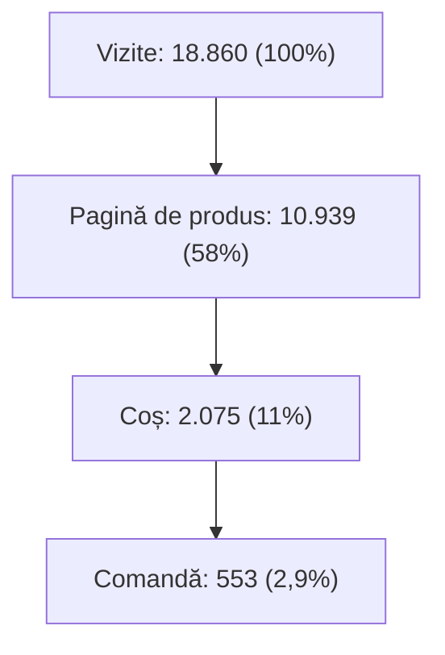

### 5.4.3 Cum citești o pâlnie

Trei observații pe tabelul de mai sus.

**Cea mai mare pierdere în număr de oameni** este între pagina de produs și coș: 8.864 de vizite văd un produs și nu îl adaugă. Întrebările care merită puse: sunt clare prețul și costul livrării? Sunt fotografiile și descrierile suficiente? Există recenzii?

**Cea mai mare pierdere procentuală** este la sfârșit: aproape trei coșuri din patru nu devin comenzi. Aici oamenii și-au arătat deja intenția, deci o îmbunătățire mică valorează mult.

**Efectul se calculează simplu.** Dacă rata de finalizare a coșului ar urca de la 26,7% la 30%, din aceleași 2.075 de coșuri ar ieși 622 de comenzi în loc de 553. Sunt 69 de comenzi în plus, fără niciun leu cheltuit pe trafic. La contribuția medie din septembrie de aproximativ 51 lei pe comandă, înseamnă circa 3.500 lei pe lună. (Calculul presupune că aceste comenzi suplimentare ar arăta ca media.)

Pâlnia se calculează și **pe segmente**: pe canal, pe dispozitiv (telefon sau calculator), pe clienți noi și clienți care revin. O pâlnie medie arată bine sau rău „în general”; pâlniile pe segmente arată unde anume. La Cămara, vizitele din email convertesc în proporție de 5,0%, iar cele din reclame în proporție de 1,8% până la 2,0%. Nu sunt același fel de vizitatori și nu are sens să le ceri același rezultat.

> **Greșeală frecventă.** Să repari etapa cu cel mai urât procent fără să te uiți la numărul de oameni. O etapă prin care trec 50 de persoane pe lună poate avea o rată groaznică și totuși să nu merite nicio oră de muncă. Înmulțește mereu: câți oameni ajung acolo × cât poți îmbunătăți realist × cât valorează o comandă.

> **De reținut.** Pâlnia îți spune **unde** pleacă oamenii, nu **de ce**. Pentru „de ce” ai nevoie de altceva: să parcurgi tu comanda pe telefon, să citești mesajele clienților, să întrebi cinci cumpărători.

## 5.5 Economia unei comenzi

### 5.5.1 De ce venitul nu este profit

**Economia unei comenzi** (în engleză *unit economics*, economia pe unitate) este răspunsul la o întrebare simplă: după ce plătesc tot ce este legat direct de o comandă, cu cât rămân?

Să urmărim o comandă obișnuită de 150 lei, la preț întreg, venită din căutare:

| Pas | Calcul | Lei |
|---|---|---|
| Venit | prețul plătit de client | 150,00 |
| Costul mărfii | cât plătești producătorilor (55%) | -82,50 |
| **Marjă brută** | 45% din venit | **67,50** |
| Marketing | căutarea neplătită nu costă pe comandă | 0,00 |
| Ambalare și livrare | cutie, protecție, curier | -14,00 |
| **Contribuție** | ce rămâne pentru costurile fixe și profit | **53,50** |

Din 150 lei încasați, 53,50 lei sunt cu adevărat „ai firmei”. Restul doar trec prin cont.

Acum aceeași privire asupra unei comenzi medii din noiembrie de pe canalul Reclame, cu cod de reducere de 20%:

| Pas | Lei |
|---|---|
| Venit | 105,00 |
| Costul mărfii | -72,45 |
| **Marjă brută** (31%) | **32,55** |
| Marketing (16.800 lei / 286 comenzi) | -58,74 |
| Ambalare și livrare | -14,00 |
| **Contribuție** | **-40,19** |

(Date fictive, construite pentru exercițiu.)

Clientul a plătit 105 lei, a fost numărat la „comenzi”, a intrat în „venit”, iar magazinul a rămas cu 40 de lei mai puțin decât dacă acea comandă nu ar fi existat. Asta înseamnă „venitul nu este profit”.

De ce scade marja de la 45% la 31% când dai o reducere de 20%? Pentru că reducerea se scade din preț, dar costul mărfii rămâne același. Un borcan cumpărat cu 55 lei și vândut cu 100 lei lasă 45 lei. Vândut cu 80 lei, lasă 25 lei, adică 31% din noul preț. O reducere de 20% din preț a tăiat 44% din marja în lei.

### 5.5.2 Costuri pe comandă și costuri fixe

Pentru calculele din acest capitol, costurile se împart în două categorii:

- **Costuri pe comandă (variabile):** apar cu fiecare comandă și dispar dacă nu vinzi. Costul mărfii, ambalarea, livrarea, comisionul procesatorului de plăți.
- **Costuri fixe:** le plătești oricâte comenzi ai. Chiria spațiului, salariile, abonamentul platformei, contabilitatea. La Cămara, 10.000 lei pe lună, adică 2.500 lei pe săptămână.

Marketingul stă la mijloc. Bugetul de reclame este hotărât de tine la începutul lunii (seamănă cu un cost fix), dar scopul lui este să aducă fiecare comandă în parte (seamănă cu un cost pe comandă). În analiza pe canale îl împărțim la comenzile canalului. În calculul pragului de rentabilitate îl tratăm ca pe un buget lunar dat. Ambele sunt corecte, cu condiția să spui ce ai ales.

De aici, două definiții pe care le folosim până la sfârșit:

```
Contribuție = marjă brută - marketing - ambalare și livrare
Rezultat simplificat = contribuție - costuri fixe
```

„Simplificat” înseamnă că lăsăm deoparte impozitele, amortizarea, dobânzile și alte elemente de contabilitate. Pentru decizii de marketing și de preț, simplificarea este suficientă. Pentru declarații fiscale, nu este.

### 5.5.3 Comanda medie, în septembrie și în noiembrie

Împărțind totalurile lunare din fișier la numărul de comenzi, obținem „comanda medie” a fiecărei luni:

| Pe o comandă medie (lei) | Septembrie | Noiembrie |
|---|---|---|
| Venit (AOV) | 154,43 | 137,09 |
| Costul mărfii | -84,94 | -80,68 |
| Marjă brută | 69,49 | 56,41 |
| Marketing | -4,70 | -21,36 |
| Ambalare și livrare | -14,00 | -14,00 |
| **Contribuție** | **50,79** | **21,05** |
| Costuri fixe repartizate | -18,08 | -12,56 |
| **Rezultat** | **32,71** | **8,49** |

(Date fictive, construite pentru exercițiu; calculate din `camara_saptamanal.csv`.)

Rândul costurilor fixe arată singurul efect bun al creșterii: aceiași 10.000 lei se împart la mai multe comenzi, deci apasă mai puțin pe fiecare (12,56 lei în loc de 18,08). Câștigul de 5,52 lei pe comandă este însă mult mai mic decât pierderea de 29,74 lei la contribuție.

### 5.5.4 Pragul de rentabilitate

**Pragul de rentabilitate** (*break-even point*) este numărul de comenzi la care rezultatul este exact zero. Sub prag pierzi, peste prag câștigi.

```
Prag (comenzi) = (costuri fixe + buget de marketing) / (marjă brută pe comandă - ambalare și livrare pe comandă)
```

Numitorul este ce lasă o comandă înainte de marketing. Numărătorul este suma pe care toate comenzile lunii trebuie să o acopere împreună.

**Calcul pe noiembrie.**

- O comandă medie aduce 137,09 lei, la o marjă brută de 41,15%: 56,41 lei.
- Scădem 14 lei pentru ambalare și livrare: rămân aproximativ 42,4 lei.
- De acoperit: 17.000 lei marketing + 10.000 lei costuri fixe = 27.000 lei.
- Prag = 27.000 / 42,41 ≈ 637 de comenzi.

Cămara a avut 796 de comenzi în noiembrie, cu 159 peste prag. Cele 159 de comenzi × 42,41 lei dau aproximativ 6.758 lei, adică exact rezultatul lunii. Verificarea aceasta merită făcută de fiecare dată: dacă nu iese, ai o greșeală în formulă.

**Același calcul pe septembrie.** O comandă lăsa 69,49 - 14 = 55,49 lei, iar de acoperit erau 2.600 + 10.000 = 12.600 lei. Pragul era de 227 de comenzi, iar magazinul a avut 553.

| | Septembrie | Noiembrie |
|---|---|---|
| Lasă o comandă, înainte de marketing (lei) | 55,49 | 42,41 |
| De acoperit: marketing + fixe (lei) | 12.600 | 27.000 |
| Prag de rentabilitate (comenzi) | 227 | 637 |
| Comenzi realizate | 553 | 796 |
| Comenzi peste prag | 326 | 159 |

(Date fictive, construite pentru exercițiu.)

În două luni, pragul aproape s-a triplat. Magazinul vinde mai mult și este mult mai aproape de pierdere. În septembrie putea pierde 59% din comenzi și tot rămânea pe zero; în noiembrie, o scădere de 20% îl duce acolo.

> **Greșeală frecventă.** Să calculezi pragul cu marja la preț întreg (45%) când o parte din vânzări se face cu reducere. Folosește marja reală a perioadei. La Cămara, diferența dintre 45% și 41,15% mută pragul din noiembrie de la aproximativ 566 la 637 de comenzi.

## 5.6 Analiza de sensibilitate: ce pârghie contează cel mai mult

### 5.6.1 Metoda

Rezultatul unui magazin se poate scrie ca o singură formulă:

```
Rezultat = vizite × rata de conversie × AOV × marja brută %
           - buget de marketing
           - comenzi × cost de ambalare și livrare
           - costuri fixe
```

**Analiza de sensibilitate** înseamnă să miști câte o pârghie, pe rând, lăsându-le pe celelalte pe loc, și să vezi cu cât se schimbă rezultatul. Scopul nu este o prognoză. Scopul este să afli pe ce merită să îți cheltuiești timpul.

### 5.6.2 Calcul pe noiembrie

Punctul de plecare: 32.140 vizite, conversie 2,48%, AOV 137,09 lei, marjă brută 41,15%, marketing 17.000 lei, 14 lei pe comandă, costuri fixe 10.000 lei. Rezultat: 6.758 lei.

| Scenariu | Ce se schimbă | Rezultat nou (lei) | Diferență (lei) | Diferență (%) |
|---|---|---|---|---|
| Trafic +10% | 80 de comenzi în plus, cu tot cu colete | 10.134 | +3.376 | +50% |
| Conversie +10% (de la 2,48% la 2,72%) | aceleași 80 de comenzi în plus | 10.134 | +3.376 | +50% |
| AOV +10% (de la 137 la 151 lei) | venit +10.913 lei, niciun colet în plus | 11.248 | +4.490 | +66% |
| Marjă +3 puncte procentuale (la 44,15%) | 3% din venit rămâne în firmă | 10.032 | +3.274 | +48% |
| Buget -10%, comenzi neschimbate | 1.700 lei economisiți | 8.458 | +1.700 | +25% |
| Buget -10%, cu 10% mai puține comenzi din reclame | 1.700 lei economisiți, minus marja a 29 de comenzi | 7.928 | +1.170 | +17% |

(Date fictive, construite pentru exercițiu; calculate din `camara_saptamanal.csv`.)

### 5.6.3 Ce învățăm din tabel

**Traficul și conversia dau exact același efect.** Nu este o coincidență: în formulă, vizitele și rata de conversie se înmulțesc, deci 10% în plus la oricare dintre ele dă aceleași 80 de comenzi în plus. Fiecare aduce 42,41 lei, în total 3.376 lei. Diferența dintre cele două pârghii este de cost, nu de efect: traficul în plus de obicei se cumpără, conversia în plus se obține muncind la site.

**AOV le bate pe amândouă.** Zece la sută în plus la valoarea comenzii aduce aceeași marjă brută suplimentară ca zece la sută în plus la trafic (4.490 lei), dar fără cele 80 de colete de ambalat și expediat (80 × 14 = 1.114 lei, cu rotunjire). Clientul care adaugă un borcan în plus în aceeași cutie este cea mai ieftină creștere.

**Trei puncte de marjă fac aproape cât zece la sută de trafic.** O renegociere cu producătorii sau o creștere de preț de câțiva lei pe borcan are un efect comparabil cu câteva mii de vizite în plus.

**Un rezultat mic amplifică orice.** Diferențele de 50% sau 66% par uriașe pentru că rezultatul de plecare este mic. O firmă care trăiește aproape de prag este foarte sensibilă în ambele direcții: tot cu 50% scade rezultatul dacă traficul scade cu 10%.

**Tăierea bugetului trebuie judecată cu tot cu comenzile pierdute.** Rândul al cincilea presupune că poți tăia 1.700 lei fără să pierzi nimic, ceea ce este optimist. Rândul al șaselea presupune că pierzi o zecime din comenzile din reclame. Fiecare dintre ele lăsa 18,55 lei înainte de marketing, deci pierzi 531 lei și câștigi net 1.170 lei. Tăierea rămâne avantajoasă tocmai pentru că aceste comenzi costă mai mult decât aduc.

> **Greșeală frecventă.** Să tratezi scenariile ca fiind la fel de ușor de obținut. Tabelul spune ce **efect** are fiecare pârghie, nu cât de **greu** se mișcă. Zece la sută la conversie poate însemna luni de lucru la site; trei puncte de marjă pot însemna o singură discuție cu un furnizor, sau pot fi imposibile. Analiza de sensibilitate îți ordonează opțiunile; nu le execută.

### 5.6.4 Costurile ascunse ale pârghiilor

Analiza de mai sus mișcă o singură pârghie și presupune că restul stau pe loc. În realitate, pârghiile sunt legate între ele. Trei legături apar în aproape orice magazin.

**Randamentul descrescător al reclamelor.** Primii lei cheltuiți pe reclame ajung la oamenii cei mai interesați. Pe măsură ce mărești bugetul, platforma îți arată reclama unor oameni tot mai puțin interesați, la un preț tot mai mare. La Cămara, costul unei vizite din reclame a urcat de la 0,75 lei în septembrie (2.400 / 3.220) la 1,06 lei în noiembrie (16.800 / 15.900), iar conversia a coborât de la 1,99% la 1,80%. Rezultatul: costul de marketing pe comandă a urcat de la 37,50 la 58,74 lei.

Mai grăitor este **costul marginal**, adică prețul comenzilor aduse de banii în plus. Între septembrie și noiembrie, bugetul a crescut cu 14.400 lei și a adus 222 de comenzi suplimentare pe canal. Fiecare comandă suplimentară a costat 14.400 / 222 = 64,86 lei în reclame, pentru o marjă brută de 32,55 lei. Media de 58,74 lei arată rău; costul marginal arată și mai rău, iar el este cel care contează când decizi dacă mai adaugi buget.

**Reducerea care crește comenzile și taie marja.** Reducerile funcționează: aduc comenzi. Întrebarea este de câte comenzi în plus ai nevoie ca să ieși la fel. La preț întreg, o comandă de 150 lei lasă 53,50 lei după marfă și livrare. Cu reducerea de 20% și coșul mai mic, o comandă lasă 18,55 lei. Ai nevoie de 53,50 / 18,55 = 2,9 comenzi cu reducere ca să câștigi cât dintr-una la preț întreg, și asta înainte de a plăti reclama. Mai există două costuri pe care tabelul nu le vede: clienții care ar fi cumpărat oricum la preț întreg și folosesc codul, și clienții care învață să aștepte următoarea reducere.

**Costuri pe comandă față de costuri fixe.** Volumul ajută doar acolo unde costurile sunt fixe. Dublarea comenzilor înjumătățește chiria pe comandă, dar nu schimbă nimic la cei 14 lei de ambalare și livrare, care se plătesc de fiecare dată. De aceea „recuperăm din volum” este adevărat numai dacă fiecare comandă în plus are contribuție pozitivă. O contribuție negativă înmulțită cu un volum mare dă o pierdere mare. În plus, costurile fixe sunt fixe doar până la un punct: la 800 de colete pe lună s-ar putea să ai nevoie de încă un om la ambalat, iar costul „fix” urcă o treaptă.

> **De reținut.** Trei întrebări înainte de orice campanie: (1) Cât lasă o comandă adusă de campanie, după marfă, reducere, reclamă și livrare? (2) Cât costă ultima comandă adusă, nu comanda medie? (3) Ce se întâmplă cu clienții care ar fi cumpărat oricum?

## 5.7 Studiu de caz complet: de ce a scăzut rezultatul Cămării deși comenzile au crescut

Toate cifrele din această secțiune sunt **date fictive, construite pentru exercițiu**, calculate din `camara_saptamanal.csv`. Fișierul are 48 de rânduri: 12 săptămâni × 4 canale. Canalul unei comenzi este cel al ultimului clic dinaintea comenzii.

### 5.7.1 Situația

La sfârșitul lui noiembrie, proprietarii se uită la tabloul de bord al platformei. Vizitele au crescut cu 70% față de septembrie. Comenzile, cu 44%. Venitul, cu 28%. Contul de reclame raportează 286 de comenzi și un ROAS de 1,79. Totul arată a creștere.

Apoi vine situația de la contabilitate: din rezultatul de 18.088 lei din septembrie au mai rămas 6.758 lei. Întrebarea investigației: **unde s-au dus 11.330 lei?**

### 5.7.2 Pasul 1: descrie, lună cu lună

Întâi punem cifrele una lângă alta, fără nicio interpretare.

| | Septembrie | Octombrie | Noiembrie | Noiembrie față de septembrie |
|---|---|---|---|---|
| Vizite | 18.860 | 26.380 | 32.140 | +70% |
| Comenzi | 553 | 688 | 796 | +44% |
| Rata de conversie | 2,93% | 2,61% | 2,48% | -0,45 puncte |
| Venit (lei) | 85.400 | 97.779 | 109.125 | +28% |
| AOV (lei) | 154,43 | 142,12 | 137,09 | -11% |
| Marjă brută (lei) | 38.430 | 41.235 | 44.902 | +17% |
| Marjă brută (%) | 45,0% | 42,2% | 41,1% | -3,9 puncte |
| Marketing (lei) | 2.600 | 11.400 | 17.000 | de 6,5 ori |
| Ambalare și livrare (lei) | 7.742 | 9.632 | 11.144 | +44% |
| Contribuție (lei) | 28.088 | 20.203 | 16.758 | -40% |
| Costuri fixe (lei) | 10.000 | 10.000 | 10.000 | 0 |
| **Rezultat simplificat (lei)** | **18.088** | **10.203** | **6.758** | **-63%** |

Tabelul arată deja un tipar: tot ce se măsoară în **volum** crește (vizite, comenzi, venit), iar tot ce se măsoară **pe unitate** scade (conversie, AOV, marjă procentuală). Creșterea a venit cu clienți „mai slabi” decât cei de dinainte.

### 5.7.3 Pasul 2: descompune diferența

Rezultatul este o scădere simplă, deci și diferența dintre două luni se poate desface pe componente:

| Componentă | Septembrie | Noiembrie | Efect asupra rezultatului (lei) |
|---|---|---|---|
| Marjă brută | 38.430 | 44.902 | +6.472 |
| Marketing | 2.600 | 17.000 | -14.400 |
| Ambalare și livrare | 7.742 | 11.144 | -3.402 |
| Costuri fixe | 10.000 | 10.000 | 0 |
| **Rezultat** | **18.088** | **6.758** | **-11.330** |

Citit într-o singură propoziție: magazinul a cheltuit 14.400 lei în plus pe marketing și 3.402 lei în plus pe colete ca să obțină 6.472 lei de marjă brută în plus. Fiecare leu suplimentar de marjă a costat 2,75 lei.

Știm acum **care** linie a produs căderea. Nu știm încă **de unde** vine.

### 5.7.4 Pasul 3: desparte pe canale

Aceeași analiză, pe fiecare canal, pentru prima și ultima lună:

| Septembrie | Vizite | Comenzi | Conversie | AOV (lei) | Marjă | Marketing pe comandă (lei) | Contribuție pe comandă (lei) | Contribuție totală (lei) |
|---|---|---|---|---|---|---|---|---|
| Căutare | 9.640 | 241 | 2,50% | 150 | 45% | 0,00 | 53,50 | 12.894 |
| Reclame | 3.220 | 64 | 1,99% | 150 | 45% | 37,50 | 16,00 | 1.024 |
| Email | 2.400 | 121 | 5,04% | 165 | 45% | 1,65 | 58,60 | 7.090 |
| Direct | 3.600 | 127 | 3,53% | 155 | 45% | 0,00 | 55,75 | 7.080 |
| **Total** | **18.860** | **553** | **2,93%** | **154,43** | **45%** | **4,70** | **50,79** | **28.088** |

| Noiembrie | Vizite | Comenzi | Conversie | AOV (lei) | Marjă | Marketing pe comandă (lei) | Contribuție pe comandă (lei) | Contribuție totală (lei) |
|---|---|---|---|---|---|---|---|---|
| Căutare | 9.920 | 249 | 2,51% | 150 | 45% | 0,00 | 53,50 | 13.322 |
| Reclame | 15.900 | 286 | 1,80% | 105 | 31% | 58,74 | -40,19 | -11.495 |
| Email | 2.560 | 129 | 5,04% | 165 | 45% | 1,55 | 58,70 | 7.572 |
| Direct | 3.760 | 132 | 3,51% | 155 | 45% | 0,00 | 55,75 | 7.359 |
| **Total** | **32.140** | **796** | **2,48%** | **137,09** | **41,1%** | **21,36** | **21,05** | **16.758** |

Acum imaginea este limpede.

**Trei canale nu s-au schimbat aproape deloc.** Căutarea, emailul și traficul direct au aceeași conversie, același AOV și aceeași marjă ca în septembrie, cu o creștere ușoară de volum. Împreună au adus 27.064 lei contribuție în septembrie și 28.253 lei în noiembrie.

**Tot ce s-a schimbat este pe canalul Reclame.** Vizitele au crescut de aproape cinci ori, comenzile de 4,5 ori. Dar valoarea medie a comenzii a coborât de la 150 la 105 lei, marja de la 45% la 31%, iar costul de marketing pe comandă a urcat de la 37,50 la 58,74 lei. Contribuția pe comandă a trecut de la +16 lei la -40 lei. Înmulțită cu 286 de comenzi, dă o pierdere de 11.495 lei pe canal.

**Canalul a trecut de la marginal la dominant.** În septembrie, reclamele aduceau 12% din comenzi; în noiembrie, 36%. Aproape jumătate din vizitele lunii noiembrie (49%) vin din reclame.

> **Exemplu.** De ce a scăzut conversia totală de la 2,93% la 2,48%, dacă trei canale convertesc la fel ca înainte, iar al patrulea doar puțin mai slab? Pentru că s-a schimbat amestecul. Canalul cu cea mai mică conversie (Reclame) a ajuns să aducă jumătate din vizite, așa că trage media în jos. Site-ul nu s-a stricat. Cine s-ar fi uitat doar la conversia totală ar fi început să „repare” pagina de plată, adică o problemă care nu există.

### 5.7.5 Pasul 4: urmărește săptămânile

Tabelele lunare arată că ceva s-a schimbat între septembrie și octombrie. Datele săptămânale arată exact când.

| Săptămâna | Luna | Buget Reclame (lei) | Comenzi Reclame | AOV Reclame (lei) | Marjă Reclame | Contribuție pe comandă, Reclame (lei) | Rezultat pe magazin (lei) |
|---|---|---|---|---|---|---|---|
| 1 | septembrie | 600 | 16 | 150 | 45% | 16,00 | 4.508 |
| 2 | septembrie | 600 | 16 | 150 | 45% | 16,00 | 4.508 |
| 3 | septembrie | 600 | 16 | 150 | 45% | 16,00 | 4.566 |
| 4 | septembrie | 600 | 16 | 150 | 45% | 16,00 | 4.508 |
| 5 | octombrie | 1.500 | 30 | 118 | 33% | -25,06 | 3.613 |
| 6 | octombrie | 2.600 | 43 | 108 | 31% | -40,99 | 2.656 |
| 7 | octombrie | 3.300 | 54 | 105 | 31% | -42,56 | 2.183 |
| 8 | octombrie | 3.800 | 61 | 105 | 31% | -43,75 | 1.750 |
| 9 | noiembrie | 4.200 | 68 | 105 | 31% | -43,21 | 1.596 |
| 10 | noiembrie | 4.200 | 72 | 105 | 31% | -39,78 | 1.724 |
| 11 | noiembrie | 4.200 | 74 | 105 | 31% | -38,21 | 1.768 |
| 12 | noiembrie | 4.200 | 72 | 105 | 31% | -39,78 | 1.670 |

(Rezultatul săptămânal include costuri fixe de 2.500 lei pe săptămână.)

Ruptura este în săptămâna 5. Atunci bugetul sare de la 600 la 1.500 lei, valoarea medie a comenzii din reclame cade de la 150 la 118 lei, iar marja de la 45% la 33%. Sunt urmele codului de reducere de 20%, lansat odată cu noua campanie. Contribuția pe comandă devine negativă **din prima săptămână** a schimbării. De acolo, bugetul urcă în fiecare săptămână până la 4.200 lei, iar rezultatul magazinului coboară în oglindă.

Lecția practică: semnalul era vizibil în săptămâna 5. Cine urmărea săptămânal contribuția pe comandă pe canal ar fi oprit creșterea după o săptămână sau două. Cine urmărea comenzile și venitul a văzut șapte săptămâni de „creștere”.

### 5.7.6 Pasul 5: explică mecanismul

Trei lucruri s-au întâmplat simultan pe același canal și s-au înmulțit între ele.

1. **Reducerea a tăiat marja.** Codul de 20% a dus marja brută de la 45% la 31%. Din fiecare 100 lei vânduți rămân 31 lei, nu 45.
2. **Coșul s-a micșorat.** O reducere de 20% aplicată unui coș de 150 lei ar fi dat 120 lei. Media reală este 105 lei, deci noii clienți cumpără și mai puține produse. Marja brută pe comandă a coborât de la 67,50 la 32,55 lei, adică la mai puțin de jumătate.
3. **Reclama s-a scumpit.** Costul pe vizită a urcat de la 0,75 la 1,06 lei și conversia a scăzut ușor. Costul pe comandă a crescut de la 37,50 la 58,74 lei.

Rezultatul: o comandă care aduce 32,55 lei marjă costă 58,74 lei în reclamă și 14 lei în livrare.

### 5.7.7 Pasul 6: verifică prin scenarii

O explicație bună trebuie să reziste la întrebarea „și dacă nu făceam asta?”.

- **Fără canalul Reclame deloc**, celelalte trei canale ar fi lăsat în noiembrie 28.253 lei contribuție, adică un rezultat de 18.253 lei.
- **Cu reclamele păstrate ca în septembrie** (2.400 lei, 64 de comenzi, +16 lei pe comandă), rezultatul ar fi fost de aproximativ 19.277 lei.
- **Realitatea:** 6.758 lei.

Diferența față de al doilea scenariu este de circa 12.500 lei într-o singură lună. Atât a costat campania extinsă.

### 5.7.8 Concluzia și ce nu știm încă

**Concluzia.** Rezultatul a scăzut pentru că magazinul a cumpărat comenzi în pierdere. Canalul Reclame a fost extins de șapte ori ca buget, cu un cod de reducere care a tăiat marja și cu un cost de achiziție în creștere. Fiecare comandă astfel adusă a costat magazinul aproximativ 40 de lei. Comenzile și venitul au crescut tocmai din cauza acestor comenzi, de aceea indicatorii de volum arătau bine. Celelalte canale nu au nicio vină și nici site-ul.

**Ce nu poate spune acest fișier.** O investigație cinstită își declară limitele:

- *Revin acești clienți?* Dacă mulți dintre cei 286 de clienți din reclame comandă din nou, la preț întreg, prin email sau direct, pierderea de azi este o investiție. Fișierul nu are date pe client, deci nu putem calcula CLV. Este prima întrebare de lămurit înainte de a opri complet campania.
- *Cât din vânzare se datorează reclamei?* Atribuirea pe ultimul clic dă toată comanda ultimului canal atins. Cineva care a văzut reclama, apoi a revenit după trei zile tastând adresa, apare la Direct. Cineva care oricum ar fi cumpărat, dar a dat clic pe o reclamă, apare la Reclame. Despre modelele de atribuire, vezi capitolul 3.
- *Reducerea sau publicul?* Nu putem separa din aceste date efectul codului de reducere de efectul lărgirii publicului. Pentru asta ar trebui un experiment: aceeași campanie, cu și fără cod (vezi capitolul 9).

**Ce ar fi rezonabil de făcut.** Readucerea bugetului spre nivelul la care canalul era rentabil; renunțarea la codul de 20% sau înlocuirea lui cu un avantaj care nu taie marja (de exemplu transport gratuit peste un prag, care împinge și AOV-ul în sus); un prag clar de oprire (canalul trebuie să aibă contribuție pe comandă peste zero, adică ROAS peste 2,8 la preț întreg); mutarea atenției spre email, canalul cu cea mai bună contribuție pe comandă (58,70 lei). Cum alegi între aceste variante și cum le testezi este subiectul capitolului 9.

> **De reținut.** Ordinea investigației: totaluri pe perioade, descompunerea diferenței, despărțirea pe segmente, urmărirea în timp, mecanismul, verificarea prin scenarii, limitele. Aceeași ordine funcționează pentru aproape orice întrebare de tipul „de ce a scăzut X?”.

## 5.8 Cele patru tipuri de analiză

Prezentarea cursului descrie patru niveluri de analiză, fiecare răspunzând la altă întrebare. În studiul de caz le-ai văzut deja pe primele două, fără să le numim.

| Tip | Întrebarea | Exemplu pe Cămara | Cu ce se face într-o firmă mică |
|---|---|---|---|
| Descriptivă | Ce s-a întâmplat? | „În noiembrie am avut 796 de comenzi și un rezultat de 6.758 lei.” | Rapoartele platformei de magazin, Google Analytics, un tabel de calcul (Excel, Google Sheets) |
| Diagnostică | De ce s-a întâmplat? | „Rezultatul a scăzut pentru că pe canalul Reclame contribuția pe comandă este -40 lei.” | Tabele pivot, filtrare pe canal, produs, perioadă; instrumente de tip Power BI sau Data Studio (numit Looker Studio între 2022 și 2026); Python cu pandas (vezi capitolul 8) |
| Predictivă | Ce se va întâmpla? | „Dacă păstrăm bugetul și codul, rezultatul lunii decembrie va fi în jur de 6.000-7.000 lei.” | Prelungirea tendinței într-un tabel de calcul, scenarii „ce se întâmplă dacă”; mai târziu, modele statistice în Python sau R |
| Prescriptivă | Ce ar trebui să facem? | „Reducem bugetul la 2.400 lei și renunțăm la cod; ne așteptăm la un rezultat de circa 19.000 lei.” | Analiza de sensibilitate din secțiunea 5.6, reguli de decizie scrise, experimente (vezi capitolul 9) |

Câteva observații care te feresc de neînțelegeri.

**Nivelurile se sprijină unul pe altul.** Nu poți explica ce nu ai măsurat și nu poți prevedea ce nu înțelegi. O firmă care nu are încă un tabel lunar corect nu are ce face cu un model de predicție.

**Cele mai multe decizii ale unei firme mici se iau cu primele două niveluri.** Tot studiul de caz de mai sus s-a făcut cu adunări, împărțiri și despărțirea pe canale. Analiza diagnostică, în practică, înseamnă aproape întotdeauna același gest: iei o cifră totală și o desfaci pe segmente până găsești segmentul care s-a schimbat (în engleză, *drill-down*).

**Predicția nu cere neapărat inteligență artificială.** „Luna viitoare va semăna cu luna aceasta, corectat cu sezonul” este o predicție, adesea una decentă. Instrumentele avansate devin utile când ai multe date și multe decizii care se repetă.

**Analiza prescriptivă nu înlocuiește judecata.** Un calcul îți poate spune care variantă dă cel mai bun rezultat în ipotezele date. Nu îți spune dacă ipotezele sunt adevărate și nici ce contează pentru tine pe lângă bani.

> **Pentru afacerea ta.** Scrie patru propoziții despre luna trecută, câte una pentru fiecare tip de analiză: ce s-a întâmplat, de ce, ce crezi că urmează, ce faci. Dacă te blochezi la a doua, acolo ai de lucru; nu la instrumente mai sofisticate.

## 5.9 Calitatea datelor și jurnalul de indicatori

### 5.9.1 Patru surse de cifre greșite

Un calcul corect pe date greșite dă un răspuns greșit cu două zecimale. Înainte de a trage concluzii, verifică patru lucruri.

**Definiții consecvente.** Fiecare indicator trebuie să însemne același lucru de la o lună la alta și de la un om la altul. Întrebări de lămurit o singură dată, în scris:

- „Vizită” înseamnă sesiune sau persoană? În Google Analytics, o sesiune se încheie, în mod implicit, după 30 de minute de inactivitate (Google Analytics Help, „Analytics dimensions and metrics”), deci aceeași persoană poate produce mai multe sesiuni pe zi.
- „Comandă” înseamnă plasată, plătită sau livrată? Ce faci cu cele anulate și cu retururile?
- „Venit” este cu TVA sau fără? Înainte sau după reduceri? Cu taxa de transport sau fără?
- „Cost de marketing” include doar reclamele sau și agenția, instrumentele, timpul oamenilor?

Nu există un răspuns universal corect. Există doar răspunsul ales, notat și respectat.

**Perioade comparabile.** În fișierul Cămării, fiecare lună are exact patru săptămâni, tocmai ca să poată fi comparate. În viața reală, lunile au între 28 și 31 de zile și un număr diferit de weekenduri. Compară săptămâni întregi cu săptămâni întregi și nu pune o lună neterminată lângă una încheiată. O lună „în scădere cu 30%” în ziua de 21 este o lună normală.

**Duble înregistrări și lipsuri.** Un export făcut de două ori, o comandă înregistrată și în platformă, și manual, un cod de urmărire instalat de două ori pe site: toate dublează cifre. Verificări simple: numără rândurile, caută chei duplicate, compară totalul cu altă sursă. În fișierul nostru sunt 48 de rânduri și 48 de perechi distincte săptămână-canal, deci nicio dublură. Compară periodic și comenzile din instrumentul de analiză cu cele din platformă și cu încasările din bancă; nu vor fi identice, dar diferența trebuie să fie mică și stabilă.

**Sezonalitate.** Un magazin de dulcețuri și miere vinde mai mult înainte de sărbători. Dacă decembrie este peste noiembrie, nu ai îmbunătățit neapărat ceva. Comparația corectă pentru o afacere sezonieră este cu aceeași perioadă a anului trecut. Datele fictive ale Cămării nu conțin sezonalitate, tocmai pentru ca efectul reclamelor să se vadă curat; într-un caz real ar trebui să separi cele două efecte.

> **Greșeală frecventă.** Să schimbi definiția unui indicator la mijlocul anului fără să notezi. Cifra „sare”, iar peste trei luni nimeni nu mai știe dacă a fost o schimbare reală sau una de calcul. Orice modificare de definiție se trece în jurnal, cu dată.

### 5.9.2 Un jurnal de indicatori pentru o firmă mică

Jurnalul de indicatori este un tabel simplu, completat la intervale fixe, de aceeași persoană, din aceleași surse. Nu trebuie să fie frumos. Trebuie să fie ținut. Graficele și tabloul de bord vin după (vezi capitolele 6 și 7).

| Când | Ce urmărești | De ce |
|---|---|---|
| Săptămânal (15 minute, aceeași zi) | Vizite, comenzi și rata de conversie, pe canal | Semnal rapid că s-a schimbat ceva |
| Săptămânal | Venit și AOV, pe canal | Arată imediat efectul reducerilor |
| Săptămânal | Cost de marketing și cost pe comandă, pe canal | Randamentul descrescător se vede aici primul |
| Săptămânal | Contribuția pe comandă, pe canal | Indicatorul care ar fi oprit campania Cămării în săptămâna 5 |
| Lunar | Marjă brută, contribuție, rezultat simplificat | Imaginea de ansamblu |
| Lunar | Pragul de rentabilitate și comenzile peste prag | Cât de aproape ești de pierdere |
| Lunar | Pâlnia de conversie, pe etape | Unde merită lucrat la site |
| Lunar | Clienți noi față de clienți care revin; retururi și reclamații | Calitatea creșterii |
| Trimestrial | CLV estimat, NPS sau CSAT, revizuirea definițiilor | Se schimbă încet; nu merită urmărite săptămânal |

Pe lângă cifre, jurnalul are o coloană pe care instrumentele nu o completează singure: **„Ce am schimbat”**. Campanie nouă, cod de reducere, preț modificat, pagină refăcută, curier schimbat. Fără această coloană, peste două luni vei vedea o ruptură în cifre și nu vei ști de unde vine. În jurnalul Cămării, la săptămâna 5 ar fi scris: „buget Reclame mărit, lansat cod -20%”. Toată investigația din secțiunea 5.7 ar fi durat cinci minute.

**Listă de verificare înainte de a prezenta o cifră:**

- Știu exact cum a fost calculată și din ce sursă?
- Am cu ce să o compar (țintă, perioada trecută)?
- Perioadele comparate au aceeași lungime și același sezon?
- Am verificat-o pe segmente, nu doar pe total?
- Am căutat ce s-a schimbat în firmă în acea perioadă?
- Pot spune ce decizie depinde de ea?

## Aplicații

**1. Refă calculele (Cămara).** Deschide `camara_saptamanal.csv` într-un tabel de calcul. Construiește cu un tabel pivot totalurile pe luni: vizite, comenzi, venit, marjă brută, marketing, ambalare și livrare, contribuție. Calculează rata de conversie, AOV, marja procentuală și rezultatul simplificat. Compară cu tabelul din secțiunea 5.7.2. Dacă o cifră diferă, găsește de ce.

**2. Octombrie pe canale (Cămara).** Tabelele din 5.7.4 arată doar septembrie și noiembrie. Construiește același tabel pentru octombrie. Care este contribuția pe comandă pe canalul Reclame? Cum explici că AOV-ul canalului în octombrie (aproximativ 108 lei) este puțin mai mare decât în noiembrie?

**3. Pragul de rentabilitate în trei variante (Cămara).** Calculează pragul lunii noiembrie dacă: (a) bugetul de reclame ar fi redus la jumătate, restul neschimbat; (b) costul de ambalare și livrare ar scădea la 12 lei pe comandă; (c) costurile fixe ar crește cu 3.000 lei pentru un angajat cu jumătate de normă. Care variantă mută pragul cel mai mult?

**4. O pâlnie cu trei scenarii (Cămara).** Pornind de la pâlnia din septembrie (cu ipotezele de 58% și 11%), calculează câte comenzi în plus ar aduce: (a) creșterea ponderii celor care văd o pagină de produs de la 58% la 63%, cu ratele următoare neschimbate; (b) creșterea ratei de adăugare în coș de la 19% la 21% din cei care văd un produs; (c) creșterea ratei de finalizare de la 26,7% la 29%. Ce ai încerca întâi și de ce?

**5. Vânătoarea de indicatori de vanitate.** Alege un raport public sau un tablou de bord la care ai acces (pagina de statistici a unui cont de rețea socială, raportul unei platforme de magazin). Notează primii cinci indicatori afișați. Pentru fiecare, aplică testul „dacă crește cu 20%, ce fac altfel?”. Propune un înlocuitor util pentru fiecare indicator de vanitate găsit.

**6. De la decizie la indicator.** Pentru fiecare decizie de mai jos, scrie întrebarea, indicatorul, datele necesare și pragul, după modelul din 5.2.3: (a) „Introducem transport gratuit pentru comenzi peste 200 lei?”; (b) „Mai trimitem un newsletter pe lună?”; (c) „Renunțăm la produsul cu cele mai multe retururi?”.

**7. Pentru afacerea ta: economia unei vânzări.** Alege produsul sau serviciul tău principal (sau al unei afaceri pe care o cunoști bine). Scrie tabelul din secțiunea 5.5.1 cu cifrele reale: preț, cost direct, marjă brută, cost de achiziție a clientului, costuri de livrare sau de prestare, contribuție. Adună costurile fixe lunare și calculează pragul de rentabilitate. Câte vânzări peste prag ai avut luna trecută?

**8. Pentru afacerea ta: jurnalul de indicatori.** Alege cel mult șase indicatori din tabelul 5.9.2 potriviți afacerii tale. Scrie pentru fiecare definiția exactă, sursa și ziua în care îl notezi. Completează jurnalul patru săptămâni la rând, cu tot cu coloana „Ce am schimbat”.

## Întrebări de verificare

1. Care este diferența dintre o dată, o informație și o decizie? Dă un exemplu din trei propoziții.
2. Dă câte un exemplu de date structurate, semistructurate și nestructurate dintr-un magazin online.
3. Ce sunt datele proprii (*first-party*) și de ce sunt primele de pus în ordine?
4. Numește trei trăsături care deosebesc un KPI de o cifră oarecare.
5. Ce este un indicator de vanitate și cu ce întrebare îl recunoști?
6. Un magazin are 12.000 de vizite și 300 de comenzi, cu venit de 42.000 lei. Calculează rata de conversie și AOV.
7. De ce un ROAS de 1,79 nu înseamnă că reclama este profitabilă?
8. Cum se calculează NPS și între ce valori poate varia?
9. De ce +10% trafic și +10% conversie au același efect asupra rezultatului, iar +10% AOV are un efect mai mare?
10. Scrie formula pragului de rentabilitate folosită în capitol și explică fiecare termen.
11. Conversia totală a Cămării a scăzut de la 2,93% la 2,48%, deși trei canale convertesc la fel. Cum este posibil?
12. Ce întrebare pune fiecare dintre cele patru tipuri de analiză?

### Răspunsuri

1. Data este înregistrarea brută (o comandă de 147 lei din email). Informația este data comparată și pusă în context (comenzile din email au AOV cu 10% peste cele din căutare). Decizia este ce faci în urma ei (trimiți newsletterul mai des și măsori).
2. Structurate: tabelul de comenzi. Semistructurate: răspunsul JSON de la procesatorul de plăți sau un email. Nestructurate: recenziile scrise, fotografiile, mesajele din chat.
3. Datele strânse direct de firmă de la clienții și din operațiunile ei. Sunt cele mai relevante și cele mai ieftine, iar calitatea lor depinde numai de firmă.
4. Oricare trei dintre: este legat de un obiectiv, are definiție scrisă, are termen de comparație, are un responsabil, poate schimba o decizie.
5. O cifră care arată bine, dar nu ajută la nicio decizie. Întrebarea: „Dacă crește cu 20%, ce fac altfel de mâine?”
6. Rata de conversie = 300 / 12.000 = 2,5%. AOV = 42.000 / 300 = 140 lei.
7. ROAS compară venitul cu costul reclamei, nu profitul. Din venit trebuie plătite întâi marfa și livrarea. La Cămara, cu marjă de 31% și 14 lei livrare, canalul iese pe zero abia la un ROAS de aproximativ 5,7.
8. NPS = procentul promotorilor (note de 9 și 10) minus procentul detractorilor (note 0-6). Variază între -100 și +100.
9. Vizitele și conversia se înmulțesc în formulă, deci 10% la oricare dă același număr de comenzi în plus. AOV aduce aceeași marjă suplimentară, dar fără colete în plus, deci fără costul de ambalare și livrare pe comenzile suplimentare.
10. Prag = (costuri fixe + buget de marketing) / (marjă brută pe comandă - ambalare și livrare pe comandă). Numărătorul este suma de acoperit într-o lună; numitorul este ce lasă o comandă înainte de marketing.
11. S-a schimbat amestecul de trafic. Canalul cu cea mai mică conversie (Reclame) a ajuns de la 17% la 49% din vizite și trage media în jos.
12. Descriptivă: ce s-a întâmplat? Diagnostică: de ce? Predictivă: ce se va întâmpla? Prescriptivă: ce ar trebui să facem?

## De reținut

- Datele devin utile abia când sunt transformate în informație și legate de o decizie. Pornește de la decizie, nu de la cifra disponibilă.
- Un KPI are obiectiv, definiție scrisă, termen de comparație, responsabil și puterea de a schimba o decizie. Cinci până la opt sunt de ajuns pentru o firmă mică.
- Vizitele, comenzile și venitul pot crește în timp ce firma pierde bani. Indicatorii de volum se citesc întotdeauna alături de cei pe unitate: marjă, cost pe comandă, contribuție pe comandă.
- Orice indicator poate păcăli. Întreabă de fiecare dată cum este definit, ce lasă pe dinafară și ce ascunde media.
- Venitul nu este profit. Contribuția pe comandă arată dacă o comandă în plus te ajută sau te costă, iar pragul de rentabilitate arată cât de aproape ești de pierdere.
- Analiza de sensibilitate ordonează pârghiile: la Cămara, creșterea valorii comenzii bate creșterea traficului, pentru că nu aduce colete în plus. Pârghiile au însă costuri ascunse: reclamele se scumpesc pe măsură ce le extinzi, iar reducerile taie marja.
- Când un total se schimbă, desfă-l pe segmente și pe săptămâni până găsești locul și momentul schimbării. Media ascunde aproape întotdeauna cauza.
- Un jurnal simplu, ținut săptămânal, cu definiții fixe și cu o coloană „Ce am schimbat”, valorează mai mult decât un instrument scump folosit din când în când.

## Surse și lecturi recomandate

Surse folosite pentru definițiile din capitol (accesate în noiembrie 2026):

- Google Analytics Help, „[GA4] Engagement rate and bounce rate”. https://support.google.com/analytics/answer/12195621 (definițiile sesiunii implicate, ratei de implicare și ratei de respingere).
- Google Analytics Help, „Analytics dimensions and metrics”. https://support.google.com/analytics/answer/9143382 (definițiile pentru sesiuni, utilizatori activi, raportul DAU/MAU, rata evenimentelor-cheie pe sesiuni și pe utilizatori).
- Google Analytics Help, „About key events”. https://support.google.com/analytics/answer/9267568 (ce este un eveniment-cheie).
- Google Ads Help, „About Target ROAS bidding”. https://support.google.com/google-ads/answer/6268637 (definiția și exemplul de calcul pentru ROAS).
- Bain & Company, „Measuring Your Net Promoter Score”. https://www.netpromotersystem.com/about/measuring-your-net-promoter-score/ (întrebarea, scara și formula NPS).
- Reichheld, Frederick F., „The One Number You Need to Grow”, Harvard Business Review, decembrie 2003. https://hbr.org/2003/12/the-one-number-you-need-to-grow (articolul care a propus NPS; pagina a fost deschisă pentru datele bibliografice, textul integral este disponibil cu abonament).

Lecturi recomandate:

- Croll, Alistair; Yoskovitz, Benjamin, *Lean Analytics: Use Data to Build a Better Startup Faster*, O'Reilly Media, 2013. Despre alegerea unui număr mic de indicatori și despre indicatorii de vanitate.
- Davenport, Thomas H.; Harris, Jeanne G., *Competing on Analytics: The New Science of Winning*, Harvard Business School Press, 2007 (ediție actualizată în 2017). Lucrarea la care trimite prezentarea cursului pentru folosirea datelor în decizie.
- Farris, Paul W.; Bendle, Neil T.; Pfeifer, Phillip E.; Reibstein, David J., *Marketing Metrics: The Manager's Guide to Measuring Marketing Performance*, Pearson. Catalog amplu de indicatori, cu formule și avertismente de interpretare.

Materiale ale cursului:

- Prezentarea „Introducere în eBusiness și economia digitală”, secțiunile despre importanța datelor în luarea deciziilor, nivelurile de maturitate analitică și indicatorii-cheie de performanță în eBusiness.
- Setul de date `camara_saptamanal.csv` (date fictive, construite pentru exercițiu), din care sunt calculate toate cifrele despre „Cămara de la Dunăre”.

---

# Capitolul 6. Principiile vizualizării datelor: percepție, claritate, onestitate

## Ce vei putea face după acest capitol

- Să explici de ce un tabel cu medii și totaluri nu ajunge și să deosebești un grafic făcut pentru explorare de unul făcut pentru explicare.
- Să alegi codificarea vizuală potrivită (poziție, lungime, unghi, arie, culoare) pornind de la ce poate citi ochiul cu precizie.
- Să alegi forma unui grafic după întrebarea la care răspunde: evoluție, comparație, parte din întreg, relație, distribuție.
- Să construiești un grafic curat: titlu care spune concluzia, axe cu unități, etichete directe, culoare folosită cu sens și accesibilă.
- Să recunoști și să corectezi un grafic care înșală (axă trunchiată, axe duble, perioadă aleasă convenabil, 3D, arii) și să calculezi factorul de minciună.
- Să pregătești datele pentru grafic și să verifici un grafic după o listă de control înainte să îl trimiți.

Capitolul acesta tratează regulile valabile pentru orice grafic. Fiecare tip de grafic în parte (coloane, linii, diagramă circulară, histogramă, hartă de căldură și celelalte), ca și construirea unui dashboard, se discută în capitolul 7. Codul Python de aici este scurt și comentat; limbajul și biblioteca pandas se învață în capitolul 8.

Exemplele folosesc magazinul online fictiv „Cămara de la Dunăre” din Galați. Toate cifrele despre Cămara sunt date fictive, construite pentru exercițiu.

## 6.1 Ce este vizualizarea datelor și la ce folosește

### 6.1.1 O definiție pe înțeles

Vizualizarea datelor înseamnă să transformi numere în forme pe care ochiul le compară ușor: poziții, lungimi, pante, culori. Scopul este dublu. Întâi, să înțelegi tu ce se întâmplă în date: tipare, tendințe, excepții. Apoi, să îi faci pe alții să înțeleagă repede același lucru, ca să poată decide.

Un grafic bun nu este un grafic frumos. Este un grafic din care cititorul pleacă, în câteva secunde, cu concluzia corectă. Un grafic prost este fie unul din care nu pleci cu nimic, fie, mai grav, unul din care pleci cu o concluzie greșită.

> **Exemplu.** Proprietara Cămării primește în fiecare luni un fișier cu 48 de rânduri: 12 săptămâni, 4 canale, câte 10 coloane. Toată informația este acolo, dar nimeni nu „vede” în tabel că un canal a trecut pe pierdere în octombrie. O singură linie colorată care coboară sub zero arată asta în două secunde (o construim în secțiunea 6.4).

### 6.1.2 Explorare și explicare

Aceleași date se desenează în două situații foarte diferite, iar confuzia dintre ele produce cele mai multe grafice slabe.

| | Explorare | Explicare |
|---|---|---|
| Cine se uită | Tu, analistul | Altcineva: șeful, clientul, banca, colegii |
| Întrebarea | „Ce este aici?” | „Ce vreau să rețină?” |
| Câte grafice faci | Zeci, rapide, urâte | Unul sau câteva, lucrate |
| Ce contează | Viteza și varietatea unghiurilor | Claritatea unui singur mesaj |
| Titlul | Numele variabilelor | Concluzia |
| Ce păstrezi | Tot ce ar putea fi interesant | Doar ce susține mesajul |

În explorare cauți. Faci un grafic, vezi ceva ciudat, faci altul, tai datele altfel. Nimeni nu vede graficele acestea în afară de tine, deci nu merită timp pierdut cu aspectul lor. În explicare ai găsit deja ce aveai de găsit și trebuie să îl arăți cuiva care are trei minute și zece alte probleme.

> **Greșeală frecventă.** Să pui în prezentare graficele de explorare, exact cum au ieșit din program. Cititorul primește munca ta de căutare, nu rezultatul ei. Un grafic de explicare se reface de la zero, pornind de la mesaj.

O imagine ușor de ținut minte: explorarea seamănă cu deschisul a o sută de scoici ca să găsești două perle. În prezentare arăți perlele, nu scoicile.

### 6.1.3 De ce nu ajunge tabelul: cvartetul lui Anscombe

În 1973, statisticianul Francis Anscombe a publicat în revista *The American Statistician* un articol scurt, „Graphs in Statistical Analysis”, în care a construit patru seturi mici de date, fiecare cu 11 perechi de valori (x, y). Cele patru seturi au aproape exact aceleași statistici rezumative:

| Statistică | Valoare (aceeași în toate cele patru seturi) |
|---|---|
| Media lui x | 9 |
| Varianța lui x | 11 |
| Media lui y | 7,50 |
| Varianța lui y | aproximativ 4,125 |
| Corelația dintre x și y | 0,816 |
| Dreapta de regresie | y = 3,00 + 0,500 x |

(Valorile sunt cele din articolul lui Anscombe, așa cum sunt redate pe pagina Wikipedia „Anscombe's quartet”, accesată în noiembrie 2026.)

Dacă ai primi doar acest tabel, ai spune că cele patru seturi sunt la fel. Desenate ca grafice de dispersie, arată complet diferit:

- **Setul I**: un nor de puncte care urcă, împrăștiat în jurul unei drepte. Este ce ne imaginăm când auzim „corelație de 0,8”.
- **Setul II**: punctele stau pe o curbă netedă, care urcă și apoi coboară. Relația există, dar nu este o dreaptă.
- **Setul III**: zece puncte stau pe o dreaptă, iar al unsprezecelea este mult deasupra. Un singur punct aberant schimbă panta și scade corelația.
- **Setul IV**: zece puncte au același x (8) și nu arată nicio relație; un singur punct, aflat departe (x = 19), produce singur toată „corelația”.

Concluzia lui Anscombe: calculele și graficele se fac împreună. Media, totalul și corelația comprimă datele, iar comprimarea ascunde forma. În 2017, Justin Matejka și George Fitzmaurice au dus ideea mai departe cu „Datasaurus Dozen”: un set de puncte care desenează un dinozaur și alte douăsprezece seturi cu aceleași statistici rezumative.

Codul de mai jos reproduce cvartetul. Rulează-l și privește cele patru panouri: statisticile tipărite sunt identice, imaginile nu.

```python
import pandas as pd
import matplotlib.pyplot as plt

x123 = [10, 8, 13, 9, 11, 14, 6, 4, 12, 7, 5]
cvartet = {
    "I":   (x123, [8.04, 6.95, 7.58, 8.81, 8.33, 9.96, 7.24, 4.26, 10.84, 4.82, 5.68]),
    "II":  (x123, [9.14, 8.14, 8.74, 8.77, 9.26, 8.10, 6.13, 3.10, 9.13, 7.26, 4.74]),
    "III": (x123, [7.46, 6.77, 12.74, 7.11, 7.81, 8.84, 6.08, 5.39, 8.15, 6.42, 5.73]),
    "IV":  ([8, 8, 8, 8, 8, 8, 8, 19, 8, 8, 8],
            [6.58, 5.76, 7.71, 8.84, 8.47, 7.04, 5.25, 12.50, 5.56, 7.91, 6.89]),
}

fig, axe = plt.subplots(2, 2, figsize=(8, 6), sharex=True, sharey=True)
for ax, (nume, (x, y)) in zip(axe.flat, cvartet.items()):
    s = pd.DataFrame({"x": x, "y": y})
    print(nume, "media x:", round(s.x.mean(), 2), "media y:", round(s.y.mean(), 2),
          "corelatia:", round(s.x.corr(s.y), 3))
    ax.scatter(s.x, s.y, color="#0072B2")
    ax.plot([3, 20], [3 + 0.5 * 3, 3 + 0.5 * 20], color="gray", linewidth=1)
    ax.set_title("Setul " + nume, loc="left")
fig.suptitle("Aceleași medii și aceeași corelație, patru povești diferite")
fig.savefig("anscombe.png", dpi=150)
```

Rezultatul tipărit: media lui x este 9,0 și media lui y este 7,5 în toate seturile, iar corelația este 0,816 (0,817 la setul IV, din rotunjire).

> **Pentru afacerea ta.** „Valoarea medie a comenzii a rămas aproape la fel” poate ascunde două grupuri de clienți care s-au mișcat în direcții opuse. Înainte să raportezi o medie, desenează valorile din spatele ei: pe săptămâni, pe canale, pe produse. La Cămara, media pe magazin ascunde că pe canalul Reclame valoarea medie a comenzii a scăzut de la 150 la 105 lei (date fictive).

## 6.2 Cum vede ochiul

Un grafic funcționează pentru că sistemul vizual face o parte din muncă înainte să ne gândim conștient. Dacă știi ce face ochiul bine și ce face prost, știi ce să alegi.

### 6.2.1 Atribute preatenționale

Unele proprietăți vizuale sunt percepute aproape instantaneu, fără efort și fără să citim element cu element. Se numesc atribute preatenționale (în engleză *preattentive attributes*): le vedem înainte să fim atenți.

Stephen Few propune un exercițiu simplu în articolul „Tapping the Power of Visual Perception” (2004). Ți se arată patru rânduri de cifre gri și ți se cere să numeri de câte ori apare cifra 5. Trebuie să citești tot, cifră cu cifră. Apoi primești aceleași rânduri, dar cu cifrele 5 negre și restul gri deschis. Acum le numeri dintr-o privire. Nimic nu s-a schimbat în date; s-a schimbat un atribut preatențional, intensitatea culorii.

Principalele atribute preatenționale folosite în grafice:

| Atribut | Exemplu într-un grafic | Poate purta o valoare numerică? |
|---|---|---|
| Poziția în plan | Punctele dintr-un grafic de dispersie, capătul unei bare | Da, foarte precis |
| Lungimea | Barele | Da, precis |
| Orientarea, unghiul, panta | Linia care urcă sau coboară, felia de „plăcintă” | Aproximativ |
| Mărimea (aria) | Bulele, dreptunghiurile dintr-un treemap | Doar „mai mare sau mai mic” |
| Intensitatea culorii | De la deschis la închis într-o hartă de căldură | Doar „mai mult sau mai puțin” |
| Nuanța culorii | Albastru față de portocaliu | Nu; arată categorii |
| Forma | Cerc, pătrat, triunghi | Nu; arată categorii |
| Grosimea liniei, încadrarea | Linia îngroșată, chenarul în jurul unei zone | Nu; atrag atenția |

Few subliniază în același articol că numai două dintre atribute pot codifica valori cantitative cu precizie: poziția în plan și lungimea liniei. Intensitatea culorii și aria arată ordinea (care este mai mare), dar nu și cu cât. Nuanța nu arată nici măcar ordinea: nimeni nu „simte” că verdele este mai mult decât movul.

De aici vin două reguli practice:

1. Cifra importantă se codifică prin poziție sau lungime.
2. Culoarea, forma și grosimea rămân pentru categorii și pentru evidențiere.

### 6.2.2 Ierarhia preciziei: Cleveland și McGill

În 1984, William Cleveland și Robert McGill, cercetători la laboratoarele Bell, au publicat în *Journal of the American Statistical Association* articolul „Graphical Perception: Theory, Experimentation, and Application to the Development of Graphical Methods”. Ei au testat experimental cât de precis citesc oamenii valori codificate în feluri diferite. Rezultatul este o ordine a „sarcinilor perceptuale elementare”, de la cea mai precisă la cea mai puțin precisă:

| Loc | Ce compară ochiul | Unde apare |
|---|---|---|
| 1 | Poziția pe o scală comună | Bare aliniate la aceeași bază, puncte pe aceeași axă, linii |
| 2 | Poziția pe scale identice, dar nealiniate | Panouri alăturate cu aceeași axă |
| 3 | Lungimea, direcția, unghiul | Segmentele din mijlocul unei coloane suprapuse, pantele, feliile unei diagrame circulare |
| 4 | Aria | Bule, treemap |
| 5 | Volumul, curbura | Grafice 3D, pictograme „în relief” |
| 6 | Umbrirea, saturația culorii | Hărți colorate, hărți de căldură |

(Ordinea este redată după sinteza din cursul INFO 3312 al Universității Cornell, accesată în noiembrie 2026; vezi sursele. Coloana „Unde apare” este interpretarea noastră. Același curs arată că Heer și Bostock au extins rezultatele în 2010 și că poziția rămâne înaintea lungimii, a unghiului și a ariei.)

Ce înseamnă asta pentru tine:

- **Barele aliniate bat diagrama circulară** când cititorul trebuie să compare valori apropiate. La bare compari poziții pe o scală comună (locul 1). La diagrama circulară compari unghiuri și arii (locurile 3 și 4).
- **Într-o coloană suprapusă, doar segmentul de jos se citește bine.** El pornește de la bază, deci îi compari poziția. Segmentele de deasupra „plutesc”, deci le compari lungimile (locul 3).
- **Culoarea este slabă pentru valori exacte**, dar bună pentru tipare de ansamblu. O hartă de căldură arată unde este „cald”, nu dacă o celulă are 312 sau 340.

> **Exemplu.** În noiembrie, Reclame aduce 35,9% din comenzile Cămării, iar Căutare 31,3% (date fictive). Pe o diagramă circulară, cele două felii par aproape egale. Pe două bare orizontale aliniate, diferența se vede imediat, iar dacă scrii valoarea la capătul barei, cititorul are și cifra exactă.

Ierarhia nu spune „folosește mereu bare”. Spune: pune pe treapta cea mai precisă comparația care contează cel mai mult. Dacă vrei doar impresia generală („două canale aduc două treimi din comenzi”), o formă mai puțin precisă poate fi suficientă.

### 6.2.3 Memoria de lucru și limita de serii

Few amintește în articolul citat că memoria de scurtă durată reține doar câteva elemente simultan (el indică trei până la șapte) și recomandă cel mult șapte, preferabil cel mult cinci serii cu sens distinct într-un grafic. Un grafic cu nouă linii colorate și o legendă pe margine obligă cititorul să facă naveta între linie și legendă pentru fiecare serie.

Soluții, în ordinea preferinței: evidențiezi o serie și le lași pe celelalte gri; grupezi seriile mici în „Altele”; împarți graficul în panouri mici cu aceeași scală (în engleză *small multiples*, panouri multiple).

### 6.2.4 Principiile Gestalt aplicate la grafice

Psihologii școlii Gestalt (cuvânt german pentru „formă”, „întreg”) au descris felul în care creierul grupează automat ce vede. Knaflic le folosește în *Storytelling with Data* ca instrument de curățare a graficelor. Patru dintre ele ne interesează direct, plus două pe care le pomenim pe scurt.

| Principiu | Ce face creierul | Cum îl folosești | Cum te poate încurca |
|---|---|---|---|
| Proximitate | Lucrurile apropiate par un grup | Pui eticheta lângă linia ei; apropii barele din aceeași lună | O legendă departe de date pare fără legătură cu ele |
| Similaritate | Lucrurile cu aceeași culoare sau formă par înrudite | Același canal are aceeași culoare în toate graficele | Dacă două serii fără legătură au culori apropiate, cititorul le leagă |
| Închidere | Completăm singuri formele incomplete | Poți șterge chenarul graficului și o parte din liniile de fundal; graficul rămâne „întreg” | Rar o problemă |
| Continuitate | Ochiul urmează linia cea mai lină | Barele aliniate la bază nu au nevoie de linia axei; linia unei serii se urmărește și printre altele | La intersecția a două linii de aceeași culoare, ochiul poate „sări” pe seria greșită |

Celelalte două: **încadrarea** (ce este într-un chenar sau pe un fond umbrit pare un grup; utilă pentru a marca „perioada campaniei”) și **conexiunea** (punctele unite cu o linie par legate; de aceea unim cu linie numai puncte între care are sens o trecere, cum ar fi săptămâni succesive, și nu categorii fără ordine).

> **Greșeală frecventă.** Să unești cu linie categorii fără ordine, de exemplu comenzile pe canale: Căutare, Reclame, Email, Direct. Linia sugerează o trecere „de la Căutare la Reclame”, care nu există. Pentru categorii folosești bare; linia rămâne pentru timp sau pentru alte mărimi ordonate.

## 6.3 Alegerea formei după întrebare

Nu porni de la „ce grafic arată bine?”. Pornește de la întrebarea la care trebuie să răspundă graficul. În business, aproape orice întrebare cade într-una din cinci familii.

| Întrebarea | Familia | Forma de pornire | Exemplu la Cămara |
|---|---|---|---|
| Cum s-a schimbat în timp? | Evoluție | Linie (sau coloane, dacă sunt puține perioade) | Comenzile pe 12 săptămâni |
| Care este mai mare? Cu cât? | Comparație între categorii | Bare, ordonate după valoare | Contribuția pe canal în noiembrie |
| Cât din total reprezintă fiecare? | Parte din întreg | Bare cu procente, coloană suprapusă 100%; diagramă circulară doar cu 2-3 felii | Ponderea canalelor în comenzi |
| Se mișcă împreună două mărimi? | Relație | Grafic de dispersie | Cheltuiala de reclamă și comenzile din Reclame, pe săptămâni |
| Cum sunt răspândite valorile? | Distribuție | Histogramă | Valoarea comenzilor individuale |

Aceeași regulă, ca drum de decizie:

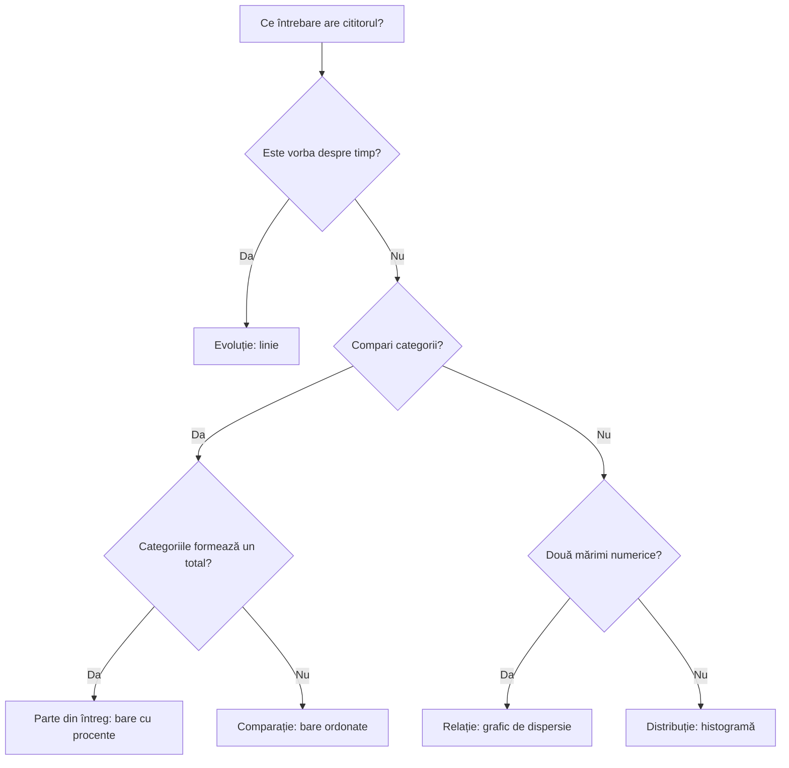

Trei precizări:

- **Aceleași date răspund la întrebări diferite.** Comenzile pe canal și pe săptămână pot arăta evoluția (patru linii), comparația (patru bare pentru noiembrie) sau structura (ponderea fiecărui canal). Alegi după ce vrei să spui, nu după ce ai în fișier.
- **Dacă ai două întrebări, fă două grafice.** Un grafic care încearcă să arate și evoluția, și structura, și comparația cu anul trecut nu arată nimic.
- **Uneori răspunsul nu este un grafic.** Poate fi un tabel sau un singur număr (secțiunea 6.8).

Detaliile fiecărui tip (date necesare, variante, capcane proprii) sunt în capitolul 7.

## 6.4 Anatomia unui grafic bun

Prezentarea de curs enumeră elementele unei diagrame: titlu, axe, etichete ale axelor, unități de măsură, legendă, grilă de fundal, adnotări și note, sursa datelor. Le luăm pe rând, cu regula de bună practică pentru fiecare.

### 6.4.1 Titlul spune concluzia

Un titlu descriptiv spune ce este în grafic: „Contribuție săptămânală pe canal”. Un titlu-concluzie spune ce trebuie să vadă cititorul: „Din octombrie, canalul Reclame pierde bani la fiecare comandă”. Într-un grafic de explicare, titlul este concluzia, iar descrierea coboară în subtitlu, împreună cu unitatea și perioada.

Test rapid: dacă cititorul ar citi numai titlul, ar pleca cu mesajul? Dacă nu, rescrie-l.

Există și greșeala inversă, la fel de importantă: titlul nu are voie să spună mai mult decât arată datele. „Reclamele distrug afacerea” nu este o concluzie, este o opinie. „Canalul Reclame a avut contribuție negativă în fiecare dintre ultimele 8 săptămâni” este o concluzie.

### 6.4.2 Axe, unități, scală

- Fiecare axă are etichetă și unitate: „Contribuție (lei)”, „Săptămâna”. Dacă unitatea este în subtitlu și axa este evidentă, eticheta poate lipsi, dar unitatea nu.
- Numerele se scriu ca pentru oameni: „85.400 lei”, nu „85400.0”. Miile se pot scurta: „85 mii lei”.
- Timpul curge de la stânga la dreapta, cu pași egali. Dacă lipsește o săptămână, locul ei rămâne gol; nu o sari.
- Categoriile se ordonează cu sens: după valoare (de regulă descrescător) sau după o ordine firească (luni, trepte de vârstă). Ordinea alfabetică ajută doar la căutare.
- Scala începe unde trebuie (secțiunea 6.6 discută pe larg axa de la zero).

### 6.4.3 Etichete directe în loc de legendă

Legenda obligă ochiul să plece de la date, să găsească pătrățelul colorat, să citească numele și să se întoarcă. Principiul proximității spune ce ai de făcut: scrie numele seriei lângă serie, la capătul liniei sau pe bară, în aceeași culoare. Legenda rămâne o soluție de rezervă, când seriile se încalecă și nu ai loc pentru etichete.

La fel pentru valori: dacă cititorul are nevoie de cifra exactă, scrie-o pe bară sau la capătul liniei. Dacă le scrii pe toate, poți renunța la axa verticală și la grilă.

### 6.4.4 Grilă discretă, adnotări, sursă

- **Grila**: linii subțiri, gri deschis, puține. Doar orizontale la coloane și linii. Dacă ai etichete de valori, nu mai ai nevoie de grilă.
- **Adnotările**: una sau două note scurte, puse exact pe locul la care se referă: „bugetul de reclame crește, apare codul de reducere de 20%”. O adnotare bună răspunde la întrebarea pe care cititorul o va pune oricum: „ce s-a întâmplat aici?”.
- **Sursa și definițiile**: sub grafic, mic. De unde vin datele, ce perioadă, cum este definit indicatorul („canalul unei comenzi = ultimul clic”; vezi capitolul 5 pentru definiții).

### 6.4.5 Raportul date-cerneală și „chartjunk”

Edward Tufte, în *The Visual Display of Quantitative Information* (prima ediție 1983, a doua 2001), propune o măsură simplă a economiei unui grafic, raportul date-cerneală (în engleză *data-ink ratio*):

> raport date-cerneală = cerneala folosită pentru a arăta datele / toată cerneala folosită în grafic

Ideea: cât mai mult din ce este desenat să fie informație. Tot Tufte a inventat cuvântul *chartjunk* („gunoi de grafic”) pentru elementele care nu informează sau care chiar ascund informația: fundaluri colorate, umbre, efecte 3D, chenare groase, grile dese, imagini decorative, zecimale inutile.

Curățarea se face prin întrebare, element cu element: „dacă șterg asta, pierde cititorul ceva?”. Dacă nu, ștergi.

> **Exemplu.** Graficul implicit dintr-un program de calcul tabelar pentru comenzile lunare ale Cămării are, de obicei: chenar, grilă, legendă cu o singură intrare („Comenzi”), axă cu valori din 100 în 100, uneori fond colorat și umbre. După curățare rămân: trei bare într-o singură culoare, valoarea scrisă deasupra fiecăreia (553, 688, 796), numele lunilor și titlul. Nimic din informație nu s-a pierdut, iar graficul se citește mai repede.

O nuanță: raportul date-cerneală este un ghid, nu un scop. Etichetele axelor, o adnotare sau o linie de referință la zero nu sunt „date”, dar ajută la citire. Tai ce nu ajută, nu tot ce nu este cifră.

### 6.4.6 Exemplu lucrat: contribuția pe canal

Datele din spatele graficului sunt contribuția săptămânală pe canal (marja brută minus marketing minus ambalare și livrare; date fictive, în lei, rotunjite; sunt arătate doar câteva săptămâni):

| Săptămâna | Căutare | Email | Direct | Reclame |
|---|---|---|---|---|
| 1 | 3.210 | 1.758 | 1.784 | 256 |
| 4 | 3.210 | 1.758 | 1.784 | 256 |
| 5 | 3.264 | 1.818 | 1.784 | -752 |
| 6 | 3.317 | 1.818 | 1.784 | -1.762 |
| 8 | 3.317 | 1.818 | 1.784 | -2.668 |
| 9 | 3.317 | 1.878 | 1.840 | -2.939 |
| 12 | 3.317 | 1.878 | 1.840 | -2.864 |

Descrierea graficului: patru linii pe 12 săptămâni. Trei dintre ele (Căutare, Email, Direct) sunt gri, subțiri și aproape orizontale. A patra, Reclame, este portocalie și groasă; stă puțin peste zero patru săptămâni, apoi coboară abrupt sub linia de zero și se oprește în jur de -2.900 de lei. Numele fiecărui canal este scris la capătul din dreapta al liniei. O linie verticală punctată între săptămânile 4 și 5 poartă nota despre buget și codul de reducere. Titlul spune concluzia.

```python
import pandas as pd
import matplotlib.pyplot as plt

df = pd.read_csv("camara_saptamanal.csv")
lat = df.pivot(index="saptamana", columns="canal", values="contributie")

decalaj = {"Email": 160, "Direct": -160}   # etichetele celor două linii apropiate nu se mai suprapun

fig, ax = plt.subplots(figsize=(9, 5))
for canal in lat.columns:
    accent = canal == "Reclame"
    ax.plot(lat.index, lat[canal],
            color="#D55E00" if accent else "#999999",
            linewidth=3 if accent else 1.5)
    ax.text(12.2, lat[canal].iloc[-1] + decalaj.get(canal, 0), canal, va="center",
            color="#D55E00" if accent else "#555555",
            fontweight="bold" if accent else "normal")

ax.axhline(0, color="black", linewidth=0.8)
ax.axvline(4.5, color="#bbbbbb", linestyle=":", linewidth=1)
ax.text(4.6, 2400, "bugetul de reclame crește,\napare codul de reducere de 20%", fontsize=9)
ax.set_title("Din octombrie, canalul Reclame pierde bani la fiecare comandă\n"
             "Contribuție săptămânală pe canal, lei (date fictive)", loc="left")
ax.set_xlabel("Săptămâna")
ax.set_ylabel("Contribuție (lei)")
ax.set_xticks(range(1, 13))
ax.set_xlim(1, 13.8)
ax.spines[["top", "right"]].set_visible(False)
ax.grid(axis="y", color="#eeeeee")
fig.tight_layout()
fig.savefig("contributie_canale.png", dpi=150)
```

Observă ce principii sunt la lucru: poziția pe o scală comună pentru valoare (locul 1 în ierarhie), culoarea folosită numai pentru evidențiere, etichete directe prin proximitate, linia de zero ca referință, o singură adnotare, titlu-concluzie. Codul presupune că fișierul CSV (*comma-separated values*, valori separate prin virgulă) se află în folderul de lucru.

## 6.5 Culoarea

Culoarea este un instrument puternic și ușor de folosit prost. Claus Wilke, în *Fundamentals of Data Visualization*, îi dă trei roluri: să distingă grupuri, să reprezinte valori și să evidențieze. Fiecărui rol îi corespunde un tip de scală.

### 6.5.1 Trei tipuri de scale

| Tip | La ce folosește | Cum arată | Exemplu la Cămara |
|---|---|---|---|
| Categorială (calitativă) | Categorii fără ordine | Câteva culori clar diferite, de „greutate” vizuală apropiată | Cele 4 canale |
| Secvențială | Valori de la mic la mare | De regulă o singură nuanță, de la deschis la închis | Comenzile pe canal și săptămână, într-o hartă de căldură |
| Divergentă | Abateri față de un punct de mijloc cu sens | Două nuanțe care pleacă dintr-un mijloc neutru, deschis | Contribuția pe canal și săptămână: sub zero într-o nuanță, peste zero în alta |

Reguli care decurg de aici:

- **Nu pune o scală secvențială pe categorii.** Dacă cele patru canale sunt colorate în patru tonuri de albastru, cititorul crede că unul este „mai mult” decât altul.
- **Nu pune culori categoriale pe valori.** Curcubeul nu are ordine firească. Wilke arată că scala-curcubeu nu este monotonă și poate scoate în evidență aspecte arbitrare ale datelor.
- **Scala divergentă cere un mijloc real.** Zero la profit, ținta la un indicator, media la o abatere. Dacă nu există un asemenea punct, folosește o scală secvențială.
- **Puține culori.** Wilke dă ca reper trei până la cinci categorii pentru o scală calitativă; spre opt-zece, potrivirea culorilor cu legenda devine prea obositoare și este mai bine să etichetezi direct.

Al patrulea caz, cel mai util în prezentări, este **culoarea de accent**: totul în gri, un singur element colorat. Este exact ce am făcut în graficul din 6.4.6.

### 6.5.2 Culoare cu sens consecvent

Principiul similarității lucrează și între grafice, nu doar în interiorul unuia. Dacă Reclame este portocaliu pe pagina 2, trebuie să fie portocaliu și pe pagina 7. Altfel, cititorul leagă greșit seriile.

Alte convenții de respectat:

- Aceeași mărime, aceeași culoare în tot documentul (venitul mereu albastru, costul mereu gri).
- Roșu și verde poartă deja sens („rău” și „bine”). Nu le folosi pentru două categorii neutre. Și nu te baza doar pe ele (vezi mai jos).
- Culoarea puternică este o resursă limitată. Dacă totul este colorat intens, nimic nu iese în evidență.

### 6.5.3 Accesibilitate: daltonism și contrast

O parte din publicul tău nu vede culorile ca tine. Institutul Național al Ochiului din Statele Unite (National Eye Institute, NEI) arată că aproximativ 1 din 12 bărbați are o deficiență de vedere a culorilor și că forma cea mai frecventă face greu de deosebit roșul de verde (NEI, pagina „Color Blindness”, https://www.nei.nih.gov/learn-about-eye-health/eye-conditions-and-diseases/color-blindness, accesată în noiembrie 2026). Wilke dă aceeași ordine de mărime: aproximativ 8% dintre bărbați și 0,5% dintre femei (Wilke, capitolul 19, https://clauswilke.com/dataviz/color-pitfalls.html, accesat în noiembrie 2026). Într-o sală cu 25 de bărbați, este de așteptat ca în medie doi să nu deosebească bine bara roșie de cea verde.

Standardul de referință pentru accesibilitatea web este WCAG (*Web Content Accessibility Guidelines*, Ghidul pentru accesibilitatea conținutului web), publicat de consorțiul W3C (*World Wide Web Consortium*). Trei criterii din versiunea 2.2 privesc direct graficele (https://www.w3.org/TR/WCAG22/, accesat în noiembrie 2026):

| Criteriu | Ce cere, pe scurt | Ce înseamnă pentru un grafic |
|---|---|---|
| 1.4.1 Folosirea culorii (nivel A) | Culoarea nu este singurul mijloc vizual de a transmite o informație | Seriile se disting și prin etichetă, formă, tip de linie sau model |
| 1.4.3 Contrast minim (nivel AA) | Textul are un raport de contrast de cel puțin 4,5:1 față de fond; textul mare, cel puțin 3:1 | Etichetele gri deschis pe fond alb pot fi ilizibile |
| 1.4.11 Contrastul elementelor non-text (nivel AA) | Elementele grafice vizate de criteriu au cel puțin 3:1 față de culorile alăturate | Liniile și barele trebuie să se distingă de fond și între ele |

De aici regula cea mai importantă a acestei secțiuni:

> **De reținut.** Nu transmite informația doar prin culoare. Dublează culoarea cu altceva: etichetă directă, formă diferită a punctelor, linie plină față de linie întreruptă, poziție. Test simplu: tipărește graficul alb-negru. Dacă încă se înțelege, este bine.

Practic:

- Evită perechea roșu-verde pentru „rău-bine”. Albastrul și portocaliul sunt o pereche mai sigură.
- Folosește o paletă gândită pentru deficiențele de vedere a culorilor. Wilke recomandă paleta Okabe-Ito, cu opt culori; din ea am luat albastrul `#0072B2` și portocaliul-roșcat `#D55E00` din exemplele de cod.
- Verifică graficul cu un simulator de daltonism (recomandarea este tot a lui Wilke: nu te baza doar pe paletă, testează).
- Verifică raportul de contrast al textului cu un instrument de calcul.

Referirea la WCAG de aici este orientativă și nu este consultanță juridică; dacă ai obligații legale de accesibilitate pentru un site sau un document, consultă textul oficial al standardului și legislația aplicabilă.

## 6.6 Onestitate: cum minte un grafic și cum îl corectezi

Un grafic poate fi fals fără să conțină nicio cifră falsă. Poate înșela prin felul în care este desenat, prin datele alese și prin ce lasă pe dinafară. Uneori autorul o face intenționat. De cele mai multe ori o face din grabă, cu setările implicite ale programului. Efectul asupra cititorului este același. Alberto Cairo a dedicat subiectului o carte întreagă, *How Charts Lie* (2019), bună ca lectură suplimentară.

Wilke formulează regula de bază ca „principiul cernelii proporționale” (pe care îl atribuie lui Bergstrom și West): mărimea suprafețelor colorate dintr-un grafic trebuie să fie proporțională cu valorile pe care le reprezintă.

### 6.6.1 Axa trunchiată la bare

Comenzile lunare ale Cămării (date fictive):

| Luna | Comenzi | Înălțimea barei cu axa de la 0 | Înălțimea barei cu axa de la 450 |
|---|---|---|---|
| Septembrie | 553 | 553 | 553 - 450 = 103 |
| Octombrie | 688 | 688 | 688 - 450 = 238 |
| Noiembrie | 796 | 796 | 796 - 450 = 346 |

Calculul:

- Creșterea reală din septembrie până în noiembrie: 796 / 553 = 1,44, adică +44%.
- Cu axa pornită de la 450, bara din noiembrie are 346 de unități, iar cea din septembrie 103. Raportul: 346 / 103 = 3,36. Bara din noiembrie pare de aproximativ 3,4 ori mai înaltă.

Cititorul compară lungimi (asta face ochiul cu barele) și pleacă cu impresia că magazinul și-a triplat comenzile. Cifrele de pe axă sunt corecte. Imaginea nu este.

Regula: **la bare, axa valorilor pornește de la zero.** Bara codifică valoarea prin lungime, iar o lungime tăiată nu mai înseamnă nimic. Wilke o spune fără nuanțe: pe o scală liniară, barele pornesc întotdeauna de la 0.

### 6.6.2 Factorul de minciună

Tufte a propus o măsură pentru cât exagerează un grafic, factorul de minciună (*lie factor*):

> factor de minciună = mărimea efectului arătat în grafic / mărimea efectului din date
>
> unde mărimea efectului = (a doua valoare - prima valoare) / prima valoare

Un grafic fidel are factorul 1. Peste 1, graficul exagerează; între 0 și 1, ascunde.

Pentru graficul cu axa de la 450:

- Efectul din date: (796 - 553) / 553 = 243 / 553 = 0,44 (creștere de 44%).
- Efectul din grafic: (346 - 103) / 103 = 243 / 103 = 2,36 (bara crește cu 236%).
- Factorul de minciună: 2,36 / 0,44 = 5,4.

Graficul arată o schimbare de peste cinci ori mai mare decât cea reală. Codul următor desenează ambele variante, una lângă alta, și tipărește calculul.

```python
import pandas as pd
import matplotlib.pyplot as plt

df = pd.read_csv("camara_saptamanal.csv")
luni = ["septembrie", "octombrie", "noiembrie"]
comenzi = df.groupby("luna")["comenzi"].sum().reindex(luni)

baza = 450
efect_date = (comenzi["noiembrie"] - comenzi["septembrie"]) / comenzi["septembrie"]
efect_grafic = ((comenzi["noiembrie"] - baza) - (comenzi["septembrie"] - baza)) / (comenzi["septembrie"] - baza)
print("Efect în date:", round(efect_date, 3))
print("Efect în grafic:", round(efect_grafic, 3))
print("Factor de minciună:", round(efect_grafic / efect_date, 2))

fig, (stanga, dreapta) = plt.subplots(1, 2, figsize=(9, 4))
stanga.bar(luni, comenzi, color="#999999")
stanga.set_ylim(baza, 820)
stanga.set_title("Înșelător: axa pornește de la 450", loc="left")
dreapta.bar(luni, comenzi, color="#0072B2")
dreapta.set_ylim(0, 900)
dreapta.set_title("Corect: axa pornește de la zero", loc="left")
for ax in (stanga, dreapta):
    ax.set_ylabel("Comenzi pe lună")
    ax.spines[["top", "right"]].set_visible(False)
    for i, v in enumerate(comenzi):
        ax.text(i, v + 8, str(v), ha="center")
fig.tight_layout()
fig.savefig("axa_trunchiata.png", dpi=150)
```

Rezultatul tipărit: efect în date 0,439; efect în grafic 2,359; factor de minciună 5,37.

### 6.6.3 Când este acceptabilă o axă care nu pornește de la zero

Regula cu zero ține de bare, pentru că barele se citesc prin lungime. Linia și punctele se citesc prin poziție și pantă, deci nu au o „lungime” care să fie falsificată. La ele, o axă care nu pornește de la zero este adesea alegerea corectă:

- **Când zero nu are sens sau este foarte departe.** Temperatura în grade Celsius; un curs de schimb care variază doar la a doua zecimală. Cu axa de la zero, linia ar fi dreaptă și nu ai vedea nimic.
- **Când variațiile mici contează.** O rată de conversie care trece de la 2,9% la 2,5% este o problemă serioasă, deși pe o axă 0-100% nu se vede.

Condițiile de onestitate rămân:

1. Axa este etichetată clar, iar cititorul vede de unde pornește.
2. Nu umpli cu culoare zona de sub linie. O arie umplută se citește ca suprafață și readuce problema barelor; Wilke arată acest efect pe un grafic de preț al unei acțiuni.
3. Intervalul axei nu este ales ca să dramatizeze. O variație de 1% nu trebuie să ocupe toată înălțimea graficului dacă pentru afacere este zgomot.
4. Dacă vrei să arăți diferența, desenează diferența: „schimbare față de septembrie”, cu zero ca punct de pornire.

Greșeala inversă există și ea: o axă întinsă excesiv (de la 0 la 10.000 pentru valori între 500 și 800) aplatizează tot și ascunde o schimbare reală. Factorul de minciună sub 1 descrie acest caz.

### 6.6.4 Axe duble

Un grafic cu două axe verticale (comenzi pe stânga, rezultat în lei pe dreapta) arată două linii care se intersectează undeva. Cititorul vede intersecția și îi dă sens: „aici s-a rupt ceva”. Dar punctul de intersecție depinde numai de cum ai ales cele două scale. Schimbi intervalul axei din dreapta și liniile se intersectează în altă săptămână, sau deloc.

Cu două axe poți face ca două serii să pară mult mai legate, sau mult mai divergente, decât sunt. De aceea, axele duble sunt de evitat în grafice de explicare.

Alternative:

- **Două panouri, unul sub altul, cu aceeași axă a timpului.** Fiecare mărime are scala ei, cinstit, și nu există o intersecție falsă.
- **Indexare**: ambele serii exprimate ca procent față de prima perioadă (septembrie = 100). Atunci au aceeași unitate și pot sta pe aceeași axă.
- **Un indicator derivat**: în loc de „venit” și „comenzi” pe două axe, desenezi „venit pe comandă”.

Exemplul pe Cămara, cu totalurile săptămânale (date fictive; săptămânile 2 și 3 seamănă cu 1 și 4 și au fost omise din tabel):

| Săptămâna | 1 | 4 | 5 | 6 | 7 | 8 | 9 | 10 | 11 | 12 |
|---|---|---|---|---|---|---|---|---|---|---|
| Comenzi | 138 | 138 | 154 | 168 | 180 | 186 | 195 | 200 | 202 | 199 |
| Rezultat simplificat (lei) | 4.508 | 4.508 | 3.613 | 2.656 | 2.183 | 1.750 | 1.596 | 1.724 | 1.768 | 1.670 |

```python
import pandas as pd
import matplotlib.pyplot as plt

df = pd.read_csv("camara_saptamanal.csv")
sapt = df.groupby("saptamana")[["comenzi", "contributie"]].sum()
sapt["rezultat"] = sapt["contributie"] - 2500   # costuri fixe: 2.500 lei pe săptămână

fig, (sus, jos) = plt.subplots(2, 1, figsize=(8, 6), sharex=True)
sus.plot(sapt.index, sapt["comenzi"], color="#0072B2", marker="o")
sus.set_ylim(0, 220)
sus.set_title("Comenzile cresc...", loc="left")
sus.set_ylabel("Comenzi pe săptămână")

jos.plot(sapt.index, sapt["rezultat"], color="#D55E00", marker="o")
jos.set_ylim(0, 5000)
jos.set_title("...dar rezultatul scade", loc="left")
jos.set_ylabel("Rezultat simplificat (lei)")
jos.set_xlabel("Săptămâna")
jos.set_xticks(range(1, 13))

for ax in (sus, jos):
    ax.spines[["top", "right"]].set_visible(False)
    ax.grid(axis="y", color="#eeeeee")
fig.tight_layout()
fig.savefig("doua_panouri.png", dpi=150)
```

Descrierea rezultatului: sus, o linie albastră care urcă de la 138 la aproximativ 200 de comenzi; jos, o linie portocalie care coboară de la aproximativ 4.500 la aproximativ 1.700 de lei. Cele două titluri de panou, citite împreună, formează mesajul. Am pornit ambele axe de la zero ca să nu dramatizăm nici creșterea, nici scăderea.

### 6.6.5 Perioade alese convenabil

Poți spune un neadevăr cu date corecte dacă alegi de unde începi și unde te oprești. În engleză practica se numește *cherry picking* (culesul cireșelor: iei numai ce îți convine).

> **Exemplu.** Rezultatul simplificat al Cămării a fost de 1.596 lei în săptămâna 9 și de 1.670 lei în săptămâna 12 (date fictive). Un grafic doar cu săptămânile 9-12 poate purta titlul „Rezultatul a crescut cu 4,6% în noiembrie”, iar calculul este corect: (1.670 - 1.596) / 1.596 = 4,6%. Graficul cu toate cele 12 săptămâni arată însă că rezultatul a scăzut de la aproximativ 4.500 la aproximativ 1.700 de lei pe săptămână. Ambele grafice folosesc date reale. Numai al doilea este onest.

Cum te aperi, ca autor și ca cititor:

- Arată o perioadă suficient de lungă încât să se vadă nivelul „normal” dinainte.
- Compară perioade comparabile: noiembrie cu noiembrie anul trecut, nu decembrie cu ianuarie, la un magazin cu vânzări sezoniere.
- Spune explicit de ce ai ales perioada.
- Când primești un grafic, întreabă: „ce era înainte de primul punct?”.

### 6.6.6 Efecte 3D

Al treilea „D” (de la tridimensional) nu adaugă nicio informație la un grafic cu două variabile. Adaugă în schimb perspectivă, iar perspectiva deformează: felia din față a unei diagrame circulare 3D pare mai mare decât una egală din spate; la coloanele 3D nu mai este clar unde se citește înălțimea, pe fața din față sau pe cea din spate. Wilke are un capitol întreg cu titlul „Don't go 3D”. Varianta corectată este graficul plat.

### 6.6.7 Arii și pictograme

Când valoarea este codificată printr-o figură (cerc, pictogramă, borcan desenat), apare o capcană de geometrie. Dacă mărești figura proporțional pe ambele dimensiuni, aria crește cu pătratul factorului.

Pe Cămara: vrei să arăți creșterea comenzilor cu 44% prin două borcane desenate. Faci al doilea borcan de 1,44 ori mai înalt și, ca să nu arate deformat, și de 1,44 ori mai lat. Aria lui este de 1,44 × 1,44 = 2,07 ori mai mare. Ochiul vede „dublu”, nu „+44%”. Factorul de minciună: (2,07 - 1) / 0,44 = 2,4. Dacă borcanul este desenat în relief, impresia merge spre volum: 1,44 × 1,44 × 1,44 = 2,99, aproape triplu.

Corect: fie aria (nu înălțimea) este proporțională cu valoarea, fie, mult mai simplu, folosești bare. Dacă ții la pictograme, repetă aceeași pictogramă de mărime fixă (un borcan = 100 de comenzi) și lasă cititorul să le numere.

### 6.6.8 Hărți care exagerează suprafața

Pe o hartă colorată pe regiuni (hartă coropletă, în engleză *choropleth*), ochiul este atras de suprafețele mari. Dar suprafața unui județ nu are legătură cu numărul de clienți din el. Un județ întins și rar populat ocupă mult loc pe hartă și domină imaginea, în timp ce un oraș mare, unde stau mulți clienți, abia se vede.

A doua capcană a hărților: valorile absolute. O hartă cu „număr de comenzi pe județ” seamănă de cele mai multe ori cu o hartă a populației: sunt mai multe comenzi acolo unde sunt mai mulți oameni. Întrebarea de business este de obicei alta: unde suntem puternici față de mărimea pieței? Pentru asta împarți la populație (comenzi la 10.000 de locuitori).

Reguli pentru hărți: colorează rate, nu totaluri; folosește o scală secvențială, cu puține trepte; întreabă-te dacă geografia chiar contează pentru mesaj. Dacă vrei doar să compari zece județe, un grafic cu bare ordonate este mai precis decât harta.

### 6.6.9 Rezumat: zece feluri de a înșela și corecția lor

| Tehnica | Ce impresie creează | Corecția |
|---|---|---|
| Bare cu axa care nu pornește de la zero | Diferențe mici par uriașe | Axa de la zero sau grafic al diferenței |
| Axă întinsă excesiv | O schimbare reală pare nimic | Interval potrivit cu variația care contează |
| Două axe verticale | Legături și intersecții create de scale | Două panouri sau indexare |
| Perioadă aleasă convenabil | Tendință opusă celei reale | Perioadă lungă, comparabilă, justificată |
| Efect 3D | Elementele din față par mai mari | Grafic plat |
| Figuri scalate pe ambele dimensiuni | Creșterea pare la pătrat | Arie proporțională sau bare |
| Hartă cu valori absolute | Hartă a populației, nu a performanței | Rate la populație |
| Pași inegali pe axa timpului | Pante false | Timp la scară, cu goluri vizibile |
| Cumulat în loc de valori pe perioadă | „Crește mereu”, orice s-ar întâmpla | Valori pe perioadă |
| Procente fără bază | „+100%” de la 2 la 4 comenzi | Scrie și valorile absolute |

> **Greșeală frecventă.** Graficul cu vânzări cumulate. O linie cumulată a vânzărilor nu coboară niciodată, chiar dacă vânzările lunare scad. Arată bine în orice prezentare și spune foarte puțin despre tendință. Dacă vrei tendința, desenezi valorile pe perioadă.

## 6.7 Pregătirea datelor înainte de grafic

Un grafic nu poate fi mai bun decât tabelul din spatele lui. Prezentarea de curs grupează pregătirea în trei etape: curățare, transformare, organizare. Le dezvoltăm aici pe scurt; tehnica în pandas se învață în capitolul 8.

### 6.7.1 Curățarea

**Valorile lipsă.** Întâi afli de ce lipsesc. O săptămână fără comenzi pe un canal este zero, nu „lipsă”. O săptămână în care urmărirea vizitelor nu a funcționat este lipsă, nu zero. Diferența se vede în grafic: zero trage linia în jos, lipsa lasă un gol. Opțiunile, în ordinea prudenței:

1. Lași golul vizibil și îl explici într-o notă. De cele mai multe ori este varianta cea mai cinstită.
2. Elimini rândul, dacă nu afectează mesajul și spui că ai făcut-o.
3. Înlocuiești cu o estimare (media sau mediana, cum sugerează prezentarea de curs), marcată distinct în grafic, de exemplu cu linie întreruptă.

**Valorile extreme** (în engleză *outliers*). O comandă de 4.800 de lei într-un magazin unde comanda obișnuită are 130 de lei poate fi o eroare de introducere (un zero în plus), o comandă de test sau un client real, firmă, care a cumpărat cadouri. Verifici, apoi decizi. Eroarea se corectează. Comanda reală rămâne în date, dar o poți arăta separat, ca să nu strice scala pentru toate celelalte. Nu ștergi o valoare doar pentru că strică graficul.

**Formatele.** Probleme mărunte care produc grafice greșite:

- Date calendaristice citite ca text sau cu ziua și luna inversate („03.11.2026” poate ajunge 11 martie).
- Zecimale cu virgulă citite ca text („85,4” nu este număr pentru un program setat pe engleză).
- Aceeași categorie scrisă în trei feluri: „Email”, „email”, „E-mail” apar ca trei bare.
- Luni sortate alfabetic: noiembrie, octombrie, septembrie.
- Rânduri duplicate, care dublează totalurile.

### 6.7.2 Transformarea

**Agregarea la nivelul potrivit.** Zilnic, datele unui magazin mic sunt zgomot: marțea sunt 14 comenzi, miercurea 22, fără nicio cauză. Lunar, pierzi momentul în care s-a schimbat ceva. Pentru Cămara, nivelul săptămânal arată clar ruptura din săptămâna 5. Regula: alegi cel mai fin nivel la care tiparul se vede fără zgomot.

**Procente și rate.** Pentru întrebări de tip „parte din întreg” calculezi ponderile înainte de grafic. Pentru comparații între unități de mărimi diferite, împarți la bază: comenzi la 100 de vizite, nu comenzi.

**Normalizarea.** Când vrei să compari evoluția unor mărimi cu unități diferite (vizite, comenzi, lei), le aduci la aceeași bază: septembrie = 100. Este alternativa cinstită la axele duble.

### 6.7.3 Organizarea

- **Sortarea**: cronologic pentru timp, după valoare pentru categorii.
- **Filtrarea**: doar ce ține de mesaj. Ce ai scos menționezi în notă.
- **Gruparea categoriilor mici în „Altele”**: zece produse cu sub 1% fiecare devin o singură bară. Atenție: „Altele” nu trebuie să ajungă cea mai mare categorie.

### 6.7.4 Format lat și format lung

Aceleași date pot sta în două forme, iar programele de grafică cer una sau alta.

**Format lung** (în engleză *long* sau *tidy*): un rând pentru fiecare observație, o coloană pentru fiecare variabilă. Așa este fișierul Cămării:

| saptamana | canal | comenzi |
|---|---|---|
| 1 | Căutare | 60 |
| 1 | Reclame | 16 |
| 1 | Email | 30 |
| 1 | Direct | 32 |
| 2 | Căutare | 60 |

**Format lat** (în engleză *wide*): un rând pentru fiecare săptămână, o coloană pentru fiecare canal:

| saptamana | Căutare | Direct | Email | Reclame |
|---|---|---|---|---|
| 1 | 60 | 32 | 30 | 16 |
| 2 | 60 | 32 | 30 | 16 |
| 3 | 61 | 31 | 31 | 16 |

| | Format lung | Format lat |
|---|---|---|
| Bun pentru | Stocare, filtrare, grupare, instrumente de tip dashboard | Citit de oameni, grafice simple în programe de calcul tabelar, o linie pe coloană în matplotlib |
| Adaugi un canal nou | Adaugi rânduri | Adaugi o coloană (și refaci formulele) |
| Semn că îl ai | O coloană „canal” cu valori repetate | Numele canalelor sunt titluri de coloane |

Regula practică: păstrezi datele în format lung și le treci în format lat doar când graficul o cere. În pandas, trecerea se face cu `pivot`, iar întoarcerea cu `melt`:

```python
import pandas as pd

df = pd.read_csv("camara_saptamanal.csv")
print(df.isna().sum().sum(), "valori lipsă")
print(df.duplicated(["saptamana", "canal"]).sum(), "rânduri duplicate")
print(df[["vizite", "comenzi", "venit"]].describe().loc[["min", "max"]])

# din format lung în format lat: un rând pe săptămână, o coloană pe canal
lat = df.pivot(index="saptamana", columns="canal", values="comenzi")
print(lat.head(3))

# și înapoi, din lat în lung
lung = lat.reset_index().melt(id_vars="saptamana", var_name="canal", value_name="comenzi")
print(lung.head(3))

# agregare la nivel de lună, cu ordinea corectă a lunilor
luni = ["septembrie", "octombrie", "noiembrie"]
df["luna"] = pd.Categorical(df["luna"], categories=luni, ordered=True)
print(df.groupby("luna", observed=True)[["comenzi", "venit"]].sum())
```

Primele trei instrucțiuni `print` sunt verificările minime dinaintea oricărui grafic: valori lipsă (0 în fișierul nostru), duplicate (0) și minimul și maximul fiecărei coloane, ca să prinzi valorile imposibile. Ultimul bloc rezolvă problema lunilor sortate alfabetic.

> **Pentru afacerea ta.** Dacă ții vânzările într-o foaie de calcul cu o coloană pentru fiecare lună și un rând pentru fiecare produs, ai format lat. Merge cât timp te uiți tu la el. În momentul în care vrei filtre, comparații pe categorii sau un dashboard (capitolul 7), treci la format lung: o comandă sau o zi pe rând, cu coloane „data”, „produs”, „canal”, „cantitate”, „valoare”.

## 6.8 De la grafic la poveste

Un grafic corect și curat poate totuși să nu producă nicio decizie. Lipsește povestea: de ce îl arăți, cui și ce vrei să se întâmple după. Cole Nussbaumer Knaflic organizează *Storytelling with Data* în jurul a șase lecții: înțelege contextul, alege forma potrivită, elimină încărcătura, concentrează atenția, gândește ca un designer, spune o poveste. Le grupăm în patru mișcări.

### 6.8.1 Context

Înainte să deschizi programul, răspunde în scris la trei întrebări:

- **Cine** este publicul? Ce știe deja, ce îl interesează, ce poate decide?
- **Ce** vrei să facă după ce vede graficul? Să aprobe, să oprească, să schimbe ceva?
- **Cum** susțin datele cererea ta?

Dacă nu poți răspunde la a doua întrebare, nu ai încă o prezentare. Ai o informare.

### 6.8.2 Mesaj

Knaflic recomandă să formulezi „ideea mare” (concept preluat de la Nancy Duarte): o singură propoziție completă, care spune punctul tău de vedere și ce este în joc. Dacă nu încape într-o propoziție, nu ești pregătit să desenezi.

Pentru Cămara: „Reclamele cu cod de reducere ne-au adus cu 44% mai multe comenzi, dar pierdem aproximativ 40 de lei la fiecare comandă venită pe acest canal; propun să oprim codul și să reducem bugetul la nivelul din septembrie.”

Propoziția are fapt, miză și cerere. Titlul graficului principal va fi o variantă scurtă a ei.

### 6.8.3 Evidențiere

Aici se aplică atributele preatenționale din 6.2. Întâi scoți tot ce nu servește mesajul (grilă, chenare, serii irelevante). Apoi dai un singur accent: culoarea, grosimea sau o adnotare pe elementul despre care vorbești. Restul devine gri.

Test: arată graficul cuiva timp de cinci secunde și întreabă ce a văzut. Dacă răspunsul nu este mesajul tău, accentul este în alt loc decât credeai.

### 6.8.4 Pași

O poveste are început, mijloc și sfârșit. Pentru o prezentare de business:

1. **Situația**: ce știam și ce ne propusesem. „În septembrie aveam 553 de comenzi și un rezultat de 18.088 lei.”
2. **Tensiunea**: ce s-a schimbat și de ce contează. „În noiembrie avem 796 de comenzi, dar rezultatul a scăzut la 6.758 lei.”
3. **Cauza**, cu graficul principal. „Scăderea vine dintr-un singur canal.”
4. **Propunerea**: ce cerem. „Oprim codul de 20% și readucem bugetul la 2.400 lei pe lună; testăm o reclamă fără reducere.” (Cum se testează corect o astfel de schimbare, în capitolul 9.)

Un grafic pe pas. Dacă prezinți pe diapozitive, construiește graficul complex în trepte: întâi cele trei canale stabile, apoi linia Reclame, apoi adnotarea.

### 6.8.5 Tabel sau grafic?

Distincția de lucru, în spiritul cărții lui Few *Show Me the Numbers* (al cărei subtitlu vorbește chiar despre proiectarea tabelelor și a graficelor): tabelul servește la căutarea și compararea unor valori individuale exacte; graficul servește la a vedea forma datelor, adică tendințe, tipare și excepții.

| Situația | Tabel | Grafic |
|---|---|---|
| Cititorul caută o valoare anume („cât am vândut în săptămâna 7?”) | Da | Nu |
| Contează cifrele exacte (prețuri, facturi, bugete) | Da | Nu |
| Sunt mai multe unități de măsură pe același rând (lei, bucăți, %) | Da | Greu |
| Vrei să arăți o tendință sau o ruptură | Nu | Da |
| Vrei să arăți o relație între două mărimi | Nu | Da |
| Sunt multe valori și contează imaginea de ansamblu | Nu | Da |
| Ai doar 2-4 cifre | Poate | Rar; mai bine text |

Un tabel se proiectează cu aceeași grijă ca un grafic: numere aliniate la dreapta, același număr de zecimale, linii puține, rândul important evidențiat.

### 6.8.6 Când un singur număr mare este cea mai bună vizualizare

Dacă mesajul stă într-una sau două cifre, un grafic doar îl diluează. Pentru acest caz ajunge text simplu: numărul scris mare, cu o propoziție de context.

> **Exemplu.** În loc de un grafic cu două bare (18.088 și 6.758), un diapozitiv cu „-63%” scris mare și dedesubt: „Rezultatul lunar a scăzut de la 18.088 lei în septembrie la 6.758 lei în noiembrie, deși comenzile au crescut cu 44% (date fictive).” Atât.

Condiții ca numărul mare să fie onest: are unitate, are perioadă, are termen de comparație. „6.758 lei” singur nu spune nimic; „6.758 lei, față de 18.088 în septembrie” spune tot.

## 6.9 Greșeli frecvente într-o prezentare de business: înainte și după

Fiecare rând descrie o greșeală întâlnită des și varianta corectată, pe datele Cămării (date fictive).

| Nr. | Înainte | De ce este o problemă | După |
|---|---|---|---|
| 1 | Titlu: „Comenzi pe canale, sept.-nov.” | Cititorul trebuie să găsească singur concluzia | Titlu: „Creșterea comenzilor vine aproape toată din Reclame”; subtitlu cu unitatea și perioada |
| 2 | Diagramă circulară 3D cu ponderea celor 4 canale în noiembrie, cu legendă | Unghiuri și arii deformate de perspectivă; Reclame (35,9%) și Căutare (31,3%) se deosebesc greu | Patru bare orizontale ordonate descrescător, cu procentul scris la capăt |
| 3 | Coloane cu comenzile lunare, axa de la 450 | Bara din noiembrie pare de 3,4 ori mai înaltă; factor de minciună 5,4 | Axa de la zero, valorile scrise pe bare, „+44%” în titlu |
| 4 | Comenzi (axa stângă) și rezultat (axa dreaptă) pe același grafic | Intersecția liniilor este un efect al scalelor | Două panouri suprapuse, cu aceeași axă a timpului |
| 5 | Patru linii în patru culori vii, legendă în dreapta | Niciun accent; drum între linie și legendă pentru fiecare serie | Trei linii gri, Reclame colorată, numele scrise la capătul liniilor |
| 6 | Roșu pentru canalul cu pierdere, verde pentru cele profitabile, fără etichete | O parte din public deosebește greu cele două culori | Portocaliu și gri, plus etichete directe și linia de zero |
| 7 | Grafic doar cu săptămânile 9-12: „rezultatul crește cu 4,6%” | Perioadă aleasă convenabil | Toate cele 12 săptămâni, cu momentul schimbării adnotat |
| 8 | Tabel cu 48 de rânduri și 10 coloane lipit pe diapozitiv | Nimeni nu citește 480 de celule proiectate pe perete | Un grafic cu mesajul; tabelul merge în anexă |
| 9 | Bare cu canalele în ordine alfabetică | Ordinea nu ajută comparația | Ordine descrescătoare după valoare |
| 10 | Axă cu „85400.0”, „97779.0”, fără unitate | Zecimale false, lipsa unității | „85 mii lei”, „98 mii lei”; unitatea în subtitlu |
| 11 | Venit cumulat pe 12 săptămâni | Linia urcă orice s-ar întâmpla | Venit pe săptămână; cumulatul apare doar dacă ținta este un total |
| 12 | Șase grafice mici pe un diapozitiv, „ca să fie tot” | Se citesc greu și nu există un mesaj | Un grafic pe diapozitiv, un mesaj pe grafic |

Două dintre ele, pe larg.

**Greșeala 2, diagrama circulară.** Datele: Căutare 249 de comenzi (31,3%), Reclame 286 (35,9%), Email 129 (16,2%), Direct 132 (16,6%). În varianta inițială, cititorul vede patru felii, dintre care două par aproape egale între ele și celelalte două la fel. Trebuie să caute culorile în legendă. În varianta corectată, barele sunt în ordinea Reclame, Căutare, Direct, Email; diferența de 37 de comenzi dintre primele două se vede ca diferență de lungime, iar procentul este scris la capăt. Dacă mesajul este „Reclame a devenit primul canal ca număr de comenzi”, bara Reclame este colorată, iar celelalte sunt gri.

**Greșeala 8, tabelul lipit.** Proprietara nu are nevoie de 480 de celule. Are nevoie de trei lucruri: rezultatul a scăzut, cauza este un canal, ce propui. Varianta corectată are trei diapozitive: numărul mare (-63%), graficul din 6.4.6, propunerea. Tabelul complet rămâne în anexă, pentru cine vrea să verifice.

> **Greșeală frecventă.** Să corectezi forma și să uiți definiția. Un grafic impecabil cu „profit pe canal” este înșelător dacă nu spui că este vorba de contribuție (fără costurile fixe) și că o comandă este atribuită ultimului clic. Definiția indicatorului face parte din grafic. Vezi capitolul 5.

## 6.10 Listă de verificare înainte de a trimite un grafic

**Mesaj**

- [ ] Pot spune mesajul într-o propoziție.
- [ ] Titlul este acea propoziție, nu numele variabilelor.
- [ ] Graficul răspunde la o singură întrebare.
- [ ] Un grafic chiar este forma potrivită (nu un tabel, nu un număr mare).

**Formă**

- [ ] Forma corespunde întrebării: evoluție, comparație, parte din întreg, relație, distribuție.
- [ ] Comparația cea mai importantă este codificată prin poziție sau lungime.
- [ ] Categoriile sunt ordonate cu sens; timpul curge de la stânga la dreapta, la scară.
- [ ] Sunt cel mult cinci serii cu sens distinct, sau una evidențiată și restul gri.

**Claritate**

- [ ] Axele au etichete și unități; numerele sunt formatate pentru oameni.
- [ ] Seriile sunt etichetate direct; legenda lipsește sau este lângă date.
- [ ] Grila este discretă; nu există chenare, umbre, fundaluri sau efecte 3D.
- [ ] Am șters tot ce puteam șterge fără să pierd informație.

**Culoare**

- [ ] Tipul de scală se potrivește cu datele (categorială, secvențială, divergentă).
- [ ] Aceeași categorie are aceeași culoare în tot documentul.
- [ ] Informația nu este transmisă doar prin culoare; graficul se înțelege și alb-negru.
- [ ] Textul are contrast suficient față de fond.

**Onestitate**

- [ ] Barele pornesc de la zero.
- [ ] Dacă axa unei linii nu pornește de la zero, intervalul este justificat și vizibil.
- [ ] Nu există două axe verticale cu scale diferite.
- [ ] Perioada nu este aleasă ca să favorizeze o concluzie.
- [ ] Ariile și pictogramele sunt proporționale cu valorile.
- [ ] Procentele sunt însoțite de valorile absolute.

**Date**

- [ ] Am verificat valorile lipsă, duplicatele și valorile extreme.
- [ ] Totalurile din grafic se potrivesc cu sursa.
- [ ] Sursa, perioada și definiția indicatorului sunt scrise sub grafic.
- [ ] Datele fictive sau estimate sunt marcate ca atare.

**Test final**

- [ ] Am arătat graficul cinci secunde cuiva care nu cunoaște subiectul și a spus mesajul corect.

## Aplicații

1. **Cvartetul (individual, 20 de minute).** Rulează codul din 6.1.3. Pentru fiecare dintre cele patru seturi, scrie o propoziție: ce ai face diferit ca analist după ce ai văzut graficul, față de situația în care ai fi văzut doar tabelul cu statistici?

2. **Cămara, axa trunchiată (individual, 30 de minute).** Din `camara_saptamanal.csv`, calculează venitul lunar (85.400, 97.779 și 109.125 lei; date fictive). Desenează-l cu bare, o dată cu axa de la zero și o dată cu axa de la 80.000. Calculează de câte ori pare mai înaltă bara din noiembrie decât cea din septembrie în a doua variantă și factorul de minciună. (Verificare: aproximativ 5,4 ori; factor aproximativ 15,8.)

3. **Cămara, un grafic pentru un mesaj (individual sau în perechi, 45 de minute).** Mesajul: „Pe canalul Reclame, din octombrie încoace, fiecare comandă ne costă mai mult decât aduce.” Alege forma, construiește graficul (în Python sau într-un program de calcul tabelar), scrie titlul-concluzie și o adnotare. Treci-l prin lista de verificare din 6.10 și notează ce ai corectat.

4. **Cămara, repară graficul (în perechi, 30 de minute).** Un coleg a făcut o diagramă circulară 3D cu veniturile pe canale în noiembrie (Căutare 37.350, Reclame 30.030, Email 21.285, Direct 20.460 lei; date fictive), cu patru culori vii și legendă. Enumeră cel puțin patru probleme, legând fiecare de un principiu din capitol, și descrie în cuvinte sau desenează varianta corectată.

5. **Vânătoare de grafice (individual, o săptămână).** Găsește în presă, pe rețele sociale sau într-un raport de firmă trei grafice: unul bun, unul neclar, unul înșelător. Pentru fiecare: ce întrebare își propune, ce codificare vizuală folosește, ce ai schimba. La cel înșelător, estimează factorul de minciună, dacă se poate.

6. **Pentru afacerea ta (individual, o oră).** Ia cel mai important indicator al afacerii tale sau al unei afaceri pe care o cunoști (vânzări, clienți noi, rezervări). Strânge valorile pe cel puțin 8 perioade. Scrie „ideea mare” într-o propoziție, alege între tabel, grafic și număr mare, construiește varianta aleasă și arat-o cinci secunde unei persoane din afara afacerii. Notează ce a înțeles și ce ai modificat după.

7. **Test de accesibilitate (individual, 20 de minute).** Ia un grafic colorat făcut de tine în ultimele luni. Transformă-l în tonuri de gri (sau tipărește-l alb-negru) și trece-l printr-un simulator de daltonism. Ce informație s-a pierdut? Refă-l astfel încât să nu depindă de culoare.

8. **Lat și lung (individual, 20 de minute).** Pornind de la `camara_saptamanal.csv`, construiește un tabel în format lat cu venitul pe săptămână și canal, apoi readu-l în format lung. Spune în ce situație concretă ai folosi fiecare formă.

## Întrebări de verificare

1. Care este diferența dintre un grafic de explorare și unul de explicare?
2. Ce demonstrează cvartetul lui Anscombe?
3. Ce sunt atributele preatenționale? Care două pot codifica precis valori numerice?
4. De ce barele aliniate se citesc mai precis decât feliile unei diagrame circulare?
5. Ce spune principiul proximității și cum îl aplici la etichetarea seriilor?
6. Ce formă de pornire alegi pentru: (a) evoluția în timp, (b) relația dintre două mărimi, (c) distribuția unei mărimi?
7. Ce este raportul date-cerneală și ce înseamnă „chartjunk”?
8. Când folosești o scală de culoare divergentă?
9. De ce nu este suficient să deosebești seriile doar prin culoare?
10. Comenzile cresc de la 553 la 796. Cu axa barelor pornită de la 450, care este factorul de minciună?
11. De ce sunt problematice graficele cu două axe verticale și ce alternative ai?
12. Când este un singur număr mare o alegere mai bună decât un grafic?

### Răspunsuri

1. Explorarea este pentru tine: multe grafice rapide, ca să găsești ce este în date. Explicarea este pentru altcineva: puține grafice lucrate, construite în jurul unui singur mesaj.
2. Că seturi de date cu aceleași medii, varianțe și corelații pot avea forme complet diferite; statisticile rezumative nu înlocuiesc graficul.
3. Proprietăți vizuale percepute instantaneu, fără efort conștient (poziție, lungime, orientare, mărime, culoare, formă). Precis pentru valori: poziția în plan și lungimea.
4. La bare aliniate compari poziții pe o scală comună, sarcina perceptuală cea mai precisă în ierarhia Cleveland și McGill; la felii compari unghiuri și arii, mai jos în ierarhie.
5. Elementele apropiate sunt percepute ca un grup. Scrii numele seriei lângă linia sau bara ei, în loc de o legendă aflată la distanță.
6. (a) Linie; (b) grafic de dispersie; (c) histogramă.
7. Partea din „cerneala” unui grafic care arată date, raportată la toată cerneala folosită. „Chartjunk” este tot ce nu informează sau ascunde informația: umbre, 3D, fundaluri, grile dese, decorațiuni.
8. Când valorile se abat în două direcții față de un punct de mijloc cu sens (zero, țintă, medie).
9. Pentru că o parte din public (aproximativ 1 din 12 bărbați, după NEI) nu deosebește bine anumite culori, iar graficul poate fi tipărit alb-negru. WCAG, criteriul 1.4.1, cere ca informația să nu fie transmisă numai prin culoare.
10. Efect în date: 243 / 553 = 0,44. Efect în grafic: 243 / 103 = 2,36. Factor: 2,36 / 0,44 = aproximativ 5,4.
11. Poziția relativă a liniilor și intersecțiile lor depind de scalele alese arbitrar, deci pot sugera relații inexistente. Alternative: două panouri cu aceeași axă a timpului, indexare la o bază comună, un indicator derivat.
12. Când mesajul stă în una sau două cifre. Numărul trebuie să aibă unitate, perioadă și termen de comparație.

## De reținut

- Graficul există pentru o întrebare. Întâi întrebarea și mesajul, apoi forma.
- Ochiul compară precis poziții și lungimi, aproximativ unghiuri și arii, slab culori. Pune cifra importantă pe treapta cea mai precisă.
- Titlul spune concluzia; etichetele stau lângă date; tot ce nu informează se șterge.
- Culoarea distinge, măsoară sau evidențiază. Alege tipul de scală după date și nu transmite niciodată informația doar prin culoare.
- Barele pornesc de la zero. Liniile pot avea alt interval, dacă este vizibil și justificat. Factorul de minciună măsoară cât exagerează un grafic.
- Axele duble, perioadele alese convenabil, efectele 3D, figurile scalate greșit și hărțile cu totaluri înșală chiar și cu cifre corecte.
- Un grafic nu poate fi mai bun decât datele din spatele lui: verifică valorile lipsă, extremele, duplicatele și formatele înainte să desenezi.
- Uneori cea mai bună vizualizare este un tabel sau un singur număr mare, cu context.

## Surse și lecturi recomandate

Surse deschise și folosite la scrierea capitolului (toate accesate în noiembrie 2026):

- Geru, M., „Tipuri de Grafice Folosite în Business”, prezentare de curs, eBusiness și Vizualizarea Datelor (diapozitivele despre introducere, pregătirea datelor, elementele unei diagrame, concluzii și referințe).
- Anscombe, F. J. (1973). „Graphs in Statistical Analysis”. *The American Statistician*, 27(1), 17-21. Datele și statisticile cvartetului au fost consultate pe pagina Wikipedia „Anscombe's quartet”: https://en.wikipedia.org/wiki/Anscombe%27s_quartet
- Matejka, J., Fitzmaurice, G. (2017). „Same Stats, Different Graphs: Generating Datasets with Varied Appearance and Identical Statistics through Simulated Annealing”. *Proceedings of the 2017 CHI Conference on Human Factors in Computing Systems*. Citat după aceeași pagină Wikipedia.
- Cleveland, W. S., McGill, R. (1984). „Graphical Perception: Theory, Experimentation, and Application to the Development of Graphical Methods”. *Journal of the American Statistical Association*, 79(387), 531-554. Articolul nu a putut fi deschis direct; ierarhia a fost preluată din sinteza cursului INFO 3312, Cornell University: https://info3312.infosci.cornell.edu/slides/04-graphical-perception.html ; referința apare și pe https://en.wikipedia.org/wiki/Graphical_perception
- Few, S. (2004). „Tapping the Power of Visual Perception”. Perceptual Edge (publicat inițial în *Intelligent Enterprise*): https://www.perceptualedge.com/articles/ie/visual_perception.pdf
- Wilke, C. O. *Fundamentals of Data Visualization*. O'Reilly Media. Manuscrisul complet este disponibil gratuit: https://clauswilke.com/dataviz/ . Capitole folosite: „Color scales” (https://clauswilke.com/dataviz/color-basics.html), „The principle of proportional ink” (https://clauswilke.com/dataviz/proportional-ink.html), „Common pitfalls of color use” (https://clauswilke.com/dataviz/color-pitfalls.html).
- National Eye Institute (NEI), „Color Blindness”: https://www.nei.nih.gov/learn-about-eye-health/eye-conditions-and-diseases/color-blindness
- World Wide Web Consortium (W3C), *Web Content Accessibility Guidelines (WCAG) 2.2*, Recomandare W3C: https://www.w3.org/TR/WCAG22/ ; „Understanding Success Criterion 1.4.1: Use of Color”: https://www.w3.org/WAI/WCAG22/Understanding/use-of-color.html
- Wikipedia, „Misleading graph” (formula factorului de minciună și a raportului date-cerneală, axe trunchiate, pictograme): https://en.wikipedia.org/wiki/Misleading_graph ; „Edward Tufte”: https://en.wikipedia.org/wiki/Edward_Tufte

Cărți de referință (recomandate pentru aprofundare):

- Tufte, E. R. (2001). *The Visual Display of Quantitative Information* (ediția a doua; prima ediție 1983). Graphics Press. Sursa noțiunilor de raport date-cerneală, „chartjunk” și factor de minciună.
- Knaflic, C. N. (2015). *Storytelling with Data: A Data Visualization Guide for Business Professionals*. Wiley. Pagina editurii: https://www.wiley.com/en-us/Storytelling+with+Data%3A+A+Data+Visualization+Guide+for+Business+Professionals-p-9781119002253
- Few, S. (2012). *Show Me the Numbers: Designing Tables and Graphs to Enlighten* (ediția a doua). Analytics Press.
- Few, S. (2009; ediția a doua 2021). *Now You See It*. Analytics Press. Lista cărților autorului: https://www.perceptualedge.com/library.php
- Cairo, A. (2019). *How Charts Lie: Getting Smarter about Visual Information*. W. W. Norton & Company: https://wwnorton.com/books/9781324001560
- Heer, J., Bostock, M. (2010). „Crowdsourcing Graphical Perception: Using Mechanical Turk to Assess Visualization Design”. *Proceedings of the CHI Conference on Human Factors in Computing Systems*. Pentru cei care vor să vadă cum se testează experimental ierarhia percepției.

---

# Capitolul 7. Tipuri de grafice folosite în business și construirea unui dashboard

## Ce vei putea face după acest capitol

- Să alegi tipul de grafic pornind de la întrebarea de business, nu de la ce arată bine în meniu.
- Să pregătești un tabel de date în forma cerută de fiecare dintre cele zece tipuri de grafice din catalog.
- Să citești corect un grafic și să recunoști greșelile tipice ale fiecărui tip.
- Să construiești fiecare grafic în Excel sau Google Sheets și în Python, cu biblioteca matplotlib.
- Să deosebești un grafic cu bare de o histogramă, o linie de un șir de coloane și o diagramă circulară de un clasament cu bare.
- Să proiectezi un dashboard (tablou de bord) cu 4-6 indicatori și să îl publici într-un instrument gratuit de raportare.

Capitolul 6 a explicat principiile: cum percepe ochiul lungimi, unghiuri și culori, de ce axa trunchiată înșală, cum arată un grafic onest. Aici facem catalogul. Pentru fiecare tip de grafic găsești aceeași fișă: întrebarea la care răspunde, când îl folosești și când nu, cum arată datele, cum îl citești, un exemplu de business, greșelile frecvente și pașii de construcție.

Exemplul recurent este „Cămara de la Dunăre”, magazinul online fictiv din Galați care vinde dulcețuri, zacuscă, miere și siropuri de la producători locali. Toate cifrele despre Cămara sunt date fictive, construite pentru exercițiu, și sunt calculate din fișierul `camara_saptamanal.csv` (12 săptămâni, 4 canale de vânzare).

## 7.1 Înainte de catalog: întrebarea, datele, părțile unui grafic

### 7.1.1 Pornește de la întrebare

Un grafic este un răspuns. Dacă nu știi întrebarea, orice tip pare potrivit și niciunul nu convinge. În practică, întrebările de business se reduc la câteva familii:

| Familie | Întrebarea tipică | Tipuri din acest capitol |
|---|---|---|
| Comparație | Care categorie este mai mare? Cu cât? | Coloane și bare (simple, grupate, orizontale) |
| Evoluție | Cum s-a schimbat în timp? | Linie, coloane pentru puține perioade |
| Structură | Din ce este compus totalul? | Coloane suprapuse, circular, inel, treemap |
| Distribuție | Cum sunt împrăștiate valorile? Unde sunt cele mai multe? | Histogramă |
| Relație | Se mișcă două mărimi împreună? | Dispersie, hartă de căldură |
| Trecere de la A la B | Cum ajung de la venit la profit? | Cascadă |
| Plan în timp | Cine face ce și până când? | Gantt |
| Profil pe mai multe criterii | Cum arată un produs sau un canal pe 5-6 criterii? | Radar |

> **De reținut.** Scrie întrebarea într-o propoziție înainte să deschizi Excel sau Python. Dacă propoziția conține „în timp”, te gândești la linie. Dacă conține „față de”, te gândești la bare. Dacă conține „din total”, te gândești la structură. Dacă conține „are legătură cu”, te gândești la dispersie.

### 7.1.2 Părțile unui grafic

Indiferent de tip, un grafic de business are aproape mereu aceleași componente. Le folosim ca listă de verificare înainte de a trimite graficul cuiva.

| Element | La ce folosește | Verificare rapidă |
|---|---|---|
| Titlu | Spune subiectul sau, mai bine, concluzia | Se înțelege graficul doar din titlu? |
| Axa X (orizontală) | Categoriile sau timpul (variabila independentă) | Ordinea are sens (cronologică sau după mărime)? |
| Axa Y (verticală) | Valorile numerice (variabila dependentă) | Pornește de la zero la bare? |
| Etichetele axelor și unitatea | Explică ce se măsoară: lei, %, bucăți | Apare unitatea de măsură? |
| Legendă | Leagă o culoare de o serie | Se poate înlocui cu etichete puse direct pe serie? |
| Grilă | Linii fine care ajută la citirea valorilor | Este discretă, nu concurează cu datele? |
| Adnotări | Text scurt care explică un punct | Evenimentul important este marcat? |
| Sursa datelor | Transparență și credibilitate | Scrie de unde vin cifrele și pentru ce perioadă? |

La diagramele de tip flux sau organigramă mai apar conectorii (săgețile) care arată relațiile dintre elemente. În catalogul de față îi întâlnim doar la diagrama Gantt, unde arată dependențele dintre activități.

### 7.1.3 Pregătirea datelor

Cele mai multe grafice proaste pornesc de la un tabel prost pregătit. Înainte de orice grafic parcurgi trei pași.

1. **Cureți.** Cauți valorile lipsă și decizi ce faci cu ele: le elimini, le completezi sau le marchezi. Cauți valorile extreme (în engleză *outliers*) și verifici dacă sunt erori de introducere sau fapte reale. Uniformizezi formatele: aceeași scriere a datelor calendaristice, numere stocate ca numere, nu ca text.
2. **Transformi.** Agregi la nivelul potrivit întrebării: zilnic, săptămânal, lunar. Calculezi procentele dacă vrei un grafic de structură. Aduci la aceeași scară mărimile cu unități diferite, dacă le compari în același grafic.
3. **Organizezi.** Sortezi (cronologic la timp, descrescător la clasamente). Filtrezi ce nu ține de întrebare. Grupezi categoriile mărunte într-una numită „Altele”, ca să nu aglomerezi graficul.

Mai este un lucru practic: forma tabelului. Fișierul Cămării este în **format lung**: fiecare rând este o combinație săptămână-canal, iar valorile stau pe coloane (`venit`, `comenzi` și așa mai departe). Programele de foi de calcul desenează de obicei grafice din **format lat**: o coloană de categorii și câte o coloană pentru fiecare serie. Trecerea de la lung la lat se face cu un tabel pivot (PivotTable în Excel, Pivot table în Google Sheets) sau, în Python, cu `pivot_table` din pandas (vezi capitolul 8).

Format lung, primele rânduri:

| saptamana | luna | canal | venit |
|---|---|---|---|
| 1 | septembrie | Căutare | 9.000 |
| 1 | septembrie | Reclame | 2.400 |
| 1 | septembrie | Email | 4.950 |
| 1 | septembrie | Direct | 4.960 |

Format lat, aceleași date:

| saptamana | Căutare | Reclame | Email | Direct |
|---|---|---|---|---|
| 1 | 9.000 | 2.400 | 4.950 | 4.960 |

> **Greșeală frecventă.** Selectezi tot tabelul lung și apeși „Inserare grafic”. Programul nu știe ce vrei să însumezi și desenează 48 de coloane fără sens. Întâi faci tabelul pivot, apoi graficul.

### 7.1.4 Convenții pentru exemplele de cod

Fragmentele Python din capitol sunt scurte și complete: fiecare poate fi rulat singur, dacă fișierul `camara_saptamanal.csv` se află în folderul de lucru. Toate folosesc pandas și matplotlib (instalarea și bazele sunt în capitolul 8) și salvează graficul într-un fișier PNG. Pașii pentru Excel și Google Sheets folosesc denumirile din interfața în engleză. Dacă ai interfața în română, numele sunt traduse, dar ordinea meniurilor este aceeași.

## 7.2 Graficul cu coloane și bare

Graficul cu coloane (în engleză *bar chart* sau *column chart*) este cel mai folosit grafic din business. Fiecare categorie primește un dreptunghi, iar înălțimea sau lungimea lui este proporțională cu valoarea. Ochiul compară foarte bine lungimi care pornesc de la aceeași linie de bază (vezi capitolul 6), de aceea barele sunt alegerea sigură pentru comparații.

În vorbirea curentă, „coloane” înseamnă dreptunghiuri verticale, iar „bare” dreptunghiuri orizontale. Logica este aceeași. Avem patru variante: simple, grupate, suprapuse și orizontale.

### 7.2.1 Coloane simple

**La ce întrebare răspunde.** Care categorie are valoarea cea mai mare și cât de mari sunt diferențele?

**Când îl folosești.** Când compari o singură mărime între câteva categorii: venit pe canale, vânzări pe trimestre, comenzi pe județe. **Când nu:** dacă ai peste 12 categorii (treci la bare orizontale sau grupezi în „Altele”) sau dacă ai o serie lungă de timp (treci la linie).

**Structura datelor.** O coloană de categorii și o coloană de valori numerice. Categoriile sunt distincte, valorile sunt în aceeași unitate. Numărul comod de categorii este între 5 și 12, dar merge foarte bine și cu 3 sau 4.

| canal | venit în noiembrie (lei) |
|---|---|
| Căutare | 37.350 |
| Reclame | 30.030 |
| Email | 21.285 |
| Direct | 20.460 |

**Cum îl citești.** Te uiți întâi la ordinea coloanelor, apoi la raportul dintre ele. Aici Căutarea aduce cel mai mult, iar Reclamele sunt pe locul doi. Totalul este 109.125 lei.

> **Exemplu.** Cămara, noiembrie (date fictive, construite pentru exercițiu). Graficul cu coloane arată că Reclamele au ajuns al doilea canal ca venit, cu 30.030 lei. În septembrie aduceau 9.600 lei și erau pe ultimul loc. Graficul răspunde la „cine vinde cel mai mult”, dar nu spune nimic despre profit. Pentru asta avem nevoie de alt indicator (contribuția) și de alte grafice, mai jos.

**Greșeli frecvente.**

- Axa valorilor nu pornește de la zero. La bare, lungimea este mesajul, deci trunchierea falsifică raportul dintre categorii (vezi capitolul 6).
- Categoriile sunt lăsate în ordine alfabetică. Dacă ordinea nu are un sens propriu (cum au lunile), sortează descrescător.
- Fiecare coloană are altă culoare, fără ca aceasta să însemne ceva. O singură culoare, plus eventual una de accent pentru categoria despre care vorbești.
- Efecte 3D, umbre, gradient. Îngreunează citirea și nu adaugă informație.

**În Excel sau Google Sheets.**

1. Fă un tabel pivot: `canal` pe rânduri, suma `venit` la valori, filtru pe `luna` = noiembrie.
2. Sortează descrescător după venit.
3. Excel: Insert > Charts > Clustered Column. Sheets: Insert > Chart, apoi Chart type > Column chart.
4. Scrie un titlu cu unitatea de măsură și adaugă etichete de date (Data labels).

**În Python.**

```python
import pandas as pd
import matplotlib.pyplot as plt

df = pd.read_csv("camara_saptamanal.csv")
nov = df[df["luna"] == "noiembrie"]
venit = nov.groupby("canal")["venit"].sum().sort_values(ascending=False)

fig, ax = plt.subplots(figsize=(7, 4))
ax.bar(venit.index, venit.values, color="#4C72B0")
for i, v in enumerate(venit.values):
    ax.text(i, v, f"{v:,.0f}".replace(",", "."), ha="center", va="bottom")
ax.set_title("Venit pe canale, noiembrie (lei, date fictive)")
ax.set_ylabel("Venit (lei)")
ax.set_ylim(0, venit.max() * 1.15)
fig.tight_layout()
fig.savefig("coloane_simple.png", dpi=150)
```

### 7.2.2 Coloane grupate

**La ce întrebare răspunde.** Cum arată aceeași mărime în două sau mai multe situații, pentru fiecare categorie? Exemplul clasic din prezentare: buget planificat față de cheltuieli reale, pe departamente.

**Când îl folosești.** Când ai 2-4 serii comparabile, în aceeași unitate de măsură: plan față de realizat, anul acesta față de anul trecut, septembrie față de noiembrie. **Când nu:** dacă ai mai mult de 4 serii (grupurile devin garduri greu de citit) sau dacă seriile au unități diferite (lei și bucăți).

**Structura datelor.** O coloană de categorii principale și câte o coloană numerică pentru fiecare serie.

| canal | venit septembrie (lei) | venit noiembrie (lei) |
|---|---|---|
| Căutare | 36.150 | 37.350 |
| Reclame | 9.600 | 30.030 |
| Email | 19.965 | 21.285 |
| Direct | 19.685 | 20.460 |

**Cum îl citești.** În interiorul fiecărui grup compari coloanele între ele. Între grupuri compari coloanele de aceeași culoare. Aici trei canale au perechi aproape egale, iar la Reclame coloana de noiembrie este de peste trei ori mai înaltă decât cea de septembrie. Creșterea venitului total vine aproape în întregime dintr-un singur canal.

**Greșeli frecvente.**

- Prea multe serii în grup. Peste patru, ochiul nu mai urmărește culorile.
- Culori fără logică. Pentru „înainte și după” folosește două nuanțe ale aceleiași culori, cea închisă pentru perioada despre care vorbești.
- Ordinea seriilor diferă de ordinea din legendă sau de ordinea firească (septembrie trebuie să stea în stânga lui noiembrie).

**În Excel sau Google Sheets.** Tabel pivot cu `canal` pe rânduri, `luna` pe coloane și suma `venit` la valori. Păstrezi doar lunile de comparat. Excel: Insert > Clustered Column. Sheets: Insert > Chart > Column chart (seriile apar automat una lângă alta).

**În Python.**

```python
import pandas as pd
import matplotlib.pyplot as plt

df = pd.read_csv("camara_saptamanal.csv")
tabel = df.pivot_table(index="canal", columns="luna", values="venit", aggfunc="sum")
tabel = tabel[["septembrie", "noiembrie"]].sort_values("noiembrie", ascending=False)

fig, ax = plt.subplots(figsize=(7, 4))
tabel.plot(kind="bar", ax=ax, rot=0, color=["#A9C4E4", "#1F4E8C"])
ax.set_title("Venit pe canale: septembrie față de noiembrie (lei, date fictive)")
ax.set_xlabel("")
ax.set_ylabel("Venit (lei)")
ax.legend(title="")
fig.tight_layout()
fig.savefig("coloane_grupate.png", dpi=150)
```

### 7.2.3 Coloane suprapuse (stivuite)

**La ce întrebare răspunde.** Cât este totalul și din ce este compus, pentru fiecare categorie sau perioadă?

**Când îl folosești.** Când te interesează în primul rând totalul și abia apoi compoziția lui: vânzări pe trimestre, împărțite pe categorii de produse; venit săptămânal, împărțit pe canale. **Când nu:** dacă vrei să compari precis componentele între ele. Doar segmentul de jos pornește de la zero. Celelalte „plutesc” și lungimile lor se compară greu.

**Structura datelor.** Ca la coloanele grupate, cu o condiție în plus: valorile dintr-un rând se adună într-un total care are sens. Cel mult 5-6 componente, puse în aceeași ordine în toate coloanele.

| saptamana | Căutare | Direct | Email | Reclame | Total |
|---|---|---|---|---|---|
| 1 | 9.000 | 4.960 | 4.950 | 2.400 | 21.310 |
| 8 | 9.300 | 4.960 | 5.115 | 6.405 | 25.780 |
| 12 | 9.300 | 5.115 | 5.280 | 7.560 | 27.255 |

**Cum îl citești.** Întâi înălțimea totală a coloanelor (venitul crește de la 21.310 la 27.255 lei pe săptămână). Apoi segmentul care se schimbă. Pune componenta despre care vorbești jos, lângă axă, ca să poată fi citită precis, sau sus, ca să se vadă că ea „adaugă” creșterea. La Cămara, segmentul Reclame se triplează, celelalte rămân aproape la fel.

Varianta **100% suprapusă** aduce toate coloanele la aceeași înălțime și arată doar cotele. La Cămara, cota Reclamelor în venit trece de la 11,2% în septembrie la 27,5% în noiembrie. Varianta 100% ascunde însă totalul, deci nu o folosi când mesajul este creșterea.

**Greșeli frecvente.**

- Prea multe componente subțiri, imposibil de etichetat.
- Concluzii despre un segment din mijloc, care nu are o bază comună cu vecinii lui.
- Ordinea componentelor se schimbă de la o coloană la alta.

**În Excel sau Google Sheets.** Tabel pivot cu `saptamana` pe rânduri, `canal` pe coloane, suma `venit`. Excel: Insert > Stacked Column. Sheets: Insert > Chart > Stacked column chart.

**În Python.**

```python
import pandas as pd
import matplotlib.pyplot as plt

df = pd.read_csv("camara_saptamanal.csv")
tabel = df.pivot_table(index="saptamana", columns="canal", values="venit", aggfunc="sum")
tabel = tabel[["Căutare", "Direct", "Email", "Reclame"]]

fig, ax = plt.subplots(figsize=(8, 4))
tabel.plot(kind="bar", stacked=True, ax=ax, rot=0,
           color=["#B0B0B0", "#C8C8C8", "#DCDCDC", "#D1495B"])
ax.set_title("Venit săptămânal pe canale (lei, date fictive)")
ax.set_xlabel("Săptămâna")
ax.set_ylabel("Venit (lei)")
ax.legend(title="", ncol=4, loc="upper left")
fig.tight_layout()
fig.savefig("coloane_suprapuse.png", dpi=150)
```

Culorile sunt alese cu intenție: trei nuanțe de gri pentru canalele stabile și o culoare de accent pentru canalul despre care este povestea.

### 7.2.4 Bare orizontale

**La ce întrebare răspunde.** Aceeași ca la coloanele simple, dar pentru cazul în care etichetele sunt lungi sau categoriile sunt multe.

**Când îl folosești.** Clasamente (top 15 produse), denumiri lungi (departamente, producători, întrebări de chestionar), valori negative și pozitive pe același grafic. **Când nu:** pentru timp. Timpul curge de la stânga la dreapta, deci perioadele stau pe axa orizontală.

**Structura datelor.** O coloană de categorii și una de valori, sortate. Atenție: multe programe desenează primul rând al tabelului în partea de jos a graficului. Sortează crescător în tabel ca valoarea cea mai mare să ajungă sus.

| canal | contribuție în noiembrie (lei) |
|---|---|
| Căutare | 13.321,50 |
| Email | 7.572,25 |
| Direct | 7.359,00 |
| Reclame | -11.494,70 |

**Cum îl citești.** De sus în jos, ca pe un clasament. Barele din stânga liniei de zero sunt pierderi.

> **Exemplu.** Cămara, noiembrie (date fictive). Pe graficul cu venitul, Reclamele erau pe locul doi. Pe graficul cu contribuția (marja brută minus marketing minus ambalare și livrare, vezi capitolul 5), bara Reclamelor pleacă spre stânga: -11.494,70 lei. Același canal, același tip de grafic, alt indicator și concluzia se întoarce. Tipul de grafic nu poate repara alegerea greșită a indicatorului.

**Greșeli frecvente.** Bare nesortate. Etichete tăiate. Culoare diferită pentru fiecare bară. Lipsa liniei de zero atunci când există valori negative.

**În Excel sau Google Sheets.** Excel: Insert > Clustered Bar. Sheets: Insert > Chart > Bar chart. Dacă ordinea iese inversă, în Excel bifezi la axa categoriilor opțiunea „Categories in reverse order”.

**În Python.**

```python
import pandas as pd
import matplotlib.pyplot as plt

df = pd.read_csv("camara_saptamanal.csv")
nov = df[df["luna"] == "noiembrie"]
contributie = nov.groupby("canal")["contributie"].sum().sort_values()
culori = ["#D1495B" if v < 0 else "#4C72B0" for v in contributie.values]

fig, ax = plt.subplots(figsize=(7, 3.5))
ax.barh(contributie.index, contributie.values, color=culori)
ax.axvline(0, color="black", linewidth=0.8)
ax.set_title("Contribuția pe canale, noiembrie (lei, date fictive)")
ax.set_xlabel("Contribuție (lei)")
fig.tight_layout()
fig.savefig("bare_orizontale.png", dpi=150)
```

## 7.3 Graficul liniar

**La ce întrebare răspunde.** Cum a evoluat o mărime în timp? Crește, scade, are sezonalitate, are rupturi?

Graficul liniar (*line chart*) leagă puncte succesive printr-o linie. Linia sugerează continuitate: între două puncte vecine presupunem că fenomenul a trecut prin valori intermediare. De aceea se potrivește datelor ordonate în timp. Un comerciant își urmărește vânzările lunare pe doi ani ca să vadă vârfurile, scăderile și tiparele sezoniere, apoi își planifică stocurile și promoțiile. Un specialist în marketing urmărește traficul pe site și interacțiunile din rețelele sociale ca să vadă efectul campaniilor.

**Când îl folosești.** Serii de timp cu multe puncte (de la 8-10 în sus), una până la patru serii în aceeași unitate. **Când nu:** pentru categorii fără ordine (canale, produse, județe). O linie între „Email” și „Direct” sugerează o trecere care nu există.

**Structura datelor.** O coloană de timp, la intervale egale, și câte o coloană numerică pentru fiecare serie.

| saptamana | venit (lei) | contribuție (lei) |
|---|---|---|
| 1 | 21.310 | 7.007,50 |
| 4 | 21.310 | 7.007,50 |
| 5 | 22.765 | 6.113,45 |
| 8 | 25.780 | 4.250,30 |
| 12 | 27.255 | 4.170,35 |

**Cum îl citești.** Urmărești patru lucruri, în ordine:

1. **Tendința**: direcția generală (în sus, în jos, pe loc).
2. **Sezonalitatea**: tipare care se repetă (săptămânal, lunar, anual). Pentru a o vedea ai nevoie de cel puțin două cicluri complete.
3. **Rupturile**: locul în care panta se schimbă brusc. Întrebarea imediată este „ce s-a întâmplat atunci?”.
4. **Anomaliile**: puncte izolate, mult peste sau sub vecinii lor. Pot fi erori de date sau evenimente reale.

> **Exemplu.** Cămara, 12 săptămâni (date fictive, construite pentru exercițiu). Linia venitului stă la 21.310 lei patru săptămâni, apoi urcă din săptămâna 5 până la 27.255 lei în săptămâna 12, adică plus 28%. Linia contribuției face invers: de la 7.007,50 lei coboară la 4.170,35 lei, adică minus 40%. Cele două linii se despart exact în săptămâna 5, când bugetul de Reclame a fost mărit și a apărut codul de reducere de 20%. Un singur grafic cu două linii spune toată povestea: vindem mai mult și rămânem cu mai puțin.

**Greșeli frecvente.**

- **Graficul spaghetti**: 8-10 linii colorate care se încâlcesc. Păstrează cel mult patru sau evidențiază una și lasă restul gri.
- **Două axe verticale** cu scări diferite. Punctul în care liniile se intersectează depinde de cum ai ales scările, deci cititorul vede o „întâlnire” care nu înseamnă nimic. Mai bine două grafice mici, unul sub altul.
- **Intervale de timp inegale** desenate la distanțe egale (lipsesc luni, iar linia le sare fără semn).
- **Netezirea** liniei (opțiunea „smooth”). Inventează valori între puncte.
- **Axă tăiată** fără avertisment. La linii, o axă care nu pornește de la zero este acceptabilă când te interesează variația, dar trebuie să fie vizibil marcată (vezi capitolul 6).

**În Excel sau Google Sheets.**

1. Tabel pivot: `saptamana` pe rânduri, suma `venit` și suma `contributie` la valori.
2. Excel: Insert > Line > Line with Markers. Sheets: Insert > Chart > Line chart.
3. Șterge legenda și scrie numele seriilor la capătul liniilor (etichetă de date doar pe ultimul punct).
4. Adaugă o adnotare la săptămâna 5: casetă de text în Excel, notă în titlu sau subtitlu în Sheets.

**În Python.**

```python
import pandas as pd
import matplotlib.pyplot as plt

df = pd.read_csv("camara_saptamanal.csv")
sapt = df.groupby("saptamana")[["venit", "contributie"]].sum()

fig, ax = plt.subplots(figsize=(8, 4))
ax.plot(sapt.index, sapt["venit"], marker="o", color="#4C72B0")
ax.plot(sapt.index, sapt["contributie"], marker="o", color="#D1495B")
ax.text(12.2, sapt["venit"].iloc[-1], "Venit", color="#4C72B0", va="center")
ax.text(12.2, sapt["contributie"].iloc[-1], "Contribuție", color="#D1495B", va="center")
ax.axvline(5, color="gray", linestyle="--", linewidth=0.8)
ax.text(5.1, 15000, "săpt. 5: buget Reclame mărit,\ncod de reducere 20%", color="gray")
ax.set_title("Venit și contribuție pe săptămâni (lei, date fictive)")
ax.set_xlabel("Săptămâna")
ax.set_ylabel("Lei")
ax.set_xticks(range(1, 13))
ax.set_xlim(0.5, 14)
ax.set_ylim(0, 30000)
fig.tight_layout()
fig.savefig("linie.png", dpi=150)
```

## 7.4 Diagrama circulară și varianta inel

**La ce întrebare răspunde.** Ce parte din întreg reprezintă fiecare categorie?

Diagrama circulară (*pie chart*, „plăcinta”) împarte un cerc în sectoare. Fiecare sector este cota unei categorii, iar toate sectoarele fac împreună 100%. Varianta inel (*donut chart*) este aceeași diagramă cu centrul decupat. În centru se scrie de obicei totalul.

**Când o folosești.** Când sunt îndeplinite toate condițiile de mai jos:

- valorile sunt părți ale unui singur întreg și se adună la 100%;
- ai cel mult 4-5 categorii;
- cotele sunt clar diferite, sau mesajul este unul simplu, de tipul „un canal face mai mult de o treime”;
- nu ai nevoie de comparații precise.

**Când nu.** Când ai multe categorii, cote apropiate (24%, 26%, 25%), valori negative, valori care nu formează un întreg (de exemplu rate de conversie pe canale) sau când vrei să compari două perioade. Ochiul estimează prost unghiurile și ariile (vezi capitolul 6). Două „plăcinte” puse alături obligă cititorul să compare unghiuri între cercuri diferite, ceea ce aproape nimeni nu poate face corect.

**Structura datelor.** O coloană de categorii și o coloană de valori pozitive. Procentele le calculează programul.

| canal | venit noiembrie (lei) | cotă din venit |
|---|---|---|
| Căutare | 37.350 | 34,2% |
| Reclame | 30.030 | 27,5% |
| Email | 21.285 | 19,5% |
| Direct | 20.460 | 18,7% |
| Total | 109.125 | 100% |

Cotele rotunjite la o zecimală se adună aici la 99,9%. Este un efect normal al rotunjirii. Nu „ajusta” o cotă ca să iasă exact 100.

**Cum o citești.** Pornești de la ora 12 și mergi în sensul acelor de ceas, de la sectorul cel mai mare la cel mai mic. Reperele ușoare sunt sfertul (25%) și jumătatea (50%). Orice altă cotă trebuie scrisă ca etichetă, pentru că nu poate fi citită din desen.

**Rețeta pentru o diagramă circulară corectă.**

1. Cel mult cinci sectoare. Restul intră în „Altele”.
2. Sectoarele ordonate descrescător, începând de la ora 12.
3. Etichete puse direct pe sectoare sau lângă ele (nume și procent), fără legendă separată.
4. Fără 3D și fără sectoare „explodate”. Perspectiva mărește sectoarele din față.
5. Totalul scris în titlu sau în centrul inelului.
6. O întrebare de control: ar fi mai clar ca bare? Dacă da, fă bare.

> **Greșeală frecventă.** Diagramă circulară pentru întrebări cu răspuns multiplu. Dacă 60% dintre clienți au bifat „gust” și 45% au bifat „preț”, procentele nu se adună la 100% și nu sunt părți ale aceluiași întreg. Graficul corect este cel cu bare orizontale.

> **Exemplu.** Cămara, noiembrie (date fictive). Diagrama circulară a venitului pe canale arată patru sectoare relativ echilibrate și transmite un mesaj liniștitor: „venitul este diversificat”. Mesajul este corect pentru venit și înșelător pentru afacere, fiindcă sectorul Reclame, de 27,5%, are contribuție negativă. Contribuția pe canale nici nu poate fi desenată circular, pentru că are o valoare negativă. Când o mărime poate fi negativă, diagrama circulară iese din discuție.

**În Excel sau Google Sheets.** Sortezi descrescător. Excel: Insert > Pie (sau Doughnut). Sheets: Insert > Chart > Pie chart, iar pentru inel alegi Donut chart sau mărești „Donut hole” în fila Customize. Adaugi etichete cu numele categoriei și procentul, apoi ștergi legenda.

**În Python.**

```python
import pandas as pd
import matplotlib.pyplot as plt

df = pd.read_csv("camara_saptamanal.csv")
nov = df[df["luna"] == "noiembrie"]
venit = nov.groupby("canal")["venit"].sum().sort_values(ascending=False)

fig, ax = plt.subplots(figsize=(5, 5))
ax.pie(venit.values, labels=venit.index, autopct="%1.1f%%",
       startangle=90, counterclock=False,
       wedgeprops=dict(width=0.45, edgecolor="white"))
ax.text(0, 0, "109.125 lei", ha="center", va="center", fontsize=12)
ax.set_title("Cota canalelor în venit, noiembrie (date fictive)")
fig.tight_layout()
fig.savefig("inel.png", dpi=150)
```

Parametrul `wedgeprops=dict(width=0.45)` transformă cercul în inel. Dacă îl ștergi (și ștergi și textul din centru), obții diagrama circulară clasică.

## 7.5 Histograma

**La ce întrebare răspunde.** Cum sunt distribuite valorile unei variabile numerice? Unde se află cele mai multe, cât de împrăștiate sunt, există valori neobișnuite?

Histograma seamănă cu un grafic cu coloane, dar face altceva. Axa orizontală este o axă numerică împărțită în intervale egale (în engleză *bins*). Înălțimea fiecărei coloane arată câte observații cad în acel interval, adică frecvența. Histograma pornește de la date brute (un rând pentru fiecare angajat, comandă sau client) și numără.

**Când o folosești.** Pentru o variabilă numerică continuă sau cu multe valori posibile: salarii, valoarea comenzilor, timpul de livrare, vârsta clienților, timpul de răspuns la tichete. **Când nu:** pentru categorii (acolo folosești bare) și pentru seturi foarte mici de date (sub 30-40 de observații forma nu este stabilă).

**Structura datelor.** O singură coloană numerică, cu multe rânduri. Din ea se obține tabelul de frecvențe. Exemplul din prezentare este distribuția salariilor într-o firmă, cu intervale de 500 de lei. Tabelul de mai jos este o variantă a acelui exemplu, cu 120 de angajați, în care cifrele au fost puse de acord între ele. Sunt date fictive, construite pentru exercițiu.

| Interval salariu (lei) | Număr de angajați | Pondere |
|---|---|---|
| 2.500 - 2.999 | 6 | 5,0% |
| 3.000 - 3.499 | 18 | 15,0% |
| 3.500 - 3.999 | 46 | 38,3% |
| 4.000 - 4.499 | 26 | 21,7% |
| 4.500 - 4.999 | 12 | 10,0% |
| 5.000 - 5.499 | 7 | 5,8% |
| 5.500 - 5.999 | 3 | 2,5% |
| 6.000 și peste | 2 | 1,7% |
| Total | 120 | 100% |

**Cum o citești.** O histogramă se descrie prin patru trăsături.

- **Forma.** Simetrică (ca un clopot), asimetrică spre dreapta (coadă lungă spre valorile mari), asimetrică spre stânga sau cu mai multe vârfuri (multimodală). Aici distribuția este asimetrică spre dreapta: cei mai mulți angajați sunt între 3.500 și 4.500 de lei, iar coada se întinde spre salariile mari.
- **Centrul.** Media și mediana. În datele individuale generate pentru acest exemplu, media este de aproximativ 4.013 lei, iar mediana de aproximativ 3.889 lei. La o distribuție asimetrică spre dreapta, media este mai mare decât mediana, pentru că puținele valori mari trag media în sus.
- **Împrăștierea.** 75% dintre angajați (90 din 120) au salarii între 3.000 și 4.499 de lei. Structura salarială este relativ omogenă.
- **Valorile extreme.** Doi angajați (1,7%) au peste 6.000 de lei. Au fost grupați într-un singur interval, pentru că sunt prea puțini pentru intervale separate.

Mai citim de aici: grupul cel mai mare (46 de persoane, 38,3%) are salarii între 3.500 și 3.999 de lei; 10% dintre angajați (12 persoane) câștigă 5.000 de lei sau mai mult; 20% (24 de persoane) câștigă sub 3.500 de lei.

> **De reținut.** La o distribuție cu coadă spre dreapta, media este mai mare decât mediana. Dacă vezi afirmația inversă („mediana mai mare decât media confirmă asimetria pozitivă”), ea este greșită: o mediană peste medie indică o coadă spre stânga. Pentru salarii, valoarea comenzilor și timpul de răspuns, raportează mediana, nu doar media.

**La ce folosește în decizie.** Histograma salariilor ajută la evaluarea echității sistemului de plată, la planificarea bugetului de măriri, la comparația cu piața, la găsirea intervalelor salariale din care pleacă mulți oameni și la stabilirea pragurilor pentru bonusuri. Pentru un magazin online, aceeași tehnică aplicată valorii comenzilor arată unde merită pus pragul de transport gratuit: puțin peste intervalul în care se află cele mai multe comenzi.

**Alegerea intervalelor.** Lățimea intervalului schimbă imaginea. Intervale prea largi (2.000 de lei) ascund forma: rămân două coloane. Intervale prea înguste (50 de lei) fragmentează datele în zeci de coloane cu 1-3 angajați. Intervalele de 500 de lei dau aici opt coloane, suficient pentru a vedea forma. Regula practică: între 6 și 15 intervale, cu limite rotunde, ușor de citit. Încearcă două sau trei lățimi înainte să alegi.

**Greșeli frecvente.**

- Confuzia cu graficul cu bare (vezi secțiunea 7.12).
- Intervale de lățimi diferite, desenate ca și cum ar fi egale. Ultimul interval deschis („6.000 și peste”) trebuie etichetat clar.
- Spații între coloane. La histogramă coloanele se ating, pentru că axa este continuă.
- Limite ambigue. Un salariu de exact 4.000 de lei intră în 3.500 - 4.000 sau în 4.000 - 4.500? Scrie regula (aici: limita de jos inclusă, limita de sus exclusă).
- Concluzii din prea puține date.

**În Excel sau Google Sheets.**

- Excel: selectezi coloana cu salarii, apoi Insert > Insert Statistic Chart > Histogram. Clic dreapta pe axa orizontală > Format Axis, unde setezi „Bin width” la 500 și, dacă vrei, „Overflow bin” la 6000.
- Sheets: selectezi coloana, Insert > Chart > Histogram chart. În fila Customize, la secțiunea Histogram, setezi „Bucket size” la 500.
- Varianta manuală: construiești tabelul de frecvențe cu funcția `COUNTIFS` (în română `COUNTIFS` sau `NUMĂRARE.DACĂ.MULTIPLE`, în funcție de versiune) și desenezi coloane fără spațiu între ele.

**În Python.** Fragmentul generează 120 de salarii fictive care respectă tabelul de frecvențe, apoi desenează histograma.

```python
import numpy as np
import matplotlib.pyplot as plt

intervale = [(2500, 6), (3000, 18), (3500, 46), (4000, 26),  # (limita de jos, număr de angajați), date fictive
             (4500, 12), (5000, 7), (5500, 3), (6000, 2)]
salarii = np.concatenate([np.linspace(jos + 10, jos + 490, n) for jos, n in intervale])

fig, ax = plt.subplots(figsize=(7, 4))
ax.hist(salarii, bins=range(2500, 7000, 500), color="#4C72B0", edgecolor="white")
ax.axvline(np.median(salarii), color="black", linestyle="--")
ax.text(np.median(salarii) + 40, 42, f"mediana: {np.median(salarii):,.0f} lei".replace(",", "."))
ax.set_title("Distribuția salariilor, 120 de angajați (date fictive)")
ax.set_xlabel("Salariu (lei), intervale de 500 de lei")
ax.set_ylabel("Număr de angajați")
fig.tight_layout()
fig.savefig("histograma.png", dpi=150)

print(len(salarii), round(salarii.mean()), round(np.median(salarii)))
```

Ultimul rând afișează `120 4012 3889`: numărul de angajați, media și mediana.

## 7.6 Graficul de dispersie

**La ce întrebare răspunde.** Există o legătură între două mărimi numerice? Cât de strânsă este și ce formă are?

În graficul de dispersie (*scatter plot*), fiecare observație este un punct. Poziția pe orizontală este valoarea primei variabile, poziția pe verticală este valoarea celei de-a doua. Norul de puncte arată relația.

**Când îl folosești.** Buget de reclame și comenzi, preț și cantitate vândută, timp de răspuns și nota de satisfacție, vizite și comenzi pe zile. Este util și pentru a găsi grupuri de observații (*clustere*) și valori neobișnuite. **Când nu:** dacă una dintre variabile este o categorie (folosești bare) sau timpul (folosești linie).

**Structura datelor.** Două coloane numerice, câte un rând pentru fiecare observație. Opțional, o a treia coloană pentru culoare (grupul) sau pentru mărimea punctului. Convenția: pe axa X pui mărimea pe care o controlezi sau presupusa cauză, pe axa Y rezultatul.

Canalul Reclame, pe săptămâni (date fictive):

| saptamana | cost marketing (lei) | comenzi |
|---|---|---|
| 1 | 600 | 16 |
| 5 | 1.500 | 30 |
| 6 | 2.600 | 43 |
| 7 | 3.300 | 54 |
| 8 | 3.800 | 61 |
| 9 | 4.200 | 68 |
| 11 | 4.200 | 74 |

**Cum îl citești.**

- **Direcția.** Norul urcă spre dreapta (relație pozitivă), coboară (negativă) sau este fără direcție (nicio legătură liniară).
- **Forma.** Dreaptă sau curbă. O curbă care se aplatizează arată randamente descrescătoare: fiecare leu în plus aduce mai puțin.
- **Strângerea.** Puncte aproape de o linie înseamnă o relație puternică. Un nor larg înseamnă o relație slabă.
- **Grupurile și excepțiile.** Ciorchini separați de puncte sau puncte izolate, care merită investigate unul câte unul.

> **Exemplu.** Cămara, canalul Reclame, 12 săptămâni (date fictive, construite pentru exercițiu). Punctele se așază aproape perfect pe o dreaptă crescătoare: coeficientul de corelație dintre costul de marketing și numărul de comenzi este 0,996. Bugetul mai mare aduce, fără îndoială, mai multe comenzi. Tot graficul arată însă că panta este modestă: de la 600 la 4.200 de lei pe săptămână, comenzile cresc de la 16 la aproximativ 72. Asta înseamnă 3.600 de lei în plus pentru 56 de comenzi în plus, adică în jur de 64 de lei cheltuiți pe reclamă pentru fiecare comandă suplimentară. La o marjă brută de aproximativ 33 de lei pe o comandă de 105 lei, înainte de ambalare și livrare, fiecare astfel de comandă pierde bani. O corelație puternică spune că două mărimi se mișcă împreună. Nu spune că mișcarea este profitabilă.

**Greșeli frecvente.**

- **Corelația luată drept cauzalitate.** Două mărimi pot crește împreună pentru că depind amândouă de o a treia (sezonul, de exemplu). Cum se verifică o relație cauzală, prin experimente, vezi în capitolul 9.
- **Suprapunerea punctelor.** La mii de puncte, norul devine o pată. Soluții: puncte mai mici, transparență (parametrul `alpha` în matplotlib) sau un eșantion.
- **Linie de tendință pusă peste un nor fără formă.** Programul desenează o dreaptă oricând i-o ceri, chiar dacă relația nu există.
- **Extrapolarea.** Dreapta este valabilă în intervalul observat. Nu rezultă de aici că 40.000 de lei pe săptămână ar aduce 700 de comenzi.
- **Axe schimbate între ele** sau fără unități.

**În Excel sau Google Sheets.**

1. Filtrezi tabelul la `canal` = Reclame și păstrezi coloanele `cost_marketing` și `comenzi`, în această ordine (prima devine axa X).
2. Excel: Insert > Scatter. Sheets: Insert > Chart > Scatter chart.
3. Linie de tendință: în Excel, Chart Design > Add Chart Element > Trendline > Linear. În Sheets, fila Customize > Series > bifezi Trendline.
4. Denumești ambele axe, cu unități.

**În Python.**

```python
import numpy as np
import pandas as pd
import matplotlib.pyplot as plt

df = pd.read_csv("camara_saptamanal.csv")
reclame = df[df["canal"] == "Reclame"]
x, y = reclame["cost_marketing"], reclame["comenzi"]
panta, termen_liber = np.polyfit(x, y, 1)

fig, ax = plt.subplots(figsize=(6, 4.5))
ax.scatter(x, y, s=60, alpha=0.7, color="#D1495B")
ax.plot(x, panta * x + termen_liber, color="gray", linewidth=1)
ax.set_title("Reclame: buget săptămânal și comenzi (date fictive)")
ax.set_xlabel("Cost de marketing pe săptămână (lei)")
ax.set_ylabel("Comenzi pe săptămână")
ax.set_xlim(0)
ax.set_ylim(0)
fig.tight_layout()
fig.savefig("dispersie.png", dpi=150)

print(round(x.corr(y), 3), round(1 / panta, 1))
```

Ultimul rând afișează corelația (0,996) și inversul pantei dreptei de tendință, adică lei de reclamă pentru o comandă în plus: aproximativ 66. Valoarea este apropiată de cei 64 de lei obținuți mai sus din comparația simplă a capetelor.

## 7.7 Harta de căldură

**La ce întrebare răspunde.** Unde sunt valorile mari și unde sunt cele mici într-un tabel cu două dimensiuni?

Harta de căldură (*heat map*) este un tabel în care numerele sunt înlocuite sau dublate de culoare. Intensitatea culorii este proporțională cu valoarea. Ochiul găsește imediat zonele „fierbinți” și zonele „reci”, lucru greu de făcut într-un tabel cu 50 sau 500 de cifre.

**Când o folosești.** Comenzi pe zilele săptămânii și ore, indicatori pe canale și săptămâni, vânzări pe produse și județe, matrice de corelații între indicatori, retenția clienților pe cohorte. **Când nu:** dacă ai nevoie de valori exacte (rămâi la tabel) sau dacă ai doar câteva celule (un grafic cu bare este mai clar).

**Structura datelor.** O matrice: o categorie pe rânduri, o categorie pe coloane, o valoare numerică în fiecare celulă. Din formatul lung se obține cu un tabel pivot.

Contribuția pe comandă, pe canale și luni (lei, date fictive):

| canal | septembrie | octombrie | noiembrie |
|---|---|---|---|
| Căutare | 53,50 | 53,50 | 53,50 |
| Email | 58,60 | 58,65 | 58,70 |
| Direct | 55,75 | 55,75 | 55,75 |
| Reclame | 16,00 | -39,79 | -40,19 |

**Cum o citești.** Cauți întâi tiparele mari: un rând întreg de altă culoare (o categorie diferită de celelalte), o coloană de altă culoare (o perioadă diferită), un colț care se schimbă treptat. Apoi cauți celulele izolate. La Cămara, harta pe săptămâni are trei rânduri de aceeași nuanță de la un capăt la altul și un rând, Reclame, care își schimbă culoarea începând cu săptămâna 5.

**Alegerea paletei.** Sunt două situații (principiile generale despre culoare sunt în capitolul 6):

- **Paletă secvențială** (de la deschis la închis, o singură culoare) pentru valori care merg de la mic la mare: număr de comenzi, vizite.
- **Paletă divergentă** (două culori care se întâlnesc într-un punct neutru) pentru valori cu un mijloc cu sens: abateri față de plan, creșteri și scăderi, contribuție pozitivă și negativă. Punctul neutru trebuie să fie chiar zero sau ținta.

**Greșeli frecvente.**

- Paleta curcubeu. Nu are o ordine evidentă și creează praguri false între culori.
- Paletă roșu-verde ca singur purtător de informație. O parte dintre cititori nu disting cele două culori. Preferă roșu-albastru sau portocaliu-albastru.
- Lipsa legendei de culoare. Fără ea, cititorul nu știe ce înseamnă „închis”.
- O singură valoare extremă care „mănâncă” toată scala și lasă restul celulelor de aceeași nuanță. Limitează scala sau tratează separat valoarea extremă.
- Rânduri și coloane în ordine alfabetică. Ordonează-le după timp sau după mărime, ca tiparele să devină vizibile.

**În Excel sau Google Sheets.** Nu există un tip de grafic separat pentru harta de căldură în lista standard de grafice, dar o obții direct din tabel, cu formatare condiționată.

1. Construiești tabelul pivot (`canal` pe rânduri, `saptamana` pe coloane, valoarea dorită).
2. Selectezi celulele cu valori.
3. Excel: Home > Conditional Formatting > Color Scales. Sheets: Format > Conditional formatting > Color scale.
4. Pentru o paletă divergentă, alegi o scală în trei culori și setezi punctul din mijloc la valoarea 0.

**În Python.**

```python
import pandas as pd
import matplotlib.pyplot as plt

df = pd.read_csv("camara_saptamanal.csv")
df["contributie_pe_comanda"] = df["contributie"] / df["comenzi"]
tabel = df.pivot_table(index="canal", columns="saptamana", values="contributie_pe_comanda")
tabel = tabel.loc[["Email", "Direct", "Căutare", "Reclame"]]

fig, ax = plt.subplots(figsize=(9, 3))
imagine = ax.imshow(tabel.values, cmap="RdBu", vmin=-60, vmax=60, aspect="auto")
ax.set_xticks(range(12))
ax.set_xticklabels(tabel.columns)
ax.set_yticks(range(4))
ax.set_yticklabels(tabel.index)
for i in range(4):
    for j in range(12):
        ax.text(j, i, f"{tabel.values[i, j]:.0f}", ha="center", va="center", fontsize=8)
fig.colorbar(imagine, ax=ax, label="lei pe comandă")
ax.set_title("Contribuția pe comandă, pe canale și săptămâni (date fictive)")
ax.set_xlabel("Săptămâna")
fig.tight_layout()
fig.savefig("harta_de_caldura.png", dpi=150)
```

Limitele `vmin=-60` și `vmax=60` sunt simetrice față de zero. Astfel albul paletei „RdBu” (roșu-albastru) cade exact pe contribuția zero: albastru înseamnă că o comandă lasă bani, roșu înseamnă că o comandă costă bani.

## 7.8 Diagrama în cascadă

**La ce întrebare răspunde.** Cum ajung de la o valoare de pornire la o valoare finală și cât adaugă sau scade fiecare pas?

Diagrama în cascadă (*waterfall chart*) arată o valoare inițială, apoi o succesiune de creșteri și scăderi, apoi valoarea finală. Coloanele de la capete stau pe axă. Coloanele intermediare „plutesc”: fiecare pornește de unde s-a oprit cea dinainte.

**Când o folosești.** Trecerea de la venit la profit. Explicarea diferenței dintre buget și realizat. Trecerea de la rezultatul unei luni la rezultatul lunii următoare, pe cauze. Evoluția numărului de clienți: câți erau, câți au venit, câți au plecat, câți sunt. **Când nu:** dacă pașii nu se adună (nu poți pune în cascadă procente de natură diferită) sau dacă sunt peste 10-12 pași.

**Structura datelor.** O coloană cu numele pasului și una cu valoarea: pozitivă pentru creșteri, negativă pentru scăderi. Totalurile se marchează separat.

Cămara, noiembrie (lei, date fictive, calculate din CSV):

| Pas | Valoare | Tip | Nivel după pas |
|---|---|---|---|
| Venit | 109.125,00 | pornire | 109.125,00 |
| Costul mărfii | -64.222,95 | scădere | 44.902,05 |
| Marketing | -17.000,00 | scădere | 27.902,05 |
| Ambalare și livrare | -11.144,00 | scădere | 16.758,05 |
| Costuri fixe | -10.000,00 | scădere | 6.758,05 |
| Rezultat simplificat | 6.758,05 | total | 6.758,05 |

Nivelul de după costul mărfii, 44.902,05 lei, este marja brută. Nivelul de după ambalare și livrare, 16.758,05 lei, este contribuția.

**Cum o citești.** De la stânga la dreapta, ca pe o poveste: am încasat atât, am plătit marfa, am plătit reclamele, am plătit curierul, am plătit costurile fixe, a rămas atât. Lungimea fiecărei trepte arată cât de mult „mușcă” acel cost din venit.

> **Exemplu.** Cămara, septembrie față de noiembrie (date fictive, construite pentru exercițiu). În septembrie, cascada pornește de la 85.400 lei: costul mărfii 46.970, marketing 2.600, ambalare și livrare 7.742, costuri fixe 10.000, rezultat 18.088 lei. În noiembrie pornește de la 109.125 lei și ajunge la doar 6.758 lei. Puse una lângă alta, cele două cascade arată unde s-a dus diferența: treapta „Marketing” a crescut de la 2.600 la 17.000 de lei, iar treapta „Costul mărfii” a crescut mai repede decât venitul, din cauza codului de reducere (marja brută totală a coborât de la 45% la aproximativ 41% din venit). Venitul a crescut cu 23.725 lei, iar costurile cu 35.055 lei.

**Greșeli frecvente.**

- Coloana finală lăsată să plutească. Totalurile stau pe axă.
- Aceeași culoare pentru creșteri, scăderi și totaluri. Folosește trei culori: una pentru totaluri, una pentru creșteri, una pentru scăderi.
- Pași în ordine întâmplătoare. Respectă ordinea logică a calculului (venit, costul mărfii, marketing și așa mai departe) sau, la o analiză de abateri, ordonează după mărime.
- Axă trunchiată. Ca la orice grafic cu coloane, falsifică proporțiile.
- Lipsa valorilor scrise pe trepte. La cascadă, etichetele sunt aproape obligatorii.

**În Excel sau Google Sheets.**

- Excel (versiunile 2016 și mai noi, inclusiv Microsoft 365, conform paginii de asistență Microsoft): selectezi tabelul cu pașii și valorile, apoi Insert > Insert Waterfall > Waterfall. Faci clic dreapta pe coloana „Rezultat simplificat”, alegi Format Data Point și bifezi „Set as total”, ca să stea pe axă.
- Sheets: Insert > Chart > Waterfall chart. Introduci doar pașii (venitul pozitiv, costurile negative). Coloana de total final se adaugă din opțiunile de subtotal din fila Customize.
- În versiunile vechi de Excel se folosește o „păcăleală”: coloane suprapuse în care prima serie, cea de dedesubt, este făcută invizibilă. Resursa indicată în prezentare, ghidul TeamGantt despre diagrama în cascadă, descrie această metodă pas cu pas și oferă un șablon.

**În Python.** Matplotlib nu are o funcție dedicată, dar cascada se construiește din bare cu parametrul `bottom` (de unde pornește fiecare coloană).

```python
import pandas as pd
import matplotlib.pyplot as plt

df = pd.read_csv("camara_saptamanal.csv")
nov = df[df["luna"] == "noiembrie"].sum(numeric_only=True)

pasi = ["Venit", "Costul mărfii", "Marketing", "Ambalare\nși livrare", "Costuri fixe"]
valori = [nov["venit"], -(nov["venit"] - nov["marja_bruta"]), -nov["cost_marketing"],
          -nov["cost_ambalare_livrare"], -10000]

fig, ax = plt.subplots(figsize=(8, 4.5))
nivel = 0
for pas, v in zip(pasi, valori):
    culoare = "#4C72B0" if v > 0 else "#D1495B"
    ax.bar(pas, v, bottom=nivel, color=culoare)
    ax.text(pas, nivel + v / 2, f"{v:,.0f}".replace(",", "."), ha="center", va="center", color="white")
    nivel += v
ax.bar("Rezultat", nivel, color="#2E7D32")
ax.text("Rezultat", nivel, f"{nivel:,.0f}".replace(",", "."), ha="center", va="bottom")
ax.set_title("De la venit la rezultat, noiembrie (lei, date fictive)")
ax.set_ylabel("Lei")
fig.tight_layout()
fig.savefig("cascada.png", dpi=150)

print(round(nivel, 2))
```

Ultimul rând afișează 6758.05, rezultatul simplificat din noiembrie.

## 7.9 Diagrama Gantt

**La ce întrebare răspunde.** Ce activități are proiectul, când începe și când se termină fiecare, care depind una de alta și cine răspunde de ele?

Diagrama Gantt este un grafic cu bare orizontale așezate pe o axă a timpului. Fiecare bară este o activitate: capătul din stânga este data de început, lungimea este durata. Poartă numele inginerului american Henry Gantt, care a conceput-o în jurul anilor 1910-1915. Un instrument asemănător, numit harmonogramă, fusese creat încă din 1896 de inginerul polonez Karol Adamiecki (sursa: Wikipedia, articolul „Gantt chart”, https://en.wikipedia.org/wiki/Gantt_chart, accesat în noiembrie 2026).

Spre deosebire de celelalte grafice din catalog, Gantt nu descrie date trecute. Descrie un plan. Îl folosești ca să planifici timpul, să vezi dependențele dintre activități, să găsești perioadele aglomerate și să urmărești progresul față de termene.

**Când o folosești.** Proiecte cu 5-30 de activități și termene clare: lansarea unui produs, o campanie de sărbători, migrarea unui site, organizarea unui eveniment. **Când nu:** pentru muncă repetitivă fără început și sfârșit (acolo ajunge o listă de sarcini sau un tablou de tip kanban) și pentru proiecte cu sute de activități puse pe o singură pagină.

**Structura datelor.** Un rând pentru fiecare activitate: nume, dată de început, durată sau dată de sfârșit. Opțional: responsabil, activitatea de care depinde, procent realizat.

Plan fictiv pentru campania de Crăciun a Cămării:

| Activitate | Început | Durată (zile) | Responsabil | Depinde de |
|---|---|---|---|---|
| Stabilirea ofertei și a prețurilor | 16 noiembrie | 4 | proprietar | - |
| Comanda de marfă la producători | 20 noiembrie | 7 | achiziții | ofertă |
| Fotografii și texte pentru pachete | 20 noiembrie | 5 | marketing | ofertă |
| Pagina de campanie pe site | 25 noiembrie | 4 | marketing | fotografii |
| Email către abonați | 29 noiembrie | 2 | marketing | pagina de campanie |
| Perioada de comenzi | 1 decembrie | 18 | toată echipa | marfă, pagină |
| Ultima zi de livrare garantată | 19 decembrie | 1 | livrare | - |

**Cum o citești.**

- Pe verticală, la o dată anume: ce activități se desfășoară în paralel. Multe bare suprapuse înseamnă o perioadă aglomerată.
- Pe orizontală: ordinea și durata.
- Lanțul de activități care depind una de alta și care, împreună, dau durata totală se numește **drum critic**. Orice întârziere pe acest lanț întârzie tot proiectul. În exemplu: ofertă, fotografii, pagină, email, comenzi.
- Reperele punctuale (în engleză *milestones*), cum este ultima zi de livrare garantată, se marchează de obicei cu un romb.

Aceeași planificare, ca diagramă:

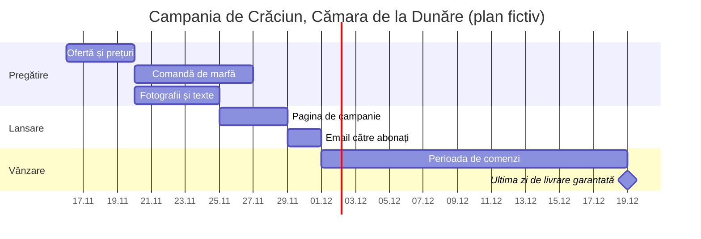

**Greșeli frecvente.**

- Activități prea vagi („marketing”) sau prea mărunte („trimite un email lui Andrei”).
- Dependențe nemarcate. Fără ele, diagrama este doar un calendar colorat.
- Nicio rezervă de timp. Orice plan în care toate barele se ating cap la cap va întârzia.
- Diagramă făcută la început și neactualizată. Un Gantt util se actualizează săptămânal, cu o linie verticală pentru „azi”.
- Fără responsabili. O activitate fără nume în dreptul ei nu este a nimănui.

> **Pentru afacerea ta.** Ia următoarea ta acțiune cu termen fix (o promoție, un târg, lansarea unui produs) și scrie 6-8 activități cu început, durată și responsabil. Numără înapoi de la data-limită. Vei vedea aproape de fiecare dată că trebuia să începi cu o săptămână mai devreme decât credeai.

**În Excel sau Google Sheets.** Nici Excel, nici Sheets nu au în lista standard de grafice un tip numit Gantt (paginile lor de asistență despre tipurile de grafice nu îl menționează). Se folosește un grafic cu bare suprapuse:

1. Tabel cu trei coloane: activitate, data de început, durata în zile.
2. Inserezi un grafic Stacked Bar cu două serii: data de început și durata.
3. Faci invizibilă prima serie (fără umplere). Rămân vizibile doar barele duratei, împinse la dreapta până la data de început.
4. Inversezi ordinea categoriilor, ca prima activitate să fie sus.

Pentru planuri simple, o variantă rapidă este chiar foaia de calcul: activitățile pe rânduri, zilele pe coloane și celule colorate, manual sau prin formatare condiționată.

**În Python.**

```python
import matplotlib.pyplot as plt

plan = [("Ofertă și prețuri", 0, 4), ("Comandă de marfă", 4, 7),  # (activitate, zi de început față de 16 nov., durată)
        ("Fotografii și texte", 4, 5), ("Pagina de campanie", 9, 4),
        ("Email către abonați", 13, 2), ("Perioada de comenzi", 15, 18)]

fig, ax = plt.subplots(figsize=(8, 3.5))
for nume, inceput, durata in plan:
    ax.barh(nume, durata, left=inceput, color="#4C72B0")
ax.scatter([33], [len(plan) - 1], marker="D", color="#D1495B", zorder=3)
ax.text(33.6, len(plan) - 1, "19 dec.", va="center")
ax.invert_yaxis()
ax.set_xlim(0, 38)
ax.set_xlabel("Zile de la 16 noiembrie")
ax.set_title("Campania de Crăciun: plan (fictiv)")
ax.grid(axis="x", linewidth=0.3)
fig.tight_layout()
fig.savefig("gantt.png", dpi=150)
```

Parametrul `left` face la Gantt ce face `bottom` la cascadă: mută începutul barei.

## 7.10 Diagrama radar

**La ce întrebare răspunde.** Cum arată profilul unui element (produs, furnizor, canal, angajat) pe mai multe criterii deodată și prin ce diferă de profilul altuia?

Diagrama radar (*radar chart* sau *spider chart*, „pânza de păianjen”) are trei sau mai multe axe care pornesc din același centru, câte una pentru fiecare criteriu. Valorile mici sunt aproape de centru, cele mari spre margine. Punctele de pe axe se unesc și formează un poligon. Fiecare element comparat are poligonul lui, explicat în legendă.

**Când o folosești.** Când compari 2-3 elemente pe 5-8 criterii aduse la aceeași scară: evaluarea furnizorilor (preț, calitate, termen, flexibilitate), profilul competențelor, comparația a două produse. **Când nu:** dacă ai nevoie de comparații precise, dacă ai peste trei poligoane sau criterii cu unități care nu pot fi aduse la aceeași scară.

**Structura datelor.** Criteriile pe rânduri, elementele comparate pe coloane, toate valorile pe aceeași scară (note de la 1 la 5 sau indici de la 0 la 100).

Profilul a două canale ale Cămării în noiembrie (date fictive). Fiecare indicator este exprimat ca procent din cea mai bună valoare dintre cele patru canale:

| Indicator | Valoare Reclame | Valoare Email | Indice Reclame | Indice Email |
|---|---|---|---|---|
| Vizite | 15.900 | 2.560 | 100 | 16 |
| Comenzi | 286 | 129 | 100 | 45 |
| Rata de conversie | 1,80% | 5,04% | 36 | 100 |
| Valoarea medie a comenzii | 105 lei | 165 lei | 64 | 100 |
| Marja brută | 31% | 45% | 69 | 100 |

**Cum o citești.** Te uiți la forma poligonului, nu la mărimea lui. Reclamele au un poligon întins spre „Vizite” și „Comenzi” și strâns pe celelalte trei axe: mult volum, calitate slabă. Emailul are forma opusă: volum mic, cea mai bună conversie, cea mai mare valoare medie a comenzii, marjă întreagă. Diagrama rezumă într-o imagine ideea „un canal de volum și un canal de valoare”.

**Greșeli frecvente.**

- **Aria poligonului luată drept scor total.** Aria depinde de ordinea în care pui axele. Aceleași date, cu axele rearanjate, dau altă arie.
- **Scări diferite pe axe**, fără normalizare. Un criteriu măsurat în mii strivește unul măsurat în procente.
- **Criterii cu sensuri opuse.** La unele „mare” înseamnă bine (calitate), la altele rău (cost, termen de livrare). Întoarce-le pe toate în același sens înainte de desen.
- **Prea multe poligoane** suprapuse, cu umplere opacă.
- **Normalizarea ascunsă.** Spune mereu cum ai adus valorile la aceeași scară. Indicii de mai sus arată poziția față de cel mai bun canal, nu valorile reale.

> **De reținut.** Dacă publicul trebuie să citească valori, un grafic cu bare grupate sau un tabel simplu este mai bun decât radarul. Radarul este pentru forme și profiluri.

**În Excel sau Google Sheets.** Pregătești tabelul cu indici (criteriile pe rânduri, o coloană pentru fiecare element). Excel: Insert > Insert Waterfall, Funnel, Stock, Surface or Radar Chart > Radar. Sheets: Insert > Chart > Radar chart.

**În Python.**

```python
import numpy as np
import pandas as pd
import matplotlib.pyplot as plt

df = pd.read_csv("camara_saptamanal.csv")
nov = df[df["luna"] == "noiembrie"].groupby("canal")[["vizite", "comenzi", "venit", "marja_bruta"]].sum()
profil = pd.DataFrame({
    "Vizite": nov["vizite"],
    "Comenzi": nov["comenzi"],
    "Rata de conversie": nov["comenzi"] / nov["vizite"],
    "Valoarea medie\na comenzii": nov["venit"] / nov["comenzi"],
    "Marja brută (%)": nov["marja_bruta"] / nov["venit"],
})
indici = profil / profil.max() * 100

unghiuri = np.linspace(0, 2 * np.pi, len(indici.columns), endpoint=False).tolist()
unghiuri += unghiuri[:1]

fig, ax = plt.subplots(figsize=(6, 6), subplot_kw=dict(polar=True))
for canal, culoare in [("Reclame", "#D1495B"), ("Email", "#4C72B0")]:
    valori = indici.loc[canal].tolist()
    valori += valori[:1]
    ax.plot(unghiuri, valori, color=culoare, label=canal)
    ax.fill(unghiuri, valori, color=culoare, alpha=0.15)
ax.set_xticks(unghiuri[:-1])
ax.set_xticklabels(indici.columns)
ax.set_ylim(0, 100)
ax.set_title("Profilul canalelor, noiembrie (indici, date fictive)")
ax.legend(loc="lower right", bbox_to_anchor=(1.2, 0))
fig.tight_layout()
fig.savefig("radar.png", dpi=150)

print(indici.loc[["Reclame", "Email"]].round(0))
```

## 7.11 Treemap

**La ce întrebare răspunde.** Cum se împarte un total pe categorii și subcategorii, atunci când sunt prea multe pentru o diagramă circulară?

Graficul treemap (uneori tradus „hartă arborescentă”) umple un dreptunghi mare cu dreptunghiuri mai mici, așezate unele în altele. Aria fiecărui dreptunghi este proporțională cu o valoare. Culoarea poate arăta o a doua valoare. Exemplul din prezentare: bugetul de marketing pe două niveluri (categorie și subcategorie), unde mărimea dreptunghiului este bugetul alocat, iar culoarea este rentabilitatea investiției (ROI, *Return on Investment*).

**Când îl folosești.** Structuri ierarhice cu multe elemente: vânzări pe categorii și produse, buget pe departamente și linii de cheltuieli, spațiu ocupat pe disc, portofoliu de clienți. **Când nu:** dacă ai puține categorii (bare), valori negative la mărime (aria nu poate fi negativă) sau dacă ai nevoie de comparații precise.

**Structura datelor.** Un rând pentru fiecare element de pe nivelul cel mai de jos: categoria (părintele), subcategoria, valoarea pentru mărime și, opțional, valoarea pentru culoare.

Cămara, noiembrie (date fictive). Mărimea este venitul, culoarea este contribuția pe comandă:

| Grup | Canal | Venit (lei) | Contribuție pe comandă (lei) |
|---|---|---|---|
| Canale neplătite | Căutare | 37.350 | 53,50 |
| Canale neplătite | Direct | 20.460 | 55,75 |
| Canale proprii | Email | 21.285 | 58,70 |
| Canale plătite | Reclame | 30.030 | -40,19 |

Gruparea pe trei tipuri de canale este o alegere făcută pentru acest exemplu, ca să avem două niveluri.

**Cum îl citești.** Întâi dreptunghiurile mari: ele sunt grosul totalului. Apoi culoarea: un dreptunghi mare într-o culoare „rea” este prima problemă de rezolvat. La Cămara, al doilea dreptunghi ca mărime (Reclame, 27,5% din venit) este singurul roșu. Combinația mare și roșu este exact ce caută un manager într-un treemap.

**Greșeli frecvente.**

- Prea multe niveluri de ierarhie. Două, cel mult trei.
- Zeci de dreptunghiuri minuscule, fără etichete. Grupează-le în „Altele”.
- Comparații fine între dreptunghiuri cu forme diferite. Un dreptunghi lung și subțire pare altfel decât unul pătrat cu aceeași arie.
- Culoare fără legendă sau cu o paletă fără punct neutru, deși valoarea poate fi negativă.
- Treemap pentru 4 categorii, doar pentru că arată modern. Exemplul nostru este didactic: în practică, la patru canale, barele orizontale sunt mai clare.

**În Excel sau Google Sheets.**

- Excel: tabel cu coloanele grup, canal, valoare. Insert > Insert Hierarchy Chart > Treemap. Excel colorează după grupul părinte, nu după o a doua valoare.
- Sheets: Insert > Chart > Tree map chart. Tabelul are forma: element, părinte, mărime și, opțional, o coloană pentru culoare. Trebuie să existe câte un rând și pentru fiecare părinte, inclusiv pentru rădăcină (de exemplu „Total”, cu părintele gol).

**În Python.** Matplotlib nu are treemap. Soluția scurtă este pachetul suplimentar `squarify` (se instalează cu `pip install squarify`), care calculează dreptunghiurile și le desenează cu matplotlib.

```python
import pandas as pd
import matplotlib.pyplot as plt
import squarify

df = pd.read_csv("camara_saptamanal.csv")
nov = df[df["luna"] == "noiembrie"].groupby("canal")[["venit", "comenzi", "contributie"]].sum()
nov["pe_comanda"] = nov["contributie"] / nov["comenzi"]
nov = nov.sort_values("venit", ascending=False)

culori = ["#D1495B" if v < 0 else "#4C72B0" for v in nov["pe_comanda"]]
etichete = [f"{canal}\n{venit:,.0f} lei\n{c:.0f} lei pe comandă".replace(",", ".")
            for canal, venit, c in zip(nov.index, nov["venit"], nov["pe_comanda"])]

fig, ax = plt.subplots(figsize=(7, 4.5))
squarify.plot(sizes=nov["venit"], label=etichete, color=culori, ax=ax,
              edgecolor="white", linewidth=2, text_kwargs=dict(color="white"))
ax.axis("off")
ax.set_title("Venit pe canale; culoarea arată contribuția pe comandă (noiembrie, date fictive)")
fig.tight_layout()
fig.savefig("treemap.png", dpi=150)
```

## 7.12 Ce grafic aleg

### 7.12.1 Tabel-sinteză

| Întrebarea ta | Tip recomandat | Alternativă | De evitat |
|---|---|---|---|
| Care categorie este mai mare? | Coloane simple, sortate | Bare orizontale (etichete lungi, multe categorii) | Circular, radar, 3D |
| Cum stă planul față de realizat, pe categorii? | Coloane grupate | Bare cu o linie-țintă | Două diagrame circulare |
| Cum a evoluat în timp (multe perioade)? | Linie | Coloane (sub 8 perioade) | Circular, bare orizontale |
| Din ce este compus totalul, la un moment dat? | Bare sortate cu procente | Circular sau inel (cel mult 5 părți) | Circular cu 10 sectoare, 3D |
| Cum se schimbă compoziția în timp? | Coloane suprapuse | Coloane 100% suprapuse, linii pe componente | Șir de diagrame circulare |
| Cum sunt distribuite valorile? | Histogramă | Tabel de frecvențe | Coloane cu media pe categorii |
| Au legătură două mărimi numerice? | Dispersie | Dispersie cu linie de tendință | Două linii pe două axe verticale |
| Unde sunt valorile mari într-un tabel cu două dimensiuni? | Hartă de căldură | Tabel cu formatare condiționată | Coloane 3D, zeci de linii |
| Cum ajung de la venit la profit? | Cascadă | Tabel cu trepte | Circular (costurile nu sunt „părți” ale profitului) |
| Cine face ce și până când? | Gantt | Listă cu termene, calendar | Orice grafic de date |
| Cum arată profilul pe 5-8 criterii? | Radar (2-3 elemente) | Bare grupate, tabel | Radar cu 6 poligoane |
| Cum se împarte totalul pe categorii și subcategorii? | Treemap | Bare grupate pe categorii | Circular cu zeci de sectoare |

Aceeași logică, sub formă de schemă de decizie:

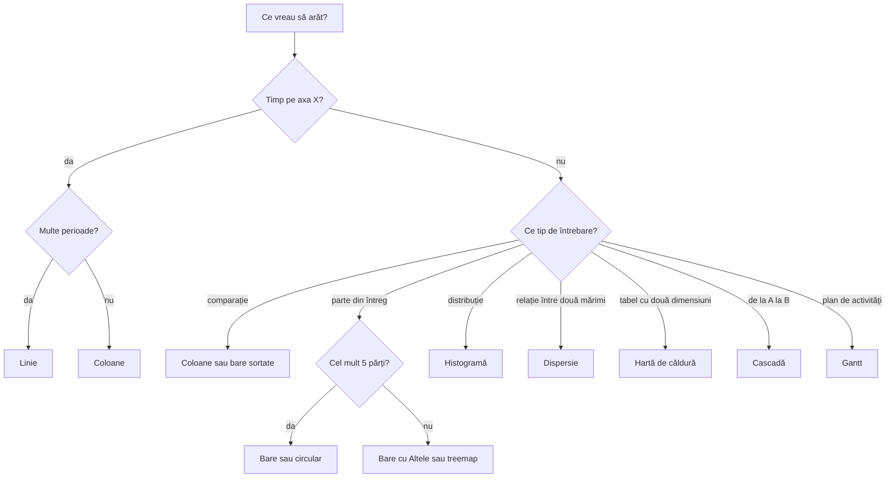

### 7.12.2 Bare sau histogramă

Arată asemănător și sunt confundate des. Diferențele:

| | Grafic cu bare | Histogramă |
|---|---|---|
| Ce este pe axa X | Categorii (canale, produse) | Intervale ale unei variabile numerice |
| Ce arată înălțimea | Valoarea categoriei (lei, bucăți) | Numărul de observații din interval |
| Ordinea coloanelor | O alegi tu (de obicei după mărime) | Fixă, dată de axa numerică |
| Spațiu între coloane | Da | Nu |
| Date de pornire | Un tabel deja agregat | Date brute, câte un rând pe observație |
| Întrebare | Cine este mai mare? | Cum sunt împrăștiate valorile? |

Test rapid: dacă poți schimba ordinea coloanelor fără să strici sensul, este grafic cu bare. Dacă nu poți, este histogramă.

### 7.12.3 Linie sau coloane pentru timp

Ambele sunt corecte pentru timp, dar spun lucruri diferite. Linia pune accent pe formă: tendință, pantă, rupturi. Coloanele pun accent pe mărimea fiecărei perioade luate separat.

- Alege **linia** când ai multe perioade, când compari 2-4 serii sau când mesajul este schimbarea de direcție.
- Alege **coloanele** când ai puține perioade (4 trimestre, 3 luni), când fiecare perioadă este un total de sine stătător sau când vrei să arăți compoziția (coloane suprapuse).
- La coloane, axa pornește de la zero. La linie, poți restrânge axa, dacă spui acest lucru.

Pentru cele 12 săptămâni ale Cămării, linia este alegerea potrivită: ruptura din săptămâna 5 se vede dintr-o privire. Pentru cele trei luni (85.400, 97.779 și 109.125 lei), trei coloane sunt suficiente.

### 7.12.4 Circular sau bare pentru cote

Diagrama circulară spune un singur lucru bine: „acestea sunt părți ale unui întreg”. Barele spun bine tot restul: care parte este mai mare, cu cât, cum s-a schimbat.

- Alege **circularul** (sau inelul) când ai 2-5 părți, cote clar diferite și un mesaj simplu despre o parte dominantă.
- Alege **barele** când ai mai mult de 5 părți, cote apropiate, mai multe perioade de comparat sau când cititorul are nevoie de valori.
- Dacă eziți, alege barele și scrie procentele pe ele. Nu vei greși.

> **Exemplu.** Cotele canalelor în venitul Cămării în noiembrie sunt 34,2%, 27,5%, 19,5% și 18,7% (date fictive). Pe o diagramă circulară, Emailul și Directul par egale: diferența de 0,8 puncte procentuale nu se vede într-un unghi. Pe bare sortate, ordinea este imediat vizibilă. Dacă mai vrei să arăți și septembrie, circularul nu mai este o opțiune: îți trebuie coloane grupate.

## 7.13 Construirea unui dashboard

### 7.13.1 Ce este și ce nu este

Un **dashboard** (tablou de bord) este un ecran care adună cei mai importanți indicatori pentru un scop anume, astfel încât să poată fi urmăriți dintr-o privire. Definiția urmează, în parafrază, formularea lui Stephen Few din *Information Dashboard Design* (2006). Trei idei contează: puține informații, un singur ecran, un scop precis.

Un dashboard nu este un raport și nu este o analiză. Raportul explică în detaliu, cu text. Analiza caută un răspuns la o întrebare nouă. Dashboardul urmărește, zi de zi sau săptămână de săptămână, aceleași întrebări, și semnalează când ceva cere atenție. Analiza din capitolele 5 și 9 a descoperit problema Reclamelor. Un dashboard bun ar fi semnalat-o din săptămâna 6.

### 7.13.2 Scop și public

Înainte de orice grafic, răspunde în scris la patru întrebări:

1. **Cine îl folosește?** Proprietarul, omul de marketing, contabilul. Fiecare are alte întrebări.
2. **Ce decizie ia cu el?** „Măresc sau reduc bugetul de reclame săptămâna viitoare?” este o decizie. „Să văd cum stăm” nu este.
3. **Cât de des îl deschide?** Zilnic, săptămânal, lunar. De aici rezultă perioada afișată și ritmul de actualizare.
4. **Pe ce ecran?** Laptop, telefon, televizorul din birou.

| Tip de dashboard | Public | Ritm | Conținut tipic |
|---|---|---|---|
| Operațional | Cei care execută (livrare, suport) | Zilnic sau în timp real | Comenzi de expediat azi, tichete deschise, stocuri sub prag |
| Tactic | Cei care conduc un domeniu (marketing) | Săptămânal | Indicatori pe canale, costuri, conversii, comparație cu săptămâna trecută |
| Strategic | Proprietar, conducere | Lunar | Venit, marjă, rezultat, clienți noi, față de țintă și față de anul trecut |

> **Greșeală frecventă.** Un singur dashboard „pentru toată lumea”, cu 25 de grafice. Nimeni nu îl folosește, pentru că nimeni nu își găsește întrebarea în el. Mai bine trei ecrane mici, fiecare cu un public și o decizie.

### 7.13.3 Alegerea a 4-6 indicatori

Indicatorii de pe rândul de sus se aleg, nu se adună. Criteriile (definițiile indicatorilor și economia unei comenzi sunt în capitolul 5):

- **Leagă-i de decizie.** Dacă indicatorul se schimbă, faci ceva diferit? Dacă nu, nu are ce căuta pe primul rând.
- **Acoperă lanțul.** Cel puțin unul de volum (comenzi), unul de valoare (venit, valoarea medie a comenzii), unul de eficiență (rata de conversie, costul de marketing pe comandă) și unul de rezultat (contribuție, rezultat).
- **Ferește-te de indicatorii „de vanitate”.** Vizitele și numărul de urmăritori cresc ușor și nu plătesc facturi.
- **Dă fiecărei cifre un termen de comparație.** O cifră singură nu spune nimic. Pune lângă ea perioada anterioară, ținta sau aceeași perioadă a anului trecut.
- **Definește-i în scris.** O notă scurtă: formula, sursa, perioada. Altfel, două persoane vor citi aceeași cifră în două feluri.

Pentru Cămara, septembrie față de noiembrie (date fictive, calculate din CSV):

| Indicator | Septembrie | Noiembrie | Schimbare |
|---|---|---|---|
| Venit (lei) | 85.400 | 109.125 | +27,8% |
| Comenzi | 553 | 796 | +43,9% |
| Rata de conversie (comenzi / vizite) | 2,93% | 2,48% | -0,45 puncte procentuale |
| Valoarea medie a comenzii (lei) | 154,43 | 137,09 | -11,2% |
| Contribuția pe comandă (lei) | 50,79 | 21,05 | -58,6% |
| Rezultat simplificat (lei) | 18.088 | 6.758 | -62,6% |

Un dashboard care ar fi arătat doar primele două rânduri ar fi transmis „luna cea mai bună de până acum”. Ultimele două rânduri schimbă complet lectura.

### 7.13.4 Ierarhia vizuală

Cititorul parcurge ecranul din colțul stânga-sus spre dreapta-jos. Așază conținutul în aceeași ordine: de la cel mai important la detaliu.

1. **Rândul de sus: cifrele-cheie.** 4-6 casete, fiecare cu indicatorul, valoarea mare, comparația (săgeată și procent) și, eventual, o linie mică de evoluție.
2. **Mijloc: graficul principal.** De obicei o linie în timp, lată cât ecranul, care răspunde la „cum evoluăm”.
3. **Jos: detalierea.** Două sau trei grafice mai mici, care răspund la „de unde vine”: pe canale, pe produse, pe regiuni.
4. **Subsol:** sursa datelor, data ultimei actualizări, definițiile.

Reguli de formă (principiile sunt în capitolul 6):

- O singură culoare de bază și una de accent. Roșul și verdele se păstrează pentru „sub țintă” și „peste țintă”, dublate de un semn sau o săgeată.
- Aceeași culoare pentru aceeași categorie pe tot ecranul. Dacă Reclamele sunt roșii într-un grafic, sunt roșii peste tot.
- Aliniere pe o grilă, spații egale, fără chenare groase.
- Titluri care spun ce se vede („Venit pe săptămâni, lei”), fără titluri decorative.
- Fără vitezometre și cadrane. Ocupă mult loc pentru o singură cifră.
- Totul pe un ecran, fără derulare. Dacă nu încape, ai prea multe.

### 7.13.5 Filtre și interactivitate

Filtrele lasă cititorul să își pună singur întrebările următoare, fără să îți ceară alt raport. Cele uzuale: perioada, canalul, categoria de produse, regiunea.

- Pune filtrele sus, într-un singur loc, și arată mereu ce este selectat.
- Alege o stare implicită utilă (ultimele 4 săptămâni, toate canalele). Majoritatea oamenilor nu vor atinge niciodată filtrele.
- Puține filtre: două sau trei. Fiecare filtru în plus este o posibilitate în plus de a citi greșit ecranul.
- Verifică ce se întâmplă cu indicatorii calculați atunci când filtrezi. O medie de medii este greșită: valoarea medie a comenzii se recalculează ca venit total împărțit la comenzi totale, pentru selecția curentă.

### 7.13.6 Actualizarea și întreținerea

Un dashboard cu date vechi este mai periculos decât lipsa lui, pentru că arată sigur pe el.

- **Sursă unică.** Toate graficele citesc din același tabel. La Cămara: o foaie Google Sheets cu structura din CSV, la care se adaugă rânduri în fiecare luni.
- **Ritm fix.** Stabilește ziua și responsabilul actualizării. Afișează pe ecran data ultimei actualizări.
- **Format stabil.** Nu redenumi coloanele și nu schimba ordinea lor. Datele noi se adaugă ca rânduri (format lung), nu ca coloane noi.
- **Verificare.** După fiecare actualizare, compară un total din dashboard cu același total din sursă.
- **Revizuire.** O dată pe trimestru întreabă: ce grafic nu a mai folosit nimeni? Scoate-l.

### 7.13.7 Schița unui dashboard pentru Cămara

Public: proprietarul și persoana care se ocupă de marketing. Decizie: câți bani merg săptămâna viitoare pe fiecare canal. Ritm: săptămânal, lunea dimineața. Date fictive, construite pentru exercițiu.

**Titlu:** „Cămara de la Dunăre: vânzări și rentabilitate pe canale”. Dedesubt, cu litere mici: perioada selectată și data ultimei actualizări.

**Filtre (dreapta-sus):** luna (implicit: ultima lună), canalul (implicit: toate).

**Rândul 1, cinci casete cu cifre:**

| Caseta | Valoare (noiembrie) | Comparație cu septembrie |
|---|---|---|
| Venit | 109.125 lei | +27,8% |
| Comenzi | 796 | +43,9% |
| Valoarea medie a comenzii | 137,09 lei | -11,2% |
| Contribuția pe comandă | 21,05 lei | -58,6% |
| Rezultat simplificat | 6.758 lei | -62,6% |

**Rândul 2, graficul principal:** linie cu două serii pe 12 săptămâni, venit și contribuție, cu adnotare la săptămâna 5 (graficul din secțiunea 7.3). Este imaginea care arată că cele două se despart.

**Rândul 3, trei grafice de detaliu:**

- stânga: bare orizontale cu contribuția pe canale, sortate, cu roșu pentru valorile negative (secțiunea 7.2.4);
- mijloc: coloane suprapuse cu venitul săptămânal pe canale (secțiunea 7.2.3);
- dreapta: dispersie cu bugetul săptămânal de Reclame și comenzile aduse (secțiunea 7.6).

**Subsol:** „Sursa: evidența comenzilor și a costurilor. Contribuție = marjă brută - marketing - ambalare și livrare. Rezultat simplificat = contribuție - costuri fixe (10.000 lei pe lună). Canalul unei comenzi = ultimul clic.”

Ce am lăsat pe dinafară, cu intenție: diagrama circulară a venitului (nu ajută la decizie și poate liniști pe nedrept), vizitele ca cifră-cheie (indicator de vanitate în acest context), radarul și treemapul (bune într-o prezentare, prea greu de citit săptămânal).

> **Pentru afacerea ta.** Desenează întâi dashboardul pe hârtie: cinci casete sus, un grafic mare, două mici. Scrie în fiecare casetă indicatorul și cu ce îl compari. Abia apoi deschide instrumentul. Dacă nu poți completa schița, problema nu este instrumentul, ci faptul că nu ai încă datele sau nu ai ales decizia.

### 7.13.8 Listă de verificare înainte de publicare

- Are un public și o decizie, scrise într-o propoziție?
- Are cel mult șase cifre-cheie, fiecare cu un termen de comparație?
- Încape pe un ecran?
- Fiecare grafic răspunde la o întrebare pe care o poți formula?
- Culorile au același sens peste tot?
- Scrie sursa, definițiile și data ultimei actualizări?
- Ai verificat un total față de datele-sursă?
- L-ai arătat unei persoane care nu știe datele și a înțeles mesajul principal fără explicații?

## 7.14 Provocare: un dashboard interactiv în Data Studio

Prezentarea de curs se încheie cu o provocare: construiește un dashboard simplu, interactiv, în Google Data Studio, cu un grafic liniar, o diagramă circulară și un grafic cu bare, apoi trimite linkul colegilor și profesorului.

> **De reținut.** Despre numele produsului. Instrumentul gratuit de raportare al Google s-a numit Data Studio până în octombrie 2022, când a fost redenumit Looker Studio. În aprilie 2026, Google a anunțat revenirea la numele Data Studio (blogul Google Cloud, „Data Studio returns as new home for Data Cloud assets”, 11 aprilie 2026, https://cloud.google.com/blog/products/data-analytics/looker-studio-is-data-studio). Potrivit anunțului, rapoartele și sursele de date existente au fost preluate fără vreo acțiune din partea utilizatorilor, varianta gratuită rămâne, iar varianta plătită se numește Data Studio Pro. Documentația oficială folosește acum numele Data Studio și adresa https://datastudio.google.com. Multe tutoriale și videoclipuri din perioada 2022-2026 spun „Looker Studio”: este același produs. „Looker”, fără „Studio”, este alt produs, platforma Google pentru companii mari.

Pașii de mai jos urmează documentația Google (ghidul de pornire rapidă, paginile despre conectorii Google Sheets și CSV și pagina despre controale), consultată în noiembrie 2026. Etichetele din interfață sunt date în engleză. Interfețele se schimbă des, deci verifică documentația dacă un buton nu mai este unde te aștepți.

**Pasul 1. Pregătește datele.** Varianta comodă este Google Sheets: încarci `camara_saptamanal.csv` în Google Drive și îl deschizi ca foaie de calcul. Documentația cere ca datele să fie în format tabelar, cu antetul pe un singur rând și cu același tip de date în toate celulele unei coloane. Fișierul Cămării respectă deja aceste condiții. Formatul lung este cel potrivit aici: instrumentul face singur agregările.

Poți încărca și direct fișierul CSV, prin conectorul „CSV file upload”. Condițiile din documentație: codificare UTF-8, virgulă ca separator, primul rând cu nume de coloane unice, formate doar din litere, cifre și liniuță de subliniere. Coloanele noastre (`saptamana`, `cost_marketing` și celelalte) respectă regula.

**Pasul 2. Creează raportul.** Intri pe https://datastudio.google.com cu un cont Google. În panoul de navigare alegi Create > Report. Se deschide editorul, cu panoul „Add data to report”.

**Pasul 3. Conectează datele.** În fila „Connect to data” alegi conectorul Google Sheets, apoi foaia de calcul și foaia de lucru. Lași bifată opțiunea „Use first row as headers” și apeși Add. Dă un nume raportului: clic pe „Untitled report”, în antet.

**Pasul 4. Verifică tipurile câmpurilor.** Instrumentul împarte coloanele în dimensiuni (categorii după care grupezi: `luna`, `canal`, `saptamana`) și indicatori (*metrics*: valori care se însumează, cum sunt `venit` și `comenzi`). Verifică două lucruri: că `saptamana` este tratată ca dimensiune, nu ca număr de însumat, și că valorile bănești sunt recunoscute ca numere. Indicatorii calculați nu se obțin ca medie a rândurilor. Valoarea medie a comenzii se definește ca un câmp calculat de forma `SUM(venit) / SUM(comenzi)`.

**Pasul 5. Adaugă graficele.** Pentru fiecare: în bara de instrumente apeși „Add a chart”, alegi tipul, faci clic pe pânză unde vrei să apară, apoi stabilești dimensiunea și indicatorul în panoul de proprietăți.

| Grafic cerut în provocare | Dimensiune | Indicator | Observație |
|---|---|---|---|
| Linie (evoluție) | `saptamana` | `venit` (și `contributie`) | Sortează crescător după săptămână, nu după valoare |
| Circular (structură) | `canal` | `venit` | Patru sectoare, etichete cu procent |
| Bare (comparație) | `luna` sau `canal` | `venit` sau `contributie` | Lunile se sortează implicit alfabetic; vezi mai jos |
| Casete cu cifre (Scorecard) | - | `venit`, `comenzi`, câmpul calculat | Rândul de sus al dashboardului |

**Pasul 6. Adaugă un control de filtrare.** Documentația enumeră mai multe tipuri de controale, între care listele derulante (drop-down list) și controlul pentru interval de date (date range control). Pentru datele noastre, adaugă o listă derulantă pe câmpul `canal` și una pe `luna`. Controlul pentru interval de date are nevoie de un câmp de tip dată calendaristică, pe care fișierul nostru nu îl are (avem doar numărul săptămânii). Dacă vrei să îl folosești, adaugă în foaia de calcul o coloană cu data de început a fiecărei săptămâni.

**Pasul 7. Personalizează.** Aplică regulile din secțiunea 7.13.4: o culoare de bază și una de accent, aceeași culoare pentru același canal în toate graficele, titluri descriptive, aliniere pe grilă.

**Pasul 8. Verifică și partajează.** Apasă View ca să vezi raportul așa cum îl vede cititorul și încearcă filtrele. Compară un total (venitul din noiembrie trebuie să fie 109.125 lei) cu sursa. Apoi apasă Share și adaugă persoanele sau grupurile, cu drept de vizualizare sau de editare. Documentația avertizează că partajarea raportului nu partajează și sursa de date. Dacă cititorii văd sau nu datele depinde de felul în care este configurat accesul la sursa de date, deci testează linkul dintr-un alt cont sau dintr-o fereastră privată înainte să îl trimiți.

> **Greșeală frecventă.** Lunile apar pe axă în ordinea „noiembrie, octombrie, septembrie”, pentru că textul se sortează alfabetic. Soluții: sortezi graficul după `saptamana`, adaugi în date o coloană numerică a lunii (9, 10, 11) sau, cel mai bine, folosești o coloană de tip dată.

Dacă vrei să vezi cum arată dashboarduri făcute de alții, galeria Tableau Public (https://public.tableau.com), recomandată în prezentare, este o sursă bună de inspirație. Tableau este alt instrument, dar principiile de alcătuire sunt aceleași.

## Aplicații

1. **Cămara: de la întrebare la grafic.** Pentru fiecare întrebare de mai jos, alege tipul de grafic, scrie structura tabelului necesar (coloanele) și construiește graficul din `camara_saptamanal.csv`, în Sheets sau în Python: (a) Cum a evoluat numărul de vizite pe săptămâni? (b) Ce canal a adus cele mai multe comenzi în octombrie? (c) Cum s-a schimbat structura comenzilor pe canale, de la o lună la alta? (d) Există o legătură între vizite și comenzi pe canalul Căutare?

2. **Cămara: cascada pentru septembrie și octombrie.** Construiește diagrama în cascadă de la venit la rezultatul simplificat pentru septembrie și pentru octombrie, după modelul din secțiunea 7.8. Verifică rezultatele: 18.088 lei în septembrie și 10.203,09 lei în octombrie. Scrie în trei propoziții ce treaptă s-a schimbat cel mai mult între septembrie și noiembrie.

3. **Cămara: două hărți de căldură.** Construiește o hartă de căldură cu numărul de comenzi pe canale și săptămâni (paletă secvențială) și una cu contribuția pe canale și săptămâni (paletă divergentă, centrată pe zero). Ce observi în prima și nu se vede în a doua? Dar invers?

4. **Repară graficul.** Caută într-un raport, într-o prezentare sau într-o știre un grafic care încalcă cel puțin două reguli din acest capitol (de exemplu o diagramă circulară cu peste opt sectoare sau bare cu axa trunchiată). Notează greșelile, redesenează-l corect și explică ce se vede acum și nu se vedea înainte.

5. **Histograma, cu trei lățimi de interval.** Pornind de la codul din secțiunea 7.5, desenează histograma salariilor cu intervale de 250, 500 și 1.000 de lei. Care variantă arată cel mai bine forma distribuției? De ce nu este indicat să alegi lățimea care îți susține cel mai bine concluzia?

6. **Provocarea din curs.** Construiește în Data Studio dashboardul descris în secțiunea 7.14, pe datele Cămării: cinci casete cu cifre, un grafic liniar, un grafic cu bare, o diagramă circulară și cel puțin un control de filtrare. Partajează linkul cu un coleg și cere-i să spună, fără explicații din partea ta, care este mesajul principal. Notează ce a înțeles și ce ai schimba.

7. **Pentru afacerea ta.** Alege o afacere (a ta, a familiei sau una pe care o cunoști bine). Scrie: cine ar folosi dashboardul, ce decizie ar lua cu el și cât de des. Alege 4-6 indicatori, cu formulă și termen de comparație. Desenează pe hârtie schița (casete, grafic principal, două grafice de detaliu) și notează de unde ar veni datele și cine le-ar actualiza.

8. **Un plan Gantt.** Fă diagrama Gantt pentru lansarea unui produs nou sau pentru o campanie de 1 Martie: 6-10 activități, cu date, durate, responsabili și dependențe. Marchează drumul critic și cel puțin un reper punctual.

## Întrebări de verificare

1. De ce trebuie să pornească de la zero axa valorilor la un grafic cu bare?
2. Când alegi coloane grupate și când coloane suprapuse?
3. Care este principalul neajuns al coloanelor suprapuse?
4. În ce situații sunt preferabile barele orizontale?
5. De ce nu se trasează un grafic liniar între categorii fără ordine, cum sunt canalele?
6. Ce condiții trebuie îndeplinite pentru ca o diagramă circulară să fie o alegere acceptabilă?
7. Numește trei diferențe între un grafic cu bare și o histogramă.
8. Într-o distribuție asimetrică spre dreapta, care este mai mare: media sau mediana? De ce?
9. La Cămara, corelația dintre bugetul de Reclame și comenzi este 0,996. De ce nu rezultă de aici că merită crescut bugetul?
10. Când folosești o paletă divergentă la o hartă de căldură?
11. Ce reprezintă coloanele „plutitoare” dintr-o diagramă în cascadă și cum se desenează totalurile?
12. Ce deosebește un dashboard de un raport și câți indicatori-cheie ar trebui să aibă pe rândul de sus?

### Răspunsuri

1. Pentru că la bare mesajul este lungimea. O axă trunchiată schimbă raportul vizibil dintre bare și exagerează diferențele.
2. Grupate, când vrei să compari seriile între ele (plan față de realizat). Suprapuse, când te interesează totalul și compoziția lui.
3. Doar segmentul de la bază are o linie comună de pornire. Celelalte segmente se compară greu între coloane.
4. La etichete lungi, la multe categorii (clasamente) și când există valori negative și pozitive. Nu pentru timp.
5. Linia sugerează continuitate și o trecere între puncte vecine. Între categorii fără ordine, această trecere nu există.
6. Părțile formează un întreg (100%), sunt cel mult 4-5, cotele sunt clar diferite, nu există valori negative și nu este nevoie de comparații precise sau între perioade.
7. Pe axa X: categorii față de intervale numerice. Înălțimea: valoare față de număr de observații. Ordinea: liberă față de fixă. În plus, la histogramă coloanele se ating, iar datele de pornire sunt brute.
8. Media. Puținele valori foarte mari o trag în sus, iar mediana (valoarea de la mijloc) rămâne aproape neschimbată.
9. Corelația arată că bugetul și comenzile cresc împreună, nu că aceste comenzi sunt profitabile. Fiecare comandă suplimentară costă în jur de 64 de lei în reclame, iar contribuția pe comandă a canalului este de aproximativ -40 de lei.
10. Când valorile au un punct neutru cu sens (zero, ținta, media) și contează de ce parte a lui se află: abateri, creșteri și scăderi, contribuții pozitive și negative.
11. Coloanele plutitoare sunt creșterile și scăderile succesive. Fiecare pornește de la nivelul la care s-a oprit precedenta. Totalurile (valoarea de pornire și cea finală) stau pe axă.
12. Dashboardul urmărește periodic aceiași indicatori, pe un singur ecran, pentru o decizie anume. Raportul explică în detaliu. Pe rândul de sus: 4-6 indicatori, fiecare cu un termen de comparație.

## De reținut

- Tipul de grafic se alege după întrebare: comparație (bare), evoluție (linie), structură (suprapuse, circular, treemap), distribuție (histogramă), relație (dispersie, hartă de căldură), trecere de la A la B (cascadă), plan (Gantt), profil (radar).
- Barele sortate sunt alegerea sigură. Când eziți între un grafic spectaculos și bare, alege barele.
- Diagrama circulară merge doar pentru cel mult cinci părți ale unui întreg, cu cote clar diferite. Histograma numără observații pe intervale și nu este un grafic cu bare.
- Fiecare tip cere o anumită formă a tabelului. Cele mai multe grafice nereușite se repară în date (agregare, sortare, tabel pivot), nu în setările de culoare.
- Tipul de grafic nu repară indicatorul greșit. La Cămara, venitul pe canale arată un succes, iar contribuția pe canale arată o pierdere de 11.494,70 lei pe Reclame în noiembrie (date fictive).
- O corelație puternică într-un grafic de dispersie nu dovedește nici cauzalitate, nici rentabilitate.
- Un dashboard are un public, o decizie, 4-6 indicatori cu termen de comparație, un singur ecran și o dată a ultimei actualizări.
- Numele instrumentelor se schimbă (Data Studio, Looker Studio, din nou Data Studio). Principiile de alegere și de alcătuire rămân.

## Surse și lecturi recomandate

**Surse folosite pentru verificare (accesate în noiembrie 2026)**

- Google Cloud Blog, „Data Studio returns as new home for Data Cloud assets”, 11 aprilie 2026 (revenirea de la numele Looker Studio la Data Studio): https://cloud.google.com/blog/products/data-analytics/looker-studio-is-data-studio
- Google Cloud, documentația Data Studio, ghidul de pornire rapidă (crearea raportului, adăugarea datelor și a graficelor, vizualizare, partajare): https://docs.cloud.google.com/looker/docs/studio/quick-start-guide
- Google Cloud, documentația Data Studio, fluxul de lucru tipic: https://docs.cloud.google.com/looker/docs/studio/a-typical-looker-studio-workflow
- Google Cloud, documentația Data Studio, conectarea la Google Sheets: https://docs.cloud.google.com/looker/docs/studio/connect-to-google-sheets
- Google Cloud, documentația Data Studio, încărcarea fișierelor CSV: https://docs.cloud.google.com/looker/docs/studio/upload-csv-files-to-looker-studio
- Google Cloud, documentația Data Studio, despre controale: https://docs.cloud.google.com/looker/docs/studio/about-controls
- Google, Ajutor Editori Documente Google, tipurile de grafice din Google Sheets: https://support.google.com/docs/answer/190718
- Microsoft, asistență Office, tipurile de diagrame disponibile: https://support.microsoft.com/en-us/office/available-chart-types-in-office-a6187218-807e-4103-9e0a-27cdb19afb90
- Microsoft, asistență Office, crearea unei diagrame în cascadă în Excel: https://support.microsoft.com/en-us/office/create-a-waterfall-chart-8de1ece4-ff21-4d37-acd7-546f5527f185
- Matplotlib, documentație, exemplul „Annotated heatmap”: https://matplotlib.org/stable/gallery/images_contours_and_fields/image_annotated_heatmap.html
- TeamGantt, „Waterfall Chart: Excel Template & How-to Tips” (resursa indicată în prezentare): https://www.teamgantt.com/waterfall-chart-and-excel-template
- Wikipedia, „Gantt chart” (istoricul diagramei): https://en.wikipedia.org/wiki/Gantt_chart

**Cărți și articole recomandate în prezentarea de curs**

- Bertin, J. (1983). *Semiology of Graphics: Diagrams, Networks, Maps*. University of Wisconsin Press.
- Cairo, A. (2016). *The Truthful Art: Data, Charts, and Maps for Communication*. New Riders.
- Few, S. (2009). *Now You See It: Simple Visualization Techniques for Quantitative Analysis*. Analytics Press.
- Heer, J., Bostock, M., & Ogievetsky, V. (2010). A Tour Through the Visualization Zoo. *Communications of the ACM*, 53(6), 59-67.
- Knaflic, C. N. (2015). *Storytelling with Data: A Data Visualization Guide for Business Professionals*. Wiley.
- McCandless, D. (2012). *Information is Beautiful*. HarperCollins (ediție revăzută; prima ediție a apărut în 2009).
- Munzner, T. (2014). *Visualization Analysis and Design*. CRC Press.
- Tufte, E. R. (2001). *The Visual Display of Quantitative Information* (ediția a doua). Graphics Press.
- Wexler, S., Shaffer, J., & Cotgreave, A. (2017). *The Big Book of Dashboards: Visualizing Your Data Using Real-World Business Scenarios*. Wiley.
- Wilkinson, L. (2005). *The Grammar of Graphics* (ediția a doua). Springer.

În plus față de lista din prezentare, pentru secțiunea despre dashboard: Few, S. (2006). *Information Dashboard Design: The Effective Visual Communication of Data*. O'Reilly.

**Resurse sugerate de profesor pentru exemple de vizualizări**

Lista de mai jos este preluată din prezentare, ca sugestii pentru a vedea zilnic grafice și hărți. Conturile de pe rețelele sociale își pot schimba numele sau conținutul. Privește graficele de acolo cu ochi critic și aplică-le regulile din acest capitol și din capitolul 6.

- Site-uri: Tableau Public, galerie de vizualizări publicate de utilizatori (https://public.tableau.com); Trading Economics, indicatori economici pe țări (https://tradingeconomics.com).
- Instagram: @geopolitical.guy, @theeconomist, @everythingaboutmaps, @the.world.in.maps, @statsandgraphs.
- TikTok: @worlddata.stats.
- YouTube: @EconomicsExplained, @TwoMinutePapers, @EuropeanCommission, @principlesbyraydalio, @CaptainGizmo, @DataIsBeautifulOfficial.

---

# Capitolul 8. Python pentru analiza datelor: de la bazele limbajului la pandas și grafice

În capitolul 5 am privit cifrele magazinului „Cămara de la Dunăre” cu ochii unui manager: comenzile cresc, banii rămași la sfârșitul lunii scad. În capitolele 6 și 7 am văzut cum arată un grafic bun. Acum facem totul cu mâna noastră, în cod. Pornim de la zero: ce este o variabilă, ce este o listă, cum citești un mesaj de eroare. Ajungem la un caiet de lucru care încarcă fișierul cu date, reface investigația și desenează graficele.

Nu trebuie să fi programat vreodată. Dacă ai mai scris cod, parcurge repede secțiunea 8.3 și oprește-te la casetele cu greșeli frecvente, apoi treci la pandas.

Toate cifrele despre Cămara de la Dunăre sunt date fictive, construite pentru exercițiu.

## Ce vei putea face după acest capitol

- Să pornești un mediu de lucru Python, în browser (Google Colab) sau pe calculatorul tău (mediu virtual și Jupyter).
- Să scrii și să citești cod de bază: variabile, liste, dicționare, condiții, bucle, funcții, obiecte.
- Să citești un mesaj de eroare și să găsești singur cauza.
- Să încarci un fișier CSV în pandas, să îl verifici, să îl cureți și să calculezi indicatori pe luni și pe canale.
- Să desenezi și să salvezi grafice cu Matplotlib: linie, bare, dispersie, cascadă.
- Să reproduci în cod o investigație de business și să îi verifici totalurile.

## 8.1 De ce Python pentru analiza datelor

Python este un limbaj de programare general, gratuit și cu sursă deschisă (open-source). Se folosește la site-uri web, la automatizări, în cercetare și în inteligența artificială. Pentru noi contează trei lucruri.

**Se citește ușor.** Codul seamănă cu engleza simplă. Linia `if comenzi > 100:` înseamnă exact ce pare: „dacă sunt mai mult de 100 de comenzi”. Limbajul nu îți cere să declari dinainte tipul fiecărei valori și nu îți cere acolade sau punct și virgulă.

**Are unelte gata făcute pentru date.** Limbajul în sine știe puțin despre tabele. Puterea vine din biblioteci, adică pachete de cod scrise de alții, pe care le instalezi și le folosești: pandas pentru tabele, Matplotlib pentru grafice, scikit-learn pentru modele de predicție. Le prezentăm în secțiunea 8.4.

**Analiza rămâne scrisă.** Aici este diferența mare față de un tabel de calcul. În Excel, o analiză este o succesiune de clicuri pe care nu o mai vede nimeni: ai filtrat, ai copiat, ai șters un rând, ai tras o formulă. În Python, fiecare pas este o linie de cod. Luna viitoare schimbi numele fișierului și rulezi din nou. Un coleg poate citi exact ce ai făcut. O greșeală se poate găsi și corecta.

Asta nu înseamnă că renunți la Excel. Tabelul următor te ajută să alegi.

| Situație | Unealta potrivită | De ce |
|---|---|---|
| Un tabel mic, o întrebare rapidă, o singură dată | Excel sau Google Sheets | Vezi datele, calculezi în două minute |
| Același raport în fiecare săptămână sau lună | Python | Scrii o dată, rulezi de câte ori vrei |
| Date din mai multe fișiere care trebuie lipite | Python | Lipirea manuală produce erori greu de văzut |
| Sute de mii de rânduri | Python | Tabelele de calcul devin lente |
| Analiză pe care trebuie să o poată verifica altcineva | Python | Fiecare pas este vizibil în cod |
| Introducerea manuală a câtorva valori | Excel sau Google Sheets | Un caiet de cod nu este un formular |

> **Pentru afacerea ta.** Dacă în fiecare luni dimineață descarci un export din platforma magazinului și refaci aceleași tabele pivot, ai deja un candidat bun pentru Python. Primul caiet de lucru te costă câteva ore. Din a doua săptămână, raportul durează cât apăsarea unui buton.

## 8.2 Mediul de lucru

Ai două drumuri. Ambele duc la același loc: un **caiet de lucru** (notebook), adică un document împărțit în celule. Într-o celulă scrii cod, o rulezi, iar rezultatul apare imediat dedesubt. Între celulele de cod poți pune celule de text cu explicații. Formatul se numește Jupyter Notebook, iar fișierele au extensia `.ipynb`.

### 8.2.1 Drumul scurt: Google Colab, fără instalare

Colab (prescurtare de la Colaboratory) este un serviciu Google care găzduiește caiete Jupyter. Documentația oficială îl descrie ca pe un serviciu care nu cere nicio configurare: nu descarci și nu instalezi nimic, lucrezi din browser (Google, Colab FAQ, https://research.google.com/colaboratory/faq.html, accesat în noiembrie 2026). Utilizarea de bază este gratuită, cu resurse care nu sunt garantate și cu limite care se pot schimba. Caietele se salvează în Google Drive.

Pașii:

1. Deschide https://colab.research.google.com și autentifică-te cu un cont Google.
2. Creează un caiet nou (meniul File, apoi New notebook).
3. Scrie în prima celulă `print("Salut, Cămara!")` și apasă Shift+Enter. Textul apare sub celulă.
4. Încarcă fișierul `camara_saptamanal.csv` în sesiune. Poți folosi panoul de fișiere din stânga sau celula de mai jos, care deschide o fereastră de alegere a fișierului.

```python
from google.colab import files
incarcate = files.upload()
```

Colab vine de obicei cu bibliotecile uzuale de analiză gata instalate, deci poți trece direct la secțiunea 8.3. Dacă un `import` dă totuși `ModuleNotFoundError`, instalează pachetul dintr-o celulă, cu `!pip install` urmat de numele lui.

> **Greșeală frecventă.** Codul din Colab rulează pe o mașină virtuală temporară. Documentația spune că mașinile virtuale sunt șterse după o perioadă de inactivitate (Google, Colab FAQ). Fișierele încărcate în sesiune dispar odată cu ea. Caietul rămâne în Drive, dar fișierul CSV trebuie încărcat din nou. Dacă primești `FileNotFoundError` într-un caiet care ieri mergea, aceasta este aproape sigur cauza.

### 8.2.2 Drumul lung: instalare pe calculatorul tău

Merită dacă lucrezi des, dacă datele nu au voie să părăsească firma sau dacă vrei să lucrezi fără internet.

**Pasul 1. Instalează Python** de pe https://www.python.org/downloads/, urmând instrucțiunile pentru sistemul tău de operare. Verifică apoi într-un terminal că instalarea a reușit: comanda `python --version` (pe macOS și Linux, `python3 --version`) trebuie să afișeze numărul versiunii.

**Pasul 2. Creează un mediu virtual.** Un mediu virtual este un dosar care conține o copie izolată de Python împreună cu bibliotecile unui singur proiect. Astfel, proiectele nu se încurcă între ele: unul poate folosi o versiune de pandas, altul alta. Modulul `venv` vine odată cu Python (Python Software Foundation, „venv: Creation of virtual environments”, https://docs.python.org/3/library/venv.html, accesat în noiembrie 2026).

Deschide un terminal în dosarul proiectului. Pe Windows:

```bash
python -m venv .venv
.venv\Scripts\activate.bat
```

În PowerShell, activarea se face cu `.venv\Scripts\Activate.ps1`. Pe macOS sau Linux:

```bash
python3 -m venv .venv
source .venv/bin/activate
```

După activare, numele mediului apare la începutul liniei de comandă. De acum, tot ce instalezi ajunge în dosarul `.venv`, nu în Python-ul sistemului.

**Pasul 3. Instalează bibliotecile.**

```bash
python -m pip install pandas matplotlib numpy scikit-learn openpyxl jupyterlab
```

`pip` este programul care descarcă și instalează pachete Python. Pachetul `openpyxl` este necesar doar dacă vrei să citești fișiere Excel (pandas, „Installation”, https://pandas.pydata.org/docs/getting_started/install.html, accesat în noiembrie 2026).

**Pasul 4. Pornește Jupyter.**

```bash
jupyter lab
```

Comanda deschide JupyterLab în browser (Project Jupyter, „Installing Jupyter”, https://jupyter.org/install, accesat în noiembrie 2026). Creează un caiet nou și pune fișierul `camara_saptamanal.csv` în același dosar cu el.

### 8.2.3 Versiunile cu care a fost testat capitolul

Tot codul din acest capitol a fost rulat, iar rezultatele afișate sunt copiate din execuția reală. Versiunile folosite:

| Componentă | Versiune |
|---|---|
| Python | 3.14.2 |
| pandas | 3.1.1 |
| NumPy | 2.5.5 |
| Matplotlib | 3.11.2 |
| scikit-learn | 1.9.1 |

Dacă ai versiuni mai vechi, codul funcționează în continuare, dar unele afișări pot arăta puțin diferit. Două diferențe sunt de așteptat. În pandas 2, coloanele de text apar cu tipul `object`, nu `str`: tipul dedicat pentru text a devenit implicit în pandas 3.0 (pandas, „What's new in 3.0.0”, https://pandas.pydata.org/docs/whatsnew/v3.0.0.html, accesat în noiembrie 2026). Tot acolo s-a schimbat regula despre copii, pe care o discutăm în secțiunea 8.15. Textul mesajelor de eroare diferă și el ușor de la o versiune de Python la alta.

Îți poți verifica versiunile astfel:

```python
import sys, pandas, numpy, matplotlib
print(sys.version)
print(pandas.__version__, numpy.__version__, matplotlib.__version__)
```

## 8.3 Bazele limbajului

Parcurgem opt noțiuni. Pentru fiecare ai un exemplu, o greșeală frecventă cu mesajul ei de eroare și un exercițiu. Scrie codul cu mâna ta, nu îl copia: degetele învață mai repede decât ochii.

O convenție: în acest capitol afișăm totul cu `print(...)`, ca să fie limpede ce produce fiecare linie. Într-un caiet, ultima expresie dintr-o celulă se afișează singură, chiar și fără `print`.

### 8.3.1 Variabile și tipuri

O variabilă este un nume pe care îl dai unei valori, ca o etichetă lipită pe un borcan. Semnul `=` înseamnă „pune valoarea din dreapta sub numele din stânga”. Nu este semnul de egalitate din matematică.

```python
nume = "Batman"
cafele_bune = 99
e_student_fericit = False
pret_zacusca = 18.5

print(nume, cafele_bune, e_student_fericit, pret_zacusca)
print(type(nume), type(cafele_bune), type(e_student_fericit), type(pret_zacusca))
```

```text
Batman 99 False 18.5
<class 'str'> <class 'int'> <class 'bool'> <class 'float'>
```

Python a ghicit singur tipul fiecărei valori. Cele patru tipuri de bază sunt:

| Tip | Nume în Python | Exemplu | La ce folosește |
|---|---|---|---|
| Text (șir de caractere) | `str` | `"Batman"`, `"Reclame"` | Nume, canale, luni |
| Număr întreg | `int` | `99`, `553` | Comenzi, vizite |
| Număr cu zecimale | `float` | `18.5`, `0.45` | Prețuri, marje, rate |
| Valoare logică | `bool` | `True`, `False` | Da sau nu |

Două lucruri de ținut minte. Textul se scrie între ghilimele, altfel Python crede că este numele unei variabile. Zecimalele se scriu cu punct, nu cu virgulă: `18.5`, nu `18,5`. De aceea, în rezultatele din acest capitol vei vedea `18088.0` acolo unde în text scriem 18.088 lei.

Cu variabilele poți calcula. Să luăm prima săptămână din septembrie pe canalul Căutare:

```python
vizite = 2380
comenzi = 60
venit = 9000

rata_conversie = comenzi / vizite * 100
valoare_medie = venit / comenzi

print(rata_conversie)
print(round(rata_conversie, 2))
print(f"Rata de conversie: {rata_conversie:.2f}%, valoarea medie a comenzii: {valoare_medie:.0f} lei")
```

```text
2.5210084033613445
2.52
Rata de conversie: 2.52%, valoarea medie a comenzii: 150 lei
```

Ultima linie folosește un **f-string**: un text cu litera `f` în față, în care tot ce pui între acolade este înlocuit cu valoarea variabilei. După două puncte vine formatul: `.2f` înseamnă două zecimale.

> **Greșeală frecventă.** Încerci să lipești un text de un număr.
>
> `print("Am băut " + cafele_bune + " cafele")`
>
> Python răspunde: `TypeError: can only concatenate str (not "int") to str`. Semnul `+` adună numere sau lipește texte, dar nu le amestecă. Soluția este un f-string: `print(f"Am băut {cafele_bune} cafele")`.

A doua greșeală clasică este o literă greșită în numele variabilei:

```python
print(cafele_bun)
```

```text
NameError: name 'cafele_bun' is not defined
```

Versiunile recente de Python îți sugerează chiar numele corect. Citește mesajul până la capăt.

> **Exercițiu.** În septembrie, Cămara a avut 18.860 de vizite și 553 de comenzi, cu un venit de 85.400 lei (date fictive). Creează trei variabile și afișează, cu un f-string, rata de conversie cu două zecimale și valoarea medie a comenzii. Ar trebui să obții 2,93% și aproximativ 154 lei.

### 8.3.2 Liste

O listă este un șir ordonat de valori, scris între paranteze drepte. O poți modifica după ce ai creat-o.

```python
lista_cumparaturi = ["Red Bull", "Pizza", "Speranță"]

lista_cumparaturi.append("Somn")        # adăugăm ceva esențial
lista_cumparaturi.remove("Speranță")    # scoatem ce nu găsim

print(lista_cumparaturi)
print(lista_cumparaturi[0])
print(len(lista_cumparaturi))
```

```text
['Red Bull', 'Pizza', 'Somn']
Red Bull
3
```

Tot ce urmează după semnul `#` pe o linie este un comentariu: Python îl ignoră, este pentru oameni. Elementele se numără de la zero, deci `lista_cumparaturi[0]` este primul element. Cui nu îi place regula îi amintim că și etajele unui bloc încep cu parterul.

Acum o listă utilă. Comenzile totale ale Cămării în cele patru săptămâni din septembrie:

```python
comenzi_septembrie = [138, 138, 139, 138]

print(sum(comenzi_septembrie))
print(max(comenzi_septembrie))
print(sum(comenzi_septembrie) / len(comenzi_septembrie))
print(comenzi_septembrie[-1])
print(comenzi_septembrie[:2])
```

```text
553
139
138.25
138
[138, 138]
```

Indexul `-1` înseamnă „ultimul element”. Scrierea `[:2]` se numește feliere (slicing) și înseamnă „de la început până la poziția 2, fără ea”, adică primele două elemente. Totalul de 553 este chiar numărul de comenzi din septembrie.

> **Greșeală frecventă.** Lista are patru elemente, cu pozițiile 0, 1, 2 și 3. Dacă ceri `comenzi_septembrie[4]`, primești `IndexError: list index out of range`. Ultima poziție validă este întotdeauna `len(lista) - 1`.

> **Exercițiu.** Creează lista bugetelor săptămânale de reclame din octombrie: 1500, 2600, 3300, 3800 (date fictive). Afișează totalul, apoi adaugă cu `append` bugetul primei săptămâni din noiembrie, 4200, și afișează lungimea listei.

### 8.3.3 Dicționare

Lista ține valori în ordine. Dicționarul ține perechi **cheie: valoare**, scrise între acolade. Cauți după cheie, nu după poziție, exact ca într-un dicționar adevărat: cauți cuvântul și găsești definiția.

```python
produs = {"nume": "Zacuscă de vinete", "pret": 22.0, "stoc": 40}

print(produs["pret"])

produs["stoc"] = produs["stoc"] - 3     # s-au vândut trei borcane
produs["producator"] = "Gospodăria Ionescu"   # adăugăm o cheie nouă

print(produs)
print(list(produs.keys()))
```

```text
22.0
{'nume': 'Zacuscă de vinete', 'pret': 22.0, 'stoc': 37, 'producator': 'Gospodăria Ionescu'}
['nume', 'pret', 'stoc', 'producator']
```

Dicționarele sunt importante pentru analiză din două motive. Primul: multe date de pe internet vin în formatul JSON (JavaScript Object Notation, un format text pentru schimb de date), care arată exact ca niște dicționare și liste puse unele în altele. Al doilea: un tabel pandas se poate construi dintr-un dicționar în care fiecare cheie este numele unei coloane, iar valoarea este lista cu datele din acea coloană. Îl vei vedea la lucru în secțiunea 8.3.7.

```python
buget_reclame = {"septembrie": 2400, "octombrie": 11200, "noiembrie": 16800}

for luna, buget in buget_reclame.items():
    print(luna, buget)

print(buget_reclame["noiembrie"] / buget_reclame["septembrie"])
```

```text
septembrie 2400
octombrie 11200
noiembrie 16800
7.0
```

Bugetul de reclame din noiembrie este de șapte ori mai mare decât cel din septembrie. Ține minte cifra, ne întoarcem la ea.

> **Greșeală frecventă.** Cheile trebuie scrise exact, cu aceleași litere mari și mici și cu aceleași diacritice.

```python
print(produs["preț"])
```

```text
KeyError: 'preț'
```

`KeyError` înseamnă „nu există cheia aceasta”. Cheia noastră se numește `pret`, fără diacritice. Vei întâlni aceeași eroare în pandas când greșești numele unei coloane. De aceea, în fișierul Cămării numele coloanelor sunt scrise fără diacritice și fără spații: `saptamana`, `cost_marketing`.

> **Exercițiu.** Creează un dicționar `comenzi_noiembrie` cu cheile Căutare, Reclame, Email și Direct și valorile 249, 286, 129 și 132 (date fictive). Afișează totalul cu `sum(comenzi_noiembrie.values())`. Ar trebui să obții 796.

### 8.3.4 Condiții: if, elif, else

Cu `if` spui programului să facă ceva doar dacă o condiție este adevărată. Linia cu `if` se termină cu două puncte, iar liniile care depind de ea sunt împinse spre dreapta cu patru spații. Această împingere se numește **indentare** și în Python nu este decor: ea spune ce cod aparține blocului.

```python
cafele_bune = 99

if cafele_bune > 3:
    print("Poate ajunge pe azi.")

print("Linia aceasta se execută oricum.")
```

```text
Poate ajunge pe azi.
Linia aceasta se execută oricum.
```

Cu `elif` (prescurtare de la „else if”) verifici o altă condiție dacă prima a fost falsă. Cu `else` prinzi tot ce a rămas. Se execută un singur bloc: primul a cărui condiție este adevărată.

```python
contributie_pe_comanda = -40.19

if contributie_pe_comanda > 20:
    verdict = "canal sănătos"
elif contributie_pe_comanda > 0:
    verdict = "canal la limită"
else:
    verdict = "fiecare comandă pierde bani"

print(verdict)
```

```text
fiecare comandă pierde bani
```

Operatorii de comparație sunt `==` (egal), `!=` (diferit), `>`, `<`, `>=`, `<=`. Condițiile se combină cu `and` (ambele adevărate), `or` (cel puțin una) și `not` (negare).

> **Greșeală frecventă.** Un singur `=` atribuie o valoare. Două, `==`, compară. Dacă le încurci într-o condiție, Python te oprește înainte să ruleze ceva.

```python
canal = "Reclame"
if canal = "Reclame":
    print("Verifică bugetul.")
```

```text
SyntaxError: invalid syntax. Maybe you meant '==' or ':=' instead of '='?
```

A doua greșeală este indentarea uitată:

```python
if cafele_bune > 3:
print("Poate ajunge pe azi.")
```

```text
IndentationError: expected an indented block after 'if' statement on line 1
```

Ambele sunt erori de sintaxă: Python nu a înțeles propoziția, deci nu a rulat nimic din celulă. Mesajul îți spune și linia la care s-a împiedicat.

> **Exercițiu.** Cămara oferă livrare gratuită la comenzi de cel puțin 200 de lei și percepe 14 lei la restul. Scrie un `if` cu `else` care, pornind de la variabila `valoare_comanda`, afișează costul livrării. Testează cu 150 și cu 200. Atenție la diferența dintre `>` și `>=`.

### 8.3.5 Bucle: for și while

O buclă repetă un bloc de cod. Bucla `for` ia pe rând fiecare element dintr-o colecție.

```python
curs = ["slide 1", "slide 2"]

for slide in curs:
    print("Nu înțeleg nimic.")
    print("...dar e frumos fundalul.")
```

```text
Nu înțeleg nimic.
...dar e frumos fundalul.
Nu înțeleg nimic.
...dar e frumos fundalul.
```

Blocul indentat s-a executat de două ori, o dată pentru fiecare element. Variabila `slide` ia pe rând valoarea fiecărui element. Să o și folosim:

```python
bugete_reclame = [600, 1500, 2600, 3300, 3800, 4200]
comenzi_reclame = [16, 30, 43, 54, 61, 68]

for buget, comenzi in zip(bugete_reclame, comenzi_reclame):
    cost_pe_comanda = buget / comenzi
    print(f"Buget {buget} lei, {comenzi} comenzi, {cost_pe_comanda:.1f} lei marketing pe comandă")
```

```text
Buget 600 lei, 16 comenzi, 37.5 lei marketing pe comandă
Buget 1500 lei, 30 comenzi, 50.0 lei marketing pe comandă
Buget 2600 lei, 43 comenzi, 60.5 lei marketing pe comandă
Buget 3300 lei, 54 comenzi, 61.1 lei marketing pe comandă
Buget 3800 lei, 61 comenzi, 62.3 lei marketing pe comandă
Buget 4200 lei, 68 comenzi, 61.8 lei marketing pe comandă
```

Funcția `zip` parcurge două liste în paralel, ca un fermoar. Cifrele sunt bugetul de reclame și comenzile din reclame în săptămânile 4-9 (date fictive). Bugetul crește de șapte ori, iar costul de marketing pe comandă urcă de la 37,5 la aproape 62 de lei. Un `for` de trei rânduri a arătat deja o parte din problemă.

Bucla `while` repetă blocul cât timp o condiție rămâne adevărată. O folosești când nu știi dinainte de câte ori trebuie să repeți.

```python
buget_ramas = 16800
saptamana = 0

while buget_ramas > 0:
    saptamana = saptamana + 1
    buget_ramas = buget_ramas - 4200
    print(f"După săptămâna {saptamana} au rămas {buget_ramas} lei")
```

```text
După săptămâna 1 au rămas 12600 lei
După săptămâna 2 au rămas 8400 lei
După săptămâna 3 au rămas 4200 lei
După săptămâna 4 au rămas 0 lei
```

> **Greșeală frecventă.** Bucla infinită. Dacă ștergi linia `buget_ramas = buget_ramas - 4200`, condiția rămâne adevărată pentru totdeauna, iar programul nu se mai oprește. Nu primești niciun mesaj de eroare: celula rulează la nesfârșit. O oprești din butonul de stop al celulei (sau din meniul Kernel, Interrupt, în Jupyter) și verifici dacă ceva din interiorul buclei schimbă condiția.

La `for`, greșeala tipică este tot indentarea:

```python
for buget in bugete_reclame:
print(buget)
```

```text
IndentationError: expected an indented block after 'for' statement on line 1
```

O veste bună: în pandas vei scrie foarte rar bucle. Operațiile se aplică pe o coloană întreagă dintr-o singură linie. Trebuie totuși să înțelegi buclele, pentru că apar peste tot în jurul analizei: parcurgi mai multe fișiere, desenezi mai multe grafice, repeți un calcul pentru fiecare canal.

> **Exercițiu.** Pornind de la lista `comenzi_septembrie` din secțiunea 8.3.2, scrie un `for` care afișează pentru fiecare săptămână costul de ambalare și livrare, la 14 lei pe comandă. Apoi calculează totalul lunii. Ar trebui să obții 7.742 lei.

### 8.3.6 Funcții

O funcție este un bloc de cod cu nume, pe care îl scrii o dată și îl folosești de câte ori vrei. Primește date de intrare (argumente) și întoarce un rezultat cu `return`. Ai folosit deja funcții scrise de alții: `print`, `len`, `sum`, `round`. Acum scriem una a noastră.

```python
def contributie_pe_comanda(valoare_medie, marja_pct, marketing_pe_comanda, ambalare=14):
    """Câți lei rămân dintr-o comandă după marketing, ambalare și livrare."""
    marja_bruta = valoare_medie * marja_pct
    return marja_bruta - marketing_pe_comanda - ambalare

print(contributie_pe_comanda(150, 0.45, 37.5))
print(round(contributie_pe_comanda(105, 0.31, 58.74), 2))
print(contributie_pe_comanda(150, 0.45, 37.5, ambalare=20))
```

```text
16.0
-40.19
10.0
```

Prima apelare descrie canalul Reclame în septembrie: comandă medie de 150 de lei, marjă brută de 45%, 37,5 lei de marketing pe comandă. Rămân 16 lei. A doua descrie același canal în noiembrie: comandă de 105 lei, marjă de 31%, 58,74 lei de marketing. Fiecare comandă pierde aproximativ 40 de lei. Sunt exact cifrele din firul comun al cursului, iar în secțiunea 8.10 le vom obține direct din fișier.

Argumentul `ambalare=14` are o valoare implicită. Dacă nu îl precizezi, se folosește 14. Textul dintre ghilimele triple este un **docstring**: o explicație scurtă pe care o vede oricine cere ajutor despre funcție.

> **Greșeală frecventă.** Uiți `return`. Funcția calculează, dar nu întoarce nimic, iar rezultatul ei este valoarea specială `None` („nimic”).

```python
def marja_bruta(valoare_medie, marja_pct):
    rezultat = valoare_medie * marja_pct

m = marja_bruta(150, 0.45)
print(m)
print(m - 14)
```

```text
None
TypeError: unsupported operand type(s) for -: 'NoneType' and 'int'
```

Eroarea apare abia la linia unde încerci să folosești rezultatul, nu în funcție. Când vezi `NoneType` într-un mesaj, caută un `return` lipsă.

> **Exercițiu.** Scrie funcția `rata_conversie(comenzi, vizite)` care întoarce rata în procente, rotunjită la două zecimale. Testeaz-o cu 60 de comenzi și 2.380 de vizite (rezultat: 2,52). Ce se întâmplă dacă o apelezi cu 0 vizite? Adaugă un `if` care întoarce 0 în acest caz.

### 8.3.7 Clase și obiecte

Ultima noțiune sună cel mai abstract, dar ai nevoie doar de ideea de bază. O **clasă** este un șablon. Un **obiect** este un lucru concret făcut după șablon. Obiectul are **atribute** (date pe care le ține) și **metode** (funcții pe care le știe executa asupra datelor proprii).

```python
class Canal:
    def __init__(self, nume, vizite, comenzi):
        self.nume = nume
        self.vizite = vizite
        self.comenzi = comenzi

    def rata_conversie(self):
        return round(self.comenzi / self.vizite * 100, 2)

email = Canal("Email", 2400, 121)
reclame = Canal("Reclame", 3220, 64)

print(email.nume, email.rata_conversie())
print(reclame.nume, reclame.rata_conversie())
```

```text
Email 5.04
Reclame 1.99
```

`Canal` este șablonul. `email` și `reclame` sunt două obiecte făcute după el, fiecare cu datele lui (cifrele din septembrie, date fictive). Metoda specială `__init__` se execută la crearea obiectului și îi pune datele la locul lor. Cuvântul `self` înseamnă „obiectul acesta”.

Regula de scriere este punctul: `obiect.atribut` pentru date, `obiect.metoda()` pentru acțiuni, cu paranteze.

Nu vei scrie des clase în analiza datelor. Vei folosi însă, în fiecare linie, obiecte făcute de alții. Tabelul pandas este un astfel de obiect:

```python
import pandas as pd

tabel = pd.DataFrame({
    "canal": ["Email", "Reclame"],
    "vizite": [2400, 3220],
    "comenzi": [121, 64],
})

print(type(tabel))
print(tabel.shape)
print(tabel.head())
```

```text
<class 'pandas.DataFrame'>
(2, 3)
     canal  vizite  comenzi
0    Email    2400      121
1  Reclame    3220       64
```

Recunoști piesele: un dicționar cu liste a devenit un tabel. `tabel` este un obiect din clasa `DataFrame`. `tabel.shape` este un atribut (fără paranteze): numărul de rânduri și de coloane. `tabel.head()` este o metodă (cu paranteze): întoarce primele rânduri. Tot restul capitolului este o plimbare printre metodele acestui obiect.

> **Greșeală frecventă.** Scrii greșit numele unei metode sau al unui atribut.

```python
print(tabel.heads())
```

```text
AttributeError: 'DataFrame' object has no attribute 'heads'. Did you mean: 'head'?
```

`AttributeError` înseamnă „obiectul acesta nu are așa ceva”. Verifică literele. Într-un caiet, apasă tasta Tab după punct și primești lista metodelor disponibile.

> **Exercițiu.** Adaugă clasei `Canal` atributul `venit` și metoda `valoare_medie_comanda()`. Creează obiectul pentru Reclame în noiembrie: 15.900 de vizite, 286 de comenzi, venit de 30.030 lei (date fictive). Ar trebui să obții o valoare medie de 105 lei.

### 8.3.8 Cum citești un mesaj de eroare

Erorile nu sunt un semn că nu ești făcut pentru programare. Sunt felul în care calculatorul îți spune ce nu a înțeles. Programatorii cu experiență văd la fel de multe erori ca tine, doar că le citesc mai repede.

Tutorialul oficial Python împarte erorile în două familii (Python Software Foundation, „Errors and Exceptions”, https://docs.python.org/3/tutorial/errors.html, accesat în noiembrie 2026). **Erorile de sintaxă** sunt prinse înainte să ruleze ceva: propoziția este scrisă greșit. **Excepțiile** apar în timpul rulării: propoziția este corectă, dar ceva nu a mers. Iată o excepție, așa cum apare când rulezi un fișier `exemplu.py` (calea fișierului este scurtată):

```python
def valoare_medie(venit, comenzi):
    return venit / comenzi

print(valoare_medie(9000, 60))
print(valoare_medie(2400, 0))
```

```text
150.0
Traceback (most recent call last):
  File "exemplu.py", line 5, in <module>
    print(valoare_medie(2400, 0))
          ~~~~~~~~~~~~~^^^^^^^^^
  File "exemplu.py", line 2, in valoare_medie
    return venit / comenzi
           ~~~~~~^~~~~~~~~
ZeroDivisionError: division by zero
```

Se citește de jos în sus:

1. **Ultima linie** spune ce s-a întâmplat: tipul erorii și o explicație. Aici, o împărțire la zero.
2. **Liniile de deasupra** spun unde: fișierul, numărul liniei și codul, cu săgeți sub bucata vinovată. Când o funcție a apelat altă funcție, vezi tot drumul. Cel mai de jos loc este cel unde s-a produs eroarea.
3. Prima apelare a mers (a afișat 150.0). A doua a primit 0 comenzi.

Tabelul următor adună erorile pe care le-ai întâlnit până acum.

| Eroare | Ce înseamnă | Cauza obișnuită |
|---|---|---|
| `SyntaxError` | Python nu înțelege propoziția | `=` în loc de `==`, paranteză neînchisă, două puncte lipsă |
| `IndentationError` | Spațiile de la începutul liniei sunt greșite | Bloc neindentat după `if`, `for`, `def` |
| `NameError` | Nume necunoscut | Literă greșită, celulă nerulată |
| `TypeError` | Operație pe un tip nepotrivit | Text adunat cu număr, calcul cu `None` |
| `IndexError` | Poziție inexistentă în listă | Ai uitat că numărătoarea începe de la 0 |
| `KeyError` | Cheie sau coloană inexistentă | Nume scris altfel decât în date |
| `AttributeError` | Obiectul nu are metoda cerută | Nume de metodă greșit |
| `ZeroDivisionError` | Împărțire la zero | O săptămână fără comenzi sau fără vizite |
| `FileNotFoundError` | Fișierul nu este unde îl cauți | Nume greșit, alt dosar, sesiune Colab nouă |

> **De reținut.** Citește ultima linie a mesajului, apoi uită-te la linia de cod indicată. Dacă tot nu înțelegi, copiază ultima linie a mesajului într-un motor de căutare. Aproape sigur a mai pățit-o cineva.

## 8.4 Ecosistemul: cinci biblioteci și rolul lor

O bibliotecă se instalează o dată (cu `pip`) și se importă în fiecare caiet în care o folosești. Prin convenție, bibliotecile de date se importă cu nume scurte, pe care le vei vedea în orice exemplu de pe internet.

| Biblioteca | Import obișnuit | La ce folosește | Exemplu la Cămara |
|---|---|---|---|
| NumPy | `import numpy as np` | Calcule numerice rapide pe șiruri de numere; fundația pe care stau celelalte | Dreapta de regresie din secțiunea 8.13 |
| pandas | `import pandas as pd` | Tabele (DataFrame): citire, filtrare, grupare, curățare | Tot ce facem în secțiunile 8.6-8.10 |
| Matplotlib | `import matplotlib.pyplot as plt` | Grafice statice, cu control asupra fiecărui detaliu | Graficele din secțiunea 8.11 |
| Seaborn | `import seaborn as sns` | Grafice statistice construite peste Matplotlib, cu mai puțin cod | Distribuții și comparații rapide în explorare |
| scikit-learn | `from sklearn... import ...` | Modele de învățare automată (machine learning): predicție, clasificare, grupare | Regresia liniară din secțiunea 8.13 |

Prezentarea de curs numește pandas „Excel-ul programatorilor de Python”. Comparația este bună: un DataFrame are rânduri, coloane și un cap de tabel, ca o foaie de calcul. Diferența este că nu dai clic pe celule. Scrii ce vrei să se întâmple cu o coloană întreagă.

În acest capitol lucrăm cu pandas și Matplotlib, folosim puțin NumPy și scikit-learn la final și lăsăm Seaborn pentru explorare pe cont propriu.

## 8.5 Fluxul unei analize

Orice analiză de date, mică sau mare, trece prin aceiași pași. Prezentarea de curs enumeră patru. Adăugăm un al cincilea, fără de care primii patru nu folosesc nimănui.

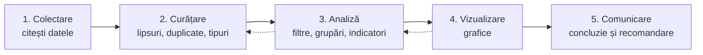

Săgețile punctate contează. În practică te întorci des: un grafic ciudat îți arată o problemă în date, o grupare scoate la iveală un canal scris în două feluri. Este normal.

| Pas | Întrebarea la care răspunzi | Unelte pandas și Matplotlib |
|---|---|---|
| Colectare | Ce date am și de unde vin? | `read_csv`, `read_excel` |
| Curățare | Pot avea încredere în ele? | `info`, `isna`, `duplicated`, `astype` |
| Analiză | Ce s-a întâmplat și unde? | filtre, coloane calculate, `groupby`, `pivot_table` |
| Vizualizare | Cum arăt asta dintr-o privire? | `plot`, `bar`, `scatter`, `savefig` |
| Comunicare | Ce recomand și cât de sigur sunt? | o frază, un tabel, un grafic (vezi capitolele 6, 7 și 9) |

Parcurgem acum toți pașii pe fișierul Cămării. Pentru claritatea expunerii, facem întâi analiza pe fișierul curat și abia apoi, în secțiunea 8.9, arătăm curățarea pe o copie stricată intenționat. Într-un proiect real, verificarea și curățarea vin întotdeauna primele.

## 8.6 Colectare: citim fișierul și facem cunoștință cu el

Fișierul `camara_saptamanal.csv` are 48 de rânduri: 12 săptămâni înmulțite cu 4 canale. CSV (Comma-Separated Values, valori separate prin virgulă) este cel mai simplu format de tabel: un fișier text în care fiecare rând este o linie, iar coloanele sunt despărțite prin virgule. Îl poți deschide și cu un editor de text.

```python
import pandas as pd

df = pd.read_csv("camara_saptamanal.csv")

print(df.shape)
print(df.head())
```

```text
(48, 10)
   saptamana        luna  ...  cost_ambalare_livrare  contributie
0          1  septembrie  ...                    840       3210.0
1          2  septembrie  ...                    840       3210.0
2          3  septembrie  ...                    854       3263.5
3          4  septembrie  ...                    840       3210.0
4          5   octombrie  ...                    854       3263.5

[5 rows x 10 columns]
```

Trei lucruri s-au întâmplat. Am importat pandas sub numele scurt `pd`. Funcția `read_csv` a citit fișierul și a întors un DataFrame, pe care l-am numit `df` (numele obișnuit pentru „tabelul meu”). Atributul `shape` confirmă 48 de rânduri și 10 coloane, iar metoda `head()` arată primele cinci rânduri.

Coloana fără nume din stânga (0, 1, 2...) este **indexul**: eticheta fiecărui rând, pusă automat de pandas. Punctele de suspensie arată că tabelul este prea lat pentru afișare și pandas a ascuns coloanele din mijloc. Îi putem cere să le arate pe toate:

```python
pd.set_option("display.max_columns", 20)
pd.set_option("display.width", 200)

print(df.head(3))
```

```text
   saptamana        luna    canal  vizite  comenzi  venit  marja_bruta  cost_marketing  cost_ambalare_livrare  contributie
0          1  septembrie  Căutare    2380       60   9000       4050.0               0                    840       3210.0
1          2  septembrie  Căutare    2410       60   9000       4050.0               0                    840       3210.0
2          3  septembrie  Căutare    2450       61   9150       4117.5               0                    854       3263.5
```

Fiecare rând descrie un canal într-o săptămână. Semnificația coloanelor:

| Coloană | Ce conține |
|---|---|
| `saptamana` | Numărul săptămânii, de la 1 la 12 |
| `luna` | septembrie, octombrie sau noiembrie |
| `canal` | Căutare, Reclame, Email sau Direct (canalul ultimului clic, vezi capitolul 3) |
| `vizite`, `comenzi` | Câte vizite și câte comenzi a adus canalul în acea săptămână |
| `venit` | Valoarea comenzilor, în lei |
| `marja_bruta` | Venitul minus costul produselor vândute, în lei |
| `cost_marketing` | Cheltuiala de marketing a canalului, în lei |
| `cost_ambalare_livrare` | 14 lei pentru fiecare comandă |
| `contributie` | Marja brută minus marketing minus ambalare și livrare |

Indicatorii sunt explicați pe larg în capitolul 5. Aici îi calculăm.

### 8.6.1 info: structura tabelului

```python
df.info()
```

```text
<class 'pandas.DataFrame'>
RangeIndex: 48 entries, 0 to 47
Data columns (total 10 columns):
 #   Column                 Non-Null Count  Dtype  
---  ------                 --------------  -----  
 0   saptamana              48 non-null     int64  
 1   luna                   48 non-null     str    
 2   canal                  48 non-null     str    
 3   vizite                 48 non-null     int64  
 4   comenzi                48 non-null     int64  
 5   venit                  48 non-null     int64  
 6   marja_bruta            48 non-null     float64
 7   cost_marketing         48 non-null     int64  
 8   cost_ambalare_livrare  48 non-null     int64  
 9   contributie            48 non-null     float64
dtypes: float64(2), int64(6), str(2)
memory usage: 3.9 KB
```

`info()` este prima verificare serioasă. Pentru fiecare coloană vezi câte valori nu lipsesc (`Non-Null Count`) și ce tip are (`Dtype`). Citim rezultatul astfel:

- Toate coloanele au 48 de valori din 48, deci nu lipsește nimic.
- `vizite`, `comenzi`, `venit` și costurile sunt `int64`, adică numere întregi. `marja_bruta` și `contributie` sunt `float64`, numere cu zecimale.
- `luna` și `canal` sunt `str`, adică text (în pandas 2 ar fi apărut `object`).

Dacă o coloană care ar trebui să fie numerică apare ca text, ai o problemă de curățare. O vedem în secțiunea 8.9.

### 8.6.2 describe: un rezumat statistic

```python
print(df[["vizite", "comenzi", "venit", "contributie"]].describe().round(1))
```

```text
       vizite  comenzi   venit  contributie
count    48.0     48.0    48.0         48.0
mean   1612.1     42.4  6089.7       1355.2
std    1098.4     17.2  2127.3       1900.8
min     590.0     16.0  2400.0      -2938.6
25%     755.0     31.0  4960.0       1360.2
50%     930.0     33.0  5115.0       1817.8
75%    2452.5     61.0  8077.5       2256.2
max    4100.0     74.0  9450.0       3370.5
```

Pentru fiecare coloană numerică, `describe()` dă numărul de valori, media, abaterea standard, minimul, maximul și cele trei cuartile (25%, 50%, 75%). Rândul `50%` este mediana. Folosește tabelul ca pe un detector de ciudățenii. Aici, un lucru sare în ochi: contribuția minimă este negativă, -2.938,6 lei. Există cel puțin un rând în care un canal a pierdut bani într-o săptămână. Avem primul fir de urmărit.

### 8.6.3 Dacă datele sunt în Excel

Prezentarea de curs folosește `read_excel`. Funcționează la fel, cu condiția să ai instalat pachetul `openpyxl`. Ca să avem pe ce exersa, salvăm tabelul nostru ca fișier Excel și îl citim înapoi:

```python
df.to_excel("camara_saptamanal.xlsx", index=False)

din_excel = pd.read_excel("camara_saptamanal.xlsx", sheet_name=0)
print(din_excel.shape)
print(din_excel.equals(df))
```

```text
(48, 10)
True
```

Argumentul `sheet_name` alege foaia: după poziție (0 este prima) sau după nume. `index=False` îi spune lui pandas să nu scrie în fișier și coloana de index. Metoda `equals` confirmă că tabelul citit din Excel este identic cu cel inițial.

> **Greșeală frecventă.** `FileNotFoundError: [Errno 2] No such file or directory: 'camara.csv'`. Python caută fișierul în dosarul din care rulează caietul. Verifică trei lucruri: numele exact (cu extensie), dosarul și, în Colab, dacă ai încărcat fișierul în sesiunea curentă.

> **Pentru afacerea ta.** Aproape orice platformă de magazin online, de facturare sau de publicitate are un buton de export în CSV sau Excel. Descarcă exportul comenzilor pe ultimele trei luni și rulează pe el doar `read_csv`, `head`, `info` și `describe`. În zece minute vei ști ce coloane ai, ce lipsește și dacă sumele seamănă cu cele din contabilitate.

## 8.7 Selectare, filtrare și coloane calculate

### 8.7.1 Selectarea coloanelor

O coloană se alege cu numele ei între paranteze drepte, ca la dicționare. Mai multe coloane se aleg cu o listă de nume, de unde parantezele duble.

```python
print(df["venit"].sum())
print(df[["canal", "venit"]].head(3))
```

```text
292304
     canal  venit
0  Căutare   9000
1  Căutare   9000
2  Căutare   9150
```

O singură coloană este un obiect de tip `Series` (o coloană cu index). Are metode proprii: `sum()`, `mean()`, `min()`, `max()`, `unique()`. Venitul total pe cele 12 săptămâni este 292.304 lei (date fictive).

### 8.7.2 Filtrarea rândurilor

Filtrarea se face în doi pași, chiar dacă îi scriem de obicei pe o singură linie. Întâi construim o **mască**: o coloană de valori `True` și `False`, câte una pentru fiecare rând.

```python
masca = df["canal"] == "Reclame"
print(masca.head(3))
print(masca.sum())
```

```text
0    False
1    False
2    False
Name: canal, dtype: bool
12
```

Primele rânduri sunt de pe canalul Căutare, deci masca este `False`. Suma unei măști numără valorile `True`: 12 rânduri sunt de pe canalul Reclame. Apoi punem masca între parantezele drepte ale tabelului, iar pandas păstrează doar rândurile cu `True`.

```python
reclame = df[df["canal"] == "Reclame"]
print(reclame[["saptamana", "luna", "vizite", "comenzi", "venit", "cost_marketing"]])
```

```text
    saptamana        luna  vizite  comenzi  venit  cost_marketing
12          1  septembrie     790       16   2400             600
13          2  septembrie     810       16   2400             600
14          3  septembrie     800       16   2400             600
15          4  septembrie     820       16   2400             600
16          5   octombrie    1600       30   3540            1500
17          6   octombrie    2400       43   4644            2600
18          7   octombrie    3000       54   5670            3300
19          8   octombrie    3400       61   6405            3800
20          9   noiembrie    3800       68   7140            4200
21         10   noiembrie    4000       72   7560            4200
22         11   noiembrie    4100       74   7770            4200
23         12   noiembrie    4000       72   7560            4200
```

Iată povestea într-un singur tabel. În septembrie, 600 de lei pe săptămână aduc 16 comenzi. Din săptămâna 5, bugetul urcă treptat până la 4.200 de lei pe săptămână. Comenzile cresc și ele, dar mai încet.

Condițiile se combină cu `&` (și) și `|` (sau). Fiecare condiție trebuie pusă între paranteze rotunde.

```python
filtru = (df["canal"] == "Reclame") & (df["luna"] == "noiembrie")

print(df[filtru][["saptamana", "comenzi", "venit", "contributie"]])
print(df.loc[filtru, "contributie"].sum())
```

```text
    saptamana  comenzi  venit  contributie
20          9       68   7140      -2938.6
21         10       72   7560      -2864.4
22         11       74   7770      -2827.3
23         12       72   7560      -2864.4
-11494.699999999999
```

Forma `df.loc[rânduri, coloane]` alege dintr-o singură mișcare și rândurile (cu o mască), și coloanele (cu un nume sau o listă de nume). Folosește-o ori de câte ori vrei și să modifici valorile alese (vezi secțiunea 8.15). În noiembrie, canalul Reclame a avut o contribuție de -11.494,70 lei. Șirul de 9 de la sfârșitul rezultatului nu este o greșeală a ta: calculatorul memorează numerele cu zecimale în baza 2 și apar rotunjiri minuscule. La afișare folosește `round(valoare, 2)`.

Să răspundem și la întrebarea rămasă de la `describe`: unde este contribuția negativă?

```python
negative = df[df["contributie"] < 0]
print(len(negative))
print(negative["canal"].unique().tolist())
print(negative["saptamana"].min())
```

```text
8
['Reclame']
5
```

Opt rânduri, toate pe canalul Reclame, începând cu săptămâna 5. Niciun alt canal nu a avut vreo săptămână pe minus.

### 8.7.3 Coloane calculate

O coloană nouă se creează prin atribuire. Operația se aplică pe toate rândurile deodată, fără buclă.

```python
df["rata_conversie"] = df["comenzi"] / df["vizite"] * 100
df["valoare_medie_comanda"] = df["venit"] / df["comenzi"]
df["marja_pct"] = df["marja_bruta"] / df["venit"] * 100
df["marketing_pe_comanda"] = df["cost_marketing"] / df["comenzi"]
df["contributie_pe_comanda"] = df["contributie"] / df["comenzi"]

indicatori = ["rata_conversie", "valoare_medie_comanda", "marja_pct",
              "marketing_pe_comanda", "contributie_pe_comanda"]

reclame = df[df["canal"] == "Reclame"].set_index("saptamana")
print(reclame.loc[[1, 5, 12], indicatori].round(2).T)
```

```text
saptamana                   1       5       12
rata_conversie            2.03    1.88    1.80
valoare_medie_comanda   150.00  118.00  105.00
marja_pct                45.00   33.00   31.00
marketing_pe_comanda     37.50   50.00   58.33
contributie_pe_comanda   16.00  -25.06  -39.78
```

Am ales trei săptămâni de pe canalul Reclame (prima, a cincea și ultima) și am întors tabelul cu `.T` (transpunere), ca indicatorii să fie pe rânduri. `set_index("saptamana")` face din numărul săptămânii eticheta rândului, așa că `loc[[1, 5, 12]]` înseamnă „săptămânile 1, 5 și 12”.

| Indicator | Formula | Ce spune |
|---|---|---|
| Rata de conversie | comenzi / vizite × 100 | Din 100 de vizite, câte se termină cu o comandă |
| Valoarea medie a comenzii | venit / comenzi | Cât cheltuie un client la o comandă |
| Marja procentuală | marjă brută / venit × 100 | Cât rămâne din 100 de lei încasați după costul produselor |
| Marketing pe comandă | cost marketing / comenzi | Cât a costat să obții o comandă |
| Contribuție pe comandă | contribuție / comenzi | Cât rămâne dintr-o comandă pentru acoperirea costurilor fixe |

Între săptămâna 1 și săptămâna 12, pe canalul Reclame, toți cei cinci indicatori s-au înrăutățit. Valoarea medie a comenzii a scăzut de la 150 la 105 lei, iar marja de la 45% la 31%: este efectul codului de reducere de 20%. Marketingul pe comandă a urcat de la 37,5 la peste 58 de lei. Contribuția pe comandă a trecut de la +16 lei la aproape -40 de lei. Săptămâna 5 arată că ruptura s-a produs repede: chiar din prima săptămână cu buget mărit, o comandă din reclame pierdea 25 de lei.

> **De reținut.** Verifică orice coloană primită de-a gata, dacă o poți recalcula. Fișierul are deja coloana `contributie`. O refacem din componente și comparăm.

```python
recalculat = df["marja_bruta"] - df["cost_marketing"] - df["cost_ambalare_livrare"]
diferenta_maxima = (recalculat - df["contributie"]).abs().max()
print(round(diferenta_maxima, 6))

print((df["cost_ambalare_livrare"] == df["comenzi"] * 14).all())
```

```text
0.0
True
```

Diferența maximă este zero, deci coloana `contributie` respectă formula: marjă brută minus marketing minus ambalare și livrare. A doua verificare confirmă ipoteza de 14 lei pe comandă pentru ambalare și livrare, pe toate rândurile.

## 8.8 Grupare, tabele pivot și sortare

### 8.8.1 groupby: „pentru fiecare..., calculează...”

Întrebările de business au aproape mereu forma „cât pe fiecare lună?”, „cât pe fiecare canal?”. În pandas, aceasta este metoda `groupby`. Ea face trei lucruri: împarte rândurile în grupuri, aplică un calcul pe fiecare grup și lipește rezultatele într-un tabel nou.

```python
print(df.groupby("luna")["comenzi"].sum())
```

```text
luna
noiembrie     796
octombrie     688
septembrie    553
Name: comenzi, dtype: int64
```

Cifrele sunt corecte: 553 de comenzi în septembrie, 796 în noiembrie. Ordinea însă este alfabetică, pentru că pandas nu știe că „septembrie” vine înaintea lui „octombrie”. Pentru el sunt simple texte. Îi spunem noi ordinea, transformând coloana într-o **categorie ordonată**:

```python
ordine_luni = ["septembrie", "octombrie", "noiembrie"]
df["luna"] = pd.Categorical(df["luna"], categories=ordine_luni, ordered=True)

coloane_sume = ["vizite", "comenzi", "venit", "marja_bruta",
                "cost_marketing", "cost_ambalare_livrare", "contributie"]

lunar = df.groupby("luna")[coloane_sume].sum()
print(lunar[["vizite", "comenzi", "venit", "contributie"]])
```

```text
            vizite  comenzi   venit  contributie
luna                                            
septembrie   18860      553   85400     28088.00
octombrie    26380      688   97779     20203.09
noiembrie    32140      796  109125     16758.05
```

Acum lunile apar în ordinea calendarului, iar totalurile coincid cu cele din firul cursului: 18.860 de vizite, 553 de comenzi și 85.400 lei în septembrie; 32.140 de vizite, 796 de comenzi și 109.125 lei în noiembrie.

> **Greșeală frecventă.** Media ratelor nu este rata din totaluri. Pare firesc să calculezi rata de conversie a lunii ca medie a ratelor săptămânale, cu `mean()`. Rezultatul este greșit, pentru că dă aceeași greutate unui canal cu 600 de vizite și unuia cu 4.000.

```python
media_ratelor = df.groupby("luna")["rata_conversie"].mean()
rata_din_totaluri = lunar["comenzi"] / lunar["vizite"] * 100

print(pd.DataFrame({"media_ratelor": media_ratelor,
                    "rata_din_totaluri": rata_din_totaluri}).round(2))
```

```text
            media_ratelor  rata_din_totaluri
luna                                        
septembrie           3.26               2.93
octombrie            3.22               2.61
noiembrie            3.21               2.48
```

Media ratelor spune că în noiembrie conversia este în jur de 3,2%. Rata reală, calculată din totaluri, este sub 2,5%. Regula: aduni întâi numărătorul și numitorul, apoi împarți. Același lucru este valabil pentru valoarea medie a comenzii, marja procentuală și orice alt raport.

### 8.8.2 Mai multe calcule deodată, pe canale

Cu `agg` ceri mai multe calcule într-o singură grupare și dai nume coloanelor rezultate.

```python
pe_canal = df.groupby("canal").agg(
    vizite=("vizite", "sum"),
    comenzi=("comenzi", "sum"),
    venit=("venit", "sum"),
    contributie=("contributie", "sum"),
)
pe_canal["contributie_pe_comanda"] = pe_canal["contributie"] / pe_canal["comenzi"]

print(pe_canal.sort_values("contributie", ascending=False).round(2))
```

```text
         vizite  comenzi   venit  contributie  contributie_pe_comanda
canal                                                                
Căutare   29380      736  110400     39376.00                   53.50
Email      7440      375   61875     21993.75                   58.65
Direct    11040      388   60140     21631.00                   55.75
Reclame   29520      538   59889    -17951.61                  -33.37
```

Fiecare rând din `agg` se citește: „coloana nouă = (coloana sursă, calculul)”. `sort_values` ordonează tabelul după o coloană, iar `ascending=False` înseamnă descrescător. Pe toate cele trei luni, Reclame este singurul canal cu o contribuție totală negativă, deși a adus mai multe comenzi decât Email sau Direct.

### 8.8.3 pivot_table: un canal pe rând, o lună pe coloană

Tabelul pivot din Excel are un echivalent direct. Alegi ce pui pe rânduri (`index`), ce pui pe coloane (`columns`), ce valoare calculezi (`values`) și cum (`aggfunc`).

```python
pivot = df.pivot_table(index="canal", columns="luna",
                       values="contributie", aggfunc="sum")
print(pivot.round(0))
print(pivot.sum().round(2))
```

```text
luna     septembrie  octombrie  noiembrie
canal                                    
Căutare     12894.0    13161.0    13322.0
Direct       7080.0     7192.0     7359.0
Email        7090.0     7331.0     7572.0
Reclame      1024.0    -7481.0   -11495.0
luna
septembrie    28088.00
octombrie     20203.09
noiembrie     16758.05
dtype: float64
```

Acesta este tabelul care lămurește investigația. Trei canale au o contribuție aproape constantă, în ușoară creștere. Al patrulea trece de la +1.024 lei la -11.495 lei. `pivot.sum()` adună pe coloane și dă contribuția totală a fiecărei luni.

### 8.8.4 Sortare: cele mai slabe săptămâni

```python
cele_mai_slabe = df.sort_values("contributie").head(3)
print(cele_mai_slabe[["saptamana", "canal", "comenzi", "cost_marketing", "contributie"]])
```

```text
    saptamana    canal  comenzi  cost_marketing  contributie
20          9  Reclame       68            4200      -2938.6
23         12  Reclame       72            4200      -2864.4
21         10  Reclame       72            4200      -2864.4
```

Cele mai slabe trei rânduri din tot fișierul sunt săptămâni din noiembrie pe canalul Reclame. Observă indexul din stânga: rândurile își păstrează eticheta inițială (20, 23, 21) chiar dacă au fost reordonate.

> **Exemplu.** Un lanț de metode se citește de la stânga la dreapta, ca o propoziție. Linia `df[df["luna"] == "noiembrie"].groupby("canal")["comenzi"].sum().sort_values(ascending=False)` înseamnă: ia rândurile din noiembrie, grupează-le pe canale, adună comenzile, ordonează descrescător. Când lanțul devine greu de citit, rupe-l în pași cu nume.

## 8.9 Curățare: valori lipsă, duplicate și tipuri greșite

Fișierul Cămării este curat pentru că a fost construit pentru curs. Datele reale nu sunt. Un export real are rânduri dublate, celule goale, sume scrise ca text și același canal scris în trei feluri. Ca să exersăm, stricăm intenționat o copie.

### 8.9.1 Construim o copie murdară

```python
murdar = pd.read_csv("camara_saptamanal.csv")

murdar["venit"] = murdar["venit"].astype(str) + " lei"     # (1) venitul devine text
murdar.loc[5, "venit"] = "9.300 lei"                       #     un rând are și separator de mii

murdar["comenzi"] = murdar["comenzi"].astype(float)
murdar.loc[[14, 30], "comenzi"] = float("nan")             # (2) două valori lipsă

murdar.loc[20, "canal"] = "reclame "                       # (3) același canal, scris diferit
murdar.loc[40, "canal"] = "DIRECT"

murdar = pd.concat([murdar, murdar.iloc[[0, 1]]], ignore_index=True)   # (4) două rânduri dublate

murdar.to_csv("camara_murdar.csv", index=False)
```

Am citit din nou fișierul original, am modificat copia din memorie și am salvat-o sub alt nume. Fișierul original a rămas neatins. `float("nan")` este felul în care Python scrie „valoare lipsă” (NaN vine de la Not a Number, „nu este un număr”). `pd.concat` lipește tabele unul sub altul, iar `iloc[[0, 1]]` alege rândurile după poziție.

### 8.9.2 Diagnosticul

Uităm cum am stricat fișierul și îl privim ca pe un export primit de la altcineva.

```python
murdar = pd.read_csv("camara_murdar.csv")
murdar.info()
```

```text
<class 'pandas.DataFrame'>
RangeIndex: 50 entries, 0 to 49
Data columns (total 10 columns):
 #   Column                 Non-Null Count  Dtype  
---  ------                 --------------  -----  
 0   saptamana              50 non-null     int64  
 1   luna                   50 non-null     str    
 2   canal                  50 non-null     str    
 3   vizite                 50 non-null     int64  
 4   comenzi                48 non-null     float64
 5   venit                  50 non-null     str    
 6   marja_bruta            50 non-null     float64
 7   cost_marketing         50 non-null     int64  
 8   cost_ambalare_livrare  50 non-null     int64  
 9   contributie            50 non-null     float64
dtypes: float64(3), int64(4), str(3)
memory usage: 4.0 KB
```

`info()` arată deja trei simptome. Tabelul are 50 de rânduri, nu 48. Coloana `comenzi` are doar 48 de valori din 50 și a devenit `float64`. Coloana `venit` este text (`str`), nu număr. Continuăm cu trei verificări punctuale:

```python
print(murdar.isna().sum().loc[["comenzi", "venit"]])
print(murdar.duplicated().sum())
print(murdar["canal"].value_counts())
```

```text
comenzi    2
venit      0
dtype: int64
2
canal
Căutare     14
Email       12
Reclame     11
Direct      11
reclame      1
DIRECT       1
Name: count, dtype: int64
```

`isna()` marchează valorile lipsă, iar `sum()` le numără pe fiecare coloană. `duplicated()` marchează rândurile identice cu unul de mai sus. `value_counts()` numără de câte ori apare fiecare valoare și este cel mai rapid mod de a prinde scrierile diferite: avem șase „canale” în loc de patru.

De ce contează? Pentru că pandas nu se plânge. Calculează ce îi ceri, pe ce are:

```python
print(murdar["comenzi"].sum())
print(murdar["venit"].head(3).sum())
```

```text
2109.0
9000 lei9000 lei9150 lei
```

Totalul corect al comenzilor este 2.037. Am obținut altceva, fără niciun avertisment: sumele sar peste valorile lipsă (pandas, „Working with missing data”, https://pandas.pydata.org/docs/user_guide/missing_data.html, accesat în noiembrie 2026), iar rândurile dublate se numără de două ori. La venit este și mai rău: „suma” unor texte este lipirea lor.

### 8.9.3 Tratamentul

```python
curat = murdar.drop_duplicates()

curat["canal"] = curat["canal"].str.strip().str.capitalize()

curat["venit"] = (curat["venit"]
                  .str.replace(" lei", "")
                  .str.replace(".", "")
                  .astype(int))

curat["comenzi"] = curat["comenzi"].fillna(curat["cost_ambalare_livrare"] / 14).astype(int)

curat.info()
```

```text
<class 'pandas.DataFrame'>
RangeIndex: 48 entries, 0 to 47
Data columns (total 10 columns):
 #   Column                 Non-Null Count  Dtype  
---  ------                 --------------  -----  
 0   saptamana              48 non-null     int64  
 1   luna                   48 non-null     str    
 2   canal                  48 non-null     str    
 3   vizite                 48 non-null     int64  
 4   comenzi                48 non-null     int64  
 5   venit                  48 non-null     int64  
 6   marja_bruta            48 non-null     float64
 7   cost_marketing         48 non-null     int64  
 8   cost_ambalare_livrare  48 non-null     int64  
 9   contributie            48 non-null     float64
dtypes: float64(2), int64(6), str(2)
memory usage: 3.9 KB
```

Pas cu pas:

1. `drop_duplicates()` elimină rândurile identice și păstrează prima apariție.
2. `.str` dă acces la metodele de text pentru o coloană întreagă. `strip()` taie spațiile de la capete, iar `capitalize()` face prima literă mare și restul mici. Astfel, „reclame ” și „DIRECT” devin „Reclame” și „Direct”.
3. La venit ștergem unitatea de măsură și punctul folosit ca separator de mii, apoi transformăm textul în număr întreg cu `astype(int)`.
4. La comenzi umplem lipsurile cu `fillna`. Aici avem noroc: știm că ambalarea și livrarea costă 14 lei pe comandă, deci putem reconstitui numărul de comenzi din costul lor.

Punctul 4 merită o discuție. Nu există o regulă unică pentru valorile lipsă. Alegerea depinde de ce știi despre date.

| Opțiune | Cod | Când se potrivește | Risc |
|---|---|---|---|
| Elimini rândul | `dropna()` | Lipsuri puține și întâmplătoare | Pierzi și celelalte coloane ale rândului; totalurile scad |
| Pui zero | `fillna(0)` | Lipsa înseamnă chiar „nimic” (nicio cheltuială) | Dacă lipsa înseamnă „nu știm”, inventezi un zero |
| Pui media sau mediana | `fillna(col.mean())` | Analize statistice pe multe rânduri | Netezești datele; totalurile devin aproximative |
| Reconstitui din alte coloane | ca mai sus | Există o relație exactă între coloane | Relația trebuie verificată pe rândurile complete |
| Întrebi sursa | fără cod | Oricând se poate | Durează, dar este singura variantă sigură |

Verificăm rezultatul față de fișierul original:

```python
original = pd.read_csv("camara_saptamanal.csv")

print(curat["canal"].unique().tolist())
print(curat["comenzi"].sum(), curat["venit"].sum())
print(curat.equals(original))
```

```text
['Căutare', 'Reclame', 'Email', 'Direct']
2037 292304
True
```

Patru canale, 2.037 de comenzi, 292.304 lei, iar tabelul curățat este identic cu originalul.

> **Greșeală frecventă.** Încerci conversia înainte de curățare. `murdar["venit"].astype(float)` dă `ValueError: could not convert string to float: '9000 lei'`. Mesajul îți arată exact valoarea care l-a încurcat. Curăță textul, apoi convertește.

> **Pentru afacerea ta.** Exporturile românești au două capcane tipice: virgula folosită ca separator zecimal („18,50”) și punctul folosit ca separator de mii („1.250”). `read_csv` are argumente pentru ele: `decimal=","` și `thousands="."`. Dacă fișierul are coloanele despărțite prin punct și virgulă, adaugă `sep=";"`. Verifică apoi cu `info()` că sumele au ajuns numere.

## 8.10 Reproducerea investigației: comenzile cresc, rezultatul scade

Avem toate uneltele. Refacem în cod raționamentul din capitolul 5, pe tabelul `df` (cel curat, cu lunile ordonate).

### 8.10.1 Tabloul lunar

Rezultatul simplificat este contribuția minus costurile fixe de 10.000 de lei pe lună. Punem costurile fixe într-o constantă cu nume, scrisă cu majuscule, ca să fie ușor de găsit și de schimbat.

```python
COSTURI_FIXE_LUNA = 10_000

lunar["rezultat"] = lunar["contributie"] - COSTURI_FIXE_LUNA
print(lunar[["comenzi", "venit", "marja_bruta", "cost_marketing", "contributie", "rezultat"]])
```

```text
            comenzi   venit  marja_bruta  cost_marketing  contributie  rezultat
luna                                                                           
septembrie      553   85400     38430.00            2600     28088.00  18088.00
octombrie       688   97779     41235.09           11400     20203.09  10203.09
noiembrie       796  109125     44902.05           17000     16758.05   6758.05
```

Scrierea `10_000` este tot numărul zece mii: liniuțele de subliniere sunt permise în numere, ca să se citească mai ușor. Calculăm și variațiile dintre septembrie și noiembrie:

```python
sep = lunar.loc["septembrie"]
nov = lunar.loc["noiembrie"]

for indicator in ["comenzi", "venit", "cost_marketing", "rezultat"]:
    variatie = (nov[indicator] / sep[indicator] - 1) * 100
    print(f"{indicator}: {sep[indicator]:.0f} -> {nov[indicator]:.0f} ({variatie:+.0f}%)")
```

```text
comenzi: 553 -> 796 (+44%)
venit: 85400 -> 109125 (+28%)
cost_marketing: 2600 -> 17000 (+554%)
rezultat: 18088 -> 6758 (-63%)
```

Am regăsit cifrele din firul cursului: comenzi de la 553 la 796 (+44%), venit de la 85.400 la 109.125 lei (+28%), rezultat de la 18.088 la 6.758 lei (-63%). Tabelul lunar arată și suspectul principal: costul de marketing a crescut de la 2.600 la 17.000 de lei pe lună, de peste șase ori.

### 8.10.2 Tabelul pe canale

Totalurile lunare ascund ce se întâmplă în interior. Grupăm după două coloane deodată, lună și canal, și calculăm indicatorii din totaluri (nu ca medie a ratelor săptămânale).

```python
canale = df.groupby(["luna", "canal"])[coloane_sume].sum()

canale["valoare_medie_comanda"] = canale["venit"] / canale["comenzi"]
canale["marja_pct"] = canale["marja_bruta"] / canale["venit"] * 100
canale["marketing_pe_comanda"] = canale["cost_marketing"] / canale["comenzi"]
canale["contributie_pe_comanda"] = canale["contributie"] / canale["comenzi"]

de_afisat = ["comenzi", "valoare_medie_comanda", "marja_pct",
             "marketing_pe_comanda", "contributie_pe_comanda", "contributie"]

print(canale.loc["septembrie", de_afisat].round(2))
```

```text
         comenzi  valoare_medie_comanda  marja_pct  marketing_pe_comanda  contributie_pe_comanda  contributie
canal                                                                                                        
Căutare      241                  150.0       45.0                  0.00                   53.50     12893.50
Direct       127                  155.0       45.0                  0.00                   55.75      7080.25
Email        121                  165.0       45.0                  1.65                   58.60      7090.25
Reclame       64                  150.0       45.0                 37.50                   16.00      1024.00
```

În septembrie toate canalele câștigă bani la fiecare comandă. Reclame este cel mai slab, cu 16 lei pe comandă, dar este pe plus.

```python
print(canale.loc["noiembrie", de_afisat].round(2))
```

```text
         comenzi  valoare_medie_comanda  marja_pct  marketing_pe_comanda  contributie_pe_comanda  contributie
canal                                                                                                        
Căutare      249                  150.0       45.0                  0.00                   53.50     13321.50
Direct       132                  155.0       45.0                  0.00                   55.75      7359.00
Email        129                  165.0       45.0                  1.55                   58.70      7572.25
Reclame      286                  105.0       31.0                 58.74                  -40.19    -11494.70
```

Acesta este tabelul central al investigației. Citește rândul Reclame:

- comenzile au crescut de la 64 la 286;
- valoarea medie a comenzii a scăzut de la 150 la 105 lei, iar marja de la 45% la 31% (efectul codului de reducere de 20%);
- marketingul pe comandă a crescut de la 37,50 la 58,74 lei;
- contribuția pe comandă a ajuns la -40,19 lei.

Celelalte trei canale arată aproape la fel ca în septembrie. Creșterea de comenzi a venit aproape în întregime dintr-un canal pe care fiecare comandă pierde în jur de 40 de lei. Cu cât vinzi mai mult acolo, cu atât pierzi mai mult.

O ultimă întrebare, de tipul „ce ar fi fost dacă”:

```python
contributie_fara_reclame = canale.loc["noiembrie", "contributie"].drop("Reclame").sum()
print(round(contributie_fara_reclame - COSTURI_FIXE_LUNA, 2))
```

```text
18252.75
```

Fără canalul Reclame, rezultatul simplificat din noiembrie ar fi fost de aproximativ 18.253 de lei în loc de 6.758. Calculul este o simplificare: presupune că restul canalelor nu ar fi fost afectate și ignoră faptul că unii clienți aduși de reclame pot reveni mai târziu pe alte canale. Despre cum se verifică astfel de presupuneri, cu experimente, vorbim în capitolul 9.

> **De reținut.** Un total care crește poate ascunde un segment care pierde. Când un indicator general se mișcă ciudat, desparte-l pe segmente (canale, produse, luni) și calculează indicatorii pe unitate: pe comandă, pe vizită, pe client.

## 8.11 Grafice cu Matplotlib

Principiile unui grafic bun sunt în capitolul 6, iar alegerea tipului de grafic în capitolul 7. Aici învățăm mecanica: cum ceri un grafic în cod și cum îl salvezi. Neavând imagini în acest suport, descriem în cuvinte ce apare. Rulează codul și vei vedea graficele în caietul tău.

Matplotlib lucrează cu două obiecte. **Figura** (`fig`) este foaia întreagă. **Axele** (`ax`) sunt zona în care se desenează datele, cu titlu, axe și legendă. Documentația recomandă stilul în care le creezi explicit și apelezi metode pe ele (Matplotlib, „Quick start guide”, https://matplotlib.org/stable/users/explain/quick_start.html, accesat în noiembrie 2026). Rețeta are mereu aceiași pași: creezi figura și axele, desenezi, pui titlu și etichete, salvezi.

### 8.11.1 Linie: venitul și contribuția pe săptămâni

```python
import matplotlib.pyplot as plt
from pathlib import Path

Path("grafice").mkdir(exist_ok=True)

saptamanal = df.groupby("saptamana")[["venit", "contributie"]].sum()
print(saptamanal.loc[[1, 12]])

fig, ax = plt.subplots(figsize=(8, 4.5))
ax.plot(saptamanal.index, saptamanal["venit"], marker="o", linewidth=2, label="Venit")
ax.plot(saptamanal.index, saptamanal["contributie"], marker="o", linewidth=2, label="Contribuție")

ax.set_title("Venitul săptămânal crește, contribuția scade (date fictive)")
ax.set_xlabel("Săptămâna")
ax.set_ylabel("Lei")
ax.set_xticks(saptamanal.index)
ax.set_ylim(0, None)
ax.grid(axis="y", alpha=0.3)
ax.spines[["top", "right"]].set_visible(False)
ax.legend()

fig.savefig("grafice/venit_saptamanal.png", dpi=150, bbox_inches="tight")
plt.show()
```

```text
           venit  contributie
saptamana                    
1          21310      7007.50
12         27255      4170.35
```

Ce face fiecare parte:

- `plt.subplots(figsize=(8, 4.5))` creează figura și axele, cu lățimea de 8 și înălțimea de 4,5 inci.
- `ax.plot(x, y, ...)` desenează o linie. `marker="o"` pune un punct la fiecare valoare, iar `label` este numele din legendă.
- `set_title`, `set_xlabel`, `set_ylabel` pun titlul și etichetele axelor. Titlul spune concluzia, nu doar subiectul (vezi capitolul 6).
- `set_ylim(0, None)` pornește axa verticală de la zero.
- `savefig` salvează imaginea, iar `plt.show()` o afișează.

Graficul arată două linii. Cea a venitului urcă de la 21.310 lei în prima săptămână la peste 27.000 de lei în ultima. Cea a contribuției coboară de la aproximativ 7.000 la aproximativ 4.200 de lei, cu o coborâre treptată între săptămânile 5 și 9, exact când crește bugetul de reclame, după care rămâne pe loc. Ambele serii sunt în lei, deci pot sta pe aceeași axă. Nu pune niciodată pe același grafic două axe verticale cu unități diferite (vezi capitolul 6).

> **De reținut.** `savefig` alege formatul după extensia fișierului: `.png` pentru prezentări și documente, `.pdf` sau `.svg` când ai nevoie de imagini care nu se pixelează la mărire. `dpi=150` stabilește rezoluția, iar `bbox_inches="tight"` taie marginile albe (Matplotlib, „matplotlib.pyplot.savefig”, https://matplotlib.org/stable/api/_as_gen/matplotlib.pyplot.savefig.html, accesat în noiembrie 2026). Apelează `savefig` înainte de `plt.show()`.

### 8.11.2 Bare: venitul pe canale

```python
venit_nov = df[df["luna"] == "noiembrie"].groupby("canal")["venit"].sum().sort_values()
print(venit_nov)

etichete = [f"{valoare:,.0f} lei".replace(",", ".") for valoare in venit_nov]

fig, ax = plt.subplots(figsize=(7, 3.5))
bare = ax.barh(venit_nov.index, venit_nov.values, color="#2a78b5")
ax.bar_label(bare, labels=etichete, padding=4)

ax.set_title("Venit pe canale, noiembrie (date fictive)")
ax.set_xlabel("Lei")
ax.set_xlim(0, venit_nov.max() * 1.2)
ax.spines[["top", "right"]].set_visible(False)

fig.savefig("grafice/venit_canale_noiembrie.png", dpi=150, bbox_inches="tight")
plt.show()
```

```text
canal
Direct     20460
Email      21285
Reclame    30030
Căutare    37350
Name: venit, dtype: int64
```

`barh` desenează bare orizontale, potrivite când etichetele sunt cuvinte. Am sortat valorile înainte, ca barele să fie ordonate. `bar_label` scrie valoarea la capătul fiecărei bare. Linia cu `etichete` construiește textele, punând punctul ca separator de mii, după obiceiul românesc. Ea folosește o **comprehensiune de listă**: un `for` scris pe un singur rând, între paranteze drepte, care produce o listă.

Graficul arată patru bare. Căutare este prima, cu 37.350 de lei. Reclame este a doua, cu 30.030 de lei. Cine ar privi doar acest grafic ar spune că reclamele sunt al doilea cel mai bun canal. Refă-l cu `contributie` în loc de `venit` (aplicația 4) și bara Reclame va coborî sub zero. Alegerea indicatorului schimbă complet povestea.

### 8.11.3 Dispersie: bugetul de reclame față de comenzi

Graficul de dispersie (scatter plot) pune un punct pentru fiecare pereche de valori. Îl folosim când vrem să vedem relația dintre două mărimi.

```python
reclame = df[df["canal"] == "Reclame"]

fig, ax = plt.subplots(figsize=(6.5, 4.5))
ax.scatter(reclame["cost_marketing"], reclame["comenzi"], s=80, color="#2a78b5", alpha=0.5)

ax.set_title("Reclame: buget săptămânal și comenzi (date fictive)")
ax.set_xlabel("Buget de reclame pe săptămână (lei)")
ax.set_ylabel("Comenzi din reclame")
ax.set_xlim(0, None)
ax.set_ylim(0, None)
ax.spines[["top", "right"]].set_visible(False)

fig.savefig("grafice/buget_vs_comenzi.png", dpi=150, bbox_inches="tight")
plt.show()

print(reclame["cost_marketing"].nunique(), "niveluri de buget în 12 săptămâni")
```

```text
6 niveluri de buget în 12 săptămâni
```

`scatter(x, y)` pune câte un punct pentru fiecare rând. Argumentul `s` este mărimea punctului, iar `alpha=0.5` îl face pe jumătate transparent: acolo unde se suprapun mai multe puncte, culoarea iese mai închisă. Punctele urcă de la stânga jos la dreapta sus: mai mult buget, mai multe comenzi. Dar se îngrămădesc. Cele patru săptămâni din septembrie stau aproape una peste alta, la 600 de lei și 16 comenzi. La fel cele din noiembrie, la 4.200 de lei și în jur de 70 de comenzi. Avem 12 puncte, dar numai șase niveluri diferite de buget. Ne întoarcem la acest detaliu în secțiunea 8.13.

### 8.11.4 Cascadă: de la rezultatul din septembrie la cel din noiembrie

Graficul în cascadă (waterfall) arată cum ajungi de la o valoare la alta, prin pași care adaugă sau scad. Matplotlib nu are o funcție dedicată, dar îl putem construi din bare obișnuite, folosind argumentul `bottom`, care spune de unde pornește fiecare bară.

```python
pasi = {
    "Marjă brută": nov["marja_bruta"] - sep["marja_bruta"],
    "Marketing": -(nov["cost_marketing"] - sep["cost_marketing"]),
    "Ambalare\nși livrare": -(nov["cost_ambalare_livrare"] - sep["cost_ambalare_livrare"]),
}

fig, ax = plt.subplots(figsize=(8, 4.5))

nivel = sep["rezultat"]
ax.bar("Rezultat\nseptembrie", nivel, color="#7f7f7f")
ax.text(0, nivel + 400, f"{nivel:.0f}", ha="center")

for pozitie, (nume, variatie) in enumerate(pasi.items(), start=1):
    culoare = "#2a78b5" if variatie >= 0 else "#c8553d"
    ax.bar(nume, variatie, bottom=nivel, color=culoare)
    ax.text(pozitie, max(nivel, nivel + variatie) + 400, f"{variatie:+.0f}", ha="center")
    nivel = nivel + variatie
    print(f"{nume.replace(chr(10), ' ')}: {variatie:+.2f} lei, nivel după pas: {nivel:.2f}")

ax.bar("Rezultat\nnoiembrie", nivel, color="#7f7f7f")
ax.text(4, nivel + 400, f"{nivel:.0f}", ha="center")

ax.set_title("De la 18.088 lei la 6.758 lei: ce a schimbat rezultatul (date fictive)")
ax.set_ylabel("Lei")
ax.set_ylim(0, 28000)
ax.spines[["top", "right"]].set_visible(False)

fig.savefig("grafice/cascada_rezultat.png", dpi=150, bbox_inches="tight")
plt.show()
```

```text
Marjă brută: +6472.05 lei, nivel după pas: 24560.05
Marketing: -14400.00 lei, nivel după pas: 10160.05
Ambalare și livrare: -3402.00 lei, nivel după pas: 6758.05
```

Graficul are cinci bare. Prima, gri, este rezultatul din septembrie: 18.088 lei. A doua, albastră, urcă: marja brută a crescut cu 6.472 de lei, pentru că s-a vândut mai mult. A treia, roșie, coboară abrupt: marketingul a costat cu 14.400 de lei mai mult. A patra, tot roșie, coboară cu încă 3.402 lei: mai multe comenzi înseamnă mai multe colete. Ultima bară, gri, este rezultatul din noiembrie: 6.758 lei. Costurile fixe nu apar, pentru că nu s-au schimbat.

Valorile tipărite sub cod sunt verificarea: pornind de la 18.088 și aplicând cei trei pași, ajungem exact la 6.758,05 lei, adică la rezultatul calculat separat în tabelul lunar. Un grafic în cascadă ai cărui pași nu se adună la valoarea finală este greșit, oricât de bine ar arăta.

## 8.12 Pragul de rentabilitate, calculat în cod

Pragul de rentabilitate (break-even) este punctul în care nu câștigi și nu pierzi. Conceptul este explicat în capitolul 5. Aici îl calculăm în două feluri.

### 8.12.1 Câte comenzi acoperă costurile fixe

Dacă fiecare comandă lasă în medie o anumită contribuție, numărul de comenzi necesar pentru acoperirea costurilor fixe este raportul dintre costurile fixe și contribuția pe comandă.

```python
import math

lunar["contributie_pe_comanda"] = lunar["contributie"] / lunar["comenzi"]
lunar["prag_comenzi"] = (COSTURI_FIXE_LUNA / lunar["contributie_pe_comanda"]).apply(math.ceil)

print(lunar[["comenzi", "contributie_pe_comanda", "prag_comenzi"]].round(2))
```

```text
            comenzi  contributie_pe_comanda  prag_comenzi
luna                                                     
septembrie      553                   50.79           197
octombrie       688                   29.36           341
noiembrie       796                   21.05           475
```

`apply(math.ceil)` aplică fiecărei valori funcția de rotunjire în sus: nu poți vinde o fracțiune de comandă. În septembrie, cu aproape 51 de lei contribuție pe comandă, magazinul își acoperea costurile fixe din 197 de comenzi și a avut 553. În noiembrie, contribuția medie pe comandă a scăzut la 21 de lei, iar pragul a urcat la 475 de comenzi. Magazinul vinde mai mult și este mult mai aproape de prag.

### 8.12.2 Cât își permite să plătească pe o comandă din reclame

A doua întrebare este mai utilă pentru decizie: care este cel mai mare cost de marketing pe comandă la care canalul Reclame nu pierde bani? Răspunsul este marja brută pe comandă minus ambalarea și livrarea.

```python
AMBALARE_LIVRARE = 14

r = canale.xs("Reclame", level="canal").copy()
r["marja_pe_comanda"] = r["marja_bruta"] / r["comenzi"]
r["marketing_maxim_pe_comanda"] = r["marja_pe_comanda"] - AMBALARE_LIVRARE
r["buget_maxim"] = r["marketing_maxim_pe_comanda"] * r["comenzi"]

print(r[["comenzi", "marja_pe_comanda", "marketing_maxim_pe_comanda",
         "marketing_pe_comanda", "buget_maxim", "cost_marketing"]].round(2))
```

```text
            comenzi  marja_pe_comanda  marketing_maxim_pe_comanda  marketing_pe_comanda  buget_maxim  cost_marketing
luna                                                                                                                
septembrie       64             67.50                       53.50                 37.50      3424.00            2400
octombrie       188             33.78                       19.78                 59.57      3719.09           11200
noiembrie       286             32.55                       18.55                 58.74      5305.30           16800
```

`xs` (de la „cross-section”, secțiune) alege din tabelul cu index dublu toate rândurile unui canal. În septembrie, o comandă din reclame lăsa 67,50 lei marjă brută. După ambalare și livrare rămâneau 53,50 lei, iar marketingul costa 37,50 lei: sub prag. În noiembrie, cu reducerea de 20%, marja pe comandă a scăzut la 32,55 lei. După ambalare și livrare rămân 18,55 lei, iar marketingul costă 58,74 lei: de peste trei ori pragul.

Coloana `buget_maxim` spune același lucru în lei pe lună. Pentru cele 286 de comenzi din noiembrie, canalul și-ar fi acoperit costurile cu un buget de cel mult 5.305 lei. S-au cheltuit 16.800.

> **Exemplu.** Același prag, exprimat ca randament al cheltuielii cu reclamele, ROAS (Return on Ad Spend, venit obținut pentru fiecare leu cheltuit pe reclame).

```python
nov_r = r.loc["noiembrie"]
roas_real = nov_r["venit"] / nov_r["cost_marketing"]
roas_prag = nov_r["valoare_medie_comanda"] / nov_r["marketing_maxim_pe_comanda"]

print(f"ROAS realizat: {roas_real:.2f}, ROAS de prag: {roas_prag:.2f}")
```

```text
ROAS realizat: 1.79, ROAS de prag: 5.66
```

Fiecare leu de reclamă a adus 1,79 lei venit. Cu marja și costurile din noiembrie, ar fi trebuit să aducă cel puțin 5,66 lei ca să nu producă pierdere. Un ROAS supraunitar nu înseamnă profit: contează cât din venit rămâne după costul produselor și al livrării.

## 8.13 Pasul următor: o regresie liniară simplă

Prezentarea de curs se încheie cu ideea că Python nu se oprește la descrierea trecutului: cu scikit-learn poți construi modele care fac predicții. Facem un prim pas, cel mai simplu posibil: o dreaptă care leagă bugetul săptămânal de reclame de numărul de comenzi din reclame.

Regresia liniară caută dreapta care trece cel mai aproape de puncte. Dreapta are două numere: **panta** (cu cât cresc comenzile când bugetul crește cu un leu) și **termenul liber** (câte comenzi ar prezice la buget zero). Cu NumPy:

```python
import numpy as np

x = reclame["cost_marketing"]
y = reclame["comenzi"]

panta, termen_liber = np.polyfit(x, y, 1)

print(f"comenzi ≈ {termen_liber:.1f} + {panta:.4f} × buget")
print(f"O comandă în plus costă aproximativ {1 / panta:.0f} lei de reclame")
print(f"Coeficientul de corelație: {np.corrcoef(x, y)[0, 1]:.3f}")
```

```text
comenzi ≈ 6.5 + 0.0151 × buget
O comandă în plus costă aproximativ 66 lei de reclame
Coeficientul de corelație: 0.996
```

`np.polyfit(x, y, 1)` potrivește un polinom de gradul 1, adică o dreaptă. Același calcul cu scikit-learn, unde toate modelele urmează același tipar: creezi modelul, îl potrivești pe date cu `fit`, apoi îi ceri predicții cu `predict` (scikit-learn, „LinearRegression”, https://scikit-learn.org/stable/modules/generated/sklearn.linear_model.LinearRegression.html, accesat în noiembrie 2026).

```python
from sklearn.linear_model import LinearRegression

X = reclame[["cost_marketing"]]
model = LinearRegression().fit(X, y)

print(round(model.coef_[0], 4), round(model.intercept_, 1))
print(round(model.score(X, y), 3))

scenariu = pd.DataFrame({"cost_marketing": [2000]})
print(model.predict(scenariu).round(1))
```

```text
0.0151 6.5
0.992
[36.8]
```

Cele două biblioteci dau aceeași dreaptă. Metoda `score` întoarce coeficientul de determinare R², care arată cât din variația comenzilor este descrisă de dreaptă: 1 ar însemna potrivire perfectă. Pentru un buget de 2.000 de lei pe săptămână, modelul prezice în jur de 37 de comenzi.

Cifra interesantă este cea din mijloc. În aceste date, o comandă în plus din reclame este asociată cu aproximativ 66 de lei de buget suplimentar. Am văzut în secțiunea 8.12 că, în condițiile din noiembrie, o comandă din reclame poate suporta cel mult 18,55 lei de marketing. Dreapta spune, pe altă cale, același lucru ca tabelul pe canale.

Urmează partea cea mai importantă a secțiunii: ce **nu** ai voie să conchizi.

> **Greșeală frecventă.** O dreaptă care se potrivește bine nu este o dovadă. Patru motive de prudență, toate valabile aici:
>
> 1. **12 puncte sunt puține.** Mai mult, opt dintre ele stau în două grămezi (septembrie și noiembrie), deci dreapta este trasă practic între două locuri. Un R² de peste 0,99 pe asemenea date impresionează mai mult decât merită.
> 2. **Relația nu dovedește cauzalitate.** În aceleași săptămâni în care a crescut bugetul a apărut și codul de reducere de 20%. Nu putem separa din aceste date efectul bugetului de efectul reducerii. Poate că reducerea a adus comenzile, iar reclamele doar au anunțat-o.
> 3. **Nu extrapola.** Dreapta descrie intervalul 600-4.200 de lei pe săptămână. Nu spune nimic despre 10.000 de lei. În publicitate, randamentul scade de obicei pe măsură ce bugetul crește, deci relația reală nu rămâne o dreaptă.
> 4. **Sunt date observate, nu un experiment.** Nimeni nu a ales la întâmplare săptămânile cu buget mare. Ca să afli efectul real al bugetului, ai nevoie de un test controlat (vezi capitolul 9).

Folosește regresia ca pe o unealtă de descriere și de formulare a ipotezelor. Decizia de a tăia sau de a păstra bugetul se sprijină pe tabelul contribuției pe comandă și, ideal, pe un experiment.

## 8.14 Bune practici

Un caiet de analiză este citit de mai multe ori decât este scris: de colegi, de profesor, de tine peste trei luni. Câteva obiceiuri îl fac demn de încredere.

**Nume clare.** `contributie_pe_comanda` se înțelege singur. `x2` sau `df_final_bun_v3` nu. Convenția Python este să scrii numele cu litere mici și liniuțe de subliniere, iar constantele cu majuscule (`COSTURI_FIXE_LUNA`). Evită diacriticele și spațiile în numele variabilelor și ale coloanelor.

**Comentarii care spun de ce, nu ce.** Comentariul `# împarte venitul la comenzi` repetă codul. Comentariul `# rata se calculează din totaluri, nu ca medie a ratelor săptămânale` explică o decizie pe care cititorul altfel nu o vede.

**Caiete reproductibile.** Într-un caiet poți rula celulele în orice ordine, iar asta este o capcană: caietul poate funcționa doar pentru că ai rulat cândva o celulă pe care apoi ai șters-o. Înainte să trimiți un caiet, repornește-l și rulează tot, de sus până jos. În JupyterLab opțiunea se află în meniul Kernel, iar în Colab în meniul Runtime (numele exact poate diferi de la o versiune la alta). Dacă trece, este reproductibil. Notează și versiunile bibliotecilor, cum am făcut în secțiunea 8.2.3.

**Nu modifica fișierul original.** Datele brute se citesc și atât. Orice curățare se face în cod, iar rezultatul se salvează sub alt nume. Dacă greșești, rulezi din nou. Dacă ai modificat cu mâna fișierul primit, nu mai ai la ce te întoarce.

**Verifică totalurile.** După fiecare pas care poate pierde sau dubla rânduri (filtrare, curățare, lipire de tabele), compară numărul de rânduri și un total cunoscut. În acest capitol am verificat de trei ori: contribuția recalculată din componente, tabelul curățat față de original, pașii cascadei față de rezultatul final.

**O constantă, un singur loc.** Costurile fixe și costul de ambalare apar în cod o singură dată, sus, cu nume. Când se schimbă ipoteza, schimbi un singur rând.

Lista de verificare pentru un caiet pe care îl predai:

| Verificare | Cum o faci |
|---|---|
| Rulează de la zero | Repornește și rulează toate celulele |
| Fișierul original este neatins | Niciun `to_csv` peste numele lui |
| Numărul de rânduri este cel așteptat | `df.shape` după citire și după curățare |
| Nu există lipsuri sau duplicate neexplicate | `isna().sum()`, `duplicated().sum()` |
| Tipurile sunt corecte | `info()`: numerele sunt numere |
| Totalurile coincid cu o sursă independentă | Compară cu raportul platformei sau cu contabilitatea |
| Ratele sunt calculate din totaluri | Nicio medie de procente |
| Graficele au titlu, etichete și unități | Vezi capitolul 6 |
| Concluzia este scrisă în cuvinte | O celulă de text la final |

## 8.15 Greșeli frecvente ale începătorilor în pandas

Le-am adunat într-un singur loc, cu mesajele reale. Când te lovești de una, vei ști ce să cauți.

### 8.15.1 Numele coloanei scris altfel

```python
print(df["Venit"].sum())
```

```text
KeyError: 'Venit'
```

Coloana se numește `venit`, cu literă mică. Numele coloanelor sunt sensibile la majuscule, la diacritice și la spații. Afișează `df.columns` și copiază numele de acolo.

### 8.15.2 Un egal în loc de două

```python
print(df[df["canal"] = "Reclame"])
```

```text
SyntaxError: cannot assign to subscript here. Maybe you meant '==' instead of '='?
```

Este aceeași greșeală ca la `if`: comparația se scrie cu `==`.

### 8.15.3 and în loc de &, paranteze uitate

```python
print(df[(df["canal"] == "Reclame") and (df["comenzi"] > 70)])
```

```text
ValueError: The truth value of a Series is ambiguous. Use a.empty, a.item(), a.any() or a.all().
```

Mesajul pare criptic, dar cauza este simplă. Cuvintele `and` și `or` lucrează cu o singură valoare adevărată sau falsă. O coloană întreagă are 48 de valori, iar Python nu știe ce înseamnă „adevărul” ei. Pentru coloane se folosesc `&` și `|`. Și parantezele sunt obligatorii:

```python
print(df[df["canal"] == "Reclame" & df["comenzi"] > 70])
```

```text
TypeError: Cannot perform 'rand_' with a dtyped [int64] array and scalar of type [bool]
```

Fără paranteze, Python încearcă întâi să calculeze `"Reclame" & df["comenzi"]`, ceea ce nu are sens. Forma corectă:

```python
print(len(df[(df["canal"] == "Reclame") & (df["comenzi"] > 70)]))
```

```text
3
```

### 8.15.4 Indentarea

Am văzut-o în secțiunea 8.3. Apare cel mai des când copiezi cod de pe internet și amesteci spații cu taburi sau când lipești un bloc la alt nivel de indentare. Regula: patru spații pentru fiecare nivel, peste tot la fel. Editoarele de caiete le pun singure după o linie terminată cu două puncte.

### 8.15.5 Copii și vederi: modificarea care nu se întâmplă

Vrei să pui pe zero costul de marketing pentru Reclame, într-un scenariu de test. Scrii, firesc, un filtru urmat de o atribuire:

```python
test = df.copy()
test[test["canal"] == "Reclame"]["cost_marketing"] = 0
```

```text
ChainedAssignmentError: A value is being set on a copy of a DataFrame or Series through chained assignment.
Such chained assignment never works to update the original DataFrame or Series, because the intermediate object on which we are setting values always behaves as a copy (due to Copy-on-Write).

Try using '.loc[row_indexer, col_indexer] = value' instead, to perform the assignment in a single step.

See the documentation for a more detailed explanation: https://pandas.pydata.org/docs/dev/user_guide/migration.html#chained-assignment
```

Pandas nu oprește programul, dar afișează un avertisment lung. Verificăm ce s-a ales de modificare:

```python
print(test["cost_marketing"].sum())
```

```text
31000
```

Suma este neschimbată: 31.000 de lei. Filtrul `test[...]` a produs un tabel nou, temporar, iar atribuirea a modificat acel tabel temporar, care a fost apoi aruncat. Aceasta se numește atribuire înlănțuită (chained assignment). În pandas 3, orice selecție se comportă ca o copie, deci atribuirea înlănțuită nu funcționează niciodată, iar pandas te avertizează cu `ChainedAssignmentError` (pandas, „Copy-on-Write”, https://pandas.pydata.org/docs/user_guide/migration.html, accesat în noiembrie 2026). În pandas 2, aceeași linie producea avertismentul `SettingWithCopyWarning` și uneori modifica tabelul, alteori nu, ceea ce era și mai derutant.

Soluția este aceeași în toate versiunile: o singură operație, cu `loc`.

```python
test.loc[test["canal"] == "Reclame", "cost_marketing"] = 0

print(test["cost_marketing"].sum())
print(df["cost_marketing"].sum())
```

```text
600
31000
```

Acum au rămas doar cei 600 de lei cheltuiți pe email. Tabelul `df` este neatins, pentru că am lucrat pe o copie făcută explicit cu `.copy()`. Fă la fel de fiecare dată când încerci un scenariu.

O rudă a acestei greșeli: uiți să păstrezi rezultatul. Majoritatea metodelor pandas întorc un tabel nou și nu îl modifică pe cel vechi. Linia `df.sort_values("venit")`, singură, nu schimbă nimic în `df`. Trebuie să scrii `df = df.sort_values("venit")` sau să dai rezultatului alt nume.

### 8.15.6 Text în loc de numere

```python
preturi = pd.Series(["100", "200"])

print(preturi.sum())
print(preturi.mean())
```

```text
100200
TypeError: Cannot perform reduction 'mean' with string dtype
```

„Suma” a lipit textele, iar media a dat eroare. Simptomele unei coloane numerice citite ca text: tipul `str` (sau `object`) în `info()`, sume absurde, sortare ciudată (în ordine alfabetică, „1000” vine înaintea lui „200”). Soluția este conversia:

```python
preturi = pd.to_numeric(preturi)
print(preturi.sum(), preturi.mean())
```

```text
300 150.0
```

Tabelul de mai jos rezumă secțiunea.

| Simptom | Cauza probabilă | Soluția |
|---|---|---|
| `KeyError: 'Venit'` | Nume de coloană scris altfel | Verifică `df.columns` |
| `SyntaxError` la un filtru | `=` în loc de `==` | Două semne egal |
| `ValueError: The truth value of a Series is ambiguous` | `and`, `or` sau `if` pe o coloană întreagă | `&`, `\|`, fiecare condiție în paranteze |
| `TypeError` cu `&` | Paranteze lipsă în jurul condițiilor | Pune paranteze |
| Modificarea nu apare, `ChainedAssignmentError` | Atribuire înlănțuită | `df.loc[masca, "coloana"] = valoare` |
| Sume lipite sau `TypeError` la medie | Numere stocate ca text | `pd.to_numeric`, `astype` după curățare |
| Totaluri prea mari | Rânduri dublate | `duplicated().sum()`, `drop_duplicates()` |
| Totaluri prea mici | Valori lipsă ignorate de `sum` | `isna().sum()` |
| Luni în ordine alfabetică | Text fără ordine | `pd.Categorical(..., ordered=True)` |

## 8.16 Mini-proiect ghidat: raportul lunar al Cămării, dintr-o singură funcție

Punem cap la cap ce am învățat. Scopul: o funcție care primește calea unui fișier CSV cu structura cunoscută și produce raportul pe luni și canale, verificat și salvat. Luna viitoare, când apare fișierul nou, apelezi funcția și ai terminat.

**Pasul 1. Scriem funcția.** Fiecare bloc din ea este un pas din fluxul analizei.

```python
def raport_lunar(cale_csv, costuri_fixe_luna=10_000):
    """Citește datele săptămânale și întoarce (tabel pe luni, tabel pe luni și canale)."""
    # 1. Colectare
    date = pd.read_csv(cale_csv)

    # 2. Verificări: ne oprim cu un mesaj clar dacă datele nu sunt în regulă
    if date.isna().sum().sum() > 0:
        raise ValueError("Fișierul are valori lipsă. Curăță-l înainte.")
    if date.duplicated().sum() > 0:
        raise ValueError("Fișierul are rânduri dublate. Curăță-l înainte.")

    # păstrăm lunile în ordinea în care apar în fișier, nu alfabetic
    ordine = date["luna"].unique()
    date["luna"] = pd.Categorical(date["luna"], categories=ordine, ordered=True)

    # 3. Analiză: totaluri, apoi indicatori calculați din totaluri
    sume = ["vizite", "comenzi", "venit", "marja_bruta",
            "cost_marketing", "cost_ambalare_livrare", "contributie"]

    pe_luni = date.groupby("luna")[sume].sum()
    pe_luni["rezultat"] = pe_luni["contributie"] - costuri_fixe_luna

    pe_canale = date.groupby(["luna", "canal"])[sume].sum()
    pe_canale["contributie_pe_comanda"] = pe_canale["contributie"] / pe_canale["comenzi"]

    # 4. Verificarea totalurilor: canalele trebuie să se adune la totalul lunii
    diferenta = pe_canale["contributie"].groupby("luna").sum() - pe_luni["contributie"]
    if diferenta.abs().max() > 0.01:
        raise ValueError("Totalurile pe canale nu coincid cu totalurile lunare.")

    return pe_luni, pe_canale
```

Cuvântul `raise` oprește funcția și produce o eroare cu mesajul nostru. Este mai bine ca raportul să se oprească zgomotos decât să producă în liniște cifre greșite.

**Pasul 2. O rulăm pe fișierul curat.**

```python
pe_luni, pe_canale = raport_lunar("camara_saptamanal.csv")

print(pe_luni[["comenzi", "venit", "contributie", "rezultat"]])
print(pe_canale["contributie_pe_comanda"].unstack().round(2))
```

```text
            comenzi   venit  contributie  rezultat
luna                                              
septembrie      553   85400     28088.00  18088.00
octombrie       688   97779     20203.09  10203.09
noiembrie       796  109125     16758.05   6758.05
canal       Căutare  Direct  Email  Reclame
luna                                       
septembrie     53.5   55.75  58.60    16.00
octombrie      53.5   55.75  58.65   -39.79
noiembrie      53.5   55.75  58.70   -40.19
```

`unstack()` mută al doilea nivel al indexului (canalul) pe coloane și transformă lista lungă într-un tabel compact: o lună pe rând, un canal pe coloană. Dintr-o privire se vede că Reclame trece de la +16 la aproape -40 de lei pe comandă, în timp ce restul canalelor stau pe loc.

**Pasul 3. O rulăm pe fișierul murdar.**

```python
pe_luni_murdar, pe_canale_murdar = raport_lunar("camara_murdar.csv")
```

```text
ValueError: Fișierul are valori lipsă. Curăță-l înainte.
```

Funcția a refuzat fișierul, cu mesajul scris de noi. Exact asta voiam.

**Pasul 4. Salvăm rezultatele**: tabelul într-un fișier CSV nou și un grafic cu bare al contribuției pe canale în ultima lună.

```python
pe_luni.round(2).to_csv("raport_lunar.csv")

ultima_luna = pe_luni.index[-1]
contributii = pe_canale.loc[ultima_luna, "contributie"].sort_values()
culori = ["#c8553d" if valoare < 0 else "#2a78b5" for valoare in contributii]

fig, ax = plt.subplots(figsize=(7, 3.5))
ax.barh(contributii.index, contributii.values, color=culori)
ax.axvline(0, color="black", linewidth=0.8)
ax.set_title(f"Contribuția pe canale, {ultima_luna} (date fictive)")
ax.set_xlabel("Lei")
ax.spines[["top", "right"]].set_visible(False)
fig.savefig("grafice/contributie_canale.png", dpi=150, bbox_inches="tight")
plt.show()

print(ultima_luna)
print(contributii.round(2))
```

```text
noiembrie
canal
Reclame   -11494.70
Direct      7359.00
Email       7572.25
Căutare    13321.50
Name: contributie, dtype: float64
```

Graficul are trei bare albastre spre dreapta (Căutare, Email, Direct) și una roșie spre stânga, mai lungă decât barele pentru Email și Direct: Reclame, cu aproape -11.500 de lei.

**Pasul 5. Scriem concluzia.** Un raport fără o frază de concluzie este doar un tabel. De exemplu: „În noiembrie, comenzile au crescut cu 44% față de septembrie, dar rezultatul simplificat a scăzut cu 63%. Cauza este canalul Reclame: bugetul a crescut de șapte ori, iar cu reducerea de 20% fiecare comandă de pe acest canal pierde aproximativ 40 de lei. Recomandăm limitarea costului de marketing la cel mult 18,55 lei pe comandă sau renunțarea la codul de reducere, urmată de un test controlat.” Cum formulezi și cum testezi o astfel de recomandare este subiectul capitolului 9.

**Ce poți adăuga singur:** un argument pentru costul de ambalare, o coloană cu pragul de rentabilitate, un al doilea grafic, o buclă care rulează funcția pe mai multe fișiere dintr-un dosar.

## Aplicații

1. **Primii pași (Cămara).** Încarcă `camara_saptamanal.csv` într-un caiet nou. Afișează `shape`, `head`, `info` și `describe`. Răspunde în scris: câte rânduri și coloane are tabelul, ce tipuri au coloanele, care este cea mai mare valoare a costului de marketing dintr-un rând și pe ce canal apare.

2. **Octombrie, luna de mijloc (Cămara).** Capitolul compară septembrie cu noiembrie. Refă tabelul pe canale pentru octombrie: comenzi, valoare medie a comenzii, marjă procentuală, marketing pe comandă, contribuție pe comandă. În ce săptămână din octombrie devine negativă contribuția canalului Reclame? Ar fi putut un raport săptămânal să dea alarma mai devreme?

3. **Scenariu (Cămara).** Lucrând pe o copie (`df.copy()`), presupune că în noiembrie bugetul de reclame ar fi rămas la 600 de lei pe săptămână și că rândurile canalului Reclame ar fi arătat ca în septembrie. Folosește `loc` ca să înlocuiești valorile, recalculează contribuția și rezultatul lunii. Compară cu 6.758 lei. Scrie două motive pentru care scenariul este doar o aproximare.

4. **Grafice (Cămara).** Refă graficul cu bare din secțiunea 8.11.2 folosind contribuția în locul venitului și colorează diferit bara negativă. Apoi desenează un grafic cu linii al contribuției săptămânale, cu câte o linie pentru fiecare canal (indiciu: `pivot_table` cu `index="saptamana"` și `columns="canal"`, apoi un `for` peste coloane). Salvează ambele grafice ca PNG.

5. **Curățare.** Rulează codul din secțiunea 8.9.1, apoi strică fișierul în alt fel: schimbă două valori din `cost_marketing` în text cu virgulă zecimală (de exemplu „4200,00”) și șterge o valoare din `venit`. Scrie pașii de diagnostic și de curățare. Pentru venitul lipsă, ce variantă din tabelul cu opțiuni alegi și de ce? (Indiciu: pe canalele fără reducere, marja brută este 45% din venit.)

6. **Funcții.** Scrie funcția `prag_marketing(valoare_medie, marja_pct, ambalare=14)` care întoarce costul maxim de marketing pe comandă la care contribuția este zero. Testeaz-o cu valorile canalului Reclame din septembrie și din noiembrie și compară cu secțiunea 8.12.2. Apoi folosește un `for` ca să afișezi pragul pentru reduceri de 0%, 10%, 20% și 30% aplicate unei comenzi de 150 de lei cu marjă de 45% la preț întreg. Atenție: reducerea scade venitul, dar costul produselor rămâne același.

7. **Pentru afacerea ta.** Exportă din platforma ta (sau a unei firme pe care o cunoști) comenzile din ultimele trei luni, în CSV sau Excel. Dacă nu ai date, construiește un fișier cu cel puțin 30 de rânduri, cu structura celui al Cămării. Parcurge fluxul complet: citire, `info`, curățare, un `groupby` pe lună și unul pe canal sau pe categorie de produs, un grafic salvat și o concluzie de trei fraze. Notează ce coloană ți-a lipsit ca să poți calcula contribuția pe comandă. Nu pune în caiet date personale ale clienților (nume, telefoane, adrese): pentru această analiză nu ai nevoie de ele.

## Întrebări de verificare

1. Ce diferență este între `=` și `==`?
2. Lista `comenzi = [138, 138, 139, 138]` are patru elemente. Ce întoarce `comenzi[1]` și ce se întâmplă la `comenzi[4]`?
3. Prin ce diferă un dicționar de o listă și ce eroare primești dacă ceri o cheie care nu există?
4. Ce rol are indentarea în Python?
5. Când folosești `while` în loc de `for` și care este riscul principal?
6. Ce întoarce o funcție din care lipsește `return`?
7. În `df.shape` și `df.head()`, care este atribut și care este metodă? Cum le deosebești?
8. Ce informații îți dă `df.info()` și de ce este prima verificare după citire?
9. De ce rata de conversie lunară nu se calculează ca medie a ratelor săptămânale?
10. De ce `df[df["canal"] == "Reclame"]["venit"] = 0` nu modifică tabelul și cum se scrie corect?
11. Fișierul are două valori lipsă la comenzi. De ce este periculos că `sum()` nu dă nicio eroare?
12. Regresia din secțiunea 8.13 are R² de peste 0,99. Dă două motive pentru care nu poți spune că bugetul de reclame „cauzează” comenzile în proporția arătată de dreaptă.

### Răspunsuri

1. `=` atribuie o valoare unui nume. `==` compară două valori și întoarce `True` sau `False`.
2. `comenzi[1]` întoarce 138, al doilea element, pentru că numărătoarea începe de la 0. `comenzi[4]` dă `IndexError: list index out of range`.
3. Lista ține valori în ordine și le găsești după poziție. Dicționarul ține perechi cheie-valoare și le găsești după cheie. O cheie inexistentă dă `KeyError`.
4. Arată ce linii aparțin unui bloc (`if`, `for`, `def`, `class`). Indentarea greșită dă `IndentationError` sau, mai rău, schimbă logica programului.
5. Când nu știi dinainte numărul de repetări și te oprești la îndeplinirea unei condiții. Riscul este bucla infinită, dacă nimic din buclă nu schimbă condiția.
6. Valoarea `None`. Orice calcul ulterior cu ea dă `TypeError` cu mențiunea `NoneType`.
7. `shape` este atribut (o dată a obiectului, fără paranteze). `head()` este metodă (o acțiune, cu paranteze).
8. Numărul de rânduri, numele coloanelor, câte valori nu lipsesc în fiecare și tipul fiecăreia. Arată imediat lipsurile și coloanele numerice citite ca text.
9. Media simplă dă aceeași greutate unor rânduri cu volume foarte diferite de vizite. Corect este să aduni comenzile și vizitele, apoi să împarți.
10. Filtrul produce un tabel temporar, iar atribuirea se face pe acesta (atribuire înlănțuită). Corect: `df.loc[df["canal"] == "Reclame", "venit"] = 0`.
11. Suma sare peste lipsuri și întoarce un total mai mic, care arată perfect plauzibil. Fără o verificare cu `isna().sum()`, eroarea ajunge în raport.
12. Oricare două dintre: sunt doar 12 puncte, grupate în câteva niveluri de buget; în același timp s-a introdus codul de reducere, deci efectele nu pot fi separate; datele sunt observate, nu provin dintr-un experiment; dreapta nu poate fi extrapolată în afara intervalului observat.

## De reținut

- Python păstrează analiza scrisă: fiecare pas este o linie de cod care poate fi citită, verificată și rulată din nou. De aici vine avantajul față de clicurile dintr-un tabel de calcul.
- Opt noțiuni de limbaj ajung pentru început: variabile, liste, dicționare, condiții, bucle `for` și `while`, funcții, obiecte. Un DataFrame este un obiect cu atribute și metode.
- Mesajele de eroare se citesc de jos în sus: ultima linie spune ce s-a întâmplat, liniile de deasupra spun unde.
- După orice citire de date, rulează `head`, `info` și `describe`. Curăță lipsurile, duplicatele și tipurile înainte de orice calcul, fără să modifici fișierul original.
- Ratele și mediile pe grupuri se calculează din totaluri: aduni întâi, împarți apoi.
- Un total care crește poate ascunde un segment care pierde. La Cămara, tabelul pe canale arată că Reclame a trecut de la +16 la aproximativ -40 de lei contribuție pe comandă (date fictive).
- Pentru a modifica valori alese cu un filtru, folosește `df.loc[masca, "coloana"] = valoare`, pe o copie făcută cu `.copy()` când testezi scenarii.
- O regresie pe 12 puncte descrie o legătură, nu dovedește o cauză. Deciziile se verifică prin experimente (capitolul 9).

## Surse și lecturi recomandate

Documentație oficială folosită la scrierea și verificarea capitolului (toate accesate în noiembrie 2026):

- Python Software Foundation, „venv: Creation of virtual environments”, documentația Python 3: https://docs.python.org/3/library/venv.html
- Python Software Foundation, „Errors and Exceptions”, The Python Tutorial: https://docs.python.org/3/tutorial/errors.html
- Python Software Foundation, pagina de descărcare Python: https://www.python.org/downloads/
- Google, „Colaboratory: Frequently Asked Questions”: https://research.google.com/colaboratory/faq.html
- Project Jupyter, „Installing Jupyter”: https://jupyter.org/install
- pandas, „Installation”, documentația pandas 3.1: https://pandas.pydata.org/docs/getting_started/install.html
- pandas, „What's new in 3.0.0” (tipul implicit pentru text, regula Copy-on-Write): https://pandas.pydata.org/docs/whatsnew/v3.0.0.html
- pandas, „Copy-on-Write (CoW)”, ghid de migrare (atribuirea înlănțuită și `loc`): https://pandas.pydata.org/docs/user_guide/migration.html
- pandas, „Working with missing data”: https://pandas.pydata.org/docs/user_guide/missing_data.html
- Matplotlib, „Quick start guide” (figură, axe, stiluri de lucru): https://matplotlib.org/stable/users/explain/quick_start.html
- Matplotlib, „matplotlib.pyplot.savefig”: https://matplotlib.org/stable/api/_as_gen/matplotlib.pyplot.savefig.html
- scikit-learn, „LinearRegression”: https://scikit-learn.org/stable/modules/generated/sklearn.linear_model.LinearRegression.html

Lecturi recomandate pentru aprofundare:

- Wes McKinney, „Python for Data Analysis”, ediția a 3-a, O'Reilly Media, 2022. Cartea autorului bibliotecii pandas, cu multe exemple lucrate.
- The Python Tutorial, tutorialul oficial al limbajului: https://docs.python.org/3/tutorial/
- pandas, „Getting started tutorials”, tutorialele oficiale pentru începători: https://pandas.pydata.org/docs/getting_started/intro_tutorials/

Material de curs: prezentarea „Python pentru Analiza Datelor” (structura secțiunilor 8.1, 8.3-8.5 și exemplele cu variabile, liste și bucle). Setul de date `camara_saptamanal.csv` este fictiv, construit pentru exercițiu.

---

# Capitolul 9. De la analiză la decizie: experimente, cauzalitate și un proiect aplicat

## Ce vei putea face după acest capitol

- Să deosebești o observație de o ipoteză și să formulezi ipoteze care pot fi verificate.
- Să explici de ce o corelație nu dovedește o cauză și să numești cele trei explicații alternative: a treia cauză, cauzalitatea inversă și coincidența.
- Să proiectezi un experiment simplu (test A/B, săptămâni alternate, cod de reducere pentru jumătate din listă) pe care îl poate rula și o firmă mică.
- Să completezi o fișă de decizie: o intervenție, datele care o susțin, ce măsori, când verifici și la ce rezultat renunți.
- Să compari opțiuni prin scenarii, analiză de sensibilitate și cel mai rău caz, ținând cont de costul fiecărei pârghii.
- Să planifici un proiect de analiză pe date reale cu respectarea regulilor de protecție a datelor personale.

## 9.1 Punctul de plecare: știm ce s-a întâmplat. Ce facem?

În capitolul 5 am urmărit pas cu pas cazul magazinului „Cămara de la Dunăre”, un magazin online fictiv din Galați care vinde dulcețuri, zacuscă, miere și siropuri de la producători locali. Reluăm aici doar concluziile, fiindcă de la ele pornim. Toate cifrele despre Cămară sunt date fictive, construite pentru exercițiu.

| Indicator (date fictive) | Septembrie | Noiembrie | Variație |
|---|---|---|---|
| Vizite | 18.860 | 32.140 | +70% |
| Comenzi | 553 | 796 | +44% |
| Venit (lei) | 85.400 | 109.125 | +28% |
| Rezultat simplificat (lei) | 18.088 | 6.758 | -63% |
| Buget lunar de Reclame (lei) | 2.400 | 16.800 | de 7 ori mai mare |

Explicația la care am ajuns: bugetul de reclame plătite pe rețelele sociale a crescut de șapte ori, iar campania a venit cu un cod de reducere de 20%. Pe canalul Reclame, valoarea medie a comenzii a coborât de la 150 la 105 lei, marja brută de la 45% la 31%, iar contribuția pe comandă a trecut de la +16 lei la -40 de lei. Fiecare comandă adusă de reclame în noiembrie a scos bani din firmă.

Analiza de până aici răspunde la două întrebări: ce s-a întâmplat și de ce s-a întâmplat, probabil. Cuvântul „probabil” contează. Avem o explicație care se potrivește cu datele, dar nu am testat-o. Iar proprietara nu are nevoie de o explicație, are nevoie de o hotărâre pentru luna decembrie: oprește reducerea? taie bugetul? încearcă altceva?

Capitolul acesta acoperă drumul de la „am înțeles” la „am hotărât și verific”. Drumul are patru pași, pe care îi reluăm în cerc:

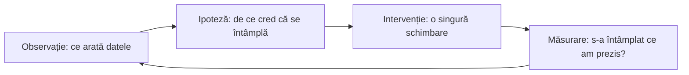

> **De reținut.** O analiză care nu se termină cu o decizie, cu un termen de verificare și cu un prag de renunțare rămâne un raport. Scopul analizei într-o firmă este să schimbe ce faci luni dimineață.

## 9.2 Observație și ipoteză

### Cum le deosebești

O **observație** este ceva ce se poate citi direct în date. Doi oameni care se uită la același tabel trebuie să ajungă la aceeași observație. „În noiembrie au fost 796 de comenzi” este o observație.

O **ipoteză** este o explicație propusă sau o predicție. Conține, de obicei, un „pentru că”, un „din cauza” sau un „dacă facem X, atunci Y”. Doi oameni rezonabili pot să nu fie de acord cu ea. „Comenzile au crescut pentru că reclamele au funcționat” este o ipoteză.

Trei teste rapide te ajută să le separi:

1. **Testul tabelului.** Pot arăta cu degetul celula sau calculul din care rezultă afirmația? Dacă da, este observație.
2. **Testul lui „pentru că”.** Afirmația explică un motiv sau prezice viitorul? Atunci este ipoteză, oricât de plauzibilă ar suna.
3. **Testul contrazicerii.** Ce rezultat m-ar face să renunț la afirmație? O ipoteză bună poate fi infirmată de date. Dacă nimic nu o poate contrazice, nu este o ipoteză utilă, este o părere.

Mai există o a treia categorie, care se strecoară des în rapoarte: **judecata de valoare**. „Campania a fost un succes” nu este nici observație, nici ipoteză, până nu spui după ce criteriu judeci. După numărul de comenzi, da. După rezultat, nu.

### Exercițiu lucrat: opt afirmații despre Cămară

| Nr. | Afirmație | Ce este | De ce |
|---|---|---|---|
| 1 | În noiembrie, comenzile au fost cu 44% mai multe decât în septembrie. | Observație | Se calculează direct: 796 față de 553. |
| 2 | Reclamele au adus clienți noi. | Ipoteză | Datele arată comenzi atribuite canalului Reclame după ultimul clic. Nu arată dacă acei oameni erau clienți noi. |
| 3 | Pe canalul Reclame, valoarea medie a comenzii a scăzut de la 150 la 105 lei. | Observație | Venit împărțit la comenzi, pe canal. |
| 4 | Valoarea medie a scăzut din cauza codului de 20%. | Ipoteză | Reducerea explică o parte. Dar 150 de lei minus 20% înseamnă 120, nu 105. Poate că publicul nou cumpără și coșuri mai mici. |
| 5 | Clienții veniți prin reclame nu vor mai comanda a doua oară. | Ipoteză | Este o predicție. Setul de date nu urmărește clienții în timp. |
| 6 | Canalele Căutare, Email și Direct au rămas aproape neschimbate. | Observație | 489 de comenzi în septembrie, 510 în noiembrie, pe cele trei canale la un loc. |
| 7 | Dacă oprim reducerea, pierdem jumătate din comenzile din reclame. | Ipoteză | Predicție despre o intervenție. Se poate testa. |
| 8 | Campania a fost o greșeală. | Judecată de valoare | Depinde de criteriu și de ce nu știm încă (de exemplu, câți dintre clienții noi revin). |

Afirmația 4 merită un minut în plus. Sună ca o observație, pentru că reducerea și scăderea coșului au apărut în același timp. Dar un calcul simplu arată că reducerea singură nu explică toată scăderea. Asta este valoarea separării: te obligă să verifici dacă explicația „evidentă” acoperă toată diferența.

> **Greșeală frecventă.** Într-o ședință, cineva spune o ipoteză pe tonul unei observații („reclamele ne-au adus clienți mai slabi”), nimeni nu o contestă, iar peste o săptămână ea circulă ca fapt. Obișnuiește-te să notezi pe două coloane: „ce știm” și „ce credem”. Tot ce se află în a doua coloană are nevoie de o verificare.

### Cum scrii o ipoteză care poate fi verificată

O formulă utilă: **„Dacă [schimbăm un lucru], atunci [indicatorul] va [crește sau scădea] cu aproximativ [cât], în [interval de timp], pentru că [mecanism].”**

> **Exemplu.** Ipoteză slabă: „Reducerea strică marja.” Ipoteză verificabilă: „Dacă oprim codul de 20% pe canalul Reclame și păstrăm bugetul, atunci marja brută a comenzilor din reclame va reveni la aproximativ 45% în două săptămâni, iar numărul de comenzi săptămânale din reclame va scădea cu cel mult 30%, pentru că o parte dintre cumpărători vin pentru produs, nu pentru reducere.” A doua variantă spune ce măsori, când și ce rezultat ar contrazice-o.

## 9.3 Corelație și cauzalitate

### Ce este o corelație

Două mărimi sunt **corelate** când se mișcă împreună: când una crește, cealaltă tinde să crească și ea (corelație pozitivă) sau să scadă (corelație negativă). Corelația se vede într-un grafic de dispersie (vezi capitolul 7) și se poate rezuma printr-un coeficient între -1 și +1, pe care îl calculează orice foaie de calcul.

În datele Cămării, pe cele 12 săptămâni, cheltuiala totală de marketing și numărul total de comenzi sunt corelate aproape perfect: coeficientul este 0,995 (calculat din setul `camara_saptamanal.csv`, date fictive). În săptămânile cu buget mai mare sunt mai multe comenzi. Tentația este să tragem concluzia: reclamele aduc comenzi, deci mai multe reclame aduc și mai multe comenzi.

Concluzia poate fi adevărată. Dar corelația singură nu o dovedește. Când două lucruri se mișcă împreună, există patru explicații posibile, iar „A îl produce pe B” este doar una dintre ele.

| Explicație | Pe scurt | La Cămară |
|---|---|---|
| A produce B | Reclamele aduc comenzi. | Explicația pe care o presupunem. |
| A treia cauză | Altceva le mișcă pe amândouă. | Toamna crește pofta de zacuscă și tot toamna a fost mărit bugetul. Codul de 20% a pornit odată cu bugetul. |
| Cauzalitate inversă | B produce A. | Vânzările bune o fac pe proprietară să mărească bugetul. |
| Coincidență | Cu puține date, tiparele apar și din întâmplare. | Avem doar 12 săptămâni. |

### A treia cauză: sezonul și reducerea

O **a treia cauză** (în engleză *confounder*, variabilă de confuzie) este un factor care influențează în același timp și presupusa cauză, și presupusul efect.

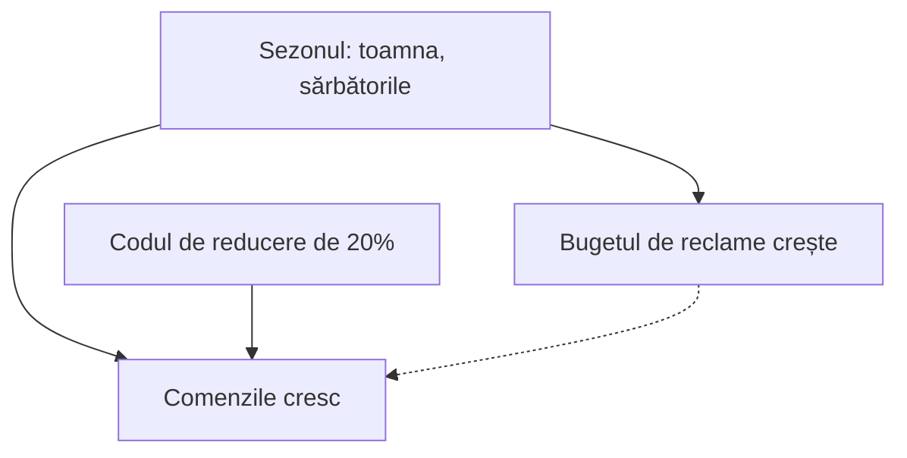

La Cămară avem doi candidați. Primul este sezonul: conservele și dulcețurile se vând mai bine toamna și înainte de sărbători, iar proprietarii măresc bugetele exact atunci. Al doilea este codul de reducere, care a pornit în aceeași săptămână cu majorarea bugetului. Când două schimbări pornesc simultan, datele nu pot spune singure care dintre ele a adus comenzile. Poate că reclamele fără reducere ar fi adus jumătate. Poate că reducerea trimisă pe email, fără nicio reclamă, ar fi adus la fel de mult.

Putem totuși să scoatem ceva din date. Canalele pe care nu s-a schimbat nimic (Căutare, Email, Direct) arată cât a crescut cererea „de la sine”: de la 489 la 510 comenzi, adică aproximativ 4%. Dacă sezonul ar fi fost motorul principal, am fi văzut o creștere mare și pe aceste canale. Nu o vedem. Deci sezonul explică puțin, iar grosul creșterii vine din pachetul „buget plus reducere”. Ce nu putem face este să despărțim bugetul de reducere. Pentru asta trebuie un experiment.

> **De reținut.** Un canal sau un grup la care nu ai schimbat nimic este cel mai ieftin „martor” pe care îl ai. Înainte să atribui o creștere unei acțiuni, uită-te cât a crescut acolo unde nu ai făcut nimic.

### Cauzalitatea inversă

Uneori săgeata merge în sens opus față de cum o desenăm. Exemple din practica unui magazin mic:

- După o săptămână bună, proprietara are bani în cont și mărește bugetul de reclame. În date apare „buget mare, vânzări mari”, dar vânzările au produs bugetul.
- Platformele de publicitate arată reclamele cu precădere oamenilor care au deja șanse mari să cumpere, de exemplu celor care au vizitat recent site-ul. O parte dintre ei ar fi comandat oricum. Regula ultimului clic (vezi capitolul 5) trece comanda în dreptul Reclamelor, deși reclama doar a prins din urmă o decizie deja luată.
- Clienții mulțumiți scriu mai des la asistență ca să mai comande. Cineva vede corelația „cine scrie la asistență cumpără mai mult” și propune ca toți clienții să fie împinși spre chat.

### Coincidența la eșantioane mici

Douăsprezece săptămâni înseamnă douăsprezece puncte pe grafic. Cu atât de puține puncte, tiparele apar ușor din întâmplare. Pentru acest capitol am făcut o simulare: 20.000 de perechi de șiruri de câte 12 numere complet aleatoare, fără nicio legătură între ele. Aproximativ una din zece perechi a avut un coeficient de corelație mai mare de 0,5 în valoare absolută. Când șirurile au o tendință în timp (fiecare valoare pornește de la cea dinainte, cum se întâmplă cu vânzările, bugetele sau numărul de abonați), proporția urcă la aproximativ patru din zece.

Concluzia practică: două serii care cresc amândouă în timp vor fi aproape mereu corelate, indiferent dacă au vreo legătură. Numărul de comenzi ale Cămării este corelat și cu numărul de zile scurse de la 1 septembrie, și cu scăderea temperaturii de afară, și cu prețul benzinei, dacă s-a întâmplat să crească în acea toamnă.

> **Greșeală frecventă.** „Am postat mai des pe Instagram și vânzările au crescut.” Dacă ambele au crescut treptat timp de trei luni, corelația este garantată și nu spune nimic. Întreabă-te: în săptămânile în care am postat mai mult decât tendința, am vândut mai mult decât tendința?

### Lista de verificare pentru orice „X a adus Y”

1. Ce altceva s-a schimbat în aceeași perioadă (preț, reducere, stoc, sezon, concurență, o apariție în presă)?
2. Ce s-a întâmplat acolo unde nu am schimbat nimic?
3. Se poate ca Y să fi produs X?
4. Câte puncte de date am? Sunt săptămâni sau luni independente, sau o singură tendință?
5. Am un mecanism credibil și, mai ales, o predicție pe care o pot verifica?
6. Pot face un test în care schimb doar X?

Dacă răspunsul la întrebarea 6 este „da”, restul devin mai puțin importante. Experimentul este metoda care taie nodul.

## 9.4 Experimentul: cum afli dacă o schimbare chiar funcționează

### Ideea de bază

Un **experiment controlat** compară două grupuri care diferă printr-un singur lucru: schimbarea pe care vrei să o testezi. Forma cea mai cunoscută în mediul online este **testul A/B**: o parte dintre vizitatori văd varianta A (cea actuală), cealaltă parte văd varianta B (cea nouă), în aceeași perioadă. La final compari indicatorul ales.

Lucrarea de referință a domeniului este cartea lui Ron Kohavi, Diane Tang și Ya Xu, *Trustworthy Online Controlled Experiments: A Practical Guide to A/B Testing* (Cambridge University Press, 2020), scrisă de oameni care au condus programele de experimente de la Microsoft, Google și LinkedIn. Mesajul ei central este că intuiția, chiar și a oamenilor cu experiență, greșește des când prezice ce va funcționa, și că un rezultat de experiment merită crezut doar dacă experimentul a fost construit cu grijă. Tot acolo este reluată o regulă veche din statistică, legea lui Twyman: o cifră care arată neobișnuit de bine este, de cele mai multe ori, o greșeală de măsurare. Când un test îți arată o îmbunătățire spectaculoasă, primul gest sănătos este să cauți eroarea.

### Cele patru ingrediente

**Grupul de control.** Este grupul la care nu schimbi nimic. Fără el, nu ai cu ce compara. „Am schimbat pagina de produs și conversia a crescut” nu spune nimic dacă în aceeași săptămână a început sezonul cadourilor. Grupul de control trece prin același sezon, aceleași zile de salariu, aceeași vreme. Tot ce îl deosebește de grupul de test este schimbarea ta.

**Randomizarea.** Cine ajunge în fiecare grup se hotărăște prin tragere la sorți, nu prin alegere. Dacă trimiți oferta nouă „celor mai buni clienți”, grupul de test va cumpăra mai mult oricum. Tragerea la sorți face ca grupurile să semene între ele la tot ce contează, inclusiv la lucrurile pe care nu te-ai gândit să le măsori. Într-o foaie de calcul, randomizarea se face în trei pași: adaugi o coloană cu un număr aleator (funcția `RAND()` sau `ALEATORIU()`), sortezi după ea, tai lista la jumătate.

**O singură schimbare o dată.** Dacă varianta B are alt titlu, altă fotografie și alt preț, iar B câștigă, nu știi care dintre cele trei a contat. Exact asta s-a întâmplat la Cămară, la scară mare: bugetul și reducerea au fost schimbate împreună.

**Un indicator ales dinainte.** Hotărăști înainte de test ce măsori și ce înseamnă succes. La Cămară, indicatorul potrivit nu este numărul de comenzi (care crește la orice reducere), ci contribuția pe vizitator sau pe destinatar: câți lei rămân, după costurile variabile, pentru fiecare om inclus în test. Alegi și unul sau două **indicatoare de pază**, care nu au voie să se strice: rata de retur, numărul de reclamații, valoarea medie a comenzii.

### Cât durează un test

Două reguli simple acoperă majoritatea cazurilor unei firme mici:

- **Săptămâni întregi.** Oamenii cumpără altfel lunea față de sâmbăta. Un test de patru zile compară bucăți de săptămână diferite. Rulează cel puțin o săptămână completă, de preferat două.
- **Durata se fixează dinainte.** Scrii „test de 14 zile” și te uiți la rezultat în ziua a 14-a. De ce contează atât de mult, vezi mai jos, la capcane.

Evită perioadele atipice: Black Friday, săptămâna dinaintea Crăciunului, o zi în care ai apărut la televiziunea locală. Ce afli atunci nu se aplică unei săptămâni obișnuite.

### Mărimea eșantionului, la nivel de intuiție

Vânzările au zgomot. Dacă la 1.000 de vizite te aștepți la 25 de comenzi (o rată de conversie de 2,5%), într-o săptămână vei avea 21, în alta 29, fără să se fi schimbat nimic. Abaterea obișnuită este cam cât rădăcina pătrată a numărului de comenzi: la 25 de comenzi, plus sau minus 5. Adică plus sau minus 20%, doar din întâmplare.

De aici rezultă ideea de bază: **cu cât efectul pe care îl cauți este mai mic, cu atât ai nevoie de mai mulți oameni în test**, iar creșterea este abruptă. Ca să vezi un efect de două ori mai mic, îți trebuie de patru ori mai mulți vizitatori. O regulă practică răspândită, reluată și în cartea lui Kohavi, Tang și Xu, spune că numărul necesar în fiecare grup este de aproximativ 16 ori varianța indicatorului, împărțit la pătratul diferenței pe care vrei să o detectezi. Nu trebuie să reții formula. Reține ordinul de mărime din tabelul de mai jos, calculat cu această regulă pentru o rată de conversie de pornire de 2,5%.

| Vrei să detectezi o creștere a conversiei | Creștere relativă | Vizitatori necesari în fiecare grup (aproximativ) |
|---|---|---|
| de la 2,5% la 3,5% | +40% | 3.900 |
| de la 2,5% la 3,0% | +20% | 15.600 |
| de la 2,5% la 2,75% | +10% | 62.400 |

Cămara are în jur de 8.000 de vizite pe săptămână în noiembrie (date fictive). Un test pe tot site-ul, împărțit în două, ar putea detecta în două săptămâni doar efecte mari, de ordinul a 30-40%. Pentru o îmbunătățire de 10% ar trebui să ruleze aproape patru luni. Concluzia pentru o firmă mică: **testează schimbări mari**, nu culoarea unui buton. O ofertă nouă, un prag de transport gratuit, un alt preț, o altă primă pagină. Schimbările mici se hotărăsc cu bun-simț, nu cu teste.

### Semnificația statistică, fără formule grele

Să zicem că ai trimis un email la 4.000 de abonați, împărțiți la întâmplare în două (cifre ipotetice, pentru ilustrare). Grupul A, cu mesajul obișnuit: 2.000 de destinatari, 40 de comenzi, adică 2,0%. Grupul B, cu oferta nouă: 2.000 de destinatari, 52 de comenzi, adică 2,6%. B pare cu 30% mai bun.

Întrebarea la care răspunde un test statistic este una singură: **dacă oferta nouă nu ar avea niciun efect, cât de des aș vedea, din pură întâmplare, o diferență cel puțin atât de mare?** Răspunsul se numește valoarea p (*p-value*). Prin convenție, un rezultat este numit „semnificativ statistic” când această probabilitate este sub 5%.

Pentru cifrele de mai sus, testul obișnuit pentru compararea a două proporții (cel pe care îl aplică și calculatoarele online de teste A/B) dă o valoare p de aproximativ 0,20. Adică, fără niciun efect real, ai vedea o asemenea diferență cam o dată din cinci încercări. Rezultatul este încurajator, dar nu este o dovadă. Ai trei variante oneste: repeți testul pe încă o trimitere și aduni datele, accepți riscul pentru că decizia este ieftină și reversibilă, sau renunți.

Trei precizări ca să nu citești greșit cuvântul „semnificativ”:

- **Semnificativ nu înseamnă important.** Cu un milion de vizitatori, o diferență de 0,05 puncte procentuale poate fi semnificativă statistic și complet irelevantă pentru afacere.
- **Nesemnificativ nu înseamnă „fără efect”.** Înseamnă că testul tău nu a fost destul de mare ca să vadă efectul, dacă există.
- **5% este o convenție, nu o lege a naturii.** Pentru o decizie ușor de întors, poți accepta mai multă incertitudine. Pentru una greu de întors (schimbi furnizorul, renunți la un canal), cere mai multă siguranță.

### Capcane

| Capcană | Ce se întâmplă | Cum o eviți |
|---|---|---|
| Oprirea prea devreme | Te uiți zilnic și oprești testul când B conduce. La început diferențele sar mult; dacă oprești la primul vârf, „câștigi” des din întâmplare. | Fixează durata dinainte. Uită-te zilnic doar ca să prinzi defecte, nu ca să decizi. |
| Prea multe variante | Testezi 20 de titluri. La pragul de 5%, unul dintre ele va părea câștigător din întâmplare, în medie. | Două, cel mult trei variante. Câștigătorul surprinzător se retestează. |
| Prea mulți indicatori | Varianta B nu câștigă la conversie, dar „câștigă la clienții de pe mobil din Moldova, joia”. | Indicatorul principal se alege înainte. Restul sunt idei pentru testul următor. |
| Efectul de noutate | Clienții vechi dau clic pe orice arată altfel. După două săptămâni efectul dispare. | Rulează mai mult sau uită-te separat la vizitatorii noi. |
| Grupuri care se amestecă | Clientul din grupul de control află codul de reducere de la un prieten din grupul de test. | Coduri unice sau cu utilizare limitată; măsoară câte comenzi cu cod vin din afara grupului. |
| Grupuri inegale | Ai împărțit 50/50, dar în raport apar 2.000 și 1.700 de oameni. | Semn de defect tehnic. Nu interpreta rezultatul până nu afli unde s-au pierdut 300 de oameni. |

### Ce poate testa o firmă mică fără instrumente scumpe

Nu ai nevoie de o platformă de experimente ca să înveți din date. Iată trei metode, de la cea mai slabă la cea mai bună.

**1. Înainte și după, cu atenție la sezon.** Schimbi ceva și compari perioada de după cu cea dinainte. Este cea mai slabă metodă, pentru că orice altceva s-a schimbat între timp se amestecă în rezultat. O poți întări în trei feluri: compari cu aceeași perioadă a anului trecut, nu doar cu luna trecută; folosești un „martor” la care nu ai umblat (un canal, o categorie de produse, un oraș); alegi săptămâni obișnuite, fără sărbători și fără alte campanii.

> **Exemplu.** Cămara oprește codul de 20% pe Reclame în săptămâna 13. Comenzile din reclame scad de la 72 la 50. Înainte să tragi concluzia, uită-te la Căutare: dacă și acolo comenzile au scăzut cu 10% (a trecut vârful de sezon), atunci doar o parte din scăderea de pe Reclame vine de la oprirea codului. Diferența dintre cele două scăderi este estimarea ta.

**2. Săptămâni alternate.** Aplici schimbarea în săptămânile cu număr impar și revii la varianta veche în cele cu număr par, timp de 6-8 săptămâni. Tendința de sezon afectează ambele tipuri de săptămâni aproape la fel, așa că se anulează în mare parte. Metoda merge bine pentru lucruri care se pot porni și opri curat: un prag de transport gratuit, un banner, o ordine a produselor pe prima pagină. Merge prost pentru lucruri cu efect întârziat (un client care a văzut oferta săptămâna trecută comandă săptămâna aceasta) și pentru prețuri, unde clienții se pot simți nedreptățiți.

**3. Cod de reducere doar pentru jumătate din listă.** Este un test A/B adevărat, făcut cu instrumente pe care le ai deja. Împarți la întâmplare lista de email în două. Jumătate primește oferta, cealaltă jumătate primește același email fără ofertă. După 7-10 zile compari, pentru fiecare jumătate, numărul de comenzi, venitul și, mai ales, contribuția totală. Capcana clasică este să compari doar comenzile făcute cu cod: așa nu afli câte dintre ele ar fi venit oricum. Comparația corectă este între toți oamenii din grupul A și toți oamenii din grupul B.

> **Pentru afacerea ta.** Începe cu lista de email sau de mesaje, pentru că acolo controlezi cine ce primește. Alege o singură întrebare care te costă bani dacă greșești (de obicei: „merită reducerea asta?”). Împarte lista în două cu un număr aleator, trimite, așteaptă o săptămână, compară lei rămași, nu comenzi. Un asemenea test durează o oră de pregătire.

## 9.5 Fișa de decizie

### De ce o pagină scrisă

O decizie luată din vorbe se rescrie singură în memorie. Peste o lună, dacă a mers bine, toată lumea „a știut de la început”. Dacă a mers prost, nimeni nu-și mai amintește ce se aștepta. **Fișa de decizie** este o pagină pe care o completezi înainte de a schimba ceva. Are șase rubrici:

1. **Intervenția:** o singură schimbare, descrisă atât de concret încât altcineva să o poată executa.
2. **Datele care o susțin:** observațiile, cu cifre. Separat, ipoteza.
3. **Ce măsurăm:** un indicator principal și unul sau două de pază.
4. **Când verificăm:** o dată din calendar.
5. **Cum arată succesul și la ce rezultat renunțăm:** două praguri numerice, scrise dinainte.
6. **Riscuri și ce nu știm.**

Rubrica 5 este cea mai importantă și cea mai des sărită. Pragul de renunțare scris dinainte te apără de tine: fără el, vei găsi mereu un motiv să mai aștepți o săptămână.

Mai jos sunt trei fișe lucrate pentru Cămară. Toate calculele pornesc de la setul de date fictiv și de la ipotezele cazului: marjă brută de 45% la preț întreg, 14 lei pe comandă pentru ambalare și livrare. Unde am adăugat ipoteze noi, am spus-o explicit. Calculele sunt pe săptămână, pe canalul Reclame, cu media din noiembrie ca punct de plecare: aproximativ 72 de comenzi, buget de 4.200 de lei, contribuție de aproximativ -2.874 de lei pe săptămână.

### Fișa 1. Oprim reducerea de 20%, păstrăm bugetul

| Rubrică | Conținut |
|---|---|
| Intervenția | De luni, reclamele rulează fără codul de 20%. Bugetul rămâne 4.200 de lei pe săptămână. Nimic altceva nu se schimbă. |
| Datele care o susțin | Observație: marja brută pe Reclame a scăzut de la 45% la 31%; contribuția pe comandă este -40 de lei. Ipoteză: o parte dintre clienți ar cumpăra și fără reducere. |
| Ce măsurăm | Principal: contribuția săptămânală a canalului Reclame. De pază: numărul de comenzi din reclame, valoarea medie a comenzii. |
| Când verificăm | După trei săptămâni complete. |
| Succes | Contribuția canalului urcă peste -1.000 de lei pe săptămână, cu cel puțin 65 de comenzi. |
| Renunțăm dacă | Comenzile din reclame scad sub 30 pe săptămână. Sub acest nivel, varianta fără cod pierde mai mult decât cea cu cod. |
| Riscuri | Scăderea comenzilor poate fi mai mare decât credem. Rezultatul se suprapune cu sezonul de sărbători. |

Calculul din spate, pe scurt. Coșul de 105 lei cu reducere ar costa aproximativ 131 de lei la preț întreg. La marja de 45%, asta înseamnă cam 59 de lei marjă brută, din care scădem 14 lei ambalare și livrare: rămân 45 de lei pe comandă înainte de costul reclamei. Întrebarea este câte comenzi rămân după ce dispare reducerea.

| Scenariu (ipoteze de lucru) | Comenzi pe săptămână | Contribuție înainte de reclame | Buget | Contribuția canalului |
|---|---|---|---|---|
| Situația de acum, cu cod | 72 | 1.326 | 4.200 | -2.874 |
| Optimist: nu pierdem comenzi | 72 | 3.240 | 4.200 | -960 |
| Mediu: pierdem 30% | 50 | 2.250 | 4.200 | -1.950 |
| Pesimist: pierdem 50% | 36 | 1.620 | 4.200 | -2.580 |

Tabelul spune două lucruri. Primul: oprirea reducerii îmbunătățește situația în toate cele trei scenarii, chiar dacă pierdem jumătate din comenzi. Abia sub 30 de comenzi pe săptămână ajungem mai rău decât acum. Al doilea, mai puțin plăcut: în niciun scenariu canalul nu ajunge pe plus. La 45 de lei pe comandă și un buget de 4.200 de lei, ar fi nevoie de 93 de comenzi pe săptămână doar ca reclamele să se plătească singure. Fișa 1 oprește o parte din pierdere, nu rezolvă problema.

### Fișa 2. Coborâm bugetul la nivelul din septembrie

| Rubrică | Conținut |
|---|---|
| Intervenția | Bugetul de Reclame revine la 600 de lei pe săptămână, cu campania din septembrie, fără cod de reducere. |
| Datele care o susțin | Observație: în septembrie, la 600 de lei pe săptămână, canalul aducea 16 comenzi de câte 150 de lei și o contribuție de +256 de lei. Observație: comenzile de pe celelalte canale au crescut doar cu 4% în perioada cu buget mare. Ipoteză: revenirea la bugetul vechi readuce și rezultatele vechi. |
| Ce măsurăm | Principal: rezultatul simplificat lunar. De pază: comenzile pe Căutare și Direct (ca să vedem dacă reclamele le susțineau indirect). |
| Când verificăm | După patru săptămâni complete. |
| Succes | Contribuția canalului Reclame revine pe plus, iar rezultatul lunar trece de 15.000 de lei. |
| Renunțăm dacă | Comenzile pe Căutare și Direct, la un loc, scad cu peste 20% față de noiembrie. Ar însemna că reclamele aduceau indirect mult mai mult decât arată ultimul clic. |
| Riscuri | Pierdem aproximativ 220 de comenzi pe lună și clienții noi pe care îi aduceau. Nu știm câți dintre ei ar fi revenit. Venitul scade vizibil. |

Dacă ipoteza se confirmă întocmai, contribuția canalului trece de la -11.495 de lei pe lună la +1.024, iar rezultatul simplificat urcă de la 6.758 la aproximativ 19.277 de lei. Venitul lunar coboară de la 109.125 la aproximativ 88.700 de lei. Aici stă dificultatea omenească a deciziei: trebuie să accepți un magazin care arată mai mic pe ecran și câștigă de aproape trei ori mai mult.

Fișa 2 are și o problemă de metodă, pe care e bine să o recunoști: schimbă două lucruri deodată (bugetul și reducerea). Dacă merge, nu vei ști care a contat. Varianta „curată” ar fi fișa 1 timp de trei săptămâni, apoi fișa 2. Numai că fiecare săptămână de așteptare costă aproape 2.900 de lei. Este un compromis clasic între a învăța și a câștiga. Când pierderea curentă este mare și decizia se poate întoarce ușor (bugetul se mărește la loc într-o zi), este rezonabil să oprești întâi pierderea și să înveți după aceea, cu teste mici.

### Fișa 3. Prag de transport gratuit la 200 de lei

Această fișă cere o ipoteză suplimentară. În modelul simplificat al cazului, firma suportă 14 lei pe comandă pentru ambalare și livrare. Presupunem, pentru exercițiu, că restul costului de curier este plătit astăzi de client ca taxă de livrare, de 15 lei, și că pragul de transport gratuit ar muta această sumă în sarcina firmei pentru comenzile de peste 200 de lei.

| Rubrică | Conținut |
|---|---|
| Intervenția | Comenzile de peste 200 de lei au transport gratuit. Mesajul apare în coș: „Mai adaugă X lei pentru transport gratuit”. Se aplică pe tot site-ul, în săptămâni alternate, timp de 8 săptămâni. |
| Datele care o susțin | Observație: valoarea medie a comenzii pe Căutare, Email și Direct este între 150 și 165 de lei, deci multe coșuri sunt la un produs sau două distanță de prag. Ipoteză: o parte dintre clienți vor adăuga un produs ca să scape de taxa de livrare. |
| Ce măsurăm | Principal: contribuția pe comandă, în săptămânile cu prag față de cele fără. De pază: ponderea comenzilor de peste 200 de lei, rata de conversie. |
| Când verificăm | După 8 săptămâni (4 cu prag, 4 fără). |
| Succes | Contribuția pe comandă crește cu cel puțin 1 leu, iar conversia nu scade. |
| Renunțăm dacă | Pentru fiecare comandă care trecea oricum de prag nu apare cel puțin o comandă „urcată” peste prag. |
| Riscuri | Clienții care comandau oricum peste 200 de lei primesc un cadou de 15 lei fără să-și schimbe comportamentul. Efectul total este mic. |

Calculul, pe 100 de comenzi de pe canalele neplătite (ipoteze de lucru): 15 comenzi trec deja de 200 de lei, iar celelalte 85 au în medie 142 de lei. Cele 15 comenzi mari primesc transportul gratuit fără să aducă nimic în plus: cost 15 × 15 = 225 de lei. Un client care își urcă coșul de la 142 la 207 lei aduce 65 de lei venit în plus, adică aproximativ 29 de lei marjă brută, din care firma plătește 15 lei transport. Rămân cam 14 lei câștig net pe fiecare comandă urcată. Ca să acopere cei 225 de lei, trebuie 16 comenzi urcate la 100. De aici regula din fișă: o comandă urcată pentru fiecare comandă care trecea oricum de prag.

Pe cele aproximativ 510 comenzi lunare ale canalelor neplătite, rezultatul ar fi între -420 și +1.030 de lei pe lună, după cum se urcă 10, 20 sau 30 de comenzi din 100. Este o idee bună de testat, dar efectul ei este de zece ori mai mic decât al fișei 2.

> **De reținut.** Pune fișele una lângă alta și compară ordinul de mărime al efectului. Energia unei firme mici este limitată. Întâi se rezolvă problema de 12.000 de lei pe lună, apoi cea de 500.

## 9.6 Compromisuri: orice pârghie are un cost

### Trei costuri care se uită ușor

**Randamentul descrescător al reclamelor.** Primii lei cheltuiți ajung la oamenii cei mai interesați. Pe măsură ce mărești bugetul, platforma arată reclama unui public tot mai larg și mai puțin interesat. Fiecare comandă în plus costă mai mult decât cea dinainte. Datele Cămării arată efectul, cu rezerva că în săptămânile 5-12 rula și reducerea:

| Buget săptămânal (lei) | Comenzi din reclame | Cost mediu pe comandă (lei) | Costul unei comenzi în plus față de treapta anterioară (lei) |
|---|---|---|---|
| 600 | 16 | 37,5 | - |
| 1.500 | 30 | 50,0 | 64 |
| 2.600 | 43 | 60,5 | 85 |
| 3.300 | 54 | 61,1 | 64 |
| 3.800 | 61 | 62,3 | 71 |

Coloana din dreapta este cea care contează pentru decizie. Costul mediu ascunde faptul că fiecare comandă adăugată peste primele 16 a costat între 64 și 85 de lei. O comandă de 150 de lei la preț întreg lasă 53,50 lei după marfă, ambalare și livrare. Atât poți plăti, cel mult, ca să o obții, dacă judeci doar prima comandă. La 37,50 lei, reclamele din septembrie erau o afacere bună. Orice treaptă de deasupra a costat mai mult decât aduce, chiar și fără reducere.

> **Greșeală frecventă.** „Costul mediu pe comandă este 50 de lei, sub limita noastră de 53, deci mai mărim bugetul.” Media include comenzile ieftine de la început. Decizia de a mări bugetul se judecă după costul comenzilor suplimentare, nu după medie.

**Reducerea taie din marjă, nu din preț.** O reducere de 20% la un produs cu marjă brută de 45% nu micșorează câștigul cu 20%. Dintr-un produs de 100 de lei, 55 de lei sunt costul mărfii și 45 de lei marja. După reducere încasezi 80 de lei, costul rămâne 55, marja scade la 25 de lei. Ai dat 20% din preț și ai pierdut 44% din marjă. Ca să câștigi aceiași bani, trebuie să vinzi cu 80% mai multe bucăți (45 împărțit la 25 este 1,8). Puține reduceri aduc atât.

**Costuri pe comandă față de costuri fixe.** Costurile fixe (10.000 de lei pe lună la Cămară) nu se schimbă dacă vinzi 500 sau 800 de comenzi. Ele se acoperă din contribuția comenzilor. O comandă cu contribuție pozitivă, oricât de mică, ajută la acoperirea lor. O comandă cu contribuție negativă mărește gaura, indiferent cât de mult „volum” aduce. Fraza „pierdem puțin pe fiecare comandă, dar recuperăm din volum” este greșită aritmetic. Volumul ajută doar când contribuția pe comandă este pozitivă sau când volumul reduce el însuși costurile (un tarif mai bun la curier, un preț mai bun la borcane), iar asta se demonstrează cu oferta furnizorului în mână, nu se presupune.

### Cum compari opțiuni: scenarii

Un **scenariu** este un set coerent de ipoteze dus până la un rezultat în lei. Lucrezi de obicei cu trei: pesimist, mediu, optimist. Rostul lor nu este să ghicești viitorul, ci să vezi cât de mult depinde decizia de lucrurile pe care nu le știi.

| Opțiune | Pesimist (lei pe lună) | Mediu (lei pe lună) | Optimist (lei pe lună) |
|---|---|---|---|
| Nu schimbăm nimic | 6.758 | 6.758 | 6.758 |
| Fișa 1: fără reducere, buget păstrat | 7.934 | 10.454 | 14.414 |
| Fișa 2: buget ca în septembrie | 13.626 | 16.451 | 19.277 |
| Fișa 3: prag de transport gratuit (adăugat la situația curentă) | 6.337 | 7.064 | 7.791 |

Cifrele pentru fișa 1 și fișa 3 vin din calculele de mai sus, aduse la nivel de lună. Pentru fișa 2, scenariul optimist presupune că celelalte canale nu sunt afectate, cel mediu că pierd 10% din contribuție, iar cel pesimist că pierd 20%, în ideea că reclamele le susțineau indirect.

### Analiza de sensibilitate

**Analiza de sensibilitate** pune o singură întrebare: cât de mult trebuie să greșesc la o ipoteză ca să se schimbe decizia? Iei ipoteza cea mai nesigură și o miști până când opțiunea aleasă nu mai este cea mai bună.

La fișa 2, ipoteza nesigură este efectul indirect al reclamelor asupra celorlalte canale. Contribuția lunară a canalelor Căutare, Email și Direct este de aproximativ 28.250 de lei. Fișa 2 aduce 12.519 lei față de situația de acum. Ca avantajul să dispară, celelalte canale ar trebui să piardă 12.519 din 28.250, adică 44% din contribuție. Datele spun că aceste canale au crescut cu doar 4% când bugetul a crescut de șapte ori. O cădere de 44% la reducerea bugetului este foarte greu de imaginat. Decizia este **robustă**: rămâne bună chiar dacă ipotezele sunt mult greșite.

La fișa 3, lucrurile stau invers. Pragul de rentabilitate este la 16 comenzi urcate din 100, iar scenariile noastre merg de la 10 la 30. Decizia este **sensibilă**: o mică eroare de estimare schimbă semnul rezultatului. Tocmai de aceea fișa 3 este un candidat bun pentru un test, iar fișa 2 se poate aplica direct.

> **De reținut.** Deciziile robuste se iau. Deciziile sensibile se testează. Analiza de sensibilitate îți spune în ce categorie ești și, prin urmare, unde merită să cheltuiești timp cu un experiment.

### Cel mai rău caz

Ultima întrebare este cea a supraviețuirii: dacă iese scenariul pesimist, pot trăi cu el? Uită-te pe coloana „Pesimist” din tabel. Fișa 2 are cel mai bun cel mai rău caz (13.626 de lei), dublu față de situația curentă. Fișa 3 poate pierde câteva sute de lei pe lună, o sumă pe care firma o suportă ușor ca preț al învățării.

Două întrebări completează tabloul. Prima: **cât de reversibilă este decizia?** Un buget de reclame se schimbă la loc într-o zi. Un contract pe un an cu un depozit, nu. La deciziile reversibile poți accepta mai multă incertitudine. A doua: **cât costă să nu decizi?** La Cămară, fiecare săptămână de amânare înseamnă aproape 2.900 de lei pierduți pe canalul Reclame. A nu hotărî nimic este și ea o decizie, cu un cost care se poate calcula.

## 9.7 De la descriptiv la prescriptiv într-o firmă mică

În capitolul 1 am întâlnit cele patru niveluri de analiză din prezentarea de curs: descriptiv (ce s-a întâmplat?), diagnostic (de ce s-a întâmplat?), predictiv (ce se va întâmpla?) și prescriptiv (ce ar trebui să facem?). Prezentarea le asociază cu instrumente tot mai grele, de la tablouri de bord până la platforme de inteligență artificială. Pentru o firmă cu trei oameni, întrebarea realistă este alta: ce pot face la fiecare nivel cu ce am deja?

| Nivel | Întrebarea | Ce poți face realist într-o firmă mică | Instrumente suficiente |
|---|---|---|---|
| Descriptiv | Ce s-a întâmplat? | Un tabel săptămânal cu 5-7 indicatori pe canal și un tablou de bord simplu (vezi capitolul 7). | Exportul din platforma magazinului, foaie de calcul. |
| Diagnostic | De ce? | Descompunere pe canale, produse, clienți noi și vechi; comparație cu un martor; economia unei comenzi (vezi capitolul 5). | Tabele pivot, pandas (vezi capitolul 8). |
| Predictiv | Ce va fi? | Prognoză simplă: media ultimelor 4 săptămâni, corectată cu aceeași perioadă a anului trecut; scenarii pesimist, mediu, optimist. | Foaie de calcul. Modele statistice doar când ai cel puțin doi-trei ani de date. |
| Prescriptiv | Ce facem? | Fișe de decizie, teste mici, reguli scrise de tipul „dacă, atunci”. | O pagină de text, un calendar, disciplină. |

Câteva observații despre acest tabel.

**Nivelurile de sus nu le înlocuiesc pe cele de jos.** Fără date descriptive curate, orice prognoză este o ghicitoare cu zecimale. Cele mai multe firme mici câștigă cel mai mult din primele două niveluri făcute bine și regulat.

**Predicția unei firme mici este modestă și utilă.** Nu ai nevoie de învățare automată (*machine learning*) ca să știi că în decembrie vei vinde mai multă miere. Ai nevoie de vânzările din decembrie trecut, de tendința ultimelor săptămâni și de un interval, nu de un singur număr: „între 700 și 900 de comenzi” este o prognoză mai onestă și mai folositoare decât „812”.

**Prescriptivul la scară mică înseamnă reguli de decizie.** O regulă scrisă dinainte este o formă simplă de analiză prescriptivă. De exemplu: „Dacă două săptămâni la rând costul reclamei pe comandă depășește 50 de lei, bugetul scade cu 20%.” Sau: „Nicio reducere peste 10% fără un calcul al marjei rămase.” Regulile de acest fel iau decizia la rece, înainte ca emoția momentului să intervină.

**Atenție la prescriptivul automat al platformelor.** Platformele de publicitate oferă licitare automată și recomandări de buget. Ele optimizează obiectivul pe care li-l dai, de regulă numărul de conversii sau venitul atribuit. Nu îți cunosc marja, costul de livrare sau costurile fixe. O recomandare de tipul „mărește bugetul ca să obții mai multe conversii” este corectă pentru obiectivul platformei și poate fi dăunătoare pentru rezultatul tău. Cazul Cămării este exact povestea unei optimizări reușite pe indicatorul greșit.

### Rolul și limitele instrumentelor de inteligență artificială

Asistenții bazați pe modele lingvistice mari (în engleză *Large Language Models*, LLM) au intrat repede în munca de analiză. Merită folosiți, cu ochii deschiși.

La ce ajută cu adevărat:

- **Scriu și explică formule și cod.** Poți cere o formulă de foaie de calcul sau o secvență pandas pentru o descompunere pe canale și poți cere explicația fiecărei linii (vezi capitolul 8).
- **Propun explicații alternative.** Întrebarea „ce altceva ar putea explica această creștere?” primește de obicei o listă mai lungă decât a ta. Este un bun antidot la părtinirea de confirmare (vezi secțiunea 9.8).
- **Structurează.** Transformă notițe dezordonate într-o fișă de decizie, într-un plan de test sau într-un chestionar.
- **Rezumă text.** Recenzii, răspunsuri deschise la chestionare, mesaje de la clienți, grupate pe teme.

Unde trebuie prudență:

- **Pot greși calcule și pot inventa.** Un răspuns fluent nu este un răspuns verificat. Orice cifră care intră într-o decizie se recalculează de tine, din datele tale. Orice sursă citată se deschide.
- **Nu îți cunosc contextul.** Nu știu că furnizorul de miere a scumpit în octombrie sau că ai avut site-ul căzut două zile. Dacă nu le spui, vor explica datele fără aceste fapte.
- **Nu fac minuni cauzale.** Dacă datele sunt observaționale, un asistent nu poate scoate din ele o cauză. Poate cel mult să formuleze ipoteze. Diferența dintre corelație și cauzalitate rămâne valabilă oricât de inteligent ar fi instrumentul.
- **Sunt de acord prea ușor.** Dacă întrebi „nu-i așa că reclamele au funcționat?”, ai șanse mari să primești argumente pentru. Întreabă neutru sau cere explicit contraargumente.
- **Datele personale nu se încarcă la întâmplare.** O listă de clienți cu nume, emailuri și adrese este un set de date personale. Trimiterea ei către un serviciu extern este o prelucrare care are nevoie de temei legal și de garanții contractuale (vezi secțiunea 9.9). Pentru analiză ajung aproape întotdeauna date agregate sau anonimizate: tabelul săptămânal al Cămării nu conține niciun client.

> **De reținut.** Folosește inteligența artificială ca pe un coleg rapid și neobosit, care nu a văzut niciodată firma ta și care nu răspunde pentru rezultat. Răspunderea pentru decizie rămâne la om.

## 9.8 Capcane de judecată în decizii

Datele bune nu ajung. Felul în care le citim are tipare previzibile de eroare, descrise sistematic de psihologii Amos Tversky și Daniel Kahneman începând cu anii 1970 și popularizate de Kahneman în cartea *Thinking, Fast and Slow* (2011). Iată cele care apar cel mai des în deciziile unui mic magazin online.

| Capcana | Cum arată la Cămară | Antidot |
|---|---|---|
| Părtinirea de confirmare | Proprietara a decis campania, deci se uită la comenzi (+44%) și nu la rezultat (-63%). | Scrie dinainte ce rezultat te-ar face să recunoști că ai greșit. Cere cuiva să apere poziția opusă. |
| Părtinirea supraviețuitorului | „Toate magazinele de succes pe care le urmăresc fac reclame agresive.” Cele care au făcut la fel și au închis nu mai postează. | Întreabă: pe cine nu văd în aceste date? |
| Ancorarea | Discuția este „20% sau 15% reducere?”, deși întrebarea corectă este dacă trebuie vreo reducere. Prima cifră pusă pe masă a devenit reper. | Pornește calculul de la zero: ce reducere își permite marja? |
| Costurile scufundate | „Am băgat deja 28.000 de lei în reclame în două luni, nu putem opri acum.” | Banii cheltuiți nu se întorc, orice ai face. Contează doar ce aduce leul următor. |
| Media care ascunde segmentele | Valoarea medie a comenzii a scăzut de la 154 la 137 de lei. Pare că toți clienții cumpără mai puțin. De fapt trei canale sunt neschimbate și unul s-a prăbușit. | Nu decide pe o medie până nu ai văzut-o pe segmente. |

### Supraviețuitorii din datele tale

Părtinirea supraviețuitorului merită un paragraf în plus, pentru că se ascunde în aproape orice set de date de firmă. Recenziile vin de la clienții care au primit coletul și au avut chef să scrie. Chestionarul de satisfacție este completat de cei care nu au plecat. Analiza „clienților fideli” îi include doar pe cei care au rămas. În fiecare caz, concluzia se trage dintr-un grup care a trecut deja printr-un filtru. Întrebarea de control este mereu aceeași: cine lipsește din tabel și de ce lipsește?

### Paradoxul lui Simpson: când media merge într-un sens și segmentele în celălalt

Statisticianul britanic Edward Simpson a descris în 1951 o situație care contrazice intuiția: o tendință care apare în fiecare grup luat separat poate să dispară sau să se inverseze când grupurile sunt adunate. Cauza este schimbarea ponderii grupurilor.

Datele reale ale cazului arată o versiune blândă a fenomenului. Rata de conversie a magazinului a scăzut de la 2,93% în septembrie la 2,48% în noiembrie. Pe canale, însă, Căutarea a rămas la 2,5%, Emailul la 5,0%, Directul la 3,5%. Doar Reclamele au coborât puțin, de la 2,0% la 1,8%. Scăderea de ansamblu vine aproape în întregime din faptul că Reclamele, canalul cu cea mai slabă conversie, au trecut de la 17% la 49% din vizite.

Ca să vedem paradoxul complet, construim un exemplu ipotetic pe aceleași canale. Să presupunem că în decembrie echipa îmbunătățește pagina de produs și conversia crește pe fiecare grup de canale.

| Grup de canale (exemplu ipotetic) | Perioada 1: vizite | Comenzi | Conversie | Perioada 2: vizite | Comenzi | Conversie |
|---|---|---|---|---|---|---|
| Reclame | 3.000 | 60 | 2,0% | 16.000 | 352 | 2,2% |
| Celelalte canale | 15.000 | 480 | 3,2% | 16.000 | 544 | 3,4% |
| **Total** | 18.000 | 540 | **3,0%** | 32.000 | 896 | **2,8%** |

Conversia a crescut pe Reclame. A crescut și pe celelalte canale. Iar pe total a scăzut, de la 3,0% la 2,8%. Nicio cifră nu este greșită. Totalul a scăzut pentru că în perioada a doua jumătate din vizite vin din grupul cu conversie mică, față de o șesime înainte.

Imaginează-ți ședința în care cineva vede doar ultima linie: „Am schimbat pagina de produs și conversia a scăzut. Revenim la varianta veche.” Ar anula o îmbunătățire reală pe baza unei medii.

> **Greșeală frecventă.** A compara o medie pe două perioade fără a verifica dacă amestecul s-a schimbat. Ori de câte ori compari rate (conversie, marjă, valoare medie), pune alături ponderea fiecărui segment în cele două perioade. Dacă ponderile s-au mutat, compară pe segmente.

## 9.9 Etica datelor și cadrul legal

Această secțiune explică, pe înțeles, regulile de bază pentru lucrul cu date despre oameni. **Textul nu este consultanță juridică.** Pentru o situație concretă, citește sursele oficiale indicate și consultă un specialist.

### Ce este GDPR și când te privește

Regulamentul general privind protecția datelor, cunoscut după acronimul englezesc GDPR (*General Data Protection Regulation*; în română apare și ca RGPD), este Regulamentul (UE) 2016/679. Se aplică direct în toate statele Uniunii Europene. În România, autoritatea de supraveghere este Autoritatea Națională de Supraveghere a Prelucrării Datelor cu Caracter Personal (ANSPDCP), care primește plângeri și poate aplica sancțiuni.

Potrivit portalului oficial Your Europe al Uniunii Europene, regulamentul se aplică oricărei firme cu sediul în UE care prelucrează date personale, indiferent de mărime. **Datele personale** sunt orice informații despre o persoană identificată sau identificabilă: nume, adresă, venit, adresă IP. Ghidul pentru întreprinderi mici al Comitetului european pentru protecția datelor (EDPB, *European Data Protection Board*) adaugă exemple apropiate de un magazin online: numărul de telefon, adresa de email, identificatorul de client, istoricul de navigare și de cumpărături. Regulamentul nu se aplică datelor despre persoane juridice: cifra de afaceri a unei societăți comerciale nu este o dată personală.

Un magazin ca al nostru prelucrează date personale în fiecare zi: numele și adresa de livrare, telefonul pentru curier, emailul pentru confirmare, istoricul comenzilor.

### Temeiul: de ce ai voie să folosești o dată

Orice prelucrare are nevoie de un **temei legal**. Regulamentul prevede șase, enumerate pe portalul Your Europe: consimțământul persoanei, executarea unui contract, o obligație legală, protejarea intereselor vitale, o sarcină de interes public și interesul legitim al firmei, cu condiția ca acesta să nu calce drepturile și libertățile persoanei.

| Ce face magazinul | Temei plauzibil | Observații |
|---|---|---|
| Folosește adresa ca să livreze comanda | Contract | Nu ai nevoie de consimțământ separat pentru ce este necesar livrării. |
| Păstrează facturile | Obligație legală | Legislația fiscală impune păstrarea documentelor. |
| Trimite newsletter unui abonat | Consimțământ | Dat printr-un gest clar, de exemplu bifarea unei căsuțe. Nebifată dinainte. |
| Analizează vânzările pe săptămâni și canale | De regulă interes legitim, iar pe date agregate riscul este minim | Tabelul săptămânal nu mai conține persoane. |

Consimțământul, pentru a fi valabil, trebuie să fie liber, specific, informat și lipsit de ambiguitate, exprimat printr-un act pozitiv, iar persoana trebuie să-l poată retrage (Your Europe). Ghidul EDPB atrage atenția asupra unui lucru practic: dacă prelucrarea este oricum necesară, de pildă pentru livrare, consimțământul nu este temeiul potrivit.

### Principiile, cu accent pe minimizare

Ghidul EDPB pentru întreprinderi mici rezumă șase principii: legalitate, echitate și transparență; limitarea scopului; minimizarea datelor; exactitatea; limitarea stocării; securitatea. Firma trebuie, în plus, să poată demonstra că le respectă.

Pentru cine face analiză, două dintre ele au efect imediat:

- **Limitarea scopului.** Datele strânse pentru livrare nu devin automat materie primă pentru orice altă idee. Un scop nou cere o verificare nouă a temeiului.
- **Minimizarea.** Colectezi și păstrezi doar ce îți trebuie pentru scopul declarat. Dacă nu ai nevoie de data nașterii ca să vinzi dulceață, nu o cere. În analiză, minimizarea are o formă simplă: lucrează pe cel mai agregat nivel care răspunde la întrebare. Pentru decizia despre bugetul de reclame, tabelul săptămânal pe canale a fost suficient.

### Drepturile oamenilor din tabel

Persoanele ale căror date le prelucrezi au, potrivit regulamentului, dreptul de acces la date, de rectificare, de ștergere, de restricționare, de portabilitate și de opoziție. În cazul marketingului direct, prelucrarea trebuie oprită întotdeauna la cerere. Cererile se rezolvă gratuit, cât mai repede și în cel mult o lună de la primire, cu posibilitate de prelungire pentru cereri complexe (Your Europe, „Protecția datelor conform RGPD”, accesat în noiembrie 2026).

Tot de acolo, două cifre care arată cât de serios este tratat subiectul: o încălcare a securității datelor care prezintă un risc pentru persoane se notifică autorității în 72 de ore de la constatare, iar amenzile pot ajunge până la 20 de milioane de euro sau 4% din cifra de afaceri globală.

### Cookie-uri și consimțământ

**Cookie-urile** sunt fișiere mici pe care un site le salvează în browserul vizitatorului. Regulile lor vin din legislația europeană privind confidențialitatea comunicațiilor electronice, transpusă în România prin Legea nr. 506/2004. Articolul 4 alineatul (5) din lege permite stocarea de informații în echipamentul utilizatorului numai dacă acesta și-a exprimat acordul și a primit înainte informații clare și complete despre scop.

Portalul Your Europe explică aplicarea practică:

- **Nu au nevoie de consimțământ** cookie-urile strict necesare unui serviciu cerut explicit de utilizator: cele care țin minte coșul de cumpărături, datele introduse într-un formular sau autentificarea.
- **Au nevoie de consimțământ** cookie-urile de urmărire folosite pentru publicitate comportamentală, analiză sau cercetare de piață, inclusiv cele plasate de terți. Ele nu pot fi activate la prima încărcare a paginii, înainte ca vizitatorul să fi acceptat.
- Refuzul trebuie să fie la fel de simplu ca acceptarea, iar consimțământul se dă separat pe scopuri.

Pentru analiză, urmarea este importantă: o parte dintre vizitatori refuză cookie-urile de măsurare, deci cifrele de trafic din instrumentele de analiză sunt incomplete. Vizitele raportate sunt o subestimare, iar proporția celor care refuză poate diferi între canale. Este încă un motiv să te bazezi, pentru decizii, pe datele pe care le deții sigur: comenzi, încasări, costuri.

Aceeași lege reglementează mesajele comerciale. Articolul 12 interzice comunicările comerciale prin poștă electronică fără consimțământul prealabil expres al destinatarului. Există o excepție pentru adresa obținută direct de la un client cu ocazia unei vânzări: poate fi folosită pentru produse sau servicii similare, cu condiția ca omul să se poată opune simplu și gratuit, atât la colectarea adresei, cât și la fiecare mesaj.

### Dincolo de lege: trei întrebări de etică

Legea fixează minimul. Trei întrebări te ajută să rămâi și corect, și respectat de clienți:

1. **Ar fi clientul surprins să afle ce fac cu datele lui?** Dacă da, ori îi spui clar, ori nu faci.
2. **Am nevoie de date despre persoane sau ajung totalurile?** Aproape orice decizie din acest suport de curs se poate lua pe date agregate.
3. **Experimentul meu tratează oamenii corect?** Să testezi două mesaje este în regulă. Să afișezi prețuri diferite pentru același produs unor clienți diferiți, fără să le spui, îți poate costa încrederea chiar dacă testul „iese”.

> **Pentru afacerea ta.** Fă o listă cu toate datele personale pe care le strângi (formular de comandă, newsletter, chat, cookie-uri). Pentru fiecare, scrie pe un rând: de ce o strâng, pe ce temei, cât o păstrez, cine o mai vede (curier, platformă de email, contabil). Unde nu ai un răspuns la „de ce”, șterge câmpul din formular.

## 9.10 Proiect aplicat: angajabilitatea absolvenților, un studiu făcut de studenți

### De la un titlu provocator la o întrebare de cercetare

Schița de proiect a profesorului pornește de la un titlu care atrage atenția: „De ce angajatorii nu vor studenți? Un studiu pentru studenți făcut de studenți”. Titlul este bun pentru un afiș. Pentru o cercetare, aplică-i testele din secțiunea 9.2: „angajatorii nu vor studenți” este o ipoteză, nu o observație. Poate că îi vor, dar pe alte posturi. Poate că diferă mult între specializări. Poate că nu este adevărat deloc.

Primul pas al proiectului este deci să transformi titlul în întrebări la care datele pot răspunde:

- **Întrebare descriptivă:** Ce proporție dintre absolvenții unui program lucrează la un an, la trei ani și la cinci ani de la absolvire, și cum se compară cu media națională a domeniului?
- **Întrebare descriptivă:** În ce ramuri de activitate și în ce județe lucrează absolvenții? Câți lucrează în domeniul în care au studiat?
- **Întrebare de diagnostic:** Diferă parcursul celor care au lucrat în timpul facultății față de al celor care nu au lucrat?
- **Întrebare despre angajatori:** Ce spun angajatorii din regiune că le lipsește la un absolvent proaspăt?

Observă că a treia întrebare este o capcană de cauzalitate pregătită pentru tine. Dacă studenții care au lucrat în facultate se angajează mai repede, asta nu dovedește că munca din facultate ajută. Poate că studenții mai întreprinzători fac și una, și alta. Proiectul trebuie să spună deschis ce poate și ce nu poate concluziona.

### Ce date există public: platforma UEFISCDI

Prima resursă din schiță este platforma de angajabilitate a absolvenților, operată de Unitatea Executivă pentru Finanțarea Învățământului Superior, a Cercetării, Dezvoltării și Inovării (UEFISCDI), la adresa https://angajabilitate.uefiscdi.ro/. Descrierea de mai jos reflectă ce prezenta platforma la data accesării, în noiembrie 2026. Verifică pe site forma actuală.

- **Ce este.** Platforma oferă statistici construite prin legarea datelor despre parcursul educațional de datele despre evoluția pe piața muncii.
- **Sursele ei.** Registrul Matricol Unic (RMU) pentru școlaritate, Registrul General de Evidență a Salariaților (REGES) pentru contractele de muncă și chestionarele naționale adresate absolvenților. La secțiunea de venituri sunt citate și date fiscale.
- **Generațiile acoperite.** La data accesării, selecția era limitată la generațiile de absolvenți 2016-2019, cele pentru care s-au făcut interogări în registrul salariaților. Angajabilitatea este urmărită în primii cinci ani de la absolvire.
- **Indicatori.** Inserția pe piața muncii, tipul contractului și norma de lucru, potrivirea dintre studii și ocupație, venitul, ramura de activitate a angajatorului (cod CAEN, Clasificarea Activităților din Economia Națională), județul și regiunea de angajare.
- **Filtre și comparații.** Program de studii de licență sau master de la orice universitate, cu referință națională, instituțională sau pe domeniu, și comparații între subgrupuri (de exemplu mediu de proveniență, bursă, angajare în timpul studiilor).
- **Acces.** Pagina principală arată un set restrâns de indicatori fără autentificare. Modulele extinse cer un cont gratuit.
- **Ce nu oferă.** Datele sunt statistici agregate. Platforma nu arată cariera unei persoane anume.

Limitele trebuie scrise în raport, nu ascunse. Registrul salariaților nu îi cuprinde pe absolvenții care lucrează în străinătate, pe cei din profesiile liberale și mai multe categorii din sectorul public. Un absolvent care lucrează la Viena apare în statistici ca neangajat în România, ceea ce nu înseamnă că este șomer. Iar generațiile disponibile au absolvit înainte de pandemie, deci nu descriu neapărat piața muncii de astăzi.

### Variabilele utile

Schița profesorului enumeră ce ar fi interesant de știut despre un absolvent. Tabelul le pune lângă sursa de unde pot fi obținute corect.

| Variabilă | La ce întrebare ajută | De unde se poate obține corect |
|---|---|---|
| Anul absolvirii | Compararea generațiilor; timp scurs de la absolvire | Platforma UEFISCDI (agregat); chestionar |
| Facultatea și specializarea | Diferențe între programe | Platforma UEFISCDI (agregat); chestionar |
| Localitatea sau județul actual | Câți rămân în regiune | Platforma UEFISCDI (județ, agregat); chestionar, la nivel de județ sau țară |
| Angajatorul | Legătura cu datele financiare ale firmelor | Chestionar, opțional; se păstrează separat și se raportează doar agregat |
| Funcția | Potrivirea dintre studii și ocupație | Platforma UEFISCDI (ocupații, agregat); chestionar, pe categorii |
| Ramura de activitate | Unde ajung absolvenții | Platforma UEFISCDI (cod CAEN); chestionar |
| A lucrat în timpul studiilor | Întrebarea de diagnostic | Platforma UEFISCDI (subgrup); chestionar |

### Date financiare publice despre firme

A doua parte a schiței propune o analiză financiară a angajatorilor: cât de mari sunt, dacă au profit, dacă cresc. Sunt date despre persoane juridice, deci nu date personale, iar statul publică o parte dintre ele:

- **Ministerul Finanțelor** are pe site o pagină de informații despre agenții economici, cu selecție după codul unic de identificare (CUI). Potrivit descrierii de pe pagină, ea oferă date de identificare, informații fiscale și bilanțurile din ultimii ani ale societăților comerciale. Căutarea se face firmă cu firmă, cu un cod de validare, deci este gândită pentru consultare manuală.
- **Portalul de date deschise data.gov.ro** publică seturi anuale numite „Situații financiare”, cu indicatori extrași din situațiile financiare anuale depuse la administrația fiscală, în fișiere care se pot descărca și prelucra cu pandas (vezi capitolul 8).
- **Agenția Națională de Administrare Fiscală (ANAF)** documentează un serviciu web public pentru informații din situațiile financiare, interogabil după an și cod fiscal.

Schița menționează și site-uri comerciale care reîmpachetează aceste date (Listafirme, Risco, Termene). Sunt comode pentru consultare. Pentru un proiect academic, pornește de la sursa oficială și citește condițiile de utilizare ale oricărui serviciu privat înainte de a prelua date din el în mod sistematic.

Indicatorii utili despre un angajator: cifra de afaceri, profitul sau pierderea, numărul mediu de salariați, ramura de activitate și evoluția lor pe trei-cinci ani. O atenție: datele despre persoane fizice autorizate sau întreprinderi individuale duc direct la un om, deci tratează-le cu prudența cuvenită datelor personale.

### LinkedIn: de ce nu colectăm automat profiluri

Schița indică pagina de absolvenți a universității de pe LinkedIn și lista de informații care apar pe profiluri: anul absolvirii, specializarea, locația, compania, funcția, industria. Tentația este evidentă: un program care parcurge profilurile și le pune într-un tabel. Există trei motive serioase pentru care proiectul nu va face asta.

**1. Termenii platformei interzic.** Acordul de utilizare LinkedIn (versiunea în vigoare din 3 noiembrie 2025, consultată în noiembrie 2026) interzice, la secțiunea 8.2, dezvoltarea sau folosirea de programe care extrag sau copiază serviciile, „inclusiv profiluri și alte date”, precum și folosirea de roboți sau alte metode automate neautorizate de acces. Încălcarea termenilor poate duce la restricționarea contului și expune autorul la răspundere contractuală.

**2. Sunt date personale.** Numele, locul de muncă și funcția unui om sunt date personale chiar dacă el le-a făcut vizibile. Faptul că o informație este publică nu înseamnă că oricine o poate strânge într-o bază de date pentru scopurile sale. Colectarea ar avea nevoie de un temei legal, de informarea persoanelor, de respectarea drepturilor lor și de măsuri de securitate. Un grup de studenți nu poate îndeplini realist aceste obligații pentru sute de persoane care nu știu că sunt studiate.

**3. Datele ar fi oricum părtinitoare.** Aici revine părtinirea supraviețuitorului din secțiunea 9.8. Au profil complet și actualizat mai ales absolvenții cu un parcurs pe care vor să îl arate. Cei fără loc de muncă, cei care lucrează în alt domeniu sau cei care nu folosesc platforma lipsesc. Un studiu construit pe aceste profiluri ar supraestima sistematic reușita.

Ce este în regulă: să te uiți, ca orice utilizator, la statisticile agregate pe care platforma le afișează ea însăși pe pagina unei universități și să le citezi ca atare, cu data consultării și cu mențiunea limitelor. Ce nu este în regulă: să copiezi profil cu profil, manual sau automat, într-un tabel cu nume.

> **Greșeală frecventă.** „Datele sunt publice, deci le putem folosi.” Trei întrebări diferite se amestecă aici: pot vedea datele? îmi permit termenii sursei să le copiez? am un temei legal să prelucrez date despre acești oameni? Răspunsul „da” la prima nu spune nimic despre celelalte două.

### Alternative corecte

| Metodă | Ce obții | Condiții |
|---|---|---|
| Date agregate oficiale (platforma UEFISCDI) | Indicatori pe programe și generații, comparabili la nivel național | Citezi sursa, data accesării și limitele de acoperire. |
| Chestionar cu consimțământ, adresat absolvenților | Date recente, inclusiv despre cei plecați în străinătate și despre păreri | Informare clară, participare voluntară, întrebări puține, fără nume. |
| Date introduse voluntar de absolvenți | Detalii despre parcurs (angajator, funcție) | Câmpuri opționale; omul știe exact la ce folosesc și poate cere ștergerea. |
| Interviuri sau chestionar cu angajatori | Răspuns direct la întrebarea din titlu | Persoana răspunde în numele firmei; ceri acordul pentru citare. |
| Date financiare oficiale despre firme | Profilul economic al angajatorilor din regiune | Surse oficiale; atenție la persoanele fizice autorizate. |

**Reguli pentru chestionar.** Prima pagină spune cine face studiul, în ce scop, ce date se strâng, cât se păstrează și la cine poate scrie omul ca să își retragă răspunsul. Participarea începe cu un acord explicit. Nu ceri nume, email sau telefon decât dacă ai neapărată nevoie, iar atunci le ții într-un fișier separat. Preferi categoriile în locul valorilor exacte: „venit între 4.000 și 6.000 de lei”, nu suma; județul, nu adresa. Înainte de lansare, discută planul cu coordonatorul și întreabă dacă universitatea cere avizul comisiei de etică sau al responsabilului cu protecția datelor.

**Reguli pentru anonimizare.** Potrivit considerentului 26 din regulament, regulile de protecție a datelor nu se aplică informațiilor anonime, adică celor care nu mai permit identificarea persoanei. Atenție: același considerent spune că datele doar pseudonimizate, care pot fi legate din nou de o persoană cu ajutorul unor informații suplimentare, rămân date personale. A șterge coloana „nume” nu înseamnă a anonimiza. Dacă în tabel a rămas „absolventă 2019, Informatică economică, director financiar, Tulcea”, colegii o recunosc imediat. De aceea, ca bună practică de lucru, nu publica nicio celulă de tabel cu mai puțin de cinci persoane: unește categoriile mici sau scrie „sub 5”.

### Plan de lucru pe echipe

Proiectul se întinde pe șase săptămâni. Fiecare echipă are un rol principal și livrează ceva verificabil. Toate echipele citesc și comentează fișa metodologică din prima săptămână.

| Echipa | Ce face | Livrabil | Termen |
|---|---|---|---|
| Colectare | Extrage indicatorii de pe platforma UEFISCDI pentru programele alese; construiește și distribuie chestionarul; descarcă datele financiare oficiale | Fișiere brute, cu sursa și data accesării; chestionarul și textul de informare | Săptămânile 1-3 |
| Curățare | Unifică denumirile, tratează valorile lipsă, anonimizează, documentează fiecare transformare (vezi capitolul 8) | Set de date curat și dicționar de variabile | Săptămânile 3-4 |
| Analiză | Calculează indicatorii, compară cu referința națională, separă observațiile de ipoteze | Caiet de analiză cu rezultate și limite | Săptămânile 4-5 |
| Vizualizare | Alege graficele potrivite și construiește un tablou de bord (vezi capitolele 6 și 7) | 5-7 grafice finale, cu titluri care spun concluzia | Săptămâna 5 |
| Prezentare | Scrie raportul și pregătește prezentarea; verifică fiecare cifră cu echipa de analiză | Raport de 8-10 pagini, prezentare de 10 minute | Săptămâna 6 |

Livrabilele finale ale proiectului:

1. **Fișa metodologică** (o pagină): întrebările de cercetare, sursele, ce nu acoperă datele.
2. **Setul de date curat și anonimizat**, cu dicționarul de variabile.
3. **Caietul de analiză**, din care oricine poate reface cifrele.
4. **Raportul**, cu o secțiune obligatorie „Ce nu putem concluziona”.
5. **Prezentarea**, urmată de întrebări.
6. **Nota de etică și protecția datelor**: ce date personale s-au strâns, pe ce temei, cum au fost protejate și când vor fi șterse.

### Grilă de evaluare

| Criteriu | Ce urmărește evaluatorul | Puncte |
|---|---|---|
| Întrebarea de cercetare | Este clară, verificabilă, separă observația de ipoteză | 10 |
| Calitatea și legalitatea colectării | Surse oficiale citate corect; consimțământ; nicio colectare automată de profiluri | 20 |
| Curățarea și documentarea | Transformări explicate; analiza se poate reface | 15 |
| Analiza | Calcule corecte; comparații cu o referință; atenție la segmente și la mărimea eșantionului | 20 |
| Prudența concluziilor | Nu confundă corelația cu cauza; limitele sunt spuse deschis | 15 |
| Vizualizare | Grafice potrivite, lizibile, oneste | 10 |
| Prezentare și lucru în echipă | Mesaj clar, timp respectat, contribuții vizibile | 10 |
| **Total** | | **100** |

Un proiect care încalcă regulile de colectare (profiluri copiate, date personale fără consimțământ) nu primește punctele de la al doilea criteriu, indiferent cât de bună este analiza. Regula reproduce situația din viața profesională: o analiză strălucită pe date obținute incorect nu poate fi folosită.

## 9.11 Proiect final alternativ pentru antreprenori

Dacă ai deja o afacere sau lucrezi într-una, poți alege ca proiect final aplicarea întregului cadru pe ea. Nu trebuie să dezvălui cifre confidențiale. Ai trei moduri de a le proteja: înmulțești toate sumele cu același factor ales de tine și nedeclarat, raportezi doar procente și indici (septembrie = 100) sau schimbi numele produselor și al clienților. Raționamentul rămâne intact.

Structura proiectului urmează capitolele suportului de curs:

| Pas | Ce livrezi | Capitol de sprijin |
|---|---|---|
| 1. Modelul de afaceri | O pagină: cui vinzi, din ce vin banii, pe ce canale | 2 și 3 |
| 2. Indicatorii | 5-7 indicatori urmăriți săptămânal, cu definiții, pe cel puțin 8 săptămâni | 5 |
| 3. Economia unei unități | Contribuția pe comandă (sau pe client, pe abonament), pe canale | 5 |
| 4. Tabloul de bord | O pagină cu 4-6 grafice | 6 și 7 |
| 5. Observații și ipoteze | Tabel pe două coloane: ce știm, ce credem | 9.2 |
| 6. Fișe de decizie | Două fișe complete, cu scenarii și prag de renunțare | 9.5 și 9.6 |
| 7. Un test rulat | Un experiment mic, de cel puțin o săptămână, cu rezultat și interpretare | 9.4 |
| 8. Nota privind datele | Ce date personale folosești, pe ce temei, ce ai agregat sau anonimizat | 9.9 |

Evaluarea folosește aceeași grilă ca la proiectul despre angajabilitate, cu o singură înlocuire: în loc de „calitatea și legalitatea colectării” se punctează „calitatea fișelor de decizie și a testului”. Nu contează dacă testul „a ieșit”. Un test onest care arată că ideea nu funcționează valorează la fel de mult ca unul reușit și te scutește de o cheltuială.

> **Pentru afacerea ta.** Alege pentru test decizia la care te gândești de cel mai mult timp fără să o iei. De obicei este un preț, o reducere sau un canal de publicitate. Scrie fișa, fixează data de verificare și spune-i cuiva pragul de renunțare. Un martor te ajută să te ții de el.

## Aplicații

1. **Observație sau ipoteză? (Cămara).** Deschide `camara_saptamanal.csv`. Scrie zece afirmații despre magazin: cinci observații, fiecare cu calculul din care rezultă, și cinci ipoteze, fiecare cu rezultatul care ar contrazice-o. Schimbă lista cu un coleg și verificați-vă reciproc clasificările.

2. **Vânătoarea de corelații (Cămara).** Calculează într-o foaie de calcul, pe cele 12 săptămâni, coeficientul de corelație dintre bugetul de Reclame și: (a) comenzile totale, (b) comenzile din Căutare, (c) numărul săptămânii. Explică de ce toate trei ies mari și ce spune asta despre valoarea de dovadă a unei corelații între serii cu tendință.

3. **Proiectează un test (Cămara).** Proprietara vrea să afle dacă un email cu rețete, fără nicio reducere, aduce comenzi. Lista are 4.000 de abonați (cifră ipotetică). Scrie planul: cum împarți lista, ce primește fiecare grup, ce indicator principal și ce indicator de pază alegi, cât durează, ce diferență ți s-ar părea convingătoare și de ce nu ajunge să numeri comenzile din grupul de test.

4. **A patra fișă de decizie (Cămara).** Completează o fișă pentru intervenția „creștem frecvența newsletterului de la unul la două pe săptămână”. Folosește datele canalului Email din set. Construiește trei scenarii și calculează de câte comenzi suplimentare este nevoie ca schimbarea să merite, dacă al doilea email costă 50 de lei pe săptămână. Adaugă un indicator de pază legat de dezabonări.

5. **Sensibilitate.** Reia fișa 3 (prag de transport gratuit) și schimbă o singură ipoteză: taxa de livrare preluată de firmă este 20 de lei, nu 15. Câte comenzi urcate din 100 sunt necesare acum? Dar dacă pragul ar fi la 250 de lei și doar 8 comenzi din 100 l-ar depăși deja? Ce concluzie tragi despre alegerea pragului?

6. **Simpson la tine în date.** Construiește un exemplu numeric propriu, cu două segmente și două perioade, în care un indicator crește în ambele segmente și scade pe total. Apoi caută în cifrele unei afaceri pe care o cunoști un indicator mediu care ar putea ascunde un asemenea efect.

7. **Auditul datelor personale (pentru afacerea ta).** Fă inventarul datelor personale pe care le strânge afacerea ta sau un magazin online pe care îl folosești des: ce câmpuri are formularul de comandă, ce cookie-uri cere, ce spune politica de confidențialitate. Pentru fiecare dată, notează scopul și temeiul probabil. Găsește cel puțin un câmp la care s-ar putea renunța.

8. **Fișa metodologică a proiectului.** Pentru proiectul despre angajabilitate, intră pe platforma UEFISCDI, alege un program de studii și notează trei indicatori disponibili fără autentificare. Scrie o fișă metodologică de o pagină: două întrebări de cercetare, sursele, trei limite ale datelor și cinci întrebări pentru chestionarul adresat absolvenților, împreună cu textul de informare și consimțământ.

## Întrebări de verificare

1. Care este diferența dintre o observație și o ipoteză? Dă câte un exemplu din cazul Cămării.
2. Numește cele patru explicații posibile pentru o corelație între două mărimi.
3. De ce nu dovedește corelația dintre bugetul de reclame și comenzi că reclamele au adus comenzile, în cazul Cămării?
4. La ce folosește grupul de control într-un experiment?
5. De ce se face împărțirea în grupuri prin tragere la sorți?
6. Ce se întâmplă dacă te uiți zilnic la un test și îl oprești când varianta nouă conduce?
7. Ce înseamnă, pe înțeles, că un rezultat are valoarea p de 0,20?
8. De ce este pragul de renunțare cea mai importantă rubrică din fișa de decizie?
9. De ce se judecă majorarea unui buget de reclame după costul comenzilor suplimentare și nu după costul mediu?
10. Ce arată analiza de sensibilitate și cum te ajută să alegi între „decid acum” și „testez întâi”?
11. Cum poate conversia să crească pe fiecare canal și să scadă pe total?
12. De ce nu este acceptabilă colectarea automată a profilurilor de pe LinkedIn pentru proiectul despre angajabilitate? Dă două motive și o alternativă.

### Răspunsuri

1. Observația se citește direct în date și nu depinde de cine se uită („796 de comenzi în noiembrie”). Ipoteza este o explicație sau o predicție care poate fi contrazisă („comenzile au crescut datorită reclamelor”).
2. A produce B; o a treia cauză le produce pe amândouă; B produce A (cauzalitate inversă); coincidență, mai ales la date puține.
3. În aceeași perioadă a pornit codul de reducere de 20% și a venit sezonul de toamnă. Două schimbări simultane nu pot fi despărțite din date observaționale, iar 12 săptămâni cu tendință dau corelații mari aproape în orice caz.
4. Arată ce s-ar fi întâmplat fără schimbare, în aceeași perioadă și în aceleași condiții. Fără el, efectul schimbării se amestecă cu sezonul și cu orice alt eveniment.
5. Ca grupurile să semene între ele la toate caracteristicile, cunoscute și necunoscute. Dacă alegi tu, alegerea ta devine o a treia cauză.
6. Crește mult șansa de a declara câștigătoare o variantă care conduce doar din întâmplare, fiindcă la început diferențele variază puternic.
7. Dacă schimbarea nu ar avea niciun efect, o diferență cel puțin la fel de mare ar apărea din întâmplare cam o dată din cinci. Rezultatul nu este o dovadă solidă.
8. Pentru că te obligă să hotărăști la rece ce înseamnă eșec. Fără el, după ce ai investit timp și bani, vei găsi mereu motive să continui.
9. Din cauza randamentului descrescător: comenzile suplimentare costă mai mult decât cele de la început, iar media le amestecă. Decizia privește doar leii suplimentari.
10. Arată cât de mult trebuie să greșești la o ipoteză ca să se schimbe decizia. Dacă trebuie o eroare uriașă, decizia este robustă și o iei. Dacă ajunge o eroare mică, este sensibilă și merită un test.
11. Când ponderea segmentelor se schimbă: dacă segmentul cu conversie mică ajunge să aducă o parte mult mai mare din vizite, media scade chiar dacă fiecare segment s-a îmbunătățit (paradoxul lui Simpson).
12. Termenii platformei interzic extragerea automată; profilurile conțin date personale, care cer temei legal și informarea persoanelor; în plus, eșantionul ar fi părtinitor. Alternative: date agregate de pe platforma UEFISCDI sau un chestionar cu consimțământ.

## De reținut

- Separă mereu ce știi de ce crezi. Observațiile vin din date; ipotezele au nevoie de verificare, oricât de plauzibile ar suna.
- O corelație, mai ales pe puține săptămâni și între serii care cresc amândouă, nu dovedește o cauză. Caută a treia cauză, sensul invers și coincidența.
- Experimentul este cea mai sigură cale spre o concluzie cauzală: grup de control, tragere la sorți, o singură schimbare, durată și indicator fixate dinainte.
- O firmă mică testează schimbări mari, cu mijloace simple: lista de email împărțită în două, săptămâni alternate, comparații cu un martor.
- Fișa de decizie pune pe o pagină intervenția, dovezile, măsura, data verificării și pragul de renunțare. Pragul se scrie înainte, nu după.
- Orice pârghie are un cost. Compară opțiunile prin scenarii, verifică sensibilitatea la ipoteza cea mai nesigură și întreabă-te dacă poți trăi cu cel mai rău caz.
- Mediile pot ascunde segmente care se mișcă altfel. Înainte de o decizie, descompune.
- Datele despre oameni se folosesc cu temei, cât mai puține și cât mai agregate. Faptul că o informație este vizibilă nu îți dă dreptul să o colectezi.

## Surse și lecturi recomandate

Surse folosite în capitol (toate adresele web au fost accesate în noiembrie 2026):

- Prezentările de curs: „Introducere în eBusiness și economia digitală” (nivelurile de analiză) și schița de proiect „Angajabilitate studenți: de ce angajatorii nu vor studenți? Un studiu pentru studenți făcut de studenți”.
- Setul de date fictiv `camara_saptamanal.csv`, construit pentru acest suport de curs.
- Kohavi, R., Tang, D., Xu, Y. (2020). *Trustworthy Online Controlled Experiments: A Practical Guide to A/B Testing*. Cambridge University Press. https://doi.org/10.1017/9781108653985
- Kahneman, D. (2011). *Thinking, Fast and Slow*. Farrar, Straus and Giroux.
- Tversky, A., Kahneman, D. (1974). „Judgment under Uncertainty: Heuristics and Biases”. *Science*, 185.
- Simpson, E. H. (1951). „The Interpretation of Interaction in Contingency Tables”. *Journal of the Royal Statistical Society, Series B*, 13.
- UEFISCDI, Platforma de angajabilitate a absolvenților. https://angajabilitate.uefiscdi.ro/
- Regulamentul (UE) 2016/679 (Regulamentul general privind protecția datelor), text oficial pe EUR-Lex. https://eur-lex.europa.eu/eli/reg/2016/679/oj/ron
- Uniunea Europeană, portalul Your Europe, „Protecția datelor conform RGPD”. https://europa.eu/youreurope/business/dealing-with-customers/data-protection/data-protection-gdpr/index_ro.htm
- Uniunea Europeană, portalul Your Europe, „Confidențialitatea online” (cookie-uri). https://europa.eu/youreurope/business/dealing-with-customers/data-protection/online-privacy/index_ro.htm
- Comitetul european pentru protecția datelor (EDPB), Ghidul privind protecția datelor pentru întreprinderile mici, secțiunea despre noțiunile de bază. https://www.edpb.europa.eu/sme-data-protection-guide/data-protection-basics_ro
- Autoritatea Națională de Supraveghere a Prelucrării Datelor cu Caracter Personal (ANSPDCP). https://www.dataprotection.ro/
- Legea nr. 506/2004 privind prelucrarea datelor cu caracter personal și protecția vieții private în sectorul comunicațiilor electronice, formă consolidată, Portalul Legislativ. https://legislatie.just.ro/Public/DetaliiDocument/56973
- LinkedIn, User Agreement (în vigoare din 3 noiembrie 2025), secțiunea 8.2. https://www.linkedin.com/legal/user-agreement
- Ministerul Finanțelor, „Agenți economici și instituții publice: date de identificare, informații fiscale, bilanțuri”. https://mfinante.gov.ro/apps/agenticod.html?pagina=domenii
- Portalul de date deschise al Guvernului României, seturile „Situații financiare”. https://data.gov.ro/dataset?q=situatii+financiare
- ANAF, documentația serviciului web pentru informații publice din situațiile financiare. https://static.anaf.ro/static/10/Anaf/Informatii_R/doc_WS_Bilant_V1.txt

---

# Anexa A. Glosar

Termenii sunt în ordine alfabetică. Acolo unde termenul circulă în engleză, forma englezească apare în paranteză.

| Termen | Explicație |
|---|---|
| **Abandonul coșului** (cart abandonment) | Situația în care un vizitator pune produse în coș și pleacă fără să comande. Rata de abandon = coșuri nefinalizate ÷ coșuri pornite. |
| **AOV** (Average Order Value) | Valoarea medie a comenzii = venit ÷ număr de comenzi. |
| **Atribuire** | Regula după care decizi cărui canal îi aparține o vânzare: primul contact, ultimul clic, împărțită sau calculată din date. |
| **AWB** | Numărul de urmărire al coletului, emis de curier. |
| **B2B** (Business-to-Business) | Relație în care o firmă vinde altei firme. |
| **B2C** (Business-to-Consumer) | Relație în care o firmă vinde persoanelor. |
| **B2G** (Business-to-Government) | Relație în care o firmă vinde statului, de regulă prin achiziții publice. |
| **C2C** (Consumer-to-Consumer) | Relație în care persoanele vând între ele, de obicei printr-o platformă. |
| **CAC** (Customer Acquisition Cost) | Costul de achiziție a clientului = cost de marketing ÷ clienți noi. |
| **CES** (Customer Effort Score) | Indicator care măsoară cât de ușor i-a fost clientului să își rezolve problema. |
| **Churn** | Rata de renunțare: partea din clienți (sau din abonați) care pleacă într-o perioadă. |
| **CLV** (Customer Lifetime Value) | Valoarea pe viață a clientului: cât câștigi, în total, de la un client cât timp rămâne clientul tău. |
| **Contribuție** | Marja brută minus costurile care depind direct de vânzare (aici: marketing, ambalare și livrare). Arată ce aduce un canal sau o comandă înainte de costurile fixe. |
| **Corelație** | Două mărimi care se mișcă împreună. Nu arată care o cauzează pe cealaltă și nici dacă există o a treia cauză. |
| **Costuri fixe** | Cheltuieli care nu depind de numărul de comenzi: chirie, salarii, abonamente. |
| **Costuri variabile** | Cheltuieli care cresc odată cu fiecare comandă: marfa, ambalajul, livrarea, comisioanele. |
| **CR** (Conversion Rate) | Rata de conversie = comenzi ÷ vizite. |
| **CRM** (Customer Relationship Management) | Gestionarea relației cu clienții și programul în care ții istoricul fiecărui client. |
| **CSAT** (Customer Satisfaction Score) | Scorul de satisfacție: partea din clienți care se declară mulțumiți după o interacțiune. |
| **Dashboard** | Tablou de bord: o pagină cu indicatorii cei mai importanți, actualizați regulat. |
| **DataFrame** | Structura de tip tabel din biblioteca pandas, cu rânduri și coloane denumite. |
| **eBusiness** | Afacere electronică: folosirea tehnologiei digitale în toate procesele firmei, nu doar la vânzare. |
| **eCommerce** | Comerț electronic: cumpărarea și vânzarea online, cu tot cu plată. Este o parte din eBusiness. |
| **ERP** (Enterprise Resource Planning) | Program care ține la un loc stocul, facturile, contabilitatea și alte resurse ale firmei. |
| **G2B** (Government-to-Business) | Servicii digitale oferite de stat firmelor: declarații, facturare electronică, registre. |
| **GDPR** | Regulamentul general privind protecția datelor, aplicabil în Uniunea Europeană. |
| **Histogramă** | Grafic care arată cum se distribuie valorile unei singure mărimi, grupate pe intervale. |
| **Ipoteză** | O explicație posibilă, care trebuie verificată. Se deosebește de observație, care se citește direct din date. |
| **KPI** (Key Performance Indicator) | Indicator-cheie de performanță: o cifră urmărită pentru că îți schimbă deciziile. |
| **Marjă brută** | Partea din preț care rămâne după costul mărfii. Se exprimă în lei sau ca procent din venit. |
| **Marketplace** | Platformă pe care mai mulți vânzători își listează produsele și care, de regulă, încasează un comision. |
| **MRR** (Monthly Recurring Revenue) | Venitul lunar recurent, la afacerile cu abonament. |
| **NPS** (Net Promoter Score) | Indicator de loialitate, calculat din răspunsurile la întrebarea „cât de probabil este să ne recomanzi?”. |
| **Omnichannel** | Felul de lucru în care toate canalele folosesc aceleași date despre client și oferă o experiență continuă. |
| **Pâlnie de conversie** (funnel) | Șirul de pași de la vizită la comandă, cu numărul de oameni rămași la fiecare pas. |
| **Prag de rentabilitate** (break-even) | Numărul de comenzi (sau venitul) la care rezultatul este zero. |
| **Rata de respingere** (bounce rate) | Partea din vizite care pleacă fără nicio interacțiune, de obicei după o singură pagină. |
| **Rezultat simplificat** | În acest suport: marjă brută minus marketing, minus ambalare și livrare, minus costuri fixe. Nu este profit contabil. |
| **ROAS** (Return on Ad Spend) | Randamentul reclamelor = venit din reclame ÷ costul reclamelor. |
| **SCM** (Supply Chain Management) | Gestionarea lanțului de aprovizionare: furnizori, comenzi de marfă, transport. |
| **SEO** (Search Engine Optimization) | Optimizarea pentru motoarele de căutare: ce faci ca site-ul să apară în rezultatele neplătite. |
| **Test A/B** | Experiment în care o parte dintre vizitatori văd varianta A, iar ceilalți varianta B, în aceeași perioadă. |
| **Ultimul clic** (last click) | Regulă de atribuire prin care vânzarea se trece în dreptul ultimului canal folosit înainte de comandă. |
| **Unit economics** | Economia unei unități: cât câștigi și cât cheltuiești pentru o singură comandă sau un singur client. |

---

# Anexa B. Formule esențiale

Toate exemplele numerice folosesc datele fictive ale Cămării de la Dunăre pentru luna noiembrie (vezi Anexa C).

## B.1 De la vizite la venit

| Indicator | Formulă | Exemplu (noiembrie) |
|---|---|---|
| Rata de conversie | comenzi ÷ vizite | 796 ÷ 32.140 = 2,48% |
| Valoarea medie a comenzii | venit ÷ comenzi | 109.125 ÷ 796 = 137,1 lei |
| Venit | vizite × rata de conversie × valoarea medie a comenzii | 32.140 × 2,48% × 137,1 ≈ 109.125 lei |
| Rata de abandon a coșului | 1 - comenzi ÷ coșuri pornite | depinde de datele despre coșuri |

## B.2 De la venit la rezultat

| Indicator | Formulă | Exemplu (noiembrie) |
|---|---|---|
| Marja brută (lei) | venit - costul mărfii | 44.902 lei |
| Marja brută (%) | marja brută ÷ venit | 44.902 ÷ 109.125 = 41,1% |
| Contribuție | marja brută - marketing - ambalare și livrare | 44.902 - 17.000 - 11.144 = 16.758 lei |
| Rezultat simplificat | contribuție - costuri fixe | 16.758 - 10.000 = 6.758 lei |

## B.3 Economia unei comenzi

| Indicator | Formulă | Exemplu (noiembrie) |
|---|---|---|
| Marja brută pe comandă | valoarea medie a comenzii × marja brută (%) | 137,1 × 41,1% ≈ 56,4 lei |
| Ce lasă o comandă înainte de marketing și costuri fixe | marja brută pe comandă - ambalare și livrare | 56,4 - 14 = 42,4 lei |
| Marketing pe comandă | cost de marketing ÷ comenzi | 17.000 ÷ 796 = 21,4 lei |
| Contribuție pe comandă | contribuție ÷ comenzi | 16.758 ÷ 796 = 21,1 lei |

## B.4 Pragul de rentabilitate

Pragul de rentabilitate este numărul de comenzi la care rezultatul este zero.

```
prag (comenzi) = (marketing + costuri fixe) ÷ (marja brută pe comandă - ambalare și livrare)
```

Pentru noiembrie: (17.000 + 10.000) ÷ 42,4 ≈ 637 de comenzi pe lună. Cămara a avut 796, deci a fost cu 159 de comenzi peste prag. Cele 159 de comenzi, înmulțite cu 42,4 lei, dau rezultatul lunii: aproximativ 6.750 lei.

Formula tratează marketingul ca pe o sumă hotărâtă dinainte. Dacă bugetul de marketing se schimbă, pragul se mută odată cu el.

## B.5 Reclame

| Indicator | Formulă | Observație |
|---|---|---|
| Costul de achiziție a clientului | cost de marketing ÷ clienți noi | Dacă nu poți separa clienții noi, calculează marketingul pe comandă și spune asta. |
| Randamentul reclamelor | venit din reclame ÷ costul reclamelor | Un randament peste 1 nu înseamnă câștig: venitul nu este marjă. |
| Randamentul minim ca reclama să nu piardă bani | 1 ÷ marja după costurile pe comandă | Dacă din 100 de lei venit rămân 25 după marfă și livrare, ai nevoie de un randament de cel puțin 4. |

## B.6 Reducerea de preț și marja

O reducere se scade integral din marjă, pentru că marfa costă la fel.

```
marja după reducere (%) = (marja la preț întreg - reducerea) ÷ (1 - reducerea)
```

La o marjă de 45% și o reducere de 20%: (0,45 - 0,20) ÷ (1 - 0,20) = 31,25%. O reducere de 20% din preț taie, în acest caz, aproape o treime din marja procentuală: la un produs de 100 de lei, marja în lei scade de la 45 la 25.

## B.7 Creșteri și comparații

| Calcul | Formulă | Exemplu |
|---|---|---|
| Schimbare procentuală | (valoare nouă - valoare veche) ÷ valoare veche | (796 - 553) ÷ 553 = +44% |
| Puncte procentuale | diferența dintre două procente | marja de la 45% la 31% scade cu 14 puncte procentuale, nu cu 14% |
| Cotă dintr-un întreg | parte ÷ total | venitul din Reclame ÷ venitul total |

## B.8 Suport pentru clienți

| Indicator | Formulă |
|---|---|
| Timp până la primul răspuns | media timpului dintre mesajul clientului și primul răspuns al unui om |
| Rezolvare la primul contact | solicitări închise fără revenire ÷ total solicitări |
| Scorul de satisfacție (CSAT) | răspunsuri „mulțumit” și „foarte mulțumit” ÷ total răspunsuri |
| NPS | procentul promotorilor (note 9-10) - procentul detractorilor (note 0-6) |
| Solicitări la 100 de comenzi | solicitări ÷ comenzi × 100 |

---

# Anexa C. Setul de date „Cămara de la Dunăre”

Toate cifrele din această anexă sunt **fictive**, construite pentru exercițiu. Fișierul sursă este `date/camara_saptamanal.csv`: 48 de rânduri, câte unul pentru fiecare combinație de săptămână (1-12) și canal (4 canale).

## C.1 Coloanele fișierului

| Coloană | Ce conține |
|---|---|
| `saptamana` | Numărul săptămânii, de la 1 la 12 |
| `luna` | septembrie (săptămânile 1-4), octombrie (5-8), noiembrie (9-12) |
| `canal` | Căutare, Reclame, Email sau Direct; canalul unei comenzi este ultimul clic dinaintea ei |
| `vizite` | Numărul de vizite pe site venite prin acel canal |
| `comenzi` | Numărul de comenzi |
| `venit` | Valoarea comenzilor, în lei |
| `marja_bruta` | Venitul minus costul mărfii, în lei |
| `cost_marketing` | Cheltuiala de marketing a canalului, în lei |
| `cost_ambalare_livrare` | 14 lei pentru fiecare comandă |
| `contributie` | Marja brută minus marketing, minus ambalare și livrare |

## C.2 Ipotezele modelului

- Marja brută la preț întreg: 45%.
- Ambalare și livrare: 14 lei pe comandă, suportați de magazin.
- Costuri fixe: 2.500 lei pe săptămână, adică 10.000 lei pe lună. Nu sunt împărțite pe canale.
- Rezultat simplificat = contribuția tuturor canalelor minus costurile fixe. Nu include taxe, retururi, comisioane de plată sau stoc nevândut.
- Din săptămâna 5, canalul Reclame primește un buget mult mai mare și un cod de reducere de 20%.

## C.3 Totaluri pe luni

| Luna | Vizite | Comenzi | Rata de conversie | Venit (lei) | Valoarea medie a comenzii (lei) | Marja brută (lei) | Marketing (lei) | Ambalare și livrare (lei) | Costuri fixe (lei) | Rezultat simplificat (lei) |
|---|---|---|---|---|---|---|---|---|---|---|
| Septembrie | 18.860 | 553 | 2,93% | 85.400 | 154,4 | 38.430 | 2.600 | 7.742 | 10.000 | 18.088 |
| Octombrie | 26.380 | 688 | 2,61% | 97.779 | 142,1 | 41.235 | 11.400 | 9.632 | 10.000 | 10.203 |
| Noiembrie | 32.140 | 796 | 2,48% | 109.125 | 137,1 | 44.902 | 17.000 | 11.144 | 10.000 | 6.758 |

## C.4 Canalele în septembrie

| Canal | Vizite | Comenzi | Rata de conversie | Valoarea medie a comenzii (lei) | Marja brută | Marketing pe comandă (lei) | Contribuție (lei) | Contribuție pe comandă (lei) |
|---|---|---|---|---|---|---|---|---|
| Căutare | 9.640 | 241 | 2,5% | 150,0 | 45% | 0,0 | 12.894 | 53,5 |
| Reclame | 3.220 | 64 | 2,0% | 150,0 | 45% | 37,5 | 1.024 | 16,0 |
| Email | 2.400 | 121 | 5,0% | 165,0 | 45% | 1,7 | 7.090 | 58,6 |
| Direct | 3.600 | 127 | 3,5% | 155,0 | 45% | 0,0 | 7.080 | 55,8 |

## C.5 Canalele în octombrie

| Canal | Vizite | Comenzi | Rata de conversie | Valoarea medie a comenzii (lei) | Marja brută | Marketing pe comandă (lei) | Contribuție (lei) | Contribuție pe comandă (lei) |
|---|---|---|---|---|---|---|---|---|
| Căutare | 9.820 | 246 | 2,5% | 150,0 | 45% | 0,0 | 13.161 | 53,5 |
| Reclame | 10.400 | 188 | 1,8% | 107,8 | 31% | 59,6 | -7.481 | -39,8 |
| Email | 2.480 | 125 | 5,0% | 165,0 | 45% | 1,6 | 7.331 | 58,6 |
| Direct | 3.680 | 129 | 3,5% | 155,0 | 45% | 0,0 | 7.192 | 55,8 |

## C.6 Canalele în noiembrie

| Canal | Vizite | Comenzi | Rata de conversie | Valoarea medie a comenzii (lei) | Marja brută | Marketing pe comandă (lei) | Contribuție (lei) | Contribuție pe comandă (lei) |
|---|---|---|---|---|---|---|---|---|
| Căutare | 9.920 | 249 | 2,5% | 150,0 | 45% | 0,0 | 13.322 | 53,5 |
| Reclame | 15.900 | 286 | 1,8% | 105,0 | 31% | 58,7 | -11.495 | -40,2 |
| Email | 2.560 | 129 | 5,0% | 165,0 | 45% | 1,6 | 7.572 | 58,7 |
| Direct | 3.760 | 132 | 3,5% | 155,0 | 45% | 0,0 | 7.359 | 55,8 |

## C.7 Date săptămânale, toate canalele la un loc

| Săptămâna | Luna | Vizite | Comenzi | Venit (lei) | Marketing (lei) | Contribuție (lei) | Rezultat după costuri fixe (lei) |
|---|---|---|---|---|---|---|---|
| 1 | septembrie | 4.670 | 138 | 21.310 | 650 | 7.008 | 4.508 |
| 2 | septembrie | 4.720 | 138 | 21.310 | 650 | 7.008 | 4.508 |
| 3 | septembrie | 4.750 | 139 | 21.470 | 650 | 7.066 | 4.566 |
| 4 | septembrie | 4.720 | 138 | 21.310 | 650 | 7.008 | 4.508 |
| 5 | octombrie | 5.580 | 154 | 22.765 | 1.550 | 6.113 | 3.613 |
| 6 | octombrie | 6.390 | 168 | 24.019 | 2.650 | 5.156 | 2.656 |
| 7 | octombrie | 6.990 | 180 | 25.215 | 3.350 | 4.683 | 2.183 |
| 8 | octombrie | 7.420 | 186 | 25.780 | 3.850 | 4.250 | 1.750 |
| 9 | noiembrie | 7.840 | 195 | 26.835 | 4.250 | 4.096 | 1.596 |
| 10 | noiembrie | 8.060 | 200 | 27.405 | 4.250 | 4.224 | 1.724 |
| 11 | noiembrie | 8.170 | 202 | 27.630 | 4.250 | 4.268 | 1.768 |
| 12 | noiembrie | 8.070 | 199 | 27.255 | 4.250 | 4.170 | 1.670 |

## C.8 Canalul Reclame, săptămână cu săptămână

| Săptămâna | Vizite | Comenzi | Venit (lei) | Valoarea medie a comenzii (lei) | Marja brută | Marketing (lei) | Contribuție (lei) |
|---|---|---|---|---|---|---|---|
| 1 | 790 | 16 | 2.400 | 150 | 45% | 600 | 256 |
| 2 | 810 | 16 | 2.400 | 150 | 45% | 600 | 256 |
| 3 | 800 | 16 | 2.400 | 150 | 45% | 600 | 256 |
| 4 | 820 | 16 | 2.400 | 150 | 45% | 600 | 256 |
| 5 | 1.600 | 30 | 3.540 | 118 | 33% | 1.500 | -752 |
| 6 | 2.400 | 43 | 4.644 | 108 | 31% | 2.600 | -1.762 |
| 7 | 3.000 | 54 | 5.670 | 105 | 31% | 3.300 | -2.298 |
| 8 | 3.400 | 61 | 6.405 | 105 | 31% | 3.800 | -2.668 |
| 9 | 3.800 | 68 | 7.140 | 105 | 31% | 4.200 | -2.939 |
| 10 | 4.000 | 72 | 7.560 | 105 | 31% | 4.200 | -2.864 |
| 11 | 4.100 | 74 | 7.770 | 105 | 31% | 4.200 | -2.827 |
| 12 | 4.000 | 72 | 7.560 | 105 | 31% | 4.200 | -2.864 |
